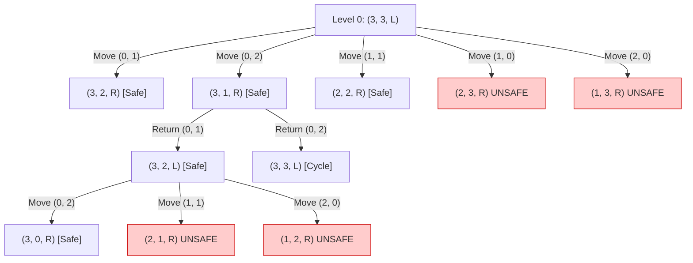
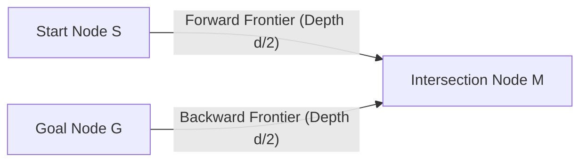
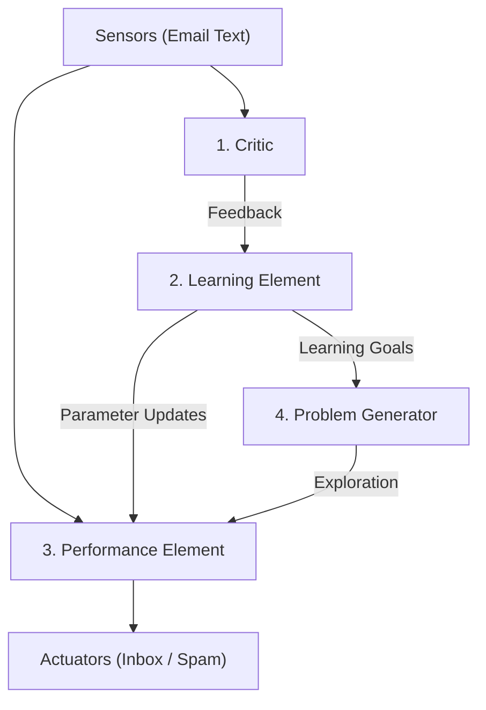
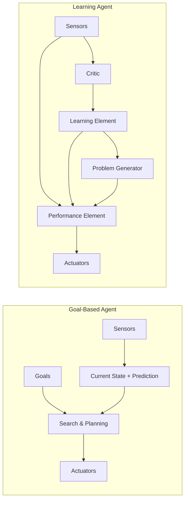

# Unit 3: Question Bank & Model Answers

> **Course -** Fundamentals of AI  
> **Unit -** Unit 3: Introduction to AI, Problem Solving and Search

---

## Question 1: AI Definitions, Turing Test & System Approaches

:::info

**Question Statement**

1. Explain the four approaches to AI: thinking humanly, thinking rationally, acting humanly and acting rationally. Give one definition of AI that fits each.
2. Describe the Turing Test and list the capabilities a machine needs to pass it. How does the Total Turing Test extend it?
3. Place each system in the approach it best fits and justify your choice:
   - A customer-support chatbot
   - An automated theorem prover
   - A self-driving car
   - A cognitive model of human problem solving

:::

---

### Model Answer

#### 1. Four Approaches to AI

AI is defined along two axes: **Human vs. Rational** and **Thought vs. Behavior**.

| Approach | Focus | Core Concept | Standard Definition |
| :--- | :--- | :--- | :--- |
| **Thinking Humanly** | Thought Process | Cognitive modeling | *"The automation of activities that we associate with human thinking, activities such as decision-making, problem solving, learning..."* (Bellman, 1978) |
| **Acting Humanly** | Observable Behavior | Behavioral mimicry | *"The art of creating machines that perform functions that require intelligence when performed by people."* (Kurzweil, 1990) |
| **Thinking Rationally** | Thought Process | Formal logic | *"The study of mental faculties through the use of computational models."* (Charniak & McDermott, 1985) |
| **Acting Rationally** | Observable Behavior | Expected utility | *"Computational Intelligence is the study of the design of intelligent agents."* (Poole et al., 1998) |

---

#### 2. Turing Test & Total Turing Test

*   **Turing Test Setup:** A human interrogator communicates via text terminal with an unseen human and machine. If the interrogator cannot tell machine from human after 5 minutes, the machine passes.
*   **Four Capabilities Needed to Pass:**
    1.  **Natural Language Processing (NLP):** To communicate fluently in natural human language.
    2.  **Knowledge Representation (KR):** To store facts and relationships heard or known.
    3.  **Automated Reasoning:** To answer queries and draw deductions from stored facts.
    4.  **Machine Learning (ML):** To detect patterns and adapt to new situations.
*   **Total Turing Test Extension:** Adds physical interaction with real-world objects.
*   **Two Additional Physical Disciplines:**
    5.  **Computer Vision:** To perceive and inspect objects visually.
    6.  **Robotics:** To manipulate physical objects and navigate real space.

---

#### 3. Classification of AI Systems

| System | Best-Fit Approach | Justification |
| :--- | :--- | :--- |
| **Customer-support chatbot** | **Acting Humanly** | Simulates human dialogue, tone, and empathy in conversational interactions. |
| **Automated theorem prover** | **Thinking Rationally** | Operates strictly via formal mathematical logic to prove theorems deductively. |
| **Self-driving car** | **Acting Rationally** | Operates as an autonomous agent selecting actions that maximize transit safety and efficiency under uncertainty. |
| **Cognitive model of human problem solving** | **Thinking Humanly** | Simulates human psychological processes, working memory limits, and reaction times. |

---

## Question 2: Water Jug Problem (State Space & Production Rules)

:::info

**Question Statement**

You have a 5-litre jug and a 2-litre jug, with no markings on either, and an unlimited water tap. You must get exactly 1 litre in the 5-litre jug.

1. Define the state representation, initial state and goal state.
2. Write the production rules.
3. Find a solution path, naming the rule used at each step.

:::

---

### Model Answer

#### 1. Problem Formulation

*   **State Representation:** $(x, y)$, where:
    *   $x \in \{0, 1, 2, 3, 4, 5\}$: volume of water (L) in the 5L jug ($J_5$).
    *   $y \in \{0, 1, 2\}$: volume of water (L) in the 2L jug ($J_2$).
*   **Initial State:** $s_0 = (0, 0)$
*   **Goal State:** $S_{\text{goal}} = \{(1, y) \mid y \in \{0, 1, 2\}\}$ (target: $x = 1$)

---

#### 2. Production Rules

Let capacities be $C_1 = 5\text{ L}$ and $C_2 = 2\text{ L}$:

| Rule | Action | Precondition | Resulting State $(x, y) \to$ |
| :---: | :--- | :--- | :--- |
| **R1** | Fill $J_5$ | $x < 5$ | $(5, y)$ |
| **R2** | Fill $J_2$ | $y < 2$ | $(x, 2)$ |
| **R3** | Empty $J_5$ | $x > 0$ | $(0, y)$ |
| **R4** | Empty $J_2$ | $y > 0$ | $(x, 0)$ |
| **R5** | Pour $J_2 \to J_5$ (fill $J_5$) | $x + y \ge 5 \land y > 0$ | $(5, y - (5 - x))$ |
| **R6** | Pour $J_5 \to J_2$ (fill $J_2$) | $x + y \ge 2 \land x > 0$ | $(x - (2 - y), 2)$ |
| **R7** | Pour all $J_2 \to J_5$ | $x + y \le 5 \land y > 0$ | $(x + y, 0)$ |
| **R8** | Pour all $J_5 \to J_2$ | $x + y \le 2 \land x > 0$ | $(0, x + y)$ |

---

#### 3. Solution Path

| Step | State $(x, y)$ | Rule Applied | Arithmetic / Action |
| :---: | :---: | :--- | :--- |
| **0** | $(0, 0)$ | **Start** | Both jugs empty. |
| **1** | $(5, 0)$ | **R1** (Fill $J_5$) | Fill 5L jug to capacity. |
| **2** | $(3, 2)$ | **R6** (Pour $J_5 \to J_2$) | Fill 2L jug from 5L jug ($5 - 2 = 3$). |
| **3** | $(3, 0)$ | **R4** (Empty $J_2$) | Discard water from 2L jug. |
| **4** | $(1, 2)$ | **R6** (Pour $J_5 \to J_2$) | Fill 2L jug from 5L jug ($3 - 2 = 1$). **Goal: $x = 1$ achieved.** |
| **5** | $(1, 0)$ | **R4** (Empty $J_2$) | *(Optional)* Empty 2L jug, leaving exactly 1L in $J_5$. |

---

## Question 3: Missionaries and Cannibals Problem

:::info

**Question Statement**

Three missionaries and three cannibals must cross a river in a boat that holds at most two people. Cannibals must never outnumber missionaries on either bank, unless no missionaries are on that bank.

1. Define the state representation, initial state, goal state, actions and path cost.
2. List the legal operators and the condition that makes a state unsafe.
3. Draw the state space for the first four levels, marking unsafe states, and give a complete solution path.
4. Why is breadth-first search a sensible choice for this problem?

:::

---

### Model Answer

#### 1. Problem Formulation

*   **State Representation:** $(M_L, C_L, B)$
    *   $M_L, C_L \in \{0, 1, 2, 3\}$: Missionaries and Cannibals on left bank.
    *   $B \in \{L, R\}$: Current boat position.  
    *(Right bank is implicit: $M_R = 3 - M_L$, $C_R = 3 - C_L$.)*
*   **Initial State:** $s_0 = (3, 3, L)$
*   **Goal State:** $s_{\text{goal}} = (0, 0, R)$
*   **Actions:** Boat carries $(m, c)$ passengers where $1 \le m + c \le 2$:
    $$\{(1, 0), (2, 0), (0, 1), (0, 2), (1, 1)\}$$
*   **Path Cost:** $1$ per river crossing (total crossings).

---

#### 2. Legal Operators & Unsafe Condition

*   **Unsafe Condition:**
    A state is unsafe if cannibals outnumber missionaries on either bank:
    $$\text{Unsafe} \iff (M_L > 0 \land C_L > M_L) \quad \lor \quad (M_R > 0 \land C_R > M_R)$$
    *Safety Invariant:* A state is valid if and only if $M = 0 \lor M = 3 \lor M = C$.
*   **Legal Operators:**
    *   Left to Right ($B = L$): $(M_L - m, C_L - c, R)$
    *   Right to Left ($B = R$): $(M_L + m, C_L + c, L)$
    *   Must satisfy: $0 \le M_L, C_L \le 3$ and preserve the safety invariant.

---

#### 3. State Space Tree (First 4 Levels) & Solution Path

##### State Space Tree (Levels 0 to 3)

##### Complete Optimal Solution (11 Crossings)

| Step | Current State | Action Taken | Next State |
| :---: | :---: | :---: | :---: |
| **0** | $(3, 3, L)$ | **Start** | $(3, 3, L)$ |
| **1** | $(3, 3, L)$ | Send 2 Cannibals $(0, 2)$ | $(3, 1, R)$ |
| **2** | $(3, 1, R)$ | Return 1 Cannibal $(0, 1)$ | $(3, 2, L)$ |
| **3** | $(3, 2, L)$ | Send 2 Cannibals $(0, 2)$ | $(3, 0, R)$ |
| **4** | $(3, 0, R)$ | Return 1 Cannibal $(0, 1)$ | $(3, 1, L)$ |
| **5** | $(3, 1, L)$ | Send 2 Missionaries $(2, 0)$ | $(1, 1, R)$ |
| **6** | $(1, 1, R)$ | Return 1 Missionary + 1 Cannibal $(1, 1)$ | $(2, 2, L)$ |
| **7** | $(2, 2, L)$ | Send 2 Missionaries $(2, 0)$ | $(0, 2, R)$ |
| **8** | $(0, 2, R)$ | Return 1 Cannibal $(0, 1)$ | $(0, 3, L)$ |
| **9** | $(0, 3, L)$ | Send 2 Cannibals $(0, 2)$ | $(0, 1, R)$ |
| **10** | $(0, 1, R)$ | Return 1 Cannibal $(0, 1)$ | $(0, 2, L)$ |
| **11** | $(0, 2, L)$ | Send 2 Cannibals $(0, 2)$ | **$(0, 0, R)$ [Goal]** |

---

#### 4. Why BFS is a Sensible Choice

1.  **Guarantees Shortest Path:** Step costs are uniform ($c = 1$). BFS is mathematically guaranteed to find the minimal number of river crossings ($11$ steps).
2.  **Prevents Infinite Loops:** State space has cycles. DFS can loop indefinitely, whereas BFS explores level-by-level and terminates at the shallowest solution.
3.  **Low Memory Impact:** Total state space has only $32$ configurations ($16$ safe). BFS's exponential space complexity $O(b^d)$ is negligible here.

---

## Question 4: Uniform Cost Search and Bidirectional Search

:::info

**Question Statement**

Consider the undirected graph below, with start $S$ and goal $G$.

**Graph Edge Costs:**

| Edge | Cost |
| :--- | :--- |
| $S - A$ | 1 |
| $S - B$ | 4 |
| $A - B$ | 2 |
| $A - C$ | 5 |
| $B - C$ | 1 |
| $B - G$ | 6 |
| $C - G$ | 3 |

**Sub-questions:**

1. Apply uniform cost search. Show the priority queue after each expansion, and give the path found and its cost.
2. Which path would breadth-first search return, counting edges only? Explain why it differs from the uniform cost answer.
3. Explain bidirectional search, give its time complexity, and state two conditions needed to apply it.

:::

---

### Model Answer

#### 1. Uniform Cost Search (UCS) Trace

Nodes are ordered in the Priority Queue ($PQ$) by cumulative cost $g(n)$.

| Step | Expanded Node | $g(n)$ | Generated Neighbors & Costs | Priority Queue Contents $[Node, g, Path]$ |
| :---: | :---: | :---: | :--- | :--- |
| **0** | — | — | Initial state | $\{ [S, 0, S] \}$ |
| **1** | **$S$** | $0$ | $A: 0+1=1$, $B: 0+4=4$ | $\{ [A, 1, S \to A], [B, 4, S \to B] \}$ |
| **2** | **$A$** | $1$ | $B: 1+2=3$ *(cheaper, update)*, $C: 1+5=6$ | $\{ [B, 3, S \to A \to B], [C, 6, S \to A \to C] \}$ |
| **3** | **$B$** | $3$ | $C: 3+1=4$ *(cheaper, update)*, $G: 3+6=9$ | $\{ [C, 4, S \to A \to B \to C], [G, 9, S \to A \to B \to G] \}$ |
| **4** | **$C$** | $4$ | $G: 4+3=7$ *(cheaper, update)* | $\{ [G, 7, S \to A \to B \to C \to G] \}$ |
| **5** | **$G$** | $7$ | **Goal reached on expansion** | — |

*   **Optimal Path:** $\mathbf{S \to A \to B \to C \to G}$
*   **Optimal Cost:** $\mathbf{7}$

---

#### 2. BFS Comparison

*   **BFS Path:** $\mathbf{S \to B \to G}$ (2 hops).
*   **BFS Cost:** $c(S-B) + c(B-G) = 4 + 6 = \mathbf{10}$.
*   **Why it differs:**
    *   BFS minimizes **edge count** (treats all costs as $1$). It selects $S \to B \to G$ because it has only 2 edges.
    *   UCS minimizes **cumulative cost** ($\sum c$). It selects $S \to A \to B \to C \to G$ because its total cost is lower ($7 < 10$).

---

#### 3. Bidirectional Search

*   **Concept:** Runs two concurrent searches: forward from start $S$ and backward from goal $G$, stopping when their frontiers meet.
*   **Time Complexity:** $\mathbf{O(b^{d/2})}$ (compared to $O(b^d)$ for BFS, providing an exponential speedup).
*   **Two Conditions Needed:**
    1.  **Reversible Operators:** A predecessor function $\text{PREDECESSORS}(s)$ must exist to generate parent nodes backwards from $G$.
    2.  **Explicit Goal State:** The goal state must be known explicitly (not an abstract property like "checkmate").

---

## Question 5: Smart City AI Systems (Agent Architectures)

:::info

**Question Statement**

A smart city is deploying the five AI systems below:

**System Descriptions:**

| System ID | Description |
| :--- | :--- |
| **S1** | A street light that switches on when its light sensor reads "dark" and off when it reads "bright". |
| **S2** | A robot vacuum that keeps an internal map of which rooms it has already cleaned, because it cannot see the whole house at once. |
| **S3** | A GPS navigator that plans a route to the destination the user types in. |
| **S4** | A ride-hailing app that picks a route weighing travel time, fuel cost and passenger comfort. |
| **S5** | A spam filter that improves its accuracy each time a user marks a mail as "spam" or "not spam". |

**Sub-questions:**

1. Identify the agent type of each system (S1-S5) and justify each answer in one line.
2. Draw the schematic diagram of a learning agent. Label its four components and explain the role of each, using S5 as the example.
3. S1 works well, but S2 could not be built as a simple reflex agent. Explain why, using the idea of a partially observable environment.

:::

---

### Model Answer

#### 1. System Classification

| System | Agent Type | One-Line Justification |
| :---: | :--- | :--- |
| **S1** | **Simple Reflex Agent** | Maps current sensor input directly to action (`dark` $\to$ ON) without history. |
| **S2** | **Model-Based Reflex Agent** | Keeps an internal map to track unobservable state in a partially observable world. |
| **S3** | **Goal-Based Agent** | Performs path planning to achieve a specified goal destination. |
| **S4** | **Utility-Based Agent** | Evaluates tradeoffs between conflicting goals (time, fuel, comfort) using a utility function. |
| **S5** | **Learning Agent** | Dynamically adapts classification parameters based on user feedback to improve accuracy. |

---

#### 2. Learning Agent Diagram & 4 Components (Applied to S5)

1.  **Critic:** Compares the filter's prediction against user labels ("spam" / "not spam") and generates an error signal.
2.  **Learning Element:** Updates word probabilities and classification weights based on feedback from the critic.
3.  **Performance Element:** The active classifier that scores incoming emails and routes them to Inbox or Spam.
4.  **Problem Generator:** Identifies ambiguous emails near the decision boundary to request user verification.

---

#### 3. Reflex Agent Viability: S1 vs. S2

*   **S1 is Fully Observable:** The current light sensor reading contains all necessary information to decide action ($P \to A$).
*   **S2 is Partially Observable:** The vacuum only senses its current room, not the status of other rooms. A simple reflex vacuum cannot tell if a clean-looking room was cleaned recently or needs cleaning, causing infinite loops and incomplete coverage. S2 **requires an internal state (map)** to function correctly.

---

## Question 6: Autonomous Hospital Transport Robot (PEAS & Environment)

:::info

**Question Statement**

A large hospital plans an autonomous robot that carries medicines, lab samples and meals between wards. It moves through busy corridors full of patients, staff and wheelchairs, and it uses lifts to change floors. The pharmacy can add urgent orders at any time while the robot is on its way.

1. Draw the schematic of a goal-based agent and a learning agent. State one situation in this robot's job where each is the better choice.
2. Specify the PEAS description of the robot.
3. Classify its task environment on these dimensions, with a one-line justification for each:
   - Observable
   - Deterministic
   - Episodic
   - Static
   - Discrete
   - Single / Multi-agent

:::

---

### Model Answer

#### 1. Schematics & Situational Choice

##### Schematics

##### Situational Choices

*   **Goal-Based is Better:** When the pharmacy injects an **urgent stat order** mid-journey, the agent updates its goal set and replans a new route using $A^*$.
*   **Learning Agent is Better:** For **predicting corridor congestion and elevator delays** across the day (e.g., shift changes at 2 PM), learning traffic trends from experience to pick faster routes.

---

#### 2. PEAS Specification

| Component | Robot Specification |
| :--- | :--- |
| **P - Performance** | On-time delivery rate, zero collisions, safe transport of fragile samples, battery efficiency. |
| **E - Environment** | Corridors, wards, pharmacy, elevators, patients, doctors, wheelchairs, moving beds. |
| **A - Actuators** | Motorized drive wheels, steering motors, compartment locks, touchscreen, speaker, lift call transmitter. |
| **S - Sensors** | 2D/3D LiDAR, RGB-D depth cameras, ultrasonic bumpers, wheel odometry, RFID/Wi-Fi receiver. |

---

#### 3. Task Environment Classification

| Dimension | Classification | One-Line Justification |
| :--- | :---: | :--- |
| **Observable** | **Partially Observable** | Sensors cannot see around blind corners, through closed doors, or across different floors. |
| **Deterministic** | **Stochastic** | Human pedestrian movements and elevator wait times introduce random, unpredictable outcomes. |
| **Episodic** | **Sequential** | Current routing actions directly determine future positions, delivery deadlines, and battery level. |
| **Static** | **Dynamic** | Pedestrians move and urgent orders arrive while the robot deliberates. |
| **Discrete** | **Continuous** | Spatial coordinates, velocity, steering angles, and time vary continuously. |
| **Single / Multi-agent** | **Multi-Agent** | Operates among active humans and other motorized hospital equipment. |
