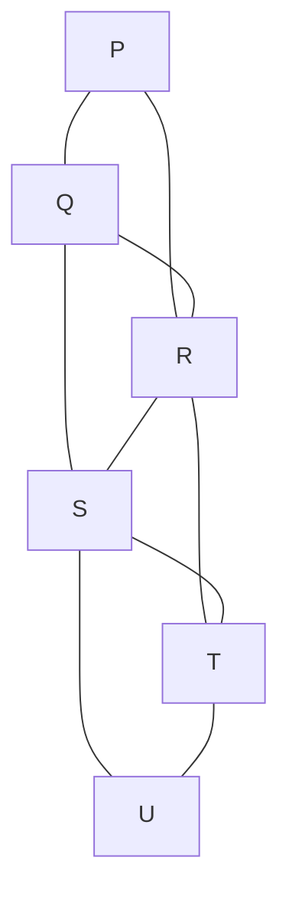
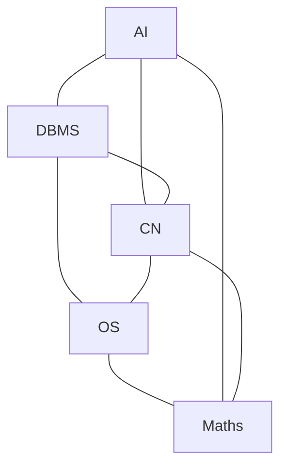
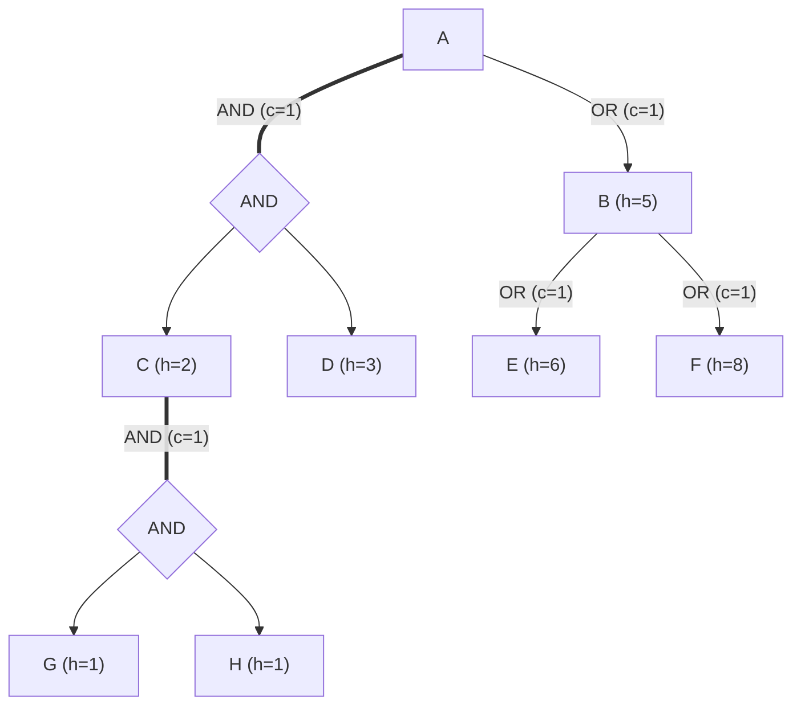

# Unit 4: Question Bank & Model Answers

> **Course -** Fundamentals of AI  
> **Unit -** Unit 4: Informed Search, Adversarial Search and Constraint Satisfaction Problems

---

## Question 1: Travelling Salesman Problem (Search Formulation & Heuristics)

:::info

**Question Statement**

A salesman starts at city $A$, visits $B$, $C$, and $D$ once each, and returns to $A$. The distances are:
- $AB = 2$
- $AC = 3$
- $AD = 9$
- $BC = 4$
- $BD = 7$
- $CD = 5$

**Sub-questions:**

1. Formulate TSP as a search problem: states, initial state, actions, goal test and path cost.
2. List every distinct tour and find the optimal one.
3. Apply the nearest-neighbour heuristic from $A$. Is its tour optimal?
4. The number of distinct tours is $(n - 1)! / 2$. Calculate it for $10$ and $20$ cities and explain why exhaustive search is impractical.

:::

---

### Model Answer

#### 1. Problem Formulation

*   **States:** Sequence of visited cities ending at the current city: $([c_1, c_2, \dots, c_k], c_k)$.
*   **Initial State:** $([A], A)$
*   **Actions:** Visit any remaining unvisited city: $\text{ACTIONS}(s) = \{c \in \{B, C, D\} \setminus \text{visited}(s)\}$. If all cities are visited, the only action is returning to $A$.
*   **Goal Test:** All cities $\{A, B, C, D\}$ are visited exactly once and the tour has returned to $A$ (tour length $= 5$ cities).
*   **Path Cost:** Sum of Euclidean/edge distances along the tour:
    $$\sum_{i=1}^{n} \text{dist}(c_i, c_{i+1}) \quad \text{where } c_{n+1} = c_1 = A$$

---

#### 2. Distinct Tours & Optimal Tour

For $n = 4$ cities, the number of distinct undirected tours is $\frac{(4-1)!}{2} = \frac{3!}{2} = 3$:

| Tour # | Tour Sequence | Edge Cost Calculation | Total Cost |
| :---: | :--- | :--- | :---: |
| **1** | $A - B - C - D - A$ | $AB + BC + CD + DA = 2 + 4 + 5 + 9$ | $20$ |
| **2** | $A - B - D - C - A$ | $AB + BD + DC + CA = 2 + 7 + 5 + 3$ | $\mathbf{17}$ |
| **3** | $A - C - B - D - A$ | $AC + CB + BD + DA = 3 + 4 + 7 + 9$ | $23$ |

*   **Optimal Tour:** $\mathbf{A \to B \to D \to C \to A}$ (or reverse) with **Cost = 17**.

---

#### 3. Nearest-Neighbour (NN) Heuristic from $A$

*   **Step 1:** From $A$, unvisited are $\{B (2), C (3), D (9)\}$. Choose nearest: $\mathbf{B}$ (cost $2$).
*   **Step 2:** From $B$, unvisited are $\{C (4), D (7)\}$. Choose nearest: $\mathbf{C}$ (cost $4$).
*   **Step 3:** From $C$, unvisited is $\{D (5)\}$. Choose remaining: $\mathbf{D}$ (cost $5$).
*   **Step 4:** From $D$, return to start city: $\mathbf{A}$ (cost $9$).
*   **NN Tour Generated:** $A \to B \to C \to D \to A$, Cost $= 2 + 4 + 5 + 9 = \mathbf{20}$.
*   **Is it optimal?** **NO.** The optimal tour is $17$. NN's greedy local decision early ($B \to C$) forces the expensive return edge $D \to A = 9$.

---

#### 4. Combinatorial Explosion ($n = 10, 20$)

*   **For $n = 10$ cities:**
    $$\frac{(10 - 1)!}{2} = \frac{9!}{2} = \frac{362,880}{2} = \mathbf{181,440} \text{ tours}$$
*   **For $n = 20$ cities:**
    $$\frac{(20 - 1)!}{2} = \frac{19!}{2} = \frac{1.216 \times 10^{17}}{2} \approx \mathbf{6.08 \times 10^{16}} \text{ tours}$$
*   **Why exhaustive search is impractical:**  
    TSP is NP-hard with $O(n!)$ factorial complexity. At 1 billion ($10^9$) tour evaluations per second, checking all tours for $n=20$ takes:
    $$\frac{6.08 \times 10^{16}}{10^9 \text{ sec}} \approx 6.08 \times 10^7 \text{ seconds} \approx \mathbf{1.93 \text{ years}}$$

---

## Question 2: Graph Colouring with Forward Checking and MRV

:::info

**Question Statement**

Six districts $P, Q, R, S, T, U$ must be coloured Red, Green or Blue so that neighbours differ. The adjacent pairs are:
- $P - Q$
- $P - R$
- $Q - R$
- $Q - S$
- $R - S$
- $R - T$
- $S - T$
- $S - U$
- $T - U$

**Sub-questions:**

1. State the CSP's three components and draw the constraint graph.
2. Solve it with backtracking plus forward checking, using the alphabetical variable order and the value order Red, Green, Blue. Show the domain table after every assignment.
3. Which variable would the degree heuristic pick first, and why? Show how MRV then guides the remaining choices.

:::

---

### Model Answer

#### 1. CSP Components & Constraint Graph

*   **Variables ($X$):** $\{P, Q, R, S, T, U\}$
*   **Domains ($D$):** $D_i = \{\text{Red (R)}, \text{Green (G)}, \text{Blue (B)}\}$ for all variables.
*   **Constraints ($C$):** $c(u) \neq c(v)$ for all adjacent pairs $(u, v) \in E$.



---

#### 2. Backtracking with Forward Checking Trace

*Variable order: $P, Q, R, S, T, U$ | Value order: $R, G, B$*

| Step | Assignment | $D(P)$ | $D(Q)$ | $D(R)$ | $D(S)$ | $D(T)$ | $D(U)$ | Forward Checking Action |
| :---: | :---: | :---: | :---: | :---: | :---: | :---: | :---: | :--- |
| **0** | Initial | $\{R, G, B\}$ | $\{R, G, B\}$ | $\{R, G, B\}$ | $\{R, G, B\}$ | $\{R, G, B\}$ | $\{R, G, B\}$ | All domains full. |
| **1** | **$P = R$** | **$\{R\}$** | $\{G, B\}$ | $\{G, B\}$ | $\{R, G, B\}$ | $\{R, G, B\}$ | $\{R, G, B\}$ | Remove $R$ from neighbors $Q, R$. |
| **2** | **$Q = G$** | **$\{R\}$** | **$\{G\}$** | $\{B\}$ | $\{R, B\}$ | $\{R, G, B\}$ | $\{R, G, B\}$ | Remove $G$ from neighbors $R, S$. |
| **3** | **$R = B$** | **$\{R\}$** | **$\{G\}$** | **$\{B\}$** | $\{R\}$ | $\{R, G\}$ | $\{R, G, B\}$ | Remove $B$ from neighbors $S, T$. |
| **4** | **$S = R$** | **$\{R\}$** | **$\{G\}$** | **$\{B\}$** | **$\{R\}$** | $\{G\}$ | $\{G, B\}$ | Remove $R$ from neighbors $T, U$. |
| **5** | **$T = G$** | **$\{R\}$** | **$\{G\}$** | **$\{B\}$** | **$\{R\}$** | **$\{G\}$** | $\{B\}$ | Remove $G$ from neighbor $U$. |
| **6** | **$U = B$** | **$\{R\}$** | **$\{G\}$** | **$\{B\}$** | **$\{R\}$** | **$\{G\}$** | **$\{B\}$** | Assign remaining forced value. |

*   **Final Valid Coloring:**  
    $$\mathbf{P = \text{Red}, \quad Q = \text{Green}, \quad R = \text{Blue}, \quad S = \text{Red}, \quad T = \text{Green}, \quad U = \text{Blue}}$$

---

#### 3. Degree Heuristic & MRV Guidance

*   **Degree Heuristic First Pick:**
    *   Degrees: $P(2), Q(3), R(4), S(4), T(3), U(2)$.
    *   $R$ and $S$ tie with degree 4 (most constraining on remaining unassigned variables).
    *   Alphabetical tie-breaker selects **$R$** first.
    *   *Why:* Picking the highest-degree variable constrains the maximum number of neighbors early, reducing future branching factor.
*   **MRV Guidance for Remaining Choices:**
    *   Once $R$ is assigned a color (e.g., $R = \text{Red}$), forward checking reduces the domains of $P, Q, S, T$ to 2 values ($\{G, B\}$).
    *   Minimum Remaining Values (MRV) selects the variable with the fewest legal values (e.g., picking $S$ or $Q$).
    *   As soon as any variable domain shrinks to a singleton ($1$ value left), MRV immediately selects it next (**fail-first principle**), eliminating search branching.

---

## Question 3: Cryptarithmetic as a CSP

:::info

**Question Statement**

```text
  T O
+ G O
-----
O U T
```

$$
\begin{array}{ccc}
  & \text{T} & \text{O} \\
+ & \text{G} & \text{O} \\
\hline
\text{O} & \text{U} & \text{T}
\end{array}
$$

1. Write the variables (including carries), domains, the all-different constraint and the column constraints.
2. Solve the puzzle step by step. Justify the value of each letter from the constraints.
3. Verify the answer.

:::

---

### Model Answer

#### 1. CSP Formalization

*   **Variables:** Letters $V = \{T, O, G, U\}$; Carries $C = \{C_1, C_2\}$ (where $C_1$ is units carry, $C_2$ is tens carry).
*   **Domains:**
    *   $D(O), D(T), D(G) \in \{1, 2, \dots, 9\}$ (leading digits cannot be 0).
    *   $D(U) \in \{0, 1, 2, \dots, 9\}$
    *   $D(C_1), D(C_2) \in \{0, 1\}$
*   **Global Constraint:** $\text{Alldiff}(T, O, G, U)$
*   **Column Constraints:**
    1.  **Units:** $O + O = T + 10 \cdot C_1$
    2.  **Tens:** $T + G + C_1 = U + 10 \cdot C_2$
    3.  **Hundreds:** $C_2 = O$

---

#### 2. Step-by-Step Deduction

1.  **Hundreds Column $\to O$ and $C_2$:**
    *   The sum of two 2-digit numbers is at most $99 + 99 = 198 \implies C_2 \le 1$.
    *   Since $O$ is a leading digit, $O \neq 0 \implies \mathbf{C_2 = 1}$ and $\mathbf{O = 1}$.
2.  **Units Column $\to T$ and $C_1$:**
    *   Substitute $O = 1$: $1 + 1 = T + 10 \cdot C_1 \implies 2 = T + 10 \cdot C_1$.
    *   Since $2 < 10$, carry $\mathbf{C_1 = 0}$ and $\mathbf{T = 2}$.
3.  **Tens Column $\to G$ and $U$:**
    *   Substitute $T = 2, C_1 = 0, C_2 = 1$:
        $$2 + G + 0 = U + 10 \implies G - U = 8$$
    *   Possible single-digit pairs $(G, U)$ where $G \le 9$:
        *   Case 1: $(9, 1) \implies$ invalid because $O = 1$ (violates $\text{Alldiff}$).
        *   Case 2: $(8, 0) \implies$ valid because $8$ and $0$ are distinct from $O=1, T=2$.
    *   Therefore: $\mathbf{G = 8}$ and $\mathbf{U = 0}$.

---

#### 3. Verification

*   **Assigned Digits:** $T = 2, O = 1, G = 8, U = 0$
*   **Alldiff Check:** $\{2, 1, 8, 0\}$ are all distinct $\checkmark$
*   **Leading Digit Check:** $T \neq 0, G \neq 0, O \neq 0 \checkmark$
*   **Arithmetic Check:**
    $$21 + 81 = 102 \quad (\text{TO} + \text{GO} = \text{OUT}) \quad \checkmark$$

---

## Question 4: Exam Scheduling as a CSP

:::info

**Question Statement**

Five exams (AI, DBMS, CN, OS, Maths) must be placed in three slots $\{\text{Mon}, \text{Tue}, \text{Wed}\}$. Two exams cannot share a slot if any student takes both. The pairs that share students are:
- $\text{AI} - \text{DBMS}$
- $\text{AI} - \text{CN}$
- $\text{DBMS} - \text{CN}$
- $\text{CN} - \text{OS}$
- $\text{DBMS} - \text{OS}$
- $\text{OS} - \text{Maths}$
- $\text{AI} - \text{Maths}$
- $\text{CN} - \text{Maths}$

The Maths examiner is unavailable on Tuesday. The department would also prefer AI not to be on Monday.

**Sub-questions:**

1. Formulate this as a CSP and draw the constraint graph. Classify each constraint as unary or binary, and as hard or soft.
2. Solve it with plain backtracking, using the variable order AI, DBMS, CN, OS, Maths and the value order Mon, Tue, Wed. Show the search tree, including every dead end and backtrack.
3. Does your solution satisfy the soft constraint? If not, give a schedule that meets all hard constraints and the soft one.

:::

---

### Model Answer

#### 1. CSP Formulation & Constraint Classification

*   **Variables:** $X = \{\text{AI}, \text{DBMS}, \text{CN}, \text{OS}, \text{Maths}\}$
*   **Domains:** $D_i = \{\text{Mon}, \text{Tue}, \text{Wed}\}$ for all variables.
*   **Constraint Classification:**
    *   **Unary Hard Constraint:** $\text{Maths} \neq \text{Tue}$ (examiner unavailable).
    *   **Unary Soft Constraint:** $\text{AI} \neq \text{Mon}$ (department preference).
    *   **Binary Hard Constraints:** Mutual exclusion between shared-student pairs:
        $$\text{AI} \neq \text{DBMS}, \; \text{AI} \neq \text{CN}, \; \text{DBMS} \neq \text{CN}, \; \text{CN} \neq \text{OS}, \; \text{DBMS} \neq \text{OS}, \; \text{OS} \neq \text{Maths}, \; \text{AI} \neq \text{Maths}, \; \text{CN} \neq \text{Maths}$$



---

#### 2. Plain Backtracking Search Trace

*Order: AI, DBMS, CN, OS, Maths | Values: Mon, Tue, Wed*

1.  **AI = Mon**
2.  **DBMS:** Mon conflicts with AI $\to$ **DBMS = Tue**
3.  **CN:** Mon conflicts with AI, Tue conflicts with DBMS $\to$ **CN = Wed**
4.  **OS:** Mon has no conflicts with DBMS(Tue) or CN(Wed) $\to$ **OS = Mon**
5.  **Maths:**
    *   Mon conflicts with OS(Mon) & AI(Mon) $\to$ Dead end.
    *   Tue violates unary hard constraint ($\text{Maths} \neq \text{Tue}$) $\to$ Dead end.
    *   Wed conflicts with CN(Wed) $\to$ Dead end.
    *   *Backtrack from Maths!*
6.  **OS:** Try Tue (conflicts with DBMS) $\to$ Try Wed (conflicts with CN) $\to$ *Backtrack OS!*
7.  **CN:** No more values $\to$ *Backtrack CN!*
8.  **DBMS:** Try Wed $\to$ CN(Tue) $\to$ OS(Mon) $\to$ Maths has no valid slot $\to$ *Backtrack DBMS!*
9.  **AI:** Backtrack to AI $\to$ **AI = Tue**
10. **DBMS = Mon** (valid)
11. **CN = Wed** (valid: Mon conflicts with DBMS, Tue conflicts with AI)
12. **OS = Tue** (valid: Mon conflicts with DBMS, Wed conflicts with CN; AI-OS has no conflict)
13. **Maths = Mon** (valid: Tue unavailable; Wed conflicts with CN; OS is Tue, AI is Tue, CN is Wed $\implies$ no conflict with Mon!)

*   **Search Tree Result:**
    $$\mathbf{\text{AI} = \text{Tue}, \quad \text{DBMS} = \text{Mon}, \quad \text{CN} = \text{Wed}, \quad \text{OS} = \text{Tue}, \quad \text{Maths} = \text{Mon}}$$

---

#### 3. Soft Constraint Evaluation

*   **Does the solution satisfy the soft constraint?**  
    **YES.** The solution assigns $\text{AI} = \text{Tue}$, which perfectly satisfies the soft preference ($\text{AI} \neq \text{Mon}$).
*   **Final Schedule by Slot:**
    *   **Monday:** DBMS, Maths
    *   **Tuesday:** AI, OS
    *   **Wednesday:** CN

---

## Question 5: Minimax and Alpha-Beta Pruning on a Three-Ply Tree

:::info

**Question Statement**

$A$ is the MAX root with MIN children $B, C, D$. Each MIN node has two MAX children, and each MAX child has two leaves. Leaf values, left to right, are:

| MIN Node | First MAX Child Leaves | Second MAX Child Leaves |
| :--- | :--- | :--- |
| **B** | 8, 7 | 9, 3 |
| **C** | 2, 4 | 9, 8 |
| **D** | 1, 6 | 8, 9 |

**Sub-questions:**

1. Draw the tree and compute the minimax value of every node. Which move does MAX choose at $A$?
2. Apply alpha-beta pruning left to right, showing $\alpha$ and $\beta$ at every node. List the pruned leaves, and state how many of the 12 leaves are evaluated.
3. Does alpha-beta ever change the value at the root? Justify.

:::

---

### Model Answer

#### 1. Minimax Values & Optimal Move

*   **Level 3 (MAX Children):**
    *   $B_1 = \max(8, 7) = \mathbf{8}, \quad B_2 = \max(9, 3) = \mathbf{9}$
    *   $C_1 = \max(2, 4) = \mathbf{4}, \quad C_2 = \max(9, 8) = \mathbf{9}$
    *   $D_1 = \max(1, 6) = \mathbf{6}, \quad D_2 = \max(8, 9) = \mathbf{9}$
*   **Level 2 (MIN Children):**
    *   $B = \min(B_1, B_2) = \min(8, 9) = \mathbf{8}$
    *   $C = \min(C_1, C_2) = \min(4, 9) = \mathbf{4}$
    *   $D = \min(D_1, D_2) = \min(6, 9) = \mathbf{6}$
*   **Level 1 (MAX Root $A$):**
    *   $A = \max(B, C, D) = \max(8, 4, 6) = \mathbf{8}$
*   **Move Chosen by MAX at $A$:** **Move to $B$** (yields the maximum guaranteed payoff of 8).

---

#### 2. Alpha-Beta Pruning Trace (Left to Right)

*Initial root bounds: $\alpha = -\infty, \beta = +\infty$*

1.  **Subtree under $B$:**
    *   $B_1$: Evaluates $8 \implies \alpha = 8$. Evaluates $7 \implies B_1 = 8$.
    *   At MIN node $B$: $\beta = \min(+\infty, 8) = 8$. Bounds: $[\alpha = -\infty, \beta = 8]$.
    *   $B_2$: Evaluates leaf $9 \implies \alpha = \max(-\infty, 9) = 9$.
    *   **Pruning condition:** $\alpha \ge \beta$ ($9 \ge 8$). **Leaf 3 is PRUNED.**
    *   $B$ returns $8$. Root $A$ updates $\alpha = \max(-\infty, 8) = \mathbf{8}$.
2.  **Subtree under $C$ (bounds $[\alpha = 8, \beta = +\infty]$):**
    *   $C_1$: Evaluates $2, 4 \implies C_1 = 4$.
    *   At MIN node $C$: $\beta = \min(+\infty, 4) = 4$.
    *   **Pruning condition:** $\alpha \ge \beta$ ($8 \ge 4$).  
        **Subtree $C_2$ (Leaves 9 and 8) is PRUNED.**
3.  **Subtree under $D$ (bounds $[\alpha = 8, \beta = +\infty]$):**
    *   $D_1$: Evaluates $1, 6 \implies D_1 = 6$.
    *   At MIN node $D$: $\beta = \min(+\infty, 6) = 6$.
    *   **Pruning condition:** $\alpha \ge \beta$ ($8 \ge 6$).  
        **Subtree $D_2$ (Leaves 8 and 9) is PRUNED.**

*   **Pruned Leaves (5 leaves):** $3$ (under $B_2$), $9, 8$ (under $C_2$), and $8, 9$ (under $D_2$).
*   **Evaluated Leaves (7 leaves):** $\{8, 7, 9, 2, 4, 1, 6\}$ (7 out of 12 evaluated).

---

#### 3. Root Invariance Proof

*   **Does Alpha-Beta ever alter the root value?** **NO.**
*   **Justification:** Alpha-Beta is mathematically exact. A branch is pruned only when $\alpha \ge \beta$, proving that the branch contains a value strictly worse than an already examined alternative for one of the players. Pruned branches can never influence the minimax decision at the root.

---

## Question 6: AND-OR Graph and AO* Algorithm

:::info

**Question Statement**

Consider the AND-OR graph below. Every arc costs $1$. In an AND arc, all the connected children must be solved.

| Node | Successors | Heuristic $h$ of Successors |
| :--- | :--- | :--- |
| **A (start)** | OR arc to $B$; AND arc to $(C, D)$ | $h(B) = 5$, $h(C) = 2$, $h(D) = 3$ |
| **B** | OR arc to $E$; OR arc to $F$ | $h(E) = 6$, $h(F) = 8$ |
| **C** | AND arc to $(G, H)$ | $h(G) = 1$, $h(H) = 1$ |

**Sub-questions:**

1. Draw the AND-OR graph.
2. Trace AO* for three expansions ($A$, then the best node, then the next best). After each expansion, show the revised costs propagated back to $A$ and mark the current best partial solution graph.
3. Why can't A* be applied directly to this problem? State the main difference in how AO* handles it.

:::

---

### Model Answer

#### 1. AND-OR Graph Representation



---

#### 2. AO* Three-Expansion Trace

*Cost formulas: $f(\text{OR}) = c + h(n)$; $f(\text{AND}) = c + \sum h(n_i)$, with $c = 1$.*

##### Expansion 1: Expand Node $A$
*   Branch 1 (OR to $B$): $f(B) = 1 + h(B) = 1 + 5 = 6$
*   Branch 2 (AND to $(C, D)$): $f(C, D) = 1 + h(C) + h(D) = 1 + 2 + 3 = 6$
*   Tie-breaker: Select AND branch $(C, D)$.
*   **Cost at $A$:** $h(A) = 6$.
*   **Best Partial Solution Graph:** $A \to (C, D)$.

##### Expansion 2: Expand Node $C$
*   $C$ has AND arc to $(G, H)$:
    $$f(G, H) = 1 + h(G) + h(H) = 1 + 1 + 1 = 3 \implies h(C) = 3$$
*   **Backpropagate to $A$:**
    *   Cost of branch $(C, D) = 1 + h(C) + h(D) = 1 + 3 + 3 = \mathbf{7}$
    *   Cost of branch $B = 1 + h(B) = 1 + 5 = \mathbf{6}$
*   **Best branch switches to OR to $B$** ($6 < 7$).
*   **Cost at $A$:** $h(A) = 6$.
*   **Best Partial Solution Graph:** $A \to B$.

##### Expansion 3: Expand Node $B$
*   Branch to $E$: $f(E) = 1 + h(E) = 1 + 6 = 7$
*   Branch to $F$: $f(F) = 1 + h(F) = 1 + 8 = 9$
*   Best choice at $B$ is $E \implies h(B) = 7$.
*   **Backpropagate to $A$:**
    *   Cost of branch $B = 1 + h(B) = 1 + 7 = \mathbf{8}$
    *   Cost of branch $(C, D) = 1 + h(C) + h(D) = 1 + 3 + 3 = \mathbf{7}$
*   **Best branch switches back to $(C, D)$** ($7 < 8$).
*   **Cost at $A$:** $h(A) = 7$.
*   **Best Partial Solution Graph:** $A \to (C, D)$ with $C \to (G, H)$.

---

#### 3. Why $A^*$ Fails & Key Difference in AO*

*   **Why $A^*$ cannot be applied:** $A^*$ assumes every action leads to a single successor and outputs a **single linear path**. In an AND-OR graph, AND branches represent problem decomposition where **all subproblems must be solved**, requiring a **solution tree**, not a path.
*   **Main Difference in AO\*:** AO\* operates directly on partial solution trees. Whenever node costs are updated, AO\* propagates revised estimates up to the root, dynamically switching connectors and re-routing the optimal partial tree.

---

## Question 7: Delivery Robot Navigation (Greedy Best-First & A* Search)

:::info

**Question Statement**

A delivery robot must travel from start $S$ to goal $G$. Edge costs and heuristic values $h(n)$ are given below:

**Edge Costs:**

| Edge | Cost |
| :--- | :--- |
| $S - A$ | 2 |
| $S - B$ | 6 |
| $A - C$ | 2 |
| $A - D$ | 4 |
| $B - G$ | 6 |
| $C - G$ | 3 |
| $D - G$ | 2 |

**Heuristic Values $h(n)$:**

| Node | $S$ | $A$ | $B$ | $C$ | $D$ | $G$ |
| :--- | :---: | :---: | :---: | :---: | :---: | :---: |
| **$h(n)$** | 6 | 5 | 2 | 3 | 2 | 0 |

**Sub-questions:**

1. Trace Greedy best-first search from $S$. Give the path found and its cost.
2. Trace A* search, showing $g(n)$, $h(n)$ and $f(n)$ for every node placed on the open list. Give the path found and its cost.
3. Suppose $h(C)$ is changed from $3$ to $6$. Is $h$ still admissible? Re-run A* and explain how the path and its cost change.

:::

---

### Model Answer

#### 1. Greedy Best-First Search Trace

*Orders nodes strictly by $h(n)$:*

| Step | Pop Node | $h(n)$ | Generated Neighbors & $h$ | Open List $[Node, h]$ |
| :---: | :---: | :---: | :--- | :--- |
| **0** | — | — | Start | $\{ [S, 6] \}$ |
| **1** | **$S$** | $6$ | $A (h=5), B (h=2)$ | $\{ [B, 2], [A, 5] \}$ |
| **2** | **$B$** | $2$ | $G (h=0)$ | $\{ [G, 0], [A, 5] \}$ |
| **3** | **$G$** | $0$ | **Goal reached** | — |

*   **Greedy Path:** $\mathbf{S \to B \to G}$
*   **Path Cost:** $c(S-B) + c(B-G) = 6 + 6 = \mathbf{12}$

---

#### 2. A* Search Trace ($f(n) = g(n) + h(n)$)

| Step | Pop Node | $g$ | $h$ | $f$ | Generated Neighbors | Open List $[Node, g, h, f, Path]$ |
| :---: | :---: | :---: | :---: | :---: | :--- | :--- |
| **0** | — | — | — | — | Start | $\{ [S, 0, 6, 6, S] \}$ |
| **1** | **$S$** | $0$ | $6$ | $6$ | $A: g=2, f=2+5=7$<br/>$B: g=6, f=6+2=8$ | $\{ [A, 2, 5, 7, S \to A], [B, 6, 2, 8, S \to B] \}$ |
| **2** | **$A$** | $2$ | $5$ | $7$ | $C: g=4, f=4+3=7$<br/>$D: g=6, f=6+2=8$ | $\{ [C, 4, 3, 7, S \to A \to C], [B, 6, 2, 8], [D, 6, 2, 8] \}$ |
| **3** | **$C$** | $4$ | $3$ | $7$ | $G: g=7, f=7+0=7$ | $\{ [G, 7, 0, 7, S \to A \to C \to G], [B, 8], [D, 8] \}$ |
| **4** | **$G$** | $7$ | $0$ | $7$ | **Goal popped on expansion** | — |

*   **Optimal Path:** $\mathbf{S \to A \to C \to G}$
*   **Optimal Cost:** $2 + 2 + 3 = \mathbf{7}$

---

#### 3. Heuristic Modification ($h(C) = 6$)

*   **Admissibility Check:**
    *   True remaining shortest cost: $h^*(C) = c(C-G) = 3$.
    *   Condition: $h(n) \le h^*(n)$.
    *   Since $h(C) = 6 > h^*(C) = 3$, **$h$ is NO LONGER ADMISSIBLE** (it overestimates).
*   **Re-running A\* with $h(C) = 6$:**
    *   At Step 2, $C$ has $f(C) = g(C) + h(C) = 4 + 6 = \mathbf{10}$.
    *   Open list becomes: $\{ [B, f=8], [D, f=8], [C, f=10] \}$.
    *   $B$ and $D$ are expanded before $C$.
    *   $D$ reaches $G$ with cost $g(G) = 6 + 2 = 8, f = 8$.
    *   Goal $G$ is popped via $D$ with $f = 8$ (before $C$ with $f = 10$ is ever expanded).
*   **New Path Found:** $\mathbf{S \to A \to D \to G}$ with **Cost = 8**.
*   **Impact:** Overestimating $h(C)$ misleads $A^*$ into abandoning the optimal path (cost $7$) in favor of a suboptimal path (cost $8$).

---

## Question 8: Iterative Deepening Search (IDS) and Game Search

:::info

**Question Statement**

Consider the search tree below. $A$ is the start node and $K$ is the goal. Children are generated left to right in alphabetical order:

| Node | Children |
| :--- | :--- |
| **A** | $B, C$ |
| **B** | $D, E$ |
| **C** | $F, G$ |
| **D** | $H, I$ |
| **E** | $J$ |
| **F** | $K \text{ (goal)}$ |
| **G** | $L$ |

**Sub-questions:**

1. Apply Iterative Deepening Search (IDS). For each depth limit, starting at $0$, list the nodes in the order they are visited, until $K$ is found.
2. For branching factor $b = 10$ and goal depth $d = 5$, calculate the number of nodes IDS generates and the number BFS generates. Show that the overhead of repeated work is small.
3. A chess program must make each move within 10 seconds. Explain why it uses iterative deepening instead of a fixed-depth search, and how the best move from one iteration helps alpha-beta pruning in the next.

:::

---

### Model Answer

#### 1. IDS Node Visit Trace

*   **Depth Limit 0:** $A$
*   **Depth Limit 1:** $A, B, C$
*   **Depth Limit 2:** $A, B, D, E, C, F, G$
*   **Depth Limit 3:** $A, B, D, H, I, E, J, C, F, K$ **[Goal Found]**

---

#### 2. Node Generation Comparison ($b = 10, d = 5$)

*   **Breadth-First Search (BFS):**
    $$N_{\text{BFS}} = 1 + b + b^2 + \dots + b^d = \sum_{i=0}^{5} 10^i = \mathbf{111,111} \text{ nodes}$$
*   **Iterative Deepening Search (IDS):**
    $$N_{\text{IDS}} = (d+1) \cdot 1 + d \cdot b + (d-1) \cdot b^2 + \dots + 1 \cdot b^d$$
    $$N_{\text{IDS}} = (6 \times 1) + (5 \times 10) + (4 \times 100) + (3 \times 1,000) + (2 \times 10,000) + (1 \times 100,000)$$
    $$N_{\text{IDS}} = 6 + 50 + 400 + 3,000 + 20,000 + 100,000 = \mathbf{123,456} \text{ nodes}$$
*   **Overhead Calculation:**
    $$\text{Overhead Ratio} = \frac{N_{\text{IDS}}}{N_{\text{BFS}}} = \frac{123,456}{111,111} \approx \mathbf{1.11} \quad (11\% \text{ overhead})$$
*   *Why overhead is small:* In an exponential tree, the bottom level contains the vast majority of nodes ($100,000$ out of $111,111 \approx 90\%$). Bottom-level nodes are generated only once, making upper-level recalculation negligible.

---

#### 3. Chess Time Limit & Alpha-Beta Move Ordering

1.  **Anytime Property under Time Constraints:**  
    A fixed-depth search cannot predict whether depth $d$ will finish within 10 seconds; if interrupted, it returns no move. IDS is an **anytime algorithm**: if the timer runs out during iteration $d$, the engine immediately outputs the best move completed at iteration $d-1$.
2.  **Move Ordering for Alpha-Beta Pruning:**  
    Alpha-Beta pruning reaches optimal $O(b^{d/2})$ efficiency only if best moves are evaluated first. The best move identified at depth $d-1$ (the principal variation) is tried first at depth $d$, maximizing beta-cutoffs and pruning large swaths of the game tree.
