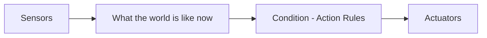
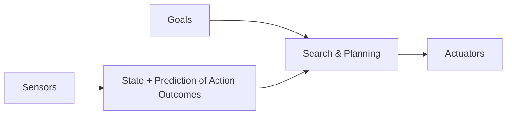
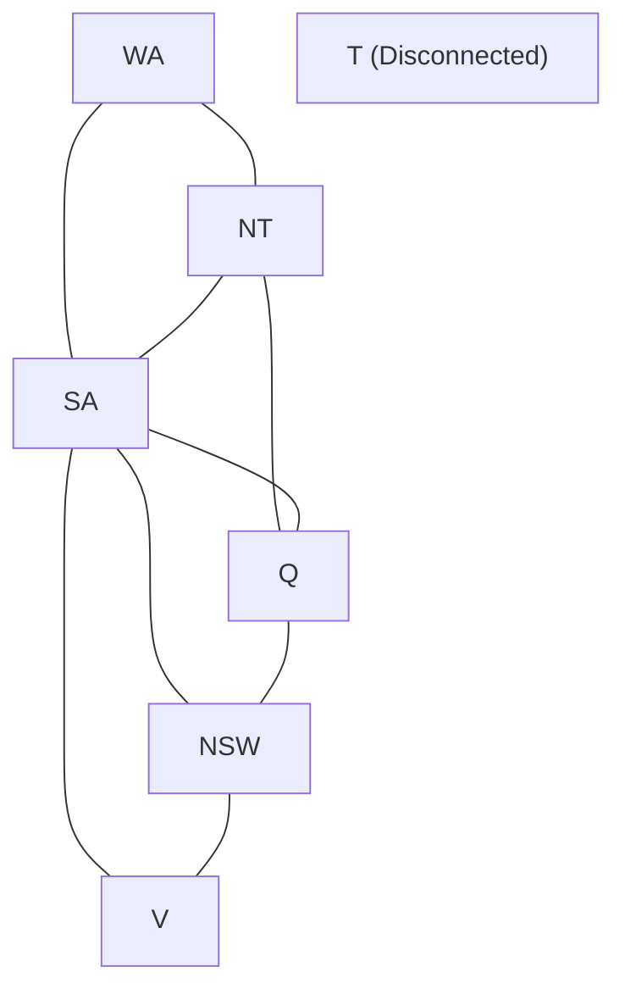

# Filtered Important Questions & Answers

> **Course -** Fundamentals of AI  
> **Coverage -** Unit 3 & Unit 4 Filtered Cycle Test Preparation

---

## Question 1: Autonomous Hospital Transport Robot (Agents & PEAS)

:::info

**Question Statement**

A hospital uses an autonomous robot to transport medical supplies through crowded corridors. The robot must respond to moving people, obstacles, and changing floor conditions.

(a) Draw and explain the architecture of a simple reflex agent and a goal-based agent. Give one situation in which each would be suitable for the robot.

(b) Write the PEAS description for this robot.

(c) Classify the task environment as fully/partially observable, deterministic/stochastic, episodic/sequential, static/dynamic, discrete/continuous, and single-agent/multi-agent. Justify each classification.

:::

---

### Model Answer

#### (a) Agent Architectures & Situational Choice

##### 1. Simple Reflex Agent



*   **Architecture:** Selects actions based solely on the current percept, ignoring history and future consequences.
*   **Suitable Situation:** Emergency obstacle avoidance (e.g., stopping immediately when proximity bumpers detect a sudden obstacle directly ahead).

##### 2. Goal-Based Agent



*   **Architecture:** Combines current state estimation with explicit goal descriptions to evaluate and plan action sequences that reach the goal.
*   **Suitable Situation:** Route planning across multiple wards and floors (e.g., calculating the shortest path from the pharmacy to Ward 4B while scheduling elevator transfers).

---

#### (b) PEAS Description

| Component | Specification |
| :--- | :--- |
| **Performance Measure** | On-time delivery rate, zero collisions with pedestrians/obstacles, sample integrity, minimal transit time, battery efficiency. |
| **Environment** | Corridors, wards, elevators, pharmacy, moving staff, patients, wheelchairs, beds. |
| **Actuators** | Motorized wheels/drive motors, steering mechanism, compartment lock/unlock, status display screen, speaker, elevator radio transmitter. |
| **Sensors** | LiDAR, RGB-D cameras, ultrasonic bumper sensors, wheel encoders, Wi-Fi/RFID receiver. |

---

#### (c) Task Environment Classification

| Dimension | Classification | Justification |
| :--- | :---: | :--- |
| **Observable** | **Partially Observable** | Sensors cannot see through walls, around corners, or inside closed elevator shafts. |
| **Deterministic** | **Stochastic** | Pedestrian movements, door closures, and elevator wait times are unpredictable. |
| **Episodic** | **Sequential** | Current routing actions directly determine future locations, deadlines, and battery level. |
| **Static** | **Dynamic** | Humans and carts move while the robot deliberates its next action. |
| **Discrete** | **Continuous** | Robot position coordinates, steering angles, velocity, and time vary continuously. |
| **Single / Multi-agent** | **Multi-Agent** | Operates alongside moving humans, doctors, and other automated hospital devices. |

---

## Question 2: Search Tree Tracing (BFS, DFS & DLS)

:::info

**Question Statement**

Consider the following search tree. Children are generated from left to right:
- S: A, B, C
- A: D, E
- B: F, G
- C: H
- D: I
- F: J
- G: K (goal)

(a) Trace Breadth-First Search and Depth-First Search until the goal is found. Show the queue or stack after each expansion.

(b) Apply Depth-Limited Search with limit 2. Does it find the goal? Explain and state the minimum depth limit required.

(c) Compare BFS and DFS in terms of completeness, optimality, time complexity, and space complexity. Which is more appropriate when memory is limited?

:::

---

### Model Answer

#### (a) Search Traces until Goal ($K$) Found

##### 1. Breadth-First Search (Queue: FIFO)

*Nodes are appended to the rear and popped from the front.*

| Step | Node Expanded | Children Generated | Queue Contents after Expansion |
| :---: | :---: | :--- | :--- |
| **0** | — | Start | $[S]$ |
| **1** | $S$ | $A, B, C$ | $[A, B, C]$ |
| **2** | $A$ | $D, E$ | $[B, C, D, E]$ |
| **3** | $B$ | $F, G$ | $[C, D, E, F, G]$ |
| **4** | $C$ | $H$ | $[D, E, F, G, H]$ |
| **5** | $D$ | $I$ | $[E, F, G, H, I]$ |
| **6** | $E$ | None | $[F, G, H, I]$ |
| **7** | $F$ | $J$ | $[G, H, I, J]$ |
| **8** | $G$ | $K$ (Goal) | $[H, I, J, K]$ |
| **9** | $H$ | None | $[I, J, K]$ |
| **10** | $I$ | None | $[J, K]$ |
| **11** | $J$ | None | $[K]$ |
| **12** | $K$ | **Goal reached on expansion** | — |

*   **Path Found:** $S \to B \to G \to K$

---

##### 2. Depth-First Search (Stack: LIFO)

*Children are pushed right-to-left so that the leftmost child sits at the top of the stack.*

| Step | Node Expanded | Children Pushed | Stack Contents after Expansion [Top $\to$ Bottom] |
| :---: | :---: | :--- | :--- |
| **0** | — | Start | $[S]$ |
| **1** | $S$ | $C, B, A$ | $[A, B, C]$ |
| **2** | $A$ | $E, D$ | $[D, E, B, C]$ |
| **3** | $D$ | $I$ | $[I, E, B, C]$ |
| **4** | $I$ | None (Leaf) | $[E, B, C]$ |
| **5** | $E$ | None (Leaf) | $[B, C]$ |
| **6** | $B$ | $G, F$ | $[F, G, C]$ |
| **7** | $F$ | $J$ | $[J, G, C]$ |
| **8** | $J$ | None (Leaf) | $[G, C]$ |
| **9** | $G$ | $K$ (Goal) | $[K, C]$ |
| **10** | $K$ | **Goal reached on expansion** | — |

*   **Path Found:** $S \to B \to G \to K$

---

#### (b) Depth-Limited Search (Limit = 2)

*   **Depth Levels:**
    *   Depth 0: $S$
    *   Depth 1: $A, B, C$
    *   Depth 2: $D, E, F, G, H$
    *   Depth 3: $I, J, K$
*   **Does it find the goal?** **No.**
*   **Explanation:** Goal node $K$ is at depth 3 ($S \to B \to G \to K$). DLS with limit $L = 2$ stops search at depth 2 and prunes all nodes at depth $> 2$. Node $G$ at depth 2 is reached, but its child $K$ at depth 3 is never explored.
*   **Minimum Depth Limit Required:** **Limit = 3**.

---

#### (c) Comparison between BFS and DFS

| Metric | Breadth-First Search (BFS) | Depth-First Search (DFS) |
| :--- | :--- | :--- |
| **Completeness** | Complete (if branching factor $b$ is finite). | Incomplete in infinite spaces/cycles (Complete here since tree is finite). |
| **Optimality** | Optimal (guarantees shallowest path). | Non-optimal (returns first path found regardless of depth). |
| **Time Complexity** | $O(b^d)$ | $O(b^m)$ (where $m$ is maximum tree depth). |
| **Space Complexity** | $O(b^d)$ (Exponential memory). | $O(b \cdot m)$ (Linear memory). |

*   **Memory-Limited Preference:** **DFS** is more appropriate because its linear space complexity ($O(b \cdot m)$) stores only the active path and unexpanded siblings, avoiding exponential memory exhaustion.

---

## Question 3: Cryptarithmetic Puzzle as a CSP (BASE + BALL = GAMES)

:::info

**Question Statement**

Solve the cryptarithmetic puzzle below. Each letter represents a different digit, and leading letters cannot be zero:

```text
  BASE
+ BALL
------
 GAMES
```

Formulate it as a constraint satisfaction problem by specifying variables, domains, carry variables, and constraints. Find a valid assignment and verify the arithmetic.

:::

---

### Model Answer

#### 1. CSP Formulation

*   **Variables:** $V = \{B, A, S, E, L, G, M\}$
*   **Domains:**
    *   $D(B), D(G) \in \{1, 2, \dots, 9\}$ (leading digits $\ne 0$).
    *   $D(A), D(S), D(E), D(L), D(M) \in \{0, 1, 2, \dots, 9\}$.
*   **Carry Variables:** $C_1, C_2, C_3, C_4 \in \{0, 1\}$ (for column additions).
*   **Global Constraint:** $\text{Alldiff}(B, A, S, E, L, G, M)$
*   **Column Constraints (Right to Left):**
    1.  **Units:** $E + L = S + 10 \cdot C_1$
    2.  **Tens:** $S + L + C_1 = E + 10 \cdot C_2$
    3.  **Hundreds:** $A + A + C_2 = M + 10 \cdot C_3$
    4.  **Thousands:** $B + B + C_3 = A + 10 \cdot C_4$
    5.  **Ten-Thousands:** $C_4 = G$

---

#### 2. Step-by-Step Deduction

1.  **Ten-Thousands Column ($G$):**
    *   The sum of two 4-digit numbers produces at most carry $1 \implies C_4 = 1$.
    *   Since $G \ne 0 \implies \mathbf{G = 1}$ and $\mathbf{C_4 = 1}$.
2.  **Units and Tens Columns ($L$ and Carries):**
    *   Units: $E + L = S + 10 \cdot C_1$
    *   Tens: $S + L + C_1 = E + 10 \cdot C_2$
    *   Adding both equations:
        $$(E + L) + (S + L + C_1) = (S + 10 \cdot C_1) + (E + 10 \cdot C_2)$$
        $$2L + C_1 = 9 \cdot C_1 + 10 \cdot C_2 \implies 2L = 8 \cdot C_1 + 10 \cdot C_2$$
    *   If $C_2 = 0 \implies 2L = 8 \cdot C_1$. If $C_1 = 0 \implies L = 0$, making $E = S$, which violates $\text{Alldiff}$.
    *   Therefore $\mathbf{C_2 = 1}$.
    *   If $C_1 = 1 \implies 2L = 8 + 10 = 18 \implies L = 9$. Then Units gives $E + 9 = S + 10 \implies S = E - 1$. Substituting into Tens yields $E - 1 + 9 + 1 = E + 10 \implies 9 = 10$ (contradiction).
    *   Therefore $\mathbf{C_1 = 0}$.
    *   Substituting $C_1 = 0, C_2 = 1$: $2L = 10 \implies \mathbf{L = 5}$.
3.  **Relating $E$ and $S$:**
    *   With $L = 5$ and $C_1 = 0$: $E + 5 = S \implies \mathbf{S = E + 5}$.
4.  **Hundreds and Thousands Columns:**
    *   Hundreds: $2A + C_2 = M + 10 \cdot C_3 \implies 2A + 1 = M + 10 \cdot C_3$.
    *   Thousands: $2B + C_3 = A + 10$ (since $C_4 = 1$).
    *   Since $2B + C_3 \ge 10 \implies B \ge 5$.
    *   Available digits for $\{B, A, M\}$ from $\{0, 2, 3, 4, 6, 7, 8, 9\}$:
        *   If $A = 4$:
            *   Hundreds: $2(4) + 1 = 9 \implies \mathbf{M = 9}$ and $\mathbf{C_3 = 0}$.
            *   Thousands: $2B + 0 = 4 + 10 = 14 \implies \mathbf{B = 7}$.
5.  **Solving $E$ and $S$:**
    *   Digits assigned so far: $\{G=1, L=5, A=4, M=9, B=7\}$.
    *   Remaining unused digits: $\{0, 2, 3, 6, 8\}$.
    *   Condition $S = E + 5$ with unused digits:
        *   Setting $\mathbf{E = 3}$ yields $\mathbf{S = 8}$ (both valid and unused).

---

#### 3. Final Valid Assignment & Verification

$$\mathbf{B = 7, \quad A = 4, \quad S = 8, \quad E = 3, \quad L = 5, \quad G = 1, \quad M = 9}$$

*   **Distinct Digits Check:** $\{7, 4, 8, 3, 5, 1, 9\}$ are all unique $\checkmark$
*   **Leading Non-Zero Check:** $B = 7 \ne 0, G = 1 \ne 0 \checkmark$
*   **Arithmetic Verification:**
    $$7483 + 7455 = 14938 \quad (\text{BASE} + \text{BALL} = \text{GAMES}) \quad \checkmark$$

---

## Question 4: Game Tree Minimax & Alpha-Beta Pruning

:::info

**Question Statement**

In a game tree, the root P is a MAX node; its children Q and R are MIN nodes. Q has MAX children S and T, while R has MAX children U and V. The leaf values from left to right are:
- S: 4, 7
- T: 2, 8
- U: 5, 6
- V: 1, 3

(a) Apply minimax and calculate the backed-up value at every internal node.

(b) Identify the move selected by MAX at the root.

(c) Apply alpha-beta pruning from left to right, showing alpha and beta values and identifying any pruned leaves or subtrees.

(d) Explain how ordering the children can affect alpha-beta pruning and state its best-case time complexity.

:::

---

### Model Answer

#### (a) Minimax Backed-Up Values

*   **Level 3: MAX Nodes ($S, T, U, V$)**
    *   $S = \max(4, 7) = \mathbf{7}$
    *   $T = \max(2, 8) = \mathbf{8}$
    *   $U = \max(5, 6) = \mathbf{6}$
    *   $V = \max(1, 3) = \mathbf{3}$
*   **Level 2: MIN Nodes ($Q, R$)**
    *   $Q = \min(S, T) = \min(7, 8) = \mathbf{7}$
    *   $R = \min(U, V) = \min(6, 3) = \mathbf{3}$
*   **Level 1: Root MAX Node ($P$)**
    *   $P = \max(Q, R) = \max(7, 3) = \mathbf{7}$

---

#### (b) Move Selected by MAX at Root

*   MAX chooses the move to **$Q$** (guaranteed minimax value of $7$).

---

#### (c) Alpha-Beta Pruning Trace (Left to Right)

*Root bounds begin at $[\alpha = -\infty, \beta = +\infty]$.*

1.  **Subtree under $Q$ (MIN node, $[\alpha = -\infty, \beta = +\infty]$):**
    *   **Node $S$ (MAX):**
        *   Leaf $4$: $\alpha = \max(-\infty, 4) = 4$.
        *   Leaf $7$: $\alpha = \max(4, 7) = 7$.
        *   Returns $7$.
    *   **At MIN node $Q$:** $\beta = \min(+\infty, 7) = 7$. Current bounds: $[\alpha = -\infty, \beta = 7]$.
    *   **Node $T$ (MAX, $[\alpha = -\infty, \beta = 7]$):**
        *   Leaf $2$: $\alpha = \max(-\infty, 2) = 2$.
        *   Leaf $8$: $\alpha = \max(2, 8) = 8$. Pruning condition $\alpha \ge \beta$ ($8 \ge 7$) holds, but leaf $8$ is already the last child of $T$.
        *   Returns $8$.
    *   **At MIN node $Q$:** $\beta = \min(7, 8) = 7$. Returns $7$ to root $P$.
2.  **At Root $P$ (MAX):**
    *   Updates $\alpha = \max(-\infty, 7) = 7$.
    *   Bounds at Root $P$: $[\alpha = 7, \beta = +\infty]$.
3.  **Subtree under $R$ (MIN node, $[\alpha = 7, \beta = +\infty]$):**
    *   **Node $U$ (MAX):**
        *   Leaf $5$: $\alpha = \max(7, 5) = 7$.
        *   Leaf $6$: $\alpha = \max(7, 6) = 7$.
        *   Returns $6$.
    *   **At MIN node $R$:**
        *   Updates $\beta = \min(+\infty, 6) = 6$.
        *   **Pruning condition triggered:** $\alpha \ge \beta$ ($7 \ge 6$).
        *   The remaining branch under $R$ is cut off.
    *   **Pruned Leaves/Subtrees:** Node **$V$** and its leaves **$1$ and $3$** are **PRUNED**.

*   **Summary:**
    *   Evaluated Leaves: $4, 7, 2, 8, 5, 6$ (6 of 8 evaluated).
    *   Pruned Leaves: $1, 3$ (Subtree $V$).

---

#### (d) Move Ordering & Best-Case Complexity

*   **Effect of Move Ordering:**
    *   **Optimal Ordering:** If the best moves are considered first, alpha-beta maximizes early cutoffs, pruning large subtrees.
    *   **Worst Ordering:** If moves are sorted from worst to best, no cutoffs occur, and search complexity degrades to full minimax ($O(b^d)$).
*   **Best-Case Time Complexity:** $\mathbf{O(b^{d/2})}$ (allows searching twice as deep within the same computational time limit).

---

## Question 5: Delivery Vehicle Navigation (Greedy Best-First & A* Search)

:::info

**Question Statement**

A delivery vehicle must travel from start node S to destination G. The edge costs are:
S-A = 3, S-B = 4, A-C = 2, A-D = 5, B-E = 2, E-G = 4, C-G = 4, D-G = 2.
The heuristic values are h(S)=7, h(A)=5, h(B)=4, h(C)=3, h(D)=2, h(E)=2, h(G)=0.

(a) Trace Greedy Best-First Search and state the path returned and its total cost.

(b) Trace A* search, showing g(n), h(n), and f(n) for nodes considered. State the path returned and its total cost.

(c) If h(D) is changed to 8, discuss whether the heuristic remains admissible and explain the possible effect on A* search.

:::

---

### Model Answer

#### (a) Greedy Best-First Search Trace

*Greedy BFS selects the node with the lowest heuristic value $h(n)$.*

| Step | Node Popped | $h(n)$ | Successors Generated | Priority Queue $[Node, h]$ |
| :---: | :---: | :---: | :--- | :--- |
| **0** | — | — | Start | $\{ [S, 7] \}$ |
| **1** | **$S$** | 7 | $A (h=5), B (h=4)$ | $\{ [B, 4], [A, 5] \}$ |
| **2** | **$B$** | 4 | $E (h=2)$ | $\{ [E, 2], [A, 5] \}$ |
| **3** | **$E$** | 2 | $G (h=0)$ | $\{ [G, 0], [A, 5] \}$ |
| **4** | **$G$** | 0 | **Goal reached on expansion** | — |

*   **Path Returned:** $\mathbf{S \to B \to E \to G}$
*   **Total Cost:** $c(S-B) + c(B-E) + c(E-G) = 4 + 2 + 4 = \mathbf{10}$

---

#### (b) A* Search Trace

*Nodes are prioritized by $f(n) = g(n) + h(n)$.*

| Step | Node Popped | $g(n)$ | $h(n)$ | $f(n)$ | Successors Generated | Open List $[Node, g, h, f, Path]$ |
| :---: | :---: | :---: | :---: | :---: | :--- | :--- |
| **0** | — | — | — | — | Start | $\{ [S, 0, 7, 7, S] \}$ |
| **1** | **$S$** | 0 | 7 | 7 | $A: g=3, f=3+5=8$<br/>$B: g=4, f=4+4=8$ | $\{ [A, 3, 5, 8, S \to A], [B, 4, 4, 8, S \to B] \}$ |
| **2** | **$A$** | 3 | 5 | 8 | $C: g=5, f=5+3=8$<br/>$D: g=8, f=8+2=10$ | $\{ [B, 4, 4, 8], [C, 5, 3, 8], [D, 8, 2, 10] \}$ |
| **3** | **$B$** | 4 | 4 | 8 | $E: g=6, f=6+2=8$ | $\{ [C, 5, 3, 8], [E, 6, 2, 8], [D, 8, 2, 10] \}$ |
| **4** | **$C$** | 5 | 3 | 8 | $G: g=9, f=9+0=9$ | $\{ [E, 6, 2, 8], [G, 9, 0, 9, S \to A \to C \to G], [D, 8, 2, 10] \}$ |
| **5** | **$E$** | 6 | 2 | 8 | $G: g=10, f=10+0=10$ | $\{ [G, 9, 0, 9], [D, 8, 2, 10], [G, 10, 0, 10] \}$ |
| **6** | **$G$** | 9 | 0 | 9 | **Goal popped on expansion** | — |

*   **Path Returned:** $\mathbf{S \to A \to C \to G}$
*   **Total Cost:** $3 + 2 + 4 = \mathbf{9}$

---

#### (c) Admissibility & Effect if $h(D) = 8$

*   **Admissibility Analysis:**
    *   True minimal cost from $D$ to $G$: $h^*(D) = c(D-G) = 2$.
    *   Admissibility requires $h(n) \le h^*(n)$ for all nodes.
    *   Because $h(D) = 8 > h^*(D) = 2$, the heuristic overestimates true cost and becomes **INADMISSIBLE**.
*   **Effect on A\* Search:**
    *   With $h(D) = 8$, the estimated total cost becomes $f(D) = g(D) + h(D) = 8 + 8 = 16$.
    *   This artificially penalizes node $D$, delaying its expansion in the priority queue.
    *   In this specific graph, the optimal path runs through $C$ (cost 9), so A* still finds the optimal path $S \to A \to C \to G$.
    *   However, in general, an inadmissible heuristic forfeits A*'s guarantee of optimality, as it can cause an optimal path through an overestimated node to be skipped in favor of a suboptimal alternative.

---

## Question 6: Map Colouring with Forward Checking & Heuristics

:::info

**Question Statement**

A map contains the regions WA, NT, SA, Q, NSW, V, and T. Adjacent pairs are:
WA-NT, WA-SA, NT-SA, NT-Q, SA-Q, SA-NSW, SA-V, Q-NSW, NSW-V.
Tasmania (T) has no neighbours.
Use the colours `{Yellow, Blue, Green}`.

(a) Draw the constraint graph and identify the variables, domains, and constraints.

(b) Assign WA = Yellow and Q = Blue. Show the remaining domains after each assignment using forward checking.

(c) Explain how a domain becoming empty indicates failure.

(d) Use the Minimum Remaining Values and degree heuristics to choose a variable order and give one valid colouring.

:::

---

### Model Answer

#### (a) Constraint Graph & CSP Formulation



*   **Variables ($X$):** $\{WA, NT, SA, Q, NSW, V, T\}$
*   **Domains ($D$):** $D_i = \{\text{Yellow}, \text{Blue}, \text{Green}\}$ for every variable.
*   **Constraints ($C$):** $\text{color}(u) \ne \text{color}(v)$ for all adjacent pairs $(u, v) \in E$:
    $$\{(WA, NT), (WA, SA), (NT, SA), (NT, Q), (SA, Q), (SA, NSW), (SA, V), (Q, NSW), (NSW, V)\}$$
    *(Tasmania $T$ has no constraints).*

---

#### (b) Forward Checking Trace

*Colours: Yellow (Y), Blue (B), Green (G)*

| Step | Assignment | $D(WA)$ | $D(NT)$ | $D(SA)$ | $D(Q)$ | $D(NSW)$ | $D(V)$ | $D(T)$ | Forward Checking Action |
| :---: | :---: | :---: | :---: | :---: | :---: | :---: | :---: | :---: | :--- |
| **0** | Initial | $\{Y, B, G\}$ | $\{Y, B, G\}$ | $\{Y, B, G\}$ | $\{Y, B, G\}$ | $\{Y, B, G\}$ | $\{Y, B, G\}$ | $\{Y, B, G\}$ | All domains complete. |
| **1** | **$WA = Y$** | $\{Y\}$ | $\{B, G\}$ | $\{B, G\}$ | $\{Y, B, G\}$ | $\{Y, B, G\}$ | $\{Y, B, G\}$ | $\{Y, B, G\}$ | Remove $Y$ from neighbors $NT, SA$. |
| **2** | **$Q = B$** | $\{Y\}$ | $\{G\}$ | $\{G\}$ | $\{B\}$ | $\{Y, G\}$ | $\{Y, B, G\}$ | $\{Y, B, G\}$ | Remove $B$ from neighbors $NT, SA, NSW$. |

---

#### (c) Why an Empty Domain Indicates Failure

*   If forward checking reduces any unassigned variable's domain to empty ($\emptyset$), no legal colour remains that satisfies constraints with the current assignments.
*   This proves immediately that the current partial assignment cannot lead to a valid full solution, signaling a dead-end and triggering an **immediate backtrack** without exploring doomed child branches.

---

#### (d) Heuristics Variable Ordering & Valid Colouring

##### 1. Heuristic Selection Order

*   **Degree Heuristic (Initial Tie-Breaker):**
    *   Counts constraints on unassigned variables: $\text{deg}(SA)=5$, $\text{deg}(NT)=3$, $\text{deg}(Q)=3$, $\text{deg}(NSW)=3$, $\text{deg}(WA)=2$, $\text{deg}(V)=2$, $\text{deg}(T)=0$.
    *   **Pick $SA$ first** (highest degree 5) $\to$ Assign $\mathbf{SA = \text{Green}}$.
*   **Minimum Remaining Values (MRV):**
    *   Neighbors of $SA$ now have domain size 2 ($\{Y, B\}$).
    *   Pick tied MRV variables by degree: pick $NT$, assign $\mathbf{NT = \text{Yellow}}$.
    *   Now $D(WA)$ reduces to $\{B\}$ (singleton, MRV forces $WA = \text{Blue}$ with 0 branching).
    *   Remaining variables are assigned similarly using MRV.

##### 2. One Valid Colouring

$$\mathbf{SA = \text{Green}, \quad WA = \text{Yellow}, \quad NT = \text{Blue}, \quad Q = \text{Yellow}, \quad NSW = \text{Blue}, \quad V = \text{Yellow}, \quad T = \text{Green}}$$

*   *Validation:* Every adjacent pair has different colours; Tasmania ($T$) is unconstrained.
