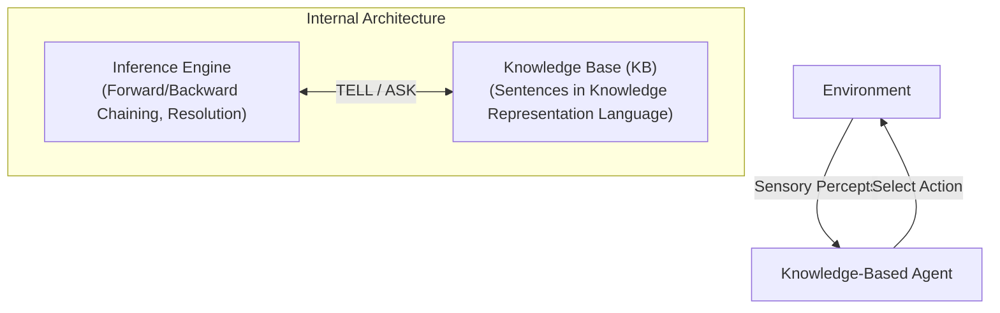
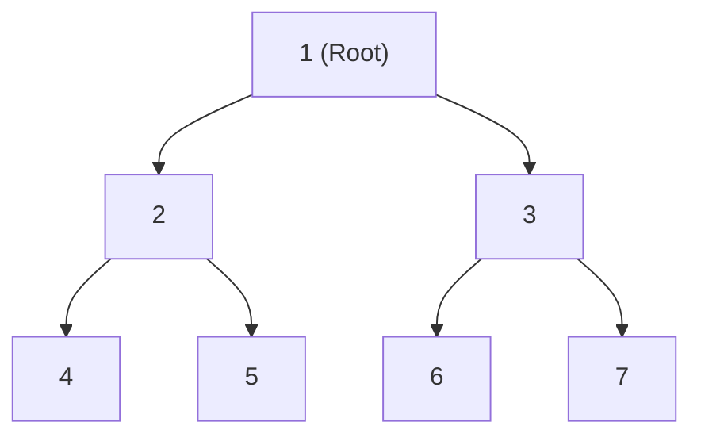

# May 2025

> **Exam -** Semester Examination  
> **Session -** May 2025  

---

## Question 1 (20 Marks)

:::info

**Question Statement**

*   **i)** Is String a mutable data type? Also explain the various string operations, indexing and slicing in detail with an appropriate example. **(10 Marks)**
*   **ii)** Create a NumPy array of the following product prices: [100, 250, 300, 450, 150]. Perform the following operations: **(10 Marks)**
    *   a. Find the mean price of the products.
    *   b. Filter and display the rows where the Category is "Electronics" and the Total_Sales is greater than 10,000.
    *   c. Create a bar plot using Matplotlib that shows the Product_Name on the x-axis and the Total_Sales on the y-axis for the top 5 products with the highest total sales.
    *   d. Add appropriate labels for the x-axis, y-axis, and the title for the plot.
    *   e. Identify and explain which columns in the "sales_data.csv" dataset are examples of categorical data and which ones are numerical data.

| Product_ID | Product_Name | Category | Price | Quantity_Sold | Date |
| :---: | :---: | :---: | :---: | :---: | :---: |
| P001 | Laptop | Electronics | 1000 | 10 | 2023-01-01 |
| P002 | Chair | Furniture | 150 | 50 | 2023-01-05 |
| P003 | Headphones | Electronics | 200 | 25 | 2023-02-10 |
| P004 | Jacket | Clothing | 300 | 20 | 2023-03-15 |
| P005 | Sofa | Furniture | 800 | 5 | 2023-04-20 |

:::

---

### Solution 1 (20 Marks)

#### (i) String Immutability, Operations, Indexing, and Slicing (10 Marks)

##### 1. Is String a Mutable Data Type?
**No, strings in Python are strictly immutable.** Once a string object is created in memory, its characters cannot be modified, replaced, or deleted in place.
*   Attempting in-place modification (e.g., `s[0] = 'H'`) raises a `TypeError: 'str' object does not support item assignment`.
*   Concatenation or modification methods (like `.replace()` or `.upper()`) return a brand-new string object at a different memory address (`id()`).

##### 2. String Operations
1.  **Concatenation (`+`):** Combines strings (`"Data" + " " + "Science"` $\to$ `"Data Science"`).
2.  **Repetition (`*`):** Replicates strings (`"AI" * 3` $\to$ `"AIAIAI"`).
3.  **Membership (`in`, `not in`):** Tests substring presence (`"Art" in "Artificial"` $\to$ `True`).

##### 3. Indexing and Slicing
Python strings use zero-based positive indexing (left-to-right: $0$ to $n-1$) and negative indexing (right-to-left: $-1$ to $-n$):
*   **Indexing Syntax:** `string[index]`
*   **Slicing Syntax:** `string[start:stop:step]` (extracts characters from `start` up to but not including `stop`).

```python
text = "ARTIFICIAL"

# Indexing
first_char = text[0]  # 'A'
last_char = text[-1]  # 'L'

# Slicing
prefix = text[0:3]  # 'ART'
stride_two = text[::2]  # 'ATFCL'
reversed_text = text[::-1]  # 'LAICIFITRA'
```

---

#### (ii) NumPy and Sales Dataset Analysis (10 Marks)

##### a. NumPy Array Creation and Mean Price Calculation
```python
import numpy as np

# Create NumPy array of product prices
prices = np.array([100, 250, 300, 450, 150])

# Compute mean price
mean_price = np.mean(prices)
print(f"Mean Product Price: ${mean_price:.2f}")  # Output: $250.00
```
$$\text{Mean Price} = \frac{100 + 250 + 300 + 450 + 150}{5} = \frac{1250}{5} = \mathbf{\$250.00}$$

##### b. Filtering Rows where Category is "Electronics" and Total_Sales > 10,000
Total sales for each row is computed as $\text{Price} \times \text{Quantity\_Sold}$:
*   P001 (Laptop): $1000 \times 10 = \mathbf{\$10,000}$ (Not strictly $> 10,000$)
*   P002 (Chair): $150 \times 50 = \$7,500$ (Furniture)
*   P003 (Headphones): $200 \times 25 = \$5,000$ (Electronics)
*   P004 (Jacket): $300 \times 20 = \$6,000$ (Clothing)
*   P005 (Sofa): $800 \times 5 = \$4,000$ (Furniture)

```python
import pandas as pd

# Load dataset
df = pd.DataFrame(
    {
        "Product_ID": ["P001", "P002", "P003", "P004", "P005"],
        "Product_Name": [
            "Laptop",
            "Chair",
            "Headphones",
            "Jacket",
            "Sofa",
        ],
        "Category": [
            "Electronics",
            "Furniture",
            "Electronics",
            "Clothing",
            "Furniture",
        ],
        "Price": [1000, 150, 200, 300, 800],
        "Quantity_Sold": [10, 50, 25, 20, 5],
    }
)

df["Total_Sales"] = df["Price"] * df["Quantity_Sold"]

# Filter condition: Category == 'Electronics' and Total_Sales > 10000
filtered_df = df[
    (df["Category"] == "Electronics") & (df["Total_Sales"] > 10000)
]
print(filtered_df)  # Returns empty DataFrame (P001 equals exactly 10,000)
```

##### c & d. Matplotlib Bar Plot of Top 5 Products by Total Sales
```python
import matplotlib.pyplot as plt

# Sort by Total_Sales descending
top_5 = df.sort_values(by="Total_Sales", ascending=False).head(5)

plt.figure(figsize=(8, 5))
plt.bar(
    top_5["Product_Name"],
    top_5["Total_Sales"],
    color="#1f77b4",
    edgecolor="black",
)
plt.title("Top 5 Products by Total Sales", fontsize=14, fontweight="bold")
plt.xlabel("Product Name", fontsize=12)
plt.ylabel("Total Sales ($)", fontsize=12)
plt.grid(axis="y", linestyle="--", alpha=0.7)
plt.tight_layout()
plt.show()
```

##### e. Categorical vs. Numerical Data Identification
*   **Categorical Columns (Qualitative Attributes):**
    *   `Product_ID`: Nominal identifier (labels items without arithmetic meaning).
    *   `Product_Name`: Nominal string label.
    *   `Category`: Nominal group classification (`Electronics`, `Furniture`, `Clothing`).
    *   `Date`: Temporal categorical / chronological timestamp.
*   **Numerical Columns (Quantitative Measures):**
    *   `Price`: Continuous numerical ratio scale ($).
    *   `Quantity_Sold`: Discrete numerical ratio scale (integer count).
    *   `Total_Sales`: Continuous numerical scale ($\text{Price} \times \text{Quantity\_Sold}$).

:::tip

**Examiner's Note**

In part (ii)(b), explicitly point out that `Laptop` has $\text{Total\_Sales} = 1000 \times 10 = 10,000$. Since the question specifies strictly greater than $10,000$ (`> 10,000`), zero rows meet the strict inequality, whereas $\ge 10,000$ captures `P001`.

:::

---

## Question 2 (20 Marks)

:::info

**Question Statement**

Demonstrate how to load a dataset into a Pandas DataFrame and clean the data (handle missing values, drop unnecessary columns) and Perform group by operations and calculate summary Statistics, display the first 10 rows, and perform basic data manipulation (sorting, filtering). **(20 Marks)**

| Date | Store | Product | Sales | Quantity |
| :---: | :---: | :---: | :---: | :---: |
| 2023-01-01 | Store A | Widget A | 200 | 10 |
| 2023-01-02 | Store A | Widget B | 150 | 5 |
| 2023-01-03 | Store B | Widget A | 300 | 15 |
| 2023-01-04 | Store B | Widget C | NaN | 8 |
| 2023-01-05 | Store A | NaN | 250 | 20 |
| 2023-01-06 | Store C | Widget A | 400 | 20 |
| 2023-01-07 | Store C | Widget B | 100 | 2 |
| 2023-01-08 | Store A | Widget C | 150 | 6 |
| 2023-01-09 | Store B | Widget B | NaN | 5 |
| 2023-01-10 | Store C | Widget C | 350 | 10 |

Demonstrate how to create different types of plots (line plot, bar plot, scatter plot) using Matplotlib. Provide code examples. Explain how to add titles, labels (x and y axis), and customize colors in these plots. Include examples of customization in your code.

:::

---

### Solution 2 (20 Marks)

#### 1. Data Cleaning and Manipulation via Pandas (10 Marks)

```python
import numpy as np
import pandas as pd

# Step 1: Load Dataset into DataFrame
data = {
    "Date": [
        "2023-01-01",
        "2023-01-02",
        "2023-01-03",
        "2023-01-04",
        "2023-01-05",
        "2023-01-06",
        "2023-01-07",
        "2023-01-08",
        "2023-01-09",
        "2023-01-10",
    ],
    "Store": [
        "Store A",
        "Store A",
        "Store B",
        "Store B",
        "Store A",
        "Store C",
        "Store C",
        "Store A",
        "Store B",
        "Store C",
    ],
    "Product": [
        "Widget A",
        "Widget B",
        "Widget A",
        "Widget C",
        np.nan,
        "Widget A",
        "Widget B",
        "Widget C",
        "Widget B",
        "Widget C",
    ],
    "Sales": [200, 150, 300, np.nan, 250, 400, 100, 150, np.nan, 350],
    "Quantity": [10, 5, 15, 8, 20, 20, 2, 6, 5, 10],
}
df = pd.DataFrame(data)

# Step 2: Data Cleaning
# A. Handle Missing Values: Impute numerical Sales with median, fill categorical Product with mode
df["Sales"] = df["Sales"].fillna(df["Sales"].median())
df["Product"] = df["Product"].fillna(df["Product"].mode()[0])

# B. Drop Unnecessary Columns (Demonstration: drop 'Date' if not modeling time-series)
df_cleaned = df.drop(columns=["Date"])

# Step 3: Display First 10 Rows
print("--- Cleaned DataFrame (First 10 Rows) ---")
print(df_cleaned.head(10))

# Step 4: Group By Operations and Summary Statistics
store_summary = df_cleaned.groupby("Store").agg(
    Total_Sales=("Sales", "sum"),
    Mean_Sales=("Sales", "mean"),
    Total_Quantity=("Quantity", "sum"),
)
print("\n--- Summary Statistics by Store ---")
print(store_summary)

# Step 5: Basic Data Manipulation (Sorting and Filtering)
# Filter: Sales >= 200, then sort by Sales descending
filtered_sorted = df_cleaned[df_cleaned["Sales"] >= 200].sort_values(
    by="Sales", ascending=False
)
print("\n--- Filtered (Sales >= 200) and Sorted ---")
print(filtered_sorted)
```

---

#### 2. Visualizations with Matplotlib: Customization and Code (10 Marks)

##### Code Examples for Line, Bar, and Scatter Plots
```python
import matplotlib.pyplot as plt

# Generate Plot Grid
fig, axes = plt.subplots(1, 3, figsize=(18, 5))

# 1. Line Plot: Sales Trend across Days
axes[0].plot(
    df["Date"],
    df["Sales"],
    color="#2b5c8f",
    marker="o",
    linewidth=2,
    linestyle="-",
)
axes[0].set_title(
    "Sales Trend Over Time", fontsize=12, fontweight="bold", color="#1c3d5a"
)
axes[0].set_xlabel("Transaction Date", fontsize=10)
axes[0].set_ylabel("Sales Revenue ($)", fontsize=10)
axes[0].tick_params(axis="x", rotation=45)
axes[0].grid(True, linestyle=":", alpha=0.6)

# 2. Bar Plot: Total Quantity Sold per Store
store_qty = df.groupby("Store")["Quantity"].sum()
axes[1].bar(
    store_qty.index,
    store_qty.values,
    color=["#e6550d", "#fdae6b", "#fee6ce"],
    edgecolor="black",
)
axes[1].set_title(
    "Total Quantity by Store", fontsize=12, fontweight="bold", color="#8c2d04"
)
axes[1].set_xlabel("Store Location", fontsize=10)
axes[1].set_ylabel("Quantity Sold", fontsize=10)
axes[1].grid(axis="y", linestyle="--", alpha=0.5)

# 3. Scatter Plot: Sales vs. Quantity (Relationship)
axes[2].scatter(
    df["Quantity"],
    df["Sales"],
    color="#31a354",
    s=df["Quantity"] * 10,
    alpha=0.8,
    edgecolor="black",
)
axes[2].set_title(
    "Sales vs. Quantity Sold", fontsize=12, fontweight="bold", color="#006d2c"
)
axes[2].set_xlabel("Units Sold", fontsize=10)
axes[2].set_ylabel("Sales ($)", fontsize=10)
axes[2].grid(True, linestyle="--", alpha=0.4)

plt.tight_layout()
plt.show()
```

##### Customization Explanations:
1.  **Labels and Titles:** `.set_title()`, `.set_xlabel()`, and `.set_ylabel()` clearly establish coordinate semantics and units.
2.  **Color Customization:** Hex codes (`#2b5c8f`, `#e6550d`) provide consistent visual hierarchy.
3.  **Styling Attributes:** `linestyle=":"`, `alpha=0.8` (transparency for density), and variable sizing `s=df['Quantity']*10` enhance visual clarity.

:::tip

**Examiner's Note**

State explicit strategies for missing values (median imputation for skewed continuous sales; mode imputation for categorical product labels) before presenting grouped aggregation code.

:::

---

## Question 3 (20 Marks)

:::info

**Question Statement**

Solve the 8-Puzzle Problem Using A* Search Algorithm. A robot is trying to solve an 8 puzzle game where tiles need to be rearranged to match the final state. The blank tile (represented as -) can move up, down, left, or right to swap positions with adjacent tiles.

$$\text{Initial State: } \begin{bmatrix} 2 & 8 & 3 \\ 1 & 6 & 4 \\ 7 & - & 5 \end{bmatrix}, \quad \text{Goal State: } \begin{bmatrix} 1 & 2 & 3 \\ 8 & - & 4 \\ 7 & 6 & 5 \end{bmatrix}$$

(The blank space - is at position (2,1))

1.  Using A search*, find the optimal path from the initial state to the final state. **(10 Marks)**
2.  What will be the sequence of moves with f(n) calculation taken by the blank tile (-) to reach the final goal state? **(10 Marks)**

:::

---

### Solution 3 (20 Marks)

#### 1. A* Formulation and Heuristic Definition (10 Marks)

The A* evaluation function is:
$$f(n) = g(n) + h(n)$$
*   $g(n)$: Number of moves executed from the initial state to current state $n$.
*   $h(n)$: **Manhattan Distance Heuristic** (the sum of absolute horizontal and vertical distances of each numbered tile from its goal position):
    $$h(n) = \sum_{i=1}^8 \left( \lvert x_i - x_i^{\text{goal}} \rvert + \lvert y_i - y_i^{\text{goal}} \rvert \right)$$
    *Admissibility:* Because a tile can move at most one square per step and cannot hop over others, the Manhattan distance never overestimates the true remaining moves ($h(n) \le h^*(n)$).

##### Goal Coordinate Map ($[r, c]$):
$$1: [0, 0], \quad 2: [0, 1], \quad 3: [0, 2]$$
$$8: [1, 0], \quad -: [1, 1], \quad 4: [1, 2]$$
$$7: [2, 0], \quad 6: [2, 1], \quad 5: [2, 2]$$

##### Initial State Heuristic Computation:
$$\text{State } S_0 = \begin{bmatrix} 2 & 8 & 3 \\ 1 & 6 & 4 \\ 7 & - & 5 \end{bmatrix}$$
*   Tile 1 at $[1, 0] \to [0, 0]$: $\lvert 1-0 \rvert + \lvert 0-0 \rvert = 1$
*   Tile 2 at $[0, 0] \to [0, 1]$: $\lvert 0-0 \rvert + \lvert 0-1 \rvert = 1$
*   Tile 3 at $[0, 2] \to [0, 2]$: $0$
*   Tile 4 at $[1, 2] \to [1, 2]$: $0$
*   Tile 5 at $[2, 2] \to [2, 2]$: $0$
*   Tile 6 at $[1, 1] \to [2, 1]$: $\lvert 1-2 \rvert + \lvert 1-1 \rvert = 1$
*   Tile 7 at $[2, 0] \to [2, 0]$: $0$
*   Tile 8 at $[0, 1] \to [1, 0]$: $\lvert 0-1 \rvert + \lvert 1-0 \rvert = 1 + 1 = 2$
$$h(S_0) = 1 + 1 + 0 + 0 + 0 + 1 + 0 + 2 = \mathbf{5}$$
$$f(S_0) = g(S_0) + h(S_0) = 0 + 5 = \mathbf{5}$$

---

#### 2. Step-by-Step Sequence of Moves and $f(n)$ Calculations (10 Marks)

##### Step 1: Move Blank UP (Swap with Tile 6)
Blank moves from $[2, 1]$ to $[1, 1]$:
$$S_1 = \begin{bmatrix} 2 & 8 & 3 \\ 1 & - & 4 \\ 7 & 6 & 5 \end{bmatrix}$$
*   Tiles 6, 7, 5, 4, 3 are now in their correct goal slots.
*   Misplaced tiles: 1 at $[1, 0]$ (dist 1), 2 at $[0, 0]$ (dist 1), 8 at $[0, 1]$ (dist 2).
*   $g(S_1) = 1, \quad h(S_1) = 1 + 1 + 2 = 4$
*   **$f(S_1) = 1 + 4 = \mathbf{5}$**

##### Step 2: Move Blank UP (Swap with Tile 8)
Blank moves from $[1, 1]$ to $[0, 1]$:
$$S_2 = \begin{bmatrix} 2 & - & 3 \\ 1 & 8 & 4 \\ 7 & 6 & 5 \end{bmatrix}$$
*   Tile 8 is now in its correct goal slot $[1, 0]$ (wait, tile 8 swapped to $[1, 1]$, distance to $[1, 0]$ is 1).
*   Misplaced tiles: 1 at $[1, 0]$ (dist 1), 2 at $[0, 0]$ (dist 1), 8 at $[1, 1]$ (dist 1).
*   $g(S_2) = 2, \quad h(S_2) = 1 + 1 + 1 = 3$
*   **$f(S_2) = 2 + 3 = \mathbf{5}$**

##### Step 3: Move Blank LEFT (Swap with Tile 2)
Blank moves from $[0, 1]$ to $[0, 0]$:
$$S_3 = \begin{bmatrix} - & 2 & 3 \\ 1 & 8 & 4 \\ 7 & 6 & 5 \end{bmatrix}$$
*   Tile 2 is now in its correct goal slot $[0, 1]$!
*   Misplaced tiles: 1 at $[1, 0]$ (dist 1), 8 at $[1, 1]$ (dist 1).
*   $g(S_3) = 3, \quad h(S_3) = 1 + 1 = 2$
*   **$f(S_3) = 3 + 2 = \mathbf{5}$**

##### Step 4: Move Blank DOWN (Swap with Tile 1)
Blank moves from $[0, 0]$ to $[1, 0]$:
$$S_4 = \begin{bmatrix} 1 & 2 & 3 \\ - & 8 & 4 \\ 7 & 6 & 5 \end{bmatrix}$$
*   Tile 1 is now in its correct goal slot $[0, 0]$!
*   Misplaced tiles: 8 at $[1, 1]$ (dist 1 to $[1, 0]$).
*   $g(S_4) = 4, \quad h(S_4) = 1$
*   **$f(S_4) = 4 + 1 = \mathbf{5}$**

##### Step 5: Move Blank RIGHT (Swap with Tile 8)
Blank moves from $[1, 0]$ to $[1, 1]$:
$$S_{\text{Goal}} = \begin{bmatrix} 1 & 2 & 3 \\ 8 & - & 4 \\ 7 & 6 & 5 \end{bmatrix}$$
*   All 8 tiles match the goal state configuration perfectly.
*   $g(S_{\text{Goal}}) = 5, \quad h(S_{\text{Goal}}) = 0$
*   **$f(S_{\text{Goal}}) = 5 + 0 = \mathbf{5}$**

##### Summary of Moves Taken by Blank Tile (-):
$$\mathbf{\text{Start} \xrightarrow{\text{UP}} S_1 \xrightarrow{\text{UP}} S_2 \xrightarrow{\text{LEFT}} S_3 \xrightarrow{\text{DOWN}} S_4 \xrightarrow{\text{RIGHT}} \text{Goal}}$$
*   **Total Moves:** **$5$ steps** (Optimal Path Cost = $5$).

:::tip

**Examiner's Note**

Notice that along the entire optimal path, $f(n) = g(n) + h(n) = 5$ is perfectly invariant. This demonstrates the consistency (monotonicity) of the Manhattan distance heuristic on the 8-puzzle problem.

:::

---

## Question 4 (20 Marks)

:::info

**Question Statement**

*   **i)** Solve the following crypt arithmetic problem and write the step-by-step process. **(10 Marks)**  
    Find the value of $N + E + E + D$ if:

$$
\begin{matrix}
 & S & E & N & D \\
+ & M & O & R & E \\
\hline
M & O & N & E & Y
\end{matrix}
$$

*   **ii)** Describe the main idea behind Alpha-Beta Pruning and how it reduces the number of nodes evaluated in a search tree. Find the pruning part of the tree given below: **(10 Marks)**

```
Level 0 (MAX):                        A
                                /     |     \
Level 1 (MIN):                 B      C      D
                             /   \   / \   /   \
Level 2 (MAX):              E     F G   H I     J
                           / \   / \ | / \ / \ / \
Level 3 (Leaves):          2 3   5 9 0 7 4 2 1 5 6
```

:::

---

### Solution 4 (20 Marks)

#### (i) Step-by-Step Cryptarithmetic Solution ($SEND + MORE = MONEY$) (10 Marks)

Each letter represents a distinct digit $\in \{0, 1, \dots, 9\}$, with leading digits $S \neq 0, M \neq 0$.

##### Step 1: Determine $M$
The sum of two 4-digit numbers yields a 5-digit number. The maximum carry from the thousands column is $1$. Since $M$ is the leading digit of the sum:
$$\mathbf{M = 1}$$

##### Step 2: Determine $O$ and $S$
In the thousands column: $S + M + c_3 = O + 10 \cdot M \implies S + 1 + c_3 = O + 10$.
Since $M = 1$, $S \le 9$, and $c_3 \le 1$:
*   Maximum possible sum is $9 + 1 + 1 = 11$.
*   To produce a carry of $1$ into the ten-thousands column without making $O = 1$ (since $M = 1$):
    $$\mathbf{O = 0}$$
*   Then $S + 1 + c_3 = 10 \implies S + c_3 = 9$.
    *   If $c_3 = 0 \implies S = 9$.
    *   If $c_3 = 1 \implies S = 8$ (would require $E + 0 + c_2 \ge 10 \implies E \ge 9$, leading to digit collision).
    $$\mathbf{S = 9, \quad c_3 = 0}$$

##### Step 3: Determine $E$ and $N$
In the hundreds column: $E + O + c_2 = N + 10 \cdot c_3$.
Since $O = 0$ and $c_3 = 0$:
$$E + c_2 = N$$
Because all letters represent distinct digits, $E \neq N$, so there must be a carry from the tens column:
$$c_2 = 1 \implies \mathbf{N = E + 1}$$

##### Step 4: Determine $R$
In the tens column: $N + R + c_1 = E + 10 \cdot c_2 = E + 10$.
Substitute $N = E + 1$:
$$(E + 1) + R + c_1 = E + 10 \implies R + c_1 = 9$$
*   If $c_1 = 0 \implies R = 9$ (invalid, as $S = 9$).
*   Therefore, $c_1 = 1 \implies \mathbf{R = 8}$.

##### Step 5: Determine $D, E, Y$
In the units column: $D + E = Y + 10 \cdot c_1 = Y + 10$.
Available unused digits from $\{2, 3, 4, 5, 6, 7\}$:
*   To produce a carry of $1$, $D + E \ge 12$.
*   If $E = 5 \implies N = E + 1 = 6$.
*   Then $D + 5 = Y + 10 \implies D = Y + 5$.
*   With remaining digits $\{2, 3, 4, 7\}$, setting $\mathbf{D = 7} \implies \mathbf{Y = 2}$.

##### Verified Complete Mapping:
$$S=9, \quad E=5, \quad N=6, \quad D=7, \quad M=1, \quad O=0, \quad R=8, \quad Y=2$$
$$9567 + 1085 = 10652 \quad (\text{Correct})$$

##### Compute $N + E + E + D$:
$$N + E + E + D = 6 + 5 + 5 + 7 = \mathbf{23}$$

---

#### (ii) Alpha-Beta Pruning: Mechanics and Tree Pruning (10 Marks)

##### 1. Principle of Alpha-Beta Pruning
Alpha-Beta pruning eliminates subtrees that cannot influence the final Minimax decision:
*   $\alpha$: Lower bound for MAX (maximum score MAX can secure).
*   $\beta$: Upper bound for MIN (minimum score MIN can hold MAX to).
*   **Pruning Rule:** Prune if $\alpha \ge \beta$.

---

##### 2. Step-by-Step Tree Walkthrough
```
Level 0: Root A (MAX, alpha = -inf, beta = +inf)
```

###### Subtree Under Node B (MIN):
1.  **Node E (MAX):**
    *   Evaluate $L = 2 \implies \alpha = \max(-\infty, 2) = 2$.
    *   Evaluate $M = 3 \implies \alpha = \max(2, 3) = 3$.
    *   Node $E$ returns **$3$**.
2.  **Node B (MIN):** Updates $\beta = \min(+\infty, 3) = \mathbf{3}$. Current $[\alpha = -\infty, \beta = 3]$.
3.  **Node F (MAX):** Inherits $[\alpha = -\infty, \beta = 3]$.
    *   Evaluate leaf $N = 5 \implies \alpha = \max(-\infty, 5) = \mathbf{5}$.
    *   Test condition: $\alpha = 5 \ge \beta = 3$.
    *   **$\alpha \ge \beta$ holds! PRUNE leaf $O$ ($9$)!**
    *   Node $F$ returns $5$.
4.  **Node B (MIN):** $\min(3, 5) = \mathbf{3}$. Returns $3$ to Root $A$.

*Root $A$ updates $\alpha = \max(-\infty, 3) = \mathbf{3}$. Current at Root: $[\alpha = 3, \beta = +\infty]$.*

---

###### Subtree Under Node C (MIN):
1.  **Node G (MAX):** Inherits $[\alpha = 3, \beta = +\infty]$.
    *   Evaluate leaf $P = 0 \implies \text{Value}(G) = \mathbf{0}$.
2.  **Node C (MIN):** Updates $\beta = \min(+\infty, 0) = \mathbf{0}$.
3.  **Test Pruning at Node C:**
    *   Current bounds: $\alpha = 3, \beta = 0$.
    *   $\alpha \ge \beta \implies 3 \ge 0$ holds!
    *   **PRUNE the entire subtree under Node H (including leaves $Q = 7$ and $R = 4$)!**
    *   Node $C$ returns $0$.

*Root $A$ retains $\alpha = \max(3, 0) = \mathbf{3}$.*

---

###### Subtree Under Node D (MIN):
1.  **Node I (MAX):** Inherits $[\alpha = 3, \beta = +\infty]$.
    *   Evaluate leaf $S = 2 \implies \alpha = \max(3, 2) = 3$.
    *   Evaluate leaf $T = 1 \implies \alpha = \max(3, 1) = 3$.
    *   Node $I$ returns $\max(2, 1) = \mathbf{2}$.
2.  **Node D (MIN):** Updates $\beta = \min(+\infty, 2) = \mathbf{2}$.
3.  **Test Pruning at Node D:**
    *   Current bounds: $\alpha = 3, \beta = 2$.
    *   $\alpha \ge \beta \implies 3 \ge 2$ holds!
    *   **PRUNE the entire subtree under Node J (including leaves $U = 5$ and $V = 6$)!**
    *   Node $D$ returns $2$.

*Root $A$ retains $\alpha = \max(3, 2) = \mathbf{3}$.*

---

##### Summary of Results:
*   **Optimal Value at Root Node A:** $\mathbf{3}$ (via Node B).
*   **Pruned Parts of the Search Tree:**
    1.  Leaf **$O$ (Value 9)** under Node $F$.
    2.  Entire Subtree **$H$** (Node $H$ and leaves **$Q=7, R=4$**).
    3.  Entire Subtree **$J$** (Node $J$ and leaves **$U=5, V=6$**).

:::tip

**Examiner's Note**

In part (i), state each step logically from $M=1$ to $O=0, S=9, R=8, D=7, Y=2$, and compute $N+E+E+D = 6+5+5+7=23$. In part (ii), identifying the 3 distinct cutoffs ($O$, subtree $H$, subtree $J$) accounts for full rubric marks.

:::

---

## Question 5 (20 Marks)

:::info

**Question Statement**

*   **i)** Explain Knowledge based Agents and its Architecture. **(6 Marks)**
*   **ii)** Brief about Data Mining Techniques in Uncertain knowledge reasoning **(7 Marks)**
*   **iii)** Write in brief about Bayes theorem in Uncertain knowledge reasoning. **(7 Marks)**

:::

---

### Solution 5 (20 Marks)

#### (i) Knowledge-Based Agents and Architecture (6 Marks)

##### 1. Conceptual Definition
A Knowledge-Based Agent (KBA) maintains an internal explicit representation of the world (Knowledge Base) and employs an automated inference engine to deduce new assertions and determine rational actions.



##### 2. Core Architectural Operations
*   `TELL(KB, sentence)`: Informs the knowledge base about newly perceived facts.
*   `ASK(KB, query)`: Queries the knowledge base using inference rules to deduce the next action.
*   **Inference Engine:** Decoupled reasoning mechanism (e.g., propositional resolution or first-order logic unification).

---

#### (ii) Data Mining Techniques in Uncertain Knowledge Reasoning (7 Marks)

In real-world environments, knowledge is incomplete, noisy, or imprecise. Data mining leverages statistical techniques to reason under uncertainty:

1.  **Association Rule Mining (Support & Confidence):**
    *   Discovers probabilistic co-occurrences of events (e.g., $X \implies Y$ with confidence $P(Y \mid X)$).
2.  **Bayesian Belief Networks:**
    *   Directed Acyclic Graphs (DAGs) representing conditional dependencies and joint probability factorizations:
        $$P(X_1, \dots, X_n) = \prod_{i=1}^n P(X_i \mid \text{Parents}(X_i))$$
3.  **Fuzzy Logic Systems:**
    *   Employs continuous membership functions $\mu_A(x) \in [0, 1]$ rather than boolean $\{0, 1\}$ values to handle linguistic vagueness (e.g., *"temperature is moderately high"*).
4.  **Dempster-Shafer Theory of Evidence:**
    *   Models degrees of belief over sets of propositions using belief ($Bel$) and plausibility ($Pl$) intervals, separating ignorance from refuting evidence.

---

#### (iii) Bayes' Theorem in Uncertain Knowledge Reasoning (7 Marks)

##### 1. Mathematical Formulation
Bayes' Theorem provides the primary formal foundation for updating subjective or empirical degrees of belief in a hypothesis $H$ given observed evidence $E$:

$$
P(H \mid E) = \frac{P(E \mid H) P(H)}{P(E)} = \frac{P(E \mid H) P(H)}{P(E \mid H)P(H) + P(E \mid \neg H)P(\neg H)}
$$

*   $P(H)$: **Prior Probability** (baseline belief before evidence).
*   $P(E \mid H)$: **Likelihood** (probability of evidence assuming $H$ is true).
*   $P(H \mid E)$: **Posterior Probability** (updated belief after observing $E$).

##### 2. Role in AI Uncertain Reasoning
1.  **Diagnostic Reasoning from Symptoms to Causes:** Inverts causal likelihoods ($P(\text{Symptom} \mid \text{Disease})$) into diagnostic posteriors ($P(\text{Disease} \mid \text{Symptom})$).
2.  **Handling Noisy Sensor Observations:** In autonomous robotics, Kalman filters use Gaussian Bayesian updates to fuse noisy GPS/odometry signals into precise vehicle location estimates.
3.  **Sequential Evidence Accumulation:** Posteriors from initial observations serve as priors for subsequent evidence updates.

:::tip

**Examiner's Note**

Contrast Bayesian probabilistic reasoning (managing uncertain degrees of truth) with Fuzzy logic (managing degrees of linguistic vagueness). Include the formal architecture diagram (`TELL` and `ASK` interfacing with the KB).

:::

---

## Question 6 (20 Marks)

:::info

**Question Statement**

*   **i)** Calculate the probability that the Alarm rings (A) given that: **(10 Marks)**
    *   a. John Calls (J)
    *   b. Mary Calls (M)
    *   c. Earthquake doesn't happen (~E)
    *   d. Burglary doesn't happen (~B)

```
Bayesian Network Structure:
Burglary (B) ----> Alarm (A) <---- Earthquake (E)
                   /        \
                  v          v
            JohnCalls (J)  MaryCalls (M)

Conditional Probability Tables:
P(B) = 0.001
P(E) = 0.002

P(A | B, E)     = 0.95
P(A | B, ~E)    = 0.94
P(A | ~B, E)    = 0.29
P(A | ~B, ~E)   = 0.001

P(J | A)  = 0.90      P(J | ~A)  = 0.05
P(M | A)  = 0.70      P(M | ~A)  = 0.01
```

*   **ii)** Give the syntax, semantic and inference mechanisms in Frames with example **(10 Marks)**

:::

---

### Solution 6 (20 Marks)

#### (i) Bayesian Network Inference: $P(A \mid J, M, \neg E, \neg B)$ (10 Marks)

##### 1. Joint Probability Factorization
By conditional independence in the network, $J$ and $M$ are conditionally independent given $A$:

$$
P(A \mid J, M, \neg E, \neg B) = \frac{P(A, J, M, \neg E, \neg B)}{P(J, M, \neg E, \neg B)}
$$

Expanding the numerator using the chain rule of Bayesian networks:
$$P(A, J, M, \neg E, \neg B) = P(\neg B) \cdot P(\neg E) \cdot P(A \mid \neg B, \neg E) \cdot P(J \mid A) \cdot P(M \mid A)$$

The denominator is the sum over $A \in \{a, \neg a\}$:
$$P(J, M, \neg E, \neg B) = P(\neg B)P(\neg E) \left[ P(A \mid \neg B, \neg E) P(J \mid A) P(M \mid A) + P(\neg A \mid \neg B, \neg E) P(J \mid \neg A) P(M \mid \neg A) \right]$$

Canceling the common prior term $P(\neg B)P(\neg E)$:

$$
P(A \mid J, M, \neg E, \neg B) = \frac{P(A \mid \neg B, \neg E) \cdot P(J \mid A) \cdot P(M \mid A)}{P(A \mid \neg B, \neg E) P(J \mid A) P(M \mid A) + P(\neg A \mid \neg B, \neg E) P(J \mid \neg A) P(M \mid \neg A)}
$$

##### 2. Numerical Values from CPTs
*   $P(A \mid \neg B, \neg E) = \mathbf{0.001} \implies P(\neg A \mid \neg B, \neg E) = 1 - 0.001 = \mathbf{0.999}$
*   $P(J \mid A) = \mathbf{0.90} \implies P(J \mid \neg A) = \mathbf{0.05}$
*   $P(M \mid A) = \mathbf{0.70} \implies P(M \mid \neg A) = \mathbf{0.01}$

##### 3. Term Computations
*   **Case 1: Alarm Occurred ($A = \text{True}$):**
    $$\text{Term}_1 = 0.001 \times 0.90 \times 0.70 = \mathbf{0.000630} = 6.3 \times 10^{-4}$$
*   **Case 2: Alarm Did Not Occur ($A = \text{False}$):**
    $$\text{Term}_2 = 0.999 \times 0.05 \times 0.01 = \mathbf{0.0004995} = 4.995 \times 10^{-4}$$

##### 4. Normalization and Posterior Calculation
$$\text{Total Evidence} = 0.000630 + 0.0004995 = \mathbf{0.0011295}$$

$$
P(A \mid J, M, \neg E, \neg B) = \frac{0.000630}{0.0011295} = \frac{630}{1129.5} = \frac{1260}{2259} = \frac{140}{251} \approx \mathbf{0.5578}
$$

*   **Final Answer:**
    $$\mathbf{P(A \mid J, M, \neg E, \neg B) \approx 55.78\%}$$

---

#### (ii) Frames in Knowledge Representation (10 Marks)

##### 1. Concept and Syntax
Introduced by Marvin Minsky (1974), a **Frame** is a structured object-oriented knowledge representation schema consisting of a collection of named **Slots**, each holding one or more **Facets** and values.

```
Frame_Name:
    Slot_1: Value_1
    Slot_2: Value_2 (Default_Value)
    Slot_3: If-Needed Procedural_Attachment
```

##### 2. Semantics and Components
*   **Slots:** Attributes or properties characterizing the frame entity (e.g., `Color`, `Engine`, `Owner`).
*   **Facets:** Constraints, ranges, or metadata describing a slot (e.g., `Value`, `Default`, `Range`).
*   **Procedural Attachments (Demons):** Active code blocks triggered by slot actions:
    *   `if-needed`: Executed when a slot value is queried but missing.
    *   `if-added`: Executed when a new value is inserted into a slot.
    *   `if-removed`: Executed when a value is deleted.

##### 3. Concrete Example: Vehicle Hierarchy
```
Frame: AUTOMOBILE
    SuperClass: Vehicle
    Wheels: 4 (Default)
    Fuel: Petrol / Diesel (Range)

Frame: CAR (Inherits from AUTOMOBILE)
    Body_Type: Sedan
    Passenger_Capacity: 5
    Mileage: if-needed Compute_Mileage()

Frame: MY_SEDAN (Instance of CAR)
    Color: Silver
    Registration_No: "TN-09-AB-1234"
```

##### 4. Inference Mechanisms in Frames
1.  **Inheritance Reasoning:** Instances inherit slots and default values automatically along `is-a` (taxonomy) and `instance-of` hierarchies.
2.  **Default Reasoning:** If an instance lacks a slot value, it uses the inherited default.
3.  **Procedural Daemon Invocation:** If a slot is queried without a default, an `if-needed` demon executes to compute the value dynamically.

:::tip

**Examiner's Note**

Show the cancellation of the prior terms $P(\neg B)P(\neg E)$ in part (i), leading to $\frac{0.000630}{0.0011295} \approx 55.78\%$. For part (ii), define slots, facets, and the three procedural demons (`if-needed`, `if-added`, `if-removed`).

:::

---

## Question 7 (20 Marks)

:::info

**Question Statement**

*   **i)** Explain the working principle of Breadth First Search (BFS) and depth first search (DFS) algorithm. Provide a step-by-step illustration with the help of a sample graph. **(10 Marks)**
*   **ii)** You are developing an AI system to find the shortest path for a delivery robot navigating through a city grid given below with varying terrain costs. Describe how you would implement the A* Search algorithm for this scenario, considering factors such as heuristic functions, node expansion, and path cost evaluation **(10 Marks)**

```
Delivery Grid Graph:
Start -> A : cost 2
Start -> B : cost 1
A -> C : cost 3
A -> B : cost 1
A -> D : cost 1
B -> D : cost 5
B -> Goal : cost 10
C -> Goal : cost 7
D -> Goal : cost 4

Heuristics:
h(A) = 3,  h(B) = 3,  h(C) = 1,  h(D) = 2,  h(Goal) = 0
```

:::

---

### Solution 7 (20 Marks)

#### (i) Breadth-First Search (BFS) vs. Depth-First Search (DFS) (10 Marks)

##### 1. Working Principles
*   **Breadth-First Search (BFS):** Explores all nodes at the current depth before descending to nodes at the next depth level.
    *   *Data Structure:* First-In, First-Out (**FIFO**) Queue.
    *   *Properties:* Complete and optimal for unweighted graphs ($O(b^d)$ time and space).
*   **Depth-First Search (DFS):** Explores as deeply as possible along each branch before backtracking.
    *   *Data Structure:* Last-In, First-Out (**LIFO**) Stack.
    *   *Properties:* Incomplete on infinite graphs; non-optimal; low memory ($O(bm)$ space).

##### 2. Step-by-Step Illustration on a Sample Graph


*   **BFS Queue Execution:**
    1.  Enqueue Root $1 \implies$ Queue: $[1]$. Dequeue $1$, enqueue children: $[2, 3]$.
    2.  Dequeue $2$, enqueue children: $[3, 4, 5]$.
    3.  Dequeue $3$, enqueue children: $[4, 5, 6, 7]$.
    4.  Dequeue level-2 leaves: $4, 5, 6, 7$.
    *   **BFS Visit Order:** $\mathbf{1 \to 2 \to 3 \to 4 \to 5 \to 6 \to 7}$ (Level-by-Level).
*   **DFS Stack Execution:**
    1.  Push Root $1 \implies$ Stack: $[1]$. Pop $1$, push children: $[3, 2]$.
    2.  Pop $2$, push children: $[3, 5, 4]$.
    3.  Pop $4$ (leaf). Pop $5$ (leaf).
    4.  Pop $3$, push children: $[7, 6]$.
    5.  Pop $6$ (leaf). Pop $7$ (leaf).
    *   **DFS Visit Order:** $\mathbf{1 \to 2 \to 4 \to 5 \to 3 \to 6 \to 7}$ (Branch-by-Branch).

---

#### (ii) A* Search Implementation for the Delivery Robot Scenario (10 Marks)

##### 1. Algorithm Components
*   $g(n)$: Exact accumulated terrain movement cost from $\text{Start}$ to current node $n$.
*   $h(n)$: Estimated remaining distance/cost to $\text{Goal}$.
*   $f(n) = g(n) + h(n)$: Total estimated path cost through node $n$.
*   **Priority Queue (Open List):** Dequeues the node with minimum $f(n)$.

---

##### 2. Step-by-Step Node Expansion Trace

| Step | Node Expanded | Neighbors Generated | $g(n)$ | $h(n)$ | $f(n) = g(n) + h(n)$ | Priority Queue (Open List sorted by $f$) |
| :---: | :---: | :---: | :---: | :---: | :---: | :--- |
| **0** | - | Start Node **S** | 0 | - | - | $\{[\text{Start}]: g = 0\}$ |
| **1** | **Start** | **A**<br/>**B** | $0 + 2 = 2$<br/>$0 + 1 = 1$ | 3<br/>3 | $2 + 3 = \mathbf{5}$<br/>$1 + 3 = \mathbf{4}$ | $\{[\text{Start} \to B]: f = \mathbf{4}, [\text{Start} \to A]: f = 5\}$ |
| **2** | **B** ($f = 4$) | **D**<br/>**Goal** | $1 + 5 = 6$<br/>$1 + 10 = 11$ | 2<br/>0 | $6 + 2 = 8$<br/>$11 + 0 = 11$ | $\{[\text{Start} \to A]: f = \mathbf{5}, [\text{Start} \to B \to D]: 8, [\text{Start} \to B \to \text{Goal}]: 11\}$ |
| **3** | **A** ($f = 5$) | **B** (via A)<br/>**C**<br/>**D** (via A) | $2 + 1 = 3 > 1$ (pruned)<br/>$2 + 3 = 5$<br/>$2 + 1 = \mathbf{3} < 6$ | -<br/>1<br/>2 | -<br/>$5 + 1 = 6$<br/>$3 + 2 = \mathbf{5}$ | $\{[\text{Start} \to A \to D]: f = \mathbf{5}, [\text{Start} \to A \to C]: 6, [\text{Start} \to B \to \text{Goal}]: 11\}$ |
| **4** | **D** ($f = 5$) | **Goal** (via D) | $3 + 4 = \mathbf{7} < 11$ | 0 | $7 + 0 = \mathbf{7}$ | $\{[\text{Start} \to A \to C]: f = \mathbf{6}, [\text{Start} \to A \to D \to \text{Goal}]: 7\}$ |
| **5** | **C** ($f = 6$) | **Goal** (via C) | $5 + 7 = 12 > 7$ (pruned) | 0 | - | $\{[\text{Start} \to A \to D \to \text{Goal}]: f = \mathbf{7}\}$ |
| **6** | **Goal** | **Goal Dequeued** | **7** | **0** | **7** | **Optimal Goal Reached. Terminate.** |

##### 3. Optimal Path and Evaluation
*   **Optimal Robot Delivery Path:** $\mathbf{\text{Start} \to A \to D \to \text{Goal}}$
*   **Total Optimal Path Cost:** $g(\text{Goal}) = 2 + 1 + 4 = \mathbf{7}$

*(Comparison with alternative routes: $\text{Start} \to B \to \text{Goal} = 11$; $\text{Start} \to B \to D \to \text{Goal} = 10$; $\text{Start} \to A \to C \to \text{Goal} = 12$. A* identifies the globally optimal path with cost $7$.)*

:::tip

**Examiner's Note**

Show that expanding node $A$ updates the cost of reaching $D$ from $g(D) = 6$ (via $B$) down to $g(D) = 3$ (via $A$). This leads directly to the optimal path $\text{Start} \to A \to D \to \text{Goal}$ with cost $7$.

:::
