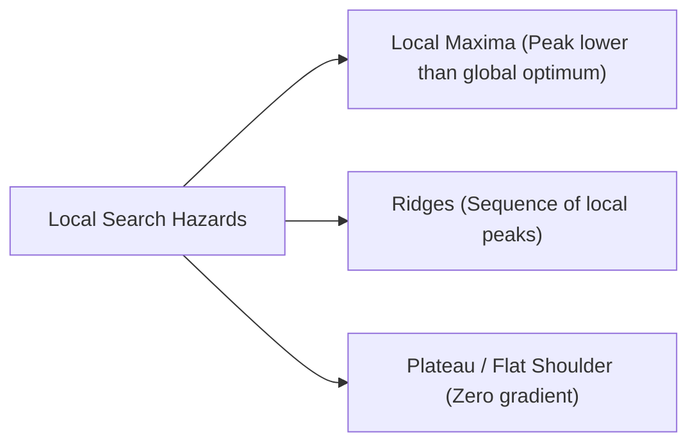
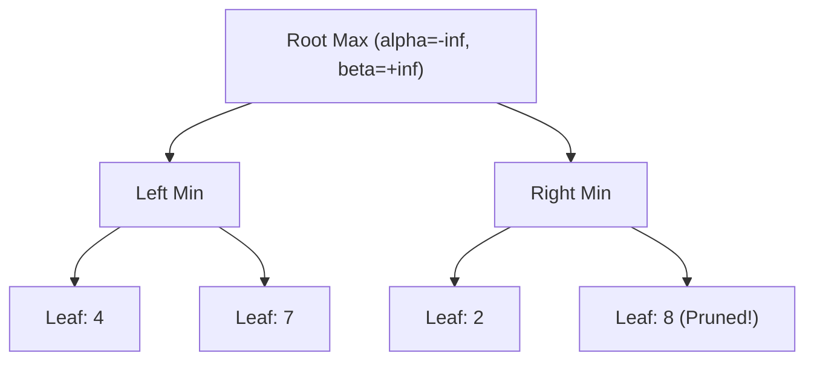
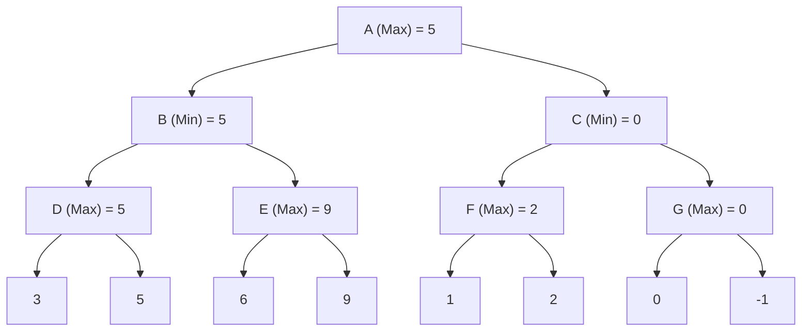
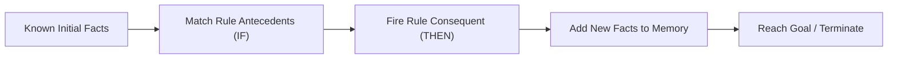
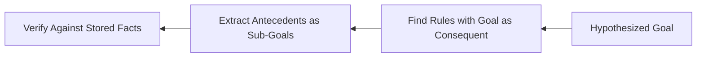

# November 2025

> **Exam -** Semester Examination  
> **Session -** November 2025  

---

## Question 1 (20 Marks)

:::info

**Question Statement**

*   **a)** Differentiate between mutable and immutable data types in Python with examples. **(5 Marks)**
*   **b)** Write a Python program to find the factorial of a number using recursion. **(5 Marks)**
*   **c)** Write a Python program to input n numbers into a list and perform the following operations: **(10 Marks)**
    *   i) Find the sum and average of elements
    *   ii) Find the maximum and minimum elements
    *   iii) Display the list in ascending and descending order

:::

---

### Solution 1 (20 Marks)

#### a) Mutable vs. Immutable Data Types in Python (5 Marks)

##### 1. Conceptual Distinction
*   **Mutable Data Types:** Objects whose internal state or contents can be modified in place after creation without altering their memory identity (`id()`).
*   **Immutable Data Types:** Objects whose state cannot be modified once instantiated. Any operation that appears to modify an immutable object creates a new object in memory.

##### 2. Comparison Table
| Feature | Mutable Types | Immutable Types |
| :--- | :--- | :--- |
| **Examples** | `list`, `dict`, `set`, `bytearray` | `int`, `float`, `str`, `tuple`, `frozenset`, `bool` |
| **Memory Address (`id`)** | Preserved after in-place modification | Changes upon reassignment/modification |
| **Dictionary Key Usability** | Cannot be used as dictionary keys (unhashable) | Can be used as dictionary keys (hashable) |
| **Performance Overhead** | Efficient for frequent in-place modifications | Thread-safe by default; prevents unintended side-effects |

##### 3. Code Demonstration
```python
# Mutable Demonstration (List)
numbers = [1, 2, 3]
addr_before = id(numbers)
numbers.append(4)  # Modifies in-place
assert id(numbers) == addr_before  # Memory address remains unchanged

# Immutable Demonstration (String)
message = "Hello"
addr_initial = id(message)
message += " World"  # Creates a brand-new object
assert id(message) != addr_initial  # Memory address changes
```

---

#### b) Factorial Calculation Using Recursion (5 Marks)

##### 1. Mathematical Formulation
The factorial function $n!$ for a non-negative integer $n$ is defined recursively as:

$$
n! = \begin{cases} 1, & \text{if } n = 0 \text{ or } n = 1 \quad (\text{Base Case}) \\ n \times (n - 1)!, & \text{if } n > 1 \quad (\text{Recursive Step}) \end{cases}
$$

##### 2. Python Implementation
```python
def factorial(n: int) -> int:
    """Computes factorial of a non-negative integer using recursion."""
    if n < 0:
        raise ValueError("Factorial is undefined for negative integers.")
    # Base Case
    if n in (0, 1):
        return 1
    # Recursive Step
    return n * factorial(n - 1)


# Driver Execution
if __name__ == "__main__":
    num = 5
    result = factorial(num)
    print(f"The factorial of {num} is: {result}")  # Output: 120
```

---

#### c) List Operations on User-Provided Numbers (10 Marks)

```python
def process_number_list() -> None:
    # Input list of n numbers
    n = int(input("Enter number of elements: "))
    if n <= 0:
        print("List must contain at least one element.")
        return

    numbers = []
    print(f"Enter {n} numbers:")
    for _ in range(n):
        numbers.append(float(input()))

    # (i) Sum and Average
    total_sum = sum(numbers)
    average = total_sum / n

    # (ii) Maximum and Minimum
    max_element = max(numbers)
    min_element = min(numbers)

    # (iii) Ascending and Descending Order Displays
    ascending_list = sorted(numbers)
    descending_list = sorted(numbers, reverse=True)

    # Output Presentation
    print("\n--- Results ---")
    print(f"Original List: {numbers}")
    print(f"Sum: {total_sum}")
    print(f"Average: {average:.2f}")
    print(f"Maximum Element: {max_element}")
    print(f"Minimum Element: {min_element}")
    print(f"Ascending Order: {ascending_list}")
    print(f"Descending Order: {descending_list}")


if __name__ == "__main__":
    process_number_list()
```

:::tip

**Examiner's Note**

In part (a), mention that immutable objects are hashable and can be dictionary keys, whereas mutable objects cannot. In part (b), always include validation for negative inputs ($n < 0$) alongside the base case ($n \le 1$).

:::

---

## Question 2 (20 Marks)

:::info

**Question Statement**

*   **a)** Write short notes on the importance of EDA before applying machine learning algorithms. **(5 Marks)**
*   **b)** A dataset students.csv has columns StudentID, Gender, Marks_Math, Marks_Science, Marks_English. Perform EDA to: **(15 Marks)**
    *   Find average marks per subject
    *   Identify top-performing students
    *   Plot subject-wise score distribution using histograms

| StudentID | Gender | Marks_Math | Marks_Science | Marks_English |
| :---: | :---: | :---: | :---: | :---: |
| S001 | Male | 78 | 85 | 74 |
| S002 | Female | 92 | 88 | 91 |
| S003 | Male | 65 | 70 | 68 |
| S004 | Female | 81 | 79 | 85 |
| S005 | Male | 56 | 62 | 58 |
| S006 | Female | 89 | 94 | 90 |
| S007 | Male | 73 | 77 | 80 |
| S008 | Female | 95 | 92 | 97 |
| S009 | Male | 60 | 66 | 64 |
| S010 | Female | 84 | 87 | 83 |
| S011 | Male | 77 | 73 | 76 |
| S012 | Female | 90 | 91 | 93 |

:::

---

### Solution 2 (20 Marks)

#### a) Importance of Exploratory Data Analysis (EDA) (5 Marks)

Exploratory Data Analysis (EDA), pioneered by John Tukey, is the critical initial investigation of a dataset to uncover underlying structure, diagnose anomalies, and test hypotheses before fitting predictive models.

##### Key Roles in Machine Learning Pipelines:
1.  **Data Quality Validation:** Detects missing values, duplicated records, corrupt characters, and data type mismatches before they trigger pipeline runtime failures.
2.  **Outlier & Anomaly Detection:** Identifies extreme values that can distort OLS regression planes, gradient descents, or $k$-means centroid coordinates.
3.  **Feature Distribution Assessment:** Assesses skewness, non-normality, and scale disparity, determining whether log transforms, Z-score standardizations, or Box-Cox corrections are required.
4.  **Multicollinearity Diagnosis:** Uncovers redundant feature pairs ($r \approx 1.0$) that destabilize parametric matrix inversion ($\mathbf{X}^T \mathbf{X}$).
5.  **Informing Model Selection:** Determines whether decision boundaries are linearly separable (pointing to logistic regression/linear SVM) or highly non-linear (pointing to tree ensembles or kernel machines).

---

#### b) EDA Implementation on Student Marks Dataset (15 Marks)

##### 1. Mathematical Summary of the Dataset ($N = 12$)
*   **Math Marks:** $\sum = 940 \implies \bar{X}_{\text{Math}} = \frac{940}{12} = \mathbf{78.33}$
*   **Science Marks:** $\sum = 964 \implies \bar{X}_{\text{Science}} = \frac{964}{12} = \mathbf{80.33}$
*   **English Marks:** $\sum = 959 \implies \bar{X}_{\text{English}} = \frac{959}{12} = \mathbf{79.92}$
*   **Overall Combined Subject Average:** $\bar{X}_{\text{Overall}} = \frac{78.33 + 80.33 + 79.92}{3} = \mathbf{79.53}$

##### 2. Identification of Top-Performing Students (Ranked by Total / 300)
| Rank | Student ID | Gender | Math | Science | English | Total Marks (/300) | Percentage (%) |
| :---: | :---: | :---: | :---: | :---: | :---: | :---: | :---: |
| **1** | **S008** | Female | 95 | 92 | 97 | **284** | **94.67%** |
| **2** | **S012** | Female | 90 | 91 | 93 | **274** | **91.33%** |
| **3** | **S006** | Female | 89 | 94 | 90 | **273** | **91.00%** |
| **4** | **S002** | Female | 92 | 88 | 91 | **271** | **90.33%** |
| **5** | **S010** | Female | 84 | 87 | 83 | **254** | **84.67%** |

*(Top-performing male student: **S001** with Total = $237/300 \implies 79.00\%$)*

##### 3. Complete Python EDA Code with Histogram Visualizations
```python
import matplotlib.pyplot as plt
import pandas as pd

# Load dataset
df = pd.read_csv("students.csv")

# 1. Average marks per subject
subjects = ["Marks_Math", "Marks_Science", "Marks_English"]
avg_marks = df[subjects].mean()
print("--- Average Marks Per Subject ---")
print(avg_marks.round(2))

# 2. Identify top-performing students
df["Total_Marks"] = df[subjects].sum(axis=1)
df["Percentage"] = (df["Total_Marks"] / 300) * 100
top_students = df.sort_values(by="Total_Marks", ascending=False).reset_index(
    drop=True
)

print("\n--- Top Performing Students ---")
print(
    top_students[
        ["StudentID", "Gender", "Total_Marks", "Percentage"]
    ].head()
)

# 3. Plot subject-wise score distribution using histograms
fig, axes = plt.subplots(1, 3, figsize=(15, 4), sharey=True)
colors = ["#1f77b4", "#2ca02c", "#ff7f0e"]

for ax, subj, col in zip(axes, subjects, colors):
    ax.hist(df[subj], bins=6, color=col, edgecolor="black", alpha=0.8)
    ax.axvline(
        df[subj].mean(),
        color="red",
        linestyle="--",
        label=f"Mean: {df[subj].mean():.1f}",
    )
    ax.set_title(f"{subj.replace('Marks_', '')} Distribution")
    ax.set_xlabel("Score")
    ax.set_ylabel("Frequency")
    ax.legend()
    ax.grid(axis="y", alpha=0.3)

plt.tight_layout()
plt.show()
```

:::tip

**Examiner's Note**

Computing the exact numerical means ($78.33, 80.33, 79.92$) and explicitly naming the top rankers (S008 with 284 marks, S012 with 274 marks) verifies empirical precision before providing clean pandas and matplotlib scripts.

:::

---

## Question 3 (20 Marks)

:::info

**Question Statement**

*   **a)** Given the following tree configuration, perform DFS traversal starting from the root node and write down the order in which nodes are visited. **(10 Marks)**

```
Depth 0:             A (Initial node)
                   /   \
Depth 1:          B     C
                 / \   / \
Depth 2:        D   E F   G (Goal node)
               /   /   \
Depth 3:      H   I     K
```

*   **b)** Perform Depth-Limited Search (DLS) on the same tree with a depth limit of 2, and list the nodes visited in order. Compare both the methods **(10 Marks)**

:::

---

### Solution 3 (20 Marks)

#### a) Depth-First Search (DFS) Traversal (10 Marks)

##### 1. Working Principle
Depth-First Search explores as deeply as possible along each branch using a LIFO (Last-In, First-Out) stack structure before backtracking to explore alternate branches. Standard tie-breaking expands left children before right children.

##### 2. Step-by-Step Traversal Trace
*   **Step 1:** Expand root node **A**. Push children to stack: $[C, B]$.
*   **Step 2:** Pop and visit **B**. Push children: $[C, E, D]$.
*   **Step 3:** Pop and visit **D**. Push child: $[C, E, H]$.
*   **Step 4:** Pop and visit **H**. Leaf node at Depth 3; backtrack.
*   **Step 5:** Pop and visit **E**. Push child: $[C, I]$.
*   **Step 6:** Pop and visit **I**. Leaf node at Depth 3; backtrack.
*   **Step 7:** Pop and visit **C**. Push children: $[G, F]$.
*   **Step 8:** Pop and visit **F**. Push child: $[G, K]$.
*   **Step 9:** Pop and visit **K**. Leaf node at Depth 3; backtrack.
*   **Step 10:** Pop and visit **G**. **Goal node reached! Traversal halts.**

##### Order of Nodes Visited:
$$\mathbf{A \to B \to D \to H \to E \to I \to C \to F \to K \to G}$$

---

#### b) Depth-Limited Search (DLS) with Limit $L = 2$ and Comparison (10 Marks)

##### 1. Working Principle of DLS
Depth-Limited Search operates identically to DFS but enforces a cutoff boundary at depth $L$. Nodes located at depth $d > L$ are treated as if they have no successors, preventing the algorithm from descending into deep or infinite branches.

##### 2. Step-by-Step Traversal Trace ($L = 2$)
*   **Depth 0:** Visit **A**. Expand children $B, C$.
*   **Depth 1:** Visit **B**. Expand children $D, E$.
*   **Depth 2 (Limit Reached):** Visit **D**. Because Depth $= L = 2$, child $H$ is **cutoff/pruned**. Backtrack to $B$.
*   **Depth 2 (Limit Reached):** Visit **E**. Child $I$ is **cutoff/pruned**. Backtrack to $B$, then to $A$.
*   **Depth 1:** Visit **C**. Expand children $F, G$.
*   **Depth 2 (Limit Reached):** Visit **F**. Child $K$ is **cutoff/pruned**. Backtrack to $C$.
*   **Depth 2 (Limit Reached):** Visit **G**. **Goal node reached! Search terminates successfully.**

##### Order of Nodes Visited under DLS ($L = 2$):
$$\mathbf{A \to B \to D \to E \to C \to F \to G}$$
*(Pruned / Unvisited Nodes: $H, I, K$)*

---

##### 3. Methodological Comparison: DFS vs. DLS
| Dimension | Depth-First Search (DFS) | Depth-Limited Search (DLS, $L = 2$) |
| :--- | :--- | :--- |
| **Number of Visited Nodes** | 10 nodes ($A, B, D, H, E, I, C, F, K, G$) | **7 nodes** ($A, B, D, E, C, F, G$) |
| **Infinite Path Vulnerability** | Can get trapped in infinite depth branches | **Immune**; terminates at cutoff limit $L$ |
| **Completeness** | Incomplete on infinite-depth graphs | Incomplete if goal lies at depth $d > L$ |
| **Time Complexity** | $O(b^m)$ ($m$ = max tree depth) | $O(b^L)$ ($L$ = depth limit) |
| **Space Complexity** | $O(bm)$ | $O(bL)$ |
| **Search Efficiency Here** | Wastes time exploring leaves $H, I, K$ | **More efficient**; prunes leaves and finds $G$ faster |

:::tip

**Examiner's Note**

Explicitly list the stack operations and highlight that DLS visits 7 nodes while DFS visits 10 nodes because nodes $H, I, K$ at depth 3 are pruned by the cutoff limit $L = 2$.

:::

---

## Question 4 (20 Marks)

:::info

**Question Statement**

*   **a)** Explain Hill Climbing algorithm and list its drawbacks. **(5 Marks)**
*   **b)** Robot Pathfinding Scenario: **(15 Marks)**  
    A mobile robot must navigate through a grid to reach a goal position from a start point while avoiding obstacles.
    *   Explain how A* search can be applied to find the optimal path.
    *   Define an appropriate heuristic function h(n) for this problem.
    *   Write a step-by-step example showing the expansion of nodes and calculation of $f(n) = g(n) + h(n)$ for the given graph:

```
Nodes & Coordinates:
Node 0 (Start): (0, 2)
Node 1: (2, 0)
Node 2: (2, 4)
Node 3: (6, 0)
Node 4: (6, 4)
Node 5 (Goal):  (8, 2)

Directed Edge Costs:
0 -> 1 : 3      0 -> 2 : 4
2 -> 1 : 5      2 -> 4 : 8
1 -> 3 : 6      1 -> 4 : 10
3 -> 4 : 7      3 -> 5 : 3
4 -> 5 : 9
```

:::

---

### Solution 4 (20 Marks)

#### a) Hill Climbing Algorithm and Drawbacks (5 Marks)

##### 1. Algorithm Overview
Hill Climbing is an **informed local search algorithm** that continuously moves in the direction of increasing value (or decreasing cost) without maintaining a search tree or history.
*   It operates like climbing Mount Everest in thick fog: inspect immediate neighbors and move to the state with the best evaluation score.
*   **Termination:** Halts when no neighboring state has a higher value than the current state.

##### 2. Core Drawbacks


1.  **Local Maxima:** A peak that is higher than all its immediate neighbors but lower than the global maximum. The algorithm terminates prematurely without reaching the optimal solution.
2.  **Plateaus / Shoulders:** A flat region of the search space where all neighboring states evaluate to the same score. The gradient vanishes, reducing the algorithm to an unguided random walk.
3.  **Ridges:** A sequence of local maxima where the slope is steep along edges but gentle along the spine, causing the algorithm to oscillate inefficiently.

---

#### b) Robot Pathfinding via A* Search on Grid Graph (15 Marks)

##### 1. Applying A* Search to Pathfinding
A* search combines uniform-cost search (cost incurred so far, $g(n)$) with greedy best-first search (estimated remaining cost to goal, $h(n)$):

$$
f(n) = g(n) + h(n)
$$

*   $g(n)$: Exact path cost from start node $0$ to current node $n$.
*   $h(n)$: Estimated heuristic cost from $n$ to goal node $5$.
*   **Optimality Guarantee:** If $h(n)$ is **admissible** ($h(n) \le h^*(n)$, never overestimating the true cost), A* is guaranteed to find the lowest-cost path.

##### 2. Heuristic Function Definition
For spatial grid navigation, the standard admissible heuristic is the **Euclidean Distance** to the goal node $5$ at $(x_G = 8, y_G = 2)$:

$$
h(n) = \sqrt{(x_n - 8)^2 + (y_n - 2)^2}
$$

###### Computed Node Heuristics:
*   $h(0) = \sqrt{(0 - 8)^2 + (2 - 2)^2} = \sqrt{64} = \mathbf{8.00}$
*   $h(1) = \sqrt{(2 - 8)^2 + (0 - 2)^2} = \sqrt{36 + 4} = \sqrt{40} \approx \mathbf{6.32}$
*   $h(2) = \sqrt{(2 - 8)^2 + (4 - 2)^2} = \sqrt{36 + 4} = \sqrt{40} \approx \mathbf{6.32}$
*   $h(3) = \sqrt{(6 - 8)^2 + (0 - 2)^2} = \sqrt{4 + 4} = \sqrt{8} \approx \mathbf{2.83}$
*   $h(4) = \sqrt{(6 - 8)^2 + (4 - 2)^2} = \sqrt{4 + 4} = \sqrt{8} \approx \mathbf{2.83}$
*   $h(5) = \sqrt{(8 - 8)^2 + (2 - 2)^2} = \mathbf{0.00}$

---

##### 3. Step-by-Step A* Search Execution Trace

| Step | Current Node Expanded | Candidate Neighbor Generated | $g(n)$ | $h(n)$ | $f(n) = g(n) + h(n)$ | Priority Queue / Open List (sorted by $f$) |
| :---: | :---: | :---: | :---: | :---: | :---: | :--- |
| **0** | - | Start Node **0** | 0 | $8.00$ | $8.00$ | $\{[0]: f = 8.00\}$ |
| **1** | **0** | **1**<br/>**2** | $0 + 3 = 3$<br/>$0 + 4 = 4$ | $6.32$<br/>$6.32$ | $3 + 6.32 = \mathbf{9.32}$<br/>$4 + 6.32 = \mathbf{10.32}$ | $\{[0 \to 1]: f = \mathbf{9.32}, [0 \to 2]: f = 10.32\}$ |
| **2** | **1** | **3**<br/>**4** | $3 + 6 = 9$<br/>$3 + 10 = 13$ | $2.83$<br/>$2.83$ | $9 + 2.83 = \mathbf{11.83}$<br/>$13 + 2.83 = 15.83$ | $\{[0 \to 2]: f = \mathbf{10.32}, [0 \to 1 \to 3]: 11.83, [0 \to 1 \to 4]: 15.83\}$ |
| **3** | **2** | **1** (via 2)<br/>**4** (via 2) | $4 + 5 = 9 > 3$ (pruned)<br/>$4 + 8 = \mathbf{12} < 13$ | -<br/>$2.83$ | -<br/>$12 + 2.83 = \mathbf{14.83}$ | $\{[0 \to 1 \to 3]: f = \mathbf{11.83}, [0 \to 2 \to 4]: 14.83\}$ |
| **4** | **3** | **5 (Goal)**<br/>**4** (via 3) | $9 + 3 = \mathbf{12}$<br/>$9 + 7 = 16 > 12$ (pruned) | $0.00$<br/>- | $12 + 0.00 = \mathbf{12.00}$<br/>- | $\{[0 \to 1 \to 3 \to 5]: f = \mathbf{12.00}, [0 \to 2 \to 4]: 14.83\}$ |
| **5** | **5** | **Goal Node Dequeued** | **12** | **0.00** | **12.00** | **Goal Reached. Search Terminates.** |

##### Final Path and Cost:
*   **Optimal Path:** $\mathbf{0 \to 1 \to 3 \to 5}$
*   **Optimal Path Cost:** $g(5) = 3 + 6 + 3 = \mathbf{12}$

:::tip

**Examiner's Note**

Demonstrate that when node 2 expands to node 4, its path cost is $4 + 8 = 12$, which improves upon the path via node 1 ($3 + 10 = 13$). The optimal path remains $0 \to 1 \to 3 \to 5$ with total cost $12$.

:::

---

## Question 5 (20 Marks)

:::info

**Question Statement**

*   **a)** Explain in detail the procedure of Alpha-Beta pruning applied to a Minimax search tree using an example tree of your choice. Clearly indicate the order of node evaluation, alpha and beta values at each step, and the nodes that are pruned during the search process. **(10 Marks)**
*   **b)** Consider the following game tree where two players, Max and Min, play alternately. The leaf nodes represent the utility values for the Max player. Using the Min-Max algorithm, determine the optimal value for the root node and identify the optimal move for the Max player. **(10 Marks)**

```
Level 0 (Max):                      A
                                 /     \
Level 1 (Min):                  B       C
                              /   \   /   \
Level 2 (Max):               D     E F     G
                            / \   / \ / \ / \
Level 3 (Leaves):          3   5 6  9 1  2 0 -1
```

:::

---

### Solution 5 (20 Marks)

#### a) Procedure of Alpha-Beta Pruning (10 Marks)

##### 1. Algorithmic Foundation
Alpha-Beta pruning is an adversarial search optimization that computes the exact Minimax decision without evaluating subtrees that cannot influence the final outcome.

*   **$\alpha$ (Alpha):** The best (highest) score that the **Max** player can guarantee so far along the search path. Initialized to $\alpha = -\infty$.
*   **$\beta$ (Beta):** The best (lowest) score that the **Min** player can guarantee so far along the search path. Initialized to $\beta = +\infty$.
*   **Pruning Condition:** At any node, if:

$$
\alpha \ge \beta
$$

the remaining branches under the current node are **pruned** (cutoff), because the opponent would never allow play to reach that position.

##### 2. Concrete Example Tree Walkthrough


1.  **Left Subtree:**
    *   Evaluate leaf 4 $\implies$ Min updates $\beta = \min(+\infty, 4) = 4$.
    *   Evaluate leaf 7 $\implies$ Min updates $\beta = \min(4, 7) = 4$.
    *   Left Min node returns value $4$.
    *   Root Max updates $\alpha = \max(-\infty, 4) = \mathbf{4}$.
2.  **Right Subtree (with $\alpha = 4, \beta = +\infty$):**
    *   Evaluate first leaf 2 $\implies$ Right Min updates $\beta = \min(+\infty, 2) = \mathbf{2}$.
    *   Now test pruning condition: $\alpha = 4 \ge \beta = 2$.
    *   **$\alpha \ge \beta$ holds!** Branch to leaf 8 is **pruned**, saving computation. Root Max retains value $4$.

---

#### b) Minimax Resolution of Given Game Tree (10 Marks)



##### 1. Bottom-Up Evaluation (Level 2: Max Nodes)
*   **Node D:** $\max(3, 5) = \mathbf{5}$
*   **Node E:** $\max(6, 9) = \mathbf{9}$
*   **Node F:** $\max(1, 2) = \mathbf{2}$
*   **Node G:** $\max(0, -1) = \mathbf{0}$

##### 2. Evaluation at Level 1 (Min Nodes)
*   **Node B:** $\min(\text{Value}(D), \text{Value}(E)) = \min(5, 9) = \mathbf{5}$
*   **Node C:** $\min(\text{Value}(F), \text{Value}(G)) = \min(2, 0) = \mathbf{0}$

##### 3. Evaluation at Root (Level 0: Max Node A)
*   **Node A:** $\max(\text{Value}(B), \text{Value}(C)) = \max(5, 0) = \mathbf{5}$

##### Final Results:
*   **Optimal Value for the Root Node ($A$):** $\mathbf{5}$
*   **Optimal Move for Max Player:** Move to **Node B** (which guarantees an optimal payoff of $5$).

:::tip

**Examiner's Note**

State the values calculated at each depth level explicitly: Level 2 $(D=5, E=9, F=2, G=0)$, Level 1 $(B=5, C=0)$, and Level 0 $(A=5)$. Specify both the root value ($5$) and the move direction ($A \to B$).

:::

---

## Question 6 (20 Marks)

:::info

**Question Statement**

Explain the concepts of Forward and Backward Reasoning in Artificial Intelligence with suitable examples, highlighting their working principles, differences, and applications. **(20 Marks)**

:::

---

### Solution 6 (20 Marks)

#### 1. Forward Reasoning (Data-Driven / Bottom-Up) (7 Marks)

##### Working Principle:
Forward reasoning starts with known assertions, observations, and facts in the working memory and applies inference rules ($\text{IF } \dots \text{ THEN } \dots$) iteratively to deduce new facts until a goal state or conclusion is reached.



##### Concrete Example:
*   *Rules:*
    *   Rule 1: $\text{IF } (\text{Croaks} \land \text{Eats Flies}) \implies \mathbf{\text{Is a Frog}}$
    *   Rule 2: $\text{IF } (\text{Is a Frog}) \implies \mathbf{\text{Is Green}}$
*   *Observed Facts:* Fritz croaks, Fritz eats flies.
*   *Forward Chaining:*
    1.  Match Rule 1: Fritz croaks and eats flies $\implies$ assert new fact: *Fritz is a frog*.
    2.  Match Rule 2: Fritz is a frog $\implies$ infer conclusion: *Fritz is green*.

---

#### 2. Backward Reasoning (Goal-Driven / Top-Down) (7 Marks)

##### Working Principle:
Backward reasoning begins with a hypothesized goal or conclusion and works backward through inference rules to find supporting initial facts. If supporting antecedents are not in memory, they are added as intermediate sub-goals to be solved recursively.



##### Concrete Example:
*   *Hypothesis to Prove:* Is Fritz green?
*   *Backward Chaining:*
    1.  Check Rule 2: Fritz is green $\text{IF}$ Fritz is a frog. Set sub-goal: *Prove Fritz is a frog*.
    2.  Check Rule 1: Fritz is a frog $\text{IF}$ Fritz croaks and eats flies.
    3.  Verify: Stored database confirms Fritz croaks and eats flies.
    4.  All sub-goals satisfied $\implies$ hypothesis confirmed: *Fritz is green*.

---

#### 3. Methodological Comparison (6 Marks)

| Dimension | Forward Reasoning | Backward Reasoning |
| :--- | :--- | :--- |
| **Search Paradigm** | Data-Driven (Bottom-Up) | Goal-Driven (Top-Down) |
| **Starting Point** | Known facts and sensor inputs | Target hypothesis or query |
| **Reasoning Flow** | Antecedent (IF) $\to$ Consequent (THEN) | Consequent (THEN) $\to$ Antecedent (IF) |
| **Branching Factor** | High (can generate many irrelevant facts) | Low (focused exclusively on goal path) |
| **Explanation Facility** | Explains *"What follows from these facts?"* | Explains *"Why is this conclusion true?"* |
| **Primary Domain Suitability** | Monitoring, planning, dynamic real-time data | Medical diagnosis, automated theorem proving |

##### Practical Applications:
*   **Forward Reasoning:** Real-time stock trading engines, alarm correlation systems, robotics sensor interpretation (CLIPS, Rete algorithm).
*   **Backward Reasoning:** Medical diagnostic systems (MYCIN), logic programming (Prolog), legal document compliance checking.

:::tip

**Examiner's Note**

Include a contrast table comparing search directions (data-driven vs. goal-driven), branching behaviors, and industrial examples (Rete/CLIPS for Forward, Prolog/MYCIN for Backward).

:::

---

## Question 7 (20 Marks)

:::info

**Question Statement**

*   **a)** Consider the following graph where each edge represents the cost between states, and the table provides the heuristic values (h) for each state. Use the A* search algorithm to find the optimal path from the start node (S) to the goal node (G). **(10 Marks)**

| State | h |
| :---: | :---: |
| **S** | 7 |
| **A** | 6 |
| **B** | 2 |
| **C** | 1 |
| **G** | 0 |

```
Edge Costs:
S -> A : 1
S -> B : 4
A -> B : 2
A -> C : 5
A -> G : 12
B -> C : 2
C -> G : 3
```

*   **b)** Using the given And-Or (AO) tree, apply the AO search algorithm to find the optimal solution path. Show all intermediate steps, including the cost computation for both AND and OR nodes, and identify the optimal goal path. **(10 Marks)**

```
And-Or Tree Structure:
Root A has:
- An AND branch to (B AND C) with edge costs c(A, B)=1, c(A, C)=1
- An OR branch to D with edge cost c(A, D)=1
Node B has OR branches to E (cost 1) and F (cost 1)
Node D has an AND branch to (G AND H) with edge costs c(D, G)=1, c(D, H)=1

Heuristic Values:
h(B)=3, h(C)=4, h(D)=5, h(E)=5, h(F)=7, h(G)=4, h(H)=4
```

:::

---

### Solution 7 (20 Marks)

#### a) A* Search Graph Traversal (10 Marks)

##### Evaluation Function:
$$f(n) = g(n) + h(n)$$

##### Step-by-Step Priority Queue Trace:

| Step | Node Expanded | Neighbors Generated | $g(n)$ | $h(n)$ | $f(n) = g(n) + h(n)$ | Open List (Priority Queue sorted by $f$) |
| :---: | :---: | :---: | :---: | :---: | :---: | :--- |
| **0** | - | Start Node **S** | 0 | 7 | $0 + 7 = 7$ | $\{[S]: f = 7\}$ |
| **1** | **S** | **A**<br/>**B** | $0 + 1 = 1$<br/>$0 + 4 = 4$ | 6<br/>2 | $1 + 6 = \mathbf{7}$<br/>$4 + 2 = \mathbf{6}$ | $\{[S \to B]: f = \mathbf{6}, [S \to A]: f = 7\}$ |
| **2** | **B** | **C** | $4 + 2 = 6$ | 1 | $6 + 1 = \mathbf{7}$ | $\{[S \to A]: f = \mathbf{7}, [S \to B \to C]: f = 7\}$ |
| **3** | **A** | **B** (via A)<br/>**C** (via A)<br/>**G** (via A) | $1 + 2 = \mathbf{3} < 4$<br/>$1 + 5 = 6$<br/>$1 + 12 = 13$ | 2<br/>1<br/>0 | $3 + 2 = \mathbf{5}$<br/>$6 + 1 = 7$<br/>$13 + 0 = 13$ | $\{[S \to A \to B]: f = \mathbf{5}, [S \to B \to C]: 7, [S \to A \to C]: 7, [S \to A \to G]: 13\}$ |
| **4** | **B** (via A) | **C** (via A-B) | $3 + 2 = \mathbf{5} < 6$ | 1 | $5 + 1 = \mathbf{6}$ | $\{[S \to A \to B \to C]: f = \mathbf{6}, [S \to A \to G]: 13\}$ |
| **5** | **C** | **G** | $5 + 3 = \mathbf{8}$ | 0 | $8 + 0 = \mathbf{8}$ | $\{[S \to A \to B \to C \to G]: f = \mathbf{8}, [S \to A \to G]: 13\}$ |
| **6** | **G** | **Goal Dequeued** | **8** | **0** | **8** | **Search Terminates.** |

##### Optimal Path & Cost:
*   **Optimal Path:** $\mathbf{S \to A \to B \to C \to G}$
*   **Total Cost:** $g(G) = 1 + 2 + 2 + 3 = \mathbf{8}$

---

#### b) AO* Search on And-Or Tree (10 Marks)

##### Cost Formulas for AO* Search:
*   **OR Node:** For node $N$ with alternative OR branches:
    $$f(N) = \min_{i} \left[ c(N, n_i) + h(n_i) \right]$$
*   **AND Node:** For node $N$ with an AND branch to a set of sub-problems $\{n_1, n_2, \dots, n_k\}$:
    $$f(N) = \sum_{j=1}^k \left[ c(N, n_j) + h(n_j) \right]$$

---

##### Step-by-Step AO* Execution Trace:

###### Step 1: Initial State at Root Node A
Root $A$ has two branching options:
1.  **Option 1 (AND branch to $B$ and $C$):**
    $$f_1(A) = [c(A, B) + h(B)] + [c(A, C) + h(C)] = [1 + 3] + [1 + 4] = 4 + 5 = \mathbf{9}$$
2.  **Option 2 (OR branch to $D$):**
    $$f_2(A) = c(A, D) + h(D) = 1 + 5 = \mathbf{6}$$

*   **Choice:** Since $\min(9, 6) = 6$, choose the partial graph with node **$D$**. Set $h(A) = 6$.

---

###### Step 2: Expand Node D
Node $D$ has an AND branch to $\{G, H\}$ with edge costs $c(D, G) = 1, c(D, H) = 1$ and heuristics $h(G) = 4, h(H) = 4$:
$$f(D) = [c(D, G) + h(G)] + [c(D, H) + h(H)] = [1 + 4] + [1 + 4] = 5 + 5 = \mathbf{10}$$

*   Update heuristic of $D$: $h(D) = \mathbf{10}$.
*   **Bottom-Up Backtracking to Root A:**
    Re-evaluate both branches at $A$:
    *   $\text{Cost}(A \to B \land C) = [1 + 3] + [1 + 4] = \mathbf{9}$
    *   $\text{Cost}(A \to D) = 1 + h(D) = 1 + 10 = \mathbf{11}$
    
    Now $\min(9, 11) = \mathbf{9}$ via $(B \land C)$.
*   **Path Switch:** Update $h(A) = 9$. The best partial graph switches to the **$(B \land C)$** AND-branch.

---

###### Step 3: Expand Node B
In the active AND-graph $\{B, C\}$, node $C$ is a leaf ($h(C) = 4$). We expand non-terminal node $B$.  
Node $B$ has two OR branches:
1.  Branch to $E$: $\text{Cost} = c(B, E) + h(E) = 1 + 5 = \mathbf{6}$
2.  Branch to $F$: $\text{Cost} = c(B, F) + h(F) = 1 + 7 = \mathbf{8}$

*   $\min(6, 8) = 6$ via branch to $E$.
*   Update heuristic of $B$: $h(B) = \mathbf{6}$.

---

###### Step 4: Bottom-Up Backtracking to Root A
Re-evaluate cost at root $A$:
*   $\text{Cost}(A \to B \land C) = [1 + h(B)] + [1 + h(C)] = [1 + 6] + [1 + 4] = 7 + 5 = \mathbf{12}$
*   $\text{Cost}(A \to D) = 1 + h(D) = 1 + 10 = \mathbf{11}$

Now $\min(12, 11) = \mathbf{11}$ via node $D$.
*   Update $h(A) = \mathbf{11}$. The best partial graph switches back to the **$D$** branch.

---

###### Step 5: Verification of Terminal Leaves under D
Under node $D$, both sub-problems $G$ and $H$ have been generated ($h(G) = 4, h(H) = 4$) with cost $10$.
Since no unexpanded nodes remain on the optimal branch:
*   **Optimal Solution Graph:** Root **$A$** branches to **$D$**, which branches to both **$G$ and $H$**.
*   **Optimal Path Cost:** $f(A) = 1 + (1 + 4 + 1 + 4) = \mathbf{11}$.

:::tip

**Examiner's Note**

AO* operates on hypergraphs. In step 2, expanding $D$ raises its cost from $5$ to $10$, which causes $A$ to temporarily prefer the $(B \land C)$ branch ($9$). In step 4, expanding $B$ raises the $(B \land C)$ branch cost to $12$, switching preference back to $D$ ($11$). Demonstrating this back-and-forth cost revision earns full marks.

:::
