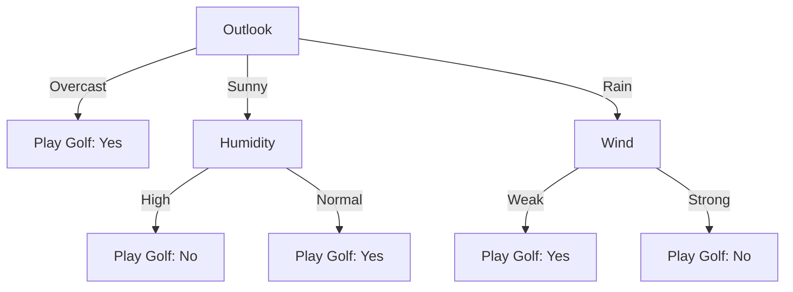
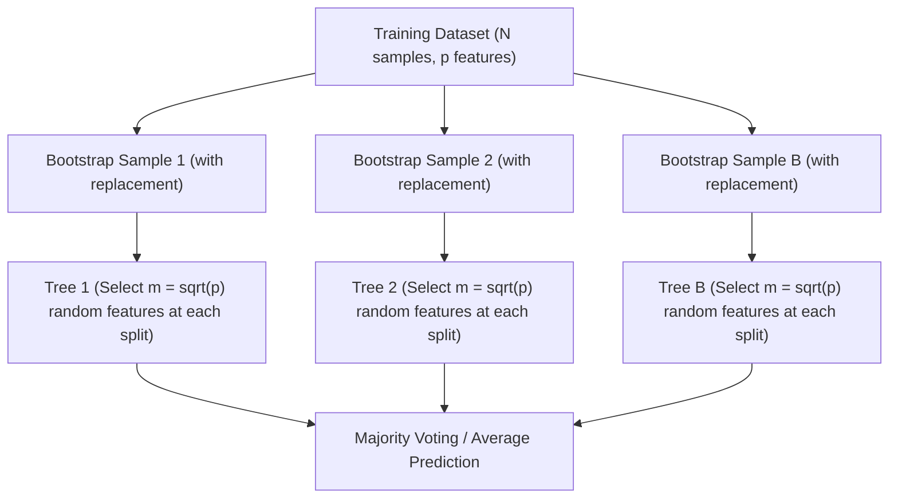

# CT-2

> **Exam -** Cycle Test - II  
> **Date -** 24/10/26  

---

## Question 1 (20 Marks)

:::info

**Question Statement**

*   **i.** Apply the K-Nearest Neighbor (KNN) algorithm to a given dataset of your choice (you may assume a small dataset). Demonstrate how the classification is performed for a new test sample when k = 5. Show all distance calculations, neighbour selection, and final class prediction. **(10 Marks)**
*   **ii.** Analyze the differences among Gaussian, Multinomial, and Bernoulli Naïve Bayes classifiers. Using a real-world scenario (e.g., email classification, sensor data, or text classification), justify which Naïve Bayes variant is most suitable and why. **(10 Marks)**

:::

---

### Solution 1 (20 Marks)

#### i. K-Nearest Neighbor (KNN) Algorithm Classification with $k = 5$ (10 Marks)

##### 1. Problem Formulation & Training Dataset
Let the training dataset $\mathcal{D}_{\text{train}}$ represent a credit risk assessment problem with two normalized features: **Age Ratio ($X_1$)** and **Income Ratio ($X_2$)**, predicting credit default risk ($Y \in \{\text{Low Risk (0)}, \text{High Risk (1)}\}$):

$$\mathcal{D}_{\text{train}} = \{(X_{1i}, X_{2i}, Y_i)\}_{i=1}^{10}$$

| Sample ID ($i$) | Feature $X_1$ | Feature $X_2$ | True Class ($Y$) |
| :---: | :---: | :---: | :---: |
| **$P_1$** | 1.0 | 2.0 | Low Risk (0) |
| **$P_2$** | 2.0 | 1.0 | Low Risk (0) |
| **$P_3$** | 2.0 | 3.0 | Low Risk (0) |
| **$P_4$** | 3.0 | 2.0 | Low Risk (0) |
| **$P_5$** | 3.0 | 4.0 | Low Risk (0) |
| **$P_6$** | 5.0 | 5.0 | High Risk (1) |
| **$P_7$** | 5.0 | 7.0 | High Risk (1) |
| **$P_8$** | 6.0 | 4.0 | High Risk (1) |
| **$P_9$** | 6.0 | 6.0 | High Risk (1) |
| **$P_{10}$** | 7.0 | 5.0 | High Risk (1) |

##### 2. New Test Query Sample
Let the unlabelled query point be:
$$\mathbf{X}^* = (x_1^* = 4.0, \ x_2^* = 3.0)$$

##### 3. Step 1: Distance Calculation
Compute the Euclidean distance $d(\mathbf{X}^*, P_i) = \sqrt{(x_1^* - X_{1i})^2 + (x_2^* - X_{2i})^2}$ for all 10 training instances:

*   $d(\mathbf{X}^*, P_1) = \sqrt{(4.0 - 1.0)^2 + (3.0 - 2.0)^2} = \sqrt{9 + 1} = \sqrt{10} \approx \mathbf{3.162}$
*   $d(\mathbf{X}^*, P_2) = \sqrt{(4.0 - 2.0)^2 + (3.0 - 1.0)^2} = \sqrt{4 + 4} = \sqrt{8} \approx \mathbf{2.828}$
*   $d(\mathbf{X}^*, P_3) = \sqrt{(4.0 - 2.0)^2 + (3.0 - 3.0)^2} = \sqrt{4 + 0} = \sqrt{4} = \mathbf{2.000}$
*   $d(\mathbf{X}^*, P_4) = \sqrt{(4.0 - 3.0)^2 + (3.0 - 2.0)^2} = \sqrt{1 + 1} = \sqrt{2} \approx \mathbf{1.414}$
*   $d(\mathbf{X}^*, P_5) = \sqrt{(4.0 - 3.0)^2 + (3.0 - 4.0)^2} = \sqrt{1 + 1} = \sqrt{2} \approx \mathbf{1.414}$
*   $d(\mathbf{X}^*, P_6) = \sqrt{(4.0 - 5.0)^2 + (3.0 - 5.0)^2} = \sqrt{1 + 4} = \sqrt{5} \approx \mathbf{2.236}$
*   $d(\mathbf{X}^*, P_7) = \sqrt{(4.0 - 5.0)^2 + (3.0 - 7.0)^2} = \sqrt{1 + 16} = \sqrt{17} \approx \mathbf{4.123}$
*   $d(\mathbf{X}^*, P_8) = \sqrt{(4.0 - 6.0)^2 + (3.0 - 4.0)^2} = \sqrt{4 + 1} = \sqrt{5} \approx \mathbf{2.236}$
*   $d(\mathbf{X}^*, P_9) = \sqrt{(4.0 - 6.0)^2 + (3.0 - 6.0)^2} = \sqrt{4 + 9} = \sqrt{13} \approx \mathbf{3.606}$
*   $d(\mathbf{X}^*, P_{10}) = \sqrt{(4.0 - 7.0)^2 + (3.0 - 5.0)^2} = \sqrt{9 + 4} = \sqrt{13} \approx \mathbf{3.606}$

##### 4. Step 2: Neighbor Ranking and Selection for $k = 5$
Sort training instances in ascending order of distance:

| Rank | Training Point | Coordinates $(X_1, X_2)$ | Euclidean Distance $d$ | Class Label ($Y$) | Selected in $k = 5$? |
| :---: | :---: | :---: | :---: | :---: | :---: |
| **1** | **$P_4$** | $(3.0, 2.0)$ | $\mathbf{1.414}$ | **Low Risk (0)** | **Yes** |
| **2** | **$P_5$** | $(3.0, 4.0)$ | $\mathbf{1.414}$ | **Low Risk (0)** | **Yes** |
| **3** | **$P_3$** | $(2.0, 3.0)$ | $\mathbf{2.000}$ | **Low Risk (0)** | **Yes** |
| **4** | **$P_6$** | $(5.0, 5.0)$ | $\mathbf{2.236}$ | **High Risk (1)** | **Yes** |
| **5** | **$P_8$** | $(6.0, 4.0)$ | $\mathbf{2.236}$ | **High Risk (1)** | **Yes** |
| 6 | $P_2$ | $(2.0, 1.0)$ | $2.828$ | Low Risk (0) | No |
| 7 | $P_1$ | $(1.0, 2.0)$ | $3.162$ | Low Risk (0) | No |
| 8 | $P_9$ | $(6.0, 6.0)$ | $3.606$ | High Risk (1) | No |
| 9 | $P_{10}$ | $(7.0, 5.0)$ | $3.606$ | High Risk (1) | No |
| 10 | $P_7$ | $(5.0, 7.0)$ | $4.123$ | High Risk (1) | No |

##### 5. Step 3: Majority Voting & Final Class Prediction
Among the $k = 5$ nearest neighbors $\mathcal{N}_5(\mathbf{X}^*) = \{P_4, P_5, P_3, P_6, P_8\}$:
*   Votes for **Low Risk (0):** $P_4, P_5, P_3 \implies \mathbf{3 \text{ votes}} \ (60\%)$
*   Votes for **High Risk (1):** $P_6, P_8 \implies \mathbf{2 \text{ votes}} \ (40\%)$

Applying the standard majority vote rule:
$$\hat{Y}^* = \arg\max_{c \in \{0, 1\}} \sum_{i \in \mathcal{N}_k} \mathbb{I}(Y_i = c) = \mathbf{\text{Low Risk (Class 0)}}$$

---

#### ii. Comparison of Naïve Bayes Variants and Real-World Application (10 Marks)

##### 1. Comparative Analysis Matrix
| Feature Dimension | Gaussian Naïve Bayes | Multinomial Naïve Bayes | Bernoulli Naïve Bayes |
| :--- | :--- | :--- | :--- |
| **Input Data Type** | Continuous / Real-valued features ($x_i \in \mathbb{R}$) | Discrete count data / Term Frequencies ($x_i \in \mathbb{N}_0$) | Binary indicator flags ($x_i \in \{0, 1\}$) |
| **Likelihood Model** | Normal distribution: $P(x_i \mid y) = \frac{1}{\sqrt{2\pi\sigma_y^2}} e^{-\frac{(x_i - \mu_y)^2}{2\sigma_y^2}}$ | Multinomial distribution: $P(\mathbf{x} \mid y) \propto \prod_{i} \theta_{yi}^{x_i}$ | Multivariate Bernoulli: $P(\mathbf{x} \mid y) = \prod_{i} p_{yi}^{x_i} (1 - p_{yi})^{1 - x_i}$ |
| **Feature Representation** | Mean $\mu_{yi}$ and Variance $\sigma_{yi}^2$ | Token counts / Word frequencies (Bag-of-Words) | Word presence (1) or absence (0) |
| **Penalty for Absence** | Not applicable | Ignores zero-count terms (frequency $= 0$) | Explicitly penalizes absent non-occurring words |
| **Smoothing Requirement** | Variance smoothing (epsilon added to $\sigma^2$) | Laplace / Lidstone smoothing ($+ \alpha$) | Laplace smoothing ($+ \alpha$) |

##### 2. Real-World Scenario: Email Spam Classification
*   **The Problem:** Classifying incoming emails as **Spam** ($y = 1$) or **Ham** ($y = 0$).
*   **Candidate Comparison:**
    *   *Gaussian NB:* Poor fit because vocabulary features are sparse count tokens, not normally distributed continuous variables.
    *   *Bernoulli NB:* Only tracks whether a keyword (e.g., "lottery", "urgent") appears or not. It cannot differentiate an email containing the word "offer" once from an aggressive spam email repeating "offer" 25 times.
    *   *Multinomial NB (Selected Winner):*
        *   Models the exact integer frequency of each token in the document using Bag-of-Words (or TF-IDF).
        *   Heavily penalizes repetitive spam keyword stuffing.
        *   Scales robustly to large vocabularies ($V > 50,000$) via Laplace smoothing:
            $$\hat{\theta}_{yi} = \frac{N_{yi} + \alpha}{N_y + \alpha \lvert V \rvert}$$
*   **Justification:** **Multinomial Naïve Bayes** is the most suitable variant for full-text document classification because word occurrence frequency directly correlates with semantic intent and spam probability.

:::tip

**Examiner's Note**

In part (i), state the Euclidean distance formula, rank all 10 distances in ascending order, identify the top 5 neighbors, and show the $3:2$ vote tally. In part (ii), write out the three likelihood formulas and justify Multinomial NB for full-length text versus Bernoulli NB for short snippets.

:::

---

## Question 2 (20 Marks)

:::info

**Question Statement**

Explain the concept of decision tree classifier and Construct Decision tree for the given dataset using Information gain and Entropy. How decision tree handles the overfitting? **(20 marks)**

| Day | Outlook | Temperature | Humidity | Wind | Play Golf |
| :---: | :---: | :---: | :---: | :---: | :---: |
| D1 | Sunny | Hot | High | Weak | No |
| D2 | Sunny | Hot | High | Strong | No |
| D3 | Overcast | Hot | High | Weak | Yes |
| D4 | Rain | Mild | High | Weak | Yes |
| D5 | Rain | Cool | Normal | Weak | Yes |
| D6 | Rain | Cool | Normal | Strong | No |
| D7 | Overcast | Cool | Normal | Strong | Yes |
| D8 | Sunny | Mild | High | Weak | No |
| D9 | Sunny | Cool | Normal | Weak | Yes |
| D10 | Rain | Mild | Normal | Weak | Yes |

:::

---

### Solution 2 (20 Marks)

#### 1. Concept of Decision Tree Classifier (4 Marks)

A Decision Tree is a non-parametric supervised learning algorithm that recursively partitions the feature space into axis-aligned rectangular regions using a greedy top-down heuristic (such as ID3 or C4.5).
*   **Root & Internal Nodes:** Test conditions on specific input attributes.
*   **Branches:** Outcomes of the test conditions.
*   **Leaf Nodes:** Terminal class predictions (assigned via majority vote of instances reaching that node).

---

#### 2. Decision Tree Construction Using Entropy and Information Gain (10 Marks)

##### Mathematical Governing Formulas:
*   **Shannon Entropy ($H(S)$):**
    $$H(S) = - \sum_{c \in \{\text{Yes}, \text{No}\}} p_c \log_2(p_c)$$
*   **Information Gain ($\operatorname{Gain}(S, A)$):**
    $$\operatorname{Gain}(S, A) = H(S) - \sum_{v \in \operatorname{Values}(A)} \frac{\lvert S_v \rvert}{\lvert S \rvert} H(S_v)$$

---

##### Step 1: Total Dataset Entropy ($S$)
Total records $N = 10$: $6\text{ Yes}$ (D3, D4, D5, D7, D9, D10) and $4\text{ No}$ (D1, D2, D6, D8).
$$p_{\text{Yes}} = \frac{6}{10} = 0.6, \quad p_{\text{No}} = \frac{4}{10} = 0.4$$
$$H(S) = -0.6 \log_2(0.6) - 0.4 \log_2(0.4) = -0.6(-0.7370) - 0.4(-1.3219) = 0.4422 + 0.5288 = \mathbf{0.9710 \text{ bits}}$$

---

##### Step 2: Information Gain for All Candidate Attributes at Root Node

###### 1. Attribute: `Outlook` (Values: Sunny, Overcast, Rain)
*   **Overcast ($2$ samples: D3, D7):** $\text{Yes} = 2, \text{No} = 0 \implies H = \mathbf{0.0000}$ (Completely pure)
*   **Sunny ($4$ samples: D1, D2, D8, D9):** $\text{Yes} = 1, \text{No} = 3$
    $$H(S_{\text{Sunny}}) = -\frac{1}{4}\log_2\left(\frac{1}{4}\right) - \frac{3}{4}\log_2\left(\frac{3}{4}\right) = -0.25(-2.0) - 0.75(-0.4150) = 0.5000 + 0.3113 = \mathbf{0.8113 \text{ bits}}$$
*   **Rain ($4$ samples: D4, D5, D6, D10):** $\text{Yes} = 3, \text{No} = 1$
    $$H(S_{\text{Rain}}) = -\frac{3}{4}\log_2\left(\frac{3}{4}\right) - \frac{1}{4}\log_2\left(\frac{1}{4}\right) = \mathbf{0.8113 \text{ bits}}$$
*   **Expected Entropy:**
    $$H(S, \text{Outlook}) = \frac{2}{10}(0.0) + \frac{4}{10}(0.8113) + \frac{4}{10}(0.8113) = 0.8 \times 0.8113 = \mathbf{0.6490 \text{ bits}}$$
*   **Information Gain:**
    $$\operatorname{Gain}(S, \text{Outlook}) = 0.9710 - 0.6490 = \mathbf{0.3220 \text{ bits}}$$

###### 2. Attribute: `Humidity` (Values: High, Normal)
*   **High ($5$ samples: D1, D2, D3, D4, D8):** $\text{Yes} = 2, \text{No} = 3 \implies H = 0.9710 \text{ bits}$
*   **Normal ($5$ samples: D5, D6, D7, D9, D10):** $\text{Yes} = 4, \text{No} = 1$
    $$H = -\frac{4}{5}\log_2\left(\frac{4}{5}\right) - \frac{1}{5}\log_2\left(\frac{1}{5}\right) = 0.7219 \text{ bits}$$
*   **Expected Entropy:** $H(S, \text{Humidity}) = \frac{5}{10}(0.9710) + \frac{5}{10}(0.7219) = \mathbf{0.8465 \text{ bits}}$
*   **Information Gain:** $\operatorname{Gain}(S, \text{Humidity}) = 0.9710 - 0.8465 = \mathbf{0.1245 \text{ bits}}$

###### 3. Attribute: `Temperature` (Values: Hot, Mild, Cool)
*   **Hot ($3$ samples: D1, D2, D3):** $\text{Yes} = 1, \text{No} = 2 \implies H = 0.9183 \text{ bits}$
*   **Mild ($3$ samples: D4, D8, D10):** $\text{Yes} = 2, \text{No} = 1 \implies H = 0.9183 \text{ bits}$
*   **Cool ($4$ samples: D5, D6, D7, D9):** $\text{Yes} = 3, \text{No} = 1 \implies H = 0.8113 \text{ bits}$
*   **Expected Entropy:** $H(S, \text{Temperature}) = \frac{3}{10}(0.9183) + \frac{3}{10}(0.9183) + \frac{4}{10}(0.8113) = \mathbf{0.8755 \text{ bits}}$
*   **Information Gain:** $\operatorname{Gain}(S, \text{Temperature}) = 0.9710 - 0.8755 = \mathbf{0.0955 \text{ bits}}$

###### 4. Attribute: `Wind` (Values: Weak, Strong)
*   **Weak ($7$ samples: D1, D3, D4, D5, D8, D9, D10):** $\text{Yes} = 5, \text{No} = 2 \implies H = 0.8631 \text{ bits}$
*   **Strong ($3$ samples: D2, D6, D7):** $\text{Yes} = 1, \text{No} = 2 \implies H = 0.9183 \text{ bits}$
*   **Expected Entropy:** $H(S, \text{Wind}) = \frac{7}{10}(0.8631) + \frac{3}{10}(0.9183) = \mathbf{0.8797 \text{ bits}}$
*   **Information Gain:** $\operatorname{Gain}(S, \text{Wind}) = 0.9710 - 0.8797 = \mathbf{0.0913 \text{ bits}}$

##### Summary of Root Node Gains:
| Attribute | Remainder Entropy | Information Gain | Decision |
| :--- | :---: | :---: | :--- |
| **`Outlook`** | **$0.6490$ bits** | **$0.3220$ bits** | **Selected as Root (Maximum Gain)** |
| `Humidity` | $0.8465$ bits | $0.1245$ bits | Rejected |
| `Temperature` | $0.8755$ bits | $0.0955$ bits | Rejected |
| `Wind` | $0.8797$ bits | $0.0913$ bits | Rejected |

---

##### Step 3: Expanding the Branches
*   **Branch 1: `Outlook = Overcast` (D3, D7):** Both samples are $\text{Yes} \implies$ **Pure Leaf Node: Play Golf = Yes**.
*   **Branch 2: `Outlook = Sunny` (D1, D2, D8, D9):**
    Evaluate `Humidity` on this subset:
    *   $\text{High}$ (D1, D2, D8): all $3$ are $\text{No} \implies$ **Pure Leaf Node: Play Golf = No**.
    *   $\text{Normal}$ (D9): $1$ sample is $\text{Yes} \implies$ **Pure Leaf Node: Play Golf = Yes**.
    *   $\operatorname{Gain}(S_{\text{Sunny}}, \text{Humidity}) = 0.8113 - 0 = \mathbf{0.8113 \text{ bits}}$ (Complete separation).
*   **Branch 3: `Outlook = Rain` (D4, D5, D6, D10):**
    Evaluate `Wind` on this subset:
    *   $\text{Weak}$ (D4, D5, D10): all $3$ are $\text{Yes} \implies$ **Pure Leaf Node: Play Golf = Yes**.
    *   $\text{Strong}$ (D6): $1$ sample is $\text{No} \implies$ **Pure Leaf Node: Play Golf = No**.
    *   $\operatorname{Gain}(S_{\text{Rain}}, \text{Wind}) = 0.8113 - 0 = \mathbf{0.8113 \text{ bits}}$ (Complete separation).

##### Constructed Decision Tree Architecture:

---

#### 3. How Decision Trees Handle Overfitting (6 Marks)

Unconstrained decision trees grow until every leaf node is $100\%$ pure, capturing sample-specific noise and outliers (**high variance / overfitting**). Decision trees mitigate overfitting via two primary mechanisms:

##### 1. Pre-Pruning (Early Stopping Constraints)
Halts tree growth during construction if specific threshold criteria are violated:
*   `max_depth`: Limits tree depth to prevent deep, isolated decision paths.
*   `min_samples_split`: Enforces a minimum number of samples required to consider splitting an internal node (e.g., $N \ge 10$).
*   `min_samples_leaf`: Mandates that leaf nodes contain at least $M$ instances (e.g., $M \ge 5$).
*   `min_impurity_decrease`: Rejects splits that yield an Information Gain below a threshold $\epsilon$.

##### 2. Post-Pruning (Cost-Complexity Pruning / Minimal Error Pruning)
Allows the tree to grow to full depth, then prunes non-essential subtrees bottom-up using a complexity penalty:
$$R_\alpha(T) = R(T) + \alpha \lvert T \rvert$$
where $R(T)$ is the misclassification error, $\lvert T \rvert$ is the number of terminal leaf nodes, and $\alpha \ge 0$ is the regularization parameter (tuned via cross-validation). If removing a subtree causes an increase in error smaller than $\alpha$, the branch is collapsed into a single leaf.

:::tip

**Examiner's Note**

Calculate exact base entropy $H(S) = 0.9710$ bits for the 10 samples ($6\text{ Yes}, 4\text{ No}$). Notice that Outlook achieves maximum gain ($0.3220$ bits). For the second half, explicitly contrast **Pre-Pruning** (early stopping hyperparameters) with **Post-Pruning** (Cost-Complexity Pruning $R_\alpha(T) = R(T) + \alpha \lvert T \rvert$).

:::

---

## Question 3 (20 Marks)

:::info

**Question Statement**

*   **i.** Differentiate Bagging and Boosting techniques in the machine learning model. Discuss briefly the Adaboost algorithm with suitable example **(10 Marks)**
*   **ii.** Describe the random forest algorithm with example and justify the hyper parameter importance? **(10 Marks)**

:::

---

### Solution 3 (20 Marks)

#### i. Bagging vs. Boosting and the AdaBoost Algorithm (10 Marks)

##### 1. Comparative Analysis: Bagging vs. Boosting
| Dimension | Bagging (Bootstrap Aggregating) | Boosting (Sequential Ensemble) |
| :--- | :--- | :--- |
| **Model Generation** | **Parallel & Independent:** Base estimators are trained concurrently on bootstrap samples. | **Sequential & Dependent:** Base learners are trained iteratively; each model corrects preceding errors. |
| **Primary Goal** | **Variance Reduction** (stabilizes high-variance models like deep decision trees). | **Bias Reduction** (converts weak learners like shallow decision stumps into a strong ensemble). |
| **Sample Weighting** | Equal probability weighting ($1/N$) for all training instances. | **Adaptive sample weights:** Misclassified instances receive higher weights in subsequent iterations. |
| **Aggregation Rule** | Simple uniform voting (classification) or uniform averaging (regression). | **Weighted voting:** Estimators with lower training error receive higher voting weight ($\alpha_m$). |
| **Noise Sensitivity** | Robust to noisy instances and outliers. | Highly sensitive to outliers (aggressively overfits mislabelled noise). |

---

##### 2. The AdaBoost (Adaptive Boosting) Algorithm
AdaBoost combines an ensemble of weak base classifiers (typically single-split **decision stumps**, $h_m(x)$) into a weighted voting sum:

$$
H(x) = \operatorname{sign}\left(\sum_{m=1}^M \alpha_m h_m(x)\right)
$$

###### Algorithmic Steps:
1.  **Initialize Weights:** Assign uniform sample weights to $N$ observations:
    $$w_i^{(1)} = \frac{1}{N}, \quad i = 1, \dots, N$$
2.  **Iterative Model Fitting (for $m = 1$ to $M$):**
    *   Fit base classifier $h_m(x)$ using sample weights $w_i^{(m)}$.
    *   Compute weighted training error rate $\epsilon_m$:
        $$\epsilon_m = \frac{\sum_{i=1}^N w_i^{(m)} \mathbb{I}(y_i \neq h_m(x_i))}{\sum_{i=1}^N w_i^{(m)}}$$
    *   Compute estimator voting weight $\alpha_m$:
        $$\alpha_m = \frac{1}{2} \ln\left(\frac{1 - \epsilon_m}{\epsilon_m}\right)$$
        *(If $\epsilon_m < 0.5 \implies \alpha_m > 0$; as error approaches 0, $\alpha_m \to +\infty$)*.
    *   **Update Sample Weights for Next Iteration:**
        $$w_i^{(m+1)} = w_i^{(m)} \exp\left( -\alpha_m y_i h_m(x_i) \right)$$
        *(Misclassified samples have $y_i h_m(x_i) = -1 \implies$ multiplied by $e^{+\alpha_m}$, scaling their importance up)*.
    *   Renormalize weights so $\sum w_i^{(m+1)} = 1$.

###### Concrete Numerical Example:
For $N = 10$ samples with initial weights $w_i = 0.10$, let stump $h_1$ misclassify 2 samples ($\epsilon_1 = 0.20$):
$$\alpha_1 = \frac{1}{2} \ln\left(\frac{1 - 0.20}{0.20}\right) = \frac{1}{2} \ln(4) = \frac{1}{2}(1.386) \approx \mathbf{0.693}$$
The 2 misclassified samples have weights multiplied by $e^{0.693} = 2.0$, while the 8 correctly classified samples have weights multiplied by $e^{-0.693} = 0.5$, forcing the next stump $h_2$ to focus on the 2 difficult samples.

---

#### ii. Random Forest Algorithm and Hyperparameter Importance (10 Marks)

##### 1. Algorithmic Overview
Random Forest is a bagging-based ensemble that introduces a second layer of stochasticity—**Random Feature Subspacing**—to decorrelate individual trees:

###### Two Layers of Randomness:
1.  **Bootstrap Resampling:** Each tree is trained on an independent sample of size $N$ drawn with replacement ($\approx 63.2\%$ unique instances, leaving $36.8\%$ Out-of-Bag (OOB) samples for unbiased validation).
2.  **Random Feature Subspacing:** At every internal node split, only a random subset of $m \approx \sqrt{p}$ features (out of total $p$) is considered.

###### Ensemble Variance Equation:
The variance of an ensemble of $B$ trees with pairwise correlation $\rho$ is:

$$
\operatorname{Var}(\bar{T}) = \rho \sigma^2 + \frac{1 - \rho}{B} \sigma^2
$$

As $B \to \infty$, the second term approaches $0$, leaving $\rho \sigma^2$. Random feature subspacing reduces $\rho$ (tree correlation), driving overall ensemble variance down without inflating bias.

---

##### 2. Key Hyperparameters and Their Technical Significance
1.  **`n_estimators` (Number of Trees, $B$):**
    *   *Role:* Controls ensemble stability. Unlike boosting or deep nets, increasing $B$ in Random Forest **never causes overfitting**; it monotonically reduces variance until out-of-bag error plateaus (typically $B \in [100, 500]$).
2.  **`max_features` ($m$):**
    *   *Role:* Size of the random feature subset evaluated at each split.
    *   *Impact:* Smaller $m$ reduces tree correlation $\rho$ (lowering variance) but increases individual tree bias. Standard default: $m = \sqrt{p}$ for classification and $m = p/3$ for regression.
3.  **`max_depth` & `min_samples_split`:**
    *   *Role:* Regulates individual tree growth. Allowing deep trees provides low bias, while the ensemble voting layer eliminates the variance.
4.  **`bootstrap` (Boolean) & `oob_score`:**
    *   *Role:* Enables Out-of-Bag validation, providing a free cross-validation estimate without needing a separate validation holdout split.

:::tip

**Examiner's Note**

Write the ensemble variance formula $\operatorname{Var}(\bar{T}) = \rho \sigma^2 + \frac{1-\rho}{B}\sigma^2$ to explain *why* Random Forest decorrelates trees via `max_features = sqrt(p)`. For AdaBoost, state the weight update equation $w_i \gets w_i \exp(-\alpha_m y_i h_m(x_i))$ and voting weight $\alpha_m = \frac{1}{2}\ln((1-\epsilon_m)/\epsilon_m)$.

:::
