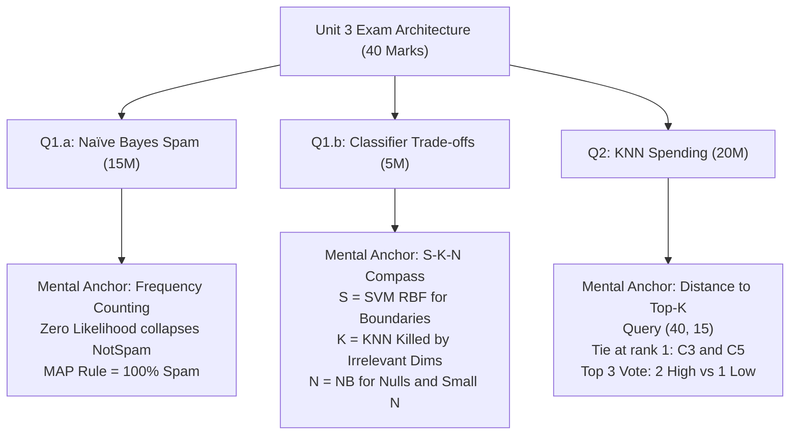

# Unit 3 Cheat Sheet: Classification & Instance-Based Learning

> **Course -** Machine Learning Algorithms (21CSC555J)  
> **Assessment -** Continuous Test 2 (CT-2)  
> **Scope -** Naïve Bayes Spam Filtering, Classifier Selection (SVM vs KNN vs NB), and K-Nearest Neighbors  
> **Primary Reference -** [Unit 3 Full Exam Solutions](./unit-3-questions.mdx)

---

## 1. Unit 3 in 60 Seconds: Core Mental Models

Unit 3 tests two distinct paradigms of classification: **Generative Probabilistic Modeling** (Naïve Bayes) and **Non-Parametric Spatial Modeling** (KNN).



---

## 2. Question 1.a Rapid Blueprint: Naïve Bayes Spam (15 Marks)

### The 4-Step Mental Algorithm
1. **Count Class Totals:** $N = 4 \implies N_{\text{Spam}} = 2, \, N_{\text{NotSpam}} = 2 \implies P(\text{Spam}) = P(\text{NotSpam}) = 0.5$.
2. **Compute Feature Likelihoods:** $P(X = x \mid C = c) = \frac{\text{Count}(X = x \text{ and } C = c)}{\text{Count}(C = c)}$.
3. **Multiply Joint Likelihood:** $\mathcal{L}(C) = P(\text{Offer}=\text{Yes} \mid C) \cdot P(\text{Win}=\text{Yes} \mid C) \cdot P(C)$.
4. **Normalize Posteriors:** Divide by evidence $P(\mathbf{X}) = \mathcal{L}(\text{Spam}) + \mathcal{L}(\text{NotSpam})$.

### Speed Calculation Card

| Feature ($X$) | Class ($C$) | Matching Instances | Value |
| :--- | :--- | :--- | :---: |
| $P(\text{Offer}=\text{Yes} \mid \text{Spam})$ | Spam (E1, E2) | E1 has Offer=Yes (1 of 2) | $\mathbf{0.5}$ |
| $P(\text{Win}=\text{Yes} \mid \text{Spam})$ | Spam (E1, E2) | E1, E2 have Win=Yes (2 of 2) | $\mathbf{1.0}$ |
| $P(\text{Offer}=\text{Yes} \mid \text{NotSpam})$ | NotSpam (E3, E4) | E3 has Offer=Yes (1 of 2) | $\mathbf{0.5}$ |
| $P(\text{Win}=\text{Yes} \mid \text{NotSpam})$ | NotSpam (E3, E4) | Neither has Win=Yes (0 of 2) | $\mathbf{0.0}$ *(Crucial Zero!)* |

### Joint Likelihood & Posterior Evaluation

* **Spam Likelihood:**
  $$\mathcal{L}(\text{Spam}) = 0.5 \times 1.0 \times 0.5 = \mathbf{0.25}$$
* **Not Spam Likelihood:**
  $$\mathcal{L}(\text{NotSpam}) = 0.5 \times 0.0 \times 0.5 = \mathbf{0.0}$$
* **Evidence:**
  $$P(\mathbf{X}) = 0.25 + 0.0 = \mathbf{0.25}$$
* **Normalized Posteriors:**
  $$P(\text{Spam} \mid \mathbf{X}) = \frac{0.25}{0.25} = \mathbf{1.0 \quad (100\%)}, \qquad P(\text{NotSpam} \mid \mathbf{X}) = \frac{0.0}{0.25} = \mathbf{0.0 \quad (0\%)}$$
* **MAP Prediction:**
  $$\hat{y} = \arg\max P(C \mid \mathbf{X}) = \text{\textbf{Spam}}$$

### High-Yield Theory Points (Sub-part iii)

:::tip

**Key Scoring Phrases for Naïve Bayes Theory**

* **Formal Assumption:** Features are conditionally independent given class label:
  $$P(X_1, X_2 \mid C) = P(X_1 \mid C) \cdot P(X_2 \mid C)$$
* **Why "Naïve":** Real email text exhibits strong token correlation (e.g., "Offer" frequently co-occurs with "Win"). Assuming zero covariance is mathematically untrue.
* **Why it works in practice:** Classification only requires the correct **ranking** ($\arg\max$), not calibrated probabilities. Reduces parameter complexity from $O(2^d)$ to $O(d)$, preventing overfitting on small samples.

:::

---

## 3. Question 1.b Decision Compass: Classifier Comparison (5 Marks)

Use the mnemonic **"S - K - N"** to instantly recall the winners:

```
S -> SVM (RBF)       : Winner for complex non-linear shapes
K -> KNN             : Worst/Most vulnerable to irrelevant features
N -> Naïve Bayes     : Winner for null values and small datasets
```

| Sub-Question | Winning Algorithm | Core Mechanism (Write These in the Exam) | Why Others Lose |
| :--- | :--- | :--- | :--- |
| **(a) Best for Non-Linear Boundaries? (2M)** | **SVM with RBF Kernel** | RBF kernel maps inputs to **infinite-dimensional Hilbert space** via $K(\mathbf{x}, \mathbf{x}') = \exp(-\gamma \|\mathbf{x} - \mathbf{x}'\|^2)$. Linear hyperplane there yields smooth non-linear boundaries. | KNN creates noisy piecewise boundaries; Gaussian NB is restricted to quadratic/ellipsoidal boundaries. |
| **(b) Most Sensitive to Irrelevant Features? (1.5M)** | **KNN ($k=5$)** | **Curse of Dimensionality:** Euclidean distance $d = \sqrt{\sum (x_j - y_j)^2}$ sums random noise across all dimensions equally, collapsing distance contrast ($d_{\max} \approx d_{\min}$). | SVM optimizes margin weights ($\alpha_i \to 0$); Naïve Bayes evaluates isolated 1D conditional factors. |
| **(c) Best for Small Data + Missing Values? (1.5M)** | **Gaussian Naïve Bayes** | 1. **Few parameters:** Only estimates $\mu_j, \sigma_j^2$ (high bias, low variance $\implies$ rapid convergence).<br/>2. **Native missing handling:** Simply marginalizes out missing features: $P(\mathbf{x}_{\text{obs}} \mid C) = \prod_{j \in \text{obs}} P(x_j \mid C)$. | SVM and KNN require complete numeric vectors and fail without explicit synthetic imputation. |

---

## 4. Question 2 Rapid Blueprint: KNN Spending Classification (20 Marks)

### Query Point & Dataset Coordinate Map
* Query Point: $\mathbf{X}_{\text{new}} = (40, 15)$ where $x_1 = \text{Income}, \, x_2 = \text{Spending}$.

```
Income Axis (x1):   20 (C1)    25 (C2)    30 (C5)    40 (Query)    50 (C3)    55 (C4)
Spending Axis (x2): 5 (C1)     7 (C2)     10 (C5)    15 (Query)    20 (C3)    22 (C4)
```

### Arithmetic Accelerator Table (Memorize These Values)

| Point | $(x_1, x_2)$ | Class | $\Delta x_1 = 40 - x_1$ | $\Delta x_2 = 15 - x_2$ | $\Delta x_1^2 + \Delta x_2^2$ | Euclidean ($d_E = \sqrt{\sum \Delta^2}$) | Manhattan ($d_M = \lvert \Delta x_1 \rvert + \lvert \Delta x_2 \rvert$) |
| :---: | :---: | :---: | :---: | :---: | :---: | :---: | :---: |
| **C1** | $(20, 5)$ | Low | $20$ | $10$ | $400 + 100 = 500$ | $\sqrt{500} \approx \mathbf{22.36}$ | $20 + 10 = \mathbf{30}$ |
| **C2** | $(25, 7)$ | Low | $15$ | $8$ | $225 + 64 = 289$ | $\sqrt{289} = \mathbf{17.00}$ *(Exact!)* | $15 + 8 = \mathbf{23}$ |
| **C3** | $(50, 20)$ | High | $-10$ | $-5$ | $100 + 25 = 125$ | $\sqrt{125} \approx \mathbf{11.18}$ | $10 + 5 = \mathbf{15}$ |
| **C4** | $(55, 22)$ | High | $-15$ | $-7$ | $225 + 49 = 274$ | $\sqrt{274} \approx \mathbf{16.55}$ | $15 + 7 = \mathbf{22}$ |
| **C5** | $(30, 10)$ | Low | $10$ | $5$ | $100 + 25 = 125$ | $\sqrt{125} \approx \mathbf{11.18}$ | $10 + 5 = \mathbf{15}$ |

:::note

**Calculation Shortcut & Pythagorean Triples**

* Notice that C2 gives exact integer distance: $15^2 + 8^2 = 225 + 64 = 289 = 17^2 \implies d_E = 17$.
* Notice that C3 and C5 have identical squared distance: $10^2 + 5^2 = 125 \implies d_E \approx 11.18$ and $d_M = 15$. They tie for rank 1!

:::

### Ranking & Voting Tally ($K=3$)

1. **Euclidean Distances Sorted:**
   * Rank 1 (Tie): **C3** ($d_E \approx 11.18$, **High**)
   * Rank 2 (Tie): **C5** ($d_E \approx 11.18$, **Low**)
   * Rank 3: **C4** ($d_E \approx 16.55$, **High**)
   * *Excluded:* C2 ($17.00$), C1 ($22.36$).
2. **Majority Voting:**
   * Votes for High: $2$ (C3, C4)
   * Votes for Low: $1$ (C5)
   * Prediction: $\hat{y} = \text{\textbf{High Spender}}$ ($P = 2/3 \approx 66.67\%$).
3. **Manhattan Comparison (Sub-part c):**
   * Sorted distances: C3 ($15$), C5 ($15$), C4 ($22$), C2 ($23$), C1 ($30$).
   * The top 3 set is identical: $\{C_3, C_5, C_4\}$.
   * Vote tally remains $2 \text{ High}$ vs $1 \text{ Low} \implies$ **High Spender**.
   * Conclusion: The local neighborhood is **topologically invariant** under both $L_1$ and $L_2$ norms.

### High-Yield Theory Points (Sub-parts d & e)

#### 1. Feature Scaling Impact (1.5 Marks)
* **Scale Dominance:** Distance metrics are magnitude-sensitive. Large-range features (e.g., Income in thousands) dominate small-range features (e.g., Spending in tens), distorting distance calculations.
* **Remedy:** Apply **Min-Max Normalization** ($[0, 1]$) or **Z-Score Standardization** so all dimensions contribute proportionally.

#### 2. Choice of Parameter K (1.5 Marks)
* **$K = 1$ (Too Small):** **Low Bias, High Variance** $\implies$ sensitive to noise and outliers, causing **Overfitting** (jagged boundaries).
* **$K \to N$ (Too Large):** **High Bias, Low Variance** $\implies$ overly smooth boundaries, predicting the global majority class (**Underfitting**).
* *Exam Tip:* Choose odd $K$ to break ties; set $K \approx \sqrt{N}$.

#### 3. Real-World Application (2 Marks)
* **Domain:** Recommender Systems / Collaborative Filtering (e.g., Amazon product suggestions, Spotify playlist matching).
* **Why Preferred:** **Lazy learning** has zero offline training cost (ingests new profiles dynamically) and uses intuitive, non-parametric neighborhood matching.

---

## 5. Golden Numbers & Quick-Recall Table

Commit these numbers to memory before walking into the exam room:

```
+-------------------------------------------------------------------------+
| UNIT 3 NUMERICAL CHEAT SHEET                                            |
+-------------------------------------------------------------------------+
| Q1.a Naïve Bayes Spam:                                                  |
| - P(Win=Yes | NotSpam)     = 0.0                                        |
| - Unnormalized Likelihoods : L(Spam) = 0.25, L(NotSpam) = 0.0           |
| - Posterior Probabilities  : P(Spam | X) = 1.0 (100%), NotSpam = 0.0   |
| - Final Class Prediction   : Spam                                       |
+-------------------------------------------------------------------------+
| Q2 KNN Spending (Query = 40, 15):                                       |
| - C3 (50, 20) : d_E = sqrt(125) ≈ 11.18,  d_M = 15                      |
| - C5 (30, 10) : d_E = sqrt(125) ≈ 11.18,  d_M = 15                      |
| - C4 (55, 22) : d_E = sqrt(274) ≈ 16.55,  d_M = 22                      |
| - C2 (25,  7) : d_E = sqrt(289) = 17.00,  d_M = 23                      |
| - C1 (20,  5) : d_E = sqrt(500) ≈ 22.36,  d_M = 30                      |
| - K = 3 Neighbors: {C3 (High), C5 (Low), C4 (High)}                     |
| - Vote Tally     : 2 High vs 1 Low  =>  Predicted: High Spender         |
+-------------------------------------------------------------------------+
```

---

## 6. Exam Traps & Avoidance Rules

:::danger

**Common Pitfalls in Unit 3**

1. **Forgetting Prior Probabilities:** In Naïve Bayes, never evaluate only $P(X_1 \mid C) \cdot P(X_2 \mid C)$. You must multiply by prior $P(C)$. Here $P(C) = 0.5$, so multiplying by $0.5$ is required for full calculation marks.
2. **Missing the Square Root:** In KNN, do not stop at $\sum (\Delta x_j)^2 = 125$. You must write $\sqrt{125} \approx 11.18$.
3. **Overlooking the Tie at Rank 1:** Points C3 and C5 both have distance $\approx 11.18$. Explicitly label them as tying for rank 1 and 2 to demonstrate mathematical precision.
4. **Confusing Bias vs Variance for Small $K$:** A small $K$ creates complex, erratic boundaries. That is **Low Bias, High Variance** (Overfitting), NOT high bias.
5. **No Normalization in Bayes:** Showing unnormalized likelihoods ($0.25$ and $0.0$) without calculating $P(\text{Spam} \mid \text{Email}) = \frac{0.25}{0.25} = 1.0$ loses the final 2 marks of part (ii).

:::
