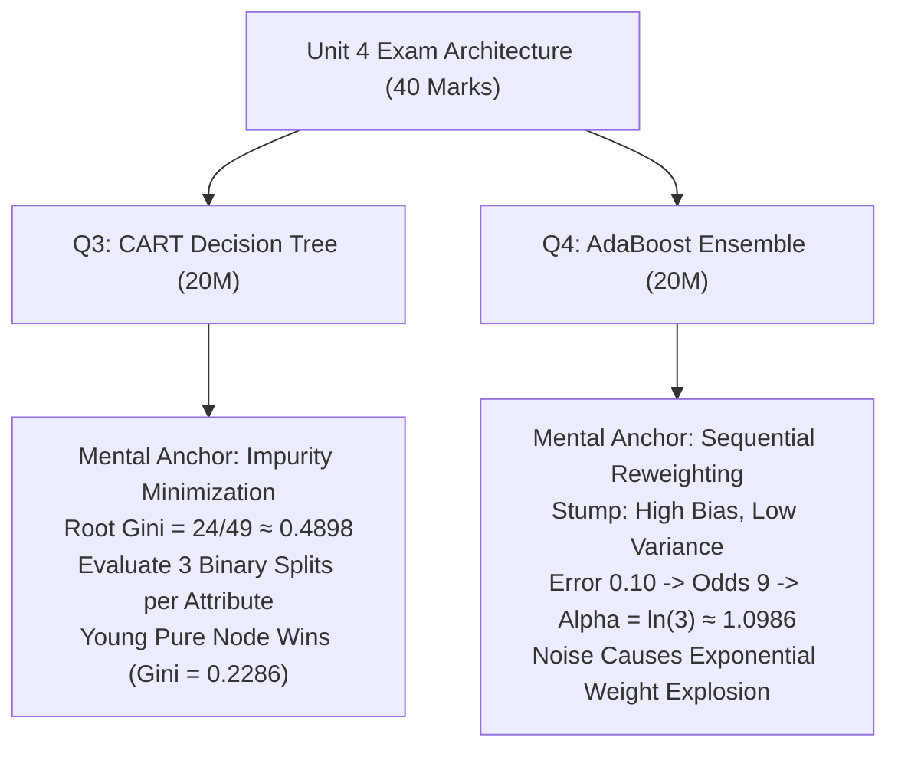

# Unit 4 Cheat Sheet: Decision Trees & Ensemble Learning

> **Course -** Machine Learning Algorithms (21CSC555J)  
> **Assessment -** Continuous Test 2 (CT-2)  
> **Scope -** CART Classification Trees (Gini Index, Binary Splitting) and AdaBoost (Stumps, Weight Updates, Bias-Variance)  
> **Primary Reference -** [Unit 4 Full Exam Solutions](./unit-4-questions.mdx)

---

## 1. Unit 4 in 60 Seconds: Core Mental Models

Unit 4 covers greedy recursive partitioning (**CART**) and sequential additive boosting (**AdaBoost**).



---

## 2. Question 3 Rapid Blueprint: CART Classification Tree (20 Marks)

### The 4-Step Mental Algorithm
1. **Root Gini:** Compute class frequencies ($N=7$, 4 Yes, 3 No) $\implies \text{Gini} = 1 - (p_{\text{Yes}}^2 + p_{\text{No}}^2)$.
2. **Evaluate Binary Partitions:** For $k=3$ categories, test all $2^{k-1}-1 = 3$ binary groupings.
3. **Compute Weighted Gini:** $\text{Gini}_{\text{split}} = \frac{N_L}{N}\text{Gini}(D_L) + \frac{N_R}{N}\text{Gini}(D_R)$.
4. **Select Minimal Gini:** The partition with lowest weighted Gini (highest Gini Gain $\Delta \text{Gini}$) is selected.

---

### Root Node Gini Calculation (Sub-part a: 4 Marks)

* $N = 7$ customers: $N_{\text{Yes}} = 4$ (C3, C4, C5, C6) and $N_{\text{No}} = 3$ (C1, C2, C7).
* Probabilities: $p_1 = \frac{4}{7}, \, p_2 = \frac{3}{7}$.
* Formula:
  $$\text{Gini}(\text{Root}) = 1 - \left[ \left(\frac{4}{7}\right)^2 + \left(\frac{3}{7}\right)^2 \right] = 1 - \frac{16 + 9}{49} = 1 - \frac{25}{49} = \mathbf{\frac{24}{49} \approx 0.4898}$$

---

### Speed Calculation Card: All Binary Splits (Sub-part b: 8 Marks)

#### 1. Splits for Age Group (Young, Middle, Senior)

| Candidate Binary Partition | Left Node ($D_L$) | $\text{Gini}(D_L)$ | Right Node ($D_R$) | $\text{Gini}(D_R)$ | Weighted Gini ($\text{Gini}_{\text{split}}$) |
| :--- | :--- | :---: | :--- | :---: | :---: |
| **$\{\text{Young}\}$ vs $\{\text{Middle, Senior}\}$** | 0 Yes, 2 No ($N_L=2$) | $\mathbf{0.0}$ *(Pure)* | 4 Yes, 1 No ($N_R=5$) | $1 - \left(\frac{16}{25} + \frac{1}{25}\right) = \mathbf{\frac{8}{25} = 0.320}$ | $\frac{2}{7}(0) + \frac{5}{7}(0.320) = \frac{1.6}{7} \approx \mathbf{0.2286}$ |
| **$\{\text{Middle}\}$ vs $\{\text{Young, Senior}\}$** | 2 Yes, 0 No ($N_L=2$) | $\mathbf{0.0}$ *(Pure)* | 2 Yes, 3 No ($N_R=5$) | $1 - \left(\frac{4}{25} + \frac{9}{25}\right) = \mathbf{\frac{12}{25} = 0.480}$ | $\frac{2}{7}(0) + \frac{5}{7}(0.480) = \frac{2.4}{7} \approx \mathbf{0.3429}$ |
| **$\{\text{Senior}\}$ vs $\{\text{Young, Middle}\}$** | 2 Yes, 1 No ($N_L=3$) | $1 - \left(\frac{4}{9} + \frac{1}{9}\right) = \mathbf{\frac{4}{9} \approx 0.444}$ | 2 Yes, 2 No ($N_R=4$) | $1 - \left(\frac{4}{16} + \frac{4}{16}\right) = \mathbf{0.500}$ | $\frac{3}{7}\left(\frac{4}{9}\right) + \frac{4}{7}(0.5) = \frac{10}{21} \approx \mathbf{0.4762}$ |

$$\mathbf{\text{Best Split for Age Group: } \{\text{Young}\} \text{ vs } \{\text{Middle, Senior}\} \implies \text{Gini} \approx 0.2286}$$

#### 2. Splits for Income Level (Low, Medium, High)

| Candidate Binary Partition | Left Node ($D_L$) | $\text{Gini}(D_L)$ | Right Node ($D_R$) | $\text{Gini}(D_R)$ | Weighted Gini ($\text{Gini}_{\text{split}}$) |
| :--- | :--- | :---: | :--- | :---: | :---: |
| **$\{\text{Low}\}$ vs $\{\text{Medium, High}\}$** | 1 Yes, 2 No ($N_L=3$) | $1 - \left(\frac{1}{9} + \frac{4}{9}\right) = \mathbf{\frac{4}{9} \approx 0.444}$ | 3 Yes, 1 No ($N_R=4$) | $1 - \left(\frac{9}{16} + \frac{1}{16}\right) = \mathbf{\frac{6}{16} = 0.375}$ | $\frac{3}{7}\left(\frac{4}{9}\right) + \frac{4}{7}(0.375) = \frac{8.5}{21} \approx \mathbf{0.4048}$ |
| **$\{\text{Medium}\}$ vs $\{\text{Low, High}\}$** | 1 Yes, 1 No ($N_L=2$) | $1 - (0.25 + 0.25) = \mathbf{0.500}$ | 3 Yes, 2 No ($N_R=5$) | $1 - \left(\frac{9}{25} + \frac{4}{25}\right) = \mathbf{\frac{12}{25} = 0.480}$ | $\frac{2}{7}(0.5) + \frac{5}{7}(0.480) = \frac{3.4}{7} \approx \mathbf{0.4857}$ |
| **$\{\text{High}\}$ vs $\{\text{Low, Medium}\}$** | 2 Yes, 0 No ($N_L=2$) | $\mathbf{0.0}$ *(Pure)* | 2 Yes, 3 No ($N_R=5$) | $1 - \left(\frac{4}{25} + \frac{9}{25}\right) = \mathbf{\frac{12}{25} = 0.480}$ | $\frac{2}{7}(0) + \frac{5}{7}(0.480) = \frac{2.4}{7} \approx \mathbf{0.3429}$ |

$$\mathbf{\text{Best Split for Income Level: } \{\text{High}\} \text{ vs } \{\text{Low, Medium}\} \implies \text{Gini} \approx 0.3429}$$

---

### Best Attribute Selection (Sub-part c: 4 Marks)

* **Age Group Minimum Gini:** $\mathbf{0.2286}$ (Split: $\{\text{Young}\}$ vs $\{\text{Middle, Senior}\}$)
* **Income Level Minimum Gini:** $\mathbf{0.3429}$ (Split: $\{\text{High}\}$ vs $\{\text{Low, Medium}\}$)
* **Gini Gain Comparison:**
  $$\Delta \text{Gini}(\text{Age Group}) = 0.4898 - 0.2286 = \mathbf{0.2612} \quad (\text{Maximum Gain!})$$
  $$\Delta \text{Gini}(\text{Income Level}) = 0.4898 - 0.3429 = 0.1469$$
* **Winner:** **Age Group** is chosen as the root split because it produces the lowest weighted impurity and cleanly isolates a pure terminal node where all Young customers have $\text{Buy} = \text{No}$.

---

### Theory Flashcards (Sub-parts d & e)

:::tip

**Tie-Breaking Protocols (Sub-part d: 2 Marks)**

If two candidate attributes have identical Gini index values:
1. **Acquisition Cost:** Pick the feature cheaper or less invasive to collect in practice (e.g., Age Group over verified Income).
2. **Subtree Balance:** Pick the split producing more evenly balanced sample counts between left and right children.
3. **Deterministic Schema Order:** Fall back to default dataset column order (first column in table).
4. **Secondary Divergence:** Check Information Gain (Entropy) to see if logarithmic spread breaks the tie.

:::

:::tip

**Key Advantages of CART over ID3 / C4.5 (Sub-part e: 2 Marks)**

1. **Dual Capability (Classification & Regression):** CART handles both categorical targets (via Gini Index) and continuous targets (via Variance Reduction / MSE). ID3 is classification-only.
2. **Strict Binary Splitting:** CART strictly generates 2 branches per split ($2^{k-1}-1$ groupings). This stops multi-way branch fragmentation (a known flaw of ID3) and preserves statistical sample size in deeper nodes.
3. **Disciplined Cost-Complexity Pruning:** Employs minimal cost-complexity $\alpha$-pruning validated with cross-validation, which is theoretically sounder than C4.5's heuristic error-based pruning.

:::

---

## 3. Question 4 Rapid Blueprint: AdaBoost Fraud Classifier (20 Marks)

### The Core Boosting Workflow & Math

```
1. Initialize uniform weights : w_i^(1) = 1/N
2. Train weak stump h_m(x)
3. Compute weighted error    : ε_m = Σ w_i * I(y_i ≠ h_m(x_i))
4. Compute stump importance  : α_m = (1/2) * ln((1 - ε_m) / ε_m)
5. Update sample weights     : w_i^(m+1) = w_i^(m) * exp(-α_m * y_i * h_m(x_i)) / Z_m
   - Correct samples         : w_i * exp(-α_m)  (attenuated)
   - Wrong samples           : w_i * exp(+α_m)  (boosted)
```

---

### Sub-Question Rapid Review Matrix

| Sub-Question | Marks | Core Conceptual Answer | Key Mathematical Expression |
| :--- | :---: | :--- | :--- |
| **(i) Why Decision Stumps?** | 4M | 1. Satisfies weak learner rule ($\epsilon < 0.5$).<br/>2. **High bias, ultra-low variance:** Boosting reduces bias; starting with low variance prevents ensemble variance explosion.<br/>3. **Fast training:** Only $O(N \cdot D)$ split evaluations.<br/>4. **Interpretability:** Provides clean feature importance rankings. | Single-threshold rule:<br/>$h(\mathbf{x}) = \text{sign}(x_j - \theta)$ |
| **(ii) Sample Weight Updates?** | 4M | 1. Init uniform $w_i = 1/N$.<br/>2. Sum misclassified weights for $\epsilon_m$.<br/>3. Compute $\alpha_m$.<br/>4. Multiplicative update: correct points multiplied by $e^{-\alpha_m}$; incorrect points boosted by $e^{+\alpha_m}$.<br/>5. Normalize by $Z_m$ so weights sum to $1$. | $w_i^{(m+1)} = \frac{w_i^{(m)} e^{-\alpha_m y_i h_m(\mathbf{x}_i)}}{Z_m}$ |
| **(iii) Error 10% $\implies \alpha$ Calculation?** | 4M | **Calculation Shortcut:**<br/>$\epsilon_m = 0.10 \implies \frac{1 - 0.10}{0.10} = \frac{0.90}{0.10} = 9$.<br/>$\alpha_m = \frac{1}{2} \ln(9) = \frac{1}{2} \ln(3^2) = \ln(3) \approx \mathbf{1.0986}$.<br/>*Meaning:* High positive voting weight in ensemble $H(\mathbf{x}) = \text{sign}\left(\sum \alpha_m h_m(\mathbf{x})\right)$. | $\alpha = \frac{1}{2}\ln(9) = \ln(3) \approx 1.0986$ |
| **(iv) Bias Reduction vs Variance Increase?** | 4M | 1. **Reduces Bias:** Additive linear combination of piecewise linear stumps creates highly flexible non-linear boundaries. Sequential residual learning drives training error to zero.<br/>2. **Increases Variance:** Extreme sensitivity to outliers and noisy labels. Hard/noisy samples get exponential weight boosts ($e^{m\alpha}$), causing the ensemble to overfit noise pockets. | Boundary synthesis vs exponential outlier amplification |
| **(v) Handling Missing "Device ID"?** | 4M | 1. **Feature Bypassing:** Stumps only pick 1 feature; AdaBoost simply selects an alternative complete feature (e.g., Amount).<br/>2. **Missing as Indicator:** Treats `Missing` as an informative categorical state (fraudsters hiding device IDs).<br/>3. **Surrogate Splits:** Uses correlated auxiliary features.<br/>4. **Proportional Assignment:** Distributes sample weights across child branches. | Native stump robustness + Missing as predictive state |

---

## 4. Golden Numbers & Quick-Recall Table

Commit these numbers to memory before walking into the exam room:

```
+-------------------------------------------------------------------------+
| UNIT 4 NUMERICAL CHEAT SHEET                                            |
+-------------------------------------------------------------------------+
| Q3 CART Decision Tree (N=7, 4 Yes, 3 No):                               |
| - Root Gini Index          : 24/49 ≈ 0.4898                             |
| - Age Group Best Split     : {Young} vs {Middle, Senior}                |
|   * Left (Young) Gini      : 0.0 (Pure Leaf Node)                       |
|   * Right (Mid+Sen) Gini   : 8/25 = 0.320                               |
|   * Weighted Gini          : 1.6/7 ≈ 0.2286                             |
|   * Gini Gain              : 0.4898 - 0.2286 = 0.2612 (WINNER)          |
| - Income Level Best Split  : {High} vs {Low, Medium}                    |
|   * Left (High) Gini       : 0.0 (Pure Leaf Node)                       |
|   * Right (Low+Med) Gini   : 12/25 = 0.480                              |
|   * Weighted Gini          : 2.4/7 ≈ 0.3429                             |
|   * Gini Gain              : 0.4898 - 0.3429 = 0.1469                   |
+-------------------------------------------------------------------------+
| Q4 AdaBoost Calculations:                                               |
| - Given Misclassification  : ε = 0.10 (10%)                             |
| - Odds Ratio (1-ε)/ε       : 0.90 / 0.10 = 9                            |
| - Alpha Value              : (1/2)*ln(9) = ln(3) ≈ 1.0986               |
| - Correct Sample Factor    : exp(-1.0986) = 1/3 ≈ 0.333                 |
| - Wrong Sample Factor      : exp(+1.0986) = 3.0                         |
+-------------------------------------------------------------------------+
```

---

## 5. Exam Traps & Avoidance Rules

:::danger

**Common Pitfalls in Unit 4**

1. **Confusing Gini with Entropy:** Gini Index uses squared probabilities ($1 - \sum p_i^2$). Do NOT write $- \sum p_i \log_2(p_i)$ (which is Entropy used in ID3). Gini has NO logarithms.
2. **Forgetting to Weight the Child Nodes:** When computing $\text{Gini}_{\text{split}}$, always multiply child Gini values by their branch proportions $\frac{N_L}{N}$ and $\frac{N_R}{N}$. Never take a simple unweighted arithmetic average.
3. **Evaluating Multi-Way Splits Instead of Binary Partitions:** CART strictly evaluates **binary** splits ($2^{k-1}-1 = 3$ candidate splits for 3 categories). If you only compute a single 3-way split, you will lose method marks for CART mechanics.
4. **Log Base Error in AdaBoost $\alpha$:** AdaBoost importance weight uses the **natural logarithm** ($\ln$), not $\log_{10}$ or $\log_2$. Remember that $\frac{1}{2}\ln(9) = \ln(\sqrt{9}) = \ln(3) \approx 1.0986$.
5. **Sign Mix-up in Weight Updates:** Misclassified samples get **increased** weights ($e^{+\alpha}$), and correctly classified samples get **reduced** weights ($e^{-\alpha}$). Inverting the sign breaks boosting dynamics.

:::
