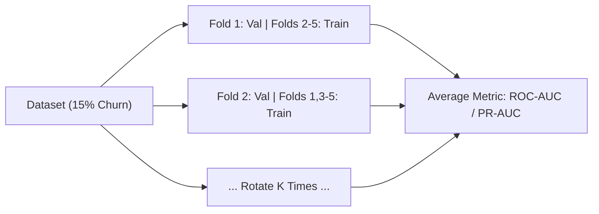
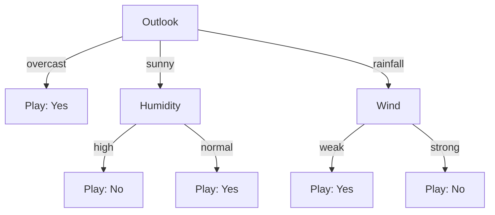

# January 2025

> **Exam -** Semester Examination  
> **Session -** January 2025  

---

## Question 1 (20 Marks)

:::info

**Question Statement**

*   **i)** Consider a dataset where the independent variable X represents the number of study hours, and the dependent variable Y represents exam scores: Explain the process of deriving the simple linear regression equation. Describe the mathematical steps to calculate the slope and intercept of the regression line. Interpret the regression line in the context of predicting exam scores based on study hours. (10 Marks)
*   **ii)** Define the concepts of overfitting and underfitting in the context of predicting students' academic performance. Discuss how they can impact the reliability of the prediction model. (5 Marks)
*   **iii)** Identify and explain commonly used evaluation metrics for regression models in the context of assessing prediction accuracy for student exam scores. Discuss why each metric is important for evaluating model performance. (5 Marks)

:::

---

### Solution 1 (20 Marks)

#### (i) Derivation and Interpretation of Simple Linear Regression (10 Marks)

##### 1. Model Setup
Let $X$ denote the number of study hours (independent variable) and $Y$ denote the exam score (dependent variable). Given $n$ observations $\{(X_i, Y_i)\}_{i=1}^n$, the simple linear regression model is:

$$
Y_i = \beta_0 + \beta_1 X_i + \epsilon_i
$$

The predicted exam score is:

$$
\hat{Y}_i = \hat{\beta}_0 + \hat{\beta}_1 X_i
$$

where $\hat{\beta}_0$ is the intercept and $\hat{\beta}_1$ is the slope. The residual error is $e_i = Y_i - \hat{Y}_i$.

##### 2. Mathematical Derivation via Ordinary Least Squares (OLS)
The OLS objective minimizes the Residual Sum of Squares (RSS), $S(\beta_0, \beta_1)$:

$$
S(\beta_0, \beta_1) = \sum_{i=1}^n \left(Y_i - \beta_0 - \beta_1 X_i\right)^2
$$

###### Step A: Partial Derivative with respect to Intercept ($\beta_0$)
Set the first partial derivative to zero:

$$
\frac{\partial S}{\partial \beta_0} = -2 \sum_{i=1}^n \left(Y_i - \beta_0 - \beta_1 X_i\right) = 0
$$

$$
\sum_{i=1}^n Y_i - n\beta_0 - \beta_1 \sum_{i=1}^n X_i = 0 \implies \bar{Y} - \beta_0 - \beta_1 \bar{X} = 0
$$

$$
\mathbf{\hat{\beta}_0 = \bar{Y} - \hat{\beta}_1 \bar{X}} \quad \text{--- (Equation 1)}
$$

where $\bar{X} = \frac{1}{n}\sum X_i$ and $\bar{Y} = \frac{1}{n}\sum Y_i$.

###### Step B: Partial Derivative with respect to Slope ($\beta_1$)
Set the second partial derivative to zero:

$$
\frac{\partial S}{\partial \beta_1} = -2 \sum_{i=1}^n X_i \left(Y_i - \beta_0 - \beta_1 X_i\right) = 0
$$

$$
\sum_{i=1}^n X_i Y_i - \beta_0 \sum_{i=1}^n X_i - \beta_1 \sum_{i=1}^n X_i^2 = 0 \quad \text{--- (Equation 2)}
$$

Substitute Equation 1 ($\beta_0 = \bar{Y} - \beta_1 \bar{X}$) into Equation 2:

$$
\sum_{i=1}^n X_i Y_i - (\bar{Y} - \beta_1 \bar{X})(n\bar{X}) - \beta_1 \sum_{i=1}^n X_i^2 = 0
$$

$$
\sum_{i=1}^n X_i Y_i - n\bar{X}\bar{Y} = \beta_1 \left( \sum_{i=1}^n X_i^2 - n\bar{X}^2 \right)
$$

Solving for $\hat{\beta}_1$:

$$
\mathbf{\hat{\beta}_1 = \frac{\sum_{i=1}^n (X_i - \bar{X})(Y_i - \bar{Y})}{\sum_{i=1}^n (X_i - \bar{X})^2} = \frac{\operatorname{Cov}(X, Y)}{\operatorname{Var}(X)}}
$$

##### 3. Contextual Interpretation
*   **Intercept ($\hat{\beta}_0$):** The baseline expected exam score for a student who logs zero study hours ($X = 0$). It reflects prior knowledge or innate aptitude.
*   **Slope ($\hat{\beta}_1$):** The expected change in exam score per additional hour of study. If $\hat{\beta}_1 = 4.5$, each additional study hour increases the predicted score by $4.5$ marks.

---

#### (ii) Overfitting and Underfitting in Student Performance Prediction (5 Marks)

*   **Underfitting (High Bias, Low Variance):**
    *   *Definition:* The model is too simplistic to capture the true underlying pattern (e.g., fitting a horizontal line or linear line when study returns diminish).
    *   *Characteristics:* High training error and high test error.
    *   *Impact on Reliability:* The model fails to recognize legitimate gains from studying, producing uniform predictions that miss at-risk students.
*   **Overfitting (Low Bias, High Variance):**
    *   *Definition:* The model is overly complex and memorizes noise/outliers in the training set (e.g., high-degree polynomial fitting a student who fell ill during the exam).
    *   *Characteristics:* Near-zero training error but high test error.
    *   *Impact on Reliability:* Unstable predictions that oscillate wildly on new student cohorts, making the model untrustworthy for academic advising.

---

#### (iii) Commonly Used Regression Evaluation Metrics (5 Marks)

1.  **Mean Absolute Error (MAE):**
    $$\text{MAE} = \frac{1}{n} \sum_{i=1}^n \lvert Y_i - \hat{Y}_i \rvert$$
    *Importance:* Directly measures average prediction error in original score units (marks). It treats all errors linearly and is robust to outliers.
2.  **Mean Squared Error (MSE):**
    $$\text{MSE} = \frac{1}{n} \sum_{i=1}^n (Y_i - \hat{Y}_i)^2$$
    *Importance:* Penalizes large errors quadratically ($\text{marks}^2$). Essential when a large prediction miss (e.g., predicting 80 for a student scoring 30) is unacceptable.
3.  **Root Mean Squared Error (RMSE):**
    $$\text{RMSE} = \sqrt{\text{MSE}}$$
    *Importance:* Combines the outlier sensitivity of MSE with the interpretable scale of marks. If $\text{RMSE} \gg \text{MAE}$, large individual prediction errors are present.
4.  **Coefficient of Determination ($R^2$):**
    $$R^2 = 1 - \frac{\sum (Y_i - \hat{Y}_i)^2}{\sum (Y_i - \bar{Y})^2}$$
    *Importance:* Scale-independent metric indicating the proportion of variance in exam scores explained by study hours ($R^2 \le 1.0$).

:::tip

**Examiner's Note**

In part (i), state the OLS loss function explicitly, set partial derivatives to zero, and solve the normal equations algebraically. In part (iii), contrast MAE (linear penalty, outlier robust) with RMSE (quadratic penalty, outlier sensitive).

:::

---

## Question 2 (20 Marks)

:::info

**Question Statement**

A retail analytics company is developing a machine learning model to predict customer purchasing behavior. The goal is to classify customers into three spending categories: "low spender," "moderate spender," and "high spender." The dataset includes features such as monthly income, number of purchases, and average purchase value. Explain how Logistic Regression could be applied to estimate the probability of a customer being a "high spender." Describe the process of converting the linear regression equation into a sigmoid function and interpreting the resulting probability values for classifying customers. Since there are three categories ("low spender," "moderate spender," and "high spender"), explain how Logistic Regression can be adapted for multi-class classification. Describe methods like One-vs-Rest (OvR) or Softmax Regression for handling multiple classes. **(20 Marks)**

:::

---

### Solution 2 (20 Marks)

#### 1. Estimating "High Spender" Probability via Logistic Regression (4 Marks)
Let $\mathbf{x} = [x_1, x_2, x_3]^T$ represent Monthly Income, Number of Purchases, and Average Purchase Value. Define the binary target:

$$
Y = \begin{cases} 1, & \text{if High Spender} \\ 0, & \text{otherwise (Low or Moderate Spender)} \end{cases}
$$

A standard linear equation $z = \mathbf{w}^T \mathbf{x} + b$ produces unbounded outputs $z \in (-\infty, +\infty)$, which violates probability constraints ($p \in [0, 1]$). Logistic regression maps $z$ through a sigmoid function to produce calibrated probabilities:

$$
P(Y = 1 \mid \mathbf{x}) = \sigma(\mathbf{w}^T \mathbf{x} + b)
$$

---

#### 2. Derivation of the Sigmoid Function from Odds and Logit (8 Marks)
To convert the unbounded linear combination $z$ into a bounded probability $p \in (0, 1)$:

1.  **Odds:** The ratio of the probability of being a high spender to not being one:
    $$\text{Odds} = \frac{p}{1 - p} \in [0, +\infty)$$
2.  **Log-Odds (Logit):** Taking the natural logarithm maps odds to the full real line $(-\infty, +\infty)$:
    $$\operatorname{logit}(p) = \ln\left(\frac{p}{1 - p}\right) = \mathbf{w}^T \mathbf{x} + b = z$$
3.  **Inversion to Sigmoid:** Exponentiate and solve for $p$:
    $$\frac{p}{1 - p} = e^z \implies p = e^z(1 - p) \implies p(1 + e^z) = e^z$$
    $$p = \frac{e^z}{1 + e^z} = \mathbf{\frac{1}{1 + e^{-z}} \equiv \sigma(z)}$$

##### Probability Interpretation:
*   $\hat{p} = \sigma(z) \in (0, 1)$ is the posterior probability that the customer is a high spender.
*   **Classification Rule:** Using a decision threshold $\tau = 0.5$:
    $$\hat{y} = \begin{cases} \text{High Spender}, & \text{if } \hat{p} \ge 0.5 \iff z \ge 0 \\ \text{Not High Spender}, & \text{if } \hat{p} < 0.5 \iff z < 0 \end{cases}$$

---

#### 3. Multi-Class Adaptation: One-vs-Rest and Softmax Regression (8 Marks)
To classify customers into $K = 3$ categories ($C_1 = \text{Low}, C_2 = \text{Moderate}, C_3 = \text{High}$), logistic regression is extended using two standard methods:

##### Method A: One-vs-Rest (OvR) / One-vs-All
*   **Architecture:** Train $K = 3$ independent binary logistic classifiers:
    1.  Classifier 1 ($f_1$): Low Spender vs. Rest ($P_1 = \sigma(\mathbf{w}_1^T \mathbf{x} + b_1)$)
    2.  Classifier 2 ($f_2$): Moderate Spender vs. Rest ($P_2 = \sigma(\mathbf{w}_2^T \mathbf{x} + b_2)$)
    3.  Classifier 3 ($f_3$): High Spender vs. Rest ($P_3 = \sigma(\mathbf{w}_3^T \mathbf{x} + b_3)$)
*   **Prediction:** Assign the input to the class with the highest probability score:
    $$\hat{y} = \arg\max_{k \in \{1, 2, 3\}} P_k(\mathbf{x})$$
*   *Key Trait:* Simple to implement and parallelize; probabilities require post-hoc normalization ($\frac{P_k}{\sum P_j}$) to sum to 1.

##### Method B: Softmax Regression (Multinomial Logistic Regression)
*   **Architecture:** Generates a linear score $z_k = \mathbf{w}_k^T \mathbf{x} + b_k$ for each class simultaneously and applies the **Softmax function**:
    $$P(Y = C_k \mid \mathbf{x}) = \frac{e^{z_k}}{\sum_{j=1}^3 e^{z_j}} = \mathbf{\frac{\exp(\mathbf{w}_k^T \mathbf{x} + b_k)}{\sum_{j=1}^3 \exp(\mathbf{w}_j^T \mathbf{x} + b_j)}}$$
*   **Key Traits:**
    1.  Inherently satisfies probability axioms: $P(Y = C_k \mid \mathbf{x}) \in (0, 1)$ and $\sum_{k=1}^3 P(Y = C_k \mid \mathbf{x}) = 1.0$.
    2.  Directly models mutually exclusive classes using Categorical Cross-Entropy loss:
        $$\mathcal{L} = -\sum_{i=1}^N \sum_{k=1}^3 y_{ik} \ln(\hat{p}_{ik})$$

:::tip

**Examiner's Note**

Show the three-step derivation of the sigmoid function: Odds $\to$ Logit $\to$ Sigmoid inversion. When comparing OvR and Softmax, highlight that Softmax models mutually exclusive categories jointly, whereas OvR trains independent binary hyperplanes.

:::

---

## Question 3 (20 Marks)

:::info

**Question Statement**

A telecommunications company is building a machine learning model to predict customer chum (whether a customer will switch to another service provider). The dataset includes customer demographics, usage patterns, and support interaction history. The team wants to ensure the model generalizes well to new data and avoids overfitting. Explain how cross-validation can be utilized to assess the performance of the chum prediction model and discuss the purpose of cross-validation and how it helps in improving the generalization of the model to unseen data. **(20 Marks)**

:::

---

### Solution 3 (20 Marks)

#### 1. Purpose of Cross-Validation (5 Marks)
Cross-validation (CV) provides an **unbiased empirical estimate of expected generalization error** on unseen data.
*   **Why Holdout (Simple Train-Test Split) Fails:** A single split yields high estimator variance depending on which samples fall into the test set by random chance, and it wastes valuable training data in small cohorts.
*   **Core Role:** By systematically rotating data so that every sample is used for validation exactly once, CV ensures the model does not memorize training noise and provides a reliable measure of out-of-sample performance.

---

#### 2. Utilizing Stratified K-Fold Cross-Validation in Telecom Churn (8 Marks)

##### A. Stratified $K$-Fold Cross-Validation (Mandatory Architecture)
Telecom churn typically suffers from **class imbalance** (e.g., $15\%$ churners, $85\%$ retained). Standard random $K$-fold can produce validation folds with very few or zero churn cases.

**Stratified $K$-Fold** partitions the dataset into $K$ disjoint folds (typically $K = 5$ or $10$) while strictly preserving the full dataset's class ratio in every fold:

$$
\frac{n_{\text{churn}}^{(k)}}{n_{\text{total}}^{(k)}} \approx \frac{N_{\text{churn}}}{N_{\text{total}}} \quad \forall k \in \{1, \dots, K\}
$$

###### Execution Steps:
1.  Divide data into $K$ stratified folds.
2.  For $k = 1$ to $K$:
    *   Train on $(K-1)$ folds.
    *   Validate on the held-out $k$-th fold to compute metric $M_k$.
3.  Compute aggregate generalization performance:
    $$\bar{M} = \frac{1}{K}\sum_{k=1}^K M_k, \quad \operatorname{SE} = \frac{s}{\sqrt{K}}$$

##### B. Data Leakage Prevention
Feature transformers (e.g., StandardScaler, imputation) must be fitted strictly inside the $(K-1)$ training folds and applied out-of-fold to the validation fold to avoid data leakage.

---

#### 3. How Cross-Validation Improves Generalization & Prevents Overfitting (7 Marks)

1.  **Detects High Variance (Overfitting):** A large gap between training performance ($98\%$) and cross-validation score ($74\%$) flags overfitting, signaling the need for regularization (L2 penalty, tree pruning).
2.  **Robust Hyperparameter Selection:** Optimal hyperparameters (e.g., regularization parameter $C$, tree depth) are chosen based on average out-of-fold performance across all $K$ folds rather than a single lucky split.
3.  **Informs Early Stopping:** Evaluates when model iterations begin overfitting validation folds without touching the test set.
4.  **Aligns with Imbalanced Metrics:** Allows tuning for **ROC-AUC, PR-AUC, and $F_1$-score** rather than raw classification accuracy, which is misleading under class imbalance.

:::tip

**Examiner's Note**

Explicitly name **Stratified $K$-Fold** as the mandatory cross-validation strategy for customer churn due to class imbalance. Mentioning data leakage prevention (fitting scalers only on training folds) demonstrates strong practical rigor.

:::

---

## Question 4 (20 Marks)

:::info

**Question Statement**

A food delivery app is building a recommendation system to suggest restaurants to users based on preferences and location. The dataset includes features like cuisine type, user ratings, average cost, and proximity. The team decides to use the K-Nearest Neighbors (KNN) algorithm. Explain how the KNN algorithm works in this context and discuss how the choice of K affects model performance, including challenges with very small or large K values. Describe the role of distance metrics, comparing Euclidean and Manhattan distances, and recommend the most suitable metric for this scenario. Finally, suggest evaluation metrics to assess the model's effectiveness in recommending relevant restaurants, justifying their importance in this context. **(20 Marks)**

:::

---

### Solution 4 (20 Marks)

#### 1. How KNN Works in Restaurant Recommendation (4 Marks)
K-Nearest Neighbors is a **non-parametric, instance-based lazy learner**. It does not train an explicit model; instead, it stores feature vectors and defers computation until inference:

1.  **Feature Vector:** Each restaurant is encoded as $\mathbf{x} = [x_{\text{cuisine}}, x_{\text{rating}}, x_{\text{cost}}, x_{\text{proximity}}]^T$.
2.  **Distance Calculation:** For a user query $\mathbf{q}$, compute the pairwise distance $D(\mathbf{q}, \mathbf{x}_i)$ to all restaurants.
3.  **Neighbor Selection:** Identify the $K$ smallest distances ($\mathcal{N}_K(\mathbf{q})$).
4.  **Aggregation & Ranking:** Aggregate neighbor ratings via distance-weighted scoring ($w_i = \frac{1}{D(\mathbf{q}, \mathbf{x}_i) + \epsilon}$) to rank and recommend the top restaurants.

---

#### 2. Effect of the Choice of $K$ (Bias-Variance Trade-off) (5 Marks)

*   **Very Small $K$ ($K = 1$ or $2$):**
    *   *Profile:* Low bias, high variance (**Overfitting**).
    *   *Challenges:* Extreme sensitivity to noise, anomalies, or a newly registered restaurant with a single fake 5-star review. Decision boundaries are jagged and unstable.
*   **Very Large $K$ ($K \to N$):**
    *   *Profile:* High bias, low variance (**Underfitting**).
    *   *Challenges:* Neighborhood incorporates geographically distant or irrelevant restaurants. Recommendations collapse to the globally most frequent restaurant category (e.g., mass-market fast food), destroying personalization.
*   **Optimal $K$:** Typically set to $K \approx \sqrt{N}$ and tuned via cross-validation using odd values to avoid voting ties.

---

#### 3. Distance Metrics: Euclidean vs. Manhattan (6 Marks)

| Dimension | Euclidean Distance ($L_2$) | Manhattan Distance ($L_1$) |
| :--- | :--- | :--- |
| **Formula** | $d_2(\mathbf{u}, \mathbf{v}) = \sqrt{\sum_{j=1}^d (u_j - v_j)^2}$ | $d_1(\mathbf{u}, \mathbf{v}) = \sum_{j=1}^d \lvert u_j - v_j \rvert$ |
| **Geometry** | Straight-line distance ("as the crow flies") | Grid-based path along orthogonal axes |
| **Outlier Sensitivity** | Squares differences; sensitive to large discrepancies | Linear penalty; significantly more robust |

##### Recommendation for this Scenario:
*   **Manhattan Distance ($L_1$) is recommended:**
    1.  In urban delivery, couriers travel along street grids rather than flying straight lines; $L_1$ approximates travel time more realistically.
    2.  Its linear penalty prevents extreme values in cost from dominating ratings and proximity.
*   **Mandatory Preprocessing (Feature Scaling):** Because proximity (km), rating ($1-5$), and cost (currency) use completely different units, **Min-Max scaling or Z-score standardization is mandatory** before computing distances.

---

#### 4. Recommendation Evaluation Metrics (5 Marks)

1.  **Precision@K:**
    $$\text{Precision@K} = \frac{\text{Relevant restaurants in top-}K}{K}$$
    *Importance:* Directly measures whether restaurants visible on the user's mobile screen are relevant.
2.  **Recall@K:**
    $$\text{Recall@K} = \frac{\text{Relevant restaurants in top-}K}{\text{Total relevant restaurants in area}}$$
    *Importance:* Measures coverage of the user's preferences across the local delivery zone.
3.  **NDCG@K (Normalized Discounted Cumulative Gain):**
    $$\text{DCG@K} = \sum_{i=1}^K \frac{2^{\text{rel}_i} - 1}{\log_2(i + 1)}, \quad \text{NDCG@K} = \frac{\text{DCG@K}}{\text{IDCG@K}}$$
    *Importance:* Evaluates ranking order, heavily rewarding placing the most relevant restaurants at rank 1-3.
4.  **Click-Through Rate (CTR) & Order Conversion Rate:** Business metrics assessing whether users actually click and place orders from recommendations.

:::tip

**Examiner's Note**

Highlight the bias-variance trade-off for $K$ ($K=1 \implies$ overfitting, noise sensitive; $K \to N \implies$ underfitting, majority class collapse). Emphasize that feature normalization is strictly required before running KNN on heterogeneous features.

:::

---

## Question 5 (20 Marks)

:::info

**Question Statement**

Consider the car theft prediction problem with the following attributes: Color (Categorical: Red, Blue, Black, etc.), Type (Categorical: SUV, Sedan, Truck, etc.), Origin (Categorical: Domestic, Imported), and the target variable Stolen (Binary: Yes, No). Assume that no pair of features are dependent, and each feature has equal influence on the classification. For this task, describe the necessary preprocessing steps you would take before applying a classification algorithm to this dataset, including how you would handle categorical data and which encoding methods you would use. Then, suggest a suitable classification algorithm, justifying your choice based on the nature of the features and the target variable. After selecting an algorithm, implement the classification model and evaluate its performance using appropriate metrics. Finally, after training the model, predict whether a car with the following attributes (Color = Red, Type = SUV, Origin = Domestic) is stolen or not, and explain how the prediction is made and interpret the result. **(20 Marks)**

| Example No. | Color | Type | Origin | Stolen? |
| :--- | :--- | :--- | :--- | :--- |
| 1 | Red | Sports | Domestic | Yes |
| 2 | Red | Sports | Domestic | No |
| 3 | Red | Sports | Domestic | Yes |
| 4 | Yellow | Sports | Domestic | No |
| 5 | Yellow | Sports | Imported | Yes |
| 6 | Yellow | SUV | Imported | No |
| 7 | Yellow | SUV | Imported | Yes |
| 8 | Yellow | SUV | Domestic | No |
| 9 | Red | SUV | Imported | No |
| 10 | Red | Sports | Imported | Yes |

:::

---

### Solution 5 (20 Marks)

#### 1. Preprocessing Steps and Categorical Encoding (4 Marks)
*   **Data Structure:** 10 records with three categorical predictors (Color, Type, Origin) and a binary target (Stolen $\in \{\text{Yes}, \text{No}\}$).
*   **Handling Categorical Data:**
    *   *One-Hot Encoding:* Generates binary indicator vectors for linear/distance models to avoid imposing artificial ordinal relationships.
    *   *Categorical Frequency Tables (Chosen):* For probabilistic models like Naive Bayes, direct frequency tables capture probability distributions without expanding feature dimensions.

---

#### 2. Algorithm Selection and Justification (3 Marks)
The most suitable algorithm is the **Naive Bayes Classifier (Categorical Naive Bayes)**:
1.  **"Assume that no pair of features are dependent":** Directly satisfies the defining **Conditional Independence Assumption**:
    $$P(\text{Color}, \text{Type}, \text{Origin} \mid Y) = P(\text{Color} \mid Y) \cdot P(\text{Type} \mid Y) \cdot P(\text{Origin} \mid Y)$$
2.  **"Each feature has equal influence":** Matches Naive Bayes' unweighted multiplicative likelihood formulation.
3.  **Small Sample Size ($N = 10$):** Decoupled parameter estimation prevents overfitting on small datasets.

---

#### 3. Model Implementation (Frequency & Probability Estimation) (4 Marks)

##### Class Priors ($N = 10$):
*   $P(\text{Yes}) = \frac{5}{10} = 0.5$
*   $P(\text{No}) = \frac{5}{10} = 0.5$

##### Conditional Likelihoods:
| Attribute | Level | Stolen = Yes ($n=5$) | Stolen = No ($n=5$) | $P(\text{Feature} \mid \text{Yes})$ | $P(\text{Feature} \mid \text{No})$ |
| :--- | :--- | :--- | :--- | :--- | :--- |
| **Color** | **Red** | 3 | 2 | $\frac{3}{5} = 0.6$ | $\frac{2}{5} = 0.4$ |
| | **Yellow** | 2 | 3 | $\frac{2}{5} = 0.4$ | $\frac{3}{5} = 0.6$ |
| **Type** | **Sports** | 4 | 2 | $\frac{4}{5} = 0.8$ | $\frac{2}{5} = 0.4$ |
| | **SUV** | 1 | 3 | $\frac{1}{5} = 0.2$ | $\frac{3}{5} = 0.6$ |
| **Origin** | **Domestic** | 2 | 3 | $\frac{2}{5} = 0.4$ | $\frac{3}{5} = 0.6$ |
| | **Imported** | 3 | 2 | $\frac{3}{5} = 0.6$ | $\frac{2}{5} = 0.4$ |

---

#### 4. Model Evaluation on Training Data (4 Marks)

##### Confusion Matrix:
| | Predicted Yes | Predicted No | Total |
| :--- | :--- | :--- | :--- |
| **Actual Yes** | $\text{TP} = 4$ | $\text{FN} = 1$ | $5$ |
| **Actual No** | $\text{FP} = 1$ | $\text{TN} = 4$ | $5$ |

*   **Accuracy:** $\frac{\text{TP} + \text{TN}}{N} = \frac{4 + 4}{10} = \mathbf{0.80 \ (80\%)}$
*   **Precision:** $\frac{\text{TP}}{\text{TP} + \text{FP}} = \frac{4}{4 + 1} = \mathbf{0.80 \ (80\%)}$
*   **Recall:** $\frac{\text{TP}}{\text{TP} + \text{FN}} = \frac{4}{4 + 1} = \mathbf{0.80 \ (80\%)}$
*   **$F_1$-Score:** $2 \times \frac{0.80 \times 0.80}{0.80 + 0.80} = \mathbf{0.80 \ (80\%)}$

---

#### 5. Prediction for Test Car: $(\text{Color} = \text{Red}, \text{Type} = \text{SUV}, \text{Origin} = \text{Domestic})$ (5 Marks)

##### Step A: Compute Unnormalized Joint Probabilities
*   **For Stolen = Yes:**
    $$P(\text{Yes}, \mathbf{x}) = P(\text{Yes}) \cdot P(\text{Red} \mid \text{Yes}) \cdot P(\text{SUV} \mid \text{Yes}) \cdot P(\text{Domestic} \mid \text{Yes})$$
    $$P(\text{Yes}, \mathbf{x}) = 0.5 \times 0.6 \times 0.2 \times 0.4 = \mathbf{0.024} = \frac{6}{250}$$
*   **For Stolen = No:**
    $$P(\text{No}, \mathbf{x}) = P(\text{No}) \cdot P(\text{Red} \mid \text{No}) \cdot P(\text{SUV} \mid \text{No}) \cdot P(\text{Domestic} \mid \text{No})$$
    $$P(\text{No}, \mathbf{x}) = 0.5 \times 0.4 \times 0.6 \times 0.6 = \mathbf{0.072} = \frac{18}{250}$$

##### Step B: Evidence & Posterior Probabilities
*   **Evidence:** $P(\mathbf{x}) = 0.024 + 0.072 = 0.096$
*   **Posterior Probabilities:**
    $$P(\text{Stolen} = \text{Yes} \mid \mathbf{x}) = \frac{0.024}{0.096} = \frac{6}{24} = \mathbf{0.25 \ (25\%)}$$
    $$P(\text{Stolen} = \text{No} \mid \mathbf{x}) = \frac{0.072}{0.096} = \frac{18}{24} = \mathbf{0.75 \ (75\%)}$$

##### Final Decision and Interpretation:
*   **Prediction:** The car is classified as **NOT STOLEN ($\hat{y} = \text{No}$)**.
*   **Interpretation:** Although the color **Red** correlates with theft ($0.60 > 0.40$), both **SUV** ($P(\text{SUV} \mid \text{No}) = 0.60$ vs. $0.20$) and **Domestic** ($P(\text{Domestic} \mid \text{No}) = 0.60$ vs. $0.40$) strongly indicate safety. Under the equal-influence independence assumption, the combined safety evidence outweighs the color evidence by a $3:1$ ratio ($75\%$ vs. $25\%$).

:::tip

**Examiner's Note**

Explicitly link the question statement ("no pair of features are dependent" and "equal influence") to Naive Bayes. Always show both unnormalized scores ($0.024$ and $0.072$) and the normalized posteriors ($0.25$ and $0.75$).

:::

---

## Question 6 (20 Marks)

:::info

**Question Statement**

A sports club wants to predict whether they should hold outdoor events based on weather conditions to improve turnout and satisfaction. They have historical data on past events, including details like outlook, temperature, humidity, wind, and whether the event was successful ("Yes" or "No"). Using this data, construct a decision tree model to help the sports club decide whether or not to hold an outdoor event. Describe the steps for selecting attributes, determining splitting criteria, and building the tree to reach a decision on whether they should "play" or "not play" under specific weather conditions. **(20 Marks)**

| Day | outlook | temperature | humidity | wind | Decision |
| :--- | :--- | :--- | :--- | :--- | :--- |
| 1 | sunny | hot | high | weak | No |
| 2 | sunny | hot | high | strong | No |
| 3 | overcast | hot | high | weak | Yes |
| 4 | rainfall | mild | high | weak | Yes |
| 5 | rainfall | cool | normal | weak | Yes |
| 6 | rainfall | cool | normal | strong | No |
| 7 | overcast | cool | normal | strong | Yes |
| 8 | sunny | mild | high | weak | No |
| 9 | sunny | cool | normal | weak | Yes |
| 10 | rainfall | mild | normal | weak | Yes |
| 11 | sunny | mild | normal | strong | Yes |
| 12 | overcast | mild | high | strong | Yes |
| 13 | overcast | hot | normal | weak | Yes |
| 14 | rainfall | mild | high | strong | No |

:::

---

### Solution 6 (20 Marks)

#### 1. Splitting Criteria (Quinlan's ID3) (4 Marks)
*   **Entropy:** Measures impurity:
    $$H(S) = - \sum_{c \in \{\text{Yes}, \text{No}\}} p_c \log_2(p_c)$$
*   **Information Gain:** Measures reduction in entropy after splitting on attribute $A$:
    $$\operatorname{Gain}(S, A) = H(S) - \sum_{v \in \operatorname{Values}(A)} \frac{|S_v|}{|S|} H(S_v)$$
*   **Criterion:** Select the attribute with the highest Information Gain at each node.

---

#### 2. Root Node Selection ($N = 14$: $9\text{ Yes}, 5\text{ No}$) (6 Marks)
Total dataset entropy:

$$
H(S) = -\frac{9}{14}\log_2\left(\frac{9}{14}\right) - \frac{5}{14}\log_2\left(\frac{5}{14}\right) = \mathbf{0.9403 \text{ bits}}
$$

##### Information Gain for Each Candidate Attribute:
1.  **`outlook`:**
    *   $\text{overcast}$ ($4$ samples: $4\text{ Yes}, 0\text{ No}$): $H = 0.0$
    *   $\text{rainfall}$ ($5$ samples: $3\text{ Yes}, 2\text{ No}$): $H = -\frac{3}{5}\log_2\frac{3}{5} - \frac{2}{5}\log_2\frac{2}{5} = 0.9710$
    *   $\text{sunny}$ ($5$ samples: $2\text{ Yes}, 3\text{ No}$): $H = 0.9710$
    *   $H(S, \text{outlook}) = \frac{4}{14}(0) + \frac{5}{14}(0.9710) + \frac{5}{14}(0.9710) = 0.6935$
    *   $\operatorname{Gain}(S, \text{outlook}) = 0.9403 - 0.6935 = \mathbf{0.2468 \text{ bits}}$
2.  **`humidity`:**
    *   $\text{high}$ ($7$ samples: $3\text{ Yes}, 4\text{ No}$): $H = 0.9852$
    *   $\text{normal}$ ($7$ samples: $6\text{ Yes}, 1\text{ No}$): $H = 0.5917$
    *   $H(S, \text{humidity}) = \frac{7}{14}(0.9852) + \frac{7}{14}(0.5917) = 0.7885$
    *   $\operatorname{Gain}(S, \text{humidity}) = 0.9403 - 0.7885 = \mathbf{0.1518 \text{ bits}}$
3.  **`wind`:**
    *   $\text{weak}$ ($8$ samples: $6\text{ Yes}, 2\text{ No}$): $H = 0.8113$; $\text{strong}$ ($6$ samples: $3\text{ Yes}, 3\text{ No}$): $H = 1.0$
    *   $H(S, \text{wind}) = \frac{8}{14}(0.8113) + \frac{6}{14}(1.0) = 0.8922$
    *   $\operatorname{Gain}(S, \text{wind}) = 0.9403 - 0.8922 = \mathbf{0.0481 \text{ bits}}$
4.  **`temperature`:**
    *   $H(S, \text{temperature}) = 0.9111 \implies \operatorname{Gain}(S, \text{temperature}) = \mathbf{0.0292 \text{ bits}}$

**Decision:** **`outlook`** has the highest Information Gain ($0.2468$ bits) and is selected as the **Root Node**.

---

#### 3. Expanding the Tree Branches (6 Marks)

##### Branch 1: `outlook = overcast`
*   Samples (Days 3, 7, 12, 13): $4\text{ Yes}, 0\text{ No}$.
*   Entropy is $0.0 \implies$ **Pure Leaf Node: Play = Yes**.

##### Branch 2: `outlook = sunny`
*   Samples (Days 1, 2, 8, 9, 11): $2\text{ Yes}, 3\text{ No}$ ($H = 0.9710$).
*   Evaluate remaining attributes:
    *   $\operatorname{Gain}(S_{\text{sunny}}, \text{humidity}) = 0.9710 - [\frac{3}{5}(0) + \frac{2}{5}(0)] = \mathbf{0.9710 \text{ bits}}$ (Maximum possible).
    *   `humidity = high` (Days 1, 2, 8): $0\text{ Yes}, 3\text{ No} \implies$ **Leaf Node: Play = No**.
    *   `humidity = normal` (Days 9, 11): $2\text{ Yes}, 0\text{ No} \implies$ **Leaf Node: Play = Yes**.

##### Branch 3: `outlook = rainfall`
*   Samples (Days 4, 5, 6, 10, 14): $3\text{ Yes}, 2\text{ No}$ ($H = 0.9710$).
*   Evaluate remaining attributes:
    *   $\operatorname{Gain}(S_{\text{rainfall}}, \text{wind}) = 0.9710 - [\frac{3}{5}(0) + \frac{2}{5}(0)] = \mathbf{0.9710 \text{ bits}}$ (Maximum possible).
    *   `wind = weak` (Days 4, 5, 10): $3\text{ Yes}, 0\text{ No} \implies$ **Leaf Node: Play = Yes**.
    *   `wind = strong` (Days 6, 14): $0\text{ Yes}, 2\text{ No} \implies$ **Leaf Node: Play = No**.

---

#### 4. Final Decision Tree Architecture and Rules (4 Marks)

##### Operational Decision Rules:
1.  $\text{IF } (\text{outlook} = \text{overcast}) \implies \mathbf{\text{Play = Yes}}$
2.  $\text{IF } (\text{outlook} = \text{sunny}) \land (\text{humidity} = \text{high}) \implies \mathbf{\text{Play = No}}$
3.  $\text{IF } (\text{outlook} = \text{sunny}) \land (\text{humidity} = \text{normal}) \implies \mathbf{\text{Play = Yes}}$
4.  $\text{IF } (\text{outlook} = \text{rainfall}) \land (\text{wind} = \text{weak}) \implies \mathbf{\text{Play = Yes}}$
5.  $\text{IF } (\text{outlook} = \text{rainfall}) \land (\text{wind} = \text{strong}) \implies \mathbf{\text{Play = No}}$

:::tip

**Examiner's Note**

Note that `temperature` is completely pruned from the tree because its Information Gain ($0.0292$) is strictly dominated by `outlook`, `humidity`, and `wind`.

:::

---

## Question 7 (20 Marks)

:::info

**Question Statement**

Consider a dataset with two features: height (in cm) and weight (in kg) of individuals. You decide to use the K-means clustering algorithm to segment the dataset into two groups based on these features. What steps would you take before applying the algorithm, and how would you determine the optimal number of clusters (k) for this dataset? Discuss at least two methods to choose the value of k. After applying K-means, you find that Cluster 1 has a mean height of 160 cm and a mean weight of 55 kg, while Cluster 2 has a mean height of 180 cm and a mean weight of 75 kg. What can you infer about the individuals in each cluster? **(20 Marks)**

:::

---

### Solution 7 (20 Marks)

#### 1. Preprocessing Steps Prior to K-Means (5 Marks)

1.  **Feature Standardization (Z-score / Min-Max):**
    *   *Why:* Height ($140-200\text{ cm}$) and Weight ($45-100\text{ kg}$) use different units and scales. Because K-Means relies on Euclidean distance ($d = \sqrt{\Delta x_1^2 + \Delta x_2^2}$), unscaled features with larger numeric variance arbitrarily dominate cluster assignments.
    *   *Remedy:* Standardize to zero mean and unit variance ($z = \frac{x - \mu}{\sigma}$).
2.  **Outlier Detection and Removal:**
    *   K-Means updates centroids using the arithmetic mean ($\boldsymbol{\mu}_k = \frac{1}{|C_k|}\sum \mathbf{x}_i$), which is sensitive to extreme values. Outliers should be removed via IQR or Z-score filtering.
3.  **Smart Centroid Initialization (K-Means++):**
    *   Initialize centroids probabilistically proportional to squared distance ($D(x)^2$) to prevent poor local minima.

---

#### 2. Determining the Optimal Number of Clusters ($k$) (8 Marks)

##### Method 1: The Elbow Method (Within-Cluster Sum of Squares - WCSS)
*   **Formula:**
    $$\text{WCSS}(k) = \sum_{j=1}^k \sum_{\mathbf{x}_i \in C_j} \|\mathbf{x}_i - \boldsymbol{\mu}_j\|_2^2$$
*   **Procedure:**
    1.  Run K-Means across a range of $k \in \{1, 2, \dots, K_{\max}\}$.
    2.  Plot $\text{WCSS}(k)$ vs. $k$. WCSS decreases monotonically as $k$ increases.
    3.  Identify the **elbow point**—the value of $k$ where the rate of decrease abruptly slows (diminishing marginal returns).

##### Method 2: The Silhouette Analysis
*   **Formula:** For each point $i$:
    $$s(i) = \frac{b(i) - a(i)}{\max(a(i), b(i))} \in [-1, +1]$$
    where $a(i)$ is the mean intra-cluster distance and $b(i)$ is the mean distance to the nearest neighboring cluster.
*   **Procedure:**
    1.  Compute the average silhouette score $\bar{S}(k) = \frac{1}{N}\sum s(i)$.
    2.  Select the value of $k$ that **maximizes $\bar{S}(k)$** with minimal negative scores.

---

#### 3. Inference from the Resulting Clusters (7 Marks)

*   **Cluster 1 Centroid:** Height = $160\text{ cm}$ ($1.60\text{ m}$), Weight = $55\text{ kg}$
    $$\text{BMI}_1 = \frac{55}{(1.60)^2} = \frac{55}{2.56} \approx \mathbf{21.48 \text{ kg/m}^2}$$
*   **Cluster 2 Centroid:** Height = $180\text{ cm}$ ($1.80\text{ m}$), Weight = $75\text{ kg}$
    $$\text{BMI}_2 = \frac{75}{(1.80)^2} = \frac{75}{3.24} \approx \mathbf{23.15 \text{ kg/m}^2}$$

##### Key Demographic and Biometric Inferences:
1.  **Both Clusters Represent Normal, Healthy Weights:** Both BMIs ($21.48$ and $23.15$) fall within the standard healthy range ($18.5 \le \text{BMI} \le 24.9\text{ kg/m}^2$).
2.  **Segmentation by Physical Stature, Not Adiposity:** The algorithm has separated individuals along the primary axis of **overall physical height and skeletal frame size** rather than body fat or metabolic condition.
3.  **Demographic Profiles:**
    *   *Cluster 1:* Shorter, lighter cohort (typically corresponds to adult females, adolescents, or individuals of petite stature).
    *   *Cluster 2:* Taller, heavier cohort (typically corresponds to adult males or individuals of large skeletal build).

:::tip

**Examiner's Note**

Calculating the BMI for both centroids ($\approx 21.5$ and $\approx 23.2\text{ kg/m}^2$) provides quantitative proof that the clusters partition individuals by physical stature rather than body fat percentage.

:::
