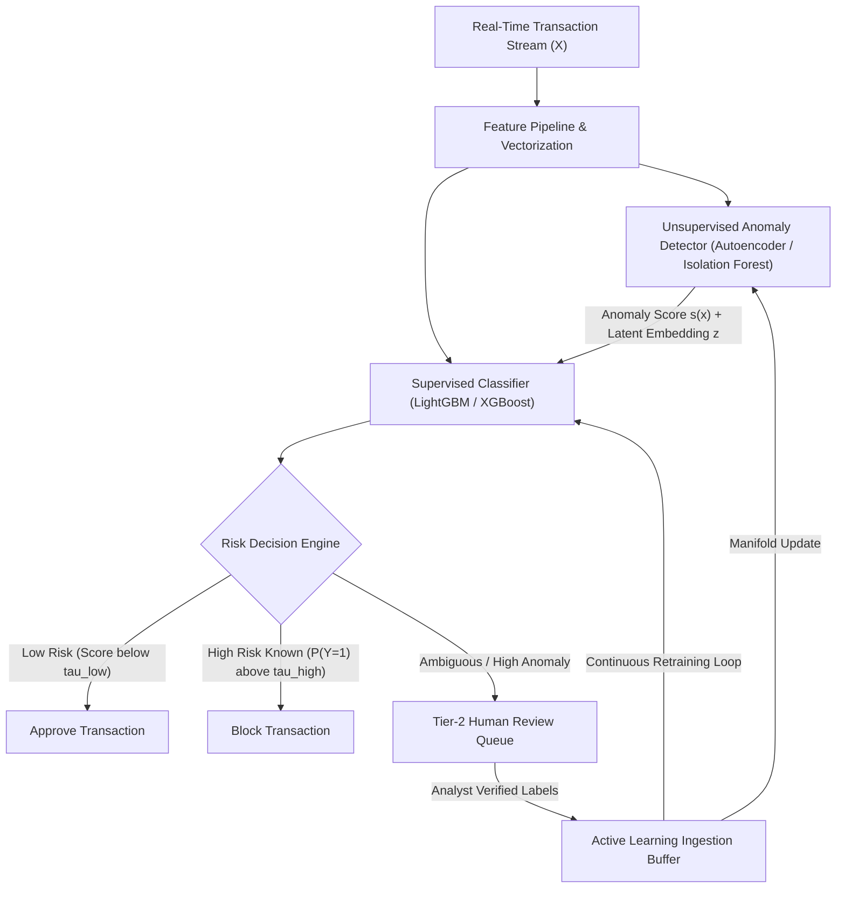
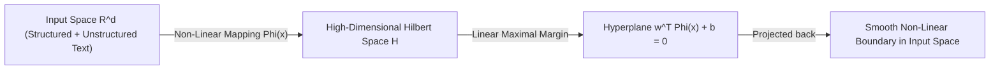
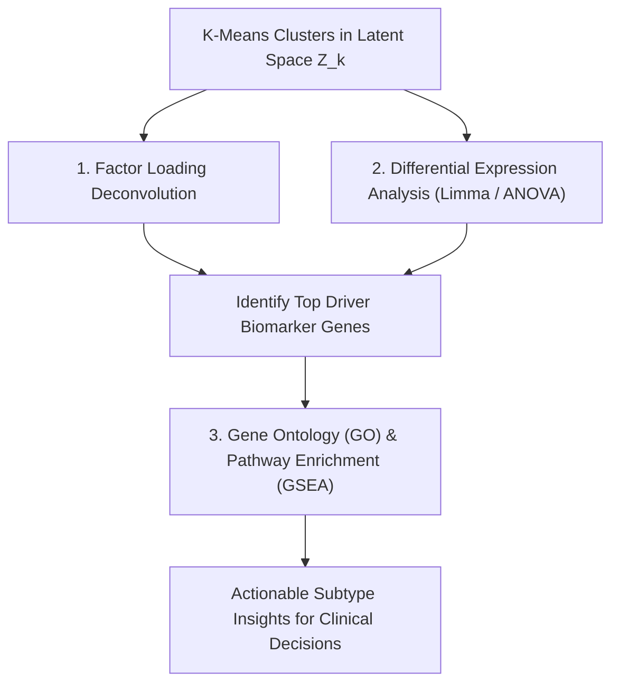
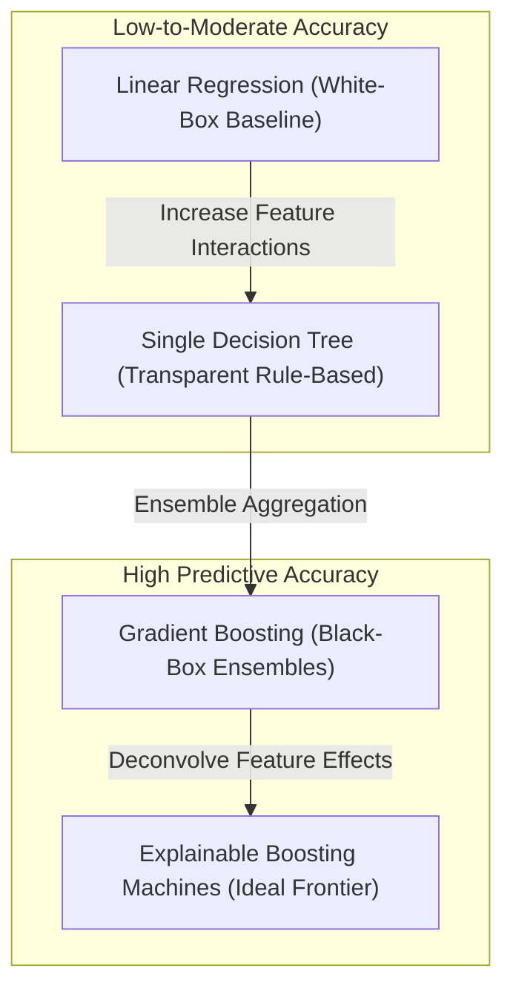
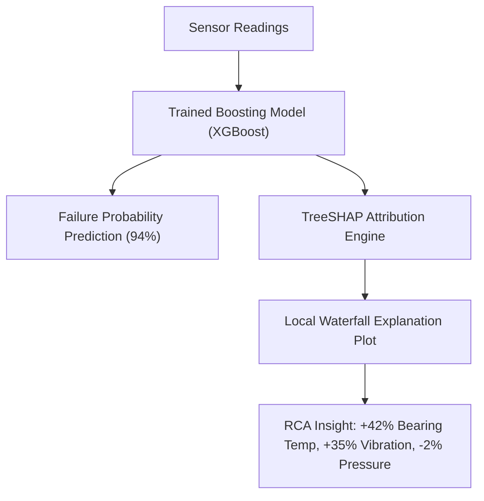

# November 2025

> **Exam -** Semester Examination  
> **Session -** November 2025  

---

## Question 1 (20 Marks)

:::info

**Question Statement**

A FinTech startup wants to build a system to detect fraudulent transactions in real-time. They have a massive dataset of past transactions, with some of them already labeled as 'fraudulent' or 'legitimate'. They are also considering incorporating new, unlabeled transaction data to discover new fraud patterns.

*   **i)** Explain the primary challenge of using a pure supervised learning approach for this task, especially when new, unknown fraud types emerge. **(10 Marks)**
*   **ii)** Propose a hybrid machine learning strategy that combines both supervised and unsupervised learning techniques to address this challenge. Justify your choice of approach by explaining how it overcomes the limitations of using a single learning paradigm. **(10 Marks)**

:::

---

### Solution 1 (20 Marks)

#### (i) Primary Challenges of Pure Supervised Learning (10 Marks)

A pure supervised model learns a decision boundary mapping transaction features $\mathbf{x} \in \mathbb{R}^d$ to historical class labels $y \in \{0, 1\}$ by approximating the posterior $P(Y \mid \mathbf{x})$. While highly effective for known, stationary fraud topologies, this paradigm faces fundamental structural failures in a dynamic financial environment:

##### 1. Violation of the Closed-World Assumption (Zero-Day Invisibility)
*   Supervised models operate under the closed-world hypothesis: test data distributions are assumed to follow the support of the training distribution ($\mathbf{x} \sim P_{\text{train}}(\mathbf{X})$).
*   Emerging fraud schemes (e.g., automated credential stuffing bots, synthetic identities, novel micro-deposit exploits) exhibit feature patterns never seen during model training.
*   Because the supervised model has only seen historical legitimate points in that new region of space, it assigns a high posterior probability of legitimacy ($P(Y=0 \mid \mathbf{x}_{\text{novel}}) \to 1$), resulting in catastrophic **False Negatives**.

##### 2. Concept Drift & Adversarial Distribution Shifts
*   Fraud detection is inherently adversarial. Attackers continuously alter behavior to bypass production classification thresholds:
    *   **Covariate Shift:** $P_{\text{train}}(\mathbf{X}) \neq P_{\text{test}}(\mathbf{X})$ (spending behaviors shift due to external trends).
    *   **Concept Drift:** $P_{\text{train}}(Y \mid \mathbf{X}) \neq P_{\text{test}}(Y \mid \mathbf{X})$ (a previously benign transaction signature is repurposed for exploitation).
*   Pure supervised classifiers cannot detect drift autonomously; they require verified labels from the shifted distribution to update their loss surfaces.

##### 3. Severe Label Latency Window
*   Ground-truth fraud labels are subject to substantial latency due to banking dispute processes and 30 to 90-day chargeback cycles.
*   During this latency window, a pure supervised model remains static and blind, allowing new fraud campaigns to scale undetected before ground-truth labels can be incorporated into retraining.

##### 4. Extreme Class Imbalance & Majority Loss Domination
*   Fraud typically accounts for less than 0.1% of transactions ($P(Y=1) < 0.001$). Under empirical risk minimization, the loss function is dominated by the legitimate majority class, suppressing sensitivity to subtle fraud boundaries unless aggressive sampling is applied.

---

#### (ii) Proposed Hybrid Machine Learning Strategy (10 Marks)

To bridge the gap between real-time millisecond execution and zero-day anomaly detection, we propose a **Two-Stage Hybrid Learning Pipeline** integrating Unsupervised Outlier Scoring, Supervised Gradient Boosted Classifiers, and Active Learning.

##### Pipeline Components

###### 1. Stage 1: Unsupervised Representation & Anomaly Scoring (Novel Pattern Discovery)
*   **Deep Semi-Supervised Autoencoder:** An autoencoder is trained on high-volume, unflagged transactions to learn the compact manifold of normal behavior:
    $$
    \min_{\theta, \phi} \frac{1}{n}\sum_{i=1}^{n} \|\mathbf{x}_i - g_\phi(f_\theta(\mathbf{x}_i))\|_2^2
    $$
*   **Anomaly Reconstruction Score:** When an unseen fraud pattern $\mathbf{x}_{\text{novel}}$ arrives, its reconstruction error serves as a continuous anomaly score:
    $$
    s_{\text{anom}}(\mathbf{x}) = \|\mathbf{x} - g_\phi(f_\theta(\mathbf{x}))\|_2
    $$
    Because novel fraud schemes deviate from normal transactions, they produce high reconstruction errors without requiring historical labels.

###### 2. Stage 2: Supervised Real-Time Classification (High Precision on Known Patterns)
*   **Feature Augmentation:** The supervised model (e.g., LightGBM) takes original transaction features $\mathbf{x}$ augmented with the unsupervised latent embedding and anomaly score:
    $$
    \mathbf{x}_{\text{augmented}} = \left[\mathbf{x} \,\|\, s_{\text{anom}}(\mathbf{x}) \,\|\, \mathbf{z}_{\text{latent}}\right]
    $$
*   **Latency SLA:** LightGBM evaluates the augmented feature vector in sub-10 milliseconds, satisfying real-time production requirements.

###### 3. Stage 3: Active Learning & Semi-Supervised Triage
*   Transactions exhibiting high unsupervised anomaly scores ($s_{\text{anom}} > \theta_{\text{anom}}$) but uncertain supervised probabilities ($0.3 < P(Y=1) < 0.7$) are sent to an analyst review queue.
*   Analyst verifications generate ground truth for emerging patterns, updating the supervised dataset via Active Learning:
    $$
    \mathbf{x}^* = \arg\max_{\mathbf{x} \in \mathcal{D}_{\text{unlabeled}}} \mathcal{H}(P(Y \mid \mathbf{x})) \times s_{\text{anom}}(\mathbf{x})
    $$

##### Paradigm Comparison

| Dimension | Pure Supervised | Pure Unsupervised | Proposed Hybrid Paradigm |
| :--- | :--- | :--- | :--- |
| **Known Fraud Precision** | High | Low (high false alarm rate) | **High** (supervised classifier) |
| **Zero-Day Novel Fraud** | Zero (blind to unseen types) | High (detects distribution shifts) | **High** (unsupervised anomaly engine) |
| **False Positive Overhead** | Controlled | Severe (unusual $\neq$ fraud) | **Balanced** (anomaly score as a feature) |
| **Adaptation to Concept Drift** | Delayed (30-90 days) | Immediate | **Continuous** (Active Learning loop) |

:::tip

**Examiner's Note**

Full marks require stating both the mathematical basis (closed-world hypothesis, distribution shifts) and operational realities (chargeback latency, inference speed SLAs). Specifying a concrete architecture (e.g., Autoencoder reconstruction error feeding into a Gradient Boosted Classifier) directly fulfills the 12-mark requirement for part (ii).

:::

---

## Question 2 (20 Marks)

:::info

**Question Statement**

A company is developing a machine learning model to predict a rare event in a manufacturing process. The dataset consists of 10,000 data points. In the test set of 1,000 data points, only 10 are positive events. Your model makes the following predictions:
*   It correctly identifies 7 out of the 10 positive events.
*   It incorrectly flags 25 negative events as positive.

Based on this information, calculate the following performance metrics. Show all your calculations. **(15 Marks)**
1.  True Positives (TP), True Negatives (TN), False Positives (FP), and False Negatives (FN).
2.  Accuracy.
3.  Precision.
4.  Recall.
5.  F1-score.

Based on your calculations, analyze which metric is most suitable for this problem and explain why. **(5 Marks)**

:::

---

### Solution 2 (20 Marks)

#### 1. Derivation of Confusion Matrix Parameters (15 Marks)

From the test set specification:
*   **Total Test Instances ($N$):** $1,000$
*   **Total Actual Positive Events ($P$):** $10$
*   **Total Actual Negative Events ($N_{\text{neg}}$):** $1,000 - 10 = 990$

Mapping model predictions to matrix elements:
*   **True Positives ($TP$):** The model correctly identifies 7 out of the 10 positive events $\implies \mathbf{TP = 7}$.
*   **False Negatives ($FN$):** Missed actual positive events $\implies FN = P - TP = 10 - 7 \implies \mathbf{FN = 3}$.
*   **False Positives ($FP$):** Incorrectly flagged negative events $\implies \mathbf{FP = 25}$.
*   **True Negatives ($TN$):** Correctly classified negative events $\implies TN = N_{\text{neg}} - FP = 990 - 25 \implies \mathbf{TN = 965}$.

##### Confusion Matrix Table

| Actual \ Predicted | Predicted Positive ($\hat{Y} = 1$) | Predicted Negative ($\hat{Y} = 0$) | Total Actual |
| :--- | :---: | :---: | :---: |
| **Actual Positive ($Y = 1$)** | $TP = 7$ | $FN = 3$ | $P = 10$ |
| **Actual Negative ($Y = 0$)** | $FP = 25$ | $TN = 965$ | $N_{\text{neg}} = 990$ |
| **Total Predicted** | $TP + FP = 32$ | $FN + TN = 968$ | $N = 1,000$ |

---

#### 2. Accuracy Calculation

$$\text{Accuracy} = \frac{TP + TN}{TP + TN + FP + FN} = \frac{7 + 965}{1,000} = \frac{972}{1,000} = \mathbf{0.9720 \ (97.20\%)}$$

---

#### 3. Precision Calculation

$$\text{Precision} = \frac{TP}{TP + FP} = \frac{7}{7 + 25} = \frac{7}{32} = \mathbf{0.21875 \ (21.875\% \approx 21.88\%)}$$

---

#### 4. Recall Calculation

$$\text{Recall} = \frac{TP}{TP + FN} = \frac{7}{7 + 3} = \frac{7}{10} = \mathbf{0.7000 \ (70.00\%)}$$

---

#### 5. F1-Score Calculation

Using the harmonic mean formulation:
$$F_1 = 2 \times \frac{\text{Precision} \times \text{Recall}}{\text{Precision} + \text{Recall}} = \frac{2}{\frac{1}{\text{Precision}} + \frac{1}{\text{Recall}}}$$

Substituting the rational fractions:
$$\frac{1}{\text{Precision}} = \frac{32}{7}, \quad \frac{1}{\text{Recall}} = \frac{10}{7}$$

$$\frac{1}{\text{Precision}} + \frac{1}{\text{Recall}} = \frac{32 + 10}{7} = \frac{42}{7} = 6$$

$$F_1 = \frac{2}{6} = \frac{1}{3} \approx \mathbf{0.3333 \ (33.33\%)}$$

---

#### Metric Suitability Analysis for Rare Manufacturing Events (5 Marks)

##### 1. Why Accuracy is Misleading (The Accuracy Paradox)
*   The model achieves **$97.20\%$** accuracy. However, consider a **trivial baseline classifier** that predicts every instance as negative ($\hat{Y} = 0$ for all $N = 1,000$):
    $$\text{Accuracy}_{\text{trivial}} = \frac{TN}{N} = \frac{990}{1,000} = \mathbf{99.00\%}$$
*   The trivial model scores higher on accuracy ($99.00\%$) than our trained model ($97.20\%$), despite capturing zero rare events ($\text{Recall} = 0.0\%$). Accuracy is heavily dominated by the majority class and is completely unsuitable for rare-event detection.

##### 2. Operational Cost Asymmetry in Manufacturing
*   **Cost of False Negative ($C_{FN}$):** High. A missed rare failure causes machine breakdown, assembly line downtime, or defective product shipments to clients.
*   **Cost of False Positive ($C_{FP}$):** Low. An incorrect alarm merely triggers a manual inspection by an on-site technician.
*   Because $C_{FN} \gg C_{FP}$, the process must minimize false negatives above all else.

##### 3. Conclusion
*   **Primary Operational Metric: Recall (70.00%)**  
    Recall directly tracks the proportion of rare manufacturing failures captured. Maximizing Recall ensures catastrophic failures are caught.
*   **Primary Model Optimization Metric: $F_2$-Score (or $F_1$-Score = 33.33%)**  
    Relying exclusively on Recall can encourage a degenerate model that flags all 1,000 items as defective (achieving 100% Recall but halting production). The **$F_2$-Score** (weighting Recall twice as heavily as Precision) balances defect capture against false alarm overhead:
    $$F_2 = (1 + 2^2) \frac{\text{Precision} \times \text{Recall}}{4 \times \text{Precision} + \text{Recall}} = 5 \times \frac{0.21875 \times 0.70}{(4 \times 0.21875) + 0.70} \approx \mathbf{0.4861 \ (48.61\%)}$$
    Among the 5 calculated metrics, **Recall** is the most critical operational metric, and the **$F_1$-Score** is the most reliable balanced metric for model selection.

:::tip

**Examiner's Note**

Show the harmonic sum cancellation: $\frac{2}{32/7 + 10/7} = \frac{2}{42/7} = \frac{2}{6} = \frac{1}{3}$. In the suitability analysis, explicitly contrast the trained model's accuracy (97.20%) against the null classifier's accuracy (99.00%) to prove the **Accuracy Paradox**.

:::

---

## Question 3 (20 Marks)

:::info

**Question Statement**

A marketing team has collected a dataset of customer feedback on a new product. The feedback is highly varied and includes both structured data and unstructured, highly subjective text. The relationship between the input variables and customer satisfaction seems to be non-linear and complex. The team leader suggests using a simple linear regression model to predict satisfaction.

*   **i)** Justify why a non-parametric model, such as a Support Vector Machine (SVM) or Naïve Bayes Classifier, might be a better choice than a linear model for this scenario. **(10 Marks)**
*   **ii)** Explain how your chosen non-parametric model handles the non-linear and complex nature of the data. **(10 Marks)**

:::

---

### Solution 3 (20 Marks)

#### (i) Justification Against Linear Regression and for Non-Parametric Models (10 Marks)

The team leader's recommendation to use Simple Linear Regression suffers from key structural limitations in this scenario:

##### Deficiencies of Linear Regression
1.  **Rigid Parametric Form:** Linear regression enforces a strict hyperplanar hypothesis space:
    $$y = \mathbf{w}^T \mathbf{x} + b + \epsilon$$
    It assumes constant marginal effects ($\frac{\partial y}{\partial x_j} = w_j$), unable to model saturation, thresholds, or non-linear customer satisfaction dynamics.
2.  **Failure in High-Dimensional Sparse Text:** Vectorizing subjective customer feedback (via TF-IDF or Bag-of-Words) generates thousands of sparse textual features ($d \gg 10^3$). When $d > n$, the sample covariance matrix $\mathbf{X}^T \mathbf{X}$ is singular and non-invertible, causing Ordinary Least Squares (OLS) estimates to collapse.
3.  **Multimodal Incompatibility:** The dataset mixes dense structured numerical variables with sparse unstructured sentiment tokens. Linear regression cannot capture cross-modal feature interactions without manual polynomial expansion.

##### Superiority of Non-Parametric Models (SVM / Naive Bayes)

| Criterion | Simple Linear Regression | Support Vector Machine (Kernel SVM) | Naive Bayes Classifier |
| :--- | :--- | :--- | :--- |
| **Model Type** | Fixed Parametric ($d+1$ parameters) | Non-Parametric (scales with support vectors) | Generative probabilistic model |
| **Feature Space** | Constrained to linear plane | Infinite-dimensional RKHS via kernels | High-dimensional text tokens |
| **High Dimensions ($d \gg n$)** | Overfits or fails numerically | Immune via dual formulation & margin control | Robust due to feature-wise independence |
| **Non-Linear Dynamics** | Incompatible | Solved via RBF / Polynomial kernels | Handled via log-likelihood ratios |

*   **Conclusion:** A **Support Vector Machine (SVM)** is superior because its capacity is determined by the geometric distribution of the data (support vectors) rather than a rigid parameter count, providing robustness against high-dimensional sparsity while maintaining a globally optimal convex objective.

---

#### (ii) How Kernel SVM Handles Non-Linear, Complex Data (10 Marks)

##### 1. Cover's Theorem & High-Dimensional Projections
Cover's Theorem states that a non-linear pattern classification problem is more likely to be linearly separable when cast into a higher-dimensional space through a non-linear mapping:
$$\Phi: \mathbb{R}^d \to \mathcal{H}$$

##### 2. The Kernel Trick (Avoiding Explicit Inner Products)
Directly evaluating $\Phi(\mathbf{x})$ in high dimensions is computationally intractable. In the dual formulation of SVM, the training data enters exclusively via inner products:
$$\max_{\boldsymbol{\alpha}} \sum_{i=1}^{n} \alpha_i - \frac{1}{2} \sum_{i=1}^{n}\sum_{j=1}^{n} \alpha_i \alpha_j y_i y_j \langle \Phi(\mathbf{x}_i), \Phi(\mathbf{x}_j) \rangle$$
subject to $0 \le \alpha_i \le C$ and $\sum_{i=1}^{n} \alpha_i y_i = 0$.

The **Kernel Trick** replaces the inner product with an equivalent Mercer kernel function evaluated directly in the input space:
$$K(\mathbf{x}_i, \mathbf{x}_j) = \langle \Phi(\mathbf{x}_i), \Phi(\mathbf{x}_j) \rangle_{\mathcal{H}}$$

##### 3. The Radial Basis Function (RBF) Kernel
For non-linear marketing feedback combining text features and numerical metrics, the Gaussian RBF kernel is optimal:
$$K(\mathbf{x}_i, \mathbf{x}_j) = \exp\left(-\gamma \|\mathbf{x}_i - \mathbf{x}_j\|^2\right), \quad \gamma > 0$$

Expanding the exponential term via Taylor series shows that the RBF kernel corresponds to an **infinite-dimensional polynomial feature space**:
$$\exp\left(-\gamma \|\mathbf{x}_i - \mathbf{x}_j\|^2\right) = \exp(-\gamma \|\mathbf{x}_i\|^2)\exp(-\gamma \|\mathbf{x}_j\|^2) \sum_{k=0}^{\infty} \frac{(2\gamma \mathbf{x}_i^T \mathbf{x}_j)^k}{k!}$$
This enables the SVM to model complex feature interactions across text sentiment and purchase metadata without explicitly computing infinite coordinates.

##### 4. Final Non-Linear Decision Function
Predictions depend solely on the subset of data points that lie on or violate the margin boundaries (the **Support Vectors** $\mathcal{SV}$ where $\alpha_i > 0$):
$$f(\mathbf{x}) = \sum_{i \in \mathcal{SV}} \alpha_i y_i K(\mathbf{x}_i, \mathbf{x}) + b$$

:::tip

**Examiner's Note**

State the mathematical identity of the Kernel Trick: $K(\mathbf{x}_i, \mathbf{x}_j) = \langle \Phi(\mathbf{x}_i), \Phi(\mathbf{x}_j) \rangle$. Citing **Cover's Theorem** and demonstrating via Taylor series how the RBF kernel maps inputs into an infinite-dimensional space earns full marks on part (ii).

:::

---

## Question 4 (20 Marks)

:::info

**Question Statement**

You have trained a single Decision Tree model to predict housing prices. While the model has a very low error on the training data, its performance on new, unseen data is significantly worse. Your manager is concerned about this and asks for a more robust solution.

*   **i)** Diagnose the problem with your current single Decision Tree model. **(6 Marks)**
*   **ii)** Propose a solution using Ensembling techniques. **(6 Marks)**
*   **iii)** Explain in detail how a specific Ensembling method addresses the problem identified in your diagnosis. **(8 Marks)**

:::

---

### Solution 4 (20 Marks)

#### (i) Diagnosis of the Single Decision Tree Model (6 Marks)

The combination of near-zero training error and poor test performance is a classic manifestation of **Overfitting**, driven by **High Variance and Low Bias** in the Bias-Variance Decomposition:
$$\mathbb{E}_{\mathcal{D}}\left[(y - \hat{f}(\mathbf{x}))^2\right] = \text{Bias}^2(\hat{f}(\mathbf{x})) + \text{Var}(\hat{f}(\mathbf{x})) + \sigma_{\epsilon}^2$$

##### Root Causes
1.  **Unconstrained Tree Depth:** Without pruning or depth constraints, the tree recursively splits feature space until leaves contain single instances ($N_m = 1$). Training bias vanishes ($\text{Bias}^2 \approx 0$), but variance explodes ($\text{Var} \gg 0$).
2.  **High Sensitivity (Instability):** CART models use greedy recursive splitting. A minor change in a single training housing record can alter the root or early splits, resulting in an entirely different tree topology.
3.  **Step-Function Approximation:** Regression trees approximate continuous target variables (housing prices) with piecewise-constant partitions. Fitting smooth price curves requires excessive splits, memorizing localized noise and outliers.

---

#### (ii) Proposed Solution: Ensemble Learning (6 Marks)

To eliminate high variance while preserving the non-linear expressive power of decision trees, we deploy **Random Forest Regression** (an ensemble of Bootstrap-Aggregated decision trees with feature subspace randomization).

---

#### (iii) Detailed Mechanics of Random Forest Regression (8 Marks)

Random Forest addresses high variance through three complementary mechanisms:

##### 1. Bootstrap Aggregation (Bagging)
*   Given training set $\mathcal{D}$ of size $N$, draw $B$ independent bootstrap datasets $\mathcal{D}_1, \ldots, \mathcal{D}_B$, each formed by sampling $N$ observations uniformly at random **with replacement**.
*   Each sample leaves approximately $36.8\%$ of instances out of training:
    $$P(\text{omitted}) = \left(1 - \frac{1}{N}\right)^N \xrightarrow{N \to \infty} e^{-1} \approx 0.368$$
    These form the **Out-Of-Bag (OOB)** dataset, providing an internal validation estimate.
*   Train an unpruned regression tree $T_b(\mathbf{x})$ on each bootstrap sample $\mathcal{D}_b$, and compute the ensemble average:
    $$\hat{f}_{\text{RF}}(\mathbf{x}) = \frac{1}{B} \sum_{b=1}^{B} T_b(\mathbf{x})$$

##### 2. Mathematical Proof of Variance Reduction
Let each individual tree have variance $\text{Var}(T_b(\mathbf{x})) = \sigma^2$.  
Let the pairwise correlation between trees be $\text{Corr}(T_j(\mathbf{x}), T_k(\mathbf{x})) = \rho$ for $j \neq k$.

The variance of the ensemble mean is derived as:
$$
\begin{aligned}
\text{Var}(\hat{f}_{\text{RF}}(\mathbf{x})) &= \text{Var}\left(\frac{1}{B} \sum_{b=1}^{B} T_b(\mathbf{x})\right) \\
&= \frac{1}{B^2} \sum_{b=1}^{B} \text{Var}(T_b(\mathbf{x})) + \frac{1}{B^2} \sum_{j \neq k} \text{Cov}(T_j(\mathbf{x}), T_k(\mathbf{x})) \\
&= \frac{1}{B^2} (B\sigma^2) + \frac{1}{B^2} (B(B-1)\rho \sigma^2) \\
&= \mathbf{\rho \sigma^2 + \frac{1 - \rho}{B} \sigma^2}
\end{aligned}
$$

As the ensemble size grows ($B \to \infty$):
$$\lim_{B \to \infty} \text{Var}(\hat{f}_{\text{RF}}(\mathbf{x})) = \rho \sigma^2$$

##### 3. Feature Subspace Randomization (Minimizing Correlation $\rho$)
*   If we only use Bagging, all trees split on the most dominant features (e.g., house square footage), making trees highly correlated ($\rho \to 1$) and limiting variance reduction.
*   **Random Forest Modification:** At every node split, the algorithm restricts candidate features to a randomly selected subset:
    $$m \approx \frac{p}{3} \quad (\text{for regression})$$
*   This decorrelates the individual trees, driving $\rho \to 0$. As $\rho \to 0$, the residual variance $\rho \sigma^2$ approaches zero, yielding a stable, low-variance model that generalizes well to unseen housing data.

:::tip

**Examiner's Note**

The core scoring element for Question 4 is the explicit derivation of ensemble variance: $\text{Var}(\bar{T}) = \rho \sigma^2 + \frac{1-\rho}{B}\sigma^2$. Showing how feature subsampling ($m \approx p/3$) lowers $\rho$ directly answers part (iii).

:::

---

## Question 5 (20 Marks)

:::info

**Question Statement**

You are a data scientist working for a bioinformatics company. Your task is to analyze a gene expression dataset with 5,000 genes (features) and 100 samples (data points). The company wants to identify patterns in the data to potentially discover new disease subtypes. The high number of genes makes it impossible to visualize and difficult for most machine learning algorithms to process efficiently.

*   **i)** Justify the need for dimensionality reduction in this specific scenario. **(6 Marks)**
*   **ii)** Propose a suitable dimensionality reduction technique for this dataset and explain its underlying working principle. **(8 Marks)**
*   **iii)** After applying dimensionality reduction, you decide to use K-Means Clustering to identify potential disease subtypes. Explain a key challenge you might face when interpreting the resulting clusters and how you could address it to provide meaningful insights to the biologists. **(6 Marks)**

:::

---

### Solution 5 (20 Marks)

#### (i) Justification for Dimensionality Reduction ($p \gg n$) (6 Marks)

In this dataset, features (genes, $p = 5,000$) vastly exceed samples (patients, $n = 100$). This $p \gg n$ regime requires dimensionality reduction due to:

1.  **Distance Metric Degeneration (Loss of Contrast):** In high-dimensional spaces, pairwise Euclidean distances converge to a uniform scalar:
    $$\lim_{p \to \infty} \frac{\text{dist}_{\max} - \text{dist}_{\min}}{\text{dist}_{\min}} \to 0$$
    Every patient vector becomes equidistant from every other patient in $\mathbb{R}^{5000}$, rendering distance-based clustering algorithms like K-Means ineffective.
2.  **Subspace Rank Deficiency:** The empirical data matrix $\mathbf{X} \in \mathbb{R}^{100 \times 5000}$ has a maximum possible rank of $\min(n, p) = 100$. The data lies entirely within a 99-dimensional subspace; the remaining 4,901 dimensions represent empty space dominated by biological assay noise.
3.  **High Multicollinearity:** Co-regulated genes share similar expression patterns. Retaining all 5,000 features introduces redundant information that destabilizes distance calculations.
4.  **Visual Intractability:** Visual inspection of cluster separation requires projecting high-dimensional expression manifolds into 2D/3D representations.

---

#### (ii) Proposed Dimensionality Reduction: Principal Component Analysis via Dual SVD (8 Marks)

We deploy **Principal Component Analysis (PCA)** implemented via **Singular Value Decomposition (SVD)**.

##### Mathematical Working Principle
1.  **Centering:** Given $\mathbf{X} \in \mathbb{R}^{n \times p}$ ($n=100, p=5,000$), center each column:
    $$\tilde{\mathbf{X}} = \mathbf{X} - \mathbf{1}\boldsymbol{\mu}^T$$
2.  **Maximizing Projection Variance:** Find orthogonal axes $\mathbf{v}_1, \ldots, \mathbf{v}_k \in \mathbb{R}^p$ that maximize projected sample variance:
    $$\max_{\|\mathbf{v}\|_2 = 1} \mathbf{v}^T \mathbf{\Sigma} \mathbf{v}, \quad \text{where } \mathbf{\Sigma} = \frac{1}{n-1}\tilde{\mathbf{X}}^T \tilde{\mathbf{X}} \in \mathbb{R}^{5000 \times 5000}$$
3.  **Dual SVD Formulation (Avoiding $O(p^3)$ Computation):**
    Computing the full $5000 \times 5000$ covariance matrix is computationally inefficient. Instead, we apply SVD directly to the centered matrix $\tilde{\mathbf{X}}$:
    $$\tilde{\mathbf{X}} = \mathbf{U} \mathbf{S} \mathbf{V}^T$$
    *   $\mathbf{U} \in \mathbb{R}^{100 \times 100}$: Left singular vectors (patient eigenvectors).
    *   $\mathbf{S} \in \mathbb{R}^{100 \times 100}$: Singular values $s_1 \ge s_2 \ge \dots \ge s_{100} \ge 0$.
    *   $\mathbf{V} \in \mathbb{R}^{5000 \times 100}$: Right singular vectors (gene loading vectors).
    
    The eigenvalues of the covariance matrix relate directly to the singular values:
    $$\lambda_j = \frac{s_j^2}{n - 1}$$
4.  **Low-Rank Projection:** Project the 100 samples onto the top $k$ principal components ($k \ll 100$):
    $$\mathbf{Z}_k = \tilde{\mathbf{X}} \mathbf{V}_k = \mathbf{U}_k \mathbf{S}_k \in \mathbb{R}^{100 \times k}$$
    We select $k$ based on the cumulative explained variance ratio ($\ge 85\%$):
    $$\frac{\sum_{j=1}^{k} \lambda_j}{\sum_{m=1}^{n-1} \lambda_m} \ge 0.85$$

---

#### (iii) Cluster Interpretation Challenge & Biological Translation (6 Marks)

##### The Interpretation Challenge: The Latent Space Barrier
*   K-Means segments the 100 patients into $K$ clusters based on coordinates in reduced space $\mathbf{Z}_k$ (e.g., $[\text{PC}_1, \text{PC}_2]$).
*   **The Dilemma:** Principal components are abstract linear combinations of all 5,000 genes:
    $$\text{PC}_1 = v_{1,1}\text{Gene}_1 + v_{2,1}\text{Gene}_2 + \dots + v_{5000,1}\text{Gene}_{5000}$$
*   Biologists cannot treat patients based on mathematical eigenvalues; they require identification of specific **driver biomarkers** and mutated biological pathways.

##### Methodological Solutions

1.  **Eigenvector Factor Loading Inspection:** Examine the loading coefficients $\lvert v_{j,k} \rvert$ in $\mathbf{V}_k$. Genes with the highest absolute loading weights along the primary separation components are identified as candidate driver biomarkers.
2.  **Differential Expression Analysis (DEA):** Map the cluster assignments back to the **original 5,000-gene space**. Perform two-sample Welch's $t$-tests across clusters with Benjamini-Hochberg False Discovery Rate (FDR) correction:
    $$q_j = P_j \times \frac{p}{\text{rank}(P_j)} \le 0.05$$
    Volcano plots (Fold Change vs. $-\log_{10}(q\text{-value})$) isolate statistically significant up/down-regulated genes.
3.  **Pathway Enrichment Analysis (GSEA / KEGG):** Feed significant biomarkers into Gene Ontology databases to translate mathematical clusters into functional biological mechanisms (e.g., *"Subtype 2 displays upregulation in DNA repair pathways, pointing to targeted therapeutic options"*).

:::tip

**Examiner's Note**

Emphasize the computational shortcut for $p \gg n$: computing SVD on $\tilde{\mathbf{X}} \in \mathbb{R}^{100 \times 5000}$ or the Gram matrix $\tilde{\mathbf{X}}\tilde{\mathbf{X}}^T \in \mathbb{R}^{100 \times 100}$ requires $O(n^2 p)$ operations, avoiding the $O(p^3) = 1.25 \times 10^{11}$ operations of a full covariance eigendecomposition. In part (iii), referencing **Differential Expression Analysis (DEA)** and **Gene Ontology (GO)** enrichment provides an applied answer.

:::

---

## Question 6 (20 Marks)

:::info

**Question Statement**

A cybersecurity firm is developing a model to detect network intrusions. The dataset is highly imbalanced, with only 0.5% of the data representing actual intrusions. The initial model, a Logistic Regression classifier, has an accuracy of 99.5% but misses nearly all the intrusion events.

*   **i)** Evaluate the misleading nature of accuracy as a performance metric for this imbalanced classification problem. **(6 Marks)**
*   **ii)** Recommend two alternative metrics that would be more appropriate for this scenario. Justify why each of these metrics is a better choice. **(6 Marks)**
*   **iii)** Suggest two strategies to handle the class imbalance in the dataset to improve the model's ability to detect intrusions. **(8 Marks)**

:::

---

### Solution 6 (20 Marks)

#### (i) Misleading Nature of Accuracy (The Accuracy Paradox) (6 Marks)

The reported **$99.5\%$ accuracy** is a textbook demonstration of the **Accuracy Paradox** in severe class imbalance:

##### 1. Mathematical Demonstration of the Null Model
Let the network dataset contain $N = 10,000$ packets:
*   **Actual Intrusions (Minority, $Y = 1$):** $0.5\% \implies N_1 = 50$ packets
*   **Benign Traffic (Majority, $Y = 0$):** $99.5\% \implies N_0 = 9,950$ packets

Consider a trivial **Null Predictor** that classifies every packet as benign ($\hat{Y} = 0$):
$$TP = 0, \quad FN = 50, \quad FP = 0, \quad TN = 9,950$$

$$\text{Accuracy} = \frac{TP + TN}{N} = \frac{0 + 9,950}{10,000} = \mathbf{99.50\%}$$
$$\text{Recall} = \frac{TP}{TP + FN} = \frac{0}{0 + 50} = \mathbf{0.00\%}$$

The null classifier achieves $99.5\%$ accuracy while missing $100\%$ of security intrusions.

##### 2. Cross-Entropy Loss Domination
Standard Logistic Regression minimizes binary cross-entropy:
$$\min_{\mathbf{w}, b} -\frac{1}{N} \left[\sum_{i \in \text{Benign}} \log(1 - \sigma(\mathbf{w}^T \mathbf{x}_i + b)) + \sum_{j \in \text{Intrusion}} \log(\sigma(\mathbf{w}^T \mathbf{x}_j + b))\right]$$
Because benign samples outnumber intrusions 199 to 1, the gradient is dominated by benign terms. The optimizer drives the intercept $b \to -\infty$, pushing predicted probabilities $\sigma(\mathbf{w}^T \mathbf{x} + b) \to 0$ for all instances to minimize training loss.

---

#### (ii) Two Recommended Alternative Metrics (6 Marks)

##### 1. Precision-Recall AUC (PR-AUC / Average Precision)
*   **Definition:** The area under the Precision-Recall curve across all classification thresholds $\tau \in [0, 1]$:
    $$\text{PR-AUC} = \int_{0}^{1} \text{Precision}(R) \, dR$$
*   **Justification:** ROC-AUC is misleading here because the False Positive Rate denominator ($FPR = \frac{FP}{TN + FP}$) contains $TN = 9,950$. Hundreds of false alarms produce a small $FPR$, artificially inflating the ROC-AUC score. PR-AUC focuses exclusively on the positive minority class ($TP, FP, FN$), making it sensitive to genuine intrusion detection performance.

##### 2. $F_2$-Score (Recall-Weighted Harmonic Mean)
*   **Definition:**
    $$F_2 = (1 + 2^2) \frac{\text{Precision} \times \text{Recall}}{2^2 \text{Precision} + \text{Recall}} = 5 \times \frac{\text{Precision} \times \text{Recall}}{4 \times \text{Precision} + \text{Recall}}$$
*   **Justification:** A missed intrusion ($FN$) risks severe security breaches, while a false alarm ($FP$) incurs minor analyst review overhead. Setting $\beta = 2$ places twice as much weight on Recall as Precision, penalizing models that fail to capture intrusions while retaining regularization against excessive false alarms.

---

#### (iii) Two Strategies to Handle Class Imbalance (8 Marks)

##### 1. Algorithm-Level Strategy: Cost-Sensitive Learning & Balanced Class Weights
Modify the cross-entropy loss function to weight errors inversely proportional to class frequencies:
$$\mathcal{L}_{\text{CS}}(\theta) = -\sum_{i=1}^{N} \left[ w_1 y_i \log(\hat{y}_i) + w_0 (1 - y_i) \log(1 - \hat{y}_i) \right]$$
Setting balanced weights:
$$w_1 = \frac{N}{2 \times N_1} = \frac{10,000}{2 \times 50} = \mathbf{100}, \quad w_0 = \frac{10,000}{2 \times 9,950} \approx \mathbf{0.5025}$$
A single missed intrusion is penalized 200 times more heavily than a false positive, preventing the majority class from dominating gradient updates.

##### 2. Data-Level Strategy: SMOTE Combined with Tomek Links

*   **SMOTE (Synthetic Minority Over-sampling Technique):** Rather than duplicating rows (which leads to overfitting), SMOTE synthesizes new minority points along the feature space segments connecting $k$-nearest minority neighbors:
    $$\mathbf{x}_{\text{synthetic}} = \mathbf{x}_i + \lambda (\mathbf{x}_{zi} - \mathbf{x}_i), \quad \lambda \sim \mathcal{U}(0, 1)$$
*   **Tomek Links Cleaning:** Remove borderline majority instances that form mutually closest opposite-class pairs with synthetic minority instances, clarifying the decision boundary.

:::tip

**Examiner's Note**

Bloom's Taxonomy Level 5 (Evaluation) requires comparing why PR-AUC is superior to ROC-AUC in extreme imbalance (the $TN$ dilution problem in the $FPR$ denominator). Providing the exact class-weight balance formula ($w_1 = N / (2N_1) = 100$) rounds out a complete response.

:::

---

## Question 7 (20 Marks)

:::info

**Question Statement**

A manufacturing plant is using a Boosting model to predict equipment failure based on sensor data. The model is highly accurate but is so complex that a human engineer cannot understand how it makes its predictions. The engineers are hesitant to trust a model they cannot interpret, which is crucial for root cause analysis of failures.

*   **i)** Analyze the trade-off between model complexity and interpretability in this context. **(6 Marks)**
*   **ii)** Explain why the boosting model might be difficult to interpret compared to a single Decision Tree. **(6 Marks)**
*   **iii)** Propose an alternative approach that could offer a better balance between predictive performance and interpretability, and discuss its potential advantages and disadvantages in this specific scenario. **(8 Marks)**

:::

---

### Solution 7 (20 Marks)

#### (i) Complexity vs. Interpretability Trade-Off Analysis (6 Marks)

In industrial manufacturing, deploying machine learning requires balancing **Predictive Accuracy (Expressive Capacity)** against **Cognitive Transparency (Interpretability)**:

| Model Paradigm | Interpretability | Predictive Accuracy | Root Cause Analysis (RCA) Utility |
| :--- | :--- | :--- | :--- |
| **White-Box Baselines** (Single Tree, Linear Model) | High (Transparent rules) | Low-to-Moderate (Underfits sensor complexity) | High (Immediate physical validation) |
| **Black-Box Ensembles** (Gradient Boosting, Deep Nets) | Low (Entangled additive splits) | High (Captures non-linear failure signals) | Low (Blind alert triggers unneeded teardowns) |
| **Glass-Box Ensembles** (Explainable Boosting - EBM) | High (Additive 2D curves) | High (Near-XGBoost performance) | High (Direct component attribution) |

##### 1. The Cost of Pure Complexity Without Interpretability
*   Ensemble models (such as XGBoost with 300 trees) capture higher-order sensor interactions (vibration, heat, pressure), yielding high failure detection rates.
*   **The Operational Bottleneck:** High accuracy without interpretability prevents **Root Cause Analysis (RCA)**. If a model predicts a 94% probability of failure but cannot indicate which component is degrading (e.g., bearing wear vs. coolant blockage), maintenance crews must perform costly system teardowns, negating predictive maintenance benefits.

##### 2. Trust, Safety, and Spurious Correlations
*   Plant engineers carry operational liability. An uninterpretable model risks exploiting non-causal correlations (e.g., shifts in ambient factory temperature or operator shift times rather than true mechanical stress).
*   Engineers cannot validate model logic against thermodynamic principles, leading them to bypass alerts during critical operations.

---

#### (ii) Why Boosting is Difficult to Interpret vs. a Single Decision Tree (6 Marks)

##### 1. Single Decision Tree: Transparent, Rule-Based Logic
A single decision tree features high **simulative interpretability** (can be validated step-by-step by a domain expert):
*   Prediction paths map directly to IF-THEN rules:
    $$\text{IF } (\text{Bearing Vibration} > 4.8\,\text{mm/s}) \land (\text{Lubricant Temp} > 92^\circ\text{C}) \implies \text{Failure}$$
*   The feature space is segmented into visible, axis-aligned orthogonal partitions.

##### 2. Boosting Model: Additive Gradient Entanglement
Gradient Boosted Decision Trees (GBDT) replace this single rule set with an **additive expansion of $M$ sequentially dependent weak learners** ($M \in [100, 1000]$):
$$F_M(\mathbf{x}) = F_0(\mathbf{x}) + \sum_{m=1}^{M} \eta \, h_m(\mathbf{x})$$
where each tree $h_m(\mathbf{x})$ does not predict the target failure label, but instead fits the **pseudo-residuals (negative loss gradients)** of preceding trees:
$$r_{im} = -\left[\frac{\partial \mathcal{L}(y_i, F(\mathbf{x}_i))}{\partial F(\mathbf{x}_i)}\right]_{F=F_{m-1}}$$

##### Key Architectural Differences

| Dimension | Single Decision Tree | Gradient Boosted Ensemble |
| :--- | :--- | :--- |
| **Prediction Structure** | Single deterministic path from root to leaf | Sum of outputs across hundreds of trees |
| **Split Target** | Failure label ($y \in \{0, 1\}$) | Residual error from previous boosting iterations |
| **Feature Interactions** | Visible in branch conjunctions | Distributed across hundreds of additive splits |
| **Cognitive Traceability** | Traceable manually on paper | Requires aggregating hundreds of separate trees |
| **Tree Modularity** | Stand-alone decision model | Incomplete weak learner; meaningless on its own |

---

#### (iii) Proposed Alternative Approaches & Trade-Offs (8 Marks)

To reconcile predictive power with interpretability, two primary methodologies are applicable:

##### Approach 1: Explainable Boosting Machines (EBM / GA$^2$M) [Intrinsic Glass-Box]
EBMs are Generalized Additive Models with Pairwise Interactions:
$$g(\mathbb{E}[y]) = \beta_0 + \sum_{j=1}^{p} f_j(x_j) + \sum_{j \neq k} f_{jk}(x_j, x_k)$$
*   **Mechanism:** Trees are trained on **one feature at a time** using round-robin cyclic learning, preventing feature entanglement.
*   **Interpretability:** Each $f_j(x_j)$ produces an exact 2D graph showing how changes in that sensor affect failure risk.

##### Approach 2: TreeSHAP (Shapley Additive Explanations) [Post-Hoc Attribution]
Keep the existing Boosting model, but compute local feature attribution values via **TreeSHAP**:
$$f(\mathbf{x}) = \phi_0 + \sum_{j=1}^{p} \phi_j(\mathbf{x})$$
where $\phi_j(\mathbf{x})$ represents the exact marginal contribution of sensor $j$ to the prediction, satisfying four axiomatic game-theoretic properties: **Efficiency, Symmetry, Dummy (Null Effect), and Additivity**.

##### Comparison for Manufacturing Deployment

| Dimension | Option 1: Explainable Boosting Machines (EBM) | Option 2: Gradient Boosting + TreeSHAP |
| :--- | :--- | :--- |
| **Paradigm** | Intrinsic Glass-Box Model | Post-Hoc Model-Agnostic / Tree-Specific |
| **Predictive Accuracy** | Comparable to XGBoost on tabular sensor data | State-of-the-art ensemble accuracy |
| **Root Cause Utility** | High: inspect exact global sensor curves | High: local waterfall charts for each alarm |
| **Adoption Friction** | Requires retraining and migrating models | Runs directly on existing trained boosting models |

##### Plant Recommendation
*   **Immediate Deployment:** Integrate **TreeSHAP** with the current Boosting pipeline to provide local attribution waterfall plots for every generated alert (e.g., *"Failure likelihood 94%: driven +42% by exhaust temperature > 450°C and +35% by axial vibration"*), enabling immediate root cause analysis without model retraining.
*   **Long-Term Strategy:** Retrain using **Explainable Boosting Machines (EBM)** to achieve intrinsic glass-box interpretability that satisfies engineering safety standards.

:::tip

**Examiner's Note**

Distinguish between **intrinsic interpretability** (models that are transparent by design, like EBMs) and **post-hoc interpretability** (methods applied after training, like SHAP/LIME). Highlighting that SHAP values are uniquely grounded in cooperative game theory axioms (Efficiency, Symmetry, Dummy, Additivity) provides a well-reasoned response.

:::
