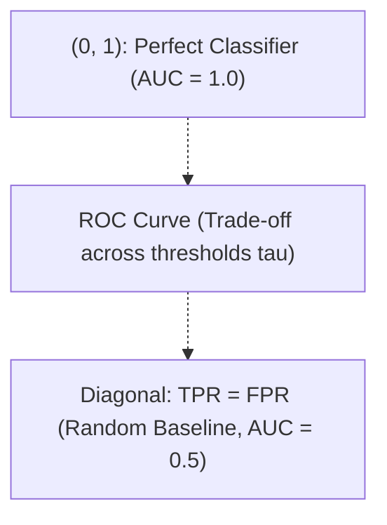

# Part A: Short Answer Questions

> **Course -** Machine Learning Algorithms (21CSC555J)  
> **Assessment Tier -** Part-A University Question Bank  
> **Mark Weightage -** 2 Marks per Question  

---

## Question 1 (2 Marks)

:::info

**Question Statement**

Describe the independent and dependent variable with example? **(2 Marks)**

:::

---

### Solution 1 (2 Marks)

*   **Independent Variable ($X$):** The input, predictor, or controlled feature manipulated or observed to evaluate its effect on the system. It is assumed to be exogenous.
*   **Dependent Variable ($Y$):** The outcome, response, or target variable whose variation is modeled and predicted as a function of $X$:
    $$Y = f(X) + \epsilon$$
*   **Concrete Example:** In housing price prediction, the living area in square feet ($X$) is the **independent variable**, while the final selling price in dollars ($Y$) is the **dependent variable**.

---

## Question 2 (2 Marks)

:::info

**Question Statement**

Define the logistic regression with mathematical notation? **(2 Marks)**

:::

---

### Solution 2 (2 Marks)

*   **Definition:** Logistic Regression is a supervised classification model that estimates the posterior probability of a binary categorical outcome via the **Sigmoid function**.
*   **Mathematical Formulation:**
    $$P(Y = 1 \mid \mathbf{x}) = \sigma(z) = \frac{1}{1 + e^{-z}} = \frac{1}{1 + e^{-(\mathbf{w}^T \mathbf{x} + b)}}$$
    *where $\mathbf{w} \in \mathbb{R}^d$ is the weight vector, $b \in \mathbb{R}$ is the bias, and $z = \mathbf{w}^T \mathbf{x} + b = \ln\left(\frac{p}{1-p}\right)$ is the log-odds (logit).*
*   **Decision Rule:** $\hat{y} = 1$ if $P(Y = 1 \mid \mathbf{x}) \ge 0.5 \iff z \ge 0$; otherwise $\hat{y} = 0$.

---

## Question 3 (2 Marks)

:::info

**Question Statement**

Define Variance and Bias? **(2 Marks)**

:::

---

### Solution 3 (2 Marks)

For an estimator $\hat{f}(x)$ predicting true target $f(x)$ across training sets $\mathcal{D}$:

*   **Bias (Underfitting Error):** The systematic deviation of the model's expected prediction from the ground truth:
    $$\operatorname{Bias}[\hat{f}(x)] = \mathbb{E}[\hat{f}(x)] - f(x)$$
    *High bias stems from overly simplistic assumptions, causing the model to miss underlying trends.*
*   **Variance (Overfitting Error):** The variability of the model's predictions across different random training splits:
    $$\operatorname{Var}[\hat{f}(x)] = \mathbb{E}\left[ \left(\hat{f}(x) - \mathbb{E}[\hat{f}(x)]\right)^2 \right]$$
    *High variance stems from excessive model complexity, causing the model to memorize localized sample noise.*

---

## Question 4 (2 Marks)

:::info

**Question Statement**

Explain the ROC curve with neat diagram? **(2 Marks)**

:::

---

### Solution 4 (2 Marks)

*   **Definition:** The **Receiver Operating Characteristic (ROC)** curve evaluates classifier discrimination by plotting the **True Positive Rate (TPR)** against the **False Positive Rate (FPR)** across all decision thresholds $\tau \in [0, 1]$.
*   **Coordinate Axes:**
    *   **Y-Axis:** $\text{TPR} = \text{Recall} = \frac{\text{TP}}{\text{TP} + \text{FN}}$
    *   **X-Axis:** $\text{FPR} = 1 - \text{Specificity} = \frac{\text{FP}}{\text{FP} + \text{TN}}$

*   **Area Under the Curve (AUC):** An $\text{AUC} = 1.0$ indicates perfect separability; $\text{AUC} = 0.5$ represents random guessing.

---

## Question 5 (2 Marks)

:::info

**Question Statement**

How to find the Optimised threshold for output probability? **(2 Marks)**

:::

---

### Solution 5 (2 Marks)

The default threshold $\tau = 0.5$ is often suboptimal under class imbalance or asymmetric misclassification costs. Optimal thresholds are located via:

1.  **Youden's $J$ Statistic (ROC-Based):** Maximizes the vertical distance from the random chance line:
    $$J(\tau) = \text{Sensitivity}(\tau) + \text{Specificity}(\tau) - 1 \implies \tau^* = \arg\max_\tau J(\tau)$$
2.  **Precision-Recall $F_1$ Optimization:** Maximizes the harmonic mean: $\tau^* = \arg\max_\tau F_1(\tau)$.
3.  **Cost-Utility Minimization:** Minimizes total monetary penalty:
    $$\tau^* = \arg\min_\tau \left[ C_{\text{FP}} \cdot \text{FP}(\tau) + C_{\text{FN}} \cdot \text{FN}(\tau) \right]$$

---

## Question 6 (2 Marks)

:::info

**Question Statement**

Define Gini Index with mathematical notation? **(2 Marks)**

:::

---

### Solution 6 (2 Marks)

*   **Definition:** The **Gini Impurity (Index)** measures the probability that a randomly chosen element from a dataset would be incorrectly labelled if labelled randomly according to the class distribution.
*   **Mathematical Formula:**
    $$I_G(S) = 1 - \sum_{i=1}^C p_i^2$$
    *where $C$ is the number of classes and $p_i$ is the relative proportion of class $i$ in set $S$.*
*   **Bounds:** For binary classification, $I_G \in [0, 0.5]$. A pure node has $I_G = 0$; a balanced $50/50$ node has maximum impurity $I_G = 1 - (0.5^2 + 0.5^2) = 0.50$.

---

## Question 7 (2 Marks)

:::info

**Question Statement**

Signify the importance of non-linear machine learning models used in supervised classification. **(2 Marks)**

:::

---

### Solution 7 (2 Marks)

*   **Overcoming Linear Inseparability:** Real-world datasets (e.g., XOR patterns, concentric circles, complex fraud topologies) cannot be separated by an affine hyperplane ($\mathbf{w}^T \mathbf{x} + b = 0$). Linear models suffer from severe **high bias (underfitting)** on such tasks.
*   **Automated Feature Interactions:** Non-linear models (Decision Trees, Kernel SVMs, Neural Networks, Ensembles) learn curved, multi-modal boundaries without requiring manual polynomial feature engineering.

---

## Question 8 (2 Marks)

:::info

**Question Statement**

Differentiate bagging and boosting technique in machine learning model. **(2 Marks)**

:::

---

### Solution 8 (2 Marks)

| Feature | Bagging (Bootstrap Aggregating) | Boosting |
| :--- | :--- | :--- |
| **Model Building** | Base learners train **in parallel and independently**. | Base learners train **sequentially and adaptively**. |
| **Primary Goal** | **Variance Reduction** (stabilizes complex trees). | **Bias Reduction** (converts weak learners to strong). |
| **Sample Weights** | Uniform random bootstrap sampling ($1/N$). | Adaptive: misclassified points receive higher weights. |
| **Canonical Example**| Random Forest, Bagged CART | AdaBoost, Gradient Boosting, XGBoost |

---

## Question 9 (2 Marks)

:::info

**Question Statement**

Write the assumptions of Naïve Bayes classifier? **(2 Marks)**

:::

---

### Solution 9 (2 Marks)

1.  **Class-Conditional Feature Independence (Core Assumption):** Features $X_1, X_2, \dots, X_d$ are assumed mutually independent given the class label $Y$:
    $$P(X_1, X_2, \dots, X_d \mid Y) = \prod_{j=1}^d P(X_j \mid Y)$$
2.  **Equal Feature Weighting:** All predictors contribute equally and independently to the final posterior decision in log-odds space.

---

## Question 10 (2 Marks)

:::info

**Question Statement**

List the distance measures used in machine learning model. **(2 Marks)**

:::

---

### Solution 10 (2 Marks)

For vectors $\mathbf{u}, \mathbf{v} \in \mathbb{R}^d$:

*   **Euclidean Distance ($L_2$ Norm):** Straight-line geometric distance:
    $$d_2(\mathbf{u}, \mathbf{v}) = \sqrt{\sum_{i=1}^d (u_i - v_i)^2}$$
*   **Manhattan Distance ($L_1$ Norm):** City-block / taxicab distance (robust to outliers):
    $$d_1(\mathbf{u}, \mathbf{v}) = \sum_{i=1}^d \lvert u_i - v_i \rvert$$
*   **Minkowski Distance ($L_p$ Norm):** Generalization parameter $p$:
    $$d_p(\mathbf{u}, \mathbf{v}) = \left(\sum_{i=1}^d \lvert u_i - v_i \rvert^p\right)^{1/p}$$
*   **Cosine Distance:** Measures angular orientation (invariant to document length):
    $$d_{\cos}(\mathbf{u}, \mathbf{v}) = 1 - \frac{\mathbf{u} \cdot \mathbf{v}}{\|\mathbf{u}\|_2 \|\mathbf{v}\|_2}$$

---

## Question 11 (2 Marks)

:::info

**Question Statement**

Write the short notes on classification with example? **(2 Marks)**

:::

---

### Solution 11 (2 Marks)

*   **Definition:** Classification is a supervised learning task where an algorithm learns a mapping function $f: \mathcal{X} \to \mathcal{Y}$ from continuous or discrete feature vectors $\mathbf{x} \in \mathbb{R}^d$ to discrete categorical target labels $y \in \{C_1, \dots, C_K\}$.
*   **Categories:**
    *   *Binary:* Two mutually exclusive classes (e.g., Default vs. Non-Default).
    *   *Multi-Class:* More than two classes (e.g., Digit recognition $0-9$).
*   **Concrete Example:** Email spam filtering, where an incoming email vector is classified into discrete categories: $\text{Spam } (1)$ or $\text{Ham } (0)$.

---

## Question 12 (2 Marks)

:::info

**Question Statement**

What cost function is used for evaluating the loss of the logistic regression model? **(2 Marks)**

:::

---

### Solution 12 (2 Marks)

*   **Cost Function:** The **Binary Cross-Entropy Loss (Log Loss)**, derived via Maximum Likelihood Estimation (MLE):
    $$J(\mathbf{w}, b) = -\frac{1}{N} \sum_{i=1}^N \left[ y_i \ln(\hat{p}_i) + (1 - y_i) \ln(1 - \hat{p}_i) \right]$$
    *where $\hat{p}_i = \sigma(\mathbf{w}^T \mathbf{x}_i + b)$ and $y_i \in \{0, 1\}$.*
*   **Why Not MSE?** Combining Mean Squared Error with the non-linear sigmoid generates a non-convex surface with local minima. Cross-Entropy guarantees a **strictly convex surface** with a unique global minimum.

---

## Question 13 (2 Marks)

:::info

**Question Statement**

What is Overfitting and Underfitting? **(2 Marks)**

:::

---

### Solution 13 (2 Marks)

*   **Underfitting (High Bias, Low Variance):**
    *   *Symptom:* High training error and high test error ($E_{\text{train}} \gg 0, E_{\text{test}} \gg 0$).
    *   *Cause:* Model is too simple to capture the underlying pattern (e.g., fitting a straight line to quadratic data).
*   **Overfitting (Low Bias, High Variance):**
    *   *Symptom:* Near-zero training error but high test error ($E_{\text{train}} \approx 0, E_{\text{test}} \gg 0$).
    *   *Cause:* Model is overly complex and memorizes localized noise and outliers instead of generalizable trends.

---

## Question 14 (2 Marks)

:::info

**Question Statement**

State the Kappa Statistics to measure the model performance. **(2 Marks)**

:::

---

### Solution 14 (2 Marks)

*   **Definition:** **Cohen's Kappa ($\kappa$)** measures classification agreement between predictions and ground truth while explicitly adjusting for agreement occurring purely by chance:
    $$\kappa = \frac{p_o - p_e}{1 - p_e}$$
*   **Parameters:**
    *   $p_o$: Observed agreement proportion ($\frac{\text{TP} + \text{TN}}{N}$).
    *   $p_e$: Expected chance agreement calculated from marginal totals.
*   **Interpretation:** $\kappa = 1.0$ (perfect agreement), $\kappa = 0$ (pure random chance). It is far more reliable than raw accuracy on imbalanced datasets.

---

## Question 15 (2 Marks)

:::info

**Question Statement**

Define Up Sampling and Down Sampling? **(2 Marks)**

:::

---

### Solution 15 (2 Marks)

Data-level resampling techniques used to resolve class imbalance:

*   **Up-Sampling (Over-sampling):** Increases the minority class count to match the majority class. Modern approaches use **SMOTE** (Synthetic Minority Over-sampling Technique) to interpolate synthetic feature vectors between $k$-nearest minority neighbors.
*   **Down-Sampling (Under-sampling):** Decreases majority class instances to match minority frequency by randomly removing or strategically filtering majority samples (e.g., **NearMiss**, Tomek Links).

---

## Question 16 (2 Marks)

:::info

**Question Statement**

How decision tree handles the overfitting? **(2 Marks)**

:::

---

### Solution 16 (2 Marks)

Decision trees control overfitting through two primary mechanisms:

1.  **Pre-Pruning (Early Stopping):** Stops tree expansion during construction if stopping constraints are reached:
    *   Setting `max_depth`, `min_samples_split`, `min_samples_leaf`, or `max_leaf_nodes`.
2.  **Post-Pruning (Cost-Complexity Pruning):** Grows the tree to maximum depth, then collapses non-critical subtrees bottom-up using a complexity penalty:
    $$R_\alpha(T) = R(T) + \alpha \lvert T \rvert$$
    *where $R(T)$ is classification error and $\lvert T \rvert$ is leaf count.*

---

## Question 17 (2 Marks)

:::info

**Question Statement**

What is ensemble learning and write the types? **(2 Marks)**

:::

---

### Solution 17 (2 Marks)

*   **Definition:** Ensemble learning combines predictions from multiple base models (weak learners) to produce a unified model with lower variance, lower bias, and superior generalization.
*   **Four Primary Types:**
    1.  **Bagging (Bootstrap Aggregating):** Parallel training on resampled subsets (e.g., Random Forest).
    2.  **Boosting:** Sequential adaptive training correcting previous errors (e.g., AdaBoost, XGBoost).
    3.  **Stacking:** Training a meta-model on predictions from heterogeneous base models.
    4.  **Voting:** Aggregating predictions via hard (majority) or soft (probability average) voting.

---

## Question 18 (2 Marks)

:::info

**Question Statement**

Signify the advantages of random forest technique. **(2 Marks)**

:::

---

### Solution 18 (2 Marks)

1.  **Variance Reduction Without Overfitting:** Adding more trees monotonically stabilizes variance without increasing test error.
2.  **Tree Decorrelation:** Random feature subspacing ($m = \sqrt{p}$) prevents dominant features from dictating every tree split, driving pairwise correlation $\rho \to 0$.
3.  **Built-in Out-of-Bag (OOB) Validation:** Provides an unbiased error estimate during training without requiring a separate holdout set.
4.  **Native Feature Importance:** Computes feature contributions automatically via Mean Decrease in Impurity (MDI).

---

## Question 19 (2 Marks)

:::info

**Question Statement**

Define KNN model with example? **(2 Marks)**

:::

---

### Solution 19 (2 Marks)

*   **Definition:** K-Nearest Neighbors (KNN) is an instance-based, non-parametric lazy learner. It retains all training instances in memory and classifies a query point by taking the majority vote among its $k$ closest neighbors:
    $$\hat{y} = \arg\max_c \sum_{i \in \mathcal{N}_k(\mathbf{x}^*)} \mathbb{I}(y_i = c)$$
*   **Concrete Example:** Classifying a loan applicant by Income (₹50,000) and Credit Score ($720$). If the $k = 3$ closest historical applicants are $[\text{Approve}, \text{Approve}, \text{Reject}]$, the model predicts **Approve**.

---

## Question 20 (2 Marks)

:::info

**Question Statement**

What are the types of naïve bayes classifier? **(2 Marks)**

:::

---

### Solution 20 (2 Marks)

1.  **Gaussian Naïve Bayes:** Assumes real-valued continuous features follow a normal Gaussian distribution:
    $$P(x_i \mid y) = \frac{1}{\sqrt{2\pi\sigma_y^2}} \exp\left(-\frac{(x_i - \mu_y)^2}{2\sigma_y^2}\right)$$
2.  **Multinomial Naïve Bayes:** Models discrete word count frequencies / term frequencies in text classification.
3.  **Bernoulli Naïve Bayes:** Models binary boolean feature flags ($x_i \in \{0, 1\}$) indicating word presence or absence.

---

## Question 21 (2 Marks)

:::info

**Question Statement**

Difference between Supervised and Unsupervised Learning with examples? **(2 Marks)**

:::

---

### Solution 21 (2 Marks)

| Feature | Supervised Learning | Unsupervised Learning |
| :--- | :--- | :--- |
| **Training Data** | Labelled pairs: $\mathcal{D} = \{(\mathbf{x}_i, y_i)\}_{i=1}^N$ | Unlabelled feature vectors: $\mathcal{D} = \{\mathbf{x}_i\}_{i=1}^N$ |
| **Objective** | Learn mapping $f(\mathbf{x}) \approx y$ to predict unseen targets | Discover intrinsic clusters, manifolds, or latent structures |
| **Feedback** | Explicit loss evaluation against ground truth labels | Internal mathematical criteria (inertia, reconstruction error) |
| **Examples** | Linear Regression, SVM, Random Forest | K-Means, PCA, DBSCAN, Autoencoders |

---

## Question 22 (2 Marks)

:::info

**Question Statement**

Define Recall and Precision **(2 Marks)**

:::

---

### Solution 22 (2 Marks)

From a binary confusion matrix:

*   **Precision (Positive Predictive Value):** The fraction of predicted positive instances that are truly positive (measures accuracy of positive alerts):
    $$\text{Precision} = \frac{\text{TP}}{\text{TP} + \text{FP}}$$
*   **Recall (Sensitivity / True Positive Rate):** The fraction of actual positive instances successfully identified by the model (measures coverage of the positive class):
    $$\text{Recall} = \frac{\text{TP}}{\text{TP} + \text{FN}}$$

---

## Question 23 (2 Marks)

:::info

**Question Statement**

What is Data imbalance and how it affects the model performance? **(2 Marks)**

:::

---

### Solution 23 (2 Marks)

*   **Definition:** Severe disparity in class frequencies where majority instances vastly outnumber minority instances (e.g., $99\%$ legitimate, $1\%$ fraud).
*   **Adverse Impacts:**
    1.  *The Accuracy Paradox:* A model predicting the majority class exclusively achieves $99\%$ accuracy while detecting $0\%$ of minority targets.
    2.  *Decision Boundary Drift:* Standard loss functions treat all errors equally, causing decision boundaries to collapse toward the minority class.

---

## Question 24 (2 Marks)

:::info

**Question Statement**

Difference between the adaboost and gradient boosting **(2 Marks)**

:::

---

### Solution 24 (2 Marks)

| Feature | AdaBoost (Adaptive Boosting) | Gradient Boosting (GBM / XGBoost) |
| :--- | :--- | :--- |
| **Error Handling** | Adjusts **instance weights**; misclassified points get higher weights. | Fits base learners directly to **pseudo-residuals (negative loss gradients)**. |
| **Loss Optimization** | Restricted primarily to Exponential Loss ($e^{-y f(x)}$). | Optimizes arbitrary differentiable loss functions (MSE, Huber, Log-Loss). |
| **Base Estimators** | Shallow single-split **decision stumps** (depth 1). | Deeper regression trees (typically depth 3 to 6). |

---

## Question 25 (2 Marks)

:::info

**Question Statement**

Define Bayes Theorem **(2 Marks)**

:::

---

### Solution 25 (2 Marks)

*   **Definition:** Bayes' Theorem calculates the posterior probability of a hypothesis $H$ given observed evidence $E$ by inverting likelihood probabilities.
*   **Mathematical Formula:**
    $$P(H \mid E) = \frac{P(E \mid H) P(H)}{P(E)}$$
*   **Component Terms:**
    *   $P(H \mid E)$: **Posterior Probability** (updated belief after observing evidence).
    *   $P(E \mid H)$: **Likelihood** of evidence given hypothesis is true.
    *   $P(H)$: **Prior Probability** (initial baseline belief).
    *   $P(E)$: **Marginal Evidence** (normalization factor: $\sum_i P(E \mid H_i)P(H_i)$).

---

## Question 26 (2 Marks)

:::info

**Question Statement**

What are the various steps involved in building a machine learning model? **(2 Marks)**

:::

---

### Solution 26 (2 Marks)

1.  **Problem Definition:** Specify the business target, problem type (classification/regression), and evaluation metric.
2.  **Data Collection & Cleaning:** Ingest raw data; resolve missing values, corrupt records, and outliers.
3.  **Exploratory Data Analysis (EDA):** Assess feature distributions, skewness, correlations, and class balance.
4.  **Feature Engineering & Preprocessing:** Encode categorical variables, scale numerical features, split into train/val/test sets.
5.  **Model Training:** Fit candidate baseline and ensemble algorithms.
6.  **Hyperparameter Tuning:** Optimize model parameters via stratified cross-validation.
7.  **Evaluation & Deployment:** Audit performance on held-out test data; deploy via REST API with performance drift monitoring.

:::tip

**Examiner's Note**

For 2-mark questions, examiners scan for: (1) Core definition keyword, (2) Mathematical formula with parameter definitions, and (3) A concise example. Structuring answers into these 3 bullets ensures consistent full marks.

:::
