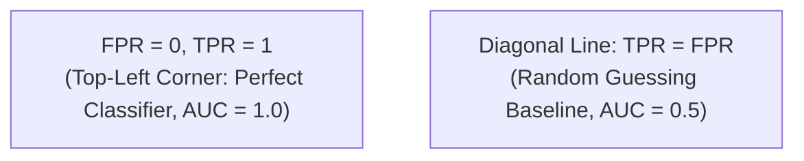

# Part A: Short Answer Questions

> **Course -** Machine Learning Algorithms (21CSC555J)  
> **Assessment Tier -** Part-A University Question Bank  
> **Mark Weightage -** 2 Marks per Question  

---

## Question 1 (2 Marks)

:::info

**Question Statement**

Describe the independent and dependent variable with example? **(2 Marks)**

:::

---

### Solution 1 (2 Marks)

*   **Independent Variable ($X$):** The input, predictor, or explanatory feature manipulated or observed to measure its effect. It is assumed to be exogenous and error-free.
*   **Dependent Variable ($Y$):** The outcome, response, or target variable whose variation is modeled and predicted as a function of $X$.
*   *Mathematical Model:* $Y = f(X) + \epsilon$.
*   *Example:* In house price prediction, the living area in square feet ($X$) is the **independent variable**, while the selling price in dollars ($Y$) is the **dependent variable**.

---

## Question 2 (2 Marks)

:::info

**Question Statement**

Define the logistic regression with mathematical notation? **(2 Marks)**

:::

---

### Solution 2 (2 Marks)

Logistic Regression is a supervised classification algorithm that models the posterior probability of a binary categorical outcome via the **Sigmoid (logistic) function**:

$$
P(Y = 1 \mid \mathbf{x}) = \sigma(\mathbf{w}^T \mathbf{x} + b) = \frac{1}{1 + e^{-(\mathbf{w}^T \mathbf{x} + b)}}
$$

where:
*   $\mathbf{w} \in \mathbb{R}^d$ is the weight vector, $b \in \mathbb{R}$ is the bias term.
*   $\mathbf{w}^T \mathbf{x} + b = \ln\left(\frac{p}{1 - p}\right)$ represents the log-odds (logit).
*   Output $\sigma(z) \in (0, 1)$ satisfies Kolmogorov's probability axioms.

---

## Question 3 (2 Marks)

:::info

**Question Statement**

Define Variance and Bias? **(2 Marks)**

:::

---

### Solution 3 (2 Marks)

Given an estimator $\hat{f}(x)$ trained on dataset $\mathcal{D}$ predicting true target $f(x)$:
*   **Bias:** The systematic error caused by overly simplistic assumptions in the model, measuring how far the average prediction deviates from the true target:
    $$\operatorname{Bias}[\hat{f}(x)] = \mathbb{E}[\hat{f}(x)] - f(x)$$
    *(High bias leads to **Underfitting**).*
*   **Variance:** The sensitivity of the model to fluctuations in the training dataset, measuring how much predictions scatter around their mean across different training draws:
    $$\operatorname{Var}[\hat{f}(x)] = \mathbb{E}\left[ \left(\hat{f}(x) - \mathbb{E}[\hat{f}(x)]\right)^2 \right]$$
    *(High variance leads to **Overfitting**).*

---

## Question 4 (2 Marks)

:::info

**Question Statement**

Explain the ROC curve with neat diagram? **(2 Marks)**

:::

---

### Solution 4 (2 Marks)

The **Receiver Operating Characteristic (ROC)** curve evaluates classifier performance across all decision thresholds $\tau \in [0, 1]$:
*   **Y-Axis:** True Positive Rate ($\text{TPR} = \text{Recall} = \frac{\text{TP}}{\text{TP} + \text{FN}}$).
*   **X-Axis:** False Positive Rate ($\text{FPR} = 1 - \text{Specificity} = \frac{\text{FP}}{\text{FP} + \text{TN}}$).

*   **Area Under the Curve (AUC):** Measures threshold-independent ranking capability. An $\text{AUC} = 1.0$ represents a flawless classifier, while $\text{AUC} = 0.5$ represents random coin-toss guessing.

---

## Question 5 (2 Marks)

:::info

**Question Statement**

How to find the Optimised threshold for output probability? **(2 Marks)**

:::

---

### Solution 5 (2 Marks)

The default classification threshold $\tau = 0.5$ is often suboptimal under class imbalance or asymmetric misclassification costs. The optimized threshold is determined via:
1.  **Youden's $J$ Statistic (ROC Optimization):** Maximizes the vertical distance from the chance diagonal:
    $$J = \text{TPR}(\tau) - \text{FPR}(\tau) = \text{Sensitivity} + \text{Specificity} - 1 \implies \tau^* = \arg\max_\tau J(\tau)$$
2.  **Precision-Recall $F_1$ Optimization:** Maximizes the harmonic mean: $\tau^* = \arg\max_\tau F_1(\tau)$.
3.  **Cost-Sensitive Utility Matrix:** Minimizes expected business cost:
    $$\tau^* = \arg\min_\tau \left( C_{\text{FP}} \cdot \text{FP}(\tau) + C_{\text{FN}} \cdot \text{FN}(\tau) \right)$$

---

## Question 6 (2 Marks)

:::info

**Question Statement**

Define Gini Index with mathematical notation? **(2 Marks)**

:::

---

### Solution 6 (2 Marks)

The **Gini Impurity (Index)** measures the probability that a randomly chosen element from a dataset would be incorrectly labelled if it were randomly labelled according to the class distribution in the subset:

$$
I_G(S) = 1 - \sum_{i=1}^C p_i^2
$$

where:
*   $C$ is the total number of classes.
*   $p_i$ is the relative frequency of class $i$ in set $S$.
*   *Bounds:* For binary classification, $I_G \in [0, 0.5]$. A pure node has $I_G = 0$, while a maximally impure node ($50/50$ split) has $I_G = 1 - (0.5^2 + 0.5^2) = 0.50$.

---

## Question 7 (2 Marks)

:::info

**Question Statement**

Signify the importance of non-linear machine learning models used in supervised classification. **(2 Marks)**

:::

---

### Solution 7 (2 Marks)

*   **Failure of Linear Separability:** Real-world datasets (e.g., XOR patterns, concentric distributions, gene expression profiles) cannot be separated by an affine hyperplane ($\mathbf{w}^T \mathbf{x} + b = 0$). Linear models suffer from severe **high bias (underfitting)** on such data.
*   **Expressive Capacity:** Non-linear models (Decision Trees, Kernel Support Vector Machines, Random Forests, Multi-Layer Perceptrons) learn complex, curved, multi-modal decision boundaries without requiring manual polynomial feature expansion, capturing intricate feature interactions automatically.

---

## Question 8 (2 Marks)

:::info

**Question Statement**

Differentiate bagging and boosting technique in machine learning model. **(2 Marks)**

:::

---

### Solution 8 (2 Marks)

| Dimension | Bagging (Bootstrap Aggregating) | Boosting |
| :--- | :--- | :--- |
| **Model Building** | Base learners are trained **in parallel and independently**. | Base learners are trained **sequentially and adaptively**. |
| **Target Error** | Primarily reduces **Variance** (stabilizes overfitted models). | Primarily reduces **Bias** (strengthens weak learners). |
| **Sample Weighting** | Equal, unweighted random bootstrap sampling ($1/N$). | Misclassified samples receive increased weights iteratively. |
| **Example** | Random Forest, Bagged Decision Trees | AdaBoost, Gradient Boosting, XGBoost |

---

## Question 9 (2 Marks)

:::info

**Question Statement**

Write the assumptions of Naïve Bayes classifier? **(2 Marks)**

:::

---

### Solution 9 (2 Marks)

1.  **Class-Conditional Independence Assumption (Core Mandate):** Every pair of features $X_j, X_k$ is mutually independent given the class label $Y$:
    $$P(X_1, X_2, \dots, X_d \mid Y) = \prod_{j=1}^d P(X_j \mid Y)$$
2.  **Equal Feature Influence:** All attributes contribute equally and independently to the final posterior probability in log-space.

---

## Question 10 (2 Marks)

:::info

**Question Statement**

List the distance measures used in machine learning model. **(2 Marks)**

:::

---

### Solution 10 (2 Marks)

For two vectors $\mathbf{u}, \mathbf{v} \in \mathbb{R}^d$:
1.  **Euclidean Distance ($L_2$ Norm):** $d_2(\mathbf{u}, \mathbf{v}) = \sqrt{\sum_{i=1}^d (u_i - v_i)^2}$ (straight-line distance).
2.  **Manhattan Distance ($L_1$ Norm):** $d_1(\mathbf{u}, \mathbf{v}) = \sum_{i=1}^d \lvert u_i - v_i \rvert$ (grid / taxicab distance).
3.  **Minkowski Distance ($L_p$ Norm):** $d_p(\mathbf{u}, \mathbf{v}) = \left(\sum_{i=1}^d \lvert u_i - v_i \rvert^p\right)^{1/p}$.
4.  **Cosine Distance:** $d_{\cos}(\mathbf{u}, \mathbf{v}) = 1 - \frac{\mathbf{u} \cdot \mathbf{v}}{\|\mathbf{u}\|_2 \|\mathbf{v}\|_2}$ (measures angular orientation, invariant to magnitude).

---

## Question 11 (2 Marks)

:::info

**Question Statement**

Write the short notes on classification with example? **(2 Marks)**

:::

---

### Solution 11 (2 Marks)

*   **Definition:** Classification is a supervised learning task where an algorithm learns a mapping function $f: \mathcal{X} \to \mathcal{Y}$ from input feature vectors $\mathbf{x} \in \mathbb{R}^d$ to discrete categorical target labels $y \in \{C_1, C_2, \dots, C_K\}$.
*   **Types:** Binary (two classes, e.g., Spam vs. Ham), Multi-Class (more than two mutually exclusive classes, e.g., Disease Subtypes), and Multi-Label (classes can co-occur).
*   *Example:* Credit card fraud detection, where transactions are classified into discrete outcomes: $\text{Legitimate } (0)$ or $\text{Fraudulent } (1)$.

---

## Question 12 (2 Marks)

:::info

**Question Statement**

What cost function is used for evaluating the loss of the logistic regression model? **(2 Marks)**

:::

---

### Solution 12 (2 Marks)

The cost function used in Logistic Regression is the **Binary Cross-Entropy Loss (Log Loss)**, derived via Maximum Likelihood Estimation (MLE):

$$
J(\mathbf{w}, b) = -\frac{1}{N} \sum_{i=1}^N \left[ y_i \ln(\hat{p}_i) + (1 - y_i) \ln(1 - \hat{p}_i) \right]
$$

where $\hat{p}_i = \sigma(\mathbf{w}^T \mathbf{x}_i + b)$ and $y_i \in \{0, 1\}$.
*   *Why not Mean Squared Error (MSE)?* When combined with the non-linear sigmoid function, MSE generates a non-convex surface plagued by multiple suboptimal local minima. Cross-entropy guarantees a **strictly convex surface** with a unique global minimum.

---

## Question 13 (2 Marks)

:::info

**Question Statement**

What is Overfitting and Underfitting? **(2 Marks)**

:::

---

### Solution 13 (2 Marks)

*   **Underfitting (High Bias, Low Variance):** The model is overly simplistic and incapable of capturing the underlying data structure. It exhibits **high training error and high validation error** ($E_{\text{train}} \gg 0, E_{\text{val}} \gg 0$).
*   **Overfitting (Low Bias, High Variance):** The model is overly complex and memorizes noise, outliers, and idiosyncratic artifacts of the training set. It exhibits **near-zero training error but high validation error** ($E_{\text{train}} \approx 0, E_{\text{val}} \gg 0$).

---

## Question 14 (2 Marks)

:::info

**Question Statement**

State the Kappa Statistics to measure the model performance. **(2 Marks)**

:::

---

### Solution 14 (2 Marks)

**Cohen's Kappa ($\kappa$)** measures inter-rater or model-to-ground-truth agreement for categorical items, correcting for agreement that occurs purely by chance:

$$
\kappa = \frac{p_o - p_e}{1 - p_e}
$$

where:
*   $p_o$: Observed accuracy (proportion of agreed instances, $\frac{\text{TP} + \text{TN}}{N}$).
*   $p_e$: Expected hypothetical probability of chance agreement based on marginal totals.
*   *Interpretation:* $\kappa \le 0$ indicates chance agreement; $0.61 - 0.80$ indicates substantial agreement; $0.81 - 1.00$ indicates near-perfect agreement. It is vastly superior to raw accuracy on imbalanced datasets.

---

## Question 15 (2 Marks)

:::info

**Question Statement**

Define Up Sampling and Down Sampling? **(2 Marks)**

:::

---

### Solution 15 (2 Marks)

Data-level resampling techniques to rectify class imbalance:
*   **Up-Sampling (Over-sampling):** Increases the number of minority class instances to match the majority class. Techniques include random duplication or synthetic feature interpolation using **SMOTE (Synthetic Minority Over-sampling Technique)**.
*   **Down-Sampling (Under-sampling):** Decreases the number of majority class instances by randomly or deterministically removing instances (e.g., **NearMiss**, Tomek Links) to match the minority count.

---

## Question 16 (2 Marks)

:::info

**Question Statement**

How decision tree handles the overfitting? **(2 Marks)**

:::

---

### Solution 16 (2 Marks)

Decision trees control overfitting via two mechanisms:
1.  **Pre-Pruning (Early Stopping):** Stops tree growth during training if constraint thresholds are reached (e.g., setting `max_depth`, `min_samples_split`, `min_samples_leaf`, or `max_leaf_nodes`).
2.  **Post-Pruning (Cost-Complexity Pruning):** Grows the tree to full depth, then collapses non-critical branches bottom-up using a complexity penalty:
    $$R_\alpha(T) = R(T) + \alpha \lvert T \rvert$$

---

## Question 17 (2 Marks)

:::info

**Question Statement**

What is ensemble learning and write the types? **(2 Marks)**

:::

---

### Solution 17 (2 Marks)

*   **Ensemble Learning:** An algorithmic meta-paradigm that combines predictions from multiple diverse base models (weak learners) to produce a unified model with superior predictive accuracy and generalization.
*   **Primary Types:**
    1.  **Bagging (Bootstrap Aggregation):** Parallel independent training (e.g., Random Forest).
    2.  **Boosting:** Sequential adaptive error correction (e.g., AdaBoost, XGBoost, LightGBM).
    3.  **Stacking (Stacked Generalization):** Training a meta-model on predictions of diverse base classifiers.
    4.  **Voting:** Aggregating outputs via hard (majority) or soft (average probability) voting.

---

## Question 18 (2 Marks)

:::info

**Question Statement**

Signify the advantages of random forest technique. **(2 Marks)**

:::

---

### Solution 18 (2 Marks)

1.  **Immunity to Overfitting:** Adding more trees monotonically stabilizes variance without increasing generalization error.
2.  **Decorrelation of Trees:** Random feature subspacing ($m = \sqrt{p}$) ensures individual trees do not split on the same dominant features, driving variance down.
3.  **Built-in Out-of-Bag (OOB) Validation:** Provides an unbiased internal error estimate without requiring a separate validation holdout split.
4.  **Automatic Feature Importance:** Quantifies variable contribution via Mean Decrease in Impurity (MDI).

---

## Question 19 (2 Marks)

:::info

**Question Statement**

Define KNN model with example? **(2 Marks)**

:::

---

### Solution 19 (2 Marks)

*   **Definition:** K-Nearest Neighbors (KNN) is an instance-based, non-parametric lazy learning algorithm. It stores all training instances in memory and classifies a new sample based on the majority class among its $k$ closest neighbors in feature space:
    $$\hat{y} = \arg\max_{c} \sum_{i \in \mathcal{N}_k(\mathbf{x}^*)} \mathbb{I}(y_i = c)$$
*   *Example:* Classifying a fruit by weight ($150\text{g}$) and color score ($0.8$). If its $k = 3$ closest neighbors are $[ \text{Apple}, \text{Apple}, \text{Orange} ]$, it is classified as an **Apple**.

---

## Question 20 (2 Marks)

:::info

**Question Statement**

What are the types of naïve bayes classifier? **(2 Marks)**

:::

---

### Solution 20 (2 Marks)

1.  **Gaussian Naïve Bayes:** Assumes real-valued continuous features follow a normal Gaussian distribution:
    $$P(x_i \mid y) \sim \mathcal{N}(\mu_{yi}, \sigma_{yi}^2)$$
2.  **Multinomial Naïve Bayes:** Models discrete word count frequencies / term occurrence counts in text documents.
3.  **Bernoulli Naïve Bayes:** Models binary boolean feature vectors ($x_i \in \{0, 1\}$) representing the presence or absence of words.

---

## Question 21 (2 Marks)

:::info

**Question Statement**

Difference between Supervised and Unsupervised Learning with examples? **(2 Marks)**

:::

---

### Solution 21 (2 Marks)

| Dimension | Supervised Learning | Unsupervised Learning |
| :--- | :--- | :--- |
| **Training Data** | Labelled pairs: $\mathcal{D} = \{(\mathbf{x}_i, y_i)\}_{i=1}^N$ | Unlabelled feature vectors: $\mathcal{D} = \{\mathbf{x}_i\}_{i=1}^N$ |
| **Objective** | Learn mapping $f(\mathbf{x}) \approx y$ to predict unseen targets | Discover intrinsic patterns, clusters, or latent manifold structures |
| **Feedback** | Explicit loss evaluation against ground truth | Internal heuristic criteria (inertia, reconstruction error) |
| **Examples** | Linear Regression, SVM, Random Forest, Logistic Regression | K-Means Clustering, PCA, Isolation Forest, Autoencoders |

---

## Question 22 (2 Marks)

:::info

**Question Statement**

Define Recall and Precision **(2 Marks)**

:::

---

### Solution 22 (2 Marks)

From a binary confusion matrix:
*   **Precision:** The proportion of predicted positive instances that were truly positive (measures accuracy of positive alerts):
    $$\text{Precision} = \frac{\text{TP}}{\text{TP} + \text{FP}}$$
*   **Recall (Sensitivity / True Positive Rate):** The proportion of actual positive instances that were successfully identified (measures coverage of the positive class):
    $$\text{Recall} = \frac{\text{TP}}{\text{TP} + \text{FN}}$$

---

## Question 23 (2 Marks)

:::info

**Question Statement**

What is Data imbalance and how it affects the model performance? **(2 Marks)**

:::

---

### Solution 23 (2 Marks)

*   **Definition:** A severe disparity in class frequencies where the majority class vastly outnumbers the minority class (e.g., $99\%$ healthy, $1\%$ diseased).
*   **Adverse Impacts:**
    1.  *Accuracy Paradox:* A trivial classifier predicting the majority class for all instances achieves $99\%$ accuracy while detecting $0\%$ of minority targets.
    2.  *Decision Boundary Drift:* Cost functions treat all errors equally, causing decision boundaries to collapse toward the minority class.

---

## Question 24 (2 Marks)

:::info

**Question Statement**

Difference between the adaboost and gradient boosting **(2 Marks)**

:::

---

### Solution 24 (2 Marks)

| Feature | AdaBoost (Adaptive Boosting) | Gradient Boosting (GBM / XGBoost) |
| :--- | :--- | :--- |
| **Error Handling** | Adjusts **sample weights**; difficult misclassified points receive higher weights. | Fits base learners directly to the **negative gradient (pseudo-residuals)** of the loss. |
| **Loss Flexibility** | Restricted primarily to Exponential Loss ($e^{-y f(x)}$). | Generalizes to arbitrary differentiable loss functions (MSE, Huber, Log-Loss). |
| **Base Estimator** | Typically shallow single-split **decision stumps** (depth 1). | Deeper regression trees (typically depth 3 to 6). |

---

## Question 25 (2 Marks)

:::info

**Question Statement**

Define Bayes Theorem **(2 Marks)**

:::

---

### Solution 25 (2 Marks)

Bayes' Theorem mathematically inverts conditional probabilities to update prior belief upon observing evidence:

$$
P(A \mid B) = \frac{P(B \mid A) P(A)}{P(B)}
$$

where:
*   $P(A \mid B)$: Posterior probability (hypothesis $A$ given evidence $B$).
*   $P(B \mid A)$: Likelihood of observing evidence $B$ given hypothesis $A$.
*   $P(A)$: Prior probability of hypothesis $A$.
*   $P(B) = \sum_i P(B \mid A_i)P(A_i)$: Marginal probability of evidence (normalization constant).

---

## Question 26 (2 Marks)

:::info

**Question Statement**

What are the various steps involved in building a machine learning model? **(2 Marks)**

:::

---

### Solution 26 (2 Marks)

1.  **Problem Formulation:** Define business objectives, prediction target, and evaluation metric.
2.  **Data Ingestion & Cleaning:** Handle missing values, outliers, and duplicates.
3.  **Exploratory Data Analysis (EDA):** Assess distributions, skewness, and correlations.
4.  **Feature Engineering & Preprocessing:** Encode categorical variables, scale numerical features, train/test split.
5.  **Model Selection & Training:** Fit candidate baseline and ensemble models.
6.  **Hyperparameter Optimization & Validation:** Tune parameters via stratified cross-validation.
7.  **Model Evaluation & Deployment:** Audit on out-of-sample test set; deploy via API with continuous monitoring.

:::tip

**Examiner's Note**

Ensure all definitions provide exact mathematical formulas (Sigmoid, Cross-Entropy, Cohen's Kappa, Gini Index, Bayes' Theorem) to secure full rubric points.

:::
