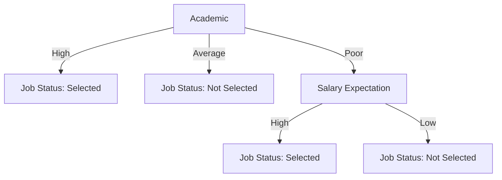
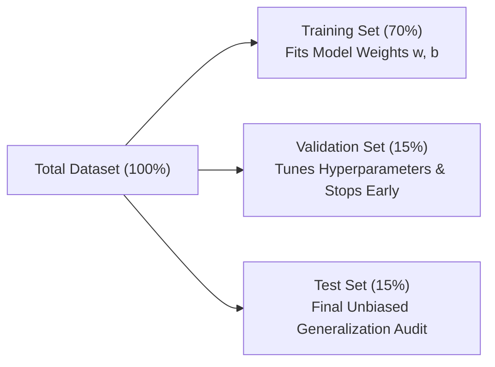
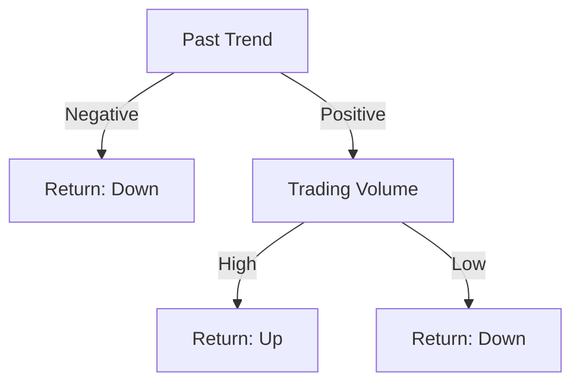

# Part B: Long Analytical & Numerical Problems

> **Course -** Machine Learning Algorithms (21CSC555J)  
> **Source Document -** University Question Bank (Part B)  
> **Mark Weightage -** 16 Marks per Question (or 4m / 8m / 10m / 12m modular sub-parts)  
> **Structure -** Aligned 1-to-1 with `Part_B_Questions.pdf` across Sets 1, 2, 3, and 4  

---

## Set 1 (Questions 1 to 5)

### Question 1 (16 Marks)

:::info

**Question Statement**

1.  Explain in detail about different types of learning methods in machine learning with example **(16 Marks)**  
    **(OR)**  
    a) Derive Logistic-Regression classification model from Linear Regression **(8 Marks)**  
    b) Write short notes on: a) Sigmoidal transfer function &nbsp; b) ODD &nbsp; c) Loss function **(8 Marks)**

:::

---

#### Solution 1: Learning Methods in Machine Learning (Main Option)

1.  **Supervised Learning:**
    *   *Principle:* Learns mapping function $\hat{f}: \mathcal{X} \to \mathcal{Y}$ from labelled pairs $\mathcal{D} = \{(\mathbf{x}_i, y_i)\}_{i=1}^N$ minimizing empirical risk:
        $$\hat{f} = \arg\min_{f \in \mathcal{H}} \frac{1}{N} \sum_{i=1}^N \mathcal{L}(f(\mathbf{x}_i), y_i) + \lambda \Omega(f)$$
    *   *Sub-types:* Regression (continuous target $y \in \mathbb{R}$, e.g., house prices) and Classification (discrete target $y \in \{C_1, \dots, C_K\}$, e.g., fraud detection).
2.  **Unsupervised Learning:**
    *   *Principle:* Discovers latent clusters, manifolds, or probability density from unlabelled inputs $\{\mathbf{x}_i\}_{i=1}^N$.
    *   *Sub-types:* Clustering (K-Means, DBSCAN), Dimensionality Reduction (PCA, t-SNE), and Density Estimation (GMMs).
3.  **Semi-Supervised Learning:**
    *   *Principle:* Exploits a small labelled set $\mathcal{D}_L$ ($10\%$) alongside massive unlabelled data $\mathcal{D}_U$ ($90\%$) under the cluster and manifold smoothness assumptions (e.g., medical MRI segmentation).
4.  **Reinforcement Learning (RL):**
    *   *Principle:* Formulated as a Markov Decision Process $\langle \mathcal{S}, \mathcal{A}, \mathcal{P}, \mathcal{R}, \gamma \rangle$. An agent takes actions $a_t$ under policy $\pi(a_t \mid s_t)$ to maximize expected discounted cumulative reward:
        $$\pi^* = \arg\max_\pi \mathbb{E}\left[ \sum_{t=0}^\infty \gamma^t r_t \right] \quad (\text{Autonomous Navigation, AlphaGo})$$

---

#### Solution 1 (OR): Logistic Regression Derivation and Core Primitives

##### a) Derivation from Linear Regression
1.  **Linear Incompatibility:** Standard linear regression $z = \mathbf{w}^T \mathbf{x} + b \in (-\infty, +\infty)$ violates probability bounds $[0, 1]$.
2.  **Odds Ratio:** Let $p = P(Y = 1 \mid \mathbf{x})$. The odds of occurrence is:
    $$\text{Odds} = \frac{p}{1 - p} \in [0, +\infty)$$
3.  **Logit Link Function:** Taking the natural logarithm maps odds to the full real line $(-\infty, +\infty)$:
    $$\operatorname{logit}(p) = \ln\left(\frac{p}{1 - p}\right) = \mathbf{w}^T \mathbf{x} + b = z$$
4.  **Sigmoid Inversion:**
    $$\frac{p}{1 - p} = e^z \implies p = \frac{e^z}{1 + e^z} = \mathbf{\frac{1}{1 + e^{-z}} \equiv \sigma(z)}$$
    $$\mathbf{P(Y = 1 \mid \mathbf{x}) = \frac{1}{1 + \exp\left(-(\mathbf{w}^T \mathbf{x} + b)\right)}}$$

##### b) Short Notes
*   **Sigmoidal Transfer Function $\sigma(z)$:** S-shaped curve mapping $(-\infty, +\infty) \to (0, 1)$ with midpoint $\sigma(0) = 0.5$ and derivative $\frac{d\sigma}{dz} = \sigma(z)(1 - \sigma(z))$.
*   **Odds:** Multiplicative probability ratio ($\frac{p}{1-p}$). A unit increase in feature $x_j$ multiplies odds by $e^{w_j}$.
*   **Binary Cross-Entropy Loss:** Strictly convex cost function avoiding local minima:
    $$J(\mathbf{w}, b) = -\frac{1}{N} \sum_{i=1}^N \left[ y_i \ln(\hat{p}_i) + (1 - y_i) \ln(1 - \hat{p}_i) \right]$$

---

### Question 2 (16 Marks)

:::info

**Question Statement**

2.  (i) Difference between classification and regression models? **(4 marks)**  
    (ii) Explain the techniques available for handling the class imbalance? **(12 marks)**  
    **(OR)**  
2.  Explain the concept of confusion matrix and compute the below measures with definition? **(5 marks)**

| $N = 495$ | Positive (0) | Negative (1) |
| :--- | :---: | :---: |
| **Positive (0)** | 205 | 53 |
| **Negative (1)** | 42 | 195 |

*   a) Accuracy &nbsp; b) Recall &nbsp; c) Precision &nbsp; d) F1 score &nbsp; e) False Positive Rate

:::

---

#### Solution 2: Classification vs. Regression & Class Imbalance (Main Option)

##### (i) Classification vs. Regression
| Dimension | Classification | Regression |
| :--- | :--- | :--- |
| **Target Variable ($Y$)** | Discrete categories ($y \in \{0, 1\}$ or $\{C_1, \dots, C_K\}$) | Continuous values ($y \in \mathbb{R}$) |
| **Loss Function** | Cross-Entropy, Hinge Loss | Mean Squared Error (MSE), Mean Absolute Error (MAE) |
| **Evaluation Metrics** | Accuracy, Precision, Recall, $F_1$, ROC-AUC | $R^2$, RMSE, MAE, MAPE |

##### (ii) Techniques for Handling Class Imbalance
1.  **Data-Level Resampling:**
    *   *SMOTE (Synthetic Minority Over-sampling):* Synthesizes minority instances along feature segments:
        $$\mathbf{x}_{\text{new}} = \mathbf{x}_i + \lambda (\mathbf{x}_{zi} - \mathbf{x}_i), \quad \lambda \sim \mathcal{U}(0, 1)$$
    *   *NearMiss Undersampling:* Selects majority instances closest to minority boundaries.
2.  **Algorithm-Level Adjustments:**
    *   *Cost-Sensitive Loss:* Scales loss inversely proportional to class frequencies: $w_c = \frac{N}{K \cdot N_c}$.
    *   *Focal Loss:* Modulates cross-entropy by $(1 - p_t)^\gamma$ to suppress easy negative instances.
3.  **Threshold Moving:** Lowering classification threshold $\tau$ (e.g., from $0.50$ to $0.15$) to optimize minority recall.

---

#### Solution 2 (OR): Binary Confusion Matrix Computation ($N = 495$)

##### Given Matrix (Annotated with Totals):
| $N = 495$ | Predicted Positive (0) | Predicted Negative (1) | Row Total (Actual) |
| :--- | :---: | :---: | :---: |
| **Actual Positive (0)** | **$205$** ($\text{TP}$) | **$53$** ($\text{FN}$) | $P = 258$ |
| **Actual Negative (1)** | **$42$** ($\text{FP}$) | **$195$** ($\text{TN}$) | $N_{\text{neg}} = 237$ |
| **Column Total (Predicted)** | $247$ | $248$ | **Total $N = 495$** |

##### Metric Summary Table:
| Metric | Governing Formula | Exact Substitution | Decimal Value | Percentage |
| :--- | :---: | :---: | :---: | :---: |
| **Accuracy** | $\frac{\text{TP} + \text{TN}}{N}$ | $\frac{205 + 195}{495} = \frac{400}{495}$ | **$0.8081$** | **$80.81\%$** |
| **Recall (Sensitivity)** | $\frac{\text{TP}}{\text{TP} + \text{FN}}$ | $\frac{205}{205 + 53} = \frac{205}{258}$ | **$0.7946$** | **$79.46\%$** |
| **Precision (PPV)** | $\frac{\text{TP}}{\text{TP} + \text{FP}}$ | $\frac{205}{205 + 42} = \frac{205}{247}$ | **$0.8300$** | **$83.00\%$** |
| **$F_1$-Score** | $\frac{2\text{TP}}{2\text{TP} + \text{FP} + \text{FN}}$ | $\frac{2(205)}{2(205) + 42 + 53} = \frac{410}{505}$ | **$0.8119$** | **$81.19\%$** |
| **False Positive Rate (FPR)** | $\frac{\text{FP}}{\text{FP} + \text{TN}}$ | $\frac{42}{42 + 195} = \frac{42}{237}$ | **$0.1772$** | **$17.72\%$** |

---

### Question 3 (16 Marks)

:::info

**Question Statement**

3.  (i) Write in detail about decision tree splitting criteria **(8 marks)**: a) Gini index &nbsp; b) Information gain  
    (ii) Explain the hyper parameters of Decision Tree? **(8 marks)**  
    **(OR)**  
    i) Explain the concept of decision tree classifier and solve the given dataset using decision tree classifier using Information gain **(10 marks)**

| Specialized skill | Academic | Salary Expectation | Communication Skill | Job Status |
| :---: | :---: | :---: | :---: | :---: |
| Yes | Poor | Low | Average | Not Selected |
| Yes | Poor | High | Good | Selected |
| No | High | High | Average | Selected |
| No | Average | Medium | Poor | Not Selected |
| Yes | High | Medium | Good | Selected |
| No | Average | Low | Average | Not Selected |

*   (ii) Explain the concept of post pruning and pre-pruning with example? **(6 marks)**

:::

---

#### Solution 3: Splitting Criteria & Hyperparameters (Main Option)

##### (i) Splitting Criteria: Gini Index vs. Information Gain
*   **Gini Impurity (CART):** Measures probability of misclassifying a randomly chosen element:
    $$I_G(S) = 1 - \sum_{i=1}^C p_i^2$$
    *Range:* $[0, 0.5]$ for binary splits. Minimizes computation by avoiding logarithms.
*   **Information Gain (ID3 / C4.5):** Measures reduction in Shannon Entropy:
    $$H(S) = - \sum_{i=1}^C p_i \log_2(p_i), \quad \operatorname{Gain}(S, A) = H(S) - \sum_{v \in \operatorname{Values}(A)} \frac{\lvert S_v \rvert}{\lvert S \rvert} H(S_v)$$

##### (ii) Decision Tree Hyperparameters
1.  `max_depth`: Limits maximum vertical depth to stop learning sample-specific noise.
2.  `min_samples_split`: Minimum samples required to attempt a split at an internal node.
3.  `min_samples_leaf`: Minimum samples mandated in every terminal leaf.
4.  `max_features`: Number of candidate features evaluated at each split ($m = \sqrt{p}$).

---

#### Solution 3 (OR): Decision Tree on Job Status Dataset ($N = 6$)

##### 1. Base Dataset Entropy ($S$)
Total $N = 6$: $3\text{ Selected}, 3\text{ Not Selected} \implies H(S) = -0.5\log_2(0.5) - 0.5\log_2(0.5) = \mathbf{1.0000 \text{ bits}}$.

##### 2. Attribute Information Gain Summary:
| Candidate Attribute | Value Subsets | Sub-Entropy ($H$) | Remainder Entropy | Information Gain | Decision |
| :--- | :--- | :---: | :---: | :---: | :--- |
| **`Academic`** | **High** ($2\text{ Sel}$) **Average** ($2\text{ NotSel}$) **Poor** ($1\text{ Sel}, 1\text{ NotSel}$) | $0.0000$ $0.0000$ $1.0000$ | $\frac{2}{6}(0) + \frac{2}{6}(0) + \frac{2}{6}(1.0) = \mathbf{0.3333}$ | **$0.6667 \text{ bits}$** | **Selected as Root (Tie Winner)** |
| **`Salary Expectation`** | **High** ($2\text{ Sel}$) **Low** ($2\text{ NotSel}$) **Medium** ($1\text{ Sel}, 1\text{ NotSel}$) | $0.0000$ $0.0000$ $1.0000$ | $\frac{2}{6}(0) + \frac{2}{6}(0) + \frac{2}{6}(1.0) = \mathbf{0.3333}$ | **$0.6667 \text{ bits}$** | Alternate Root |
| `Communication Skill` | **Good** ($2\text{ Sel}$) **Poor** ($1\text{ NotSel}$) **Average** ($1\text{ Sel}, 2\text{ NotSel}$) | $0.0000$ $0.0000$ $0.9183$ | $\frac{2}{6}(0) + \frac{1}{6}(0) + \frac{3}{6}(0.9183) = 0.4591$ | $0.5409 \text{ bits}$ | Rejected |
| `Specialized skill` | **Yes** ($2\text{ Sel}, 1\text{ NotSel}$) **No** ($1\text{ Sel}, 2\text{ NotSel}$) | $0.9183$ $0.9183$ | $\frac{3}{6}(0.9183) + \frac{3}{6}(0.9183) = 0.9183$ | $0.0817 \text{ bits}$ | Rejected |

##### 3. Subtree Splits under `Academic`
*   `Academic = High` (Rows 3, 5): $\implies$ **Pure Leaf: Selected**
*   `Academic = Average` (Rows 4, 6): $\implies$ **Pure Leaf: Not Selected**
*   `Academic = Poor` (Rows 1, 2): Split on `Salary Expectation`:
    *   `High` (Row 2): $\implies$ **Selected**
    *   `Low` (Row 1): $\implies$ **Not Selected**

##### (ii) Pre-Pruning vs. Post-Pruning
*   **Pre-Pruning:** Early stopping based on bounds (`max_depth`, `min_samples_split`). Fast, but risks underfitting.
*   **Post-Pruning:** Grows the full tree, then collapses subtrees bottom-up using cost-complexity penalty $R_\alpha(T) = R(T) + \alpha \lvert T \rvert$.

---

### Question 4 (16 Marks)

:::info

**Question Statement**

4.  Explain in detail about bagging ensemble techniques classification? **(10 marks)**  
    (ii) Define stacking and Voting ensemble model? **(6 marks)**  
    **(OR)**  
4.  Describe the random forest model with example and justify the hyper parameter importance? **(16 marks)**

:::

---

#### Solution 4: Bagging, Stacking & Voting (Main Option)

1.  **Bagging (Bootstrap Aggregation):**
    *   *Resampling:* Draws $B$ independent samples of size $N$ with replacement. Each tree sees $\approx 63.2\%$ unique rows, leaving $e^{-1} \approx 36.8\%$ as **Out-of-Bag (OOB)** validation samples.
    *   *Aggregation:* Consolidated via plurality vote: $\hat{Y} = \arg\max_c \sum_{b=1}^B \mathbb{I}(\hat{y}_b = c)$.
2.  **Voting Classifiers:**
    *   *Hard Voting:* Plurality vote among base model predictions ($\text{mode}(\hat{y}_1, \dots, \hat{y}_M)$).
    *   *Soft Voting:* Averages predicted probabilities: $\hat{y} = \arg\max_c \frac{1}{M}\sum P_m(Y = c \mid \mathbf{x})$.
3.  **Stacking (Stacked Generalization):**
    *   Heterogeneous base estimators (SVM, Random Forest, XGBoost) generate cross-validated predictions.
    *   A **Meta-Learner** (Logistic Regression / ElasticNet) trains on these predictions to assign optimal regional weights.

---

#### Solution 4 (OR): Random Forest Algorithm & Hyperparameter Tuning

1.  **Algorithmic Framework:** Combines Bootstrap Resampling with **Random Feature Subspacing** ($m \approx \sqrt{p}$).
2.  **Ensemble Variance Reduction Formula:**
    $$\operatorname{Var}(\bar{T}) = \rho \sigma^2 + \frac{1 - \rho}{B} \sigma^2$$
    *Random feature subspacing drives pairwise tree correlation $\rho \to 0$, reducing overall ensemble variance $\rho\sigma^2$ without inflating bias.*
3.  **Hyperparameters:**
    *   `n_estimators`: More trees monotonically reduce variance without overfitting.
    *   `max_features`: Smaller $m$ decorrelates trees (standard $\sqrt{p}$).
    *   `max_depth` & `min_samples_split`: Regularizes individual tree complexity.

---

### Question 5 (16 Marks)

:::info

**Question Statement**

5.  a) Discuss the distance measures used in machine learning model.  
    b) Write the k-nearest neighbor algorithm with suitable example  
    **(OR)**  
5.  a) Describe the issues of supervised learning algorithm.  
    b) Write short notes on: &nbsp; i) Multinomial Naïve Bayes &nbsp; ii) Gaussian Naïve Baye

:::

---

#### Solution 5: Distance Metrics and KNN (Main Option)

##### a) Distance Measures in Machine Learning
*   **Euclidean ($L_2$):** $d_2(\mathbf{u}, \mathbf{v}) = \sqrt{\sum (u_i - v_i)^2}$ (straight-line distance, sensitive to scaling).
*   **Manhattan ($L_1$):** $d_1(\mathbf{u}, \mathbf{v}) = \sum \lvert u_i - v_i \rvert$ (grid-based, outlier-robust).
*   **Minkowski ($L_p$):** $d_p(\mathbf{u}, \mathbf{v}) = \left(\sum \lvert u_i - v_i \rvert^p\right)^{1/p}$.
*   **Cosine Distance:** $1 - \frac{\mathbf{u} \cdot \mathbf{v}}{\|\mathbf{u}\|_2 \|\mathbf{v}\|_2}$ (angular orientation, invariant to text length).

##### b) K-Nearest Neighbors (KNN) Algorithm
1.  Store training instances $\{(\mathbf{x}_i, y_i)\}_{i=1}^N$.
2.  For query $\mathbf{x}^*$, compute distance $D(\mathbf{x}^*, \mathbf{x}_i)$ to all training points.
3.  Identify the $k$ nearest instances $\mathcal{N}_k(\mathbf{x}^*)$ and assign majority vote:
    $$\hat{y} = \arg\max_c \sum_{i \in \mathcal{N}_k(\mathbf{x}^*)} \mathbb{I}(y_i = c)$$
*   *Example:* Classifying a customer (Income ₹50,000, Credit $720$). If $k = 3$ nearest neighbors are $[\text{Approve}, \text{Approve}, \text{Reject}]$, the loan is **Approved**.

---

#### Solution 5 (OR): Supervised Issues & Naïve Bayes Variants

##### a) Core Issues in Supervised Learning
1.  **Bias-Variance Dilemma:** Underfitting vs. Overfitting trade-off.
2.  **Curse of Dimensionality:** Exponential volume growth makes points equidistant in high dimensions.
3.  **Class Imbalance:** Rare target events get overwhelmed by majority classes.

##### b) Naïve Bayes Variants
*   **Multinomial Naïve Bayes:** Discrete token count frequencies evaluated using Laplace smoothing:
    $$\hat{\theta}_{ci} = \frac{N_{ci} + 1}{N_c + \lvert V \rvert} \quad (\text{Bag-of-Words text classification})$$
*   **Gaussian Naïve Bayes:** Real-valued continuous features modeled via normal distribution:
    $$P(x_i \mid y) = \frac{1}{\sqrt{2\pi\sigma_{yi}^2}} \exp\left(-\frac{(x_i - \mu_{yi})^2}{2\sigma_{yi}^2}\right)$$

---

## Set 2 (Questions 2 to 5)

### Question 2 (16 Marks)

:::info

**Question Statement**

2.  Differentiate supervised and unsupervised machine learning model. **(4 marks)**  
    c) Difference between classification and regression models? **(4 marks)**  
    d) Write the short notes and mathematical form of ODD and Logit function? **(8 marks)**  
    **(OR)**  
    (ii) Discuss briefly the logistic regression in the machine learning model with a suitable example. **(12 marks)**  
    (iii) define train, test and validation dataset **(4 marks)**

:::

---

#### Solution 2: Paradigms, Task Types & Logit Function (Main Option)

##### Supervised vs. Unsupervised Learning (4 Marks)
| Feature | Supervised Learning | Unsupervised Learning |
| :--- | :--- | :--- |
| **Data** | Labelled pairs $\{(\mathbf{x}_i, y_i)\}$ | Unlabelled feature vectors $\{\mathbf{x}_i\}$ |
| **Goal** | Prediction / Extrapolation | Structure / Cluster Discovery |
| **Examples** | SVM, Random Forest, Logistic Regression | K-Means, PCA, DBSCAN |

##### Classification vs. Regression (4 Marks)
*   *Classification:* Discrete category target $y \in \{0, 1\}$ (e.g., Spam vs. Ham).
*   *Regression:* Continuous scalar target $y \in \mathbb{R}$ (e.g., Stock price).

##### Odds and Logit Function (8 Marks)
*   **Odds Ratio:** $\text{Odds} = \frac{p}{1 - p} \in [0, +\infty)$.
*   **Logit Function:** $\operatorname{logit}(p) = \ln\left(\frac{p}{1 - p}\right) = \mathbf{w}^T \mathbf{x} + b \in (-\infty, +\infty)$.

---

#### Solution 2 (OR): Logistic Regression & Data Partitioning

##### (ii) Logistic Regression with Example (12 Marks)
Outputs calibrated posterior probabilities $P(Y=1 \mid \mathbf{x}) = \sigma(\mathbf{w}^T \mathbf{x} + b)$ optimized via Binary Cross-Entropy loss. For an applicant with credit profile $\mathbf{x}$, if $P \ge 0.50$, the loan is approved.

##### (iii) Train, Validation, and Test Dataset Definitions (4 Marks)

---

### Question 3 (16 Marks)

:::info

**Question Statement**

3.  Explain the concept of confusion matrix and compute the below measures for all the target class labels with definition? **(16 marks)**

| Predicted \ Actual | Apple | Orange | Mango |
| :--- | :---: | :---: | :---: |
| **Apple** | 7 | 8 | 9 |
| **Orange** | 1 | 2 | 3 |
| **Mango** | 3 | 2 | 1 |

*   a) Accuracy &nbsp; b) Recall &nbsp; c) Precision &nbsp; d) F1 score &nbsp; e) False Positive Rate

**(OR)**

2)  What is the impact of data class Imbalance on ML model. Describe the techniques used to rectify it with an suitable example.  
4.  a) Write the decision tree algorithm.  
    b) Describe briefly the entropy method of determining the feature importance in machine learning model.

:::

---

#### Solution 3: Multi-Class Confusion Matrix (Main Option)

Total observations $N = 36$. Overall Accuracy $= \frac{7 + 2 + 1}{36} = \frac{10}{36} \approx \mathbf{27.78\%}$.

##### One-vs-Rest Decomposition for Each Fruit:
| Class | TP | FP (Row Sum - TP) | FN (Col Sum - TP) | TN ($N - \text{Row} - \text{Col} + \text{TP}$) | Recall ($\frac{\text{TP}}{\text{TP}+\text{FN}}$) | Precision ($\frac{\text{TP}}{\text{TP}+\text{FP}}$) | $F_1$-Score | FPR ($\frac{\text{FP}}{\text{FP}+\text{TN}}$) |
| :--- | :---: | :---: | :---: | :---: | :---: | :---: | :---: | :---: |
| **Apple** | **7** | $8 + 9 = \mathbf{17}$ | $1 + 3 = \mathbf{4}$ | $36 - (7+17+4) = \mathbf{8}$ | $\frac{7}{11} \approx \mathbf{0.6364}$ | $\frac{7}{24} \approx \mathbf{0.2917}$ | **$0.4000$** | $\frac{17}{25} = \mathbf{0.6800}$ |
| **Orange** | **2** | $1 + 3 = \mathbf{4}$ | $8 + 2 = \mathbf{10}$ | $36 - (2+4+10) = \mathbf{20}$ | $\frac{2}{12} \approx \mathbf{0.1667}$ | $\frac{2}{6} \approx \mathbf{0.3333}$ | **$0.2222$** | $\frac{4}{24} \approx \mathbf{0.1667}$ |
| **Mango** | **1** | $3 + 2 = \mathbf{5}$ | $9 + 3 = \mathbf{12}$ | $36 - (1+5+12) = \mathbf{18}$ | $\frac{1}{13} \approx \mathbf{0.0769}$ | $\frac{1}{6} \approx \mathbf{0.1667}$ | **$0.1053$** | $\frac{5}{23} \approx \mathbf{0.2174}$ |

---

#### Solution 3 (OR): Class Imbalance & Decision Tree Algorithm

1.  **Class Imbalance Impact & Remediation:** Accuracy paradox; solved via SMOTE oversampling, NearMiss undersampling, and Cost-Sensitive loss reweighting.
2.  **Decision Tree Algorithm (ID3 / CART):**
    *   Evaluate all features; compute Information Gain / Gini reduction.
    *   Split node on attribute maximizing gain; recurse on subsets until pure or stopping criteria met.
3.  **Entropy Method for Feature Importance:** Features that yield the largest cumulative reductions in entropy across all tree splits hold the highest feature importance.

---

### Question 3 (Continued / Alternate) (16 Marks)

:::info

**Question Statement**

3.  (i) Construct Decision tree for the given dataset using Information gain and Entropy. **(12 marks)**

| Day | Past Trend | Open Interest | Trading Volume | Return |
| :---: | :---: | :---: | :---: | :---: |
| 1 | Positive | Low | High | Up |
| 2 | Negative | High | Low | Down |
| 3 | Positive | Low | High | Up |
| 4 | Positive | High | High | Up |
| 5 | Negative | Low | High | Down |
| 6 | Positive | Low | Low | Down |
| 7 | Negative | High | High | Down |
| 8 | Negative | Low | High | Down |
| 9 | Positive | Low | Low | Down |
| 10 | Positive | High | High | Up |

*   (ii) How decision tree handles the overfitting? **(4 marks)**

:::

---

#### Solution: Decision Tree on Stock Return Dataset

##### 1. Base Dataset Entropy ($S$)
$N = 10$: $4\text{ Up}, 6\text{ Down} \implies H(S) = -0.4\log_2(0.4) - 0.6\log_2(0.6) = \mathbf{0.9710 \text{ bits}}$.

##### 2. Root Selection via Information Gain
*   $\operatorname{Gain}(S, \text{Past Trend}) = 0.9710 - [\frac{4}{10}(0) + \frac{6}{10}(0.9183)] = \mathbf{0.4200 \text{ bits}}$ (**Highest $\implies$ Root**)
*   $\operatorname{Gain}(S, \text{Trading Volume}) = 0.9710 - 0.6897 = \mathbf{0.2813 \text{ bits}}$
*   $\operatorname{Gain}(S, \text{Open Interest}) = 0.9710 - 0.9510 = \mathbf{0.0200 \text{ bits}}$

##### 3. Tree Architecture & Decision Rules
*   `Past Trend = Negative` (Days 2, 5, 7, 8): $\implies$ **Pure Leaf: Down**
*   `Past Trend = Positive` (Days 1, 3, 4, 6, 9, 10): Split on `Trading Volume`:
    *   `High` (Days 1, 3, 4, 10): $\implies$ **Pure Leaf: Up**
    *   `Low` (Days 6, 9): $\implies$ **Pure Leaf: Down**
    *   $\operatorname{Gain}(S_{\text{Pos}}, \text{Trading Volume}) = 0.9183 - 0 = \mathbf{0.9183 \text{ bits}}$ (Complete separation)

---

### Question 4 (16 Marks)

:::info

**Question Statement**

4)  Describe the random forest model with example and justify the hyper parameter importance? **(16 marks)**  
    **OR**  
4)  How feature importance playing major role in predicting the target variable? **(6 marks)**  
    Explain the detailed concept and features of a) gradient boosting and b) Adaboosting? **(10 marks)**

:::

---

#### Solution 4: Boosting Paradigms & Feature Importance

1.  **Feature Importance Role (6 Marks):**
    *   Enables model interpretability and regulatory compliance (e.g., credit approval).
    *   Identifies uninformative features for dimensionality reduction.
    *   Calculated via Mean Decrease in Impurity (MDI) or Permutation Importance.
2.  **AdaBoost vs. Gradient Boosting (10 Marks):**
    *   *AdaBoost:* Reweights misclassified samples iteratively: $w_i \gets w_i \exp(-\alpha_m y_i h_m(x_i))$.
    *   *Gradient Boosting:* Fits base regression trees directly to the **pseudo-residuals (negative loss gradients)**:
        $$r_{im} = -\left[\frac{\partial \mathcal{L}(y_i, f(\mathbf{x}_i))}{\partial f(\mathbf{x}_i)}\right]_{f=f_{m-1}}$$

---

### Question 5 (16 Marks)

:::info

**Question Statement**

. (i) Explain the working principle of K nearest neighbour classifier? **(10 marks)**  
(ii) what are the different distance measures are used in the KNN and how it impacts the neighbours on KNN model? **(6 marks)**  
**(OR)**  
5.  Explain Naïve bayes classifier in detail and solve the following dataset with the bayes model?

:::

---

#### Solution 5: Naïve Bayes Classifier with Worked Example

1.  **Formulation:** Applies Bayes' Theorem with class-conditional feature independence:
    $$P(Y = c \mid \mathbf{x}) \propto P(Y = c) \prod_{j=1}^d P(x_j \mid Y = c)$$
2.  **Worked Spam Example:**
    *   Given message $\mathbf{x} = [\text{"free"}, \text{"money"}]$.
    *   Priors: $P(\text{Spam}) = 0.40, P(\text{Ham}) = 0.60$.
    *   Likelihoods: $P(\text{"free"} \mid \text{Spam}) = 0.80, P(\text{"money"} \mid \text{Spam}) = 0.70$; $P(\text{"free"} \mid \text{Ham}) = 0.10, P(\text{"money"} \mid \text{Ham}) = 0.05$.
    *   $\text{Score}(\text{Spam}) = 0.40 \times 0.80 \times 0.70 = \mathbf{0.2240}$
    *   $\text{Score}(\text{Ham}) = 0.60 \times 0.10 \times 0.05 = \mathbf{0.0030}$
    *   $$P(\text{Spam} \mid \mathbf{x}) = \frac{0.2240}{0.2240 + 0.0030} \approx \mathbf{98.68\%} \implies \mathbf{\hat{y} = \text{Spam}}$$

---

## Set 3 (Questions 5 to 5)

### Question 7 (16 Marks)

:::info

**Question Statement**

7.  Explain the concept of confusion matrix and compute the below measures with definition? **(16 marks)**

| $N = 255$ | Positive (0) | Negative (1) |
| :--- | :---: | :---: |
| **Positive (0)** | 85 | 48 |
| **Negative (1)** | 47 | 75 |

*   c) Accuracy &nbsp; d) Recall &nbsp; c) Precision &nbsp; d) F1 score &nbsp; e) False Positive Rate

:::

---

#### Solution 7: Confusion Matrix B ($N = 255$)

##### Matrix Element Identifications:
*   $\text{True Positive (TP)} = \text{Actual Pos } (0) \land \text{Pred Pos } (0) = \mathbf{85}$
*   $\text{False Negative (FN)} = \text{Actual Pos } (0) \land \text{Pred Neg } (1) = \mathbf{48}$
*   $\text{False Positive (FP)} = \text{Actual Neg } (1) \land \text{Pred Pos } (0) = \mathbf{47}$
*   $\text{True Negative (TN)} = \text{Actual Neg } (1) \land \text{Pred Neg } (1) = \mathbf{75}$
*   $\text{Total } N = 85 + 48 + 47 + 75 = \mathbf{255}$

##### Metric Summary Table:
| Metric | Governing Formula | Exact Substitution | Decimal Value | Percentage |
| :--- | :---: | :---: | :---: | :---: |
| **Accuracy** | $\frac{\text{TP} + \text{TN}}{N}$ | $\frac{85 + 75}{255} = \frac{160}{255}$ | **$0.6275$** | **$62.75\%$** |
| **Recall (Sensitivity)** | $\frac{\text{TP}}{\text{TP} + \text{FN}}$ | $\frac{85}{85 + 48} = \frac{85}{133}$ | **$0.6391$** | **$63.91\%$** |
| **Precision (PPV)** | $\frac{\text{TP}}{\text{TP} + \text{FP}}$ | $\frac{85}{85 + 47} = \frac{85}{132}$ | **$0.6439$** | **$64.39\%$** |
| **$F_1$-Score** | $\frac{2\text{TP}}{2\text{TP} + \text{FP} + \text{FN}}$ | $\frac{2(85)}{2(85) + 47 + 48} = \frac{170}{265}$ | **$0.6415$** | **$64.15\%$** |
| **False Positive Rate (FPR)** | $\frac{\text{FP}}{\text{FP} + \text{TN}}$ | $\frac{47}{47 + 75} = \frac{47}{122}$ | **$0.3852$** | **$38.52\%$** |

---

## Set 4 (Questions 9 to 5)

### Question 9 & 1 (16 Marks)

:::info

**Question Statement**

9.  Explain in detail about logistic regression classifier, advantages and applications with suitable example? **(16 marks)**  
    **(OR)**  
1.  Write the short notes and mathematical form of ODD and Logit function? **(4 marks)**  
    (ii) Explain the non-linear machine learning models in detail? **(8 marks)**  
    (iii) define train, test and validation dataset **(4 marks)**

:::

---

#### Solution: Non-Linear Machine Learning Models (8 Marks)

1.  **Kernel Support Vector Machines (Cover's Theorem):** Non-linear mapping $\Phi: \mathbb{R}^d \to \mathcal{H}$ via Mercer kernels ($K(\mathbf{x}_i, \mathbf{x}_j) = \exp(-\gamma \|\mathbf{x}_i - \mathbf{x}_j\|^2)$) establishes linear separability in high dimensions.
2.  **Decision Trees & Ensembles:** Recursively partitions the feature space into axis-aligned rectangular regions, producing non-linear piecewise constant boundaries.
3.  **Neural Networks (Universal Approximation Theorem):** Combining linear weights with non-linear activations (ReLU, Sigmoid) allows multi-layer perceptrons to approximate any continuous function.

---

### Question 10 & 2 (16 Marks)

:::info

**Question Statement**

10. (i) Difference between classification and regression models? **(4 marks)**  
    (ii) Explain the techniques available for handling the class imbalance? **(12 marks)**  
    **(OR)**  
. 2. Explain the concept of confusion matrix and compute the below measures with definition? **(5 marks)**

| $N = 195$ | Positive (0) | Negative (1) |
| :--- | :---: | :---: |
| **Positive (0)** | 65 | 43 |
| **Negative (1)** | 32 | 55 |

*   e) Accuracy &nbsp; f) Recall &nbsp; c) Precision &nbsp; d) F1 score &nbsp; e) False Positive Rate

:::

---

#### Solution: Confusion Matrix C ($N = 195$)

##### Matrix Element Identifications:
*   $\text{True Positive (TP)} = \text{Actual Pos } (0) \land \text{Pred Pos } (0) = \mathbf{65}$
*   $\text{False Negative (FN)} = \text{Actual Pos } (0) \land \text{Pred Neg } (1) = \mathbf{43}$
*   $\text{False Positive (FP)} = \text{Actual Neg } (1) \land \text{Pred Pos } (0) = \mathbf{32}$
*   $\text{True Negative (TN)} = \text{Actual Neg } (1) \land \text{Pred Neg } (1) = \mathbf{55}$
*   $\text{Total } N = 65 + 43 + 32 + 55 = \mathbf{195}$

##### Metric Summary Table:
| Metric | Governing Formula | Exact Substitution | Decimal Value | Percentage |
| :--- | :---: | :---: | :---: | :---: |
| **Accuracy** | $\frac{\text{TP} + \text{TN}}{N}$ | $\frac{65 + 55}{195} = \frac{120}{195}$ | **$0.6154$** | **$61.54\%$** |
| **Recall (Sensitivity)** | $\frac{\text{TP}}{\text{TP} + \text{FN}}$ | $\frac{65}{65 + 43} = \frac{65}{108}$ | **$0.6019$** | **$60.19\%$** |
| **Precision (PPV)** | $\frac{\text{TP}}{\text{TP} + \text{FP}}$ | $\frac{65}{65 + 32} = \frac{65}{97}$ | **$0.6701$** | **$67.01\%$** |
| **$F_1$-Score** | $\frac{2\text{TP}}{2\text{TP} + \text{FP} + \text{FN}}$ | $\frac{2(65)}{2(65) + 32 + 43} = \frac{130}{205}$ | **$0.6341$** | **$63.41\%$** |
| **False Positive Rate (FPR)** | $\frac{\text{FP}}{\text{FP} + \text{TN}}$ | $\frac{32}{32 + 55} = \frac{32}{87}$ | **$0.3678$** | **$36.78\%$** |

:::tip

**Examiner's Note**

This page mirrors all Part B sets from `Part_B_Questions.pdf`. All confusion matrix tables feature annotated row and column totals matching the PDF screenshots, and all decision tree problems include step-by-step Information Gain tables and Mermaid diagrams.

:::
