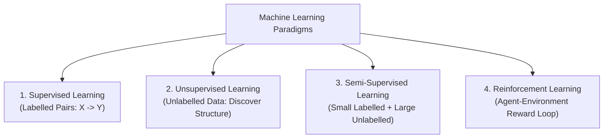
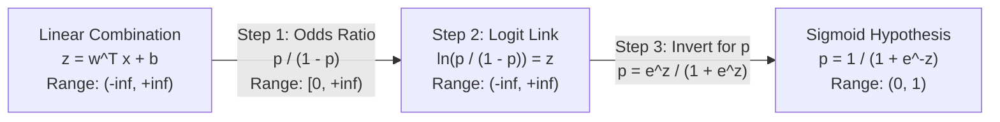
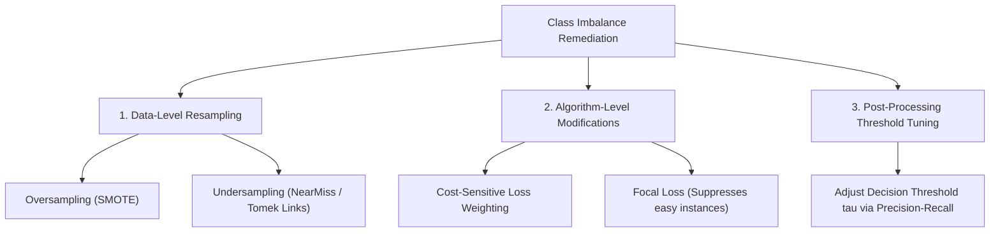
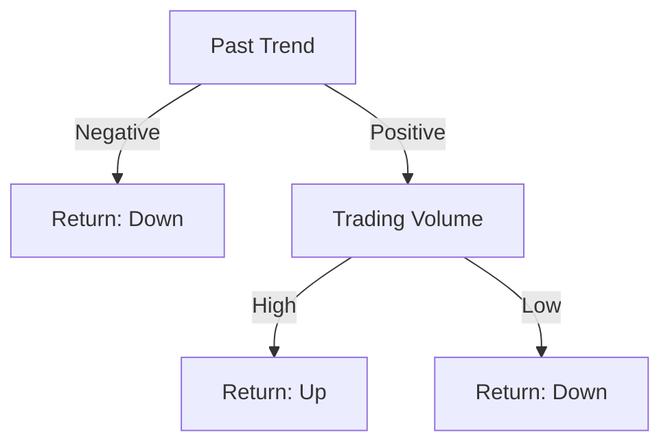
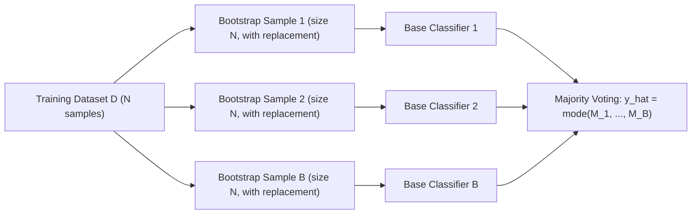
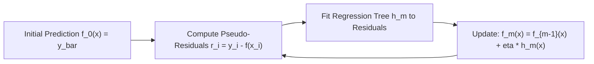

# Part B: Long Analytical & Numerical Problems

> **Course -** Machine Learning Algorithms (21CSC555J)  
> **Assessment Tier -** Part-B University Question Bank  
> **Mark Weightage -** 16 Marks per Question (or 4m / 8m / 12m modular sub-parts)  

---

## Question 1 (16 Marks)

:::info

**Question Statement**

Explain in detail about different types of learning methods in machine learning with examples. **(16 Marks)**

:::

---

### Solution 1 (16 Marks)

Machine learning paradigms are classified based on the nature of the learning signal, the presence of supervision, and environmental feedback:

---

#### 1. Supervised Learning (4 Marks)
*   **Core Principle:** Learns an explicit mapping function $\hat{f}: \mathcal{X} \to \mathcal{Y}$ from labelled training pairs $\mathcal{D} = \{(\mathbf{x}_i, y_i)\}_{i=1}^N$ drawn i.i.d. from joint distribution $P(\mathbf{X}, Y)$.
*   **Optimization Objective (Empirical Risk Minimization):**
    $$\hat{f} = \arg\min_{f \in \mathcal{H}} \left[ \frac{1}{N} \sum_{i=1}^N \mathcal{L}(f(\mathbf{x}_i), y_i) + \lambda \Omega(f) \right]$$
*   **Sub-Types:**
    *   *Regression:* Continuous target $y \in \mathbb{R}$ (e.g., Linear Regression, Ridge, SVR predicting house prices).
    *   *Classification:* Discrete target $y \in \{C_1, \dots, C_K\}$ (e.g., Logistic Regression, Random Forest predicting credit card fraud).

---

#### 2. Unsupervised Learning (4 Marks)
*   **Core Principle:** Discovers latent manifolds, geometric clusters, or probability distributions from unlabelled instances $\mathcal{D} = \{\mathbf{x}_i\}_{i=1}^N$.
*   **Sub-Types:**
    *   *Clustering:* Partitions observations into cohesive groups minimizing intra-cluster variance:
        $$\min \sum_{k=1}^K \sum_{\mathbf{x}_i \in C_k} \|\mathbf{x}_i - \boldsymbol{\mu}_k\|^2 \quad (\text{K-Means, DBSCAN})$$
    *   *Dimensionality Reduction:* Projects high-dimensional vectors to lower-dimensional latent representations while preserving variance or geodesics (e.g., PCA, t-SNE, UMAP).
    *   *Density Estimation:* Models underlying probability density $p(\mathbf{x})$ (e.g., Gaussian Mixture Models, Isolation Forest).

---

#### 3. Semi-Supervised Learning (4 Marks)
*   **Core Principle:** Combines a small labelled set $\mathcal{D}_L = \{(\mathbf{x}_i, y_i)\}_{i=1}^l$ with a substantially larger unlabelled set $\mathcal{D}_U = \{\mathbf{x}_j\}_{j=l+1}^{l+u}$ ($u \gg l$).
*   **Foundational Assumptions:**
    *   *Smoothness Assumption:* Points close in input space share identical class labels.
    *   *Cluster / Manifold Assumption:* The decision boundary passes through low-density regions, avoiding dense clusters.
*   **Methods & Real-World Example:** Pseudo-labeling, Label Propagation. In clinical imaging, an expert radiologist annotates 100 CT scans, while 50,000 unlabelled scans guide representation learning.

---

#### 4. Reinforcement Learning (RL) (4 Marks)
*   **Core Principle:** Formulated as a Markov Decision Process (MDP) defined by the tuple $\langle \mathcal{S}, \mathcal{A}, \mathcal{P}, \mathcal{R}, \gamma \rangle$. An agent in state $s_t \in \mathcal{S}$ selects action $a_t \in \mathcal{A}$ under policy $\pi(a_t \mid s_t)$, receives scalar reward $r_t$, and transitions to state $s_{t+1}$.
*   **Optimization Objective (Expected Cumulative Return):**
    $$\pi^* = \arg\max_\pi \mathbb{E}\left[ \sum_{t=0}^\infty \gamma^t r_t \right]$$
*   **Concrete Example:** Autonomous vehicle trajectory planning, robotic manipulation, and game playing (AlphaGo).

---

#### Summary Comparison Matrix
| Dimension | Supervised | Unsupervised | Semi-Supervised | Reinforcement Learning |
| :--- | :--- | :--- | :--- | :--- |
| **Input Data** | Fully labelled $(\mathbf{x}_i, y_i)$ | Unlabelled $\mathbf{x}_i$ | Mixture ($l$ labelled, $u$ unlabelled) | State observations $s_t$ |
| **Feedback Signal** | Direct ground-truth loss | None (internal mathematical heuristics) | Combined supervised + consistency loss | Delayed scalar reward $r_t$ |
| **Goal** | Prediction / Extrapolation | Pattern & Cluster Discovery | Cost-effective label propagation | Optimal behavioral policy $\pi^*$ |

:::tip

**Examiner's Note**

Provide both the formal mathematical objective (ERM, MDP tuple) and a distinct real-world application for each of the 4 paradigms to secure full rubric marks.

:::

---

## Question 2 (16 Marks)

:::info

**Question Statement**

*   **a)** Derive Logistic-Regression classification model from Linear Regression. **(8 Marks)**
*   **b)** Write short notes on: **(8 Marks)**
    *   i) Sigmoidal transfer function
    *   ii) Odds and Logit function
    *   iii) Binary Cross-Entropy Loss function

:::

---

### Solution 2 (16 Marks)

#### a) Derivation of Logistic Regression from Linear Regression (8 Marks)

##### Step 1: Why Linear Regression Fails for Classification
Standard linear regression models continuous targets:
$$z = \mathbf{w}^T \mathbf{x} + b \in (-\infty, +\infty)$$
For binary classification, modeling posterior probability $P(Y = 1 \mid \mathbf{x})$ directly with $z$ violates Kolmogorov's axioms because linear outputs can evaluate to $z < 0$ or $z > 1$.

##### Step 2: The Odds Ratio
Let $p = P(Y = 1 \mid \mathbf{x})$. The **Odds** of the event occurring is:
$$\text{Odds} = \frac{p}{1 - p} \in [0, +\infty)$$

##### Step 3: The Logit (Log-Odds) Link Function
Taking the natural logarithm maps the non-negative interval $[0, +\infty)$ onto the full real line $(-\infty, +\infty)$:
$$\operatorname{logit}(p) = \ln\left(\frac{p}{1 - p}\right) \in (-\infty, +\infty)$$

Equate this unbounded logit to the linear regression equation:
$$\ln\left(\frac{p}{1 - p}\right) = \mathbf{w}^T \mathbf{x} + b = z$$

##### Step 4: Solving for Probability $p$ (Sigmoid Inversion)
Exponentiating both sides:
$$\frac{p}{1 - p} = e^z \implies p = e^z(1 - p) \implies p = e^z - p e^z$$
$$p(1 + e^z) = e^z \implies p = \frac{e^z}{1 + e^z}$$
Divide numerator and denominator by $e^z$:
$$\mathbf{p = \frac{1}{1 + e^{-z}} \equiv \sigma(z)}$$

Substituting $z = \mathbf{w}^T \mathbf{x} + b$:
$$\mathbf{P(Y = 1 \mid \mathbf{x}) = \frac{1}{1 + \exp\left(-(\mathbf{w}^T \mathbf{x} + b)\right)}}$$

---

#### b) Short Notes on Core Logistic Regression Primitives (8 Marks)

##### i) Sigmoidal Transfer Function $\sigma(z)$
*   **Formula:** $\sigma(z) = \frac{1}{1 + e^{-z}}$
*   **Mathematical Properties:**
    1.  *Strict Bounds:* $\lim_{z \to +\infty} \sigma(z) = 1.0$, $\lim_{z \to -\infty} \sigma(z) = 0.0$.
    2.  *Symmetry:* $\sigma(-z) = 1 - \sigma(z)$ with inflection point $\sigma(0) = 0.5$.
    3.  *Derivative:* $\frac{d\sigma}{dz} = \sigma(z)(1 - \sigma(z))$.

##### ii) Odds and Logit Function
*   **Odds ($\frac{p}{1-p}$):** Relative likelihood of success versus failure. An odds of $4.0$ indicates success is 4 times more likely than failure.
*   **Logit ($\ln\frac{p}{1-p}$):** Linearizes probability. A unit increase in feature $x_j$ increases log-odds by $w_j$, multiplying the odds by $e^{w_j}$.

##### iii) Binary Cross-Entropy Loss Function
*   **Formula:**
    $$J(\mathbf{w}, b) = -\frac{1}{N} \sum_{i=1}^N \left[ y_i \ln(\hat{p}_i) + (1 - y_i) \ln(1 - \hat{p}_i) \right]$$
*   **Convexity Advantage:** Unlike Mean Squared Error (which produces non-convex surfaces with multiple local minima when combined with sigmoids), Binary Cross-Entropy guarantees a **strictly convex optimization surface** with a single global minimum.

:::tip

**Examiner's Note**

Show the 3 algebraic steps: $\text{Odds} \to \text{Logit} \to \text{Sigmoid}$. Highlight that the derivative of the sigmoid is $\sigma'(z) = \sigma(z)(1-\sigma(z))$ and that Cross-Entropy is strictly convex.

:::

---

## Question 3 (16 Marks)

:::info

**Question Statement**

*   **i)** Difference between classification and regression models? **(4 Marks)**
*   **ii)** What is the impact of data class Imbalance on ML model. Describe the techniques used to rectify it with an suitable example. **(12 Marks)**

:::

---

### Solution 3 (16 Marks)

#### i) Classification vs. Regression Models (4 Marks)

| Dimension | Classification | Regression |
| :--- | :--- | :--- |
| **Target Variable ($Y$)** | **Discrete / Categorical** ($y \in \{0, 1\}$ or $\{C_1, \dots, C_K\}$) | **Continuous / Real-valued** ($y \in \mathbb{R}$) |
| **Model Output** | Class probabilities and decision boundaries | Numerical scalar quantity along a continuous curve |
| **Loss Function** | Cross-Entropy, Hinge Loss, Zero-One Loss | Mean Squared Error (MSE), Mean Absolute Error (MAE) |
| **Evaluation Metrics** | Accuracy, Precision, Recall, $F_1$, ROC-AUC | $R^2$, RMSE, MAE, MAPE |
| **Example** | Predicting whether an email is Spam or Ham | Predicting house prices or stock market index values |

---

#### ii) Class Imbalance: Impact and Remediation Techniques (12 Marks)

##### 1. Adverse Impacts on Machine Learning Models
*   **The Accuracy Paradox:** In credit card fraud with $99.5\%$ legitimate and $0.5\%$ fraudulent transactions, a trivial model predicting "Legitimate" for all instances achieves $99.5\%$ accuracy while detecting $0\%$ of fraud.
*   **Decision Boundary Drift:** Standard optimization algorithms minimize global misclassification rate, pushing decision boundaries toward the minority class and treating minority errors as negligible noise.

##### 2. Techniques to Rectify Class Imbalance

###### A. Data-Level Resampling Techniques
1.  **Synthetic Minority Over-sampling Technique (SMOTE):**
    *   Instead of duplicating rows, SMOTE synthesizes new minority instances along line segments connecting $k$-nearest minority neighbors:
        $$\mathbf{x}_{\text{new}} = \mathbf{x}_i + \lambda (\mathbf{x}_{zi} - \mathbf{x}_i), \quad \lambda \sim \mathcal{U}(0, 1)$$
2.  **NearMiss Undersampling:**
    *   Filters majority class instances based on distance to nearest minority instances to eliminate redundant samples.

###### B. Algorithm-Level Modifications
1.  **Cost-Sensitive Learning (Balanced Class Weights):**
    *   Assigns penalty weights inversely proportional to class frequencies:
        $$w_c = \frac{N}{K \cdot N_c}$$
        Misclassifying a rare fraud transaction is penalized $100\times$ more heavily than misclassifying a legitimate one.
2.  **Focal Loss:**
    *   Adds a modulating factor $(1 - p_t)^\gamma$ to cross-entropy to suppress gradients from well-classified easy examples.

###### C. Post-Processing: Threshold Moving
*   Shifts classification threshold from default $\tau = 0.5$ to a lower probability (e.g., $\tau = 0.15$) to maximize Recall on the minority class.

:::tip

**Examiner's Note**

Provide concrete numbers for the Accuracy Paradox ($99.5\%$ accuracy with $0\%$ recall). Include the SMOTE interpolation formula $\mathbf{x}_{\text{new}} = \mathbf{x}_i + \lambda(\mathbf{x}_{zi} - \mathbf{x}_i)$ and explain class weight scaling.

:::

---

## Question 4 (16 Marks)

:::info

**Question Statement**

Explain the concept of confusion matrix and compute the below measures with definition? **(16 Marks)**
*   a) Accuracy
*   b) Recall
*   c) Precision
*   d) F1 score
*   e) False Positive Rate

Evaluate for the following two university problem datasets:
1.  **Binary Confusion Matrix ($N = 495$):**
    *   Actual Pos (0) / Pred Pos (0): $205$, Actual Pos (0) / Pred Neg (1): $53$
    *   Actual Neg (1) / Pred Pos (0): $42$, Actual Neg (1) / Pred Neg (1): $195$
2.  **Multi-Class Fruit Confusion Matrix ($N = 36$):**

| Actual \ Predicted | Apple | Orange | Mango |
| :--- | :---: | :---: | :---: |
| **Apple** | 7 | 8 | 9 |
| **Orange** | 1 | 2 | 3 |
| **Mango** | 3 | 2 | 1 |

:::

---

### Solution 4 (16 Marks)

#### 1. Metric Definitions & Formulas (4 Marks)

*   **Accuracy:** Overall fraction of correct predictions:
    $$\text{Accuracy} = \frac{\text{TP} + \text{TN}}{\text{Total } N}$$
*   **Recall (Sensitivity / TPR):** Fraction of actual positives correctly caught:
    $$\text{Recall} = \frac{\text{TP}}{\text{TP} + \text{FN}}$$
*   **Precision (PPV):** Fraction of predicted positives that are truly positive:
    $$\text{Precision} = \frac{\text{TP}}{\text{TP} + \text{FP}}$$
*   **$F_1$-Score:** Harmonic mean of precision and recall:
    $$F_1 = 2 \times \frac{\text{Precision} \times \text{Recall}}{\text{Precision} + \text{Recall}} = \frac{2\text{TP}}{2\text{TP} + \text{FP} + \text{FN}}$$
*   **False Positive Rate (FPR):** Fraction of actual negatives incorrectly flagged as positive:
    $$\text{FPR} = \frac{\text{FP}}{\text{FP} + \text{TN}} = 1 - \text{Specificity}$$

---

#### 2. Evaluation of Binary Dataset ($N = 495$) (6 Marks)

##### Matrix Breakdown:
*   $\text{True Positive (TP)} = \mathbf{205}$
*   $\text{False Positive (FP)} = \mathbf{53}$
*   $\text{False Negative (FN)} = \mathbf{42}$
*   $\text{True Negative (TN)} = \mathbf{195}$
*   $\text{Total } N = 205 + 53 + 42 + 195 = \mathbf{495}$

##### Step-by-Step Metric Summary:
| Metric | Governing Formula | Exact Substitution | Decimal Value | Percentage |
| :--- | :---: | :---: | :---: | :---: |
| **Accuracy** | $\frac{\text{TP} + \text{TN}}{N}$ | $\frac{205 + 195}{495} = \frac{400}{495}$ | **$0.8081$** | **$80.81\%$** |
| **Recall** | $\frac{\text{TP}}{\text{TP} + \text{FN}}$ | $\frac{205}{205 + 42} = \frac{205}{247}$ | **$0.8300$** | **$83.00\%$** |
| **Precision** | $\frac{\text{TP}}{\text{TP} + \text{FP}}$ | $\frac{205}{205 + 53} = \frac{205}{258}$ | **$0.7946$** | **$79.46\%$** |
| **$F_1$-Score** | $\frac{2\text{TP}}{2\text{TP} + \text{FP} + \text{FN}}$ | $\frac{2(205)}{2(205) + 53 + 42} = \frac{410}{505}$ | **$0.8119$** | **$81.19\%$** |
| **FPR** | $\frac{\text{FP}}{\text{FP} + \text{TN}}$ | $\frac{53}{53 + 195} = \frac{53}{248}$ | **$0.2137$** | **$21.37\%$** |

---

#### 3. Evaluation of Multi-Class Fruit Matrix ($N = 36$) (6 Marks)

Total samples $N = (7+8+9) + (1+2+3) + (3+2+1) = 24 + 6 + 6 = \mathbf{36}$.
*   **Overall Accuracy:**
    $$\text{Accuracy} = \frac{\sum \text{Diagonal}}{N} = \frac{7 + 2 + 1}{36} = \frac{10}{36} \approx \mathbf{0.2778 \ (27.78\%)}$$

##### One-vs-Rest Decomposition for Each Fruit:
| Class | TP | FP (Col Sum - TP) | FN (Row Sum - TP) | TN ($N - \text{Row} - \text{Col} + \text{TP}$) | Recall | Precision | $F_1$-Score | FPR |
| :--- | :---: | :---: | :---: | :---: | :---: | :---: | :---: | :---: |
| **Apple** | **7** | $1 + 3 = \mathbf{4}$ | $8 + 9 = \mathbf{17}$ | $36 - (7+4+17) = \mathbf{8}$ | $\frac{7}{24} \approx \mathbf{0.2917}$ | $\frac{7}{11} \approx \mathbf{0.6364}$ | **$0.4000$** | $\frac{4}{12} \approx \mathbf{0.3333}$ |
| **Orange** | **2** | $8 + 2 = \mathbf{10}$ | $1 + 3 = \mathbf{4}$ | $36 - (2+10+4) = \mathbf{20}$ | $\frac{2}{6} \approx \mathbf{0.3333}$ | $\frac{2}{12} \approx \mathbf{0.1667}$ | **$0.2222$** | $\frac{10}{30} \approx \mathbf{0.3333}$ |
| **Mango** | **1** | $9 + 3 = \mathbf{12}$ | $3 + 2 = \mathbf{5}$ | $36 - (1+12+5) = \mathbf{18}$ | $\frac{1}{6} \approx \mathbf{0.1667}$ | $\frac{1}{13} \approx \mathbf{0.0769}$ | **$0.1053$** | $\frac{12}{30} = \mathbf{0.4000}$ |

:::tip

**Examiner's Note**

In multi-class matrices, calculate TP as the diagonal cell, FN as the row sum minus diagonal, FP as the column sum minus diagonal, and TN as all remaining cells.

:::

---

## Question 5 (16 Marks)

:::info

**Question Statement**

Construct Decision tree for the given dataset using Information gain and Entropy. How decision tree handles the overfitting? **(16 Marks)**

| Day | Past Trend | Open Interest | Trading Volume | Return |
| :---: | :---: | :---: | :---: | :---: |
| 1 | Positive | Low | High | Up |
| 2 | Negative | High | Low | Down |
| 3 | Positive | Low | High | Up |
| 4 | Positive | High | High | Up |
| 5 | Negative | Low | High | Down |
| 6 | Positive | Low | Low | Down |
| 7 | Negative | High | High | Down |
| 8 | Negative | Low | High | Down |
| 9 | Positive | Low | Low | Down |
| 10 | Positive | High | High | Up |

:::

---

### Solution 5 (16 Marks)

#### 1. Dataset Base Entropy ($S$) (4 Marks)
Total samples $N = 10$: $4\text{ Up}$ (Days 1, 3, 4, 10) and $6\text{ Down}$ (Days 2, 5, 6, 7, 8, 9).
$$p_{\text{Up}} = \frac{4}{10} = 0.4, \quad p_{\text{Down}} = \frac{6}{10} = 0.6$$

$$H(S) = -0.4 \log_2(0.4) - 0.6 \log_2(0.6) = -0.4(-1.3219) - 0.6(-0.7370) = \mathbf{0.9710 \text{ bits}}$$

---

#### 2. Root Attribute Selection via Information Gain (6 Marks)

##### Information Gain Summary Table:
| Candidate Attribute | Value Subsets | Sub-Entropy ($H$) | Remainder Entropy | Information Gain | Decision |
| :--- | :--- | :---: | :---: | :---: | :--- |
| **`Past Trend`** | **Negative** ($4\text{ Down}$) **Positive** ($4\text{ Up}, 2\text{ Down}$) | $H = 0.0000$ $H = 0.9183$ | $\frac{4}{10}(0) + \frac{6}{10}(0.9183) = \mathbf{0.5510}$ | **$0.4200 \text{ bits}$** | **Selected as Root (Highest Gain)** |
| `Open Interest` | **High** ($2\text{ Up}, 2\text{ Down}$) **Low** ($2\text{ Up}, 4\text{ Down}$) | $H = 1.0000$ $H = 0.9183$ | $\frac{4}{10}(1.0) + \frac{6}{10}(0.9183) = 0.9510$ | $0.0200 \text{ bits}$ | Rejected |
| `Trading Volume` | **High** ($4\text{ Up}, 3\text{ Down}$) **Low** ($3\text{ Down}$) | $H = 0.9852$ $H = 0.0000$ | $\frac{7}{10}(0.9852) + \frac{3}{10}(0) = 0.6897$ | $0.2813 \text{ bits}$ | Rejected |

$$\operatorname{Gain}(S, \text{Past Trend}) = \mathbf{0.4200 \text{ bits}} \implies \text{Root Node}$$

---

#### 3. Expanding the Tree Branches (3 Marks)

*   **Branch 1: `Past Trend = Negative` (Days 2, 5, 7, 8):**
    All $4$ samples have $\text{Return} = \text{Down} \implies$ **Pure Leaf Node: Down**.
*   **Branch 2: `Past Trend = Positive` (Days 1, 3, 4, 6, 9, 10):**
    Subset contains $4\text{ Up}, 2\text{ Down}$ ($H = 0.9183$). Evaluate `Trading Volume`:
    *   `High` (Days 1, 3, 4, 10): All $4$ samples are $\text{Up} \implies H = 0.0000$ (**Pure Leaf: Up**).
    *   `Low` (Days 6, 9): Both $2$ samples are $\text{Down} \implies H = 0.0000$ (**Pure Leaf: Down**).
    *   $$\operatorname{Gain}(S_{\text{Pos}}, \text{Trading Volume}) = 0.9183 - 0 = \mathbf{0.9183 \text{ bits}} \quad (\text{Complete Separation})$$

---

#### 4. Final Architecture and Decision Rules (3 Marks)

##### Production Rules:
1.  $\text{IF } (\text{Past Trend} = \text{Negative}) \implies \mathbf{\text{Return = Down}}$
2.  $\text{IF } (\text{Past Trend} = \text{Positive}) \land (\text{Trading Volume} = \text{High}) \implies \mathbf{\text{Return = Up}}$
3.  $\text{IF } (\text{Past Trend} = \text{Positive}) \land (\text{Trading Volume} = \text{Low}) \implies \mathbf{\text{Return = Down}}$

:::tip

**Examiner's Note**

Note that `Open Interest` is completely pruned because `Past Trend` followed by `Trading Volume` achieves $100\%$ pure separation in only two levels.

:::

---

## Question 6 (16 Marks)

:::info

**Question Statement**

*   **a)** Explain in detail about bagging ensemble techniques classification? **(10 marks)**
*   **b)** Define stacking and Voting ensemble model? **(6 marks)**
*   **(OR)**
*   Describe the random forest model with example and justify the hyper parameter importance? **(16 marks)**

:::

---

### Solution 6 (16 Marks)

#### 1. Bagging, Stacking, and Voting Ensembles (16 Marks)

##### a) Bagging (Bootstrap Aggregation) Mechanics (10 Marks)
Bagging reduces the variance of unstable, high-capacity estimators by training multiple independent models on resampled subsets:

1.  **Bootstrap Resampling:** From training set $\mathcal{D}$ of size $N$, sample $N$ points uniformly with replacement. The probability of an instance *not* being chosen is:
    $$\lim_{N \to \infty} \left(1 - \frac{1}{N}\right)^N = e^{-1} \approx 0.368 \ (36.8\%)$$
    Thus, each base model trains on $\approx 63.2\%$ unique instances, leaving $36.8\%$ as **Out-of-Bag (OOB)** samples for unbiased validation.
2.  **Parallel Training:** All $B$ base estimators train independently in parallel.
3.  **Aggregation:** Binary/multiclass predictions are consolidated via plurality vote:
    $$\hat{Y} = \arg\max_{c \in \{1, \dots, K\}} \sum_{b=1}^B \mathbb{I}(\hat{y}_b = c)$$

---

##### b) Stacking and Voting Ensembles (6 Marks)
*   **Voting Classifier:**
    *   *Hard Voting:* Predicts the class receiving the simple majority of individual model votes ($\text{mode}(\hat{y}_1, \dots, \hat{y}_M)$).
    *   *Soft Voting:* Averages predicted class probabilities across all models and selects the class maximizing average probability:
        $$\hat{y} = \arg\max_{c} \frac{1}{M}\sum_{m=1}^M P_m(Y = c \mid \mathbf{x})$$
*   **Stacking (Stacked Generalization):**
    *   Heterogeneous base models ($M_1$: SVM, $M_2$: Random Forest, $M_3$: XGBoost) generate out-of-fold predictions.
    *   A **Meta-Learner** (typically Logistic Regression or ElasticNet) trains on these predictions as input features to learn which base models perform best in different regions of the feature space.

---

#### 2. OR: Random Forest Algorithm and Hyperparameter Tuning (16 Marks)

##### 1. Algorithmic Overview
Random Forest introduces **Random Feature Subspacing** to standard bagging: at every candidate node split, only a random subset of $m \approx \sqrt{p}$ features is considered.

##### 2. The Decorrelation Mechanism
For an ensemble of $B$ trees with individual variance $\sigma^2$ and pairwise correlation $\rho$:
$$\operatorname{Var}(\bar{T}) = \rho \sigma^2 + \frac{1 - \rho}{B} \sigma^2$$
As $B$ grows large, variance approaches $\rho \sigma^2$. Random feature selection drives $\rho \to 0$, reducing overall ensemble variance without increasing bias.

##### 3. Hyperparameter Justification
*   `n_estimators`: Increasing trees stabilizes predictions and eliminates variance without causing overfitting.
*   `max_features`: Balances individual tree bias against ensemble correlation $\rho$ (default $\sqrt{p}$).
*   `max_depth` & `min_samples_split`: Prevents individual trees from learning extreme noise.

:::tip

**Examiner's Note**

Write the $e^{-1} \approx 36.8\%$ Out-of-Bag derivation for Bagging, contrast Hard vs. Soft voting, and explain the ensemble variance reduction formula $\operatorname{Var} = \rho \sigma^2 + \frac{1-\rho}{B}\sigma^2$.

:::

---

## Question 7 (16 Marks)

:::info

**Question Statement**

*   **a)** Explain the detailed concept and features of: **(10 Marks)**
    *   i) AdaBoost
    *   ii) Gradient Boosting
*   **b)** How feature importance plays a major role in predicting the target variable? **(6 Marks)**

:::

---

### Solution 7 (16 Marks)

#### a) Boosting Paradigms: AdaBoost vs. Gradient Boosting (10 Marks)

##### i) AdaBoost (Adaptive Boosting)
*   **Mechanism:** Sequentially trains decision stumps by dynamically adjusting instance weights.
*   **Weight Update Formula:**
    $$w_i^{(m+1)} = w_i^{(m)} \exp\left(-\alpha_m y_i h_m(\mathbf{x}_i)\right)$$
    where estimator weight is $\alpha_m = \frac{1}{2} \ln\left(\frac{1 - \epsilon_m}{\epsilon_m}\right)$. Misclassified samples receive increased weights, forcing subsequent estimators to focus on difficult instances.

##### ii) Gradient Boosting (GBM / XGBoost)
*   **Mechanism:** Optimizes arbitrary differentiable loss functions $\mathcal{L}(y, f(\mathbf{x}))$ by iteratively fitting regression trees directly to the **negative gradient (pseudo-residuals)** of the loss:
    $$r_{im} = -\left[ \frac{\partial \mathcal{L}(y_i, f(\mathbf{x}_i))}{\partial f(\mathbf{x}_i)} \right]_{f = f_{m-1}}$$
*   **Additive Expansion:**
    $$f_m(\mathbf{x}) = f_{m-1}(\mathbf{x}) + \gamma_m h_m(\mathbf{x})$$
    where $\gamma_m$ is the step length (shrinkage / learning rate $\eta$).

---

#### b) Role of Feature Importance in Target Prediction (6 Marks)

1.  **Interpretability & Governance:** Quantifies which variables drive model decisions, fulfilling regulatory explainability requirements (e.g., credit approval).
2.  **Dimensionality Reduction:** Identifies non-informative features, allowing removal of noisy columns to speed up training.
3.  **Scientific Discovery:** Uncovers unexpected biological or economic relationships (e.g., identifying primary biomarker genes in oncology).
4.  **Computation Methods:**
    *   *Mean Decrease in Impurity (MDI):* Total reduction in Gini/Entropy contributed by a feature across all splits.
    *   *Permutation Importance:* Evaluates the drop in validation score when values of a single feature are randomly shuffled.

:::tip

**Examiner's Note**

Contrast the two boosting mechanisms: AdaBoost adjusts **sample weights**, whereas Gradient Boosting fits base trees to **pseudo-residuals (negative gradients)**.

:::

---

## Question 8 (16 Marks)

:::info

**Question Statement**

*   **i)** Explain the working principle of K nearest neighbour classifier? **(10 Marks)**
*   **ii)** What are the different distance measures are used in the KNN and how it impacts the neighbours on KNN model? **(6 Marks)**

:::

---

### Solution 8 (16 Marks)

#### i) Working Principle of K-Nearest Neighbors (KNN) (10 Marks)

KNN is an **instance-based, non-parametric, lazy learning** classifier:
1.  **Training Phase ($O(1)$ Time):** Stores training vectors $\mathcal{D} = \{(\mathbf{x}_i, y_i)\}_{i=1}^N$. No parametric function is learned.
2.  **Inference Phase ($O(N \cdot d)$ Time):**
    *   *Distance Evaluation:* Compute metric distance $D(\mathbf{x}^*, \mathbf{x}_i)$ between query point $\mathbf{x}^*$ and all $N$ stored samples.
    *   *Neighborhood Selection:* Sort distances and identify the $k$ smallest instances ($\mathcal{N}_k(\mathbf{x}^*)$).
    *   *Classification:* Apply plurality voting:
        $$\hat{y} = \arg\max_{c} \sum_{i \in \mathcal{N}_k(\mathbf{x}^*)} \mathbb{I}(y_i = c)$$
    *   *Distance-Weighted Voting:* Weights votes by inverse distance:
        $$w_i = \frac{1}{D(\mathbf{x}^*, \mathbf{x}_i) + \epsilon}$$

---

#### ii) Distance Measures and Their Impact on Neighborhoods (6 Marks)

##### 1. Distance Formulations
*   **Euclidean Distance ($L_2$):** $d_2(\mathbf{u}, \mathbf{v}) = \sqrt{\sum (u_i - v_i)^2}$. Generates spherical, circular neighborhoods. Highly sensitive to outliers due to squaring.
*   **Manhattan Distance ($L_1$):** $d_1(\mathbf{u}, \mathbf{v}) = \sum \lvert u_i - v_i \rvert$. Generates diamond-shaped neighborhoods. Robust to outliers and suited for urban grid networks.
*   **Minkowski Distance ($L_p$):** $d_p(\mathbf{u}, \mathbf{v}) = (\sum \lvert u_i - v_i \rvert^p)^{1/p}$. Generalization ($p=1 \implies L_1, p=2 \implies L_2$).
*   **Cosine Distance:** $1 - \frac{\mathbf{u} \cdot \mathbf{v}}{\|\mathbf{u}\| \|\mathbf{v}\|}$. Evaluates angular orientation, making it invariant to document length in text classification.

##### 2. Impact on Decision Boundaries & Preprocessing Requirement
*   *Scale Dominance Hazard:* If Feature A has scale $1000 - 50,000$ (income) and Feature B has scale $1 - 5$ (rating), Feature A will completely dominate $L_2$ distance by orders of magnitude.
*   *Remedy:* **Z-score standardization or Min-Max normalization is mandatory** prior to running KNN.

:::tip

**Examiner's Note**

Highlight that KNN training is $O(1)$ lazy learning, while inference is $O(N \cdot d)$ computationally intensive. Explain why feature scaling is strictly mandatory for distance-based models.

:::

---

## Question 9 (16 Marks)

:::info

**Question Statement**

*   **a)** Describe the issues of supervised learning algorithm. **(6 Marks)**
*   **b)** Explain Naïve Bayes Classifier with an Example and discuss its variants (Multinomial, Gaussian). **(10 Marks)**

:::

---

### Solution 9 (16 Marks)

#### a) Core Issues in Supervised Learning Algorithms (6 Marks)

1.  **Bias-Variance Dilemma:** High bias causes underfitting; high variance causes overfitting. Achieving minimal out-of-sample error requires optimizing model capacity.
2.  **Curse of Dimensionality:** As feature dimension $d \to \infty$, volume of feature space grows exponentially ($V \propto r^d$), causing points to become equidistant and rendering distance metrics ineffective.
3.  **Label Noise & Measurement Artifacts:** Erroneous or subjective annotations corrupt loss gradient updates.
4.  **Class Imbalance:** Disproportionate class ratios cause models to ignore minority targets.

---

#### b) Naïve Bayes Classifier: Principle, Mathematics, and Example (10 Marks)

##### 1. Mathematical Formulation
Given feature vector $\mathbf{x} = [x_1, \dots, x_d]^T$, Bayes' Theorem yields:
$$P(Y = c \mid \mathbf{x}) = \frac{P(Y = c) P(\mathbf{x} \mid Y = c)}{P(\mathbf{x})}$$
Applying the **Class-Conditional Independence Assumption**:
$$P(\mathbf{x} \mid Y = c) = \prod_{j=1}^d P(x_j \mid Y = c)$$
The decision rule selects the class maximizing posterior probability:
$$\hat{y} = \arg\max_{c} \left[ \ln P(Y = c) + \sum_{j=1}^d \ln P(x_j \mid Y = c) \right]$$

##### 2. Worked Example (Spam Classification)
Classify an incoming message containing words $\mathbf{x} = [\text{"free"}, \text{"money"}]$:
*   Priors: $P(\text{Spam}) = 0.40, \quad P(\text{Ham}) = 0.60$
*   Likelihoods:
    *   $P(\text{"free"} \mid \text{Spam}) = 0.80, \quad P(\text{"money"} \mid \text{Spam}) = 0.70$
    *   $P(\text{"free"} \mid \text{Ham}) = 0.10, \quad P(\text{"money"} \mid \text{Ham}) = 0.05$

Compute unnormalized posterior scores:
*   $\text{Score}(\text{Spam}) = 0.40 \times 0.80 \times 0.70 = \mathbf{0.2240}$
*   $\text{Score}(\text{Ham}) = 0.60 \times 0.10 \times 0.05 = \mathbf{0.0030}$

Normalizing:
$$P(\text{Spam} \mid \mathbf{x}) = \frac{0.2240}{0.2240 + 0.0030} = \frac{0.2240}{0.2270} \approx \mathbf{98.68\%}$$
$$\mathbf{\hat{y} = \text{Spam}}$$

##### 3. Key Variants
*   **Multinomial Naïve Bayes:** Evaluates integer word counts using Laplace smoothing:
    $$\hat{\theta}_{ci} = \frac{N_{ci} + 1}{N_c + \lvert V \rvert}$$
*   **Gaussian Naïve Bayes:** Evaluates continuous attributes via normal density parameters ($\mu_{ci}, \sigma_{ci}^2$).

:::tip

**Examiner's Note**

Show the independence factor expansion $P(\mathbf{x} \mid y) = \prod P(x_i \mid y)$ and demonstrate the zero-frequency problem resolved by Laplace smoothing $+1$.

:::
