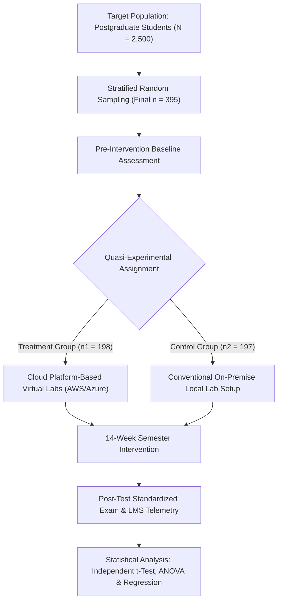
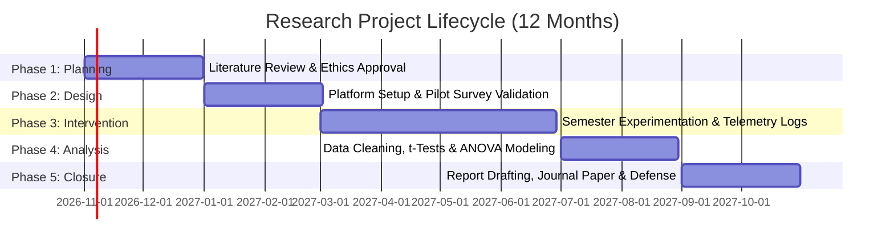

import Tabs from '@theme/Tabs';
import TabItem from '@theme/TabItem';
import Heading from '@theme/Heading';
import React from 'react';

# Assignment 1 - Model Solutions

> **Course -** 21IPC501J: Research Methodology  
> **Topic -** Statistical Analysis, Probability Distributions, Hypothesis Testing, and Proposal Design  
> **Total Weightage -** 35 Marks (Questions 1-5: 5 Marks each; Question 6: 10 Marks)

---

## Question 1: Probability Distributions (5 Marks)

:::info

**Question Statement**

A manufacturing company finds that 5% of its products are defective.
* **(a)** If 10 products are selected, calculate the probability that exactly 2 are defective using the binomial distribution.
* **(b)** If the average number of defects per batch is 2, calculate the probability of observing exactly 3 defects using the Poisson distribution. *(5 Marks)*

:::

---

### (a) Binomial Distribution Solution (2.5 Marks)

#### 📝 Exam-Ready Answer (Precise)

1. **Given Parameters:**
   * Number of items selected ($n$): $10$
   * Probability of defective item ($p$): $5\% = 0.05$
   * Probability of non-defective item ($q = 1 - p$): $1 - 0.05 = 0.95$
   * Number of defectives desired ($k$): $2$

2. **Binomial Formula:**
   $$P(X = k) = \binom{n}{k} p^k q^{n - k}$$

3. **Substitution & Calculation:**
   $$\binom{10}{2} = \frac{10 \times 9}{2 \times 1} = 45$$
   $$P(X = 2) = 45 \times (0.05)^2 \times (0.95)^8$$
   $$P(X = 2) = 45 \times 0.0025 \times 0.6634204 \approx \mathbf{0.0746}$$

4. **Final Conclusion:**
   The probability that exactly 2 out of 10 selected items are defective is **0.0746** (or **7.46%**).

<strong>💡 Click to view Elaborated Pedagogical Breakdown</strong>

* **Theoretical Condition Verification:**
  1. *Fixed Trials:* Exactly $n = 10$ products are inspected.
  2. *Binary Outcomes:* Each product is either defective (success) or non-defective (failure).
  3. *Constant Probability:* $p = 0.05$ remains identical for every drawn unit.
  4. *Independence:* Each item's defect status is mutually independent.
* **Expanded Factorial Expansion:**
  $$\binom{10}{2} = \frac{10!}{2!(10-2)!} = \frac{10 \times 9 \times 8!}{2 \times 1 \times 8!} = \frac{90}{2} = 45$$
* **Intermediate Powers Step-by-Step:**
  * $(0.05)^2 = 0.0025$
  * $(0.95)^2 = 0.9025 \implies (0.95)^4 = (0.9025)^2 = 0.81450625 \implies (0.95)^8 \approx 0.66342043$
  * $45 \times 0.0025 = 0.1125$
  * $0.1125 \times 0.66342043 = 0.0746348 \approx 7.46\%$
* **Expected Value Intuition:** The expected defective count is $E[X] = np = 10 \times 0.05 = 0.5$. Because $k = 2$ is four times the expectation, its probability ($\approx 7.46\%$) correctly reflects a rare upper-tail occurrence.

---

### (b) Poisson Distribution Solution (2.5 Marks)

#### 📝 Exam-Ready Answer (Precise)

1. **Given Parameters:**
   * Mean defect rate per batch ($\lambda$): $2$
   * Number of defectives to observe ($k$): $3$

2. **Poisson Formula:**
   $$P(X = k) = \frac{e^{-\lambda} \cdot \lambda^k}{k!}$$

3. **Substitution & Calculation:**
   $$e^{-2} \approx 0.135335, \quad 2^3 = 8, \quad 3! = 6$$
   $$P(X = 3) = \frac{0.135335 \times 8}{6} = \frac{4}{3} \times 0.135335 \approx \mathbf{0.1804}$$

4. **Final Conclusion:**
   The probability of observing exactly 3 defects in a batch is **0.1804** (or **18.04%**).

<strong>💡 Click to view Elaborated Pedagogical Breakdown</strong>

* **Model Assumptions:** Applies when discrete events occur independently across a fixed batch continuum at a known constant average rate ($\lambda = 2$).
* **Step-by-Step Arithmetic:**
  * Base of natural log: $e \approx 2.7182818$
  * $e^{-2} = \frac{1}{e^2} = \frac{1}{7.389056} \approx 0.13533528$
  * Numerator: $0.13533528 \times 8 = 1.0826822$
  * Denominator: $3 \times 2 \times 1 = 6$
  * Division: $\frac{1.0826822}{6} = 0.180447 \approx 18.04\%$

---

## Question 2: Hypothesis Testing via Student's t-Test (5 Marks)

:::info

**Question Statement**

A researcher wants to determine whether a training programme improves students' average test scores. The population mean before training is 50. A sample of 10 students after training has a mean score of 55 and a standard deviation of 6.

Test whether the mean score is significantly different from 50 at the 5% significance level. Assume the population is approximately normal. *(5 Marks)*

:::

---

### 📝 Exam-Ready Answer (Precise)

1. **Given Data:**
   * $\mu_0 = 50, \quad n = 10, \quad \bar{X} = 55, \quad s = 6, \quad \alpha = 0.05$
   * Since $n = 10 < 30$, $\sigma$ is unknown, and the population is normal, apply **One-Sample Student's $t$-Test**.

2. **Formulate Hypotheses (Two-Tailed):**
   * **Null Hypothesis ($H_0$):** $\mu = 50$ (No significant difference in mean score)
   * **Alternative Hypothesis ($H_a$):** $\mu \neq 50$ (Mean score differs significantly from 50)

3. **Standard Error & Test Statistic ($t_{\text{calc}}$):**
   $$SE = \frac{s}{\sqrt{n}} = \frac{6}{\sqrt{10}} = \frac{6}{3.1623} \approx 1.8974$$
   $$t_{\text{calc}} = \frac{\bar{X} - \mu_0}{s / \sqrt{n}} = \frac{55 - 50}{1.8974} = \frac{5}{1.8974} = \mathbf{+2.635}$$

4. **Degrees of Freedom & Critical Value:**
   * $df = n - 1 = 10 - 1 = 9$
   * For two-tailed test at $\alpha = 0.05$, $t_{\text{crit}} = \pm t_{0.025, 9} = \mathbf{\pm 2.262}$

5. **Statistical Decision & Conclusion:**
   * Since $|t_{\text{calc}}| = 2.635 > 2.262$, **Reject $H_0$**.
   * **Conclusion:** At the 5% significance level, the mean test score after training is significantly different from 50. Since $\bar{X} = 55 > 50$, the training programme produced a statistically significant improvement.

<strong>💡 Click to view Elaborated Pedagogical Breakdown</strong>

* **Why Student's $t$-Test instead of $Z$-Test?**
  * $n = 10$ is small ($n < 30$), so the Central Limit Theorem cannot be invoked.
  * Population standard deviation $\sigma$ is unknown, requiring the sample estimator $s$.
  * Normal distribution assumption allows exact Student's $t$ inference.
* **Directional (One-Tailed) Evaluation:**
  * If formulated strictly as an upper-tail test for improvement ($H_a: \mu > 50$):  
    Critical cutoff $t_{0.05, 9} = +1.833$.  
    Since $t_{\text{calc}} = 2.635 > 1.833$, $H_0$ is rejected even more decisively ($p = 0.0135 < 0.05$).
* **Dual Check via 95% Confidence Interval:**
  $$\text{CI}_{95\%} = \bar{X} \pm t_{0.025, 9} \cdot SE = 55 \pm (2.262 \times 1.8974) = [50.71, \; 59.29]$$
  Because the hypothesized null mean $\mu_0 = 50$ lies completely outside this interval, rejection of $H_0$ is independently confirmed.

---

## Question 3: One-Way ANOVA (5 Marks)

:::info

**Question Statement**

Three teaching methods are tested using the following student scores:
* **Method A:** 8, 9, 7
* **Method B:** 6, 7, 5
* **Method C:** 10, 11, 9

Use one-way ANOVA to determine whether the three methods have significantly different mean scores at the 5% significance level. *(5 Marks)*

:::

---

### 📝 Exam-Ready Answer (Precise)

1. **Formulate Hypotheses:**
   * **$H_0$:** $\mu_A = \mu_B = \mu_C$ (All three teaching methods have equal mean scores)
   * **$H_a$:** At least one teaching method produces a significantly different mean score.

2. **Group Totals & Raw Computations:**
   * **Method A ($n_1 = 3$):** $T_1 = 8 + 9 + 7 = 24, \quad \bar{X}_1 = 8.0, \quad \sum X_A^2 = 64 + 81 + 49 = 194$
   * **Method B ($n_2 = 3$):** $T_2 = 6 + 7 + 5 = 18, \quad \bar{X}_2 = 6.0, \quad \sum X_B^2 = 36 + 49 + 25 = 110$
   * **Method C ($n_3 = 3$):** $T_3 = 10 + 11 + 9 = 30, \quad \bar{X}_3 = 10.0, \quad \sum X_C^2 = 100 + 121 + 81 = 302$
   * Grand Total $G = 24 + 18 + 30 = 72, \quad N = 9, \quad \sum \sum X^2 = 606$

3. **Sum of Squares ($SS$):**
   * **Correction Factor ($CF$):**
     $$CF = \frac{G^2}{N} = \frac{72^2}{9} = \frac{5184}{9} = \mathbf{576}$$
   * **Total Sum of Squares ($SST$):**
     $$SST = \sum \sum X^2 - CF = 606 - 576 = \mathbf{30}$$
   * **Between-Methods Sum of Squares ($SSB$):**
     $$SSB = \frac{T_1^2}{n_1} + \frac{T_2^2}{n_2} + \frac{T_3^2}{n_3} - CF = \frac{24^2}{3} + \frac{18^2}{3} + \frac{30^2}{3} - 576 = 192 + 108 + 300 - 576 = \mathbf{24}$$
   * **Within-Methods Sum of Squares ($SSW$):**
     $$SSW = SST - SSB = 30 - 24 = \mathbf{6}$$

4. **One-Way ANOVA Summary Table:**

   | Source of Variation | Sum of Squares ($SS$) | Degrees of Freedom ($df$) | Mean Square ($MS$) | Calculated $F$ | Critical $F_{0.05}(2, 6)$ |
   | :--- | :---: | :---: | :---: | :---: | :---: |
   | **Between Methods** | $24$ | $k - 1 = 2$ | $MSB = \frac{24}{2} = 12.0$ | $\frac{12.0}{1.0} = \mathbf{12.0}$ | **$5.14$** |
   | **Within Methods (Error)**| $6$ | $N - k = 6$ | $MSW = \frac{6}{6} = 1.0$ | - | - |
   | **Total** | $30$ | $N - 1 = 8$ | - | - | - |

5. **Decision & Conclusion:**
   * Since $F_{\text{calc}} = 12.0 > F_{\text{crit}} = 5.14$, **Reject $H_0$** at the 5% significance level.
   * **Conclusion:** There is a statistically significant difference among the three teaching methods. **Method C** ($\bar{X}_C = 10$) performs significantly higher than Method A ($\bar{X}_A = 8$) and Method B ($\bar{X}_B = 6$).

<strong>💡 Click to view Elaborated Pedagogical Breakdown</strong>

* **Variance Partitioning Intuition:**
  ANOVA compares the variance between treatment means (signal) against the variance of individual students within each treatment (noise). $F = \frac{\text{Signal}}{\text{Noise}} = \frac{12.0}{1.0} = 12.0$.
* **Direct Independent Verification of $SSW$:**
  $$SSW = \sum_{i=1}^k \sum_{j=1}^{n_i} (X_{ij} - \bar{X}_i)^2$$
  * Method A: $(8-8)^2 + (9-8)^2 + (7-8)^2 = 0 + 1 + 1 = 2$
  * Method B: $(6-6)^2 + (7-6)^2 + (5-6)^2 = 0 + 1 + 1 = 2$
  * Method C: $(10-10)^2 + (11-10)^2 + (9-10)^2 = 0 + 1 + 1 = 2$
  * Sum: $2 + 2 + 2 = \mathbf{6}$ *(Exact check)*.
* **Exact $p$-value:** $p = 0.008 < 0.05$.

---

## Question 4: Pearson's Correlation Coefficient (5 Marks)

:::info

**Question Statement**

A researcher records the number of hours students study and their examination scores:

| Student | Study hours ($X$) | Score ($Y$) |
| :---: | :---: | :---: |
| 1 | 1 | 2 |
| 2 | 2 | 3 |
| 3 | 3 | 5 |
| 4 | 4 | 4 |
| 5 | 5 | 6 |

Calculate Pearson's correlation coefficient and interpret the result. *(5 Marks)*

:::

---

### 📝 Exam-Ready Answer (Precise)

1. **Formula (Mean Deviation Method):**
   $$r = \frac{\sum (X - \bar{X})(Y - \bar{Y})}{\sqrt{\sum (X - \bar{X})^2 \cdot \sum (Y - \bar{Y})^2}} = \frac{\sum xy}{\sqrt{\sum x^2 \cdot \sum y^2}}$$

2. **Computation Table:**
   * $\bar{X} = \frac{\sum X}{n} = \frac{15}{5} = 3.0$
   * $\bar{Y} = \frac{\sum Y}{n} = \frac{20}{5} = 4.0$

   | Student | $X$ | $Y$ | $x = X - 3$ | $y = Y - 4$ | $x^2$ | $y^2$ | $xy$ |
   | :---: | :---: | :---: | :---: | :---: | :---: | :---: | :---: |
   | 1 | 1 | 2 | $-2$ | $-2$ | $4$ | $4$ | $4$ |
   | 2 | 2 | 3 | $-1$ | $-1$ | $1$ | $1$ | $1$ |
   | 3 | 3 | 5 | $0$ | $+1$ | $0$ | $1$ | $0$ |
   | 4 | 4 | 4 | $+1$ | $0$ | $1$ | $0$ | $0$ |
   | 5 | 5 | 6 | $+2$ | $+2$ | $4$ | $4$ | $4$ |
   | **Total**| **$15$**| **$20$**| **$0$** | **$0$** | **$10$** | **$10$** | **$9$** |

3. **Substitution & Result:**
   $$r = \frac{9}{\sqrt{10 \times 10}} = \frac{9}{\sqrt{100}} = \frac{9}{10} = \mathbf{+0.90}$$

4. **Interpretation:**
   * **Strength & Direction:** $r = \mathbf{+0.90}$ indicates a **very strong positive linear correlation** between study hours and examination scores.
   * **Variance Explained:** Coefficient of determination $r^2 = (0.90)^2 = \mathbf{0.81}$ (81% of the variation in exam scores is directly explained by study hours).

<strong>💡 Click to view Elaborated Pedagogical Breakdown</strong>

* **Alternative Raw Score Formula Verification:**
  * $\sum X = 15, \quad \sum Y = 20, \quad \sum X^2 = 55, \quad \sum Y^2 = 90, \quad \sum XY = 69$
  $$r = \frac{n\sum XY - (\sum X)(\sum Y)}{\sqrt{[n\sum X^2 - (\sum X)^2][n\sum Y^2 - (\sum Y)^2]}} = \frac{5(69) - (15)(20)}{\sqrt{[5(55) - 225][5(90) - 400]}} = \frac{345 - 300}{\sqrt{50 \times 50}} = \frac{45}{50} = \mathbf{+0.90}$$
* **Academic Caveat:** While $r = 0.90$ proves a strong empirical correlation, correlation does not automatically prove causation due to potential lurking variables (e.g., student motivation, prior subject preparation).

---

## Question 5: Simple Linear Regression (5 Marks)

:::info

**Question Statement**

A researcher studies the relationship between advertising expenditure ($X$, in thousands of rupees) and sales ($Y$, in thousands of rupees):

| Advertising ($X$) | Sales ($Y$) |
| :---: | :---: |
| 1 | 3 |
| 2 | 5 |
| 3 | 7 |
| 4 | 9 |
| 5 | 11 |

Find the simple linear regression equation and predict sales when advertising expenditure is ₹6,000. *(5 Marks)*

:::

---

### 📝 Exam-Ready Answer (Precise)

1. **Regression Model:**
   $$\hat{Y} = a + bX$$
   Where $b = \frac{\sum xy}{\sum x^2}$ and $a = \bar{Y} - b\bar{X}$.

2. **Computation Table:**
   * $\bar{X} = \frac{15}{5} = 3.0$ (thousand rupees)
   * $\bar{Y} = \frac{35}{5} = 7.0$ (thousand rupees)

   | Obs | $X$ | $Y$ | $x = X - 3$ | $y = Y - 7$ | $x^2$ | $xy$ |
   | :---: | :---: | :---: | :---: | :---: | :---: | :---: |
   | 1 | 1 | 3 | $-2$ | $-4$ | $4$ | $8$ |
   | 2 | 2 | 5 | $-1$ | $-2$ | $1$ | $2$ |
   | 3 | 3 | 7 | $0$ | $0$ | $0$ | $0$ |
   | 4 | 4 | 9 | $+1$ | $+2$ | $1$ | $2$ |
   | 5 | 5 | 11 | $+2$ | $+4$ | $4$ | $8$ |
   | **Total** | **$15$** | **$35$** | **$0$** | **$0$** | **$10$** | **$20$** |

3. **Slope ($b$) & Intercept ($a$):**
   $$b = \frac{\sum xy}{\sum x^2} = \frac{20}{10} = \mathbf{2.0}$$
   $$a = \bar{Y} - b\bar{X} = 7.0 - (2.0)(3.0) = 7.0 - 6.0 = \mathbf{1.0}$$
   * **Regression Equation:** $\mathbf{\hat{Y} = 1 + 2X}$

4. **Prediction for Advertising Expenditure of ₹6,000:**
   * Since $X$ is defined in *thousands of rupees*, $X = \frac{6000}{1000} = \mathbf{6}$.
   * $\hat{Y} = 1 + 2(6) = 1 + 12 = \mathbf{13 \text{ (thousand rupees)}}$
   * $\text{Predicted Sales} = 13 \times 1,000 = \mathbf{13,000 \text{ rupees}}$

> **Final Answer:** The regression equation is **$\hat{Y} = 1 + 2X$**, and predicted sales are **₹13,000**.

<strong>💡 Click to view Elaborated Pedagogical Breakdown</strong>

* **Economic Interpretation:**
  * Intercept $a = 1.0$: Baseline sales without advertising are ₹1,000.
  * Slope $b = 2.0$: Every additional ₹1,000 in advertising generates ₹2,000 in additional sales.
* **Centroid Verification:**
  The line passes through $(\bar{X}, \bar{Y}) = (3, 7) \implies \hat{Y} = 1 + 2(3) = 7$ *(verified)*.
* **Common Student Trap (Unit Conversion):**
  Plugging in $X = 6000$ without dividing by 1,000 yields $\hat{Y} = 1 + 2(6000) = 12,001$ thousand rupees (₹12,001,000), which is incorrect because the model is trained on thousands of rupees.

---

## Question 6: Comprehensive Research Proposal (10 Marks)

:::info

**Question Statement**

A researcher plans to investigate the impact of cloud-based learning platforms on the academic performance of postgraduate students. Prepare a research proposal covering the title, problem statement, research objectives, methodology, and expected outcomes. Also, calculate the required sample size, prepare a research budget, develop a project timeline, and allocate resources to ensure the feasibility of the proposed study. *(10 Marks)*

:::

---

### 📝 Exam-Ready Proposal (Complete & Structured for 10 Marks)

#### 1. Title
> **"Empirical Investigation into the Impact of Cloud-Based Learning Platforms on Academic Performance and Collaborative Engagement among Postgraduate STEM Students"**

#### 2. Problem Statement
Higher education institutions are heavily investing in cloud-based learning management systems (e.g., Canvas, AWS Educate, Azure Lab Services). However, empirical evidence remains inconclusive regarding whether cloud platforms tangibly improve objective student learning outcomes (GPA, test scores) or merely provide administrative and digital convenience. Most existing studies rely solely on subjective satisfaction surveys rather than correlating server telemetry with standardized grades.

#### 3. Research Objectives & Hypotheses
* **Primary Objective:** Quantify the impact of cloud learning platform usage on postgraduate academic performance.
* **Sub-Objective 1:** Compare standardized exam scores between cloud virtual lab users and traditional on-premise lab users.
* **Sub-Objective 2:** Correlate active platform telemetry hours with semester final grades.
* **Hypotheses:**
  * **$H_0$:** $\mu_{\text{Cloud}} = \mu_{\text{Traditional}}$ (No difference in mean exam performance).
  * **$H_a$:** $\mu_{\text{Cloud}} > \mu_{\text{Traditional}}$ (Cloud platform users achieve significantly higher scores).

#### 4. Methodology
* **Research Design:** Quasi-experimental pretest-posttest control group design coupled with cross-sectional survey.
* **Target Population:** $N = 2,500$ postgraduate students across university STEM faculties.
* **Sampling:** Stratified random sampling into Treatment ($n_1 = 198$) and Control ($n_2 = 197$) cohorts.
* **Data Collection:** Server telemetry logs (lab hours, submissions), standardized blind-graded exams, and a 5-point Likert survey.
* **Analysis:** Independent two-sample $t$-test, One-Way ANOVA, and Multiple Linear Regression.

#### 5. Sample Size Calculation (Cochran's Formula)
For $95\%$ confidence ($Z = 1.96$), maximum variance ($p = 0.50$), and margin of error $e = 0.05$:
$$n_0 = \frac{Z^2 \cdot p \cdot (1 - p)}{e^2} = \frac{(1.96)^2 (0.50)(0.50)}{(0.05)^2} = \frac{0.9604}{0.0025} = 384.16 \approx \mathbf{385}$$

Applying Finite Population Correction (FPC) for $N = 2,500$:
$$n = \frac{n_0}{1 + \frac{n_0 - 1}{N}} = \frac{384.16}{1 + \frac{383.16}{2500}} = \frac{384.16}{1.1533} \approx \mathbf{334}$$

Accounting for a $15\%$ non-response/attrition buffer:
$$n_{\text{final}} = \frac{334}{1 - 0.15} = \frac{334}{0.85} \approx \mathbf{395 \text{ students}}$$

#### 6. Research Budget (12 Months)

| S.No. | Budget Head | Description | Cost (₹) |
| :---: | :--- | :--- | :---: |
| 1 | **Personnel** | 2 Graduate Research Assistants (6 months @ ₹15,000/mo) | ₹1,80,000 |
| 2 | **Cloud Computing** | AWS/Azure virtual compute hours & student sandbox licenses | ₹75,000 |
| 3 | **Software Tools** | SPSS / Jamovi licenses and Qualtrics survey subscription | ₹25,000 |
| 4 | **Documentation** | Test script printing, consent forms, and survey reproduction | ₹10,000 |
| 5 | **Incentives** | Completion vouchers for student participants (395 × ₹50) | ₹20,000 |
| 6 | **Dissemination** | Scopus/IEEE open-access publication charges and conference travel | ₹30,000 |
| 7 | **Contingency (8%)**| Network fallback dongles and administrative overhead | ₹28,000 |
| **Total**| **Grand Proposed Budget** | **Comprehensive funding requirement for 12 months** | **₹3,68,000** |

#### 7. Project Timeline (12 Months)

| Phase | Milestone | Months | Deliverables |
| :--- | :--- | :---: | :--- |
| **Phase 1** | Conceptualization & Ethics | Month 1 - 2 | Literature review, questionnaire design, IRB ethical clearance. |
| **Phase 2** | Platform Setup & Pilot Study | Month 3 - 4 | Cloud sandbox deployment, pilot test ($n = 30$), Cronbach's $\alpha > 0.80$. |
| **Phase 3** | Experimental Intervention | Month 5 - 8 | 14-week semester execution, continuous telemetry logging. |
| **Phase 4** | Statistical Data Processing | Month 9 - 10 | $t$-tests, ANOVA, and regression model estimation. |
| **Phase 5** | Dissemination & Thesis Defense| Month 11 - 12 | Final technical report, Scopus journal paper submission. |

#### 8. Resource Allocation & Feasibility
* **Human Resources:** Principal Investigator (Faculty, 4 hrs/wk), Cloud Systems Admin (3 hrs/wk), 2 Graduate Scholars (15 hrs/wk each).
* **Technical Feasibility:** Leverages existing campus 1-Gbps fiber-optic network; cloud educational grants offset compute costs.
* **Risk & Ethics:** Participant identity anonymized via cryptographic hashes; participation incentivized through internal continuous assessments.

#### 9. Expected Outcomes
* Empirical validation of cloud learning on student achievement.
* Predictive regression model correlating lab telemetry hours with GPA improvement.
* Institutional policy framework for cost-effective cloud laboratory investments.

<strong>💡 Click to view Elaborated Pedagogical Breakdown & Visualizations</strong>

* **Why Cochran's Formula with $p = 0.50$ is Optimal:**
  Setting $p = 0.50$ maximizes the product $p(1-p) = 0.25$, which yields the most conservative (largest) possible sample size. This guarantees that regardless of the true population proportion, the sample size will be statistically sufficient.
* **Why FPC was applied:** Because the sample $n_0 = 385$ constitutes $\frac{385}{2500} = 15.4\%$ of the population (exceeding the standard $5\%$ rule-of-thumb threshold), applying FPC adjusts the required sample size down to $334$ without sacrificing precision.

