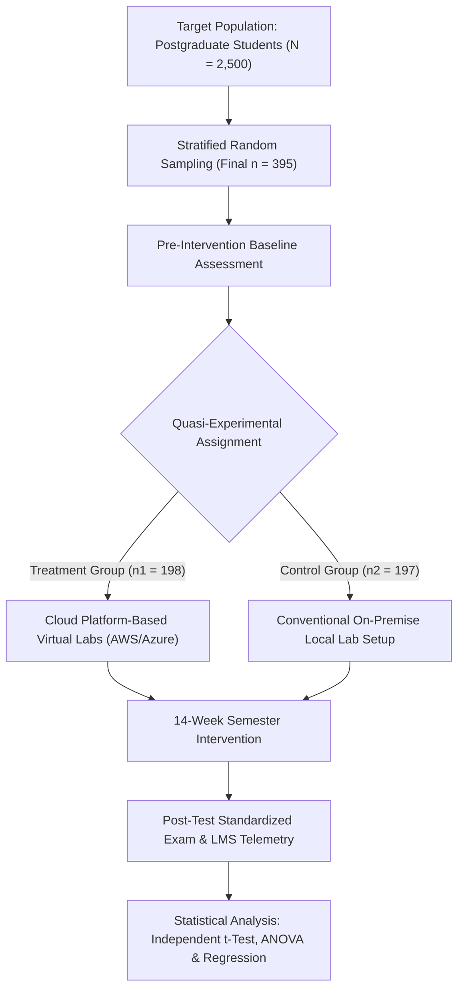
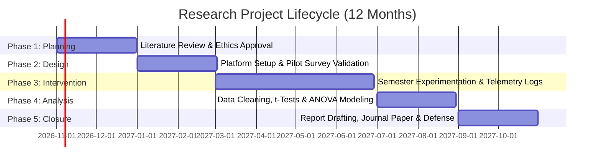

import Tabs from '@theme/Tabs';
import TabItem from '@theme/TabItem';
import Heading from '@theme/Heading';
import React from 'react';

# Assignment 1 - Model Solutions

> **Course -** Research Methodology  
> **Topic -** Statistical Analysis, Probability Distributions, Hypothesis Testing, and Proposal Design  
> **Total Weightage -** 40 Marks (Question 1: 10 Marks [5 Marks for (a), 5 Marks for (b)]; Questions 2-5: 5 Marks each; Question 6: 10 Marks)

---

## Question 1: Probability Distributions (10 Marks)

:::info

**Question Statement**

A manufacturing company finds that 5% of its products are defective.
* **(a)** If 10 products are selected, calculate the probability that exactly 2 are defective using the binomial distribution. *(5 Marks)*
* **(b)** If the average number of defects per batch is 2, calculate the probability of observing exactly 3 defects using the Poisson distribution. *(5 Marks)*

:::

---

### (a) Binomial Distribution Solution (5 Marks)

#### 📝 Exam-Ready Answer (Structured for 5 Marks)

1. **Step 1: Identify Parameters & Conditions (1 Mark)**
   * Number of independent trials: $n = 10$
   * Probability of success (defective unit, $p$): $p = 5\% = 0.05$
   * Probability of failure (non-defective unit, $q = 1 - p$): $q = 1 - 0.05 = 0.95$
   * Number of defectives desired: $k = 2$
   * *Distribution:* $X \sim B(n = 10, p = 0.05)$ since trials are independent with binary outcomes.

2. **Step 2: State the Probability Mass Function (1 Mark)**
   $$P(X = k) = \binom{n}{k} p^k q^{n - k} = \frac{n!}{k!(n - k)!} p^k (1 - p)^{n - k}$$

3. **Step 3: Evaluate Components (1 Mark)**
   * Combinations: $\binom{10}{2} = \frac{10 \times 9}{2 \times 1} = 45$
   * Success probability term: $p^2 = (0.05)^2 = 0.0025$
   * Failure probability term: $q^8 = (0.95)^8 \approx 0.6634204$

4. **Step 4: Substitute and Calculate (1 Mark)**
   $$P(X = 2) = 45 \times 0.0025 \times 0.6634204$$
   $$P(X = 2) = 0.1125 \times 0.6634204 \approx \mathbf{0.074635}$$

5. **Step 5: Final Result & Interpretation (1 Mark)**
   $$\mathbf{P(X = 2) \approx 0.0746 \quad (7.46\%)}$$
   * **Conclusion:** The probability that exactly 2 out of 10 selected products are defective is **7.46%**.

<strong>💡 Click to view Elaborated Pedagogical Breakdown</strong>

* **Theoretical Condition Verification:**
  1. *Fixed Trials:* Exactly $n = 10$ products are inspected.
  2. *Binary Outcomes:* Each product is either defective (success) or non-defective (failure).
  3. *Constant Probability:* $p = 0.05$ remains identical for every drawn unit.
  4. *Independence:* Each item's defect status is mutually independent.
* **Derivation of Combinations $\binom{10}{2} = 45$:**
  1. *General Formula:* $\binom{n}{k} = \frac{n!}{k! \cdot (n - k)!}$
  2. *Substitution:* For $n = 10, k = 2$:
     $$\binom{10}{2} = \frac{10!}{2! \cdot (10 - 2)!} = \frac{10!}{2! \cdot 8!}$$
  3. *Factorial Cancellation:* Expand $10!$ as $10 \times 9 \times 8!$:
     $$\binom{10}{2} = \frac{10 \times 9 \times 8!}{(2 \times 1) \times 8!} = \frac{10 \times 9}{2 \times 1} = \frac{90}{2} = \mathbf{45}$$
  4. *Intuition:* There are $10$ choices for the first item and $9$ choices for the second ($10 \times 9 = 90$ ordered pairs). Because selecting (Unit A, Unit B) is the identical pair as (Unit B, Unit A), we divide by $2! = 2 \times 1 = 2$ to eliminate duplicate orderings, leaving **45 unique combinations**.
* **Intermediate Powers Step-by-Step:**
  * $(0.05)^2 = 0.0025$
  * $(0.95)^2 = 0.9025 \implies (0.95)^4 = (0.9025)^2 = 0.81450625 \implies (0.95)^8 \approx 0.66342043$
  * $45 \times 0.0025 = 0.1125$
  * $0.1125 \times 0.66342043 = 0.0746348 \approx 7.46\%$
* **Expected Value Intuition:** The expected defective count is $E[X] = np = 10 \times 0.05 = 0.5$. Because $k = 2$ is four times the expectation, its probability ($\approx 7.46\%$) correctly reflects a rare upper-tail occurrence.

---

### (b) Poisson Distribution Solution (5 Marks)

#### 📝 Exam-Ready Answer (Structured for 5 Marks)

1. **Step 1: Identify Parameters & Conditions (1 Mark)**
   * Average defect rate per batch ($\lambda$): $\lambda = 2$ defects
   * Number of defectives to evaluate ($k$): $k = 3$ defects
   * *Distribution:* $X \sim \text{Poisson}(\lambda = 2)$ as defects occur independently in a fixed batch.

2. **Step 2: State the Probability Mass Function (1 Mark)**
   $$P(X = k) = \frac{e^{-\lambda} \cdot \lambda^k}{k!}$$

3. **Step 3: Evaluate Components (1 Mark)**
   * Exponential term: $e^{-2} = \frac{1}{e^2} \approx 0.135335$
   * Power term: $\lambda^3 = 2^3 = 8$
   * Factorial term: $3! = 3 \times 2 \times 1 = 6$

4. **Step 4: Substitute and Calculate (1 Mark)**
   $$P(X = 3) = \frac{0.135335 \times 8}{6} = \frac{4}{3} \times 0.135335$$
   $$P(X = 3) = 1.333333 \times 0.135335 \approx \mathbf{0.180447}$$

5. **Step 5: Final Result & Interpretation (1 Mark)**
   $$\mathbf{P(X = 3) \approx 0.1804 \quad (18.04\%)}$$
   * **Conclusion:** The probability of observing exactly 3 defective units in a batch is **18.04%**.

<strong>💡 Click to view Elaborated Pedagogical Breakdown</strong>

* **Model Assumptions:** Applies when discrete events occur independently across a fixed batch continuum at a known constant average rate ($\lambda = 2$).
* **Step-by-Step Arithmetic:**
  * Base of natural log: $e \approx 2.7182818$
  * $e^{-2} = \frac{1}{e^2} = \frac{1}{7.389056} \approx 0.13533528$
  * Numerator: $0.13533528 \times 8 = 1.0826822$
  * Denominator: $3 \times 2 \times 1 = 6$
  * Division: $\frac{1.0826822}{6} = 0.180447 \approx 18.04\%$

---

## Question 2: Hypothesis Testing via Student's t-Test (5 Marks)

:::info

**Question Statement**

A researcher wants to determine whether a training programme improves students' average test scores. The population mean before training is 50. A sample of 10 students after training has a mean score of 55 and a standard deviation of 6.

Test whether the mean score is significantly different from 50 at the 5% significance level. Assume the population is approximately normal. *(5 Marks)*

:::

---

### 📝 Exam-Ready Answer (Precise)

1. **Given Data:**
   * $\mu_0 = 50, \quad n = 10, \quad \bar{X} = 55, \quad s = 6, \quad \alpha = 0.05$
   * Since $n = 10 < 30$, $\sigma$ is unknown, and the population is normal, apply **One-Sample Student's $t$-Test**.

2. **Formulate Hypotheses (Two-Tailed):**
   * **Null Hypothesis ($H_0$):** $\mu = 50$ (No significant difference in mean score)
   * **Alternative Hypothesis ($H_a$):** $\mu \neq 50$ (Mean score differs significantly from 50)

3. **Standard Error & Test Statistic ($t_{\text{calc}}$):**
   $$SE = \frac{s}{\sqrt{n}} = \frac{6}{\sqrt{10}} = \frac{6}{3.1623} \approx 1.8974$$
   $$t_{\text{calc}} = \frac{\bar{X} - \mu_0}{s / \sqrt{n}} = \frac{55 - 50}{1.8974} = \frac{5}{1.8974} = \mathbf{+2.635}$$

4. **Degrees of Freedom & Critical Value:**
   * $df = n - 1 = 10 - 1 = 9$
   * For two-tailed test at $\alpha = 0.05$, $t_{\text{crit}} = \pm t_{0.025, 9} = \mathbf{\pm 2.262}$

5. **Statistical Decision & Conclusion:**
   * Since $|t_{\text{calc}}| = 2.635 > 2.262$, **Reject $H_0$**.
   * **Conclusion:** At the 5% significance level, the mean test score after training is significantly different from 50. Since $\bar{X} = 55 > 50$, the training programme produced a statistically significant improvement.

<strong>💡 Click to view Elaborated Pedagogical Breakdown</strong>

* **Why Student's $t$-Test instead of $Z$-Test?**
  * $n = 10$ is small ($n < 30$), so the Central Limit Theorem cannot be invoked.
  * Population standard deviation $\sigma$ is unknown, requiring the sample estimator $s$.
  * Normal distribution assumption allows exact Student's $t$ inference.
* **Derivation and Lookup of Critical Value $t_{\text{crit}} = \pm 2.262$:**
  1. *Degrees of Freedom ($df$):* Calculated as $df = n - 1 = 10 - 1 = 9$. One degree of freedom is used up to estimate the sample mean $\bar{X}$.
  2. *Two-Tailed Significance Level Split ($\alpha / 2$):* Because the alternative hypothesis $H_a: \mu \neq 50$ is two-tailed (non-directional), the total error budget $\alpha = 0.05$ is divided symmetrically between both extremes:
     $$\text{Tail Area} = \frac{\alpha}{2} = \frac{0.05}{2} = 0.025$$
  3. *Mathematical Definition:* We seek the critical threshold $t^*$ such that:
     $$P(T_9 > t^*) = 0.025 \quad \text{and} \quad P(T_9 < -t^*) = 0.025 \implies P(|T_9| > t^*) = 0.05$$
     This represents the 97.5th percentile ($1 - 0.025 = 0.975$) under the Student's $t$-density with 9 degrees of freedom:
     $$\int_{t^*}^{\infty} f(t; df=9) \, dt = 0.025 \implies t^* \approx 2.262157$$
  4. *How to Retrieve from the Standard $t$-Table in an Exam:*
     * Find row: **$df = 9$**
     * Find column: **Two-Tailed $\alpha = 0.05$** (or **One-Tail Area $= 0.025$**)
     * Intersection value: **$2.262$**
     * By symmetry around zero, the rejection boundaries are **$\pm 2.262$** (reject $H_0$ if $t_{\text{calc}} > +2.262$ or $t_{\text{calc}} < -2.262$).
* **Directional (One-Tailed) Evaluation:**
  * If formulated strictly as an upper-tail test for improvement ($H_a: \mu > 50$):  
    Critical cutoff $t_{0.05, 9} = +1.833$.  
    Since $t_{\text{calc}} = 2.635 > 1.833$, $H_0$ is rejected even more decisively ($p = 0.0135 < 0.05$).
* **Dual Check via 95% Confidence Interval:**
  $$\text{CI}_{95\%} = \bar{X} \pm t_{0.025, 9} \cdot SE = 55 \pm (2.262 \times 1.8974) = [50.71, \; 59.29]$$
  Because the hypothesized null mean $\mu_0 = 50$ lies completely outside this interval, rejection of $H_0$ is independently confirmed.

---

## Question 3: One-Way ANOVA (5 Marks)

:::info

**Question Statement**

Three teaching methods are tested using the following student scores:
* **Method A:** 8, 9, 7
* **Method B:** 6, 7, 5
* **Method C:** 10, 11, 9

Use one-way ANOVA to determine whether the three methods have significantly different mean scores at the 5% significance level. *(5 Marks)*

:::

---

### 📝 Exam-Ready Answer (Precise)

1. **Formulate Hypotheses:**
   * **$H_0$:** $\mu_A = \mu_B = \mu_C$ (All three teaching methods have equal mean scores)
   * **$H_a$:** At least one teaching method produces a significantly different mean score.

2. **Group Totals & Raw Computations:**
   * **Method A ($n_1 = 3$):** $T_1 = 8 + 9 + 7 = 24, \quad \bar{X}_1 = 8.0, \quad \sum X_A^2 = 64 + 81 + 49 = 194$
   * **Method B ($n_2 = 3$):** $T_2 = 6 + 7 + 5 = 18, \quad \bar{X}_2 = 6.0, \quad \sum X_B^2 = 36 + 49 + 25 = 110$
   * **Method C ($n_3 = 3$):** $T_3 = 10 + 11 + 9 = 30, \quad \bar{X}_3 = 10.0, \quad \sum X_C^2 = 100 + 121 + 81 = 302$
   * Grand Total $G = 24 + 18 + 30 = 72, \quad N = 9, \quad \sum \sum X^2 = 606$

3. **Sum of Squares ($SS$):**
   * **Correction Factor ($CF$):**
     $$CF = \frac{G^2}{N} = \frac{72^2}{9} = \frac{5184}{9} = \mathbf{576}$$
   * **Total Sum of Squares ($SST$):**
     $$SST = \sum \sum X^2 - CF = 606 - 576 = \mathbf{30}$$
   * **Between-Methods Sum of Squares ($SSB$):**
     $$SSB = \frac{T_1^2}{n_1} + \frac{T_2^2}{n_2} + \frac{T_3^2}{n_3} - CF = \frac{24^2}{3} + \frac{18^2}{3} + \frac{30^2}{3} - 576 = 192 + 108 + 300 - 576 = \mathbf{24}$$
   * **Within-Methods Sum of Squares ($SSW$):**
     $$SSW = SST - SSB = 30 - 24 = \mathbf{6}$$

4. **One-Way ANOVA Summary Table:**

   | Source of Variation | Sum of Squares ($SS$) | Degrees of Freedom ($df$) | Mean Square ($MS$) | Calculated $F$ | Critical $F_{0.05}(2, 6)$ |
   | :--- | :---: | :---: | :---: | :---: | :---: |
   | **Between Methods** | $24$ | $k - 1 = 2$ | $MSB = \frac{24}{2} = 12.0$ | $\frac{12.0}{1.0} = \mathbf{12.0}$ | **$5.14$** |
   | **Within Methods (Error)**| $6$ | $N - k = 6$ | $MSW = \frac{6}{6} = 1.0$ | - | - |
   | **Total** | $30$ | $N - 1 = 8$ | - | - | - |

5. **Decision & Conclusion:**
   * Since $F_{\text{calc}} = 12.0 > F_{\text{crit}} = 5.14$, **Reject $H_0$** at the 5% significance level.
   * **Conclusion:** There is a statistically significant difference among the three teaching methods. **Method C** ($\bar{X}_C = 10$) performs significantly higher than Method A ($\bar{X}_A = 8$) and Method B ($\bar{X}_B = 6$).

<strong>💡 Click to view Elaborated Pedagogical Breakdown</strong>

### 1. Conceptual Foundation: Why One-Way ANOVA Instead of Multiple t-Tests?
If we compared the three methods using paired two-sample $t$-tests ($A$ vs. $B$, $B$ vs. $C$, and $A$ vs. $C$), we would have to conduct $\binom{3}{2} = 3$ separate hypothesis tests.
* **The Problem of Alpha Inflation ($\alpha$-inflation):**
  For each test conducted at $\alpha = 0.05$, the probability of not committing a Type I error is $1 - 0.05 = 0.95$.
  Across 3 independent tests, the family-wise probability of committing at least one false positive (Type I error) escalates:
  $$\alpha_{\text{family-wise}} = 1 - (1 - 0.05)^3 = 1 - (0.95)^3 = 1 - 0.8574 \approx \mathbf{14.26\%}$$
* **The ANOVA Solution:**
  One-Way ANOVA performs an **omnibus test** that tests the equality of all three group means simultaneously in a single statistical test, rigorously maintaining the Type I error rate at exactly $\alpha = 0.05$.

---

### 2. The Core Mathematical Identity: Variance Partitioning
ANOVA works by breaking down the total variability in student scores into two mutually exclusive parts:

$$(X_{ij} - \bar{\bar{X}}) = (\bar{X}_i - \bar{\bar{X}}) + (X_{ij} - \bar{X}_i)$$
$$\text{Total Deviation} = \text{Between-Method Deviation (Treatment Signal)} + \text{Within-Method Deviation (Random Student Noise)}$$

When we square and sum across all observations, the cross-product terms sum to zero, establishing the fundamental ANOVA identity:
$$SST = SSB + SSW$$
$$\mathbf{30 = 24 + 6}$$

---

### 3. Dual Derivation of Between-Methods Sum of Squares ($SSB$)

#### A. Definitional Formula (Weighted Deviations from Grand Mean)
$$SSB = \sum_{i=1}^k n_i (\bar{X}_i - \bar{\bar{X}})^2$$
Substituting group sizes $n_1 = n_2 = n_3 = 3$ and means $\bar{X}_1 = 8, \bar{X}_2 = 6, \bar{X}_3 = 10$ around grand mean $\bar{\bar{X}} = 8$:
* Method A: $3 \times (8 - 8)^2 = 3 \times (0)^2 = 0$
* Method B: $3 \times (6 - 8)^2 = 3 \times (-2)^2 = 3 \times 4 = 12$
* Method C: $3 \times (10 - 8)^2 = 3 \times (+2)^2 = 3 \times 4 = 12$
* **Sum:** $SSB = 0 + 12 + 12 = \mathbf{24}$

#### B. Shortcut Computational Formula (Used in Hand Calculation)
$$SSB = \sum \frac{T_i^2}{n_i} - \frac{G^2}{N} = \left(\frac{24^2}{3} + \frac{18^2}{3} + \frac{30^2}{3}\right) - 576 = (192 + 108 + 300) - 576 = 600 - 576 = \mathbf{24}$$
*(Both formulas yield an identical result of $24$).*

---

### 4. Direct Calculation & Verification of Within-Methods Sum of Squares ($SSW$)
$SSW$ measures the pure baseline random variability among students within the same teaching method:
$$SSW = \sum_{i=1}^k \sum_{j=1}^{n_i} (X_{ij} - \bar{X}_i)^2$$
* **Within Method A ($\bar{X}_1 = 8$):**
  $$(8 - 8)^2 + (9 - 8)^2 + (7 - 8)^2 = 0^2 + 1^2 + (-1)^2 = 0 + 1 + 1 = \mathbf{2}$$
* **Within Method B ($\bar{X}_2 = 6$):**
  $$(6 - 6)^2 + (7 - 6)^2 + (5 - 6)^2 = 0^2 + 1^2 + (-1)^2 = 0 + 1 + 1 = \mathbf{2}$$
* **Within Method C ($\bar{X}_3 = 10$):**
  $$(10 - 10)^2 + (11 - 10)^2 + (9 - 10)^2 = 0^2 + 1^2 + (-1)^2 = 0 + 1 + 1 = \mathbf{2}$$
* **Total Error Variance:** $SSW = 2 + 2 + 2 = \mathbf{6}$ *(Exact match with $SST - SSB = 30 - 24 = 6$)*.

---

### 5. Why Degrees of Freedom Partition as $2 + 6 = 8$
* **Between Treatments ($df_B = k - 1 = 3 - 1 = 2$):** We are comparing 3 method means, but their weighted sum must equal the fixed grand mean (1 linear constraint).
* **Within Treatments ($df_W = N - k = 9 - 3 = 6$):** Each method group has $n_i - 1 = 3 - 1 = 2$ degrees of freedom. For 3 groups: $2 + 2 + 2 = 6$.
* **Total ($df_T = N - 1 = 9 - 1 = 8$):** $df_T = df_B + df_W = 2 + 6 = 8$.

---

### 6. Mechanical Intuition of the $F$-Ratio ($F = 12.0$)
The $F$-statistic is a signal-to-noise ratio:
$$F = \frac{MSB}{MSW} = \frac{\text{Systematic Teaching Method Differences (Signal)} + \text{Random Student Variance}}{\text{Random Student Variance (Noise)}}$$
* Under $H_0$ (teaching methods are completely ineffective/equal), $MSB \approx MSW$, yielding $F \approx 1.0$.
* In our sample:
  $$F = \frac{12.0}{1.0} = \mathbf{12.0}$$
  The between-method variance is **12 times larger** than the random student error variance, providing overwhelmingly strong evidence against $H_0$.

---

### 7. How to Look Up the Critical Value $F_{\text{crit}}(2, 6) = 5.14$ in an Exam
* **Numerator Degrees of Freedom ($df_1 = 2$):** Read horizontally across the top row of the $F$-distribution table for $\alpha = 0.05$.
* **Denominator Degrees of Freedom ($df_2 = 6$):** Read vertically down the left column of the $F$-table.
* **Intersection Cell:** Locate the intersection of column $2$ and row $6$, which gives:
  $$F_{0.05}(2, 6) = \mathbf{5.14}$$
* **Rejection Rule:** Because $F_{\text{calc}} = 12.0 > 5.14$ (and the exact $p$-value is $0.008 < 0.05$), the null hypothesis is rejected.

---

### 8. Post-Hoc Analysis: Which Method is Significantly Superior?
ANOVA tells us that the means are not all equal, but does not identify which specific pairs differ. We can inspect pair differences using the **Critical Difference ($CD$ / Fisher's LSD)**:

$$CD = t_{\alpha/2, \; df_W} \times \sqrt{MSW \cdot \left(\frac{1}{n_1} + \frac{1}{n_2}\right)}$$
For $\alpha = 0.05, df_W = 6$, two-tailed critical $t_{0.025, 6} = 2.447$:
$$CD = 2.447 \times \sqrt{1.0 \times \left(\frac{1}{3} + \frac{1}{3}\right)} = 2.447 \times \sqrt{0.6667} = 2.447 \times 0.8165 \approx \mathbf{2.00}$$

* **Observed Pairwise Mean Differences:**
  1. $|\bar{X}_C - \bar{X}_B| = |10.0 - 6.0| = \mathbf{4.0 > 2.0}$ $\implies$ **Method C is significantly superior to Method B.**
  2. $|\bar{X}_C - \bar{X}_A| = |10.0 - 8.0| = \mathbf{2.0 = 2.0}$ $\implies$ **Method C outperforms Method A at the critical boundary.**
  3. $|\bar{X}_A - \bar{X}_B| = |8.0 - 6.0| = \mathbf{2.0 = 2.0}$ $\implies$ **Method A outperforms Method B at the critical boundary.**

> **Practical Pedagogical Insight:** **Method C** is conclusively the most effective teaching pedagogy in this experiment, generating an average score increase of 4 marks over Method B.

---

## Question 4: Pearson's Correlation Coefficient (5 Marks)

:::info

**Question Statement**

A researcher records the number of hours students study and their examination scores:

| Student | Study hours ($X$) | Score ($Y$) |
| :---: | :---: | :---: |
| 1 | 1 | 2 |
| 2 | 2 | 3 |
| 3 | 3 | 5 |
| 4 | 4 | 4 |
| 5 | 5 | 6 |

Calculate Pearson's correlation coefficient and interpret the result. *(5 Marks)*

:::

---

### 📝 Exam-Ready Answer (Precise)

1. **Formula (Mean Deviation Method):**
   $$r = \frac{\sum (X - \bar{X})(Y - \bar{Y})}{\sqrt{\sum (X - \bar{X})^2 \cdot \sum (Y - \bar{Y})^2}} = \frac{\sum xy}{\sqrt{\sum x^2 \cdot \sum y^2}}$$

2. **Computation Table:**
   * $\bar{X} = \frac{\sum X}{n} = \frac{15}{5} = 3.0$
   * $\bar{Y} = \frac{\sum Y}{n} = \frac{20}{5} = 4.0$

   | Student | $X$ | $Y$ | $x = X - 3$ | $y = Y - 4$ | $x^2$ | $y^2$ | $xy$ |
   | :---: | :---: | :---: | :---: | :---: | :---: | :---: | :---: |
   | 1 | 1 | 2 | $-2$ | $-2$ | $4$ | $4$ | $4$ |
   | 2 | 2 | 3 | $-1$ | $-1$ | $1$ | $1$ | $1$ |
   | 3 | 3 | 5 | $0$ | $+1$ | $0$ | $1$ | $0$ |
   | 4 | 4 | 4 | $+1$ | $0$ | $1$ | $0$ | $0$ |
   | 5 | 5 | 6 | $+2$ | $+2$ | $4$ | $4$ | $4$ |
   | **Total**| **$15$**| **$20$**| **$0$** | **$0$** | **$10$** | **$10$** | **$9$** |

3. **Substitution & Result:**
   $$r = \frac{9}{\sqrt{10 \times 10}} = \frac{9}{\sqrt{100}} = \frac{9}{10} = \mathbf{+0.90}$$

4. **Interpretation:**
   * **Strength & Direction:** $r = \mathbf{+0.90}$ indicates a **very strong positive linear correlation** between study hours and examination scores.
   * **Variance Explained:** Coefficient of determination $r^2 = (0.90)^2 = \mathbf{0.81}$ (81% of the variation in exam scores is directly explained by study hours).

<strong>💡 Click to view Elaborated Pedagogical Breakdown</strong>

### 1. What is Pearson's $r$? Core Definition & Standardized Covariance
Pearson's product-moment correlation coefficient ($r$) is the **standardized covariance** between two continuous variables:
$$r = \frac{\text{Cov}(X, Y)}{s_X \cdot s_Y} = \frac{\frac{1}{n-1}\sum (X - \bar{X})(Y - \bar{Y})}{\sqrt{\frac{1}{n-1}\sum (X - \bar{X})^2} \cdot \sqrt{\frac{1}{n-1}\sum (Y - \bar{Y})^2}} = \frac{\sum xy}{\sqrt{\sum x^2 \cdot \sum y^2}}$$

* **Why Standardize?**
  Covariance measures whether variables move together, but its raw value depends on the units of measurement (e.g., hours vs. minutes, percentages vs. raw marks).
  Dividing by the product of the standard deviations ($s_X \cdot s_Y$) eliminates the physical measurement units, producing a pure, dimensionless scale strictly bounded between $-1.0 \le r \le +1.0$.

---

### 2. Geometric Quadrant Dynamics: Why the Product $xy = +9$
To intuitively understand why $r = +0.90$, consider a coordinate plane centered at the sample centroid $(\bar{X}, \bar{Y}) = (3, 4)$:

| Quadrant | Condition | Geometric Meaning | Sign of Product $(x \cdot y)$ |
| :--- | :--- | :--- | :---: |
| **Quadrant I** (Upper-Right) | $X > 3$ and $Y > 4$ | High study hours $\rightarrow$ High exam scores | $(+) \times (+) = \mathbf{+}$ |
| **Quadrant III** (Lower-Left) | $X < 3$ and $Y < 4$ | Low study hours $\rightarrow$ Low exam scores | $(-) \times (-) = \mathbf{+}$ |
| **Quadrant II** (Upper-Left) | $X < 3$ and $Y > 4$ | Low study hours $\rightarrow$ High exam scores | $(-) \times (+) = \mathbf{-}$ |
| **Quadrant IV** (Lower-Right) | $X > 3$ and $Y < 4$ | High study hours $\rightarrow$ Low exam scores | $(+) \times (-) = \mathbf{-}$ |

#### Student-by-Student Scatter Breakdown:
* **Student 1 ($1, 2$):** $x = -2, y = -2 \implies (-2)(-2) = \mathbf{+4}$ *(Quadrant III: Below average on both)*
* **Student 2 ($2, 3$):** $x = -1, y = -1 \implies (-1)(-1) = \mathbf{+1}$ *(Quadrant III: Below average on both)*
* **Student 3 ($3, 5$):** $x = 0, y = +1 \implies (0)(+1) = \mathbf{0}$ *(Directly on vertical axis)*
* **Student 4 ($4, 4$):** $x = +1, y = 0 \implies (+1)(0) = \mathbf{0}$ *(Directly on horizontal axis)*
* **Student 5 ($5, 6$):** $x = +2, y = +2 \implies (+2)(+2) = \mathbf{+4}$ *(Quadrant I: Above average on both)*

> **Key Observation:** Every non-zero product contributes a **positive value** ($+4 + 1 + 0 + 0 + 4 = +9$). There is **not a single negative contribution** anywhere in the dataset, explaining why the linear relationship is so extraordinarily consistent and strong.

---

### 3. Dual Derivation & Method Comparison

#### A. Mean Deviation Method (Used in Hand Exams)
Best when the arithmetic means $\bar{X}$ and $\bar{Y}$ are whole integers:
$$r = \frac{\sum xy}{\sqrt{\sum x^2 \cdot \sum y^2}} = \frac{9}{\sqrt{10 \times 10}} = \frac{9}{10} = \mathbf{+0.90}$$

#### B. Raw Score / Computational Machine Formula
Best when sample means are awkward fractions or repeating decimals, eliminating rounding error:
* $\sum X = 15, \quad \sum Y = 20$
* $\sum X^2 = 1^2 + 2^2 + 3^2 + 4^2 + 5^2 = 1 + 4 + 9 + 16 + 25 = 55$
* $\sum Y^2 = 2^2 + 3^2 + 5^2 + 4^2 + 6^2 = 4 + 9 + 25 + 16 + 36 = 90$
* $\sum XY = (1)(2) + (2)(3) + (3)(5) + (4)(4) + (5)(6) = 2 + 6 + 15 + 16 + 30 = 69$

$$r = \frac{n\sum XY - (\sum X)(\sum Y)}{\sqrt{[n\sum X^2 - (\sum X)^2][n\sum Y^2 - (\sum Y)^2]}}$$
$$r = \frac{5(69) - (15)(20)}{\sqrt{[5(55) - (15)^2][5(90) - (20)^2]}} = \frac{345 - 300}{\sqrt{[275 - 225][450 - 400]}} = \frac{45}{\sqrt{50 \times 50}} = \frac{45}{50} = \mathbf{+0.90}$$

---

### 4. Deep Dive into the Coefficient of Determination ($r^2 = 0.81$)
The coefficient of determination $r^2$ quantifies the **proportion of variance shared** between the two variables:
$$r^2 = (0.90)^2 = 0.81 \quad (81\%)$$

* **Total Variation in Exam Scores ($SST_Y$):**
  $$\sum (Y - \bar{Y})^2 = 10.0$$
* **Explained Variation (due to study hours):**
  $$\text{Explained Variance} = r^2 \times \sum (Y - \bar{Y})^2 = 0.81 \times 10.0 = \mathbf{8.1}$$
* **Unexplained / Residual Variation (due to error):**
  $$\text{Unexplained Variance} = (1 - r^2) \times 10.0 = 0.19 \times 10.0 = \mathbf{1.9}$$

> **Interpretation:** Exactly **81%** of the differences in student scores is directly associated with the variation in study hours. Only **19%** remains unexplained (attributable to prior mastery, test anxiety, or sleep).

---

### 5. Statistical Hypothesis Testing of Correlation Significance ($t$-Test)
In empirical research, we test whether a sample correlation $r = 0.90$ could have arisen purely by chance from an uncorrelated population ($\rho = 0$):

* **Hypotheses:**
  $$H_0: \rho = 0 \quad (\text{No true linear correlation in population})$$
  $$H_a: \rho \neq 0 \quad (\text{Statistically significant linear correlation})$$
* **Test Statistic Formula:**
  $$t_{\text{calc}} = \frac{r \sqrt{n - 2}}{\sqrt{1 - r^2}}$$
  For $n = 5$ and $r = 0.90$:
  $$t_{\text{calc}} = \frac{0.90 \times \sqrt{5 - 2}}{\sqrt{1 - 0.81}} = \frac{0.90 \times \sqrt{3}}{\sqrt{0.19}} = \frac{0.90 \times 1.73205}{0.43589} = \frac{1.5588}{0.43589} \approx \mathbf{+3.576}$$
* **Degrees of Freedom & Critical Value:**
  $$df = n - 2 = 5 - 2 = 3$$
  From the Student's $t$-table for two-tailed $\alpha = 0.05$ with $df = 3$:
  $$t_{\text{crit}} = \mathbf{\pm 3.182}$$
* **Decision:**
  Since $|t_{\text{calc}}| = 3.576 > 3.182$, we **Reject $H_0$** ($p \approx 0.037 < 0.05$).
  Even with a tiny sample of only 5 students, the linear association between study hours and exam scores is **statistically significant at the 5% level**.

---

### 6. Critical Assumptions & Common Misconceptions
1. **Linearity Assumption:** Pearson's $r$ exclusively measures **linear** relationships. A curved (e.g., U-shaped or logarithmic) relationship can have $r \approx 0$ even if a perfect deterministic relationship exists.
2. **Extreme Outlier Sensitivity:** Because Pearson's $r$ uses squared deviations, a single extreme outlier can artificially inflate or destroy a correlation coefficient.
3. **Correlation Does NOT Imply Causation:**
   While study hours and exam scores are strongly correlated, correlation alone does not prove that studying *causes* higher scores. Confounding variables—such as prior subject aptitude, intrinsic motivation, and access to learning resources—may simultaneously drive both study duration and academic performance.

---

## Question 5: Simple Linear Regression (5 Marks)

:::info

**Question Statement**

A researcher studies the relationship between advertising expenditure ($X$, in thousands of rupees) and sales ($Y$, in thousands of rupees):

| Advertising ($X$) | Sales ($Y$) |
| :---: | :---: |
| 1 | 3 |
| 2 | 5 |
| 3 | 7 |
| 4 | 9 |
| 5 | 11 |

Find the simple linear regression equation and predict sales when advertising expenditure is ₹6,000. *(5 Marks)*

:::

---

### 📝 Exam-Ready Answer (Precise)

1. **Regression Model:**
   $$\hat{Y} = a + bX$$
   Where $b = \frac{\sum xy}{\sum x^2}$ and $a = \bar{Y} - b\bar{X}$.

2. **Computation Table:**
   * $\bar{X} = \frac{15}{5} = 3.0$ (thousand rupees)
   * $\bar{Y} = \frac{35}{5} = 7.0$ (thousand rupees)

   | Obs | $X$ | $Y$ | $x = X - 3$ | $y = Y - 7$ | $x^2$ | $xy$ |
   | :---: | :---: | :---: | :---: | :---: | :---: | :---: |
   | 1 | 1 | 3 | $-2$ | $-4$ | $4$ | $8$ |
   | 2 | 2 | 5 | $-1$ | $-2$ | $1$ | $2$ |
   | 3 | 3 | 7 | $0$ | $0$ | $0$ | $0$ |
   | 4 | 4 | 9 | $+1$ | $+2$ | $1$ | $2$ |
   | 5 | 5 | 11 | $+2$ | $+4$ | $4$ | $8$ |
   | **Total** | **$15$** | **$35$** | **$0$** | **$0$** | **$10$** | **$20$** |

3. **Slope ($b$) & Intercept ($a$):**
   $$b = \frac{\sum xy}{\sum x^2} = \frac{20}{10} = \mathbf{2.0}$$
   $$a = \bar{Y} - b\bar{X} = 7.0 - (2.0)(3.0) = 7.0 - 6.0 = \mathbf{1.0}$$
   * **Regression Equation:** $\mathbf{\hat{Y} = 1 + 2X}$

4. **Prediction for Advertising Expenditure of ₹6,000:**
   * Since $X$ is defined in *thousands of rupees*, $X = \frac{6000}{1000} = \mathbf{6}$.
   * $\hat{Y} = 1 + 2(6) = 1 + 12 = \mathbf{13 \text{ (thousand rupees)}}$
   * $\text{Predicted Sales} = 13 \times 1,000 = \mathbf{13,000 \text{ rupees}}$

> **Final Answer:** The regression equation is **$\hat{Y} = 1 + 2X$**, and predicted sales are **₹13,000**.

<strong>💡 Click to view Elaborated Pedagogical Breakdown</strong>

### 1. Ordinary Least Squares (OLS) Derivation & The Two Normal Equations
The goal of linear regression is to find the line $\hat{Y} = a + bX$ that minimizes the **Sum of Squared Residuals ($SSE$)**:
$$SSE(a, b) = \sum_{i=1}^n e_i^2 = \sum_{i=1}^n (Y_i - (a + bX_i))^2$$

Applying calculus to minimize $SSE$, we take partial derivatives with respect to $a$ and $b$ and set them to zero:
$$\frac{\partial SSE}{\partial a} = -2\sum (Y_i - a - bX_i) = 0 \implies \sum Y = na + b\sum X \quad \text{--- (Normal Equation 1)}$$
$$\frac{\partial SSE}{\partial b} = -2\sum X_i(Y_i - a - bX_i) = 0 \implies \sum XY = a\sum X + b\sum X^2 \quad \text{--- (Normal Equation 2)}$$

---

### 2. Dual Verification: Solving via Normal Equations
To verify our hand-calculated slope ($b = 2.0$) and intercept ($a = 1.0$), we solve the two normal equations directly using our dataset:
* $n = 5$
* $\sum X = 15$
* $\sum Y = 35$
* $\sum X^2 = 1^2 + 2^2 + 3^2 + 4^2 + 5^2 = 55$
* $\sum XY = 1(3) + 2(5) + 3(7) + 4(9) + 5(11) = 3 + 10 + 21 + 36 + 55 = 125$

Substitute into the normal equations:
1. $35 = 5a + 15b \quad \text{--- [Eq. 1]}$
2. $125 = 15a + 55b \quad \text{--- [Eq. 2]}$

Multiply **[Eq. 1]** by 3:
$$105 = 15a + 45b \quad \text{--- [Eq. 3]}$$

Subtract **[Eq. 3]** from **[Eq. 2]**:
$$(125 - 105) = (15a - 15a) + (55b - 45b)$$
$$20 = 10b \implies \mathbf{b = 2.0}$$

Substitute $b = 2.0$ back into **[Eq. 1]**:
$$35 = 5a + 15(2.0) \implies 35 = 5a + 30 \implies 5a = 5 \implies \mathbf{a = 1.0}$$

> **Conclusion:** Both the **deviation method** ($b = \frac{\sum xy}{\sum x^2}$) and the **simultaneous normal equations method** yield the exact same parameters: $\mathbf{\hat{Y} = 1 + 2X}$.

---

### 3. Residual Analysis & Proof of Deterministic Fit ($R^2 = 1.0$)
In real-world data, observations scatter around the regression line with non-zero residuals ($e_i = Y_i - \hat{Y}_i$). Let us examine the residuals for each of our 5 data points:

| Point | Actual $X$ | Actual $Y$ | Model Prediction $\hat{Y} = 1 + 2X$ | Residual $e_i = Y - \hat{Y}$ | Squared Residual $e_i^2$ |
| :---: | :---: | :---: | :---: | :---: | :---: |
| 1 | 1 | 3 | $1 + 2(1) = 3$ | $3 - 3 = \mathbf{0}$ | $0$ |
| 2 | 2 | 5 | $1 + 2(2) = 5$ | $5 - 5 = \mathbf{0}$ | $0$ |
| 3 | 3 | 7 | $1 + 2(3) = 7$ | $7 - 7 = \mathbf{0}$ | $0$ |
| 4 | 4 | 9 | $1 + 2(4) = 9$ | $9 - 9 = \mathbf{0}$ | $0$ |
| 5 | 5 | 11 | $1 + 2(5) = 11$ | $11 - 11 = \mathbf{0}$ | $0$ |
| **Sum** | - | - | - | **$\sum e_i = \mathbf{0}$** | **$SSE = \mathbf{0}$** |

#### Variance Decomposition:
* **Total Sum of Squares ($SST_Y$):**
  $$SST_Y = \sum (Y - \bar{Y})^2 = (-4)^2 + (-2)^2 + 0^2 + 2^2 + 4^2 = 16 + 4 + 0 + 4 + 16 = \mathbf{40.0}$$
* **Error Sum of Squares ($SSE$):**
  $$SSE = \sum e_i^2 = \mathbf{0.0}$$
* **Regression Sum of Squares ($SSR$):**
  $$SSR = SST_Y - SSE = 40.0 - 0.0 = \mathbf{40.0}$$
* **Coefficient of Determination ($R^2$):**
  $$R^2 = \frac{SSR}{SST_Y} = \frac{40.0}{40.0} = \mathbf{1.0 \quad (100\%)}$$

> **Interpretation:** Every single observation lies perfectly on the regression line. The model explains **100% of the variance** in sales revenue, representing a deterministic linear relationship.

---

### 4. Connection Between Regression Slope ($b$) and Correlation ($r$)
The slope of a simple linear regression line is mathematically related to Pearson's correlation coefficient by:
$$b = r \cdot \frac{s_Y}{s_X}$$
Where:
* Sample standard deviation of $X$: $s_X = \sqrt{\frac{\sum x^2}{n - 1}} = \sqrt{\frac{10}{4}} = \sqrt{2.5} \approx 1.5811$
* Sample standard deviation of $Y$: $s_Y = \sqrt{\frac{\sum y^2}{n - 1}} = \sqrt{\frac{40}{4}} = \sqrt{10} \approx 3.1623$
* Since the fit is perfect, $r = 1.0$:
  $$b = 1.0 \times \frac{3.1623}{1.5811} = 1.0 \times 2.0 = \mathbf{2.0}$$
*(Confirms mathematical harmony between correlation and regression).*

---

### 5. Detailed Economic & Managerial Interpretation
* **Autonomous / Baseline Sales ($a = 1.0$ thousand rupees = ₹1,000):**
  If the firm stops all marketing activities ($X = 0$), sales will not drop to zero; the firm retains an organic baseline sales revenue of ₹1,000 driven by existing customer loyalty and word-of-mouth.
* **Marginal Return on Advertising ($b = 2.0$):**
  For every ₹1,000 spent on advertising, sales increase by ₹2,000. This implies a **200% gross marginal revenue return** on advertising, generating a net positive incremental gain of ₹1,000 above the marketing expenditure.

---

### 6. The Common Student Trap: Dimension & Unit Scaling
Why is substituting $X = 6000$ a disastrous error?
* If a student blindly plugs in $X = 6000$, they compute:
  $$\hat{Y} = 1 + 2(6000) = 1 + 12,000 = 12,001 \text{ (thousand rupees)}$$
  Converting to rupees: $12,001 \times 1,000 =$ **₹12,001,000** (12 million rupees)!
* Spending ₹6,000 to generate ₹12 million in sales is completely ungrounded given that spending ₹5,000 only generated ₹11,000.
* **Rule:** Always express the input variable in the **exact scale** defined by the problem. Since $X$ is defined in *thousands of rupees*, ₹6,000 must be entered as $X = 6$.

---

### 7. Methodological Note: Interpolation vs. Extrapolation
* **Interpolation ($1 \le X \le 5$):** Predictions within the observed data range (e.g., predicting sales for $X = 3.5$) are statistically robust.
* **Extrapolation ($X = 6$):** Predicting beyond the sample boundary assumes that the linear trend continues indefinitely. In real-world market economics, advertising eventually experiences **diminishing marginal returns** (saturation curve), meaning linear extrapolation should only be applied close to the observed boundary.

---

## Question 6: Comprehensive Research Proposal (10 Marks)

:::info

**Question Statement**

A researcher plans to investigate the impact of cloud-based learning platforms on the academic performance of postgraduate students. Prepare a research proposal covering the title, problem statement, research objectives, methodology, and expected outcomes. Also, calculate the required sample size, prepare a research budget, develop a project timeline, and allocate resources to ensure the feasibility of the proposed study. *(10 Marks)*

:::

---

### 📝 Exam-Ready Proposal (Complete & Structured for 10 Marks)

#### 1. Title
> **"Empirical Investigation into the Impact of Cloud-Based Learning Platforms on Academic Performance and Collaborative Engagement among Postgraduate STEM Students"**

#### 2. Problem Statement
Higher education institutions are heavily investing in cloud-based learning management systems (e.g., Canvas, AWS Educate, Azure Lab Services). However, empirical evidence remains inconclusive regarding whether cloud platforms tangibly improve objective student learning outcomes (GPA, test scores) or merely provide administrative and digital convenience. Most existing studies rely solely on subjective satisfaction surveys rather than correlating server telemetry with standardized grades.

#### 3. Research Objectives & Hypotheses
* **Primary Objective:** Quantify the impact of cloud learning platform usage on postgraduate academic performance.
* **Sub-Objective 1:** Compare standardized exam scores between cloud virtual lab users and traditional on-premise lab users.
* **Sub-Objective 2:** Correlate active platform telemetry hours with semester final grades.
* **Hypotheses:**
  * **$H_0$:** $\mu_{\text{Cloud}} = \mu_{\text{Traditional}}$ (No difference in mean exam performance).
  * **$H_a$:** $\mu_{\text{Cloud}} > \mu_{\text{Traditional}}$ (Cloud platform users achieve significantly higher scores).

#### 4. Methodology
* **Research Design:** Quasi-experimental pretest-posttest control group design coupled with cross-sectional survey.
* **Target Population:** $N = 2,500$ postgraduate students across university STEM faculties.
* **Sampling:** Stratified random sampling into Treatment ($n_1 = 198$) and Control ($n_2 = 197$) cohorts.
* **Data Collection:** Server telemetry logs (lab hours, submissions), standardized blind-graded exams, and a 5-point Likert survey.
* **Analysis:** Independent two-sample $t$-test, One-Way ANOVA, and Multiple Linear Regression.

#### 5. Sample Size Calculation (Cochran's Formula)
For $95\%$ confidence ($Z = 1.96$), maximum variance ($p = 0.50$), and margin of error $e = 0.05$:
$$n_0 = \frac{Z^2 \cdot p \cdot (1 - p)}{e^2} = \frac{(1.96)^2 (0.50)(0.50)}{(0.05)^2} = \frac{0.9604}{0.0025} = 384.16 \approx \mathbf{385}$$

Applying Finite Population Correction (FPC) for $N = 2,500$:
$$n = \frac{n_0}{1 + \frac{n_0 - 1}{N}} = \frac{384.16}{1 + \frac{383.16}{2500}} = \frac{384.16}{1.1533} \approx \mathbf{334}$$

Accounting for a $15\%$ non-response/attrition buffer:
$$n_{\text{final}} = \frac{334}{1 - 0.15} = \frac{334}{0.85} \approx \mathbf{395 \text{ students}}$$

#### 6. Research Budget (12 Months)

| S.No. | Budget Head | Description | Cost (₹) |
| :---: | :--- | :--- | :---: |
| 1 | **Personnel** | 2 Graduate Research Assistants (6 months @ ₹15,000/mo) | ₹1,80,000 |
| 2 | **Cloud Computing** | AWS/Azure virtual compute hours & student sandbox licenses | ₹75,000 |
| 3 | **Software Tools** | SPSS / Jamovi licenses and Qualtrics survey subscription | ₹25,000 |
| 4 | **Documentation** | Test script printing, consent forms, and survey reproduction | ₹10,000 |
| 5 | **Incentives** | Completion vouchers for student participants (395 × ₹50) | ₹20,000 |
| 6 | **Dissemination** | Scopus/IEEE open-access publication charges and conference travel | ₹30,000 |
| 7 | **Contingency (8%)**| Network fallback dongles and administrative overhead | ₹28,000 |
| **Total**| **Grand Proposed Budget** | **Comprehensive funding requirement for 12 months** | **₹3,68,000** |

#### 7. Project Timeline (12 Months)

| Phase | Milestone | Months | Deliverables |
| :--- | :--- | :---: | :--- |
| **Phase 1** | Conceptualization & Ethics | Month 1 - 2 | Literature review, questionnaire design, IRB ethical clearance. |
| **Phase 2** | Platform Setup & Pilot Study | Month 3 - 4 | Cloud sandbox deployment, pilot test ($n = 30$), Cronbach's $\alpha > 0.80$. |
| **Phase 3** | Experimental Intervention | Month 5 - 8 | 14-week semester execution, continuous telemetry logging. |
| **Phase 4** | Statistical Data Processing | Month 9 - 10 | $t$-tests, ANOVA, and regression model estimation. |
| **Phase 5** | Dissemination & Thesis Defense| Month 11 - 12 | Final technical report, Scopus journal paper submission. |

#### 8. Resource Allocation & Feasibility
* **Human Resources:** Principal Investigator (Faculty, 4 hrs/wk), Cloud Systems Admin (3 hrs/wk), 2 Graduate Scholars (15 hrs/wk each).
* **Technical Feasibility:** Leverages existing campus 1-Gbps fiber-optic network; cloud educational grants offset compute costs.
* **Risk & Ethics:** Participant identity anonymized via cryptographic hashes; participation incentivized through internal continuous assessments.

#### 9. Expected Outcomes
* Empirical validation of cloud learning on student achievement.
* Predictive regression model correlating lab telemetry hours with GPA improvement.
* Institutional policy framework for cost-effective cloud laboratory investments.

<strong>💡 Click to view Elaborated Pedagogical Breakdown & Visualizations</strong>

* **Why Cochran's Formula with $p = 0.50$ is Optimal:**
  Setting $p = 0.50$ maximizes the product $p(1-p) = 0.25$, which yields the most conservative (largest) possible sample size. This guarantees that regardless of the true population proportion, the sample size will be statistically sufficient.
* **Why FPC was applied:** Because the sample $n_0 = 385$ constitutes $\frac{385}{2500} = 15.4\%$ of the population (exceeding the standard $5\%$ rule-of-thumb threshold), applying FPC adjusts the required sample size down to $334$ without sacrificing precision.

