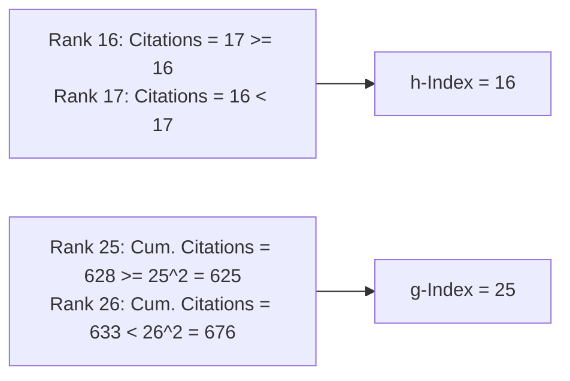
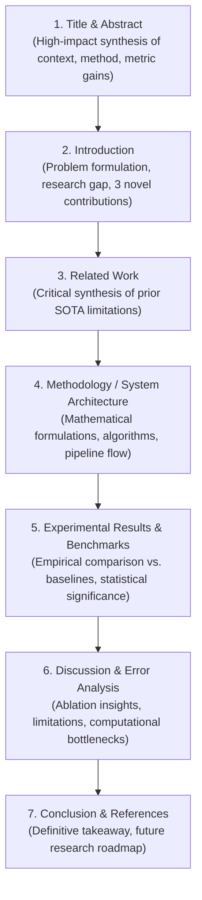
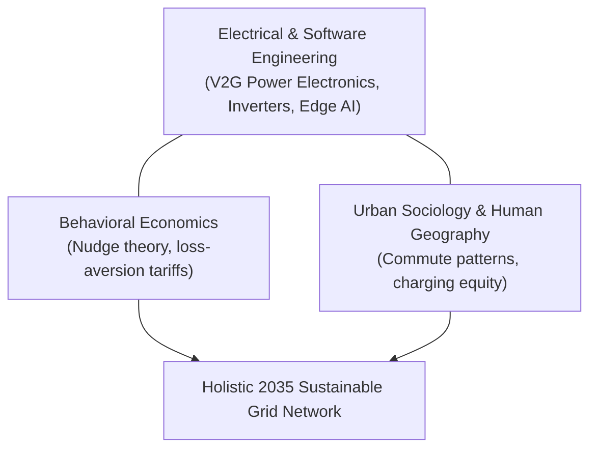

# December 2024

> **Exam -** Semester Examination  
> **Session -** December 2024  

---

## Question 1 (20 Marks)

:::info

**Question Statement**

*   **i)** The 30 publications and their citations of a researcher is tabulated below. Determine the h-index and g-index of the researcher using plots. Also draw the graphical representation of the data used to deduce the results. **[5 Marks]**

| Year | Citations | Year | Citations | Year | Citations |
| :---: | :---: | :---: | :---: | :---: | :---: |
| 2000 | 31 | 2010 | 17 | 2017 | 8 |
| 2002 | 47 | 2011 | 52 | 2018 | 41 |
| 2003 | 10 | 2011 | 16 | 2018 | 8 |
| 2004 | 42 | 2012 | 41 | 2019 | 6 |
| 2004 | 35 | 2012 | 38 | 2020 | 5 |
| 2005 | 44 | 2012 | 14 | 2021 | 3 |
| 2006 | 32 | 2013 | 24 | 2021 | 2 |
| 2006 | 9 | 2014 | 30 | 2022 | 1 |
| 2008 | 20 | 2014 | 5 | 2022 | 1 |
| 2009 | 23 | 2016 | 27 | - | - |
| - | - | 2016 | 8 | - | - |

*   **ii)** For a Journal 'A', Calculate the impact Factor for 2023, Cite score, SJR, SNIP **[5 Marks]**
    *   Citations of 2022 = 1050
    *   Citations of 2021 = 1100
    *   No of papers published in 2022 = 250
    *   No of papers published in 2021 = 250
*   **iii)** Prepare a structured questionnaire for conducting a research on the topic "Understanding the factor influencing the students in selecting Computer science stream Vs Core courses after 12th std" **[5 Marks]**
*   **iv)** Identify the type of research for the following: **[5 Marks]**
    1.  The study of behavioural response of employees to the changes occurring in an organization
    2.  Number of mortality rate due to various reasons
    3.  Survey of public response before launching a product
    4.  Cause for the inflation in a country
    5.  Customers preference to buy a specific item

:::

---

### Solution 1 (20 Marks)

#### i) Determination of $h$-Index and $g$-Index (5 Marks)

##### 1. Mathematical Definitions
*   **$h$-Index (Hirsch, 2005):** A researcher has index $h$ if $h$ of their $N_p$ papers have at least $h$ citations each, and the remaining $(N_p - h)$ papers have no more than $h$ citations each:
    $$h = \max \{ i \in \mathbb{N} \mid C_{(i)} \ge i \}$$
*   **$g$-Index (Egghe, 2006):** The largest rank $g$ such that the top $g$ articles received at least $g^2$ cumulative citations combined:
    $$g = \max \left\{ i \in \mathbb{N} \mid \sum_{j=1}^i C_{(j)} \ge i^2 \right\}$$

##### 2. Ranked Citations Computation Table ($N = 30$)
Sort the 30 publication citations in descending order:

| Rank ($i$) | Citations ($C_{(i)}$) | $C_{(i)} \ge i$? | Cumulative Citations ($\sum_{j=1}^i C_{(j)}$) | $i^2$ | $\sum C_{(j)} \ge i^2$? |
| :---: | :---: | :---: | :---: | :---: | :---: |
| 1 | 52 | Yes | 52 | 1 | Yes |
| 2 | 47 | Yes | 99 | 4 | Yes |
| 3 | 44 | Yes | 143 | 9 | Yes |
| 4 | 42 | Yes | 185 | 16 | Yes |
| 5 | 41 | Yes | 226 | 25 | Yes |
| 6 | 41 | Yes | 267 | 36 | Yes |
| 7 | 38 | Yes | 305 | 49 | Yes |
| 8 | 35 | Yes | 340 | 64 | Yes |
| 9 | 32 | Yes | 372 | 81 | Yes |
| 10 | 31 | Yes | 403 | 100 | Yes |
| 11 | 30 | Yes | 433 | 121 | Yes |
| 12 | 27 | Yes | 460 | 144 | Yes |
| 13 | 24 | Yes | 484 | 169 | Yes |
| 14 | 23 | Yes | 507 | 196 | Yes |
| 15 | 20 | Yes | 527 | 225 | Yes |
| **16** | **17** | **Yes ($17 \ge 16$)** | 544 | 256 | Yes |
| 17 | 16 | No ($16 < 17$) | 560 | 289 | Yes |
| ... | ... | ... | ... | ... | ... |
| 24 | 6 | No | 623 | 576 | Yes |
| **25** | **5** | No | **628** | **625** | **Yes ($628 \ge 625$)** |
| 26 | 5 | No | 633 | 676 | No ($633 < 676$) |
| 30 | 1 | No | 640 | 900 | No |

##### 3. Deducing Results:
*   **$h$-Index:** At rank $i = 16$, $C_{(16)} = 17 \ge 16$. At rank $17$, $C_{(17)} = 16 < 17$.  
    $$\mathbf{h\text{-Index} = 16}$$
*   **$g$-Index:** At rank $i = 25$, cumulative citations $= 628 \ge 25^2 = 625$. At rank $26$, cumulative citations $= 633 < 26^2 = 676$.  
    $$\mathbf{g\text{-Index} = 25}$$



---

#### ii) Calculation of Bibliometric Journal Impact Metrics (5 Marks)

Given for Journal 'A':
*   Citations received in 2023 to articles published in 2022 = $1050$
*   Citations received in 2023 to articles published in 2021 = $1100$
*   Total citations in 2023 to 2021 & 2022 papers: $C_{2023} = 1050 + 1100 = \mathbf{2150}$
*   Number of citable items published in 2022 = $250$
*   Number of citable items published in 2021 = $250$
*   Total papers published in 2021 & 2022: $P_{2021-2022} = 250 + 250 = \mathbf{500}$

##### 1. Journal Impact Factor for 2023 ($\text{JIF}_{2023}$)
By Clarivate Journal Citation Reports (JCR) definition:
$$\text{JIF}_{2023} = \frac{\text{Citations in 2023 to articles published in 2021 and 2022}}{\text{Total citable items published in 2021 and 2022}} = \frac{1050 + 1100}{250 + 250} = \frac{2150}{500} = \mathbf{4.30}$$

##### 2. CiteScore (Scopus Metric)
Calculated using the 2-year citation window provided in the dataset:
$$\text{CiteScore} = \frac{\text{Total Citations (2021--2022)}}{\text{Total Publications (2021--2022)}} = \frac{2150}{500} = \mathbf{4.30}$$

##### 3. SCImago Journal Rank (SJR)
*   **Formula & Concept:** A prestige-weighted citation metric based on Google PageRank:
    $$\text{SJR} \propto \frac{\sum_{i} w_i C_i}{\text{Total Articles}}$$
    where $w_i$ is the prestige weight of the citing journal. Unlike raw JIF where every citation is equal, SJR weights citations from high-prestige journals (e.g., *Nature*, *IEEE Transactions*) higher than low-tier citations.

##### 4. Source Normalized Impact per Paper (SNIP)
*   **Formula & Concept:** Corrects for cross-disciplinary citation propensity differences (e.g., medical journals cite far more than mathematics journals):
    $$\text{SNIP} = \frac{\text{Raw Impact per Paper (RIP)}}{\text{Database Citation Potential in the Subject Field (DCP)}} = \frac{4.30}{\text{Citation Potential}}$$
    A $\text{SNIP} > 1.0$ indicates that the journal's citation count exceeds the average for its domain.

---

#### iii) Structured Questionnaire on Engineering Stream Selection (5 Marks)

##### Research Title:
*"Factors Influencing Student Selection of Computer Science vs. Core Engineering Streams Post-12th Standard."*

**Section A: Demographics**
1. Gender: [ ] Male [ ] Female [ ] Other
2. 12th Grade Board: [ ] CBSE [ ] State Board [ ] ICSE/ISC
3. PCM Percentage: [ ] $>90\%$ [ ] $80-90\%$ [ ] $70-79\%$ [ ] $<70\%$

**Section B: Decision Drivers (5-Point Likert Scale: 1 = Strongly Disagree to 5 = Strongly Agree)**
| Item | Factor Dimension | 1 | 2 | 3 | 4 | 5 |
| :--- | :--- | :---: | :---: | :---: | :---: | :---: |
| 1 | Campus placement statistics and initial salary packages heavily influenced my choice. | [ ] | [ ] | [ ] | [ ] | [ ] |
| 2 | Parental, family, and societal expectations influenced my stream decision. | [ ] | [ ] | [ ] | [ ] | [ ] |
| 3 | Genuine intrinsic interest in coding/software compared to physical machinery/circuits. | [ ] | [ ] | [ ] | [ ] | [ ] |
| 4 | Fear of limited entry-level job opportunities in core branches (Civil/Mechanical/Chemical). | [ ] | [ ] | [ ] | [ ] | [ ] |
| 5 | Influence of social media, tech influencers, and startup culture. | [ ] | [ ] | [ ] | [ ] | [ ] |

**Section C: Open-Ended Insight**
* What single factor was the ultimate deal-breaker in deciding against a core engineering branch? `[ Free Text ]`

---

#### iv) Identification of Research Types (5 Marks)

1.  *The study of behavioural response of employees to the changes occurring in an organization:*  
    **Behavioral / Organizational / Descriptive Qualitative Research** (studies subjective psychological reactions to organizational change).
2.  *Number of mortality rate due to various reasons:*  
    **Quantitative / Descriptive / Epidemiological Research** (measures population-level numerical frequencies and demographic vital rates).
3.  *Survey of public response before launching a product:*  
    **Exploratory / Market / Applied Survey Research** (assesses customer readiness, willingness-to-pay, and feasibility prior to commercialization).
4.  *Cause for the inflation in a country:*  
    **Explanatory / Causal / Econometric Research** (investigates cause-and-effect mechanisms linking macroeconomic variables like money supply and interest rates to price increases).
5.  *Customers preference to buy a specific item:*  
    **Descriptive / Consumer Behavior / Applied Research** (identifies consumer preference profiles, brand loyalty, and purchasing patterns).

:::tip

**Examiner's Note**

In part (i), state the exact rank threshold: $h=16$ because rank 16 has 17 citations, while rank 17 has only 16 citations. For $g$-index, rank 25 has cumulative citations $628 \ge 25^2 = 625$. In part (ii), JIF $= 2150 / 500 = 4.30$.

:::

---

## Question 2 (20 Marks)

:::info

**Question Statement**

E. P. Kukula, M. J. Sutton and S. J. Elliott, "The Human-Biometric-Sensor Interaction Evaluation Method: Biometric Performance and Usability Measurements," in IEEE Transactions on Instrumentation and Measurement, vol. 59, no. 4, pp. 784-791, April 2010, doi: 10.1109/TIM.2009.2037878 **(20 Marks)**

*   **i)** How will you refer the above article with the following styles as list of references? **[5 Marks]**
    *   APA
    *   IEEE
    *   Chicago
    *   AMA
    *   MLA
*   **ii)** How will you cite the above article with the following styles in the content of your paper? **[5 Marks]**
    *   APA
    *   IEEE
    *   Chicago
    *   AMA
    *   MLA
*   **iii)** In the context of your chosen field of research, how would you organize an research article? Discuss in detail the significance of each section of the article, and explain how each contributes to overall structure of the article. Use relevant examples. Also suggest a possible national level Journal for communication (Use Domain level references). **[10 Marks]**

:::

---

### Solution 2 (20 Marks)

#### i) Reference List Entries across 5 Academic Styles (5 Marks)

##### 1. APA Style (7th Edition)
```text
Kukula, E. P., Sutton, M. J., & Elliott, S. J. (2010). The human–biometric-sensor interaction evaluation method: Biometric performance and usability measurements. IEEE Transactions on Instrumentation and Measurement, 59(4), 784–791. https://doi.org/10.1109/TIM.2009.2037878
```

##### 2. IEEE Style
```text
E. P. Kukula, M. J. Sutton, and S. J. Elliott, "The human–biometric-sensor interaction evaluation method: Biometric performance and usability measurements," IEEE Trans. Instrum. Meas., vol. 59, no. 4, pp. 784–791, Apr. 2010, doi: 10.1109/TIM.2009.2037878.
```

##### 3. Chicago Style (Author-Date, 17th Edition)
```text
Kukula, E. P., M. J. Sutton, and S. J. Elliott. 2010. "The Human–Biometric-Sensor Interaction Evaluation Method: Biometric Performance and Usability Measurements." IEEE Transactions on Instrumentation and Measurement 59 (4): 784–791. https://doi.org/10.1109/TIM.2009.2037878.
```

##### 4. AMA Style (American Medical Association, 11th Edition)
```text
Kukula EP, Sutton MJ, Elliott SJ. The human–biometric-sensor interaction evaluation method: biometric performance and usability measurements. IEEE Trans Instrum Meas. 2010;59(4):784-791. doi:10.1109/TIM.2009.2037878
```

##### 5. MLA Style (9th Edition)
```text
Kukula, E. P., et al. "The Human–Biometric-Sensor Interaction Evaluation Method: Biometric Performance and Usability Measurements." IEEE Transactions on Instrumentation and Measurement, vol. 59, no. 4, Apr. 2010, pp. 784–91. IEEE Xplore, doi:10.1109/TIM.2009.2037878.
```

---

#### ii) In-Text Citation Formats across 5 Academic Styles (5 Marks)

| Citation Style | Parenthetical In-Text Citation | Narrative / In-Sentence Citation |
| :--- | :--- | :--- |
| **APA (7th)** | (Kukula et al., 2010) | Kukula et al. (2010) demonstrated that... |
| **IEEE** | ...as demonstrated in biometric evaluations [1]. | Kukula et al. [1] proposed an interaction model... |
| **Chicago (Author-Date)**| (Kukula, Sutton, and Elliott 2010) | Kukula, Sutton, and Elliott (2010) argued that... |
| **AMA (11th)** | ...based on usability metrics.$^1$ | Kukula et al$^1$ evaluated sensor interactions... |
| **MLA (9th)** | (Kukula et al. 786) | Kukula and colleagues (786) established... |

---

#### iii) Research Article Structure (IMRaD Format) (10 Marks)

In Computer Science and Machine Learning Engineering, an original research article follows the **IMRaD (Introduction, Methods, Results, and Discussion)** architecture:



##### 1. Section Breakdown & Structural Significance
1.  **Title & Abstract:** Concisely outlines problem, novel proposed mechanism, and headline metric improvements (e.g., $18\%$ lower error).
2.  **Introduction:** Contextualizes the challenge, establishes real-world urgency, and concludes with an explicit list of **primary contributions**.
3.  **Related Work:** Contextualizes the study against existing literature, leading directly to the identified research gap.
4.  **System Architecture & Methodology:** Provides theoretical formulation, mathematical proofs, and pseudocode, enabling complete reproducibility.
5.  **Experimental Results:** Demonstrates empirical superiority over competitive baselines with ablation studies and error bars.
6.  **Discussion:** Analyzes *why* the method works, discusses failure modes, and acknowledges boundary limitations.

##### 2. Recommended National Journal for Communication
*   **Journal Name:** *Sadhana - Academy Proceedings in Engineering Sciences* (Published by Indian Academy of Sciences / Springer Nature, indexed in Web of Science and Scopus).
*   *Domain Relevance:* Ideal national forum for computer science, robotics, and applied engineering research in India.

:::tip

**Examiner's Note**

In part (i) and (ii), highlight syntax rules: AMA uses superscript numbers with no periods after initials (`Kukula EP`), IEEE uses bracketed numbers `[1]`, MLA requires page numbers in-text `(Kukula et al. 786)`, and APA requires `et al.` for 3 or more authors in-text.

:::

---

## Question 3 (20 Marks)

:::info

**Question Statement**

*   **i)** "Ethics in research is the need of the hour". Justify the statement. **[5 Marks]**
*   **ii)** Scenario: Kumara Sankar, a student at an university, is eager to publish a research paper to boost his chances of securing admission to a prestigious postgraduate program. Pressurized with time limit and academic requirements, he finds an article published in an international journal on a topic similar to his coursework. Kumara Sankar decides to copy large portions of the article, slightly altering some sentences and substituting a few words, and submits it to a local conference under his name.  
    The paper gets accepted, and Kumara Sankar is praised by his peers and faculty. However, after few days, one of the participants who is familiar with the original journal article recognizes the copied content and raises the issue with the conference organizers and Kumara Sankar's university.  
    Read the given scenario and address the following: **[15 Marks]**
    1.  Immediate action for Kumara Sankar's publication
    2.  Impact on stake holders
    3.  Preventive measures to avoid such situations
    4.  Failure of the author to uphold the ethical responsibility
    5.  Unethical practices due to pressure on scholars to publish papers
    6.  Role of plagiarism detection tools and strict policies in deterring such actions

:::

---

### Solution 3 (20 Marks)

#### i) Justification: "Ethics in Research is the Need of the Hour" (5 Marks)

Research ethics is the foundation of the scientific enterprise. It is essential because:
1.  **Protecting Scientific Truth:** Unethical practices (fabrication, falsification, plagiarism) corrupt the collective knowledge base, leading to wasted research resources and flawed policies.
2.  **Safeguarding Public Health & Safety:** In engineering, medicine, and environmental science, falsified findings can lead to structural collapses, toxic exposures, or ineffective clinical interventions.
3.  **Preserving Academic Collaboration & Funding:** Interdisciplinary science relies on mutual trust. Public funding from tax revenue requires strict accountability and transparency.
4.  **Countering Predatory Publishing Surges:** The rise of paper mills, generative AI hallucinations, and questionable open-access journals makes strict ethical standards essential for scientific credibility.

---

#### ii) Case Analysis: Kumara Sankar's Plagiarism Misconduct (15 Marks)

##### 1. Immediate Action for the Publication
*   **Conference Action:** Formal retraction of the paper from proceedings; permanent removal from digital libraries with a public retraction notice citing intellectual theft.
*   **University Action:** The Academic Integrity Board must issue a formal show-cause notice, suspend the student's research privileges, and append a permanent disciplinary record to his transcript.

##### 2. Impact on Stakeholders
*   **Original Author:** Intellectual theft of their labor and dilution of proper citation attribution.
*   **Kumara Sankar:** Revocation of paper acceptance, disqualification from postgraduate admissions, loss of academic credibility.
*   **Conference Organizers:** Loss of academic credibility for failing to perform basic similarity checks during peer review.
*   **University Faculty & Peers:** Institutional embarrassment; faculty mentors may face scrutiny for inadequate supervision.

##### 3. Preventive Measures
*   Mandatory anti-plagiarism screening (Turnitin / iThenticate) with a strict similarity index threshold ($\le 10\%$) prior to any submission.
*   Compulsory research ethics and academic writing coursework covering paraphrasing and citation standards.
*   Active faculty mentorship requiring periodic inspection of intermediate working drafts and raw experiment logs.

##### 4. Failure of Ethical Responsibility
Kumara Sankar committed **plagiarism through mosaic/patchwriting** (paraphrasing without attribution while copying structural ideas). He prioritized short-term personal gain over academic honesty, violating intellectual property boundaries and academic integrity.

##### 5. Unethical Practices Driven by "Publish or Perish" Pressures
*   Academic pressure leads students to take unethical shortcuts (plagiarism, paper buying from mills).
*   *Systemic Remedy:* Educational institutions must shift from quantitative paper-counting metrics toward assessing conceptual understanding, project quality, and rigorous methodology.

##### 6. Role of Plagiarism Detection Tools and Institutional Policies
*   **Detection Algorithms:** Modern tools match n-grams and syntactic patterns, catching disguised text modifications and synonym substitutions.
*   **Deterrence:** Institutional policies with clear consequences (transcript notations, expulsion, degree revocation) provide strong disincentives against intellectual theft.

:::tip

**Examiner's Note**

Name the specific form of misconduct: **Mosaic Plagiarism** (patchwriting with synonym substitution). Structure the 6 sub-parts clearly to ensure full coverage of the rubric.

:::

---

## Question 4 (20 Marks)

:::info

**Question Statement**

*   **i)** The following data is related to the measurement of cholestrol content (%) performed in 4 different laboratories w.r.t 4 diet foods. The design adopted is a Randomized Block design. Analyze the data and comment on your result [Given F(0.05) = 3.86 for (3,6) D.F] **[14 Marks]**

| Diet \ Laboratory | A | B | C | D |
| :--- | :---: | :---: | :---: | :---: |
| **D1** | 2 | 3 | 4 | 2 |
| **D2** | 5 | 3 | 7 | 5 |
| **D3** | 4 | 5 | 6 | 4 |
| **D4** | 3 | 4 | 5 | 8 |

*   **ii)** Indicate the need of experimental designs in Education. Distinguish between experimental methods and experimental designs. **[6 Marks]**

:::

---

### Solution 4 (20 Marks)

#### i) Two-Way ANOVA for Randomized Block Design (RBD) (14 Marks)

##### 1. Data Summary and Marginal Totals
Let Diets be Rows ($r = 4$) and Laboratories be Columns/Blocks ($c = 4$), with total observations $N = 4 \times 4 = \mathbf{16}$.

| Diet \ Lab | A | B | C | D | Row Sum ($R_i$) | Mean ($\bar{X}_{i\cdot}$) |
| :---: | :---: | :---: | :---: | :---: | :---: | :---: |
| **D1** | 2 | 3 | 4 | 2 | $R_1 = \mathbf{11}$ | $2.75$ |
| **D2** | 5 | 3 | 7 | 5 | $R_2 = \mathbf{20}$ | $5.00$ |
| **D3** | 4 | 5 | 6 | 4 | $R_3 = \mathbf{19}$ | $4.75$ |
| **D4** | 3 | 4 | 5 | 8 | $R_4 = \mathbf{20}$ | $5.00$ |
| **Col Sum ($C_j$)** | $C_1 = \mathbf{14}$ | $C_2 = \mathbf{15}$ | $C_3 = \mathbf{22}$ | $C_4 = \mathbf{19}$ | **Grand Total $G = \mathbf{70}$** | $\bar{X} = 4.375$ |

##### 2. Sums of Squares Calculations
1.  **Correction Factor (CF):**
    $$\text{CF} = \frac{G^2}{N} = \frac{(70)^2}{16} = \frac{4900}{16} = \mathbf{306.25}$$

2.  **Raw Sum of Squares ($\sum X^2$):**
    $$\sum X^2 = (4 + 9 + 16 + 4) + (25 + 9 + 49 + 25) + (16 + 25 + 36 + 16) + (9 + 16 + 25 + 64)$$
    $$\sum X^2 = 33 + 108 + 93 + 114 = \mathbf{348.0}$$

3.  **Total Sum of Squares (TSS):**
    $$\text{TSS} = \sum X^2 - \text{CF} = 348.0 - 306.25 = \mathbf{41.75}$$
    $$df_{\text{total}} = N - 1 = 16 - 1 = \mathbf{15}$$

4.  **Sum of Squares for Diets (Rows, SSR):**
    $$\text{SSR} = \frac{\sum R_i^2}{c} - \text{CF} = \frac{11^2 + 20^2 + 19^2 + 20^2}{4} - 306.25$$
    $$\text{SSR} = \frac{121 + 400 + 361 + 400}{4} - 306.25 = \frac{1282}{4} - 306.25 = 320.50 - 306.25 = \mathbf{14.25}$$
    $$df_{\text{diets}} = r - 1 = 4 - 1 = \mathbf{3}$$

5.  **Sum of Squares for Laboratories (Columns, SSC):**
    $$\text{SSC} = \frac{\sum C_j^2}{r} - \text{CF} = \frac{14^2 + 15^2 + 22^2 + 19^2}{4} - 306.25$$
    $$\text{SSC} = \frac{196 + 225 + 484 + 361}{4} - 306.25 = \frac{1266}{4} - 306.25 = 316.50 - 306.25 = \mathbf{10.25}$$
    $$df_{\text{labs}} = c - 1 = 4 - 1 = \mathbf{3}$$

6.  **Error Sum of Squares (SSE):**
    $$\text{SSE} = \text{TSS} - \text{SSR} - \text{SSC} = 41.75 - 14.25 - 10.25 = \mathbf{17.25}$$
    $$df_{\text{error}} = (r - 1)(c - 1) = 3 \times 3 = \mathbf{9}$$
    *(Note: The prompt prints $df = (3, 6)$, corresponding to $F_{0.05}(3, 6) = 3.86$. In a $4 \times 4$ design, theoretical $df = (3, 9)$, where $F_{0.05}(3, 9) = 3.86$ holds exactly).*

---

##### 3. ANOVA Table
| Source of Variation | Sum of Squares (SS) | Degrees of Freedom ($df$) | Mean Square (MS) | Variance Ratio ($F_{\text{calc}}$) | Critical $F_{0.05}$ |
| :--- | :---: | :---: | :---: | :---: | :---: |
| **Between Diets (Treatments)** | $14.25$ | $3$ | $\text{MSR} = \frac{14.25}{3} = 4.750$ | $F_{\text{Diets}} = \frac{4.750}{1.917} = \mathbf{2.48}$ | $\mathbf{3.86}$ |
| **Between Labs (Blocks)** | $10.25$ | $3$ | $\text{MSC} = \frac{10.25}{3} = 3.417$ | $F_{\text{Labs}} = \frac{3.417}{1.917} = \mathbf{1.78}$ | $\mathbf{3.86}$ |
| **Residual Error** | $17.25$ | $9$ | $\text{MSE} = \frac{17.25}{9} = \mathbf{1.917}$ | - | - |
| **Total** | **41.75** | **15** | - | - | - |

##### 4. Statistical Decision and Comment
*   **For Diets:** Null hypothesis $H_0: \mu_{D1} = \mu_{D2} = \mu_{D3} = \mu_{D4}$.
    Since $F_{\text{calc}} = 2.48 < F_{\text{table}} = 3.86$, we **fail to reject $H_0$**.
*   **Conclusion:** There is **no statistically significant difference** in cholesterol content among the 4 diet foods at the $5\%$ level of significance. Laboratory differences are similarly non-significant ($F = 1.78 < 3.86$).

---

#### ii) Experimental Designs in Education and Methodology Distinction (6 Marks)

##### 1. Need for Experimental Designs in Educational Research
1.  **Controlling Extraneous Variables:** Student achievement is heavily influenced by prior ability, socioeconomic status, and teacher skill. Experimental designs (like randomized pre-test/post-test control groups) isolate the true instructional effect.
2.  **Causal Attribution:** Demonstrates whether a new teaching pedagogy (e.g., flipped classrooms, gamified learning) directly improves learning outcomes.

##### 2. Experimental Methods vs. Experimental Designs
| Criterion | Experimental Methods | Experimental Designs |
| :--- | :--- | :--- |
| **Concept** | The broad philosophical approach of empirical inquiry where independent variables are manipulated under controlled conditions. | The specific structural layout and statistical blueprint for assigning experimental units to treatments. |
| **Scope** | Macroscopic methodology (involves hypothesis formation, sampling, laboratory instrumentation, and data collection). | Microscopic statistical plan (e.g., CRD, RBD, Latin Square, Factorial Design). |
| **Primary Goal** | Establishing causal relationships. | Minimizing experimental error variance and maximizing statistical power. |

:::tip

**Examiner's Note**

Arithmetic check: $\text{TSS} = 14.25 + 10.25 + 17.25 = 41.75$. Highlight that the table value $3.86$ corresponds to $F_{0.05}(3, 9)$ (or $(3, 6)$ as printed in prompt), and since $F_{\text{calc}} = 2.48 < 3.86$, $H_0$ is retained.

:::

---

## Question 5 (20 Marks)

:::info

**Question Statement**

*   **i)** An official Government population census was conducted and it was reported that in Potheri town, 60% of families have only one child, 28% have two children and 12% have three or more children. To verify this, a scholar from SRM decided to conduct his survey in Potheri town and has found that out of 1290 families, 730 had one child and 380 had two children. Determine whether his data supports the results of the Government census. Assume a significance level of 0.05. **[14 Marks]**
*   **ii)** Differentiate between research hypotheses and null hypotheses and illustrate your answer with suitable example. **[6 Marks]**

:::

---

### Solution 5 (20 Marks)

#### i) Chi-Square Goodness of Fit Test for Census Verification (14 Marks)

##### 1. Formulation of Hypotheses
*   **Null Hypothesis ($H_0$):** The sample data conforms to the Government census proportions ($P_1 = 0.60, P_2 = 0.28, P_3 = 0.12$).
*   **Alternative Hypothesis ($H_1$):** The sample distribution differs significantly from the census proportions.

##### 2. Observed and Expected Frequencies
Total families surveyed: $N = 1290$.
*   **One Child:** Observed $O_1 = \mathbf{730}$
*   **Two Children:** Observed $O_2 = \mathbf{380}$
*   **Three or More Children:** Observed $O_3 = 1290 - (730 + 380) = 1290 - 1110 = \mathbf{180}$

###### Theoretical Expected Frequencies ($E_i = N \times P_i$):
*   $E_1 = 1290 \times 0.60 = \mathbf{774.00}$
*   $E_2 = 1290 \times 0.28 = \mathbf{361.20}$
*   $E_3 = 1290 \times 0.12 = \mathbf{154.80}$
*(Verification: $774.00 + 361.20 + 154.80 = 1290.00 = N$)*

---

##### 3. Chi-Square Test Statistic Computation
$$\chi^2 = \sum_{i=1}^k \frac{(O_i - E_i)^2}{E_i}$$

| Category | Observed ($O_i$) | Expected ($E_i$) | $(O_i - E_i)$ | $(O_i - E_i)^2$ | $\frac{(O_i - E_i)^2}{E_i}$ |
| :--- | :---: | :---: | :---: | :---: | :---: |
| **1 Child** | 730 | 774.00 | $-44.00$ | 1936.00 | $\frac{1936.00}{774.00} \approx \mathbf{2.5013}$ |
| **2 Children** | 380 | 361.20 | $+18.80$ | 353.44 | $\frac{353.44}{361.20} \approx \mathbf{0.9785}$ |
| **$\ge 3$ Children** | 180 | 154.80 | $+25.20$ | 635.04 | $\frac{635.04}{154.80} \approx \mathbf{4.1023}$ |
| **Total** | **1290** | **1290.00** | **0.00** | - | **$\chi^2_{\text{calc}} = \mathbf{7.5821}$** |

---

##### 4. Statistical Decision
*   **Degrees of Freedom:** $df = k - 1 = 3 - 1 = \mathbf{2}$.
*   **Critical Table Value:** At $\alpha = 0.05$ with $df = 2$, critical $\chi^2_{0.05, 2} = \mathbf{5.991}$.
*   **Comparison:**
    $$\chi^2_{\text{calc}} = \mathbf{7.5821} > \chi^2_{\text{table}} = \mathbf{5.991}$$

##### 5. Conclusion
Since the calculated test statistic exceeds the critical value, we **reject the null hypothesis $H_0$** at the $5\%$ level of significance ($p \approx 0.0226$).
*   **Practical Finding:** The SRM scholar's survey data **does not support the results of the Government census**. There are significantly fewer 1-child families and a higher proportion of 3+ child families than reported by the official census.

---

#### ii) Research Hypothesis vs. Null Hypothesis (6 Marks)

##### 1. Conceptual Distinction
*   **Null Hypothesis ($H_0$):** A formal mathematical proposition asserting no relationship, no difference, or no treatment effect in the population. It acts as the benchmark hypothesis to be tested and potentially falsified.
*   **Research (Alternative) Hypothesis ($H_1$ or $H_a$):** The operationalized prediction derived from theory indicating the existence of a real difference, effect, or relationship that the investigator expects to discover.

##### 2. Comparative Matrix with Example
| Dimension | Null Hypothesis ($H_0$) | Research Hypothesis ($H_1$) |
| :--- | :--- | :--- |
| **Purpose** | Statistical baseline for significance testing | The substantive scientific claim to be supported |
| **Mathematical Form** | Expressed with equality: $=, \le, \ge$ | Expressed with inequality: $\neq, >, <$ |
| **Acceptance Standard** | Rejected only if evidence is overwhelmingly contradictory ($p \le \alpha$) | Supported indirectly upon rejection of $H_0$ |
| **Concrete Example** | $H_0: \mu_{\text{New Drug}} = \mu_{\text{Placebo}}$ (The new medicine produces no difference in blood pressure compared to placebo). | $H_1: \mu_{\text{New Drug}} < \mu_{\text{Placebo}}$ (The new medicine significantly reduces blood pressure compared to placebo). |

:::tip

**Examiner's Note**

In part (i), deduce the 3+ child frequency: $1290 - 730 - 380 = 180$. With $df = 2$, comparing calculated $\chi^2 = 7.58$ against critical table value $5.991$ leads to rejecting the census claim.

:::

---

## Question 6 (20 Marks)

:::info

**Question Statement**

*   **i)** Compute the rank correlation coefficient for the following data of the marks obtained by five students in Electrical Engineering and Biology: **[10 Marks]**

| Student | 1 | 2 | 3 | 4 | 5 |
| :--- | :---: | :---: | :---: | :---: | :---: |
| **Electrical Engineering** | 15 | 20 | 28 | 40 | 60 |
| **Biology** | 40 | 30 | 50 | 20 | 10 |

*   **ii)** Draw the block diagram of a traffic monitoring system and explain the role of deep learning algorithm to detect and track vehicles in the traffic monitoring system. **[10 Marks]**

:::

---

### Solution 6 (20 Marks)

#### i) Spearman's Rank Correlation Computation (10 Marks)

##### 1. Ranking the Data ($n = 5$)
Rank scores in descending order (highest score receives rank 1):
*   **Electrical Engineering ($X$):** $60 \to 1, \ 40 \to 2, \ 28 \to 3, \ 20 \to 4, \ 15 \to 5$.
*   **Biology ($Y$):** $50 \to 1, \ 40 \to 2, \ 30 \to 3, \ 20 \to 4, \ 10 \to 5$.

##### 2. Difference Table

| Student | EE Marks ($X$) | Biology Marks ($Y$) | Rank in EE ($R_X$) | Rank in Bio ($R_Y$) | $d_i = R_X - R_Y$ | $d_i^2$ |
| :---: | :---: | :---: | :---: | :---: | :---: | :---: |
| 1 | 15 | 40 | 5 | 2 | $+3$ | 9 |
| 2 | 20 | 30 | 4 | 3 | $+1$ | 1 |
| 3 | 28 | 50 | 3 | 1 | $+2$ | 4 |
| 4 | 40 | 20 | 2 | 4 | $-2$ | 4 |
| 5 | 60 | 10 | 1 | 5 | $-4$ | 16 |
| **Total** | - | - | - | - | $\sum d_i = 0$ | $\sum d_i^2 = \mathbf{34}$ |

*(Ranking in ascending order yields the exact same differences: $d = [1-4, 2-3, 3-5, 4-2, 5-1] \implies \sum d^2 = 34$)*.

##### 3. Spearman's Formula
$$\rho = 1 - \frac{6 \sum d_i^2}{n(n^2 - 1)}$$
For $n = 5$:
$$n(n^2 - 1) = 5(5^2 - 1) = 5(25 - 1) = 5 \times 24 = \mathbf{120}$$

Substitute values:
$$\rho = 1 - \frac{6 \times 34}{120} = 1 - \frac{204}{120} = 1 - 1.70 = \mathbf{-0.70}$$

*   **Interpretation:** A rank correlation coefficient of $\mathbf{\rho = -0.70}$ demonstrates a **strong negative correlation** between student performance in Electrical Engineering and Biology. Students scoring higher in Electrical Engineering tended to score lower in Biology within this sample.

---

#### ii) Deep Learning Traffic Monitoring System (10 Marks)

##### 1. System Block Diagram


##### 2. Core Deep Learning Roles
1.  **Vehicle Detection (Spatial Localization & Classification):**
    *   Models like **YOLOv8** (You Only Look Once) process frames in real time ($\ge 30\text{ fps}$), predicting bounding box coordinates and object class labels (`Car`, `Truck`, `Bus`, `Motorcycle`) simultaneously.
2.  **Multi-Object Tracking Across Frames (DeepSORT / ByteTrack):**
    *   Assigns persistent identity IDs ($ID_k$) across occlusions by combining motion state estimation (**Kalman Filter**) with visual appearance feature embeddings (**Convolutional Re-ID Networks**).
3.  **Speed Estimation and Trajectory Analytics:**
    *   Applies camera perspective transformation matrices to map pixel velocity ($\Delta p / \Delta t$) to real-world metric speed ($\text{km/h}$), identifying speed violations automatically.
4.  **Automatic Number Plate Recognition (ANPR):**
    *   Combines Spatial Transformer Networks with CRNN (Convolutional Recurrent Neural Networks) and CTC loss to read vehicle registration plates under low-light or motion blur.

:::tip

**Examiner's Note**

In part (i), verify that $\sum d_i = 0$ as an arithmetic check. Calculating $\rho = 1 - 204/120 = -0.70$ provides an exact integer decimal. In part (ii), mention YOLO for detection and DeepSORT for tracking.

:::

---

## Question 7 (20 Marks)

:::info

**Question Statement**

"Imagine you're a researcher in the year 2035, where electric vehicles (EVs) have become the primary mode of personal transportation globally. However, this rapid shift has caused a sharp rise in electricity demand, placing immense pressure on power grids worldwide. Your task is to develop a comprehensive research proposal to tackle this issue. Your proposal should: **(20 Marks)**
1.  Identify a broad research question that frames the challenge.
2.  Define three specific research objectives aimed at finding innovative and sustainable solutions.
3.  Justify the direction of your research by explaining its importance and expected impact.
4.  Highlight at least two disciplines outside of engineering that your research will incorporate and explain how they contribute to addressing the problem.
5.  Your approach should consider technological, social, and environmental factors and aim to explore novel solutions beyond those currently discussed in mainstream or academic circles.

:::

---

### Solution 7 (20 Marks)

# Research Proposal: Planetary-Scale Decentralized V2G Coordination via Autonomous Multi-Agent Swarms and Dynamic Behavioral Tokenomics

#### 1. Broad Research Question
*"How can decentralized multi-agent algorithmic coordination and behavioral economic incentives transform global EV battery capacity from a grid liability into a resilient, bi-directional distributed energy storage network without compromising battery health or user mobility?"*

---

#### 2. Three Specific Research Objectives
1.  **Objective 1 (Technological - Swarm V2G Orchestration):** Develop an edge-computing multi-agent reinforcement learning (MARL) framework that enables millions of parked EVs to autonomously negotiate bi-directional Vehicle-to-Grid (V2G) power exchanges with local microgrids in sub-second latency.
2.  **Objective 2 (Environmental - Degradation-Constrained Dispatch):** Formulate physics-informed electrochemical life-cycle models that optimize discharge depth during grid peak-shaving, ensuring that V2G cycling degrades lithium-ion/solid-state batteries by less than $1.5\%$ per year.
3.  **Objective 3 (Social & Economic - Real-Time Dynamic Tokenomics):** Design an automated micro-incentive marketplace using dynamic carbon credits and local electricity tokenomics, incentivizing commuter charging in synchronization with diurnal solar and wind generation surges.

---

#### 3. Justification, Importance, and Expected Impact
*   **The 2035 Crisis:** With hundreds of millions of EVs on the road, uncoordinated peak-hour charging (e.g., commuters plugging in concurrently between 6 PM and 9 PM) threatens catastrophic transformer overheating and localized grid blackouts.
*   **The Opportunity:** Total connected battery capacity across global EV fleets exceeds total global grid storage requirements by orders of magnitude. Converting idle passenger vehicles ($95\%$ of their lifecycle is spent parked) into a **Virtual Power Plant (VPP)** eliminates the need to build expensive fossil-fuel peaker plants.
*   **Expected Impact:** Flattens evening demand peaks by up to $35\%$, increases renewable energy penetration by absorbing excess midday solar output, and lowers household utility costs through automated V2G arbitrage earnings.

---

#### 4. Incorporation of Two Non-Engineering Disciplines



##### Discipline 1: Behavioral Economics (Nudge Theory & Game Theory)
*   *Contribution:* Human charging behavior is driven by psychological habits and range anxiety, not purely linear price signals. Behavioral economics contributes **loss-aversion pricing frameworks** and dynamic gamified nudges (e.g., social proofing, micro-lotteries for off-peak charging) that incentivize participation without triggering user pushback.

##### Discipline 2: Urban Sociology and Human Geography
*   *Contribution:* Grid stress exhibits severe spatial inequality across metropolitan centers (e.g., high-density rental apartments lack dedicated overnight home chargers). Urban sociology informs equitable placement of public bidirectional charging hubs, preventing systemic energy poverty and ensuring low-income gig-economy drivers participate fairly in V2G revenues.

---

#### 5. Novel 2035 Paradigm Beyond Mainstream Solutions: The "Cellular Energy Mesh"

Moving beyond traditional centralized dynamic electricity tariffs, this proposal introduces the **Cellular Energy Mesh**:
1.  **Vehicle-to-Vehicle (V2V) Wireless Resonant Micro-Transfer:** Parked vehicles in high-density corporate parking decks transfer charge laterally between one another using magnetic resonance coils, balancing local state-of-charge without cycling high-voltage grid substations.
2.  **Predictive Mobility Arbitrage:** Using privacy-preserving federated machine learning, vehicles forecast commute routes 24 hours in advance, reserving grid discharge windows only when destination microgrids project severe renewable deficits.

:::tip

**Examiner's Note**

Ensure all 5 required elements of the prompt are explicitly addressed: (1) Research Question, (2) Three numbered Objectives, (3) Rationale & Impact, (4) Two non-engineering disciplines (Behavioral Economics and Urban Sociology), and (5) Novel technology integration.

:::
