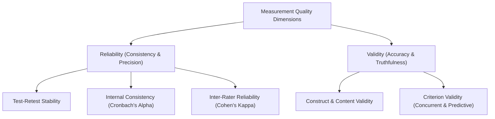
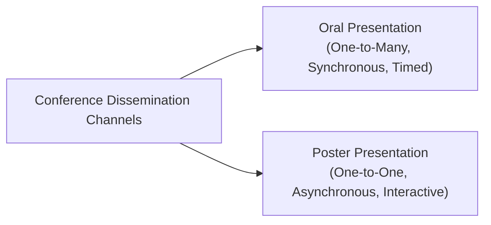
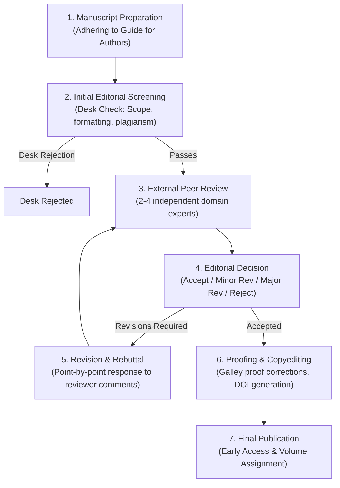
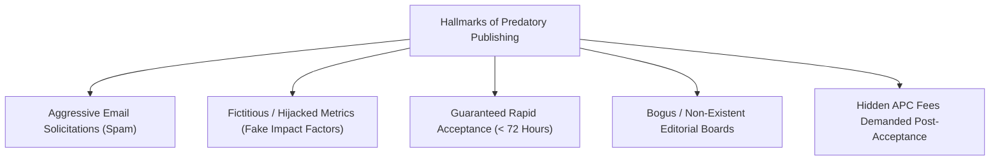
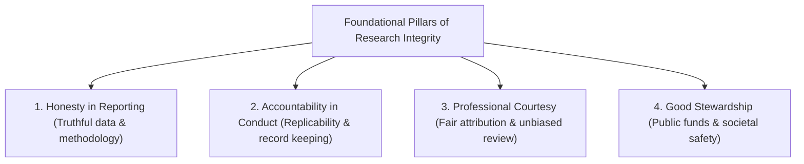

# January 2025

> **Exam -** Semester Examination  
> **Session -** January 2025  

---

## Question 1 (20 Marks)

:::info

**Question Statement**

*   **i)** Write a detailed account of the types of research and objectives of the research. **(10 Marks)**
*   **ii)** Explain about quality measurement tools in research. **(10 Marks)**

:::

---

### Solution 1 (20 Marks)

#### (i) Types and Objectives of Research (10 Marks)

##### 1. Fundamental Objectives of Research
Research is a systematic, structured investigation designed to generate verifiable generalizable knowledge. Its primary objectives include:
1.  **Exploratory / Formulative:** Gaining initial familiarity with an unexplored phenomenon or achieving new clinical/technological insights.
2.  **Descriptive:** Portraying accurately the characteristics of a specific individual, group, situation, or population frequency.
3.  **Diagnostic:** Determining the frequency with which a specific phenomenon occurs or its clinical/operational association with another factor.
4.  **Hypothesis-Testing (Causal):** Testing empirical causal relationships ($X \implies Y$) between controlled variables.

##### 2. Major Classifications of Research
| Classification Axis | Type 1 | Type 2 | Key Distinction |
| :--- | :--- | :--- | :--- |
| **Application** | **Fundamental (Pure / Basic)** | **Applied** | Pure research expands theoretical scientific boundaries without immediate commercial utility; Applied research solves immediate practical problems. |
| **Inquiry Mode** | **Quantitative** | **Qualitative** | Quantitative uses numerical measurement, formal statistics, and mathematical modeling; Qualitative explores subjective meanings, behaviors, and lived experiences. |
| **Objective** | **Descriptive** | **Analytical / Explanatory** | Descriptive surveys facts and reports *"what is"*; Analytical uses critical evaluation of existing data to establish *"why and how"*. |
| **Environment** | **Conceptual** | **Empirical** | Conceptual develops abstract theories and philosophy; Empirical relies directly on observed, experimental, verifiable data. |
| **Time Horizon** | **Cross-Sectional** | **Longitudinal** | Cross-sectional observes a population at a single point in time; Longitudinal tracks a cohort repeatedly over extended intervals. |

---

#### (ii) Quality Measurement Tools in Research (10 Marks)

Ensuring data integrity requires established psychometric and statistical quality measurement frameworks:

##### 1. Reliability Measurement Tools (Consistency)
Reliability evaluates the repeatability and internal stability of a measurement instrument:
*   **Cronbach's Alpha ($\alpha$):** Measures the internal consistency of multi-item Likert scales:
    $$\alpha = \frac{k}{k - 1} \left( 1 - \frac{\sum_{i=1}^k \sigma_{y_i}^2}{\sigma_x^2} \right)$$
    *Threshold:* $\alpha \ge 0.70$ indicates acceptable reliability; $\alpha \ge 0.80$ indicates good research-grade consistency.
*   **Cohen's Kappa ($\kappa$):** Assesses inter-rater agreement between independent qualitative coders while correcting for agreement occurring by chance:
    $$\kappa = \frac{p_o - p_e}{1 - p_e}$$
*   **Test-Retest Coefficient:** Pearson correlation ($r$) of scores obtained by administering the identical instrument across two distinct time intervals.

##### 2. Validity Measurement Frameworks (Accuracy)
Validity evaluates whether an instrument genuinely measures the theoretical construct it purports to measure:
*   **Content & Face Validity:** Expert consensus audits confirming that the items exhaustively cover the domain of interest.
*   **Construct Validity (Factor Analysis):** Principal Component Analysis (PCA) and Confirmatory Factor Analysis (CFA) verifying that survey items load onto hypothesized latent factors without cross-loadings ($> 0.40$).
*   **Criterion Validity:** Correlating instrument scores against established gold standards (Concurrent) or future behavioral outcomes (Predictive).

:::tip

**Examiner's Note**

In part (i), cover both classifications (Basic vs. Applied, Qualitative vs. Quantitative) and the 4 canonical objectives (Exploratory, Descriptive, Diagnostic, Hypothesis-testing). In part (ii), define Cronbach's Alpha ($\alpha \ge 0.7$) and Cohen's Kappa formulas.

:::

---

## Question 2 (20 Marks)

:::info

**Question Statement**

*   **i)** Examine the essential features of oral and poster presentation. Also, examine their limitations. **(10 Marks)**
*   **ii)** Describe the stages involved in the submission of research articles for publication in reputed journals. **(10 Marks)**

:::

---

### Solution 2 (20 Marks)

#### (i) Oral vs. Poster Presentations: Features and Limitations (10 Marks)

##### 1. Comparative Features Matrix
| Feature Dimension | Oral Presentation | Poster Presentation |
| :--- | :--- | :--- |
| **Format & Reach** | Synchronous, linear one-to-many lecture delivered to a seated audience within a rigid time slot ($10 - 15\text{ mins}$). | Visual static display ($A0$ format) facilitating asynchronous, informal, one-on-one dialogues over several hours. |
| **Visual Structure** | Slide deck (6-10 slides) using progressive disclosure, high-contrast graphs, and minimal text walls. | Integrated physical canvas combining Abstract, Methods flowchart, high-resolution figures, and bullet conclusions. |
| **Audience Engagement** | Formal, broadcast-style delivery; limited to brief concluding Q&A ($2 - 3\text{ mins}$). | Direct, personalized bilateral networking; viewers can inspect data at their own pace and discuss granular details. |
| **Delivery Demands** | Requires strong vocal projection, pacing, stage presence, and strict time discipline. | Requires an engaging 2-minute "elevator pitch" and responsive, approachable conversational skills. |

##### 2. Inherent Limitations
*   **Limitations of Oral Presentations:**
    1.  *Strict Time Pressure:* Presenters often rush through methodology and results, compromising audience comprehension.
    2.  *Passive Audience Retention:* Listeners absorb only a small fraction of verbally communicated information.
    3.  *Scheduling Conflicts:* Parallel conference sessions force attendees to choose between competing presentations.
*   **Limitations of Poster Presentations:**
    1.  *Spatial Constraints:* Summarizing a 10-page paper onto a single poster board requires severe compression of technical nuances.
    2.  *High Visual Competition:* In crowded exhibition halls, posters with poor graphic design are easily overlooked.
    3.  *Perceived Academic Hierarchy:* Some academic committees afford lower formal prestige to poster presentations compared to podium oral slots.

---

#### (ii) End-to-End Journal Submission and Peer Review Lifecycle (10 Marks)

Publishing in an indexed, peer-reviewed journal follows a structured 7-stage workflow:

1.  **Stage 1: Pre-Submission Preparation & Journal Matching:**
    *   Align manuscript scope with journal aims; format references and figures strictly to the journal's *Guide for Authors*; prepare a formal Cover Letter highlighting novelty and non-conflict declarations.
2.  **Stage 2: Technical & Editorial Screening (The Desk Review):**
    *   The Editor-in-Chief (EiC) inspects scope alignment, ethics statements, and automated similarity reports (iThenticate $\le 15\%$). Unsuitable papers are desk-rejected within $1 - 2$ weeks.
3.  **Stage 3: External Peer Review Assignment:**
    *   The Associate Editor assigns $2 - 4$ independent, blind expert reviewers to evaluate theoretical soundness, empirical validity, and originality.
4.  **Stage 4: First Editorial Decision:**
    *   *Accept:* Rare on initial submission.
    *   *Minor / Major Revision:* Authors are given $30 - 90$ days to address reviewer critiques.
    *   *Reject:* The submission is terminated (often with suggestions to submit to a sister journal).
5.  **Stage 5: Author Rebuttal and Revision:**
    *   Authors submit a revised manuscript with tracked changes alongside an itemized **Point-by-Point Rebuttal Document** addressing every critique with empirical evidence.
6.  **Stage 6: Re-Review and Final Acceptance:**
    *   The Editor verifies revisions (often sending them back to reviewers) and issues a formal letter of acceptance.
7.  **Stage 7: Production, Proofing & Indexing:**
    *   Publisher typesets galley proofs for author sign-off, assigns a persistent Digital Object Identifier (DOI), and syndicates metadata to Scopus/Web of Science.

:::tip

**Examiner's Note**

Detail the 4 possible editorial decisions (Accept, Minor Revision, Major Revision, Reject) and emphasize the Point-by-Point Rebuttal Document during the revision stage.

:::

---

## Question 3 (20 Marks)

:::info

**Question Statement**

*   **i)** Explain about scientific misconducts and redundant publications. **(10 Marks)**
*   **ii)** Explain the predatory publisher and journals. Also, list the characteristics. **(10 Marks)**

:::

---

### Solution 3 (20 Marks)

#### (i) Scientific Misconduct and Redundant Publications (10 Marks)

##### 1. Core Pillars of Scientific Misconduct (The FFP Violations)
International integrity bodies (ORI, COPE, UGC) classify scientific misconduct into three primary violations:
1.  **Fabrication:** Making up data, observations, or laboratory measurements out of whole cloth and reporting them as empirical facts.
2.  **Falsification:** Manipulating research materials, equipment, or processes, or altering/omitting data points to generate a desired conclusion.
3.  **Plagiarism:** Appropriating another investigator's ideas, text, code, or results without giving explicit, proper attribution.

##### 2. Secondary Research Misconducts
*   **Ghost, Guest, and Gift Authorship:** Awarding authorship to individuals who contributed no intellectual labor (Gift), adding senior figures to inflate prestige (Guest), or omitting junior contributors/industry ghostwriters (Ghost).
*   **Conflict of Interest Non-Disclosure:** Concealing financial sponsorships or personal ties that compromise research objectivity.

##### 3. Redundant (Duplicate) Publications
*   **Definition:** Publishing identical or substantially overlapping findings across multiple venues without disclosure or legitimate cross-citation.
*   **Harm to the Scientific Record:**
    1.  *Distorts Meta-Analyses:* Inflates the perceived sample size and statistical effect size of an intervention.
    2.  *Copyright Infringement:* Violates exclusive publication licenses assigned to the initial journal.
    3.  *Resource Waste:* Consumes volunteer peer-reviewer and editor time unnecessarily.

---

#### (ii) Predatory Publishers and Journals: Modus Operandi & Characteristics (10 Marks)

##### 1. Definition of Predatory Publishing
Coined by Jeffrey Beall, **Predatory Publishers** are deceptive, profit-driven entities that exploit the Open Access author-pays model (Article Processing Charges, APC) by soliciting manuscripts and publishing them without legitimate peer review, editorial oversight, or digital preservation.

##### 2. Distinctive Characteristics of Predatory Journals

1.  **Guaranteed Rapid Acceptance Without Rigorous Review:** Promises acceptance within $48 - 72$ hours, demonstrating a total absence of peer review.
2.  **Aggressive, Sycophantic Email Solicitations:** Broadcasts mass spam emails to researchers praising unrelated previous works and demanding submissions.
3.  **Deceptive & Fake Metrics:** Displays invented quality metrics (e.g., "Universal Impact Factor", "Global Impact Factor") designed to mimic Clarivate's Journal Impact Factor (JIF).
4.  **Phantom or Hijacked Editorial Boards:** Lists prominent professors without their knowledge or consent, or clones the exact title and ISSN of legitimate legacy journals (Journal Hijacking).
5.  **Hidden Article Processing Charges (APCs):** Discloses no fees on the homepage, then issues exorbitant invoices ($500 - $2000) immediately after acceptance, refusing withdrawals.
6.  **Lack of Permanent Digital Archiving:** Operates without long-term preservation partnerships (CLOCKSS, Portico), resulting in disappearing papers when domains expire.

:::tip

**Examiner's Note**

Mention Jeffrey Beall's criteria and the distinction between legitimate Open Access (peer-reviewed, DOAJ-indexed) and predatory pay-to-publish schemes with fake impact factor metrics.

:::

---

## Question 4 (20 Marks)

:::info

**Question Statement**

Explain completely randomized design and randomized block design with suitable examples. **(20 Marks)**

:::

---

### Solution 4 (20 Marks)

#### 1. Completely Randomized Design (CRD) (10 Marks)

##### Concept & Foundations:
The Completely Randomized Design is the simplest experimental layout, wherein treatments are allocated to experimental units **entirely at random** across the entire experimental space, without applying any blocking constraints.
*   **Prerequisite Condition:** The experimental units must be **completely homogeneous** (e.g., identical laboratory mice of the same age and weight, identical chemical test tubes, uniform petri dishes).

##### Linear Statistical Model:
$$Y_{ij} = \mu + \tau_i + \epsilon_{ij}$$
where:
*   $Y_{ij}$: Response observation of the $j$-th replicate under the $i$-th treatment.
*   $\mu$: Grand population mean.
*   $\tau_i$: True effect of the $i$-th treatment ($\sum \tau_i = 0$).
*   $\epsilon_{ij} \sim \text{i.i.d. } \mathcal{N}(0, \sigma^2)$: Random experimental error.

##### Applied Example:
Evaluating $k = 3$ machine learning optimization algorithms (Adam, RMSProp, SGD) on a single standardized benchmark dataset. $N = 15$ identical server runs are assigned at random (5 runs per algorithm).

##### CRD ANOVA Table:
| Source of Variation | Degrees of Freedom ($df$) | Sum of Squares (SS) | Mean Square (MS) | Variance Ratio ($F$) |
| :--- | :---: | :---: | :---: | :---: |
| **Between Treatments** | $k - 1$ | $\text{SST}$ | $\text{MST} = \frac{\text{SST}}{k - 1}$ | $F = \frac{\text{MST}}{\text{MSE}}$ |
| **Within Treatments (Error)** | $N - k$ | $\text{SSE}$ | $\text{MSE} = \frac{\text{SSE}}{N - k}$ | - |
| **Total** | $N - 1$ | $\text{Total SS}$ | - | - |

---

#### 2. Randomized Block Design (RBD) (10 Marks)

##### Concept & Foundations:
When experimental units are **heterogeneous** across an identifiable nuisance gradient (e.g., soil fertility tiers, operator skill levels, patient age brackets), CRD loses statistical power.
*   **Local Control Principle:** RBD groups experimental units into $b$ homogeneous subsets called **Blocks**.
*   Within each block, every treatment is assigned **randomly** to exactly one unit. Variability between blocks is isolated and subtracted from experimental error.

##### Linear Statistical Model:
$$Y_{ij} = \mu + \tau_i + \beta_j + \epsilon_{ij}$$
where:
*   $\beta_j$: True effect of the $j$-th block ($\sum \beta_j = 0$).
*   $\tau_i$: True effect of the $i$-th treatment.
*   $\epsilon_{ij} \sim \text{i.i.d. } \mathcal{N}(0, \sigma^2)$: Random residual error with $df = (k - 1)(b - 1)$.

##### Applied Example:
Evaluating $k = 4$ industrial cutting tool coatings ($T_1, T_2, T_3, T_4$) on metal wear. Because different lathe operators have varying skill levels, the study uses $b = 3$ operators as Blocks. Each operator tests all 4 tool coatings in randomized sequence ($N = 4 \times 3 = 12$ runs).

##### RBD ANOVA Table:
| Source of Variation | Degrees of Freedom ($df$) | Sum of Squares (SS) | Mean Square (MS) | Variance Ratio ($F$) |
| :--- | :---: | :---: | :---: | :---: |
| **Between Treatments** | $k - 1$ | $\text{SST}$ | $\text{MST} = \frac{\text{SST}}{k - 1}$ | $F_{\text{Tr}} = \frac{\text{MST}}{\text{MSE}}$ |
| **Between Blocks** | $b - 1$ | $\text{SSB}$ | $\text{MSB} = \frac{\text{SSB}}{b - 1}$ | $F_{\text{Bl}} = \frac{\text{MSB}}{\text{MSE}}$ |
| **Residual Error** | $(k - 1)(b - 1)$ | $\text{SSE}$ | $\text{MSE} = \frac{\text{SSE}}{(k - 1)(b - 1)}$ | - |
| **Total** | $N - 1 = kb - 1$ | $\text{Total SS}$ | - | - |

##### Comparative Synthesis:
| Dimension | Completely Randomized Design (CRD) | Randomized Block Design (RBD) |
| :--- | :--- | :--- |
| **Homogeneity Requirement** | Experimental units must be fully homogeneous | Units are heterogeneous; grouped into homogeneous blocks |
| **Error Degrees of Freedom** | Higher: $N - k$ | Lower: $(k - 1)(b - 1)$, but residual MSE is smaller |
| **Statistical Model** | One-Way ANOVA ($Y_{ij} = \mu + \tau_i + \epsilon_{ij}$) | Two-Way ANOVA without replication ($Y = \mu + \tau_i + \beta_j + \epsilon$) |
| **Suitability** | Laboratory and chemical bench experiments | Agricultural field trials, clinical studies, industrial machinery |

:::tip

**Examiner's Note**

State the mathematical models for both designs explicitly ($Y_{ij} = \mu + \tau_i + \epsilon_{ij}$ for CRD vs. $Y_{ij} = \mu + \tau_i + \beta_j + \epsilon_{ij}$ for RBD) and write out their complete ANOVA source tables with degrees of freedom.

:::

---

## Question 5 (20 Marks)

:::info

**Question Statement**

*   **i)** Calculate the correlation coefficient for the following heights (in inches) of fathers (X) and their sons (Y): **(10 Marks)**

| X | 65 | 66 | 67 | 67 | 68 | 69 | 70 | 72 |
| :---: | :---: | :---: | :---: | :---: | :---: | :---: | :---: | :---: |
| **Y** | 67 | 68 | 65 | 68 | 72 | 72 | 69 | 71 |

*   **ii)** The following table gives the number of aircraft accidents that occurred during the various days of the week. Test whether the accidents are uniformly distributed over the week. **(10 Marks)**

| Days | Mon | Tue | Wed | Thu | Fri | Sat |
| :--- | :---: | :---: | :---: | :---: | :---: | :---: |
| **No. of accident** | 14 | 18 | 12 | 11 | 15 | 14 |

:::

---

### Solution 5 (20 Marks)

#### (i) Karl Pearson's Correlation Coefficient for Heights (10 Marks)

##### 1. Sample Means ($n = 8$)
*   Sum of $X$: $\sum X = 65 + 66 + 67 + 67 + 68 + 69 + 70 + 72 = \mathbf{544}$
    $$\bar{X} = \frac{544}{8} = \mathbf{68.0 \text{ inches}}$$
*   Sum of $Y$: $\sum Y = 67 + 68 + 65 + 68 + 72 + 72 + 69 + 71 = \mathbf{552}$
    $$\bar{Y} = \frac{552}{8} = \mathbf{69.0 \text{ inches}}$$

##### 2. Direct Deviation Table

| $i$ | $X_i$ | $Y_i$ | $(X_i - \bar{X})$ | $(Y_i - \bar{Y})$ | $(X_i - \bar{X})^2$ | $(Y_i - \bar{Y})^2$ | $(X_i - \bar{X})(Y_i - \bar{Y})$ |
| :---: | :---: | :---: | :---: | :---: | :---: | :---: | :---: |
| 1 | 65 | 67 | $-3$ | $-2$ | 9 | 4 | $+6$ |
| 2 | 66 | 68 | $-2$ | $-1$ | 4 | 1 | $+2$ |
| 3 | 67 | 65 | $-1$ | $-4$ | 1 | 16 | $+4$ |
| 4 | 67 | 68 | $-1$ | $-1$ | 1 | 1 | $+1$ |
| 5 | 68 | 72 | $0$ | $+3$ | 0 | 9 | $0$ |
| 6 | 69 | 72 | $+1$ | $+3$ | 1 | 9 | $+3$ |
| 7 | 70 | 69 | $+2$ | $0$ | 4 | 0 | $0$ |
| 8 | 72 | 71 | $+4$ | $+2$ | 16 | 4 | $+8$ |
| **Total** | **544** | **552** | **0** | **0** | **$\sum (X - \bar{X})^2 = \mathbf{36}$** | **$\sum (Y - \bar{Y})^2 = \mathbf{44}$** | **$\sum (X - \bar{X})(Y - \bar{Y}) = \mathbf{24}$** |

##### 3. Correlation Formula Computation
$$r = \frac{\sum (X_i - \bar{X})(Y_i - \bar{Y})}{\sqrt{\sum (X_i - \bar{X})^2 \sum (Y_i - \bar{Y})^2}}$$

$$r = \frac{24}{\sqrt{36 \times 44}} = \frac{24}{6 \times \sqrt{44}} = \frac{4}{\sqrt{44}} = \frac{4}{2\sqrt{11}} = \frac{2}{\sqrt{11}}$$

$$\sqrt{11} \approx 3.31662 \implies r = \frac{2}{3.31662} \approx \mathbf{0.6030}$$

*   **Interpretation:** A Pearson correlation coefficient of $r = \mathbf{+0.6030}$ demonstrates a **moderate-to-strong positive linear relationship** between the heights of fathers and sons. Taller fathers generally tend to have taller sons.

---

#### (ii) Chi-Square Test for Uniform Distribution of Accidents (10 Marks)

##### 1. Formulation of Hypotheses
*   **Null Hypothesis ($H_0$):** Aircraft accidents are uniformly distributed across the 6 days of the week ($p_1 = p_2 = \dots = p_6 = \frac{1}{6}$).
*   **Alternative Hypothesis ($H_1$):** Accidents are not uniformly distributed (significant day-of-week effect).

##### 2. Observed and Expected Frequencies
Number of days $k = 6$.
*   Total accidents: $N = 14 + 18 + 12 + 11 + 15 + 14 = \mathbf{84}$.
*   Expected accidents per day under $H_0$:
    $$E_i = \frac{N}{k} = \frac{84}{6} = \mathbf{14.0}$$

##### 3. Chi-Square Test Statistic Calculation
$$\chi^2 = \sum_{i=1}^k \frac{(O_i - E_i)^2}{E_i}$$

| Day | Observed ($O_i$) | Expected ($E_i$) | $(O_i - E_i)$ | $(O_i - E_i)^2$ | $\frac{(O_i - E_i)^2}{E_i}$ |
| :--- | :---: | :---: | :---: | :---: | :---: |
| **Monday** | 14 | 14.0 | $0$ | 0 | $\frac{0}{14} = 0.0000$ |
| **Tuesday** | 18 | 14.0 | $+4$ | 16 | $\frac{16}{14} \approx 1.1429$ |
| **Wednesday** | 12 | 14.0 | $-2$ | 4 | $\frac{4}{14} \approx 0.2857$ |
| **Thursday** | 11 | 14.0 | $-3$ | 9 | $\frac{9}{14} \approx 0.6429$ |
| **Friday** | 15 | 14.0 | $+1$ | 1 | $\frac{1}{14} \approx 0.0714$ |
| **Saturday** | 14 | 14.0 | $0$ | 0 | $\frac{0}{14} = 0.0000$ |
| **Total** | **84** | **84.0** | **0** | - | **$\chi^2_{\text{calc}} = \frac{30}{14} = \frac{15}{7} \approx \mathbf{2.1429}$** |

##### 4. Statistical Decision
*   **Degrees of Freedom:** $df = k - 1 = 6 - 1 = \mathbf{5}$.
*   **Critical Value:** At $\alpha = 0.05$ with $df = 5$, critical $\chi^2_{0.05, 5} = \mathbf{11.070}$.
*   **Comparison:**
    $$\chi^2_{\text{calc}} = \mathbf{2.1429} < \chi^2_{\text{table}} = \mathbf{11.070}$$

##### 5. Conclusion
Since the calculated test statistic is substantially less than the critical table value, we **fail to reject the null hypothesis $H_0$** ($p \approx 0.829$).
*   **Conclusion:** The empirical data supports the hypothesis that aircraft accidents are **uniformly distributed over the week**.

:::tip

**Examiner's Note**

In part (i), both means are exact integers ($\bar{X}=68.0, \bar{Y}=69.0$), yielding exact sums $\sum dx^2 = 36, \sum dy^2 = 44, \sum dxdy = 24 \implies r = 2/\sqrt{11} \approx 0.6030$. In part (ii), expected frequency is $84/6 = 14.0$ per day, resulting in $\chi^2 = 15/7 \approx 2.14$.

:::

---

## Question 6 (20 Marks)

:::info

**Question Statement**

Explain the following: **(20 Marks)**
*   **a)** Salami Slicing **(7 Marks)**
*   **b)** Research integrity **(7 Marks)**
*   **c)** Violation of publication ethics **(6 Marks)**

:::

---

### Solution 6 (20 Marks)

#### a) Salami Slicing (Least Publishable Unit) (7 Marks)

##### 1. Definition and Mechanism
**Salami Slicing** (also termed segmented publishing or data fragmentation) is the unethical research practice of taking a single comprehensive research project and dividing it into the smallest possible publishable segments—termed **"Least Publishable Units" (LPUs)**—to artificially inflate an investigator's publication count and citation metrics.

##### 2. Scientific and Methodological Consequences
*   **Distortion of the Scientific Record:** Fragmented papers obscure holistic system interactions, depriving readers of the complete experimental context.
*   **Distortion of Meta-Analyses:** When secondary researchers conduct systematic reviews, segmented papers derived from the identical subject cohort risk being double-counted, artificially inflating treatment effect sizes.
*   **Reviewer Exhaustion:** Multiplies the burden on voluntary peer reviewers and academic editors.

##### 3. Permissible vs. Impermissible Segmentation
*   *Impermissible:* Splitting a 60-patient clinical trial into two separate 30-patient papers, or reporting accuracy in one paper and latency in another.
*   *Permissible:* Longitudinal multi-decade epidemiological studies where genuine intermediate milestones (e.g., 5-year follow-up vs. 20-year follow-up) require distinct reporting with full cross-referencing.

---

#### b) Research Integrity (7 Marks)

##### 1. Conceptual Framework
**Research Integrity** denotes adherence to core professional, ethical, and methodological standards across the entire lifecycle of scientific inquiry—from initial proposal design through data collection, analysis, authorship, and peer review.

##### 2. The Four Foundational Pillars (Singapore Statement, 2010)

1.  **Honesty:** Truthful presentation of experimental protocols, raw data, statistical findings, and transparent disclosure of methodological limitations.
2.  **Accountability:** Taking personal and institutional responsibility for the trustworthiness of published work, including maintaining auditable laboratory logs.
3.  **Professional Courtesy and Fairness:** Treating research collaborators, subjects, and peers equitably; providing fair attribution without gift or ghost authorship.
4.  **Good Stewardship of Public Resources:** Conducting research with societal benefit in mind, respecting animal/human ethical protocols, and avoiding waste of research grants.

---

#### c) Violations of Publication Ethics (6 Marks)

Publication ethics violations represent breaches of trust between authors, journal editors, peer reviewers, and the scientific community:

1.  **Plagiarism and Self-Plagiarism (Text Recycling):** Reusing substantial portions of previous publications without attribution or copyright permission.
2.  **Duplicate / Simultaneous Submission:** Submitting the identical manuscript to multiple journals concurrently to minimize time-to-acceptance.
3.  **Authorship Manipulation:**
    *   *Gift Authorship:* Including department chairs or senior colleagues who contributed no intellectual labor.
    *   *Ghost Authorship:* Concealing the contributions of industry sponsors or commercial writers.
4.  **Fabrication of Peer Reviewers:** Providing fake email addresses for suggested reviewers that route back to the authors or paper mills (Reviewer Fraud).
5.  **Data Falsification & Image Manipulation:** Splicing Western blot bands, altering contrast to conceal artifacts, or fabricating numbers to pass significance thresholds ($p < 0.05$).

:::tip

**Examiner's Note**

Anchor part (b) in the **Singapore Statement on Research Integrity** (Honesty, Accountability, Professional Courtesy, Good Stewardship). Differentiate clearly between Salami Slicing (fragmentation) and Duplicate Publication (direct duplication).

:::

---

## Question 7 (20 Marks)

:::info

**Question Statement**

Explain the following: **(20 Marks)**
*   **a)** Data visualization **(7 Marks)**
*   **b)** Identification of suitable journal **(7 Marks)**
*   **c)** Thesis writing **(6 Marks)**

:::

---

### Solution 7 (20 Marks)

#### a) Data Visualization in Research (7 Marks)

##### 1. Role in Scientific Communication
Data visualization translates complex, multi-dimensional numerical datasets into graphical visual encodings, exploiting human pre-attentive visual processing to communicate patterns, trends, and anomalies rapidly.

##### 2. Core Visual Encoding Types & Research Applications
*   **Distributions (Histograms, Box-and-Whisker Plots, KDE):** Visualizes median, interquartile range (IQR), skewness, and extreme outlier data points.
*   **Relationships & Correlations (Scatter Plots, Heatmaps):** Depicts bivariate associations, clustering patterns, and correlation coefficient matrices ($r$).
*   **Comparisons & Compositions (Bar Charts with Error Bars, Area Charts):** Illustrates treatment mean comparisons with $95\%$ confidence intervals.

##### 3. Best Practices in Research Visualization
1.  **High Data-to-Ink Ratio (Edward Tufte):** Eliminate extraneous decorative elements (3D effects, heavy backgrounds) to focus entirely on empirical data.
2.  **Colorblind-Friendly Palettes:** Use perceptually uniform colormaps (e.g., Viridis, Plasma, ColorBrewer) that render cleanly in grayscale and for color-deficient readers.
3.  **Visual Integrity:** Always label coordinate axes with clear physical units and avoid misleading truncated zero-baselines in bar charts.

---

#### b) Identification of a Suitable Journal (7 Marks)

Selecting the appropriate academic journal maximizes manuscript visibility, indexing, and publication speed while avoiding predatory outlets.

##### Strategic Selection Framework:
1.  **Aims and Scope Alignment:** Examine recent issues of the candidate journal to confirm that your methodology, application domain, and target audience match previous publications.
2.  **Indexing & Database Verification:** Confirm inclusion in premier indexing services:
    *   **Clarivate Web of Science (WoS):** Science Citation Index Expanded (SCIE).
    *   **Scopus:** CiteScore quartile rankings ($Q_1, Q_2$).
    *   *UGC-CARE List:* Mandatory verification for Indian university compliance.
3.  **Automated Journal Matcher Tools:** Utilize publisher algorithmic matchers (Elsevier JournalFinder, Springer Nature Journal Suggester, IEEE Publication Recommender) by inputting title and abstract keywords.
4.  **Operational Metrics Audit:** Evaluate average review speed (time to first decision), acceptance rate, and publication charges (Open Access APC vs. traditional Subscription models).

---

#### c) Master Thesis Writing (6 Marks)

##### 1. Core Purpose
A postgraduate thesis is an extensive scholarly dissertation documenting independent, original research. It demonstrates mastery of the literature, methodological competence, empirical execution, and critical synthesis.

##### 2. Standard Structural Architecture
1.  **Abstract:** One-page summary capturing research problem, methodology, key findings, and core contribution.
2.  **Chapter 1 (Introduction):** Motivation, real-world context, explicit research questions, and scope.
3.  **Chapter 2 (Literature Review):** Critical synthesis of existing work, identifying the specific **research gap**.
4.  **Chapter 3 (Methodology):** System architecture, mathematical formulation, and experimental protocol.
5.  **Chapter 4 (Implementation):** Engineering details, algorithms, pseudocode, and hardware/software setup.
6.  **Chapter 5 (Results & Discussion):** Empirical benchmarks, comparative tables, ablation studies, and limitations.
7.  **Chapter 6 (Conclusion):** Summary of contributions and future research roadmap.
8.  **References & Appendices:** Uniform citation formatting (IEEE/APA) and raw calibration logs.

:::tip

**Examiner's Note**

In part (a), mention Edward Tufte's Data-to-Ink ratio and the use of error bars. In part (b), cite automated journal finders (Elsevier JournalFinder, IEEE Recommender) and indexing tiers (Scopus $Q_1$, WoS SCIE). In part (c), outline the classical 6-chapter thesis sequence.

:::
