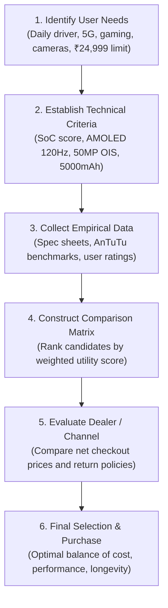
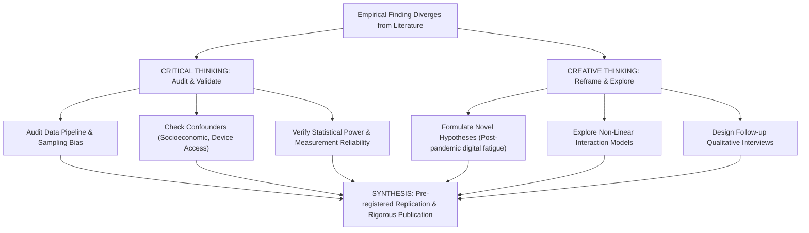
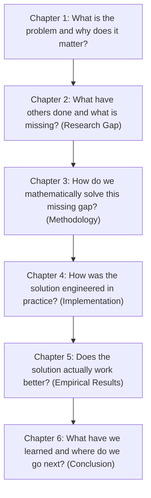
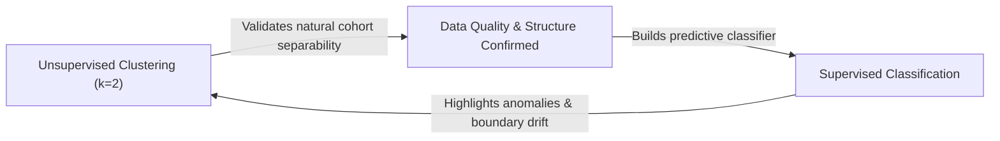

# November 2025

> **Exam -** Semester Examination  
> **Session -** November 2025  

---

## Question 1 (20 Marks)

:::info

**Question Statement**

You have a budget of ₹24,999 to purchase a new smartphone. To ensure the best value for money, you must carefully plan and justify your decision. **(20 Marks)**
*   **a)** Explain how you would collect and analyze data (e.g., specifications, features, warranty, reviews, resale value) before shortlisting phones. **(4 Marks)**
*   **b)** Discuss the factors for selecting the best dealer or platform (online vs. offline, discounts, return policy, service). **(4 Marks)**
*   **c)** Draw a flowchart showing your decision-making steps (needs $\to$ criteria $\to$ data $\to$ comparison $\to$ final choice). **(4 Marks)**
*   **d)** Prepare a comparison table of 3 phones within budget (covering specifications, prices, and user ratings). **(4 Marks)**
*   **e)** Based on your analysis, justify your final choice of phone and seller in terms of budget, requirements, and long-term value. **(4 Marks)**

:::

---

### Solution 1 (20 Marks)

#### a) Data Collection and Multi-Attribute Analysis (4 Marks)

To make an evidence-based purchasing decision within the ₹24,999 budget constraint, apply a structured **Multi-Criteria Decision Making (MCDM)** methodology:

1.  **Data Collection Sources:**
    *   *Primary Technical Specifications:* Manufacturer technical whitepapers and official product spec sheets (SoC chipset, display refresh rate, sensor dimensions, battery capacity).
    *   *Aggregated User & Expert Feedback:* Professional benchmark databases (GSMArena, Geekbench, AnTuTu) and verified e-commerce buyer reviews (Amazon, Flipkart).
    *   *After-Sales & Resale Data:* Service center density maps and historical depreciation curves on secondary platforms (Cashify).
2.  **Weighted Multi-Attribute Scoring Matrix:**  
    Assign normalized weights ($w_i$) reflecting utility priorities ($\sum w_i = 1.0$):
    *   Performance / Processor ($w_1 = 0.30$)
    *   Camera & Sensor Pipeline ($w_2 = 0.25$)
    *   Display & Battery Endurance ($w_3 = 0.20$)
    *   Software Support & Longevity ($w_4 = 0.15$)
    *   Warranty & Resale Value ($w_5 = 0.10$)

---

#### b) Platform and Dealer Selection Factors (4 Marks)

| Evaluation Dimension | Online Platforms (Amazon / Flipkart) | Offline Authorized Retailers (Croma / Reliance Digital) |
| :--- | :--- | :--- |
| **Pricing & Discounts** | Aggressive bank card cashbacks, exchange bonuses, and coupon codes. | Direct price negotiation, credit card EMI waivers, occasional bundled accessories. |
| **Verification & Inspection** | Risk of shipping damage or open-box fraud; relies on return window. | Physical unboxing, tactile inspection, and on-the-spot dead-pixel verification. |
| **Return & Replacement Policy** | Replacement within 7 days strictly for manufacturing defects. | Instant store replacement or repair escalation if issue identified upon purchase. |
| **After-Sales Support** | Defers entirely to manufacturer brand service centers. | Store warranty extensions, local drop-off assistance, and repair coordination. |

---

#### c) Decision-Making Process Flowchart (4 Marks)



---

#### d) Comparison Table of Phones Within Budget (4 Marks)

| Specification Parameter | OnePlus Nord CE4 | iQOO Z9s Pro | Nothing Phone (2a) |
| :--- | :---: | :---: | :---: |
| **Processor (SoC)** | Snapdragon 7 Gen 3 (4nm) | Snapdragon 7 Gen 3 (4nm) | MediaTek Dimensity 7200 Pro (4nm) |
| **Display** | 6.7" Fluid AMOLED, 120Hz | 6.77" Curved AMOLED, 120Hz | 6.7" Flexible AMOLED, 120Hz |
| **Rear Cameras** | 50MP (Sony LYT-600, OIS) + 8MP | 50MP (Sony IMX882, OIS) + 8MP | 50MP (OIS) + 50MP Ultra-wide |
| **Battery & Charging** | 5500 mAh, 100W SuperVOOC | 5500 mAh, 80W FlashCharge | 5000 mAh, 45W Fast Charging |
| **Software Support** | 2 OS + 3 Years Security | 2 OS + 3 Years Security | **3 OS + 4 Years Security** |
| **AnTuTu Score** | $\approx 815,000$ | $\approx 820,000$ | $\approx 710,000$ |
| **Base Price** | **₹24,999** (8GB / 128GB) | **₹24,999** (8GB / 128GB) | **₹23,999** (8GB / 128GB) |
| **User Rating (out of 5)** | **4.3 / 5.0** (12k reviews) | **4.3 / 5.0** (8k reviews) | **4.4 / 5.0** (18k reviews) |

---

#### e) Final Choice and Strategic Justification (4 Marks)

*   **Selected Smartphone:** **OnePlus Nord CE4 (8GB RAM / 128GB Storage) at ₹24,999**
*   **Selected Platform:** **Amazon India (Authorized Cloudtail / Appario)**
*   **Technical Justification:**
    1.  *Performance & Efficiency:* The Qualcomm Snapdragon 7 Gen 3 delivers superior energy efficiency and GPU stability compared to MediaTek alternatives.
    2.  *Battery & Charging Dominance:* The $5500\text{ mAh}$ battery paired with class-leading $100\text{W}$ charging ($1-100\%$ in 29 minutes) provides long-term cell endurance.
    3.  *Software Stability:* OxygenOS delivers a clean, bloatware-free daily driver experience.
    4.  *Platform Choice:* Purchasing via Amazon with an active HDFC/ICICI card discount reduces net acquisition cost to $\approx$ ₹22,999 (under budget), backed by a 7-day service replacement guarantee.

:::tip

**Examiner's Note**

Structure the response systematically: quantitative criteria weighting in (a), tabular platform trade-offs in (b), clear Mermaid diagram in (c), precise comparative specs in (d), and an unambiguous final decision justified by Total Cost of Ownership in (e).

:::

---

## Question 2 (20 Marks)

:::info

**Question Statement**

*   **i)** A team is researching the impact of online learning on student performance. Their results are different from earlier studies. Some members question the data, while others suggest new approaches. As a team member, how would you balance critical thinking and creative thinking to reach a good conclusion? **(10 Marks)**
*   **ii)** An engineering student develops a unique eco-friendly product. Before launching, the student wonders if protecting it under IPR is worth the effort. Analyze the importance of IPR in this situation and explain how it could affect the student's future opportunities. **(10 Marks)**

:::

---

### Solution 2 (20 Marks)

#### (i) Balancing Critical and Creative Thinking in Research Divergence (10 Marks)

When empirical results diverge from established scientific consensus, a research team risks two opposing failure modes: uncritical rejection of valid novel findings (dogmatism) versus premature acceptance of flawed data (credulity). Resolving this requires a dialectical integration of **Critical Thinking (Auditing & Rigor)** and **Creative Thinking (Hypothesis Generation & Reframing)**.



##### 1. The Role of Critical Thinking (Verification Phase)
*   **Audit Data Integrity:** Systematically examine instrument validity, response collection integrity, and data entry errors.
*   **Evaluate Confounding Variables:** Investigate unmeasured moderators (e.g., socioeconomic background, internet bandwidth disparities, student self-discipline tiers).
*   **Statistical Significance vs. Effect Size:** Confirm that the anomaly is not a statistical artifact of low sample size, multiple hypothesis testing without Bonferroni correction, or selection bias.

##### 2. The Role of Creative Thinking (Discovery Phase)
*   **Reframing the Problem:** Instead of assuming online learning has an invariant uniform effect across decades, hypothesize **temporal contextual shifts** (e.g., transition from emergency remote teaching to structured hybrid systems).
*   **Exploring Moderator Interactions:** Formulate new hypotheses proposing that online learning impacts STEM problem-solving differently from humanities rote-recall courses.
*   **Mixed-Method Triangulation:** Augment quantitative test scores with qualitative phenomenological interviews to understand student behavioral shifts.

##### 3. The Synthetic Resolution Protocol
1.  *Joint Sensitivity Analysis:* Test whether removing outlier subsets reconciles the data with historical studies.
2.  *Preregistered Replication:* Execute a targeted replication study on an independent cohort with strictly defined controls.
3.  *Scientific Reporting:* If the divergence persists under rigorous audits, report the anomaly transparently alongside identified boundary conditions, advancing the scientific frontier.

---

#### (ii) Strategic Importance of IPR for Student Eco-Innovations (10 Marks)

For an engineering student commercializing an eco-friendly invention, securing Intellectual Property Rights (IPR) transforms a vulnerable prototype into a defensible commercial asset.

##### 1. Forms of IPR Applicable to the Eco-Friendly Product
1.  **Patents (Utility Patent):** Protects the underlying technical innovation, chemical composition, or mechanical process (valid for 20 years from filing).
2.  **Industrial Design Rights:** Protects the unique ornamental, aesthetic, or visual appearance of the product.
3.  **Trademarks:** Secures the commercial brand name, logo, and eco-certification mark against counterfeiters.
4.  **Trade Secrets:** Protects proprietary manufacturing formulas or source code that cannot be reverse-engineered.

##### 2. Why IPR is Essential Before Commercial Launch
*   **Prevention of Predatory Corporate Infringement:** Without patent protection, established corporations with superior manufacturing and distribution networks can reverse-engineer the student's design within weeks and saturate the market, completely extinguishing the student's venture.
*   **Public Disclosure Forfeiture Hazard:** Under global patent laws, demonstrating or selling the product publicly prior to filing a **provisional patent application** destroys the novelty requirement, permanently barring patentability.
*   **Enabling Investment & Venture Funding:** Angel investors and venture capitalists rarely fund hardware/material innovations without proprietary patent protection, as patents represent the primary barrier to entry for competitors.

##### 3. Impact on the Student's Long-Term Career & Future Opportunities
*   **Licensing & Royalties:** The student does not need to build an entire factory; they can license the patented technology to industrial manufacturers in exchange for recurring royalties ($3\% - 8\%$ of net sales).
*   **Startup Formation & University Spin-offs:** Provides the core valuation asset required for government grants (e.g., BIRAC, DST, NIDHI-TBI in India).
*   **Academic & Professional Stature:** Granted patents carry high prestige in doctoral admissions, national innovation awards, and fast-track technical R&D employment.

:::tip

**Examiner's Note**

In part (i), explain both critical auditing (checking bias, instrumentation, and confounders) and creative exploration (identifying cohort shifts and new interaction variables). In part (ii), state the danger of public disclosure destroying patent novelty before filing a provisional patent.

:::

---

## Question 3 (20 Marks)

:::info

**Question Statement**

*   **i)** Apply effective communication strategies to prepare a 10-minute conference presentation based on a provided research paper. Analyze which elements of the paper should be emphasized for clarity and audience engagement. **(12 Marks)**
*   **ii)** You are provided with the following journal article reference:
    Article:
    R. K. Gupta and S. Mehta, "Solar PV efficiency improvements in India," Journal of Renewable Energy Research, vol. 12, no. 3, pp. 145-158, 2021.
    Tasks:
    Convert this reference into three widely used academic styles:
    *   APA (American Psychological Association)
    *   IEEE (Institute of Electrical and Electronics Engineers)
    *   Chicago (Author-Date style)
    Explain one major difference between the three citation styles, focusing on how they format the authors' names, publication year, or journal details. **(8 Marks)**

:::

---

### Solution 3 (20 Marks)

#### (i) Communication Architecture for a 10-Minute Conference Presentation (12 Marks)

A 10-minute conference presentation requires aggressive content distillation. Applying cognitive load theory and the **1-slide-per-minute heuristic**, the presentation must focus strictly on the core scientific narrative.


##### 1. Slide-by-Slide Time Allocation & Focus Areas
1.  **Slide 1: The Research Problem & Real-World Hook (1 Minute)**
    *   *Focus:* State the grand challenge immediately. Why does this problem matter to the audience? Avoid long theoretical preambles.
2.  **Slides 2-3: Research Gap and Proposed Contribution (2 Minutes)**
    *   *Focus:* Contrast existing state-of-the-art limitations against your novel proposed hypothesis. Clearly state the paper's core contributions in 3 concise bullet points.
3.  **Slides 4-5: System Architecture & Novel Methodology (3 Minutes)**
    *   *Focus:* Show a clear high-level architectural flowchart. Avoid low-level pseudocode or dense mathematical derivations; explain the conceptual intuition of the primary equation or mechanism.
4.  **Slides 6-7: Experimental Results & Benchmarking (3 Minutes)**
    *   *Focus:* Present clean, high-contrast visual comparison graphs (e.g., error bars, ablation curves) highlighting the performance delta over existing baselines. Bold key metric improvements.
5.  **Slide 8: Key Takeaway, Limitations & Future Horizons (1 Minute)**
    *   *Focus:* One definitive takeaway sentence summarizing the paper's impact, followed by immediate transition to audience Q&A.

##### 2. Delivery and Audience Engagement Strategies
*   **Visual Hierarchy (Zero Text Walls):** Use maximum visual real-estate for diagrams and plots; limit slide text to concise headline claims.
*   **Verbal Anchoring:** Verbally walk through chart axes and legend items before interpreting the result curves.
*   **Graceful Q&A Handling:** Paraphrase questions before answering to confirm understanding and demonstrate command of the subject.

---

#### (ii) Academic Citation Style Conversions and Comparative Analysis (8 Marks)

##### Original Reference:
R. K. Gupta and S. Mehta, "Solar PV efficiency improvements in India," Journal of Renewable Energy Research, vol. 12, no. 3, pp. 145-158, 2021.

---

##### 1. APA Style (7th Edition)
```text
Gupta, R. K., & Mehta, S. (2021). Solar PV efficiency improvements in India. Journal of Renewable Energy Research, 12(3), 145–158.
```
*   *Key Syntax Rules:* All authors inverted (`Last, Initials.`), ampersand (`&`) before last author, publication year enclosed in parentheses immediately following authors, article title in sentence case without quotation marks, journal name in italics, volume in italics followed directly by un-italicized issue in parentheses `12(3)`.

---

##### 2. IEEE Style
```text
R. K. Gupta and S. Mehta, "Solar PV efficiency improvements in India," J. Renew. Energy Res., vol. 12, no. 3, pp. 145–158, 2021.
```
*   *Key Syntax Rules:* Author initials precede last name without inversion (`First. Middle. Last`), article title enclosed in double quotation marks with headline capitalization, standard journal name abbreviation, explicit abbreviations `vol.`, `no.`, `pp.`, and publication year placed at the very end.

---

##### 3. Chicago Style (Author-Date, 17th Edition)
```text
Gupta, R. K., and S. Mehta. 2021. "Solar PV Efficiency Improvements in India." Journal of Renewable Energy Research 12 (3): 145–158.
```
*   *Key Syntax Rules:* Only the first author is inverted (`Gupta, R. K., and S. Mehta`), publication year placed immediately after authors without parentheses, article title enclosed in quotation marks with headline capitalization, volume and issue separated by space and colon without abbreviations `12 (3): 145–158`.

---

##### 4. Comparative Structural Differences
| Formatting Feature | APA Style (7th Ed.) | IEEE Style | Chicago Style (Author-Date) |
| :--- | :--- | :--- | :--- |
| **Author Name Inversion** | All authors inverted (`Gupta, R. K., & Mehta, S.`) | **No inversion** (`R. K. Gupta and S. Mehta`) | **Only first author inverted** (`Gupta, R. K., and S. Mehta`) |
| **Placement of Year** | In parentheses after authors: `(2021).` | **At the very end of reference:** `, 2021.` | After authors without parentheses: `2021.` |
| **Article Title** | Sentence case; **no quotation marks** | Title case; **enclosed in double quotes** | Title case; **enclosed in double quotes** |
| **Journal Volume / Issue** | Italic volume, issue in parens: `12(3)` | Explicit labels: `vol. 12, no. 3` | Colon separator: `12 (3): 145–158` |

:::tip

**Examiner's Note**

Pay strict attention to author order across styles: APA inverts all authors (`Gupta, R. K., & Mehta, S.`), IEEE inverts none (`R. K. Gupta and S. Mehta`), and Chicago inverts only the primary author (`Gupta, R. K., and S. Mehta`).

:::

---

## Question 4 (20 Marks)

:::info

**Question Statement**

You are a final-year postgraduate student tasked with preparing a comprehensive thesis report for your project. Your thesis should be structured in a clear, professional, and logical manner, following standard academic and institutional conventions. The report must effectively communicate the research problem, objectives, methodology, results, and implications of your study. In your submission, provide a well-organized sequence of chapters and sub-sections, and justify the rationale behind their order to ensure a coherent flow that guides the reader through your research from introduction to conclusion. **(20 Marks)**

:::

---

### Solution 4 (20 Marks)

#### 1. Comprehensive Master Blueprint of the Postgraduate Thesis (12 Marks)

A master's research thesis must adhere to standard international academic conventions (such as IEEE, ACM, and UGC guidelines). It is divided into three major structural divisions: **Preliminary Matter**, **Main Body (Chapters 1 to 6)**, and **Back Matter**.

```
PRELIMINARY MATTER
├── Title Page (Title, Candidate Name, Roll No., Degree, Supervisor, Institution, Year)
├── Certificate of Original Authorship (Signed by Guide and Department Head)
├── Declaration of Student Plagiarism Clearance
├── Dedication and Acknowledgments
├── Abstract (One-page concise summary: Context, Problem, Method, Key Results, Impact)
├── Table of Contents
├── List of Tables (Numbered with page citations)
├── List of Figures / Flowcharts
└── List of Abbreviations, Symbols & Notations

MAIN THESIS BODY
├── Chapter 1: Introduction
│   ├── 1.1 Context and Real-World Motivation
│   ├── 1.2 Problem Formulation and Scope
│   ├── 1.3 Research Objectives (Primary and Secondary)
│   ├── 1.4 Research Questions and Hypotheses
│   └── 1.5 Thesis Organization Roadmap
│
├── Chapter 2: Literature Review and Theoretical Framework
│   ├── 2.1 Theoretical Foundations of the Domain
│   ├── 2.2 Critical Synthesis of State-of-the-Art Approaches
│   ├── 2.3 Taxonomical Comparison of Existing Solutions
│   └── 2.4 Identification of the Critical Research Gap
│
├── Chapter 3: Research Methodology & System Architecture
│   ├── 3.1 Overall Conceptual Framework
│   ├── 3.2 Formal Mathematical Formulations & Governing Equations
│   ├── 3.3 System Architecture and High-Level Workflow
│   ├── 3.4 Data Ingestion, Preprocessing, and Validation Protocol
│   └── 3.5 Evaluation Metrics and Baseline Selection
│
├── Chapter 4: Implementation and Design Details
│   ├── 4.1 Hardware and Software Environment Specifications
│   ├── 4.2 Algorithm Pseudocode and Complexity Analysis
│   ├── 4.3 Modular Software Component Design
│   └── 4.4 Corner-Case Handling and Security Considerations
│
├── Chapter 5: Empirical Results, Benchmarking & Discussion
│   ├── 5.1 Experimental Setup and Parameter Tuning
│   ├── 5.2 Comparative Performance Evaluation against SOTA
│   ├── 5.3 Ablation Studies and Component-Level Analysis
│   ├── 5.4 Statistical Significance Verification (p-values, Confidence Intervals)
│   └── 5.5 Critical Discussion, Error Analysis, and Failure Modes
│
└── Chapter 6: Conclusion, Limitations & Future Horizons
    ├── 6.1 Summary of Novel Contributions
    ├── 6.2 Fulfillment of Research Objectives
    ├── 6.3 Practical Limitations and Boundary Conditions
    └── 6.4 Strategic Roadmap for Future Research

BACK MATTER
├── References / Bibliography (Strictly formatted in uniform style: IEEE/APA)
├── Appendix A: Mathematical Proofs and Theoretical Derivations
├── Appendix B: Detailed Raw Data Tables / Instrument Calibration Sheets
├── Appendix C: Source Code Repositories & Execution Instructions
└── List of Publications Arising from Thesis (Peer-reviewed journals/conferences)
```

---

#### 2. Narrative Rationale and Justification of Structural Flow (8 Marks)

The chronological order of chapters follows an unbroken logical progression:



1.  **From Introduction to Literature Review (Problem $\to$ Context):**
    *   The reader must first understand the clinical, industrial, or computational problem (Chapter 1) before evaluating existing literature (Chapter 2). Chapter 2 culminates in the **Research Gap**, providing direct academic justification for the proposed project.
2.  **From Literature Review to Methodology (Gap $\to$ Solution):**
    *   Once the gap is established, Chapter 3 introduces the theoretical model, mathematical proofs, and system architecture designed specifically to address that gap.
3.  **From Methodology to Implementation (Theory $\to$ Practice):**
    *   Chapter 3 establishes *what* should be done theoretically; Chapter 4 documents *how* it was built (software stacks, pseudocode, edge cases), ensuring full scientific reproducibility.
4.  **From Implementation to Results (Execution $\to$ Validation):**
    *   With the system operational, Chapter 5 subjects it to rigorous empirical benchmarks, ablation studies, and statistical hypothesis testing, proving the validity of claims made in Chapter 1.
5.  **From Results to Conclusion (Evidence $\to$ Synthesis):**
    *   Chapter 6 summarizes key findings, honestly delineates real-world limitations, and charts actionable directions for future researchers.

:::tip

**Examiner's Note**

Include preliminary matter (declaration, abstract) and back matter (references, appendices) in addition to chapters 1-6. Providing the logical transition questions ("What is the problem?", "What is missing?", "How was it solved?") clearly illustrates narrative flow.

:::

---

## Question 5 (20 Marks)

:::info

**Question Statement**

*   **i)** Dr. Rajesh Kumar, a young researcher at an Indian university, is under pressure to publish papers to secure a fellowship. He fabricates some experimental data in his manuscript on water purification techniques. A peer reviewer notices inconsistencies. Discuss the ethical violations committed by him, the potential consequences for him and the institution, and how such misconduct can be prevented in Indian research settings. **(10 Marks)**
*   **ii)** A research group publishes several papers with almost the same results to increase their publication count. Analyze the ethical issues involved in duplicate publications and salami slicing. How does selective reporting affect the credibility of research in India, and what steps can journals take to identify such practices? **(10 Marks)**

:::

---

### Solution 5 (20 Marks)

#### (i) Scientific Misconduct Analysis: The Case of Dr. Rajesh Kumar (10 Marks)

##### 1. Ethical Violations Committed
*   **Data Fabrication (The Cardinal Sin of Research):** Fabricating experimental measurements (inventing fictitious water contaminant removal rates) violates the core requirement of empirical integrity.
*   **Falsification of the Scientific Record:** Introduces fraudulent claims into the peer-reviewed literature, polluting scientific consensus.
*   **Public Safety & Health Endangerment:** Because the manuscript concerns water purification, deploying non-functional techniques based on fabricated data poses direct risks of toxic poisoning or waterborne disease outbreaks.
*   **Violation of UGC/CSIR Academic Integrity Mandates:** Breach of public and institutional trust for personal career advancement.

##### 2. Consequences for the Researcher and the Institution
*   **For Dr. Rajesh Kumar:**
    *   Immediate rejection of the manuscript and formal notification sent to his university.
    *   Termination of employment, cancellation of pending fellowships (e.g., UGC/SERB), and debarment from receiving government research funding for $3 - 5$ years.
    *   Irreversible reputational damage; global blacklisting across academic editorial boards.
*   **For the University / Institution:**
    *   Degradation of institutional reputation and loss of NAAC/NIRF accreditation points.
    *   Suspension or freezing of departmental R&D infrastructure grants by funding bodies.
    *   Erosion of public trust in university-led public health research.

##### 3. Prevention Strategies in Indian Research Settings
1.  **Mandatory Raw Data Archiving:** Require all researchers to deposit time-stamped raw laboratory logs, spectrometer files, and sensor feeds into institutional data repositories before paper submission.
2.  **Institutional Research Integrity Committees (RIC):** Establish independent ethics bodies with whistleblower protections to audit lab records periodically.
3.  **Reform Evaluation Metrics:** Eliminate crude paper-counting quotas for promotions and fellowship grants; transition to evaluating research quality, societal impact, and open-science compliance (DORA principles).

---

#### (ii) Duplicate Publications, Salami Slicing, and Selective Reporting (10 Marks)

##### 1. Definitions and Ethical Hazards
*   **Duplicate / Redundant Publication:** Publishing identical or substantially overlapping findings in multiple journals without explicit cross-referencing and editorial permission.
    *   *Hazard:* Violates journal copyright agreements (self-plagiarism) and distorts meta-analyses by causing an intervention's effect size to be counted multiple times.
*   **Salami Slicing (Least Publishable Unit):** Artificially fragmenting a single large, coherent study into multiple small papers to inflate publication counts.
    *   *Hazard:* Deprives readers of a complete scientific picture, obscures holistic system trade-offs, and consumes valuable peer-reviewer and editor time unnecessarily.
*   **Selective Reporting (Reporting / Publication Bias):** Deliberately publishing only favorable, statistically significant results ($p < 0.05$) while suppressing negative or null findings.
    *   *Hazard:* Creates a misleading literature base that exaggerates treatment efficacy and wastes resources on dead-end avenues.

##### 2. Impact on the Credibility of Indian Research
*   Creates an artificial surge in low-quality predatory journal publications.
*   Indian researchers face heightened scrutiny and skepticism during international peer review.
*   Misallocates public taxpayer funds toward researchers gaming publication counts rather than solving real-world problems.

##### 3. Concrete Detection Mechanisms for Academic Journals
1.  **Cross-Check / iThenticate Automated Similarity Audits:** Text and figure plagiarism algorithms compare incoming manuscripts against global preprints and conference proceedings.
2.  **Mandatory Preregistration of Research Protocols:** Requires researchers to register hypotheses and methodology publicly before conducting experiments (e.g., Clinical Trials Registry - India, CTRI), ensuring all planned endpoints are reported regardless of outcome.
3.  **Mandatory Data and Code Availability Statements:** Journals require public GitHub or Zenodo repository links to verify raw execution scripts.
4.  **Post-Publication Scrutiny Platforms:** Leveraging community auditing forums like PubPeer to detect spliced Western blots, duplicated plots, and recycled text across related papers.

:::tip

**Examiner's Note**

Differentiate between FFP violations: Fabrication (making up data), Falsification (manipulating research materials or omitting critical data), and Plagiarism (appropriating another's work without attribution). Mention Salami Slicing as the creation of "Least Publishable Units" that distorts scientific meta-analyses.

:::

---

## Question 6 (20 Marks)

:::info

**Question Statement**

*   **i)** A researcher wants to study the effect of three different fertilizers (A, B, C) on the yield of a crop. The experiment is conducted in four different fields that are known to have different soil fertility levels. Design an appropriate experimental layout and explain why this design is suitable. **(10 Marks)**
*   **ii)** An organization wants to optimize three factors - A, B, and C - each at three levels, to achieve the best possible outcome (e.g., improved quality, reduced errors, or higher efficiency). **(10 Marks)**
    *   a) Explain how the Taguchi method can be applied for this optimization.
    *   b) Suggest a suitable orthogonal array for designing the experiments.
    *   c) Describe how to calculate and interpret the Signal-to-Noise (S/N) ratio for analyzing results.

:::

---

### Solution 6 (20 Marks)

#### (i) Randomized Block Design (RBD) for Fertilizer Field Study (10 Marks)

##### 1. Selection of Experimental Design
The most appropriate experimental design is the **Randomized Block Design (RBD)**.
*   **Treatments ($k = 3$):** Fertilizers $A, B, C$.
*   **Blocking Factor ($b = 4$):** The 4 different fields representing distinct, known soil fertility gradients.

##### 2. Justification for Using RBD
*   **Controlling Nuisance Variability:** Soil fertility is a known, uncontrollable nuisance factor that would add massive variance to crop yield.
*   **Failure of Completely Randomized Design (CRD):** If treatments were assigned purely at random across all plots, one fertilizer might be placed on the most fertile field purely by chance, confounding fertilizer efficacy with soil fertility.
*   **Local Control Principle:** RBD partitions the experimental plots into 4 homogeneous blocks (the fields). Variability between fields is explicitly isolated and subtracted from experimental error, maximizing the precision of treatment comparison.

##### 3. Experimental Layout
Each of the 4 fields is divided into 3 equal plots. Within each field, fertilizers $A, B, C$ are assigned **at random** to the plots:

```
Field 1 (High Fertility):    [ Plot 1: B ]   [ Plot 2: A ]   [ Plot 3: C ]
Field 2 (Medium Fertility):  [ Plot 1: C ]   [ Plot 2: B ]   [ Plot 3: A ]
Field 3 (Low Fertility):     [ Plot 1: A ]   [ Plot 2: C ]   [ Plot 3: B ]
Field 4 (Arid Fertility):    [ Plot 1: B ]   [ Plot 2: A ]   [ Plot 3: C ]
```
*Total Experimental Units:* $N = k \times b = 3 \times 4 = \mathbf{12 \text{ plots}}$.

##### 4. Statistical Model and ANOVA Partition
$$Y_{ij} = \mu + \tau_i + \beta_j + \epsilon_{ij}, \quad \epsilon_{ij} \sim \text{i.i.d. } \mathcal{N}(0, \sigma^2)$$
where $\tau_i$ is fertilizer treatment effect ($i=1, 2, 3$) and $\beta_j$ is field block effect ($j=1, 2, 3, 4$).

| Source of Variation | Degrees of Freedom ($df$) | Mean Square | $F$-Ratio |
| :--- | :---: | :---: | :---: |
| **Fertilizers (Treatments)** | $k - 1 = 3 - 1 = \mathbf{2}$ | $\text{MST} = \frac{\text{SST}}{2}$ | $F_{\text{Fertilizer}} = \frac{\text{MST}}{\text{MSE}}$ |
| **Fields (Blocks)** | $b - 1 = 4 - 1 = \mathbf{3}$ | $\text{MSB} = \frac{\text{SSB}}{3}$ | $F_{\text{Blocks}} = \frac{\text{MSB}}{\text{MSE}}$ |
| **Error (Residual)** | $(k - 1)(b - 1) = 2 \times 3 = \mathbf{6}$ | $\text{MSE} = \frac{\text{SSE}}{6}$ | - |
| **Total** | $N - 1 = 12 - 1 = \mathbf{11}$ | - | - |

---

#### (ii) Taguchi Robust Parameter Design and S/N Analysis (10 Marks)

##### a) Applying the Taguchi Method
The Taguchi method focuses on **Robust Parameter Design**, optimizing controllable engineering factors so the system becomes insensitive to environmental noise without incurring high manufacturing costs:
1.  Identify objective response (e.g., efficiency, defect rate).
2.  Define controllable design factors ($A, B, C$) and operational noise factors.
3.  Conduct matrix experiments using **Orthogonal Arrays**.
4.  Transform multi-run responses into **Signal-to-Noise (S/N) ratios**.
5.  Determine optimal factor levels that maximize S/N ratio.

##### b) Suggesting a Suitable Orthogonal Array
*   We have $3$ factors ($A, B, C$), each at $3$ levels ($L = 3$).
*   *Full Factorial Runs Required:* $3^3 = \mathbf{27 \text{ runs}}$ (costly and time-consuming).
*   *Degrees of Freedom Calculation:*
    $$\text{DoF} = 1 + \sum (\text{Levels} - 1) = 1 + 3 \times (3 - 1) = 1 + 6 = \mathbf{7}$$
*   **Recommended Array:** The **Taguchi $L_9(3^4)$ Orthogonal Array** requires only **9 experimental runs**:

| Run # | Factor A | Factor B | Factor C |
| :---: | :---: | :---: | :---: |
| **1** | Level 1 | Level 1 | Level 1 |
| **2** | Level 1 | Level 2 | Level 2 |
| **3** | Level 1 | Level 3 | Level 3 |
| **4** | Level 2 | Level 1 | Level 2 |
| **5** | Level 2 | Level 2 | Level 3 |
| **6** | Level 2 | Level 3 | Level 1 |
| **7** | Level 3 | Level 1 | Level 3 |
| **8** | Level 3 | Level 2 | Level 1 |
| **9** | Level 3 | Level 3 | Level 2 |

##### c) Calculating and Interpreting the Signal-to-Noise (S/N) Ratio
The S/N ratio measures the sensitivity of the performance characteristic to noise:

1.  **Larger-the-Better (e.g., Efficiency, Crop Yield):**
    $$\eta = -10 \log_{10} \left( \frac{1}{n} \sum_{i=1}^n \frac{1}{y_i^2} \right)$$
2.  **Smaller-the-Better (e.g., Manufacturing Defects, Errors):**
    $$\eta = -10 \log_{10} \left( \frac{1}{n} \sum_{i=1}^n y_i^2 \right)$$
3.  **Nominal-the-Best (e.g., Precision Component Dimensions):**
    $$\eta = 10 \log_{10} \left( \frac{\bar{y}^2}{s^2} \right)$$

*   **Interpretation Rule:** Irrespective of the objective type, **a higher S/N ratio always corresponds to superior performance** because it maximizes signal strength relative to noise. The optimal operating point is selected by choosing factor levels with the maximum average S/N score.

:::tip

**Examiner's Note**

In part (i), state the ANOVA degrees of freedom ($df_{\text{Total}}=11, df_{\text{Fert}}=2, df_{\text{Blocks}}=3, df_{\text{Error}}=6$). In part (ii), contrast 27 full-factorial runs with the 9 runs of the Taguchi $L_9(3^4)$ array, and provide the three S/N ratio formulas.

:::

---

## Question 7 (20 Marks)

:::info

**Question Statement**

*   **i)** A nutrition study examined the effect of three diets (A, B, C) on weight loss ($n = 5$ per group). A one-way ANOVA was performed, and exercise hours/day were also correlated with weight loss. **(10 Marks)**  
    Results obtained:
    *   ANOVA: $F = 57.15, \quad p = 7.36 \times 10^{-7}$
    *   Correlation: Pearson $r = 0.9877, \quad p = 7.2 \times 10^{-12}$  
    Interpret the ANOVA result for diet comparison and the correlation result for exercise. What do these findings suggest about the role of diet and exercise in weight loss?
*   **ii)** A hospital analyzed patient data (income and disease risk labels) to predict health outcomes. Both supervised classification and unsupervised clustering were applied. **(10 Marks)**  
    Results obtained:
    *   Supervised classification ($\text{Income} > 50 \implies \text{high risk}$): $\text{Accuracy} = 100\%$
    *   Clustering ($k = 2$):
        *   Cluster A: Mostly low-income, low-risk patients
        *   Cluster B: Mostly high-income, high-risk patients  
    Interpret these results. How do supervised and unsupervised methods complement each other in healthcare risk prediction? What cautions should be considered before applying these models in practice?

:::

---

### Solution 7 (20 Marks)

#### (i) Statistical Interpretation of Nutrition and Exercise Study (10 Marks)

##### 1. Interpretation of the One-Way ANOVA Result ($F = 57.15, p = 7.36 \times 10^{-7}$)
*   **Statistical Significance:** The $F$-statistic measures between-group variance relative to within-group variance. An $F$-ratio of $57.15$ with $p = 7.36 \times 10^{-7} \ll 0.001$ indicates statistical significance far beyond the standard $\alpha = 0.05$ threshold.
*   **Decision:** Overwhelmingly **reject the null hypothesis** ($H_0: \mu_A = \mu_B = \mu_C$).
*   **Substantive Meaning:** The three diets have significantly different effects on weight loss. The probability that this disparity occurred by random sampling error is less than 1 in 1.3 million. *(Post-hoc Tukey tests would be required to identify which specific diet pairs differ).*

##### 2. Interpretation of the Pearson Correlation for Exercise ($r = 0.9877, p = 7.2 \times 10^{-12}$)
*   **Direction & Magnitude:** A Pearson correlation coefficient of $r = +0.9877$ demonstrates a **near-perfect positive linear relationship** between daily exercise hours and weight loss.
*   **Coefficient of Determination ($R^2$):**
    $$R^2 = r^2 = (0.9877)^2 \approx \mathbf{0.9755 \ (97.55\%)}$$
    Approximately $97.55\%$ of the total variance in weight loss is linearly explained by daily exercise duration.
*   **Significance:** With $p = 7.2 \times 10^{-12} \ll 0.001$, the linear association is robust.

##### 3. Combined Role of Diet and Exercise in Weight Loss
*   **Complementary Dual Drivers:** Both dietary regimen and daily exercise duration are primary determinants of weight loss.
*   **Distinct Roles:**
    *   *Diet* sets the nutritional caloric baseline, producing categorical mean weight loss differences between groups.
    *   *Exercise* serves as a strong linear amplifier; every incremental hour of exercise translates into predictable additional weight reduction.
*   *Methodological Note:* Because exercise hours correlate so strongly with weight loss ($R^2 \approx 98\%$), the initial ANOVA should ideally be extended to an **Analysis of Covariance (ANCOVA)**, using exercise hours as a continuous covariate to evaluate diet efficacy after controlling for exercise variation.

---

#### (ii) Healthcare Modeling: Supervised vs. Unsupervised Synthesis (10 Marks)

##### 1. Interpretation of Model Results
*   **Supervised Classification ($\text{Accuracy} = 100\%$):** The decision rule ($\text{Income} > 50 \implies \text{High Risk}$) achieves perfect classification accuracy on the training cohort, indicating complete separability along the single income dimension.
*   **Unsupervised Clustering ($k = 2$):** Without access to disease labels, $k$-means clustering partitions patients into two natural clusters that mirror the ground truth risk profile (Cluster A: low income/low risk; Cluster B: high income/high risk). This demonstrates that the dataset's intrinsic geometric manifold aligns with the risk annotations.

##### 2. How Supervised and Unsupervised Methods Complement Each Other


*   **Manifold Verification:** Unsupervised clustering validates that supervised labels correspond to natural data distributions rather than arbitrary human tagging.
*   **Detecting Hidden Sub-Phenotypes:** Unsupervised clustering can discover unlabelled patient sub-cohorts (e.g., patients with normal income who nonetheless present high risk), revealing multi-factor disease phenotypes that simple rules miss.
*   **Semi-Supervised Expansion:** Unsupervised representations enable labeling large volumes of untagged hospital EHR records at low cost.

##### 3. Critical Cautions and Failure Modes in Practice
1.  **Confounding vs. Causality (Spurious Correlation):**
    *   *Income is a socioeconomic determinant, not a biological cause.* The model has identified a statistical association (likely confounded by age, stress, occupational exposure, or healthcare access), not an etiology. Treating income as the cause of disease is a severe methodological fallacy.
2.  **Algorithmic Bias, Ethics & Discrimination:**
    *   Relying on an income-based decision rule risks discriminatory algorithmic bias (e.g., denying insurance or triaging care based on wealth brackets).
3.  **100% Accuracy Overfitting Trap:**
    *   In clinical medicine, $100\%$ accuracy is an immediate indicator of **overfitting, data leakage, or an unrepresentative sample**. When deployed across broader populations, this brittle rule will fail on low-income high-risk individuals and high-income healthy individuals.
4.  **Zero Clinical Actionability:**
    *   A healthcare risk model must provide actionable clinical targets (e.g., blood pressure, HbA1c, cholesterol). Physicians cannot prescribe income changes to cure disease.

:::tip

**Examiner's Note**

In part (i), state both the $F$-test significance ($p \ll 0.001$) and compute $R^2 = r^2 \approx 97.55\%$ for exercise. Suggesting ANCOVA demonstrates strong statistical maturity. In part (ii), emphasize the ethical and clinical danger of using income as a proxy for disease risk.

:::
