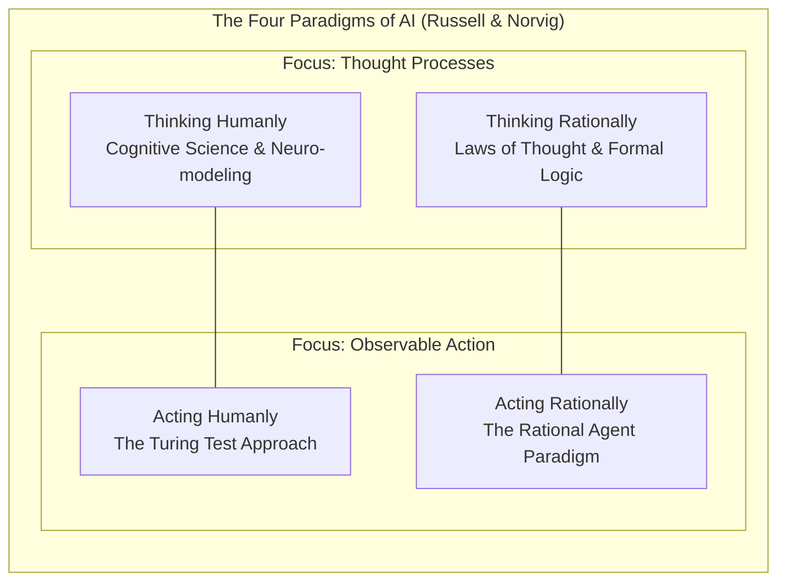
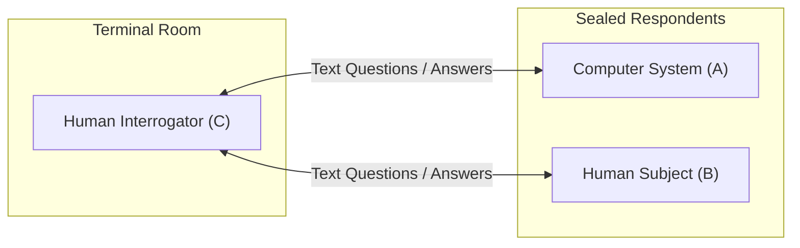
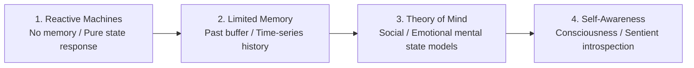

import Tabs from '@theme/Tabs';
import TabItem from '@theme/TabItem';
import Heading from '@theme/Heading';
import React from 'react';

# Introduction to AI

> **Topic -** Artificial Intelligence (AI) is the computational study and engineering of systems capable of performing tasks that typically demand biological intelligence. This guide surveys historical developments from 1950s symbolic roots to modern machine learning, formal definitions structured across the human-versus-rational spectrum, the Turing Test benchmark, and the structural taxonomy of AI systems.

---

## 1. Defining Artificial Intelligence

The term **Artificial Intelligence** was officially coined in 1956 by American computer scientist **John McCarthy** at the Dartmouth Summer Research Project on Artificial Intelligence. At its core, human intelligence encompasses multiple interdependent faculties:

*   **Reasoning:** Formulating valid deductions and decisions from premises.
*   **Learning:** Adapting behavior based on previous experience and data.
*   **Perception:** Extracting structured meaning from sensory inputs (visual, acoustic, textual).
*   **Problem Solving:** Navigating from an initial state to a desired goal state when the intermediate path is non-obvious.
*   **Linguistic Intelligence:** Comprehending and communicating complex ideas through structured symbolic language.

AI is an interdisciplinary field spanning computer science, mathematics, cognitive psychology, neuroscience, and control theory designed to replicate or exceed these faculties computationally.

### The Four Perspectives on AI

Historically, textbooks and researchers have defined AI along two fundamental axes: **Human Performance** versus **Rational Idealism**, applied to either **Thought Processes** or **Observable Behavior**. This yields Stuart Russell and Peter Norvig's canonical $2 \times 2$ matrix:

| Axis | Focus on Thought Process | Focus on Behavior |
| :--- | :--- | :--- |
| **Human-Centric** | **Thinking Humanly** Cognitive modeling: matching computational steps to human psychological and neurological data. | **Acting Humanly** The Turing Test approach: constructing machines that perform functions that require intelligence when executed by humans. |
| **Rational-Centric** | **Thinking Rationally** "Laws of Thought": formal syllogistic logic (Aristotle) that guarantees truth preservation under sound inference. | **Acting Rationally** The Rational Agent approach: designing systems that select actions expected to maximize goal achievement given available percepts. |

### The Rational Agent Advantage

While all four definitions have produced historically significant research paradigms, modern AI engineering overwhelmingly favors **Acting Rationally** (the rational agent paradigm):
1.  **General Scope:** Rationality is more general than formal logic. In environments with incomplete knowledge or stochastic uncertainty, deductive logic cannot produce a definitive action, but rational decision theory can calculate the action with the highest expected utility.
2.  **Scientific Standard:** Rational action is tied to mathematical optimization against a verifiable objective function rather than the idiosyncrasies, cognitive biases, and biological limitations of human cognition.

---

## 2. The Turing Test and Total Turing Test

Proposed in 1950 by British mathematician and computer pioneer **Alan Turing** in his landmark paper *"Computing Machinery and Intelligence"*, the Turing Test reframed the philosophical question *"Can machines think?"* into an empirical operational benchmark termed the **Imitation Game**.

### The Standard Turing Test Setup

A human interrogator is isolated in a separate room from two respondents: a human and a digital computer. Communication occurs entirely through a text-only teletype interface:

If the interrogator cannot reliably distinguish the computer from the human after a fixed duration of questioning, the computer passes the test and is deemed intelligent.

### Four Core Capabilities of the Turing Test

To pass the standard text-only Turing Test, a computing system must master four foundational branches of AI:

<Tabs>
  <TabItem value="nlp" label="1. Natural Language Processing" default>
     

    *   **Objective:** Enables the computer to parse, interpret, and generate fluent human natural language.
    *   **Core Challenge:** Disambiguating semantic intent, syntax variations, colloquial idioms, metaphors, and context-dependent meanings.
  </TabItem>
  <TabItem value="kr" label="2. Knowledge Representation">
     

    *   **Objective:** Storing internalized concepts, facts, assertions, and relational rules in memory.
    *   **Core Challenge:** Organizing structured knowledge (ontologies, knowledge graphs, relational logic) to permit efficient retrieval and update.
  </TabItem>
  <TabItem value="reasoning" label="3. Automated Reasoning">
     

    *   **Objective:** Using stored knowledge to answer questions, deduce new facts, and resolve logical contradictions.
    *   **Core Challenge:** Avoiding combinatorial explosion when traversing vast hypothesis spaces under deduction and abductive inference.
  </TabItem>
  <TabItem value="ml" label="4. Machine Learning">
     

    *   **Objective:** Extrapolating statistical patterns from past interactions and adapting to novel environments without manual reprogramming.
    *   **Core Challenge:** Generalizing out-of-distribution without overfitting or catastrophically forgetting past knowledge.
  </TabItem>
</Tabs>

### The Total Turing Test

The standard Turing Test deliberately avoids physical contact, focusing strictly on symbolic and linguistic intelligence. However, Alan Turing and subsequent researchers noted that a truly complete intelligence must interact directly with the physical world.

The **Total Turing Test** introduces a physical hatch or video terminal and requires two additional sensory-motor capabilities:
1.  **Computer Vision:** To perceive, segment, identify, and track physical three-dimensional objects and gestures in the environment.
2.  **Robotics & Manipulation:** To physically navigate spatial terrain and manipulate real-world objects using actuators.

---

## 3. Historical Milestones in AI

Artificial Intelligence developed through alternating waves of optimism, breakthrough milestones, and funding retrenchments known as **AI Winters**:

| Era | Key Milestone | Significance |
| :--- | :--- | :--- |
| **1943** | **Warren McCulloch & Walter Pitts** | Proposed the first mathematical model of an artificial neural network based on binary biological threshold units. |
| **1950** | **Alan Turing's "Computing Machinery and Intelligence"** | Formulated the Turing Test, machine learning, and genetic algorithms as viable paths to synthetic intelligence. |
| **1956** | **The Dartmouth Summer Research Conference** | John McCarthy, Marvin Minsky, Nathaniel Rochester, and Claude Shannon organized the seminal workshop where "Artificial Intelligence" became an academic discipline. |
| **1966** | **Joseph Weizenbaum creates ELIZA** | The first conversational natural language chatterbot, simulating a Rogerian psychotherapist via pattern matching. |
| **1972** | **WABOT-1 Robot (Waseda University)** | The world's first full-scale intelligent humanoid robot, featuring limb control, machine vision, and verbal dialogue. |
| **1974 - 1980** | **First AI Winter** | The Lighthill Report (UK) and DARPA cutbacks dried up funding due to intractable combinatorial search spaces in early toy problems. |
| **1980** | **Rise of Expert Systems** | Commercial resurgence driven by domain-specific knowledge bases and rule-based inference engines (e.g., R1/XCON at DEC). |
| **1987 - 1993** | **Second AI Winter** | Specialized Lisp machine workstation market collapsed under generic commodity x86 hardware; expert systems proved brittle and expensive to maintain. |
| **1997** | **IBM Deep Blue defeats Garry Kasparov** | First computer to defeat a reigning World Chess Champion under tournament time controls using massive parallel alpha-beta search. |
| **2002** | **iRobot Roomba** | AI enters consumer homes via an autonomous, obstacle-avoiding domestic vacuum cleaning robot. |
| **2011** | **IBM Watson Wins Jeopardy!** | Natural language processing, information retrieval, and automated reasoning defeat the greatest human champions on open-domain trivia. |
| **2012** | **AlexNet & Deep Learning Revolution** | Deep convolutional neural networks trained on GPUs drastically reduce error rates on ImageNet, inaugurating modern deep learning. |
| **2016** | **DeepMind AlphaGo defeats Lee Sedol** | Combines deep Monte Carlo Tree Search (MCTS) with value and policy networks to defeat an 18-time world Go champion (4-1). |

---

## 4. Taxonomy & Classification of AI Systems

AI architectures are classified according to two separate criteria: **Functional Sophistication** (their internal architecture and memory state) and **Capability Scope** (their domain breadth).

### Classification by Functional Architecture

<Tabs>
  <TabItem value="reactive" label="1. Reactive Machines" default>
     

    *   **Core Mechanism:** Have no internal memory and cannot store past experiences. They perceive the current world state directly and apply a fixed decision rule or evaluation function to select an action.
    *   **Operational Strength:** High speed and predictable mathematical behavior.
    *   **Limitation:** Incapable of learning or recalling previous iterations.
    *   **Classic Example:** IBM's Deep Blue (evaluates chessboard leaf nodes in real-time without remembering games played previously).
  </TabItem>
  <TabItem value="limited" label="2. Limited Memory">
     

    *   **Core Mechanism:** Incorporates internal memory buffers that store past observations, percepts, or training parameters over a designated time horizon.
    *   **Operational Strength:** Able to identify trends, evaluate dynamic environments, and update probabilistic models over time.
    *   **State of the Art:** All modern deep learning, self-driving vehicle systems (which track historical velocities of nearby cars), and Large Language Models belong to this category.
  </TabItem>
  <TabItem value="tom" label="3. Theory of Mind">
     

    *   **Core Mechanism:** An advanced theoretical class of AI capable of attributing mental states, beliefs, intents, desires, and emotions to other agents in the environment.
    *   **Operational Strength:** Allows seamless, collaborative social interaction and negotiation with humans.
    *   **State of the Art:** Active research frontier in social robotics and human-robot interaction (HRI).
  </TabItem>
  <TabItem value="selfaware" label="4. Self-Awareness">
     

    *   **Core Mechanism:** Hypothetical future systems possessing an internal model of their own existence, conscious awareness, and independent internal emotions.
    *   **State of the Art:** Entirely theoretical; no engineering framework currently exists.
  </TabItem>
</Tabs>

### Classification by Capability Scope

*   **Narrow AI (Weak AI):** Systems engineered, trained, and optimized for a single dedicated domain or task (e.g., medical image segmentation, chess engines, translation tools, facial recognition). While superhuman in their specialized domain, they cannot transfer skills to unrelated domains without total retraining. **All existing AI systems today are Narrow AI.**
*   **General AI (Strong AI / AGI):** Theoretical systems with human-equivalent cognitive adaptability. An AGI can autonomously generalize its knowledge, solve arbitrary novel tasks across multiple disciplines, and transfer abstract concepts without external guidance.
*   **Artificial Superintelligence (ASI):** A hypothetical synthetic intelligence that substantially exceeds human cognitive capacity across all scientific, creative, social, and strategic domains.

---

## 5. Interactive Archetype Explorer

Select an AI operational archetype below to inspect its governing paradigm, architectural requirements, and foundational benchmark:

export const ArchetypeExplorer = () => {
  const [activeKey, setActiveKey] = React.useState('actingRational');

  const archetypes = {
    actingHuman: {
      title: 'Acting Humanly (The Turing Test Paradigm)',
      focus: 'Observable Behavior vs. Human Standard',
      primaryMetric: 'Indistinguishability from human conversational output in blind interrogation.',
      requiredComponents: ['Natural Language Processing (NLP)', 'Knowledge Representation', 'Automated Reasoning', 'Machine Learning'],
      realWorldPioneers: 'Alan Turing (1950), Joseph Weizenbaum (ELIZA, 1966)',
      technicalInsight: 'Does not require replicating actual human neurological thought processes; success is measured purely on empirical behavioral mimicry.'
    },
    thinkingHuman: {
      title: 'Thinking Humanly (Cognitive Science Paradigm)',
      focus: 'Internal Thought Process vs. Human Cognition',
      primaryMetric: 'Correlation between program computational steps and human cognitive metrics (fMRI, reaction latency, error profiles).',
      requiredComponents: ['Introspection protocols', 'Psychological experimentation', 'Computational cognitive models (e.g., ACT-R, SOAR)'],
      realWorldPioneers: 'Allen Newell & Herbert Simon (General Problem Solver, 1957)',
      technicalInsight: 'Requires genuine empirical validation from experimental psychology to confirm that the internal algorithm mirrors human mental faculties.'
    },
    thinkingRational: {
      title: 'Thinking Rationally (The "Laws of Thought" Paradigm)',
      focus: 'Internal Thought Process vs. Ideal Logic',
      primaryMetric: 'Soundness and completeness of deductive conclusions derived from formal symbolic axioms.',
      requiredComponents: ['First-Order Predicate Logic', 'Inference engines', 'Formal theorem proving algorithms'],
      realWorldPioneers: 'Aristotle (Syllogisms), George Boole (Logic), Gottlob Frege',
      technicalInsight: 'Suffers severe operational limitations when real-world problems contain uncertain, informal, or noisy parameters that cannot be formulated into clean boolean axioms.'
    },
    actingRational: {
      title: 'Acting Rationally (The Rational Agent Paradigm)',
      focus: 'Observable Behavior vs. Expected Utility Optimization',
      primaryMetric: 'Expected performance score achieved across the task environment given available percept history.',
      requiredComponents: ['Sensors and Actuators', 'Utility functions', 'Search and Decision-Theoretic planning'],
      realWorldPioneers: 'John von Neumann (Game Theory), Stuart Russell & Peter Norvig',
      technicalInsight: 'The dominant engineering paradigm. Correct action does not require human-like thinking; it demands mathematical maximization of expected goal achievement.'
    }
  };

  const current = archetypes[activeKey];

  return (
    

      <h4 style={{ margin: '0 0 12px 0' }}>Interactive AI Paradigm Inspector</h4>
      

        Select a foundational AI definition to inspect its technical specification:
      

      

        <button
          onClick={() => setActiveKey('actingHuman')}
          style={{ padding: '6px 12px', borderRadius: '4px', border: '1px solid #3182ce', backgroundColor: activeKey === 'actingHuman' ? '#3182ce' : 'transparent', color: activeKey === 'actingHuman' ? '#fff' : 'var(--ifm-font-color-base)', cursor: 'pointer', fontSize: '12px' }}
        >
          Acting Humanly
        </button>
        <button
          onClick={() => setActiveKey('thinkingHuman')}
          style={{ padding: '6px 12px', borderRadius: '4px', border: '1px solid #3182ce', backgroundColor: activeKey === 'thinkingHuman' ? '#3182ce' : 'transparent', color: activeKey === 'thinkingHuman' ? '#fff' : 'var(--ifm-font-color-base)', cursor: 'pointer', fontSize: '12px' }}
        >
          Thinking Humanly
        </button>
        <button
          onClick={() => setActiveKey('thinkingRational')}
          style={{ padding: '6px 12px', borderRadius: '4px', border: '1px solid #3182ce', backgroundColor: activeKey === 'thinkingRational' ? '#3182ce' : 'transparent', color: activeKey === 'thinkingRational' ? '#fff' : 'var(--ifm-font-color-base)', cursor: 'pointer', fontSize: '12px' }}
        >
          Thinking Rationally
        </button>
        <button
          onClick={() => setActiveKey('actingRational')}
          style={{ padding: '6px 12px', borderRadius: '4px', border: '1px solid #38a169', backgroundColor: activeKey === 'actingRational' ? '#38a169' : 'transparent', color: activeKey === 'actingRational' ? '#fff' : 'var(--ifm-font-color-base)', cursor: 'pointer', fontSize: '12px', fontWeight: 'bold' }}
        >
          Acting Rationally (Standard)
        </button>
      

      

        

          {current.title}
        

        

          <b>Operational Dimension:</b> {current.focus}
        

        

          

            
Benchmark Criterion

            
{current.primaryMetric}

          

          

            
Key Pioneers

            
{current.realWorldPioneers}

          

        

        

          
Required Technical Subsystems:

          <ul style={{ margin: '0 0 0 20px', fontSize: '13px' }}>
            {current.requiredComponents.map((comp, idx) => (
              <li key={idx}>{comp}</li>
            ))}
          </ul>
        

        

          <b>Engineering Rationale:</b> {current.technicalInsight}
        

      

    

  );
};

<ArchetypeExplorer />

---

## 6. Exam Traps & Operational Nuances

<Tabs>
  <TabItem value="t1" label="1. Rationality vs. Omniscience" default>
     

    *   **The Misconception:** *"A rational agent makes perfect decisions and never experiences failure."*
    *   **The Academic Reality:** **Rationality is not omniscience.** An omniscient agent knows the *actual* outcome of its actions in advance and can act accordingly. A rational agent maximizes **expected success** given the percept sequence observed up to that instant.
    *   **Concrete Example:** If an autonomous vehicle enters an intersection with a green light and an undetected speeding vehicle runs a red light and causes a collision, the autonomous vehicle's decision was rational based on available sensor data, even though the actual outcome was adverse.
  </TabItem>
  <TabItem value="t2" label="2. Turing Test vs. Chinese Room">
     

    *   **The Misconception:** *"Passing the Turing Test proves a machine has conscious semantic understanding."*
    *   **The Academic Reality:** Philosopher John Searle introduced the **Chinese Room Argument** (1980) to refute this claim. Searle demonstrated that a human with no knowledge of Chinese who follows a formal rulebook to translate Chinese symbols can pass a Turing test in Chinese. The human manipulates pure **syntax** without possessing **semantic** understanding. The Turing test measures behavioral output, not internal comprehension.
  </TabItem>
  <TabItem value="t3" label="3. Weak AI vs. Strong AI Confusion">
     

    *   **The Misconception:** *"Weak AI refers to poor or primitive algorithms, while Strong AI means sophisticated deep neural networks."*
    *   **The Academic Reality:** The distinction is about **scope and philosophy**, not model complexity. A trillion-parameter LLM or a superhuman chess engine is still **Weak (Narrow) AI** because it operates strictly within specified task domains. **Strong AI (AGI)** requires cross-domain generalized reasoning, independent goal formulation, and autonomous knowledge transfer.
  </TabItem>
  <TabItem value="t4" label="4. The Logicism Trap">
     

    *   **The Misconception:** *"Thinking rationally through formal logic is the ideal foundation for building all autonomous AI."*
    *   **The Academic Reality:** Aristotelian formal logic requires crisp certainty (statements must evaluate strictly to True or False). Real-world autonomous tasks involve sensor noise, incomplete observability, and stochastic outcomes, which causes pure formal logic to either fail or freeze under exponential inference complexity. Rational action relies instead on probability theory and utility theory.
  </TabItem>
</Tabs>

---

## 7. Summary & Cheatsheet

  

    

      

        <h3>Foundational Frameworks</h3>
      

      

        <ul>
          <li><b>Dartmouth Conference (1956):</b> Official founding of AI led by John McCarthy, Marvin Minsky, Nathaniel Rochester, and Claude Shannon.</li>
          <li><b>Four Perspectives:</b> Thinking Humanly, Acting Humanly, Thinking Rationally, Acting Rationally.</li>
          <li><b>Standard Turing Test:</b> NLP, Knowledge Representation, Automated Reasoning, Machine Learning.</li>
          <li><b>Total Turing Test:</b> Adds Computer Vision and Robotics for physical interaction.</li>
        </ul>
      

    

  

  

    

      

        <h3>System Taxonomy</h3>
      

      

        <ul>
          <li><b>Reactive Machines:</b> Pure stimulus-response without memory (IBM Deep Blue).</li>
          <li><b>Limited Memory:</b> Stores short historical window (autonomous driving, LLMs).</li>
          <li><b>Theory of Mind:</b> Models emotional, psychological, and intent states of other agents.</li>
          <li><b>Narrow vs. General:</b> Narrow solves dedicated tasks; General (AGI) transfers cross-domain intellect.</li>
        </ul>
      

    

  

 

:::info

**Key Takeaways**

*   **Rationality over Human Mimicry:** Modern engineering prioritizes **acting rationally** (optimizing expected utility) rather than mimicking human cognitive flaws or biological thought processes.
*   **The Turing Threshold:** The standard Turing Test requires text-based natural language, reasoning, memory, and learning; the Total Turing Test requires physical embodiment (vision and robotics).
*   **All Current AI is Narrow:** Regardless of performance benchmarks, all existing state-of-the-art AI systems are classified as Narrow AI (Weak AI) with limited memory or reactive mechanics.

:::

**Next Section:** [Intelligent Agents](./02-intelligent-agents.mdx) - detailing the PEAS specification framework, environmental properties, and agent architectural structures.

---

## 8. Active Recall & Review

*Test your understanding by answering first, then clicking to reveal the underlying principles.*

### Interactive Checkpoint Quiz

export const AIQuiz = () => {
  const [selected, setSelected] = React.useState(null);
  return (
    

      <h4 style={{ margin: '0 0 10px 0' }}>Interactive Checkpoint: Total Turing Test Requirements</h4>
      
Which pair of capabilities distinguishes the <b>Total Turing Test</b> from the standard text-only Turing Test?

      

        <button onClick={() => setSelected('opt1')} style={{ padding: '8px 16px', borderRadius: '4px', border: '1px solid #3182ce', backgroundColor: selected === 'opt1' ? '#e53e3e' : 'transparent', color: selected === 'opt1' ? '#fff' : 'var(--ifm-font-color-base)', cursor: 'pointer', transition: '0.2s' }}>Natural Language Processing & Automated Reasoning</button>
        <button onClick={() => setSelected('opt2')} style={{ padding: '8px 16px', borderRadius: '4px', border: '1px solid #3182ce', backgroundColor: selected === 'opt2' ? '#38a169' : 'transparent', color: selected === 'opt2' ? '#fff' : 'var(--ifm-font-color-base)', cursor: 'pointer', transition: '0.2s' }}>Computer Vision & Robotics</button>
        <button onClick={() => setSelected('opt3')} style={{ padding: '8px 16px', borderRadius: '4px', border: '1px solid #3182ce', backgroundColor: selected === 'opt3' ? '#e53e3e' : 'transparent', color: selected === 'opt3' ? '#fff' : 'var(--ifm-font-color-base)', cursor: 'pointer', transition: '0.2s' }}>Machine Learning & Knowledge Representation</button>
      

      {selected === 'opt1' && 
Incorrect. NLP and Automated Reasoning are already required by the standard text-based Turing Test. Try again!
}
      {selected === 'opt2' && 
Correct! The Total Turing Test requires physical interaction with objects and visual inspection of the physical world, which necessitates Computer Vision (perceiving objects) and Robotics (manipulating objects).
}
      {selected === 'opt3' && 
Incorrect. Machine Learning and Knowledge Representation are core requirements of the standard text-only Turing Test. Try again!
}
    

  );
};

<AIQuiz />

### Review Flashcards

  
<b>1. [THEORY] Why is the "Acting Rationally" definition preferred over "Thinking Rationally" in modern AI engineering?</b>

  

     

    *   **Formal Logic Limitations:** "Thinking rationally" relies on formal logical syllogisms. However, in complex real-world environments, knowledge is incomplete, noisy, and subject to uncertainty. Deductive logic often produces zero solutions or freezes under combinatorial explosion.
    *   **Decision-Theoretic Flexibility:** "Acting rationally" incorporates probability theory and utility theory. A rational agent can choose an action that maximizes expected utility even when formal deductive proof is mathematically impossible.
    *   **Verifiable Objective:** It provides a clean engineering framework: measuring whether the agent achieves the best expected outcome based on its percepts.
  

  
<b>2. [EXAM PRACTICE] List the four cognitive capabilities required to pass the standard Turing Test, and state the role of each.</b>

  

     

    1.  **Natural Language Processing (NLP):** Enables verbal/textual communication with human interrogators.
    2.  **Knowledge Representation:** Organizes and stores facts, concepts, and relational models in memory.
    3.  **Automated Reasoning:** Uses stored information to answer questions, deduce new conclusions, and maintain consistency.
    4.  **Machine Learning:** Detects patterns, adapts to changing environments, and extrapolates from past interactions.
  

  
<b>3. [THEORY] What caused the first and second "AI Winters"?</b>

  

     

    *   **First AI Winter (1974 - 1980):** Triggered by premature promises by early researchers, the UK Lighthill Report (1973), and DARPA funding cuts. Early systems solved toy problems via search, but failed to scale to real-world problems due to combinatorial explosion and insufficient hardware memory.
    *   **Second AI Winter (1987 - 1993):** Triggered by the collapse of specialized commercial hardware markets (Lisp Machines). Commodity x86 hardware caught up in performance, while hand-coded commercial Expert Systems proved too brittle and expensive to maintain.
  

  
<b>4. [ANALYZE] How does a "Reactive Machine" differ from a "Limited Memory" AI system? Give a concrete example of each.</b>

  

     

    *   **Reactive Machines:** Possess no internal memory or state history. They map current sensory inputs directly to outputs without recalling past iterations.
        *   *Example:* IBM Deep Blue evaluates board configurations at the present moment without referring to previous matches.
    *   **Limited Memory:** Maintain an internal state buffer that stores recent percept history or time-series dynamics to inform decisions.
        *   *Example:* Autonomous vehicles (tracking the velocity and trajectory of surrounding vehicles over the past several seconds) and Large Language Models.
  

  
<b>5. [THEORY] What is the difference between Rationality and Omniscience?</b>

  

     

    *   **Omniscience:** Knowing the *actual* outcome of an action in advance with absolute certainty.
    *   **Rationality:** Selecting the action that maximizes the *expected* performance score, based solely on the percept sequence observed up to the present moment and built-in background knowledge.
    *   An agent can act completely rationally and still fail if unexpected or unobservable events occur.
  

