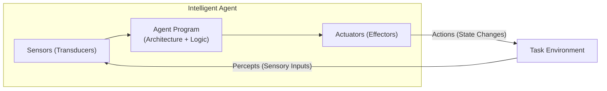
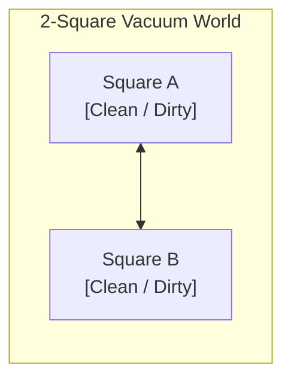
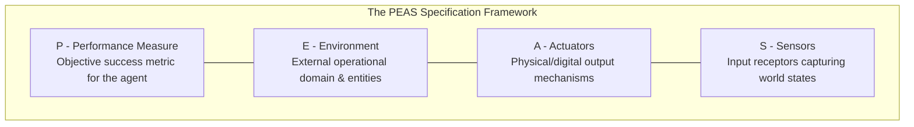
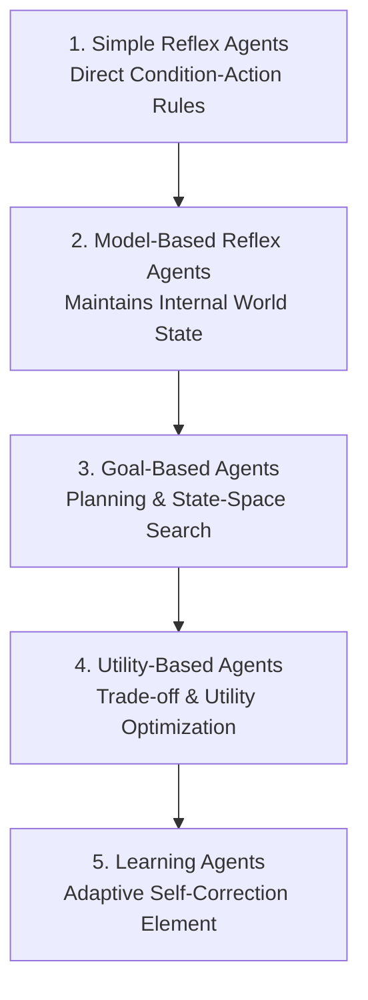

import Tabs from '@theme/Tabs';
import TabItem from '@theme/TabItem';
import Heading from '@theme/Heading';
import React from 'react';

# Intelligent Agents

> **Topic -** An intelligent agent is an autonomous entity that perceives its environment through sensors and directs its activity through actuators toward maximizing goal achievement. This guide formalizes the agent-environment loop, distinguishes mathematical agent functions from concrete agent programs, details the PEAS (Performance, Environment, Actuators, Sensors) framework, classifies task environments across seven canonical dimensions, and dissects five foundational agent architectures.

---

## 1. The Agent-Environment Interaction Paradigm

In modern Artificial Intelligence, the central unifying concept is the **Agent**. An agent interacts continuously with its surrounding **Environment** in a closed feedback loop:



### Foundational Terminology

*   **Agent:** Anything that can perceive its environment through sensors and act upon that environment through actuators.
    *   *Human Agent:* Eyes, ears, olfactory organs, and skin as **sensors**; hands, legs, vocal cords, and facial muscles as **actuators**.
    *   *Robotic Agent:* Cameras, lidar, sonar, and infrared thermopiles as **sensors**; electric motors, servomechanisms, and hydraulic grippers as **actuators**.
    *   *Software Agent (Softbot):* Keystrokes, file handles, network packets, and API payloads as **sensors**; terminal writes, database mutations, and HTTP packets as **actuators**.
*   **Percept:** The agent's sensory input at any single, discrete point in time.
*   **Percept Sequence:** The complete historical record of everything the agent has perceived from its initialization up to the present moment:
    $$\mathcal{P}^* = [p_0, p_1, p_2, \dots, p_t]$$
*   **Agent Behavior:** The choice of action executed by the agent at time step $t$ in response to its accumulated percept sequence.

:::tip

**The Role of Artificial Intelligence**

In hardware systems, engineers design the sensors and actuators (the **Architecture**). The core job of AI is to design and implement the **Agent Program** - the internal algorithm that maps incoming percepts to optimal physical or digital actions.

:::

---

## 2. Mathematical Agent Function vs. Agent Program

A rigorous distinction exists between the theoretical mathematical specification of an agent and its concrete algorithmic implementation.

### The Agent Function

The **Agent Function** is an abstract mathematical mapping from every conceivable percept sequence to a specific action:

$$f: \mathcal{P}^* \to \mathcal{A}$$

Where:
*   $\mathcal{P}^*$ represents the infinite set of all possible percept sequences.
*   $\mathcal{A}$ represents the discrete or continuous set of all legal actions available to the agent.

The agent function describes an idealized external behavior. In principle, it could be implemented as an exhaustive lookup table indexed by percept sequences. However, because $\mathcal{P}^*$ grows exponentially with time ($|\mathcal{P}|^t$), an explicit lookup table is astronomically huge and practically uncomputable for all but the simplest toy worlds.

### The Agent Program

The **Agent Program** is the concrete algorithmic implementation of the agent function designed to execute within finite space and time on a physical computing platform:

$$\text{Agent} = \text{Architecture} + \text{Program}$$

Where:
*   **Architecture:** The physical or virtual computing device equipped with sensors and actuators (e.g., an autonomous vehicle chassis, a server, or a microcontroller).
*   **Program:** The software function that receives current percepts, updates internal state, and emits an action.

### Case Study: The 2-State Vacuum-Cleaner World

Consider a classical toy problem: an autonomous vacuum cleaner operating in a world consisting of two locations, square $A$ and square $B$:



*   **Percept Space:** Tuple of `[Location, Status]`, where $\text{Location} \in \{A, B\}$ and $\text{Status} \in \{\text{Clean}, \text{Dirty}\}$.
*   **Action Space:** $\mathcal{A} \in \{\text{Left}, \text{Right}, \text{Suck}, \text{NoOp}\}$.

#### The Mathematical Agent Function (Tabular View)

| Percept Sequence | Action Selected | Rationale |
| :--- | :--- | :--- |
| `[A, Clean]` | `Right` | Move to unvisited square $B$. |
| `[A, Dirty]` | `Suck` | Clean current square $A$. |
| `[B, Clean]` | `Left` | Move to unvisited square $A$. |
| `[B, Dirty]` | `Suck` | Clean current square $B$. |
| `[A, Clean], [A, Clean]` | `Right` | Repeat traversal. |
| `[A, Clean], [A, Dirty]` | `Suck` | Clean re-dirtied square $A$. |
| `[A, Dirty], [A, Clean]` | `Right` | Advance after cleaning $A$. |

#### The Concrete Reflex Agent Program

A simple reflex agent program implements this function in four lines of code without storing history:

```python
def reflex_vacuum_agent(percept: tuple[str, str]) -> str:
    location, status = percept
    if status == "Dirty":
        return "Suck"
    elif location == "A":
        return "Right"
    elif location == "B":
        return "Left"
    return "NoOp"
```

---

## 3. Specifying Task Environments: The PEAS Framework

Before designing an intelligent agent, an engineer must rigorously specify the **Task Environment**. The universal standard for environmental specification is the **PEAS Framework**:



1.  **Performance Measure (P):** The external, objective criterion used to evaluate how successfully the agent achieves its objectives.
2.  **Environment (E):** The surrounding medium, external entities, constraints, and dynamic processes within which the agent operates.
3.  **Actuators (A):** The mechanism or devices through which the agent exerts control or alters environmental state.
4.  **Sensors (S):** The sensory devices or data feeds through which the agent receives percepts.

### Canonical PEAS Specifications

| Agent Type | Performance Measure (P) | Environment (E) | Actuators (A) | Sensors (S) |
| :--- | :--- | :--- | :--- | :--- |
| **Autonomous Taxi Driver** | Safe arrival, rapid trip time, legal compliance, passenger comfort, maximized fuel profit. | City roadways, pedestrian crossings, variable traffic, weather conditions, emergency vehicles. | Steering column, throttle accelerator, hydraulic brakes, turning signals, horn, cabin display. | Monocular cameras, LiDAR, radar, GPS, speedometer, accelerometer, engine diagnostics. |
| **Medical Diagnosis System** | Diagnostic accuracy, minimized patient mortality, reduced treatment expense, zero adverse reactions. | Clinical hospital wards, patient populations, medical laboratory databases, staff staff. | Screen display of diagnoses, recommended prescription regimens, referral orders. | Keyboard input of symptoms, EHR database records, imaging scanners (MRI, CT), lab tests. |
| **Satellite Image Analysis** | Classification precision, percentage correct pixel segmentation, anomaly detection speed. | Earth orbit imagery feed, atmospheric cloud covers, spectral wavelengths. | Display of classified geographical land maps, target detection alert notifications. | Multi-spectral high-resolution optical cameras, infrared and thermal sensor arrays. |
| **Part-Picking Robot Arm** | Percentage parts correctly placed in bins, sorting speed (parts/min), zero component breakage. | Conveyor belt, parts bins, mechanical sorting tables, industrial plant floor. | Articulated joint motor arms, vacuum suction cups, pneumatic two-finger grippers. | Overhead depth cameras, tactile pressure finger pads, joint angular encoders. |
| **Refinery Controller** | Maximized refined hydrocarbon yield, minimal energy consumption, strict safety threshold compliance. | Chemical distillation columns, pressurized boilers, fluid pipelines, valves. | Solenoid valves, industrial pump motors, electric heaters, cooling water injection. | Pressure transducers, thermocouple temperature gauges, flow-rate meters, gas chromatographs. |
| **Interactive English Tutor** | Maximized student test score improvement, personalized engagement, adaptive curriculum pacing. | Student user pool, linguistic knowledge base, graded assessment modules. | Display of customized exercises, correction feedback, instructional audio voice. | Keyboard text responses, microphone speech recognition, touchscreen stylus inputs. |

:::warning

**The Objective Metric Rule**

A performance measure must be designed based on the **desired real-world outcome in the environment**, not based on the agent's internal psychological sensations or subjective self-evaluation. If a vacuum cleaner is scored based on "how much dirt it picks up", a rational agent will repeatedly dump dirt onto a clean floor and vacuum it back up to inflate its score.

:::

---

## 4. The Seven Dimensions of Task Environments

Task environments vary across seven fundamental properties. The character of the environment directly dictates the complexity and algorithmic architecture of the required agent:

### 1. Fully Observable vs. Partially Observable (vs. Unobservable)
*   **Fully Observable:** The agent's sensors grant complete access to the entire state of the environment at any given time step (e.g., Chess, Crossword puzzles). No hidden variables exist.
*   **Partially Observable:** The environment is obscured by sensor noise, occlusion, or missing information (e.g., Poker where opponents' cards are hidden; autonomous driving where blind spots and fog exist).
*   **Unobservable (Conformant):** The agent has zero sensor capability ($S = \emptyset$) and must solve problems purely through open-loop blind actuation.

### 2. Deterministic vs. Stochastic (vs. Strategic)
*   **Deterministic:** The subsequent environmental state is completely determined by the current state and the action executed by the agent (e.g., Vacuum world without failures, 8-puzzle).
*   **Stochastic:** The environment exhibits inherent randomness or uncertainty. The same action executed in identical states can yield different outcomes according to a probability distribution (e.g., Taxi driving, dice-rolling in Backgammon).
*   **Strategic:** An environment that is deterministic except for the independent actions of other rival agents (e.g., Chess).

### 3. Episodic vs. Sequential
*   **Episodic:** The agent's experience is divided into independent, atomic episodes. In each episode, the agent perceives and acts; the quality of the action depends solely on that episode and has **no bearing on future episodes** (e.g., Defect classification on a factory conveyor belt). The agent does not need to look ahead.
*   **Sequential:** Current choices alter future states and options. An action taken now might produce adverse consequences many time steps later (e.g., Chess, Taxi driving). Long-range planning is mandatory.

### 4. Static vs. Dynamic (vs. Semidynamic)
*   **Static:** The environment does not change while the agent is deliberating or executing its search algorithm (e.g., Crossword puzzles). Time spent thinking has zero cost.
*   **Dynamic:** The environment changes continuously while the agent is computing its next move (e.g., Autonomous taxi driving). An agent that ponders too long may crash.
*   **Semidynamic:** The physical environment does not change while the agent thinks, but the agent's performance score or remaining clock decays over time (e.g., Chess with a countdown timer).

### 5. Discrete vs. Continuous
*   **Discrete:** The environment possesses a finite or countable number of distinct states, percepts, actions, and time steps (e.g., Chess has 64 discrete squares, a discrete turn-based clock, and a finite move catalog).
*   **Continuous:** States, actions, and time vary continuously across real-valued dimensions (e.g., Taxi driving features continuous steering angles, continuous vehicle speeds, and continuous GPS coordinates).

### 6. Single Agent vs. Multiagent (Cooperative vs. Competitive)
*   **Single Agent:** An agent operating alone in an environment where other objects do not maximize their own independent utility functions (e.g., Crossword puzzles, Solitaire).
*   **Multiagent:** The environment contains multiple autonomous entities pursuing their own performance objectives.
    *   *Competitive Multiagent:* Opponents actively work to minimize the agent's utility (e.g., Chess, Poker). Modeled via minimax game theory.
    *   *Cooperative Multiagent:* Multiple agents coordinate to maximize a joint utility function (e.g., Autonomous vehicles communicating over V2V networks to avoid collisions and optimize traffic throughput).

### 7. Known vs. Unknown
*   **Known Environment:** The agent (or its designer) knows the complete physical laws, transition probabilities, and outcomes of the environment in advance (e.g., standard Solitaire card rules).
*   **Unknown Environment:** The rules, physics, and dynamics are unknown. The agent must explore and learn the mechanics of the environment through trial and error before it can make optimal decisions (e.g., playing a newly published video game without reading the manual).

---

### Environmental Taxonomy Master Table

The table below compiles canonical task environments against the seven properties:

| Task Environment | Observability | Determinism | Episodic / Sequential | Dynamism | Continuity | Agent Multiplicity |
| :--- | :--- | :--- | :--- | :--- | :--- | :--- |
| **Crossword Puzzle** | Fully | Deterministic | Sequential | Static | Discrete | Single |
| **Chess (with Clock)** | Fully | Strategic | Sequential | Semidynamic | Discrete | Multiagent (Competitive) |
| **Poker** | Partially | Strategic | Sequential | Static | Discrete | Multiagent (Competitive) |
| **Backgammon** | Fully | Stochastic | Sequential | Static | Discrete | Multiagent (Competitive) |
| **Autonomous Taxi** | Partially | Stochastic | Sequential | Dynamic | Continuous | Multiagent (Mixed) |
| **Medical Diagnosis** | Partially | Stochastic | Sequential | Dynamic | Continuous | Single |
| **Satellite Analysis** | Fully | Deterministic | Episodic | Semidynamic | Continuous | Single |
| **Part-Picking Robot** | Partially | Stochastic | Episodic | Dynamic | Continuous | Single |
| **Refinery Controller** | Partially | Stochastic | Sequential | Dynamic | Continuous | Single |
| **Interactive Tutor** | Partially | Stochastic | Sequential | Dynamic | Discrete | Multiagent (Cooperative) |

:::note

**The Hardest Environment**

The most difficult task environment for an AI agent is one that is **Partially observable, Stochastic, Sequential, Dynamic, Continuous, and Multiagent** - precisely the conditions faced by autonomous driving robots in urban environments.

:::

---

## 5. Five Foundational Agent Architectures

Russell and Norvig organize agent programs into five structural designs of increasing generality and deliberative depth:



<Tabs>
  <TabItem value="simple" label="1. Simple Reflex Agents" default>
    <br/>

    *   **Mechanism:** Selects actions based **solely on the current percept**, ignoring the entire historical percept sequence. Operates via hardcoded condition-action rules:
        $$\text{if } \text{condition then } \text{action}$$
    *   **Limitation:** Fails catastrophically in partially observable environments due to infinite loops. If an unobservable vacuum cleaner cannot tell which room it is in, it may loop indefinitely between square $A$ and square $B$.
  </TabItem>
  <TabItem value="model" label="2. Model-Based Reflex Agents">
    <br/>

    *   **Mechanism:** Maintains an **internal state** that tracks aspects of the environment that cannot be viewed right now.
    *   **Internal Knowledge Required:**
        1.  *Transition Model:* How the world evolves independently of the agent.
        2.  *Sensor Model:* How the agent's own actions affect the world.
    *   **Advantage:** Successfully handles partially observable environments by estimating unobserved variables over time.
  </TabItem>
  <TabItem value="goal" label="3. Goal-Based Agents">
    <br/>

    *   **Mechanism:** Combines its internal world model with explicit **Goal Descriptions** (states that satisfy the agent's purpose).
    *   **Deliberation:** Uses **Search Algorithms** and **Automated Planning** to evaluate sequences of future actions that lead from the initial state to the goal.
    *   **Advantage:** Flexible; changing the goal immediately updates the chosen action sequence without rewriting the agent's internal rules.
  </TabItem>
  <TabItem value="utility" label="4. Utility-Based Agents">
    <br/>

    *   **Mechanism:** Maps environmental states to real numbers using a **Utility Function** ($U: \mathcal{S} \to \mathbb{R}$).
    *   **Deliberation:** When multiple competing paths achieve a goal, the utility function resolves trade-offs between speed, safety, financial cost, and reliability by calculating expected utility:
        $$\mathbb{E}[U(a)] = \sum_{s'} P(s' \mid s, a) U(s')$$
    *   **Advantage:** Essential for complex real-world decision-making under risk and conflicting goals.
  </TabItem>
  <TabItem value="learning" label="5. Learning Agents">
    <br/>

    *   **Mechanism:** Separates operational decision-making from self-improvement through four modular sub-elements:
        1.  **Learning Element:** Responsible for making improvements based on feedback.
        2.  **Critic:** Evaluates agent behavior against an external performance standard.
        3.  **Performance Element:** The operational agent responsible for selecting external actions.
        4.  **Problem Generator:** Suggests exploratory actions that discover new sub-optimal regions and novel solutions.
  </TabItem>
</Tabs>

---

## 6. Interactive Task Environment Sandbox

Select any canonical real-world scenario below to inspect its formal PEAS profile and full 7-dimension environmental classification:

export const TaskEnvironmentSandbox = () => {
  const [selectedKey, setSelectedKey] = React.useState('taxi');

  const environments = {
    taxi: {
      name: 'Autonomous Taxi Driver',
      peas: {
        p: 'Safety, passenger arrival speed, traffic law adherence, ride comfort, maximized profit.',
        e: 'Urban streets, fluctuating vehicle traffic, pedestrians, weather conditions, traffic lights.',
        a: 'Steering rack, accelerator throttle, braking calipers, turn signals, audio horn, display screen.',
        s: 'Video cameras, LiDAR, forward radar, GPS receiver, wheel speed sensors, accelerometer.'
      },
      props: {
        observable: 'Partially Observable (Occluded corners, blind spots, internal engine state hidden)',
        deterministic: 'Stochastic (Unpredictable pedestrians, mechanical wear, weather disruptions)',
        episodic: 'Sequential (Current lane change impacts downstream traffic options for miles)',
        dynamic: 'Dynamic (Traffic moves and conditions change while the path planner calculates)',
        continuous: 'Continuous (Steering angle, brake pressure, velocity, and time are real numbers)',
        agent: 'Multiagent (Mixed: cooperative with other vehicles, competitive for lane space)'
      },
      complexity: 'Maximum Complexity: Demands real-time sensor fusion, probabilistic SLAM, and predictive control.'
    },
    chess: {
      name: 'Chess Tournament (with Clock)',
      peas: {
        p: 'Winning the match (+1), drawing (0), or losing (-1). Remaining clock reserves.',
        e: '8x8 chess board, 32 physical/digital pieces, opposing human or computational master.',
        a: 'Piece moves (e.g., Nf3, e4), resignation, draw offer, clock button tap.',
        s: 'Direct board state sensor (digital array or overhead camera).'
      },
      props: {
        observable: 'Fully Observable (All piece positions and move history are completely visible)',
        deterministic: 'Strategic (Deterministic transitions governed purely by player moves)',
        episodic: 'Sequential (An opening sacrifice dictates tactical outcomes 30 moves later)',
        dynamic: 'Semidynamic (Board state freezes between turns, but player clock continuously elapses)',
        continuous: 'Discrete (64 squares, turn-based time intervals, finite move inventory)',
        agent: 'Multiagent (Strictly Competitive: zero-sum utility formulation)'
      },
      complexity: 'Moderate-High: State space is discrete and fully observable, but combinatorial tree size demands heuristic search.'
    },
    medical: {
      name: 'Medical Diagnosis System',
      peas: {
        p: 'Diagnostic accuracy, patient survival rate, minimal treatment expenses, zero malpractice errors.',
        e: 'Clinical hospital ward, patient pathology, lab database, medical staff.',
        a: 'Diagnostic recommendations, prescription orders, lab test requests, patient alerts.',
        s: 'Electronic Health Record (EHR) text, blood panel analyzers, radiological imaging (CT/MRI).'
      },
      props: {
        observable: 'Partially Observable (Internal organs and disease progression cannot be directly observed)',
        deterministic: 'Stochastic (Identical drug doses produce variable patient responses)',
        episodic: 'Sequential (Prescribing a treatment affects future symptoms and test options)',
        dynamic: 'Dynamic (Patient physiological condition fluctuates while diagnosis is formulated)',
        continuous: 'Continuous (Vital signs, medication dosages, blood pressure, body temperature)',
        agent: 'Single Agent (Microorganisms and immune systems do not exhibit strategic rational agency)'
      },
      complexity: 'High: Severe uncertainty, noisy observations, and high-consequence failure modes.'
    },
    crossword: {
      name: 'Crossword Puzzle Solver',
      peas: {
        p: 'Number of words correctly completed, minimized letter pen-erasures, total completion time.',
        e: 'Printed paper puzzle grid, clue text lists, English dictionary lexicon.',
        a: 'Writing ink letters into specific row/column character cells.',
        s: 'Document image scanner or digital ASCII grid input.'
      },
      props: {
        observable: 'Fully Observable (The complete grid and all text clues are available from step 0)',
        deterministic: 'Deterministic (Writing a letter into a cell alters that cell with 100% certainty)',
        episodic: 'Sequential (Entering a word constrains intersecting letters for all crossing words)',
        dynamic: 'Static (The grid and clues never alter while the algorithm deliberates)',
        continuous: 'Discrete (Finite alphabet of 26 uppercase characters and discrete square coordinates)',
        agent: 'Single Agent (Operates in complete isolation without competing entities)'
      },
      complexity: 'Low-Moderate: Ideal candidate for Constraint Satisfaction Problem (CSP) back-tracking.'
    }
  };

  const current = environments[selectedKey];

  return (
    <div style={{ padding: '20px', border: '1px solid var(--ifm-color-emphasis-200)', borderRadius: '8px', backgroundColor: 'rgba(148, 163, 184, 0.05)', margin: '20px 0' }}>
      <h4 style={{ margin: '0 0 12px 0' }}>Interactive Task Environment Inspector</h4>
      <p style={{ margin: '0 0 14px 0', fontSize: '14px' }}>
        Select a real-world task environment to inspect its formal PEAS breakdown and taxonomy profile:
      </p>

      <div style={{ display: 'flex', gap: '8px', flexWrap: 'wrap', marginBottom: '16px' }}>
        <button
          onClick={() => setSelectedKey('taxi')}
          style={{ padding: '6px 12px', borderRadius: '4px', border: '1px solid #3182ce', backgroundColor: selectedKey === 'taxi' ? '#3182ce' : 'transparent', color: selectedKey === 'taxi' ? '#fff' : 'var(--ifm-font-color-base)', cursor: 'pointer', fontSize: '12px', fontWeight: 'bold' }}
        >
          Autonomous Taxi
        </button>
        <button
          onClick={() => setSelectedKey('chess')}
          style={{ padding: '6px 12px', borderRadius: '4px', border: '1px solid #3182ce', backgroundColor: selectedKey === 'chess' ? '#3182ce' : 'transparent', color: selectedKey === 'chess' ? '#fff' : 'var(--ifm-font-color-base)', cursor: 'pointer', fontSize: '12px' }}
        >
          Chess (with Clock)
        </button>
        <button
          onClick={() => setSelectedKey('medical')}
          style={{ padding: '6px 12px', borderRadius: '4px', border: '1px solid #3182ce', backgroundColor: selectedKey === 'medical' ? '#3182ce' : 'transparent', color: selectedKey === 'medical' ? '#fff' : 'var(--ifm-font-color-base)', cursor: 'pointer', fontSize: '12px' }}
        >
          Medical Diagnosis
        </button>
        <button
          onClick={() => setSelectedKey('crossword')}
          style={{ padding: '6px 12px', borderRadius: '4px', border: '1px solid #3182ce', backgroundColor: selectedKey === 'crossword' ? '#3182ce' : 'transparent', color: selectedKey === 'crossword' ? '#fff' : 'var(--ifm-font-color-base)', cursor: 'pointer', fontSize: '12px' }}
        >
          Crossword Puzzle
        </button>
      </div>

      <div style={{ padding: '16px', borderRadius: '6px', backgroundColor: 'var(--ifm-background-surface-color)', border: '1px solid var(--ifm-color-emphasis-300)' }}>
        <div style={{ fontSize: '18px', fontWeight: 'bold', color: '#3182ce', marginBottom: '12px' }}>
          {current.name}
        </div>

        <div style={{ marginBottom: '14px' }}>
          <strong style={{ fontSize: '13px', textTransform: 'uppercase', color: 'var(--ifm-color-emphasis-700)' }}>PEAS Specification:</strong>
          <div style={{ display: 'grid', gridTemplateColumns: 'repeat(auto-fit, minmax(200px, 1fr))', gap: '10px', marginTop: '6px' }}>
            <div style={{ padding: '8px', borderRadius: '4px', backgroundColor: 'rgba(49, 130, 206, 0.08)' }}>
              <b>P:</b> {current.peas.p}
            </div>
            <div style={{ padding: '8px', borderRadius: '4px', backgroundColor: 'rgba(49, 130, 206, 0.08)' }}>
              <b>E:</b> {current.peas.e}
            </div>
            <div style={{ padding: '8px', borderRadius: '4px', backgroundColor: 'rgba(49, 130, 206, 0.08)' }}>
              <b>A:</b> {current.peas.a}
            </div>
            <div style={{ padding: '8px', borderRadius: '4px', backgroundColor: 'rgba(49, 130, 206, 0.08)' }}>
              <b>S:</b> {current.peas.s}
            </div>
          </div>
        </div>

        <div style={{ marginBottom: '14px' }}>
          <strong style={{ fontSize: '13px', textTransform: 'uppercase', color: 'var(--ifm-color-emphasis-700)' }}>Environmental Taxonomy:</strong>
          <ul style={{ margin: '6px 0 0 20px', fontSize: '13px', lineHeight: '1.6' }}>
            <li><b>Observability:</b> {current.props.observable}</li>
            <li><b>Determinism:</b> {current.props.deterministic}</li>
            <li><b>Episodic / Sequential:</b> {current.props.episodic}</li>
            <li><b>Dynamism:</b> {current.props.dynamic}</li>
            <li><b>Continuity:</b> {current.props.continuous}</li>
            <li><b>Multiplicity:</b> {current.props.agent}</li>
          </ul>
        </div>

        <div style={{ padding: '10px 14px', borderRadius: '4px', backgroundColor: 'rgba(56, 161, 105, 0.08)', borderLeft: '4px solid #38a169', fontSize: '13px' }}>
          <b>Engineering Assessment:</b> {current.complexity}
        </div>
      </div>
    </div>
  );
};

<TaskEnvironmentSandbox />

---

## 7. Exam Traps & Operational Nuances

<Tabs>
  <TabItem value="e1" label="1. Internal vs. External Performance Measures" default>
    <br/>

    *   **The Trap:** Defining performance based on the agent's internal perceptions rather than the external environment.
    *   **The Flaw:** If a cleaning agent is evaluated on "vacuum motor running time" or "dirt collected", it can satisfy the metric by running in an empty room or repeatedly depositing and picking up the same dust.
    *   **The Solution:** Measure the cleanliness of the floor over time independently of the agent's actions.
  </TabItem>
  <TabItem value="e2" label="2. Stochastic vs. Multiagent (Strategic)">
    <br/>

    *   **The Trap:** Confusing a multiagent competitive game with a stochastic random world.
    *   **The Flaw:** Treating an opponent's moves like random coin tosses. An opponent does not act randomly; they actively choose moves designed to minimize your performance.
    *   **The Solution:** Model stochastic uncertainty using probability distributions, but model opponents using minimax game theory.
  </TabItem>
  <TabItem value="e3" label="3. Static vs. Semidynamic Precision">
    <br/>

    *   **The Trap:** Labeling timed chess as dynamic because the clock counts down.
    *   **The Flaw:** The physical board arrangement does not change while you think.
    *   **The Solution:** Use the term **Semidynamic**: the environment itself is static, but the agent's performance score or remaining time decreases while deliberating.
  </TabItem>
  <TabItem value="e4" label="4. Simple Reflex Loops">
    <br/>

    *   **The Trap:** Deploying simple reflex agents in partially observable worlds.
    *   **The Flaw:** Because simple reflex agents lack memory, if the current percept does not reveal which state the agent is in, it can get stuck in an unrecoverable infinite loop.
    *   **The Solution:** Upgrade to a **Model-Based Reflex Agent** that tracks unseen states using an internal transition model.
  </TabItem>
</Tabs>

---

## 8. Summary & Cheatsheet

<div className="row">
  <div className="col col--6">
    <div className="card" style={{ height: '100%', marginBottom: '15px' }}>
      <div className="card__header">
        <h3>PEAS Framework</h3>
      </div>
      <div className="card__body">
        <ul>
          <li><b>Performance:</b> External objective success metric.</li>
          <li><b>Environment:</b> Operating domain and external entities.</li>
          <li><b>Actuators:</b> Output hardware/software changing state.</li>
          <li><b>Sensors:</b> Input devices measuring percepts.</li>
        </ul>
      </div>
    </div>
  </div>
  <div className="col col--6">
    <div className="card" style={{ height: '100%', marginBottom: '15px' }}>
      <div className="card__header">
        <h3>Environmental Dimensions</h3>
      </div>
      <div className="card__body">
        <ul>
          <li><b>Observability:</b> Fully vs. Partially vs. Unobservable.</li>
          <li><b>Determinism:</b> Deterministic vs. Stochastic vs. Strategic.</li>
          <li><b>Temporal:</b> Episodic vs. Sequential.</li>
          <li><b>Dynamics & State:</b> Static vs. Dynamic vs. Semidynamic; Discrete vs. Continuous.</li>
        </ul>
      </div>
    </div>
  </div>
</div>

<br/>

:::info

**Key Takeaways**

*   **Agent Function vs. Program:** The agent function is an abstract mathematical mapping ($f: \mathcal{P}^* \to \mathcal{A}$); the agent program is the concrete algorithm running on physical architecture.
*   **PEAS is Step 0:** In engineering an intelligent system, the task environment must always be specified via PEAS before selecting algorithms.
*   **The Environmental Hierarchy:** Simple Reflex $\to$ Model-Based $\to$ Goal-Based $\to$ Utility-Based $\to$ Learning Agents. Choose the simplest architecture that satisfies your environmental properties.

:::

**Next Section:** [Problem Solving & State Space](./03-problem-solving-and-formulation.mdx) - formalizing states, transition models, path costs, and classic puzzle search formulations.

---

## 9. Active Recall & Review

*Test your understanding by answering first, then clicking to reveal the underlying principles.*

### Interactive Checkpoint Quiz

export const AgentQuiz = () => {
  const [selected, setSelected] = React.useState(null);
  return (
    <div style={{ padding: '20px', border: '1px solid var(--ifm-color-emphasis-200)', borderRadius: '8px', backgroundColor: 'rgba(148, 163, 184, 0.05)', margin: '20px 0' }}>
      <h4 style={{ margin: '0 0 10px 0' }}>Interactive Checkpoint: Environmental Property Identification</h4>
      <p style={{ margin: '0 0 15px 0' }}>How is the task environment of a <b>Chess Tournament with a Clock</b> correctly classified along the dynamism dimension?</p>
      <div style={{ display: 'flex', gap: '10px', flexWrap: 'wrap' }}>
        <button onClick={() => setSelected('opt1')} style={{ padding: '8px 16px', borderRadius: '4px', border: '1px solid #3182ce', backgroundColor: selected === 'opt1' ? '#e53e3e' : 'transparent', color: selected === 'opt1' ? '#fff' : 'var(--ifm-font-color-base)', cursor: 'pointer', transition: '0.2s' }}>Static (The board does not change)</button>
        <button onClick={() => setSelected('opt2')} style={{ padding: '8px 16px', borderRadius: '4px', border: '1px solid #3182ce', backgroundColor: selected === 'opt2' ? '#38a169' : 'transparent', color: selected === 'opt2' ? '#fff' : 'var(--ifm-font-color-base)', cursor: 'pointer', transition: '0.2s' }}>Semidynamic (Board is fixed, but the clock score elapses)</button>
        <button onClick={() => setSelected('opt3')} style={{ padding: '8px 16px', borderRadius: '4px', border: '1px solid #3182ce', backgroundColor: selected === 'opt3' ? '#e53e3e' : 'transparent', color: selected === 'opt3' ? '#fff' : 'var(--ifm-font-color-base)', cursor: 'pointer', transition: '0.2s' }}>Dynamic (Pieces move in real time)</button>
      </div>
      {selected === 'opt1' && <p style={{ color: '#e53e3e', marginTop: '15px', fontWeight: 'bold', fontSize: '14px', marginBottom: '0' }}>Incorrect. While the board itself does not change while thinking, the remaining clock time continuously counts down, altering your evaluation score. Try again!</p>}
      {selected === 'opt2' && <p style={{ color: '#38a169', marginTop: '15px', fontWeight: 'bold', fontSize: '14px', marginBottom: '0' }}>Correct! An environment is semidynamic if the physical environment does not change while the agent deliberates, but the agent's performance score (or remaining clock reserve) decreases.</p>}
      {selected === 'opt3' && <p style={{ color: '#e53e3e', marginTop: '15px', fontWeight: 'bold', fontSize: '14px', marginBottom: '0' }}>Incorrect. In chess, the opponent is forbidden from moving pieces while it is your turn; hence the board state is not dynamic. Try again!</p>}
    </div>
  );
};

<AgentQuiz />

### Review Flashcards

<details>
  <summary><b>1. [THEORY] Formulate the PEAS description for an Automated Taxi Driver.</b></summary>
  <div className="answer-content">
    <br/>

    *   **Performance Measure:** Safety, trip speed, legal compliance, passenger comfort, maximized fuel/fare profit.
    *   **Environment:** Urban roads, pedestrian sidewalks, traffic lights, weather conditions, emergency vehicles.
    *   **Actuators:** Steering wheel, throttle accelerator, brakes, turn indicators, horn, cabin display.
    *   **Sensors:** Video cameras, LiDAR, radar, GPS, speedometer, accelerometer, engine sensors.
  </div>
</details>

<details>
  <summary><b>2. [MATH] Express the mathematical difference between an Agent Function and an Agent Program.</b></summary>
  <div className="answer-content">
    <br/>

    *   **Agent Function:** A purely mathematical mapping from the set of all possible percept sequences to the action space:
        $$f: \mathcal{P}^* \to \mathcal{A}$$
        It represents an abstract table of infinite potential size.
    *   **Agent Program:** The concrete executable code that takes the current percept, maintains state, and returns an action in real-time on physical architecture:
        $$\text{Agent} = \text{Architecture} + \text{Program}$$
  </div>
</details>

<details>
  <summary><b>3. [EXAM PRACTICE] Distinguish between Episodic and Sequential task environments with examples.</b></summary>
  <div className="answer-content">
    <br/>

    *   **Episodic:** The agent's experience is partitioned into independent episodes. Each episode consists of perceiving and executing one action. The current action has no effect on whether future episodes are easy or hard.
        *   *Example:* Defective part classification on an assembly line.
    *   **Sequential:** The current action fundamentally alters the environment and influences all subsequent states, choices, and future utility.
        *   *Example:* Chess (a move early in the opening determines endgame pawn structure) and Autonomous Driving.
  </div>
</details>

<details>
  <summary><b>4. [THEORY] Why do Simple Reflex Agents fail in Partially Observable environments?</b></summary>
  <div className="answer-content">
    <br/>

    *   **Perceptual Ambiguity:** A simple reflex agent chooses actions based solely on its immediate percept ($f(p_t)$), ignoring history.
    *   In a partially observable environment, identical percepts can occur in completely different world states.
    *   Without an internal model or memory, the agent cannot disambiguate which state it is in, causing it to execute repetitive actions and fall into infinite loops.
  </div>
</details>

<details>
  <summary><b>5. [ANALYZE] Why is the distinction between Strategic and Stochastic environments important in game playing?</b></summary>
  <div className="answer-content">
    <br/>

    *   **Stochastic:** The uncertainty arises from neutral environmental laws of chance (e.g., rolling dice in Backgammon, wind gusts). The environment does not intentionally optimize to defeat the agent.
    *   **Strategic:** The uncertainty is created by another rational entity that actively computes moves to minimize the agent's payoff (e.g., Chess, Go).
    *   Agents in strategic games must use adversarial search (minimax with alpha-beta pruning) rather than simple Markov decision processes.
  </div>
</details>
