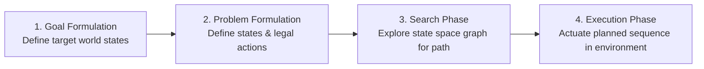
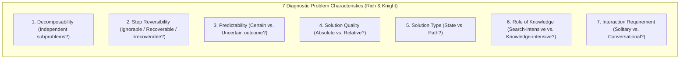
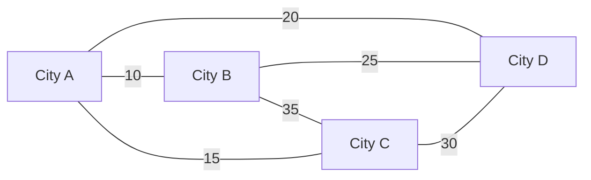

import Tabs from '@theme/Tabs';
import TabItem from '@theme/TabItem';
import Heading from '@theme/Heading';
import React from 'react';

# Problem Solving & State Space

> **Topic -** In Artificial Intelligence, problem solving is formalised as a search through a state space - an abstract graph of all valid configurations reachable from an initial state via legal operators. This guide establishes the formal five-part problem definition, analyses Elaine Rich and Kevin Knight's seven diagnostic problem characteristics, contrasts toy versus real-world problems, and formalizes classic benchmark problems including the 8-Puzzle, Water Jug, Missionaries and Cannibals, Blocks World, N-Queens, and the Travelling Salesman Problem (TSP).

---

## 1. The Search Problem Framework

A **problem-solving agent** is a goal-driven agent that plans an action trajectory through an internal state-space graph before executing physical actions in the environment.



### The Five Formal Components

According to Russell and Norvig, a search problem is formally defined by five mathematical components:

1.  **Initial State ($s_0 \in \mathcal{S}$):** The starting state configuration from which the agent begins.
2.  **Action Set ($\text{ACTIONS}(s)$):** Given a state $s$, returns the set of all legal actions $\{a_1, a_2, \dots\}$ that can be executed from $s$.
3.  **Transition Model ($\text{RESULT}(s, a)$):** A deterministic function returning the state $s'$ that results from doing action $a$ in state $s$. Alternatively specified as a **Successor Function**:
    $$\text{SUCCESSOR-FN}(s) \to \{\langle a, s' \rangle \mid a \in \text{ACTIONS}(s), s' = \text{RESULT}(s, a)\}$$
    Together, the initial state and successor function implicitly define the **State Space** ($\mathcal{S}$) - the set of all states reachable from $s_0$ through any sequence of legal actions.
4.  **Goal Test ($\text{IS-GOAL}(s)$):** A boolean test determining whether a given state satisfies the agent's objective. This can be an **explicit set** of target states (e.g., $\{ (2, 0) \}$ in the Water Jug) or an **abstract property** (e.g., "no two queens attack each other" in N-Queens, checkmate in chess).
5.  **Path Cost ($c(s, a, s')$):** A function assigning a numeric cost to each step transition. The total path cost $g(n)$ is the sum of the individual step costs along the path:
    $$g(n) = \sum_{i=1}^k c(s_{i-1}, a_i, s_i)$$

A **Solution** is a valid sequence of actions leading from the initial state $s_0$ to any state satisfying the goal test. An **Optimal Solution** is a solution achieving the lowest total path cost among all viable solution paths.

---

## 2. Rich & Knight's Seven Problem Characteristics

To determine which search algorithm (e.g., depth-first, breadth-first, heuristic $A^*$, or decomposition) is suitable for a given problem, Elaine Rich and Kevin Knight formulated seven diagnostic analytical questions:



<Tabs>
  <TabItem value="q1" label="1. Decomposability" default>
    <br/>

    *   **The Question:** Can the problem be divided into smaller, independent subproblems whose individual solutions can be combined directly to solve the whole problem?
    *   **Decomposable Example:** Symbolic integration:
        $$\int (x^2 + 3x + \sin^2 x \cos^2 x)\,dx = \int x^2\,dx + \int 3x\,dx + \int \sin^2 x \cos^2 x\,dx$$
        Each branch can be integrated independently without shared state interference.
    *   **Non-Decomposable Example:** Blocks World (due to inter-dependencies like the Sussman Anomaly) and the 8-Puzzle. Moving one tile alters spatial constraints for all remaining tiles.
  </TabItem>
  <TabItem value="q2" label="2. Step Reversibility">
    <br/>

    *   **Ignorable Problems:** Solution steps can be ignored without penalty. An unneeded step does not invalidate the final outcome (e.g., **Theorem Proving** - proving an unnecessary intermediate lemma does not ruin the mathematical proof).
    *   **Recoverable Problems:** Incorrect moves can be undone and backtracked to previous states using reverse operators (e.g., **8-Puzzle**, **Water Jug**, maze traversal).
    *   **Irrecoverable Problems:** Physical or competitive actions cannot be undone; backtracking is impossible in the real world (e.g., **Chess** against a human opponent, chemical synthesis, robotic surgery). Demands extensive planning before actuation.
  </TabItem>
  <TabItem value="q3" label="3. Predictability">
    <br/>

    *   **Certain-Outcome (Deterministic):** Applying an operator in a known state guarantees an exact, deterministic outcome. The agent can pre-compute a fixed open-loop sequence of actions (e.g., **8-Puzzle**, **Water Jug**).
    *   **Uncertain-Outcome (Stochastic):** The outcome of an operator is probabilistic or subject to unobserved adversary moves (e.g., playing **Bridge**, autonomous driving). Requires closed-loop contingency planning with real-time sensor feedback.
  </TabItem>
  <TabItem value="q4" label="4. Solution Quality: Absolute vs. Relative">
    <br/>

    *   **Absolute Solution:** Any valid path that satisfies the goal test is acceptable. Once a solution is discovered, the search can terminate immediately without exploring alternative paths (e.g., **Water Jug**, **Theorem Proving**).
    *   **Relative Solution:** Multiple paths exist, and the objective is to find the **globally optimal** path (e.g., **Travelling Salesman Problem** where any tour is valid, but only the shortest tour is desired). Requires searching or bounding the entire state space.
  </TabItem>
  <TabItem value="q5" label="5. Solution Type: State vs. Path">
    <br/>

    *   **Solution is a State:** The final configuration itself is the answer; the sequence of steps taken to construct that configuration is completely irrelevant (e.g., **N-Queens** where only the board layout matters; Cryptarithmetic).
    *   **Solution is a Path:** The ordered sequence of operations required to transition from start to finish *is* the answer (e.g., **Water Jug**, **Missionaries and Cannibals**, **8-Puzzle**).
  </TabItem>
  <TabItem value="q6" label="6. Role of Knowledge">
    <br/>

    *   **Search-Intensive:** Rules are mathematically compact and easily codified, but the state space graph is massive. The agent spends its computational budget traversing permutations (e.g., **Chess**, **8-Puzzle**, **Rubik's Cube**).
    *   **Knowledge-Intensive:** Requires massive domain-specific knowledge bases, semantic ontologies, and relational heuristics to constrain search (e.g., **Medical Diagnosis**, newspaper political stance analysis).
  </TabItem>
  <TabItem value="q7" label="7. Interaction Requirement">
    <br/>

    *   **Solitary Problem:** The computer computes the solution autonomously without intermediate user communication or explanatory dialogue (e.g., automated theorem proving, offline TSP solver).
    *   **Conversational Problem:** Intermediate dialogue is required to clarify ambiguous requirements, request additional evidence, or justify deductions to a human expert (e.g., medical consultation systems).
  </TabItem>
</Tabs>

### Characteristic Matrix for Classic Problems

| Problem | Decomposable? | Reversibility | Predictable? | Quality | Solution Type | Knowledge |
| :--- | :--- | :--- | :--- | :--- | :--- | :--- |
| **8-Puzzle** | No | Recoverable | Certain | Relative / Absolute | Path | Search-intensive |
| **Theorem Proving** | Yes | Ignorable | Certain | Absolute | Path | Knowledge-intensive |
| **Chess** | No | Irrecoverable | Certain (Strategic) | Relative | State / Path | Search-intensive |
| **Water Jug** | No | Recoverable | Certain | Absolute | Path | Search-intensive |
| **N-Queens** | No | Recoverable | Certain | Absolute | State | Search-intensive |
| **TSP** | No | Recoverable | Certain | Relative | Path | Search-intensive |
| **Medical Diagnosis** | Yes | Irrecoverable | Uncertain | Relative | State | Knowledge-intensive |

---

## 3. Formal Formulation of Classical Toy Problems

Toy problems provide clean, exact mathematical testbeds for benchmarking search algorithms. The syllabus emphasizes seven classical problems:

### 1. The 8-Puzzle (Sliding Block Puzzle)

A $3 \times 3$ grid contains eight numbered sliding tiles ($1$ to $8$) and one empty blank space. A tile adjacent to the blank space can slide into it.

```text
Initial State:           Goal State:
+---+---+---+            +---+---+---+
| 1 | 2 | 3 |            | 1 | 2 | 3 |
+---+---+---+            +---+---+---+
| 7 | 8 | 4 |    ==>     | 8 |   | 4 |
+---+---+---+            +---+---+---+
| 6 |   | 5 |            | 7 | 6 | 5 |
+---+---+---+            +---+---+---+
```

*   **States:** Permutations of the nine cells (eight numbered tiles plus one blank). Total potential states: $9! = 362,880$. Because the puzzle has two disjoint reachability components based on inversion parity, exactly half are reachable: $\frac{9!}{2} = 181,440$ reachable states.
*   **Initial State:** Any valid board configuration.
*   **Actions / Successor Function:** The blank space moves `Left`, `Right`, `Up`, or `Down` (subject to grid boundaries).
*   **Goal Test:** Board matches the designated target configuration.
*   **Path Cost:** Each single tile slide costs $1$ (total cost = number of moves).

---

### 2. The Water Jug Problem

Given a 4-gallon jug ($x$) and a 3-gallon jug ($y$), an unlimited pump, and no measurement markings, obtain **exactly 2 gallons** in the 4-gallon jug.

*   **State Space:** Ordered pair of integers $(x, y)$, where $x \in \{0, 1, 2, 3, 4\}$ and $y \in \{0, 1, 2, 3\}$.
*   **Initial State:** $(0, 0)$.
*   **Goal State:** $(2, n)$ for any $n \in \{0, 1, 2, 3\}$.
*   **Production Rules (Action Catalog):**

| Rule | Condition | New State $(x', y')$ | Semantic Description |
| :--- | :--- | :--- | :--- |
| **R1** | $x < 4$ | $(4, y)$ | Fill the 4-gallon jug completely |
| **R2** | $y < 3$ | $(x, 3)$ | Fill the 3-gallon jug completely |
| **R3** | $x > 0$ | $(x - d, y)$ | Pour some water out of the 4-gallon jug |
| **R4** | $y > 0$ | $(x, y - d)$ | Pour some water out of the 3-gallon jug |
| **R5** | $x > 0$ | $(0, y)$ | Empty the 4-gallon jug onto the ground |
| **R6** | $y > 0$ | $(x, 0)$ | Empty the 3-gallon jug onto the ground |
| **R7** | $x + y \ge 4 \land y > 0$ | $(4, y - (4 - x))$ | Pour from 3-gal into 4-gal until 4-gal is full |
| **R8** | $x + y \ge 3 \land x > 0$ | $(x - (3 - y), 3)$ | Pour from 4-gal into 3-gal until 3-gal is full |
| **R9** | $x + y \le 4 \land y > 0$ | $(x + y, 0)$ | Pour all water from 3-gal into 4-gal |
| **R10** | $x + y \le 3 \land x > 0$ | $(0, x + y)$ | Pour all water from 4-gal into 3-gal |
| **R11** | $x = 0 \land y = 2$ | $(2, 0)$ | Pour 2 gallons from 3-gal into 4-gal |
| **R12** | $x = 2$ | $(0, y)$ | Dump 2 gallons from 4-gal onto ground |

#### Optimal Solution Trace (6 Transitions)

```text
(0, 0) --[R2: Fill 3-gal]--> (0, 3)
       --[R9: Pour 3->4]---> (3, 0)
       --[R2: Fill 3-gal]--> (3, 3)
       --[R7: Pour 3->4]---> (4, 2)
       --[R5: Empty 4-gal]-> (0, 2)
       --[R9: Pour 3->4]---> (2, 0)  [GOAL REACHED!]
```

---

### 3. The Missionaries and Cannibals Problem

Three missionaries ($M$) and three cannibals ($C$) must cross a river using a boat that holds at most two people. If cannibals ever outnumber missionaries on either bank of the river, the missionaries will be eaten.

*   **State Representation:** Triple $(m, c, b)$, where $m \in \{0, 1, 2, 3\}$ is the number of missionaries on the starting bank, $c \in \{0, 1, 2, 3\}$ is the number of cannibals on the starting bank, and $b \in \{1, 0\}$ indicates whether the boat is on the starting bank ($1$) or opposite bank ($0$).
*   **Initial State:** $(3, 3, 1)$.
*   **Goal State:** $(0, 0, 0)$.
*   **Admissibility Constraint (Safety Invariant):**
    $$(m = 0 \lor m \ge c) \quad \land \quad ((3 - m) = 0 \lor (3 - m) \ge (3 - c))$$
*   **Legal Operators:** Moving $1$ or $2$ individuals in the direction of the boat:
    $$\Delta(m, c) \in \{(1, 0), (2, 0), (0, 1), (0, 2), (1, 1)\}$$
*   **Optimal 11-Step Solution Sequence:**
    $$\begin{aligned}
    (3,3,1) &\xrightarrow{2C} (3,1,0) \xrightarrow{1C} (3,2,1) \xrightarrow{2C} (3,0,0) \xrightarrow{1C} (3,1,1) \\
    &\xrightarrow{2M} (1,1,0) \xrightarrow{1M,1C} (2,2,1) \xrightarrow{2M} (0,2,0) \xrightarrow{1C} (0,3,1) \\
    &\xrightarrow{2C} (0,1,0) \xrightarrow{1C} (0,2,1) \xrightarrow{2C} (0,0,0) \quad [\text{Cost: } 11\text{ crossings}]
    \end{aligned}$$

---

### 4. The Blocks World Problem

A micro-world consisting of a flat table, a set of labeled blocks ($A, B, C, \dots$), and an articulated robotic gripper.

*   **Constraints:**
    *   Only one block can sit directly on top of another block.
    *   Any number of blocks can sit directly on the table.
    *   The robotic hand can hold at most one block at a time.
*   **Logical Predicates:** `ON(x, y)`, `ONTABLE(x)`, `CLEAR(x)`, `ARMEMPTY`, `HOLDING(x)`.
*   **Heuristic Scoring ($h_f$):**
    *   For each block with the correct support structure all the way down to the table: $+1$ per block in its support stack.
    *   For each block with a wrong support structure: $-1$ per block in its support stack.

---

### 5. The N-Queens Problem (4-Queens / 8-Queens)

Place $N$ chess queens on an $N \times N$ chessboard such that no two queens attack each other (no two queens share the same row, column, or diagonal).

```text
4-Queens Solution: [2, 4, 1, 3]
    1   2   3   4
1 [ . | Q | . | . ]  (Row 1: Col 2)
2 [ . | . | . | Q ]  (Row 2: Col 4)
3 [ Q | . | . | . ]  (Row 3: Col 1)
4 [ . | . | Q | . ]  (Row 4: Col 3)
```

Two distinct problem formulations exist:
1.  **Incremental Formulation:** Start with an empty board ($0$ queens). Operators add one queen to any legal unattacked square.
    *   *Search space explosion:* In naive incremental placement on an $8 \times 8$ board, there are $64 \times 63 \times \dots \times 57 \approx 1.8 \times 10^{14}$ possible sequences!
    *   *Constraint optimization:* By placing exactly one queen per column in row $i$, the space reduces to $8^8 \approx 1.68 \times 10^7$ states.
2.  **Complete-State (Local Search) Formulation:** Start with all $N$ queens on the board (one per column). Operators move a queen within its column to minimize the number of conflicting pairs.

---

## 4. Real-World Problems and the Travelling Salesman Problem (TSP)

While toy problems evaluate search algorithms in pristine, simulated environments, **real-world problems** solve industrial challenges that lack a single canonical formulation:
*   **Routing & Logistics:** Vehicle fleet routing, automated postal delivery, airline flight crew scheduling.
*   **Manufacturing:** VLSI circuit board pin drilling, automated factory assembly lines.
*   **Communication:** Telecommunication packet routing, optical fiber network layout design.

### The Travelling Salesman Problem (TSP)

A salesman must visit a set of $n$ cities and return to the starting city, minimizing the total distance traveled.



*   **Problem Formulation:**
    *   **Initial State:** Agent is at starting city $A$.
    *   **Operators:** Travel to any adjacent city $j$ not yet visited.
    *   **Goal State:** All $n$ cities have been visited exactly once, and agent has returned to $A$.
    *   **Path Cost:** Sum of edge lengths / travel times along the tour.
*   **Combinatorial Complexity:**
    For an undirected (symmetric) graph of $n$ cities, the number of distinct tours is:
    $$\text{Tours} = \frac{(n - 1)!}{2}$$

| Cities ($n$) | Number of Possible Complete Tours | Feasibility with Brute Force |
| :--- | :--- | :--- |
| **5** | $\frac{4!}{2} = 12$ | Instantaneous manual check |
| **6** | $\frac{5!}{2} = 60$ | Instantaneous |
| **7** | $\frac{6!}{2} = 360$ | Microseconds |
| **8** | $\frac{7!}{2} = 2,520$ | Milliseconds |
| **9** | $\frac{8!}{2} = 20,160$ | Fractions of a second |
| **10** | $\frac{9!}{2} = 181,440$ | Seconds |
| **25** | $\approx 3.1 \times 10^{23}$ | Billions of years on modern supercomputers |

:::danger

**The Greedy Nearest-Neighbor Trap in TSP**

A simple greedy heuristic of *"always proceed to the closest unvisited city"* does **not** guarantee an optimal tour. A greedy choice early in the tour frequently forces the salesman into an astronomically expensive final return edge, demonstrating why relative optimization problems demand global heuristic search ($A^*$) or approximation algorithms rather than greedy heuristics.

:::

---

## 5. Interactive Problem Formulation Explorer

Select any classical problem below to inspect its formal state space mathematical model and Rich & Knight characteristic profile:

export const ProblemFormulationExplorer = () => {
  const [selectedKey, setSelectedKey] = React.useState('waterjug');

  const problems = {
    waterjug: {
      name: 'Water Jug Problem (4-Gal & 3-Gal)',
      stateRep: 'Ordered pair (x, y) where x in {0..4} and y in {0..3}',
      initial: '(0, 0)',
      goal: '(2, n) for any n in {0..3}',
      operators: '12 Production Rules (Fill, Empty, Pour)',
      cost: '1 unit per pour operation (Min: 6 operations)',
      spaceSize: '5 x 4 = 20 discrete states (16 reachable)',
      chars: {
        decomposable: 'Non-decomposable (Jug levels are interdependent)',
        reversibility: 'Recoverable (Water can be emptied and refilled)',
        predictable: 'Certain-outcome (Deterministic fluid mechanics)',
        quality: 'Absolute (Any valid path to 2 gallons suffices)',
        type: 'Path (The sequence of pour actions is the solution)',
        knowledge: 'Search-intensive (Simple arithmetic rules, graph search)'
      }
    },
    puzzle8: {
      name: 'The 8-Puzzle (Sliding Block Puzzle)',
      stateRep: 'Permutation array of length 9 containing tiles 1-8 and blank 0',
      initial: 'Any arbitrary board permutation',
      goal: 'Standard perimeter layout: [1,2,3; 8,0,4; 7,6,5]',
      operators: 'Move blank Left, Right, Up, or Down',
      cost: '1 per tile slide (Typical optimal depth: 20-31 moves)',
      spaceSize: '9! / 2 = 181,440 reachable states',
      chars: {
        decomposable: 'Non-decomposable (Tiles obstruct each other)',
        reversibility: 'Recoverable (Moves can be reversed by inverse slide)',
        predictable: 'Certain-outcome (Deterministic transitions)',
        quality: 'Relative (Shortest move sequence is preferred)',
        type: 'Path (Sequence of tile movements is the solution)',
        knowledge: 'Search-intensive (Heuristic distances: Manhattan, Misplaced tiles)'
      }
    },
    mc: {
      name: 'Missionaries and Cannibals (3M, 3C, 1 Boat)',
      stateRep: 'Triple (m, c, b) on the left riverbank with m, c in {0..3}, b in {0, 1}',
      initial: '(3, 3, 1)',
      goal: '(0, 0, 0)',
      operators: 'Cross river with 1 or 2 persons in boat',
      cost: '1 per river crossing (Minimum: 11 crossings)',
      spaceSize: '4 x 4 x 2 = 32 states (Only 16 satisfy safety invariant)',
      chars: {
        decomposable: 'Non-decomposable (Crossing constraints bind M and C)',
        reversibility: 'Recoverable (Boat can row backward with passengers)',
        predictable: 'Certain-outcome (River conditions are deterministic)',
        quality: 'Absolute / Relative (Valid crossing found in 11 steps)',
        type: 'Path (Sequence of boat crossings is the solution)',
        knowledge: 'Search-intensive (Constraint-satisfaction state graph)'
      }
    },
    tsp: {
      name: 'Travelling Salesman Problem (TSP)',
      stateRep: 'Ordered sequence/permutation of n cities visited',
      initial: 'Starting city [A]',
      goal: 'Complete tour returning to [A] visiting all n cities',
      operators: 'Extend tour to an unvisited adjacent city',
      cost: 'Edge distance / travel time between consecutive cities',
      spaceSize: '(n - 1)! / 2 distinct tours (Exponential complexity)',
      chars: {
        decomposable: 'Non-decomposable (Edges link into a global cycle)',
        reversibility: 'Recoverable (Backtrack city selection during search)',
        predictable: 'Certain-outcome (Edge weights are static and known)',
        quality: 'Relative (Must find the minimum total distance)',
        type: 'Path (The tour route itself is the solution)',
        knowledge: 'Search-intensive (Demands branch-and-bound or MST heuristics)'
      }
    }
  };

  const curr = problems[selectedKey];

  return (
    <div style={{ padding: '20px', border: '1px solid var(--ifm-color-emphasis-200)', borderRadius: '8px', backgroundColor: 'rgba(148, 163, 184, 0.05)', margin: '20px 0' }}>
      <h4 style={{ margin: '0 0 12px 0' }}>Interactive Problem Formulation Explorer</h4>
      <p style={{ margin: '0 0 14px 0', fontSize: '14px' }}>
        Select a benchmark AI problem to inspect its formal state-space specification and diagnostic characteristics:
      </p>

      <div style={{ display: 'flex', gap: '8px', flexWrap: 'wrap', marginBottom: '16px' }}>
        <button
          onClick={() => setSelectedKey('waterjug')}
          style={{ padding: '6px 12px', borderRadius: '4px', border: '1px solid #3182ce', backgroundColor: selectedKey === 'waterjug' ? '#3182ce' : 'transparent', color: selectedKey === 'waterjug' ? '#fff' : 'var(--ifm-font-color-base)', cursor: 'pointer', fontSize: '12px', fontWeight: 'bold' }}
        >
          Water Jug
        </button>
        <button
          onClick={() => setSelectedKey('puzzle8')}
          style={{ padding: '6px 12px', borderRadius: '4px', border: '1px solid #3182ce', backgroundColor: selectedKey === 'puzzle8' ? '#3182ce' : 'transparent', color: selectedKey === 'puzzle8' ? '#fff' : 'var(--ifm-font-color-base)', cursor: 'pointer', fontSize: '12px' }}
        >
          8-Puzzle
        </button>
        <button
          onClick={() => setSelectedKey('mc')}
          style={{ padding: '6px 12px', borderRadius: '4px', border: '1px solid #3182ce', backgroundColor: selectedKey === 'mc' ? '#3182ce' : 'transparent', color: selectedKey === 'mc' ? '#fff' : 'var(--ifm-font-color-base)', cursor: 'pointer', fontSize: '12px' }}
        >
          Missionaries & Cannibals
        </button>
        <button
          onClick={() => setSelectedKey('tsp')}
          style={{ padding: '6px 12px', borderRadius: '4px', border: '1px solid #3182ce', backgroundColor: selectedKey === 'tsp' ? '#3182ce' : 'transparent', color: selectedKey === 'tsp' ? '#fff' : 'var(--ifm-font-color-base)', cursor: 'pointer', fontSize: '12px' }}
        >
          Travelling Salesman (TSP)
        </button>
      </div>

      <div style={{ padding: '16px', borderRadius: '6px', backgroundColor: 'var(--ifm-background-surface-color)', border: '1px solid var(--ifm-color-emphasis-300)' }}>
        <div style={{ fontSize: '18px', fontWeight: 'bold', color: '#3182ce', marginBottom: '10px' }}>
          {curr.name}
        </div>

        <div style={{ display: 'grid', gridTemplateColumns: 'repeat(auto-fit, minmax(220px, 1fr))', gap: '10px', marginBottom: '14px' }}>
          <div style={{ padding: '8px', borderRadius: '4px', backgroundColor: 'rgba(49, 130, 206, 0.08)' }}>
            <div style={{ fontSize: '11px', color: 'var(--ifm-color-emphasis-600)', fontWeight: 'bold' }}>STATE REPRESENTATION</div>
            <code style={{ fontSize: '12px' }}>{curr.stateRep}</code>
          </div>
          <div style={{ padding: '8px', borderRadius: '4px', backgroundColor: 'rgba(49, 130, 206, 0.08)' }}>
            <div style={{ fontSize: '11px', color: 'var(--ifm-color-emphasis-600)', fontWeight: 'bold' }}>INITIAL & GOAL</div>
            <div style={{ fontSize: '12px' }}><b>Init:</b> {curr.initial} | <b>Goal:</b> {curr.goal}</div>
          </div>
          <div style={{ padding: '8px', borderRadius: '4px', backgroundColor: 'rgba(49, 130, 206, 0.08)' }}>
            <div style={{ fontSize: '11px', color: 'var(--ifm-color-emphasis-600)', fontWeight: 'bold' }}>OPERATORS & COST</div>
            <div style={{ fontSize: '12px' }}>{curr.operators} (Cost: {curr.cost})</div>
          </div>
          <div style={{ padding: '8px', borderRadius: '4px', backgroundColor: 'rgba(49, 130, 206, 0.08)' }}>
            <div style={{ fontSize: '11px', color: 'var(--ifm-color-emphasis-600)', fontWeight: 'bold' }}>STATE SPACE SIZE</div>
            <div style={{ fontSize: '12px', fontWeight: 'bold', color: '#805ad5' }}>{curr.spaceSize}</div>
          </div>
        </div>

        <div>
          <div style={{ fontSize: '12px', fontWeight: 'bold', textTransform: 'uppercase', color: 'var(--ifm-color-emphasis-700)', marginBottom: '6px' }}>
            Rich & Knight Characteristic Profile:
          </div>
          <ul style={{ margin: '0 0 0 20px', fontSize: '13px', lineHeight: '1.6' }}>
            <li><b>Decomposability:</b> {curr.chars.decomposable}</li>
            <li><b>Reversibility:</b> {curr.chars.reversibility}</li>
            <li><b>Predictability:</b> {curr.chars.predictable}</li>
            <li><b>Solution Quality:</b> {curr.chars.quality}</li>
            <li><b>Solution Type:</b> {curr.chars.type}</li>
            <li><b>Role of Knowledge:</b> {curr.chars.knowledge}</li>
          </ul>
        </div>
      </div>
    </div>
  );
};

<ProblemFormulationExplorer />

---

## 6. Exam Traps & Operational Nuances

<Tabs>
  <TabItem value="trap1" label="1. 8-Puzzle Unreachable States" default>
    <br/>

    *   **The Trap:** Assuming all $9! = 362,880$ permutations of the 8-puzzle are solvable.
    *   **The Academic Reality:** An arbitrary 8-puzzle board configuration cannot always reach the goal state. The parity of tile inversions divides the state space into **two disconnected components of 181,440 states each**. Sliding a tile preserves the parity of total inversions. Exactly 50% of random starting configurations are mathematically impossible to solve!
  </TabItem>
  <TabItem value="trap2" label="2. Tree Search vs. Graph Search Loops">
    <br/>

    *   **The Trap:** Running basic tree search on recoverable problems like the Water Jug or 8-Puzzle.
    *   **The Operational Reality:** In a recoverable problem, an action can be immediately undone (e.g., pouring water back and forth between jugs). A standard tree search algorithm does not remember visited nodes, causing it to generate redundant states and enter an **infinite loop**. Robust implementations must maintain a **Closed List (explored set)** to prune repeated states.
  </TabItem>
  <TabItem value="trap3" label="3. Solution as State vs. Path Confusion">
    <br/>

    *   **The Trap:** Formulating N-Queens as a path search problem.
    *   **The Operational Reality:** In N-Queens, we do not care what order the queens were placed onto the board; we only care about finding a final arrangement with zero attacks. Formulating it as a path search wastes massive memory storing search trees. It is far more efficiently solved as a **State problem** using Local Search (e.g., Hill Climbing or Min-Conflicts).
  </TabItem>
  <TabItem value="trap4" label="4. Ignorable vs. Recoverable Distinction">
    <br/>

    *   **The Trap:** Calling the 8-puzzle "ignorable" because bad moves can be undone.
    *   **The Academic Reality:** The 8-puzzle is **recoverable**, not ignorable. In a recoverable problem, undoing a mistake requires executing physical reverse operators (which consumes additional steps). In an **ignorable** problem (such as proving a false lemma in theorem proving), the mistake can simply be discarded with zero operational penalty.
  </TabItem>
</Tabs>

---

## 7. Summary & Cheatsheet

<div className="row">
  <div className="col col--6">
    <div className="card" style={{ height: '100%', marginBottom: '15px' }}>
      <div className="card__header">
        <h3>5 Problem Components</h3>
      </div>
      <div className="card__body">
        <ul>
          <li><b>Initial State ($s_0$):</b> Starting configuration.</li>
          <li><b>Actions / Successor:</b> Legal transitions available from state $s$.</li>
          <li><b>Goal Test:</b> Boolean condition verifying objective satisfaction.</li>
          <li><b>Path Cost:</b> Sum of numerical step costs $c(s, a, s')$.</li>
          <li><b>Solution:</b> Action sequence mapping $s_0 \to \text{Goal}$.</li>
        </ul>
      </div>
    </div>
  </div>
  <div className="col col--6">
    <div className="card" style={{ height: '100%', marginBottom: '15px' }}>
      <div className="card__header">
        <h3>7 Problem Dimensions</h3>
      </div>
      <div className="card__body">
        <ul>
          <li><b>Decomposability:</b> Split into independent subproblems?</li>
          <li><b>Reversibility:</b> Ignorable, Recoverable, or Irrecoverable?</li>
          <li><b>Predictability:</b> Deterministic vs. Stochastic.</li>
          <li><b>Quality & Type:</b> Absolute vs. Relative; State vs. Path.</li>
        </ul>
      </div>
    </div>
  </div>
</div>

<br/>

:::info

**Key Takeaways**

*   **Problem Formulation Precedes Search:** A problem cannot be solved until states, operators, goal tests, and path costs are mathematically formalized.
*   **The Combinatorial Explosion:** As problems scale (e.g., TSP with $(n-1)! / 2$ tours or 8-Queens with $1.8 \times 10^{14}$ sequences), exhaustive blind search becomes computationally impossible, necessitating heuristic evaluation.
*   **Safety Invariants in Puzzles:** Benchmark puzzles like Missionaries & Cannibals and Water Jug enforce strict mathematical domain constraints that prune illegal transitions from the state space graph.

:::

**Next Section:** **Uninformed Search Strategies** - exploring Breadth-First Search (BFS), Depth-First Search (DFS), Depth-Limited Search (DLS), Bidirectional Search, and theoretical complexity bounds.

---

## 8. Active Recall & Review

*Test your understanding by answering first, then clicking to reveal the underlying principles.*

### Interactive Checkpoint Quiz

export const ProblemQuiz = () => {
  const [selected, setSelected] = React.useState(null);
  return (
    <div style={{ padding: '20px', border: '1px solid var(--ifm-color-emphasis-200)', borderRadius: '8px', backgroundColor: 'rgba(148, 163, 184, 0.05)', margin: '20px 0' }}>
      <h4 style={{ margin: '0 0 10px 0' }}>Interactive Checkpoint: TSP Tour Space Calculation</h4>
      <p style={{ margin: '0 0 15px 0' }}>How many distinct possible complete tours exist for a symmetric Travelling Salesman Problem with <b>6 cities</b>?</p>
      <div style={{ display: 'flex', gap: '10px', flexWrap: 'wrap' }}>
        <button onClick={() => setSelected('opt1')} style={{ padding: '8px 16px', borderRadius: '4px', border: '1px solid #3182ce', backgroundColor: selected === 'opt1' ? '#e53e3e' : 'transparent', color: selected === 'opt1' ? '#fff' : 'var(--ifm-font-color-base)', cursor: 'pointer', transition: '0.2s' }}>720 tours (6!)</button>
        <button onClick={() => setSelected('opt2')} style={{ padding: '8px 16px', borderRadius: '4px', border: '1px solid #3182ce', backgroundColor: selected === 'opt2' ? '#38a169' : 'transparent', color: selected === 'opt2' ? '#fff' : 'var(--ifm-font-color-base)', cursor: 'pointer', transition: '0.2s' }}>60 tours ((6 - 1)! / 2)</button>
        <button onClick={() => setSelected('opt3')} style={{ padding: '8px 16px', borderRadius: '4px', border: '1px solid #3182ce', backgroundColor: selected === 'opt3' ? '#e53e3e' : 'transparent', color: selected === 'opt3' ? '#fff' : 'var(--ifm-font-color-base)', cursor: 'pointer', transition: '0.2s' }}>120 tours ((6 - 1)!)</button>
      </div>
      {selected === 'opt1' && <p style={{ color: '#e53e3e', marginTop: '15px', fontWeight: 'bold', fontSize: '14px', marginBottom: '0' }}>Incorrect. 6! does not account for the fixed starting city or tour reversal symmetry. Try again!</p>}
      {selected === 'opt2' && <p style={{ color: '#38a169', marginTop: '15px', fontWeight: 'bold', fontSize: '14px', marginBottom: '0' }}>Correct! In a symmetric Travelling Salesman Problem with n cities, fixing the starting city leaves (n - 1)! permutations, and dividing by 2 for bidirectional symmetry yields (6 - 1)! / 2 = 5! / 2 = 120 / 2 = 60 tours.</p>}
      {selected === 'opt3' && <p style={{ color: '#e53e3e', marginTop: '15px', fontWeight: 'bold', fontSize: '14px', marginBottom: '0' }}>Incorrect. (6 - 1)! = 120 applies to asymmetric TSP. In symmetric TSP, traversing a loop in reverse order yields the identical distance, so we divide by 2. Try again!</p>}
    </div>
  );
};

<ProblemQuiz />

### Review Flashcards

<details>
  <summary><b>1. [THEORY] List the 5 formal components required to define a search problem.</b></summary>
  <div className="answer-content">
    <br/>

    1.  **Initial State ($s_0$):** The configuration where the agent starts.
    2.  **Actions ($\text{ACTIONS}(s)$):** The set of legal moves available in state $s$.
    3.  **Transition Model ($\text{RESULT}(s, a)$):** The resulting state $s'$ reached after executing action $a$.
    4.  **Goal Test ($\text{IS-GOAL}(s)$):** Determines whether state $s$ satisfies the objective.
    5.  **Path Cost ($c(s, a, s')$):** Numerical cost incurred by taking step $a$ to reach $s'$.
  </div>
</details>

<details>
  <summary><b>2. [EXAM PRACTICE] Distinguish between an Ignorable problem, a Recoverable problem, and an Irrecoverable problem with examples.</b></summary>
  <div className="answer-content">
    <br/>

    *   **Ignorable:** Solution steps can be ignored without impacting the proof or incurring cost.
        *   *Example:* Automated Theorem Proving.
    *   **Recoverable:** Incorrect steps can be undone by applying reverse operators.
        *   *Example:* 8-Puzzle, Water Jug.
    *   **Irrecoverable:** Moves cannot be undone; actions produce irreversible physical or competitive changes.
        *   *Example:* Playing Chess in a tournament, surgery.
  </div>
</details>

<details>
  <summary><b>3. [MATH] Why are only half of the 362,880 permutations in an 8-Puzzle solvable?</b></summary>
  <div className="answer-content">
    <br/>

    *   **Inversion Parity:** An inversion is any pair of tiles $(a, b)$ where $a > b$ but $a$ appears before $b$ in the row-major scan of the board.
    *   Horizontal moves do not alter inversion parity. Vertical moves change inversions by an even number ($\pm 2$ or $0$).
    *   Therefore, the parity of inversions is an **invariant**. The state space is partitioned into two disconnected equivalence classes of $181,440$ states each. A configuration with odd inversion parity can never reach a goal state with even parity.
  </div>
</details>

<details>
  <summary><b>4. [PRACTICE] State the safety invariant for the Missionaries and Cannibals problem.</b></summary>
  <div className="answer-content">
    <br/>

    For a state $(m, c, b)$ representing missionaries and cannibals on the starting bank:
    $$(m = 0 \lor m \ge c) \quad \land \quad ((3 - m) = 0 \lor (3 - m) \ge (3 - c))$$
    Missionaries are only safe if they are either absent from a bank ($m = 0$) or their count is greater than or equal to the cannibal count on that bank ($m \ge c$).
  </div>
</details>

<details>
  <summary><b>5. [ANALYZE] In the 7 problem characteristics, what is the difference between an Absolute and a Relative solution?</b></summary>
  <div className="answer-content">
    <br/>

    *   **Absolute Solution:** Any valid path that reaches the goal state is completely acceptable. Search can terminate immediately upon finding the first valid path.
        *   *Example:* Water Jug (any path yielding 2 gallons).
    *   **Relative Solution:** Multiple paths exist, and the solution must be evaluated relative to all other paths to find the **globally optimal** minimum cost.
        *   *Example:* Travelling Salesman Problem (TSP).
  </div>
</details>
