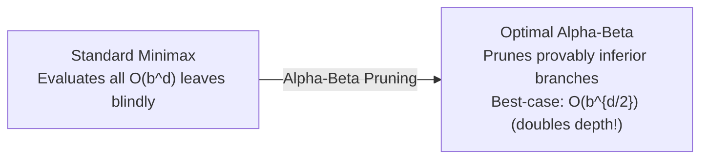
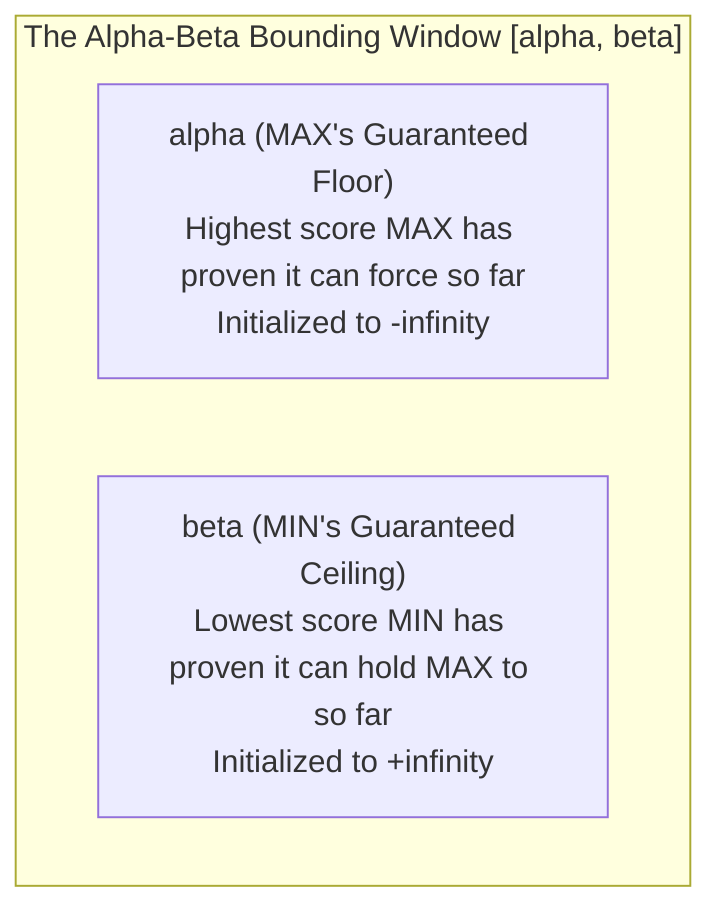
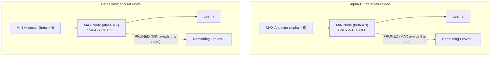
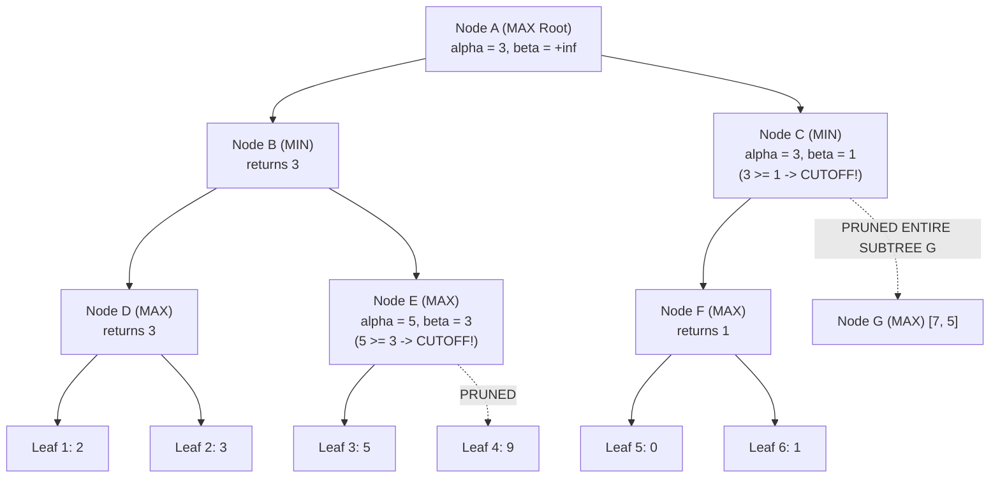
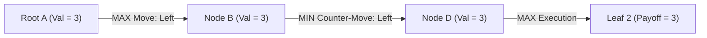

# Alpha-Beta Pruning: Concept Mastery & Exam Questions

> **Course -** Fundamentals of Artificial Intelligence (`21CSC569J` & `21CSC206T`)  
> **Topic Classification -** Adversarial Search & Game Playing  
> **Exam Priority -** **Rank 1 (100% Guaranteed in Every Semester Paper)**

---

## 1. Executive Summary & Why Alpha-Beta Matters

In two-player, zero-sum, perfect-information deterministic games (such as Chess, Checkers, and Tic-Tac-Toe), two adversaries compete with diametrically opposed objective functions:
*   **Player MAX:** Seeks moves that maximize the final payoff utility.
*   **Player MIN:** Seeks moves that minimize the final payoff utility.

### The Combinatorial Explosion of Pure Minimax
The standard Minimax algorithm computes optimal decisions through exhaustive Depth-First Search (DFS) over the game tree. However, its time complexity is:

$$\mathcal{O}(b^d)$$

where $b$ is the legal branching factor (available moves per turn) and $d$ is the maximum search depth.

*   In Chess, $b \approx 35$ and a typical match lasts $d \approx 80$ plies. Exhaustive evaluation would require $35^{80} \approx 10^{123}$ state evaluations &mdash; far exceeding the number of atoms in the observable universe.
*   Even with depth-limited horizon cuts (e.g., $d = 8$), Minimax must evaluate $35^8 \approx 2.25 \times 10^{12}$ positions, which exceeds real-time tournament time controls.

### The Core Philosophy of Alpha-Beta Pruning
**Alpha-Beta Pruning** eliminates this computational bottleneck without sacrificing optimality. It computes the **exact same minimax decision at the root** while pruning subtrees that provably cannot influence the final outcome:

$$\operatorname{AlphaBeta}(\text{Root}) \equiv \operatorname{Minimax}(\text{Root})$$



---

## 2. First-Principles Conceptual Understanding

### The Mental Model: Floors and Ceilings
Alpha-Beta pruning maintains two dynamic numerical bounds along the active search path:



1.  **$\alpha$ (Alpha) &mdash; MAX's Floor:**  
    The utility value of the best (highest-value) alternative discovered so far for player **MAX** along any choice point on the current path. MAX is guaranteed to achieve a score of *at least* $\alpha$.
2.  **$\beta$ (Beta) &mdash; MIN's Ceiling:**  
    The utility value of the best (lowest-value) alternative discovered so far for player **MIN** along any choice point on the current path. MIN is guaranteed to restrict MAX to a score of *at most* $\beta$.
3.  **The Viable Search Window:**  
    At any active node, the search interval is $[\alpha, \beta]$. If this window ever collapses ($\alpha \ge \beta$), the current branch becomes irrelevant.

---

### The Universal Pruning Condition

$$\mathbf{\text{If } \alpha \ge \beta, \quad \text{PRUNE ALL REMAINING SIBLINGS!}}$$

#### Why Does This Work?
Consider a node $N$ where $\alpha \ge \beta$:
*   If $N$ is a **MIN node**, it has discovered an outcome $v \le \alpha$. But an ancestor MAX node already has a guaranteed path worth $\alpha$. MAX will never choose the branch leading to $N$ because $N$ yields a strictly worse score ($v \le \alpha$).
*   If $N$ is a **MAX node**, it has discovered an outcome $v \ge \beta$. But an ancestor MIN node already has a guaranteed path worth $\beta$. MIN will never allow play to reach $N$ because $N$ yields a score higher than $\beta$.

---

## 3. The Two Cutoff Mechanisms

University examiners evaluate whether students understand the operational mechanics of $\alpha$-cutoffs vs. $\beta$-cutoffs:

| Cutoff Type | Where It Occurs | Trigger Condition | Who Causes It | Intuitive Reason |
| :--- | :--- | :---: | :--- | :--- |
| **$\alpha$-Cutoff** | **MIN Node** | **$v \le \alpha$** (or $\beta \le \alpha$) | Player **MIN** | MIN finds a move so low that an ancestor MAX would never pick this branch. |
| **$\beta$-Cutoff** | **MAX Node** | **$v \ge \beta$** (or $\alpha \ge \beta$) | Player **MAX** | MAX finds a move so high that an ancestor MIN would never allow this branch. |



---

## 4. Visual Step-by-Step Game Tree Walkthrough

Consider the standard 3-ply game tree below with root MAX, alternating MIN and MAX plies, and 8 terminal leaves. This tree configuration is directly adapted from semester exam papers:



### Complete Execution Trace Table

| Step | Node Visited | Node Type | Input $[\alpha, \beta]$ | Evaluated Value $(v)$ | Updated $[\alpha, \beta]$ | Action / Pruning Decision |
| :---: | :---: | :---: | :---: | :---: | :---: | :--- |
| **1** | **A** | MAX (Root) | $[-\infty, +\infty]$ | &mdash; | $[-\infty, +\infty]$ | Calls left child $B$ |
| **2** | **B** | MIN | $[-\infty, +\infty]$ | &mdash; | $[-\infty, +\infty]$ | Calls left child $D$ |
| **3** | **D** | MAX | $[-\infty, +\infty]$ | $2$ (Leaf 1) | $\alpha = \max(-\infty, 2) = 2$ | Updates $\alpha$ |
| **4** | **D** | MAX | $[2, +\infty]$ | $3$ (Leaf 2) | $\alpha = \max(2, 3) = 3$ | Returns $v = 3$ to $B$ |
| **5** | **B** | MIN | $[-\infty, +\infty]$ | $3$ (from $D$) | $\beta = \min(+\infty, 3) = 3$ | Updates $\beta$; calls child $E$ with $[-\infty, 3]$ |
| **6** | **E** | MAX | $[-\infty, 3]$ | $5$ (Leaf 3) | $\alpha = \max(-\infty, 5) = 5$ | Checks cutoff: $\alpha \ge \beta \iff 5 \ge 3$ |
| **7** | **E** | MAX | $[5, 3]$ | &mdash; | $\alpha \ge \beta \implies \mathbf{PRUNE!}$ | **Leaf 4 (value 9) is PRUNED!** Returns $5$ to $B$ |
| **8** | **B** | MIN | $[-\infty, 3]$ | $5$ (from $E$) | $\beta = \min(3, 5) = 3$ | Returns $v = 3$ to Root $A$ |
| **9** | **A** | MAX (Root) | $[-\infty, +\infty]$ | $3$ (from $B$) | $\alpha = \max(-\infty, 3) = 3$ | Updates $\alpha = 3$; calls $C$ with $[3, +\infty]$ |
| **10** | **C** | MIN | $[3, +\infty]$ | &mdash; | $[3, +\infty]$ | Calls left child $F$ with $[3, +\infty]$ |
| **11** | **F** | MAX | $[3, +\infty]$ | $0$ (Leaf 5) | $\alpha = \max(3, 0) = 3$ | No change |
| **12** | **F** | MAX | $[3, +\infty]$ | $1$ (Leaf 6) | $\alpha = \max(3, 1) = 3$ | Returns $v = 1$ to $C$ |
| **13** | **C** | MIN | $[3, +\infty]$ | $1$ (from $F$) | $\beta = \min(+\infty, 1) = 1$ | Checks cutoff: $\alpha \ge \beta \iff 3 \ge 1$ |
| **14** | **C** | MIN | $[3, 1]$ | &mdash; | $\alpha \ge \beta \implies \mathbf{PRUNE!}$ | **Entire Subtree G (Leaves 7, 5) PRUNED!** Returns $1$ |
| **15** | **A** | MAX (Root) | $[3, +\infty]$ | $1$ (from $C$) | $\alpha = \max(3, 1) = \mathbf{3}$ | **Search Complete! Optimal Value = 3** |

---

### Extracting the Principal Variation (Convenient Path)

The **Principal Variation (PV)** is the sequence of optimal moves executed by both players assuming perfect rational play:



*   **Move at Root:** Player MAX selects **Branch $B$ (Left)**.
*   **Optimal Trajectory:** $\mathbf{A \to B \to D \to \text{Leaf 2}}$.
*   **Guaranteed Payoff:** At least **3 units** for MAX.

---

## 5. Algorithmic Formulation & Node Ordering Complexity

### Recursive Pseudocode

```python
def alpha_beta(node, depth, alpha, beta, is_max_player):
    # Terminal condition
    if depth == 0 or node.is_terminal():
        return node.utility
    
    if is_max_player:
        max_eval = -float('inf')
        for child in node.children:
            eval_val = alpha_beta(child, depth - 1, alpha, beta, False)
            max_eval = max(max_eval, eval_val)
            alpha = max(alpha, eval_val)
            if alpha >= beta:
                break  # Beta-cutoff: MIN will avoid this branch
        return max_eval
    else:
        min_eval = float('inf')
        for child in node.children:
            eval_val = alpha_beta(child, depth - 1, alpha, beta, True)
            min_eval = min(min_eval, eval_val)
            beta = min(beta, eval_val)
            if alpha >= beta:
                break  # Alpha-cutoff: MAX will avoid this branch
        return min_eval
```

---

### Node Ordering & Complexity Limits

The efficiency of Alpha-Beta pruning depends entirely on the **order in which child nodes are examined**:

| Ordering Scenario | Effective Branching Factor | Time Complexity | Depth Achieved (Same Compute) |
| :--- | :---: | :---: | :--- |
| **Worst-Case Ordering** (Worst moves examined first) | $b$ | $\mathcal{O}(b^d)$ | Same depth as standard Minimax (Zero pruning) |
| **Random Ordering** | $\approx b^{3/4}$ | $\mathcal{O}(b^{3d/4})$ | Moderate depth increase ($\approx 33\%$ deeper) |
| **Best-Case Ordering** (Best moves examined first) | $\mathbf{\sqrt{b}}$ | $\mathbf{\mathcal{O}(b^{d/2})}$ | **Doubles the search depth!** ($d \to 2d$) |

#### Practical Heuristics for Move Ordering
Because game trees cannot be perfectly pre-sorted without solving the game, engines use domain-independent ordering heuristics:
1.  **Transposition Tables (TT):** Caching previously evaluated subtrees to identify the principal variation move immediately.
2.  **Killer Move Heuristic:** Trying moves that caused cutoffs at sibling nodes at the same search depth.
3.  **Iterative Deepening:** Using the best move from depth $d-1$ to order nodes at depth $d$.

---

## 6. Examiner's Grading Rubric & Common Traps

:::warning

**Top 4 Exam Pitfalls Where Students Lose Marks**

1.  **Confusing $\alpha$ and $\beta$ Updates:**  
    *WRONG:* Updating $\alpha$ at a MIN node or $\beta$ at a MAX node.  
    *CORRECT:* **MAX updates $\alpha$**; **MIN updates $\beta$**.
2.  **Inheritance of Bounding Values:**  
    Children do NOT start with $[-\infty, +\infty]$. They **inherit the current $[\alpha, \beta]$ bounds of their parent**.
3.  **Missing the Pruning Explanation:**  
    Simply crossing out a branch without stating *why* ($\alpha \ge \beta$) loses 2-3 marks. Always write: *"Pruned because $\alpha = 5 \ge \beta = 3$"*.
4.  **Omitting the Final Root Decision:**  
    After computing root utility 3, students often forget to specify which physical move MAX plays ($A \to B$).

:::

---

## 7. Exhaustive University Exam Question Archive

Below is the complete catalog of all 16 major examination questions on Alpha-Beta Pruning across both `21CSC206T` and `21CSC569J`, with direct links to full model solutions:

### `21CSC206T` (B.Tech Papers &mdash; 8M & 15M Questions)

#### 1. May 2026 &mdash; Question 23.b (8 Marks)
> Apply the Alpha-Beta Pruning algorithm to the game tree below, where the tree is evaluated from left to right. Show which branches are pruned and the final value at the root.  
> 🔗 **[View Model Solution &rarr;](../Previous-Year-Sem-Papers/21CSC206T/may-2026.mdx#question-23b-8-marks)**

#### 2. December 2025 &mdash; Question 23.a (8 Marks)
> Brief on Mini-Max algorithm and also discuss the need for Alpha-Beta Pruning with a step-by-step tree illustration.  
> 🔗 **[View Model Solution &rarr;](../Previous-Year-Sem-Papers/21CSC206T/december-2025.mdx#question-23a-8-marks)**

#### 3. July 2025 &mdash; Question 23.a (8 Marks)
> Evaluate the performance of adversarial search problems with examples in the competitive environment and show Alpha-Beta cutoff conditions.  
> 🔗 **[View Model Solution &rarr;](../Previous-Year-Sem-Papers/21CSC206T/july-2025.mdx#question-23a-8-marks)**

#### 4. May 2025 &mdash; Question 23.a (8 Marks)
> What is Minimax algorithm? Explain with an example of a game tree. Discuss its time and space complexity.  
> 🔗 **[View Model Solution &rarr;](../Previous-Year-Sem-Papers/21CSC206T/may-2025.mdx#question-23a-8-marks)**

#### 5. May 2025 &mdash; Question 23.b (8 Marks)
> Explain the concept of Alpha-Beta pruning in adversarial search. How does it improve the efficiency of the Minimax algorithm? Illustrate with a game tree example.  
> 🔗 **[View Model Solution &rarr;](../Previous-Year-Sem-Papers/21CSC206T/may-2025.mdx#question-23b-8-marks)**

#### 6. November 2024 &mdash; Question 26 (15 Marks)
> Comprehensive Part C question: Explain adversarial game search, draw the complete game tree, and execute Alpha-Beta pruning showing all cutoffs.  
> 🔗 **[View Model Solution &rarr;](../Previous-Year-Sem-Papers/21CSC206T/november-2024.mdx#question-26-15-marks)**

#### 7. July 2024 &mdash; Question 23.a (8 Marks)
> (i) Give the values calculated by minimax for all states in the tree without pruning.  
> (ii) Indicate which branches of the tree will be pruned by alpha-beta pruning.  
> 🔗 **[View Model Solution &rarr;](../Previous-Year-Sem-Papers/21CSC206T/july-2024.mdx#question-23a-8-marks)**

#### 8. May 2024 &mdash; Question 23.a (8 Marks)
> Describe the role of alpha-beta pruning in adversarial search. How does it improve the efficiency of the minimax algorithm? Illustrate with an example.  
> 🔗 **[View Model Solution &rarr;](../Previous-Year-Sem-Papers/21CSC206T/may-2024.mdx#question-23a-8-marks)**

#### 9. December 2023 &mdash; Question 23 (10 Marks)
> Describe the concept of Alpha-Beta Pruning in adversarial search. How does this technique enhance the efficiency of the Mini-Max algorithm? Provide a step-by-step illustration.  
> 🔗 **[View Model Solution &rarr;](../Previous-Year-Sem-Papers/21CSC206T/december-2023.mdx#question-23-10-marks)**

#### 10. July 2023 &mdash; Question 23.a (8 Marks)
> Demonstrate the two-player search tree to understand the working of Alpha-beta pruning on the given 8-leaf game tree.  
> 🔗 **[View Model Solution &rarr;](../Previous-Year-Sem-Papers/21CSC206T/july-2023.mdx#question-23a-8-marks)**

#### 11. May 2023 &mdash; Question 23.a (8 Marks)
> Demonstrate the two-player search tree to understand the working of Alpha-beta pruning with terminal utilities.  
> 🔗 **[View Model Solution &rarr;](../Previous-Year-Sem-Papers/21CSC206T/may-2023.mdx#question-23a-8-marks)**

---

### `21CSC569J` (M.Tech Papers &mdash; 20M Questions)

#### 12. May 2026 &mdash; Question 6 (20 Marks)
> Consider the game tree where A is the root node alternating between Max and Min levels. Apply Alpha-Beta Pruning step by step, show $\alpha$ and $\beta$ values at each node, identify pruned branches, and state the final decision of the Max player.  
> 🔗 **[View Model Solution &rarr;](../Previous-Year-Sem-Papers/21CSC569J/may-2026.mdx#question-6-20-marks)**

#### 13. November 2025 FN &mdash; Question 5 (20 Marks)
> (a) Explain in detail the procedure of Alpha-Beta pruning applied to a Minimax search tree using an example tree. Clearly indicate the order of node evaluation, alpha and beta values at each step, and nodes pruned.  
> (b) Using the Min-Max algorithm on the given game tree, determine the optimal value for the root node and identify the optimal move for the Max player.  
> 🔗 **[View Model Solution &rarr;](../Previous-Year-Sem-Papers/21CSC569J/november-2025-fn.mdx#question-5-20-marks)**

#### 14. November 2025 AN &mdash; Question 5 (20 Marks)
> Complete 2-player game tree evaluation using Minimax and Alpha-Beta pruning, detailing $[\alpha, \beta]$ propagation and branch cutoffs.  
> 🔗 **[View Model Solution &rarr;](../Previous-Year-Sem-Papers/21CSC569J/november-2025-an.mdx#question-5-20-marks)**

#### 15. May 2025 &mdash; Question 4 (20 Marks)
> Adversarial 2-player game tree evaluation demonstrating Minimax and Alpha-Beta pruning step-by-step.  
> 🔗 **[View Model Solution &rarr;](../Previous-Year-Sem-Papers/21CSC569J/may-2025.mdx#question-4-20-marks)**

#### 16. January 2025 &mdash; Question 4 (20 Marks)
> Perform alpha-beta pruning algorithm for the application 2-player game tree. Also elaborate how to find the convenient path for the player.  
> 🔗 **[View Model Solution &rarr;](../Previous-Year-Sem-Papers/21CSC569J/january-2025.mdx#question-4-20-marks)**
