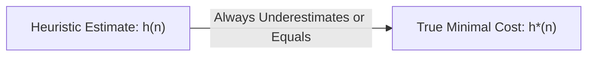
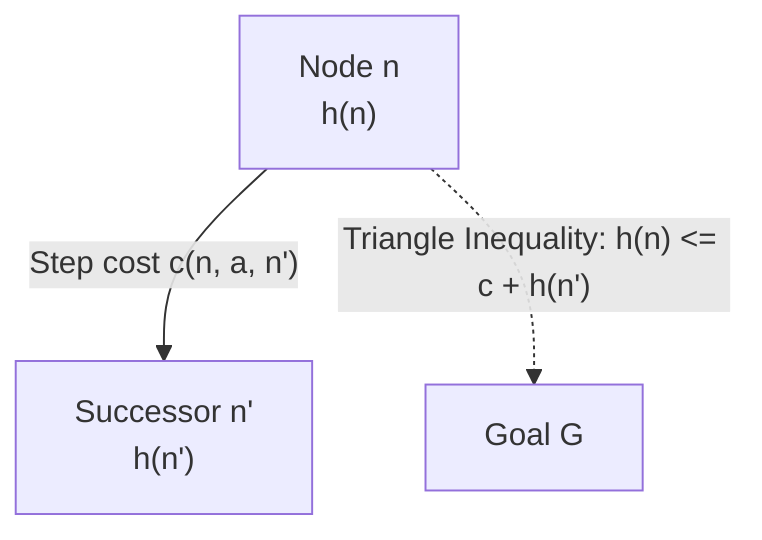
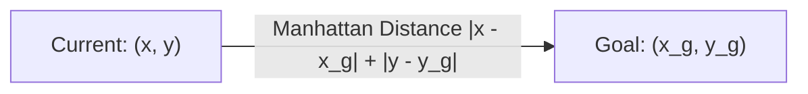
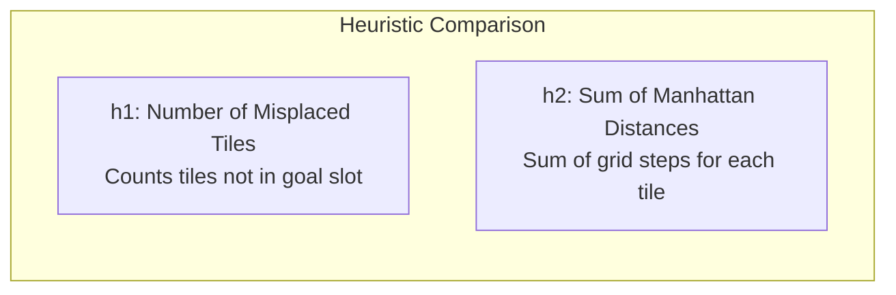
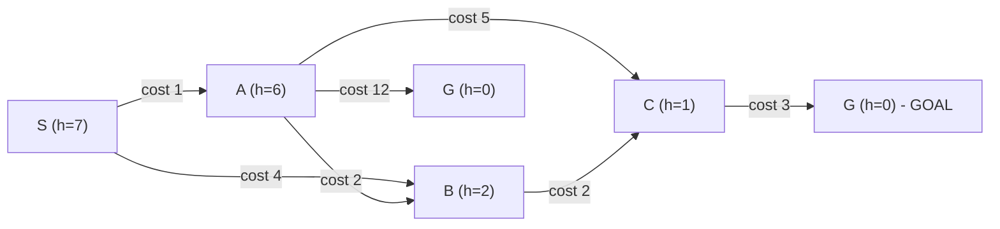

# A* Search: Concept Mastery & Exam Questions

> **Course -** Fundamentals of Artificial Intelligence (`21CSC569J` & `21CSC206T`)  
> **Topic Classification -** Informed (Heuristic) Search & Shortest Path Algorithms  
> **Exam Priority -** **Rank 2 (Appears in 80% of All Semester Examination Papers)**

---

## 1. Executive Summary & Why $A^*$ Matters

In state-space problem solving, classical uninformed algorithms (such as Breadth-First Search and Uniform Cost Search) explore nodes blindly in all directions like expanding spherical waves. Because they lack directional guidance, their time and memory footprints grow exponentially with search depth:

$$\mathcal{O}\left(b^{1 + \lfloor C^* / \epsilon \rfloor}\right)$$

### The Core Philosophy of $A^*$ Search
**$A^*$ Search** is a best-first heuristic search algorithm that guides exploration directly toward the goal state. It evaluates candidate nodes using an additive evaluation function that balances the path cost already spent with the estimated cost remaining:

$$f(n) = g(n) + h(n)$$


*   **$g(n)$ (Backward Cost):** The exact, cumulative path cost incurred to reach node $n$ from the start state $S$.
*   **$h(n)$ (Forward Heuristic Cost):** An estimated cost of the cheapest path from node $n$ to the nearest goal state $G$.
*   **$f(n)$ (Total Estimated Path Cost):** The estimated total cost of the cheapest solution path passing through node $n$.

By maintaining a **minimum-priority queue ordered strictly by $f(n)$**, $A^*$ achieves optimal efficiency: no other optimal search algorithm expanding the same heuristic can expand fewer nodes than $A^*$ (up to tie-breaking).

---

## 2. First-Principles Conceptual Understanding & Proofs

University examinations routinely ask students to state and prove the mathematical conditions under which $A^*$ is guaranteed to find an optimal solution.

### Condition 1: Admissibility ($h(n) \le h^*(n)$)

A heuristic function $h(n)$ is **admissible** if it never overestimates the true minimal cost to reach the goal:

$$0 \le h(n) \le h^*(n) \quad \forall n$$

where $h^*(n)$ is the true, optimal cost from node $n$ to the nearest goal state $G$. At any goal state, $h(G) = 0$.



#### Theorem: $A^*$ Tree Search is Optimal if $h(n)$ is Admissible
**Proof by Contradiction:**
1.  Let $C^*$ be the true cost of an optimal solution path, and let $G_1$ be an optimal goal node ($g(G_1) = C^*$).
2.  Suppose $A^*$ terminates by selecting a suboptimal goal node $G_2$ from the priority queue, where $g(G_2) > C^*$.
3.  Because $G_2$ is a goal node, $h(G_2) = 0$, so its total evaluation is:
    $$f(G_2) = g(G_2) + h(G_2) = g(G_2) > C^*$$
4.  Now consider the optimal path to $G_1$. Since $G_1$ has not yet been selected, there must exist at least one unexpanded frontier node $n$ on the optimal path.
5.  By admissibility, $h(n) \le h^*(n)$. Therefore, the evaluation of node $n$ satisfies:
    $$f(n) = g(n) + h(n) \le g(n) + h^*(n) = C^*$$
6.  Combining our inequalities:
    $$f(n) \le C^* < f(G_2) \implies f(n) < f(G_2)$$
7.  Because $f(n) < f(G_2)$, the priority queue must dequeue node $n$ *before* $G_2$.
8.  This contradicts the assumption that $G_2$ was dequeued. Therefore, $A^*$ can never select a suboptimal goal, proving tree-search optimality. $\blacksquare$

---

### Condition 2: Consistency / Monotonicity (Triangle Inequality)

In graph search (where repeated states and cycles exist), admissibility alone is insufficient unless closed nodes are allowed to reopen. **Consistency** (also called **monotonicity**) guarantees optimality in graph search without reopening any node.

A heuristic function $h(n)$ is **consistent** if, for every node $n$ and every successor $n'$ generated by action $a$:

$$h(n) \le c(n, a, n') + h(n')$$

where $c(n, a, n')$ is the step cost of transitioning from $n$ to $n'$.



#### Monotonicity of $f(n)$ Along Paths
If $h(n)$ is consistent, then $f(n)$ is non-decreasing along any path:

$$f(n') = g(n') + h(n') = g(n) + c(n, a, n') + h(n') \ge g(n) + h(n) = f(n)$$

$$\mathbf{f(n') \ge f(n)}$$

#### Theorem: $A^*$ Graph Search with Consistent Heuristics
When $h(n)$ is consistent:
1.  The sequence of nodes dequeued by $A^*$ has non-decreasing values of $f(n)$.
2.  Whenever $A^*$ selects a node $n$ for expansion, the optimal path to $n$ has already been found ($g(n) = g^*(n)$).
3.  **Closed nodes never need to be reopened**, ensuring worst-case space and time bounds.

---

### Condition 3: Heuristic Dominance

Given two admissible heuristic functions $h_1(n)$ and $h_2(n)$:

$$\mathbf{\text{If } h_2(n) \ge h_1(n) \quad \forall n, \quad \text{then } h_2 \text{ dominates } h_1.}$$

*   **Dominance Theorem:** $A^*$ using $h_2$ will expand **strictly fewer or equal nodes** than $A^*$ using $h_1$.
*   **Intuition:** A higher admissible heuristic provides a tighter lower bound, pruning more of the search space.

---

## 3. Core Problem Domains & Standard Heuristics

University examination papers evaluate $A^*$ across three standard domains:

### Domain 1: 4-Connected Grid World (Robot Pathfinding)
A mobile robot navigates an $M \times N$ grid from $(x_s, y_s)$ to $(x_g, y_g)$ avoiding wall obstacles with uniform step cost $c = 1$.



*   **Selected Heuristic:** **Manhattan Distance ($L_1$ Norm)**
    $$h(n) = \lvert x - x_g \rvert + \lvert y - y_g \rvert$$
*   **Admissibility Proof:** In an obstacle-free grid, the robot requires at least $\lvert x - x_g \rvert$ horizontal steps and $\lvert y - y_g \rvert$ vertical steps. Adding obstacles can only increase the required path length. Hence, $h(n) \le h^*(n)$ always holds.
*   **Alternative (8-Connected Grids with Diagonals):** **Chebyshev Distance**
    $$h(n) = \max(\lvert x - x_g \rvert, \lvert y - y_g \rvert)$$
*   **Alternative (Any-Angle Movement):** **Euclidean Distance ($L_2$ Norm)**
    $$h(n) = \sqrt{(x - x_g)^2 + (y - y_g)^2}$$

---

### Domain 2: The 8-Puzzle Problem
Sliding 8 numbered tiles on a $3 \times 3$ grid to reach the goal configuration.



1.  **$h_1(n)$ &mdash; Misplaced Tiles:** Count of numbered tiles (excluding the blank) whose current coordinate differs from their goal coordinate.
2.  **$h_2(n)$ &mdash; Sum of Manhattan Distances:** Sum of the horizontal and vertical distances of each tile from its goal position:
    $$h_2(n) = \sum_{i=1}^{8} \left( \lvert x_i - x_i^{\text{goal}} \rvert + \lvert y_i - y_i^{\text{goal}} \rvert \right)$$
3.  **Proof of Dominance:** A tile misplaced by $k$ grid steps contributes $1$ to $h_1(n)$ but $k \ge 1$ to $h_2(n)$. Because $h_2(n) \ge h_1(n)$ for all configurations, **$h_2$ strictly dominates $h_1$**. In practice, $h_2$ expands $\approx 6\times$ fewer nodes than $h_1$ at search depth 12.

---

### Domain 3: Weighted Directed Roadmaps
A network graph with explicit edge traversal costs $c(u, v)$ and a tabular heuristic vector $h(u)$ estimating straight-line distance to goal $G$.

---

## 4. Standard 6-Column Priority Queue Trace Protocol

University evaluators grade graph numericals against a standardized **6-column trace table**.

### Reference Problem Graph



*   **Heuristic Table:** $S: 7, \quad A: 6, \quad B: 2, \quad C: 1, \quad G: 0$

---

### Standard Step-by-Step Priority Queue Trace Table

| Step | Dequeued Node $(u)$ | $g(u)$ | $h(u)$ | $f(u) = g + h$ | Successors Generated $(v, g, h, f)$ | Priority Queue (Frontier) Contents Sorted by $f(n)$ |
| :---: | :---: | :---: | :---: | :---: | :--- | :--- |
| **1** | **S** | $0$ | $7$ | **7** | $(A, g=1, h=6, f=7)$<br/>$(B, g=4, h=2, f=6)$ | `[(B, f=6), (A, f=7)]` |
| **2** | **B** | $4$ | $2$ | **6** | $(C, g=4+2=6, h=1, f=7)$ | `[(A, f=7), (C, f=7)]` |
| **3** | **A** | $1$ | $6$ | **7** | $(B, g=1+2=3, h=2, f=5)$<br/>$(C, g=1+5=6, h=1, f=7)$<br/>$(G, g=1+12=13, h=0, f=13)$ | `[(B_cheaper, f=5), (C, f=7), (C_alt, f=7), (G, f=13)]` |
| **4** | **B** | $3$ | $2$ | **5** | $(C, g=3+2=5, h=1, f=6)$ | `[(C_cheaper, f=6), (C, f=7), (C_alt, f=7), (G, f=13)]` |
| **5** | **C** | $5$ | $1$ | **6** | $(G, g=5+3=8, h=0, f=8)$ | `[(C, f=7), (C_alt, f=7), (G, f=8), (G_old, f=13)]` |
| **6** | **C** | $6$ | $1$ | **7** | Discarded &mdash; already closed with cheaper cost $g=5$ | `[(C_alt, f=7), (G, f=8), (G_old, f=13)]` |
| **7** | **G** | $\mathbf{8}$ | $\mathbf{0}$ | $\mathbf{8}$ | **Goal Node Dequeued! Search Terminates.** | &mdash; |

*   **Optimal Path Extracted:** $\mathbf{S \to A \to B \to C \to G}$
*   **Total Minimal Cost:** $g(G) = 1 + 2 + 2 + 3 = \mathbf{8}$

---

## 5. Algorithmic Formulation & Memory-Bounded Variants

### Python Implementation

```python
import heapq

def a_star_search(graph, start, goal, heuristic):
    # Priority Queue stores: (f_score, g_score, current_node, path)
    frontier = []
    heapq.heappush(frontier, (heuristic[start], 0, start, [start]))
    
    # Explored map: tracks minimal g_score found for each node
    explored = {}
    
    while frontier:
        f, g, current, path = heapq.heappop(frontier)
        
        # Goal Test MUST occur when dequeuing from priority queue
        if current == goal:
            return path, g
            
        if current in explored and explored[current] <= g:
            continue
        explored[current] = g
        
        for neighbor, weight in graph.get(current, []):
            new_g = g + weight
            new_f = new_g + heuristic[neighbor]
            if neighbor not in explored or new_g < explored[neighbor]:
                heapq.heappush(frontier, (new_f, new_g, neighbor, path + [neighbor]))
                
    return None, float('inf')
```

---

### Complexity Analysis & Memory-Bounded Variants

| Search Property | Complexity Bound | Explanation |
| :--- | :---: | :--- |
| **Time Complexity** | $\mathcal{O}(b^d)$ | Depends on heuristic quality; drops to polynomial $\mathcal{O}(d^k)$ if error $\lvert h - h^* \rvert \le \mathcal{O}(\log h^*)$. |
| **Space Complexity** | $\mathcal{O}(b^d)$ | **The critical bottleneck of $A^*$** &mdash; must retain all generated nodes in RAM. |

#### Memory-Bounded $A^*$ Alternatives
When state spaces exceed available RAM, three algorithmic adaptations are used:
1.  **IDA* (Iterative Deepening A\*):** Uses $f(n)$ cutoffs rather than depth cutoffs, reducing memory consumption to linear $\mathcal{O}(bd)$.
2.  **RBFS (Recursive Best-First Search):** Linear-space best-first search that tracks alternative path $f$-values using recursion backpointers.
3.  **SMA* (Simplified Memory-Bounded A\*):** Operates within a fixed memory buffer, discarding the worst leaf node when memory fills.

---

## 6. Examiner's Grading Rubric & Common Traps

:::warning

**Top 4 Exam Pitfalls Where Students Lose Marks**

1.  **Early Goal Termination Trap:**  
    *WRONG:* Terminating the search as soon as a goal node is *generated* as a successor.  
    *CORRECT:* $A^*$ **must only terminate when the goal node is DEQUEUED (popped)** from the priority queue. A goal generated along a suboptimal path may have an $f$-value higher than an unexpanded node.
2.  **Counting the Blank Tile in 8-Puzzle:**  
    *WRONG:* Adding the blank space into the misplaced tiles count or Manhattan distance sum.  
    *CORRECT:* Heuristic evaluations **must only count numbered tiles $\{1, \dots, 8\}$**.
3.  **Confusing Admissibility and Consistency:**  
    Admissibility requires $h(n) \le h^*(n)$ (underestimating true goal cost). Consistency requires $h(n) \le c(n, a, n') + h(n')$ (triangle inequality). Consistency implies admissibility, but not vice-versa.
4.  **Omitting Queue State in Trace Tables:**  
    Failing to show the updated contents of the frontier priority queue at each step typically results in a 3-mark to 5-mark deduction.

:::

---

## 7. Exhaustive University Exam Question Archive

Below is the complete catalog of all 17 major examination questions on $A^*$ Search across both `21CSC206T` and `21CSC569J`, with direct links to full model solutions:

### `21CSC206T` (B.Tech Papers &mdash; 8M & 15M Questions)

#### 1. May 2026 &mdash; Question 22.b (8 Marks)
> Use the A* algorithm to search for the shortest path from the start state 'A' to the final state 'J' in the given graph. Show the step-by-step evaluation of the f(n) values for each node visited.  
> 🔗 **[View Model Solution &rarr;](../Previous-Year-Sem-Papers/21CSC206T/may-2026.mdx#question-22b-8-marks)**

#### 2. December 2025 &mdash; Question 22.a (8 Marks)
> Consider the graph with heuristic values ($S: 7, A: 8, B: 6, C: 5, G: 0$) and find the path from S to G using the A* Algorithm.  
> 🔗 **[View Model Solution &rarr;](../Previous-Year-Sem-Papers/21CSC206T/december-2025.mdx#question-22a-8-marks)**

#### 3. July 2025 &mdash; Question 22.b (8 Marks)
> What is heuristic search? Explain the Generate-and-Test method and A* evaluation with an example.  
> 🔗 **[View Model Solution &rarr;](../Previous-Year-Sem-Papers/21CSC206T/july-2025.mdx#question-22b-8-marks)**

#### 4. May 2025 &mdash; Question 22.b (8 Marks)
> The numbers on edges represent distance; numbers on nodes represent heuristic values. Find the most cost-effective path from start state A to final state J using A* search.  
> 🔗 **[View Model Solution &rarr;](../Previous-Year-Sem-Papers/21CSC206T/may-2025.mdx#question-22b-8-marks)**

#### 5. May 2025 &mdash; Question 27 (15 Marks)
> Given an initial state of 8 puzzle problem and final state to be reached, find the most cost-effective path using A* search algorithm with misplaced tiles heuristic.  
> 🔗 **[View Model Solution &rarr;](../Previous-Year-Sem-Papers/21CSC206T/may-2025.mdx#question-27-15-marks)**

#### 6. November 2024 &mdash; Question 27 (15 Marks)
> Given the graph below, demonstrate how the A* algorithm searches for the shortest path from node A to node J, highlighting how A* combines the advantages of BFS and Greedy Best-First Search.  
> 🔗 **[View Model Solution &rarr;](../Previous-Year-Sem-Papers/21CSC206T/november-2024.mdx#question-27-15-marks)**

#### 7. May 2024 &mdash; Question 22.b (8 Marks)
> Warehouse management system: The warehouse is represented as a grid where a robot moves items around avoiding obstacles. Apply A* search with Manhattan distance to find the optimal route.  
> 🔗 **[View Model Solution &rarr;](../Previous-Year-Sem-Papers/21CSC206T/may-2024.mdx#question-22b-8-marks)**

#### 8. July 2023 &mdash; Question 22.b (8 Marks)
> Use the A* algorithm to search for the most cost-effective path from start state 'A' to final state 'J' in the given graph. Show step-by-step evaluation of $f(n)$.  
> 🔗 **[View Model Solution &rarr;](../Previous-Year-Sem-Papers/21CSC206T/july-2023.mdx#question-22b-8-marks)**

#### 9. May 2023 &mdash; Question 22.b (8 Marks)
> A dog wants to eat a bone far away avoiding hurdles and sticks. Using A* search, find the optimal path to reach the bone on the grid.  
> 🔗 **[View Model Solution &rarr;](../Previous-Year-Sem-Papers/21CSC206T/may-2023.mdx#question-22b-8-marks)**

#### 10. May 2023 &mdash; Question 26 (15 Marks)
> (i) Comparatively analyze A* and Best-First Search algorithms. (5 Marks)  
> (ii) Apply UCS in the given graph and find the path from S to G. (10 Marks)  
> 🔗 **[View Model Solution &rarr;](../Previous-Year-Sem-Papers/21CSC206T/may-2023.mdx#question-26-15-marks)**

---

### `21CSC569J` (M.Tech Papers &mdash; 10M & 20M Questions)

#### 11. May 2025 &mdash; Question 3 (20 Marks)
> Solve the 8-Puzzle Problem Using A* Search Algorithm. Show state grids, depth $g(n)$, misplaced tiles $h(n)$, and total evaluation $f(n)$ across all moves.  
> 🔗 **[View Model Solution &rarr;](../Previous-Year-Sem-Papers/21CSC569J/may-2025.mdx#question-3-20-marks)**

#### 12. May 2025 &mdash; Question 7 (20 Marks)
> A* search algorithm trace on a weighted graph with priority queue logging and admissibility analysis.  
> 🔗 **[View Model Solution &rarr;](../Previous-Year-Sem-Papers/21CSC569J/may-2025.mdx#question-7-20-marks)**

#### 13. January 2025 &mdash; Question 3 (20 Marks)
> Solve the 8-puzzle problem using A* algorithm given Initial State and Goal State with $g(n) = \text{depth}$ and $h(n) = \text{number of misplaced tiles}$.  
> 🔗 **[View Model Solution &rarr;](../Previous-Year-Sem-Papers/21CSC569J/january-2025.mdx#question-3-20-marks)**

#### 14. November 2025 AN &mdash; Question 4 (20 Marks)
> Robot grid navigation via A* search using Manhattan distance, including admissibility and monotonicity proofs.  
> 🔗 **[View Model Solution &rarr;](../Previous-Year-Sem-Papers/21CSC569J/november-2025-an.mdx#question-4-20-marks)**

#### 15. November 2025 AN &mdash; Question 7 (20 Marks)
> A* search graph traversal trace table from start node S to goal G with edge costs and heuristic estimations.  
> 🔗 **[View Model Solution &rarr;](../Previous-Year-Sem-Papers/21CSC569J/november-2025-an.mdx#question-7-20-marks)**

#### 16. November 2025 FN &mdash; Question 4.b (10 Marks)
> Robot Pathfinding Scenario: A mobile robot must navigate through a grid to reach a goal position while avoiding obstacles. Explain how A* search can be applied, choose an appropriate heuristic function, and justify its admissibility.  
> 🔗 **[View Model Solution &rarr;](../Previous-Year-Sem-Papers/21CSC569J/november-2025-fn.mdx#question-4-20-marks)**

#### 17. November 2025 FN &mdash; Question 7.a (10 Marks)
> Consider the graph where each edge represents the cost between states, and the table provides heuristic values ($S: 7, A: 6, B: 2, C: 1, G: 0$). Use A* search to find the optimal path from S to G with step-by-step $g, h, f$ values.  
> 🔗 **[View Model Solution &rarr;](../Previous-Year-Sem-Papers/21CSC569J/november-2025-fn.mdx#question-7-20-marks)**
