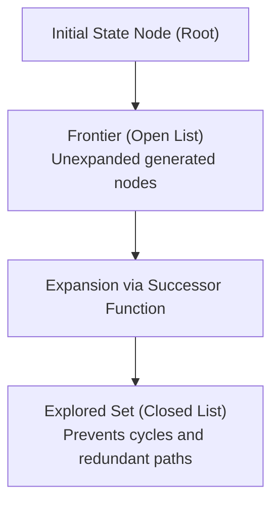
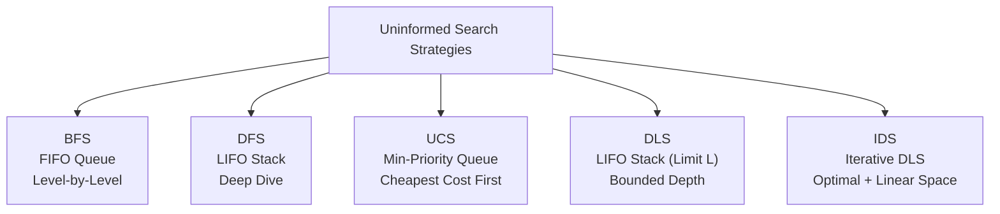
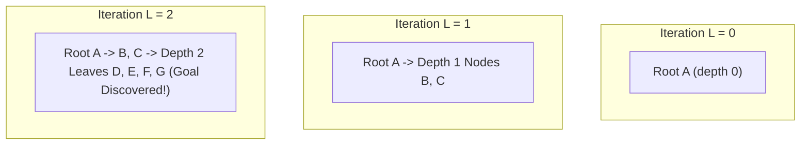
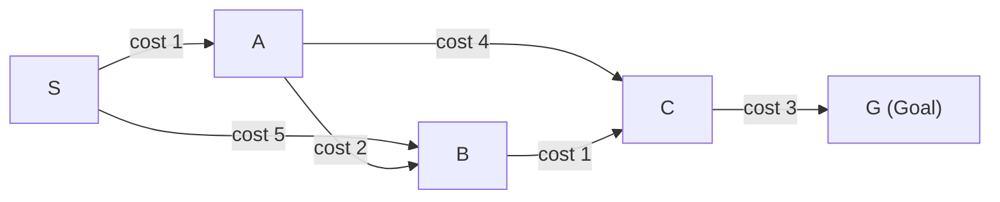
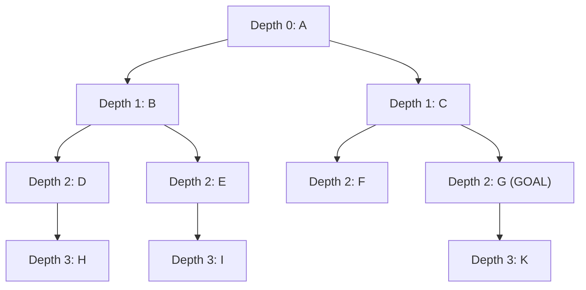

# Uninformed Search: Concept Mastery & Exam Questions

> **Course -** Fundamentals of Artificial Intelligence (`21CSC569J` & `21CSC206T`)  
> **Topic Classification -** Classical State-Space Search (Blind Strategies)  
> **Exam Priority -** **Rank 3 (Appears in 87% of All Semester Examination Papers)**

---

## 1. Executive Summary & Why Uninformed Search Matters

In classical artificial intelligence, problem-solving agents formulate goals and navigate through state spaces using search algorithms. Search strategies are divided into two fundamental paradigms:
*   **Informed (Heuristic) Search:** Utilizes domain-specific knowledge ($h(n)$) to estimate the distance to the goal (e.g., $A^*$, Greedy Best-First).
*   **Uninformed (Blind) Search:** Operates without any heuristic estimate. The algorithm only has access to problem formulation primitives: generating legal actions, computing successor states, and testing whether a state satisfies the goal condition.

### The Search Tree Framework
A search algorithm superimposes a search tree over the underlying state-space graph:

*   **Frontier (Open List):** The collection of all leaf nodes generated but not yet expanded. The specific data structure used for the frontier dictates the behavior and properties of the search algorithm.
*   **Explored Set (Closed List):** A hash table storing states that have already been expanded, ensuring that finite graphs with cycles do not cause infinite loops.

---

## 2. First-Principles Conceptual Deep Dive & Asymptotic Bounds

University examinations evaluate five primary uninformed search algorithms across four core metrics: **Completeness**, **Time Complexity**, **Space Complexity**, and **Optimality**.

---

### 1. Breadth-First Search (BFS)
*   **Frontier Data Structure:** **FIFO Queue** (First-In, First-Out).
*   **Expansion Strategy:** Explores the shallowest unexpanded node first, expanding layer by layer ($d = 0, 1, 2, \dots$).
*   **Goal Test Timing:** Applied when a node is **generated** (not when dequeued). This avoids generating an entire additional level of $b^{d+1}$ nodes.
*   **Time Complexity:** 
    $$1 + b + b^2 + b^3 + \dots + b^d = \mathcal{O}(b^d)$$
*   **Space Complexity:** $\mathcal{O}(b^d)$ &mdash; **The Exponential Memory Bottleneck.** Every node in the current generation level must reside in RAM. At depth 10 with $b = 10$, BFS requires over 10 gigabytes of memory.
*   **Optimality:** Optimal if all step costs are equal (uniform cost $c = 1$). Suboptimal if action costs vary.

---

### 2. Depth-First Search (DFS)
*   **Frontier Data Structure:** **LIFO Stack** (Last-In, First-Out) or system recursion call stack.
*   **Expansion Strategy:** Explores the deepest unexpanded node first, plunging down a single path until reaching a dead end before backtracking.
*   **Goal Test Timing:** Applied when a node is **selected for expansion**.
*   **Time Complexity:** $\mathcal{O}(b^m)$, where $m$ is the maximum depth of the state space. If the state space is infinite or contains cycles, time is unbounded.
*   **Space Complexity:** $\mathbf{\mathcal{O}(bm)}$ &mdash; **Linear Memory Footprint.** Only the active path from the root to the current leaf plus unexpanded sibling nodes must be retained in memory.
*   **Completeness & Optimality:** Incomplete in infinite-depth spaces; **suboptimal** because it may return a deep goal even if a shallow goal exists on an adjacent branch.

---

### 3. Uniform Cost Search (UCS) / Dijkstra on Implicit Graphs
*   **Frontier Data Structure:** **Min-Priority Queue ordered strictly by path cost $g(n)$**.
*   **Expansion Strategy:** Explores the node with the lowest cumulative path cost $g(n)$ from the start state $S$.
*   **Crucial Goal Test Timing:** **Applied when a node is DEQUEUED (popped)** from the priority queue, **never when generated**. A goal node generated along a high-cost path may be overtaken by an unexpanded cheaper path later.
*   **Condition for Optimality:** Every step cost must be strictly positive: $c(s, a, s') \ge \epsilon > 0$.
*   **Time & Space Complexity:**
    $$\mathcal{O}\left(b^{1 + \lfloor C^* / \epsilon \rfloor}\right)$$
    where $C^*$ is the cost of the optimal solution. When all step costs are identical ($c = \epsilon$), UCS evaluates identical nodes to BFS.

---

### 4. Depth-Limited Search (DLS)
*   **Strategy:** Standard DFS with an artificially imposed depth ceiling $L$. Nodes at depth $L$ are treated as terminal leaves.
*   **Complexity:** Time $\mathcal{O}(b^L)$, Space $\mathcal{O}(bL)$.
*   **Failure Modes:** Incomplete if the shallowest goal lies at depth $d > L$. Returns three distinct status outcomes: **Goal**, **Cutoff** (limit reached without finding goal), or **Failure** (exhausted tree without finding goal).

---

### 5. Iterative Deepening Search (IDS)
*   **Strategy:** Repeatedly executes Depth-Limited Search with progressively increasing depth limits: $L = 0, 1, 2, 3, \dots, d$.
*   **Why IDS is the Gold Standard for Uninformed Search:**  
    IDS successfully combines the **completeness and optimality of BFS** with the **linear space efficiency of DFS ($\mathcal{O}(bd)$)**!

#### Mathematical Proof of IDS Efficiency (The Redundant Node Myth)
Students frequently assume that re-expanding top levels makes IDS excessively slow. Mathematically, in an exponential tree, the bottom level completely dominates:

$$N(\text{IDS}) = (d+1) \cdot 1 + d \cdot b + (d-1) \cdot b^2 + \dots + 1 \cdot b^d$$

$$N(\text{BFS}) = 1 + b + b^2 + \dots + b^d$$

Taking the ratio of nodes expanded by IDS compared to BFS:

$$\frac{N(\text{IDS})}{N(\text{BFS})} \approx \frac{b}{b - 1}$$

*   For branching factor $b = 10$, the overhead of IDS is only $\frac{10}{9} \approx \mathbf{11\%}$!
*   For branching factor $b = 4$, the overhead is only $\frac{4}{3} \approx \mathbf{33\%}$!
*   IDS achieves BFS-level optimality while avoiding the fatal gigabyte-scale memory crashes of BFS.

---

## 3. Master 5-Algorithm Comparison Matrix

University examiners frequently test this comparative matrix in 8-mark and 15-mark questions:

| Search Algorithm | Frontier Data Structure | Time Complexity | Space Complexity | Complete? | Cost-Optimal? | Goal Test Timing |
| :--- | :--- | :---: | :---: | :---: | :---: | :--- |
| **Breadth-First (BFS)** | FIFO Queue | $\mathcal{O}(b^d)$ | $\mathcal{O}(b^d)$ *(Exponential)* | **Yes** *(finite $b$)* | Yes *(if step costs uniform)* | **Upon Generation** |
| **Depth-First (DFS)** | LIFO Stack | $\mathcal{O}(b^m)$ | $\mathbf{\mathcal{O}(bm)}$ *(Linear)* | No *(fails in loops)* | **No** *(returns first found)* | **Upon Selection** |
| **Uniform Cost (UCS)** | Min-Priority Queue by $g(n)$ | $\mathcal{O}(b^{1 + \lfloor C^* / \epsilon \rfloor})$ | $\mathcal{O}(b^{1 + \lfloor C^* / \epsilon \rfloor})$ | **Yes** | **Yes** *(Arbitrary $c \ge \epsilon$)* | **Upon Dequeue (Pop)** |
| **Depth-Limited (DLS)** | LIFO Stack (limit $L$) | $\mathcal{O}(b^L)$ | $\mathbf{\mathcal{O}(bL)}$ *(Linear)* | No *(if $d > L$)* | **No** | **Upon Selection** |
| **Iterative Deepening (IDS)** | Repeated DLS ($L = 0, 1, \dots$) | $\mathcal{O}(b^d)$ | $\mathbf{\mathcal{O}(bd)}$ *(Linear)* | **Yes** *(finite $b$)* | Yes *(if step costs uniform)* | **Upon Selection** |

---

## 4. Step-by-Step Traversal Walkthroughs & Trace Protocols

### Walkthrough 1: Uniform Cost Search (UCS) on a Weighted Graph

#### Step-by-Step UCS Priority Queue Trace Table

| Step | Dequeued Node $(u)$ | Cumulative Cost $g(u)$ | Successors Generated $(v, g)$ | Priority Queue (Frontier) State Sorted by $g(n)$ |
| :---: | :---: | :---: | :--- | :--- |
| **1** | **S** | $0$ | $(A, g=0+1=1)$ $(B, g=0+5=5)$ | `[(A, 1), (B, 5)]` |
| **2** | **A** | $1$ | $(B, g=1+2=3)$ *(Cheaper than existing 5!)* $(C, g=1+4=5)$ | `[(B, 3), (B_old, 5), (C, 5)]` |
| **3** | **B** | $3$ | $(C, g=3+1=4)$ *(Cheaper than existing 5!)* | `[(C, 4), (B_old, 5), (C_old, 5)]` |
| **4** | **C** | $4$ | $(G, g=4+3=7)$ | `[(B_old, 5), (C_old, 5), (G, 7)]` |
| **5** | **B** | $5$ | Discarded &mdash; state $B$ already explored at lower cost $g=3$ | `[(C_old, 5), (G, 7)]` |
| **6** | **C** | $5$ | Discarded &mdash; state $C$ already explored at lower cost $g=4$ | `[(G, 7)]` |
| **7** | **G** | $\mathbf{7}$ | **Goal Node Dequeued! Search Terminates.** | &mdash; |

*   **Optimal Path Extracted:** $\mathbf{S \to A \to B \to C \to G}$
*   **Optimal Cost:** $g(G) = 1 + 2 + 1 + 3 = \mathbf{7}$

---

### Walkthrough 2: DFS vs. DLS ($L = 2$) on a Search Tree

*   **Depth-First Search (DFS) Visited Order (9 Nodes):**  
    $$A \to B \to D \to H \to E \to I \to C \to F \to \mathbf{G \quad (Goal)}$$
    *(DFS dives deep along the left subtrees down to depth 3 before backtracking to $C$)*.
*   **Depth-Limited Search (DLS with $L = 2$) Visited Order (7 Nodes):**  
    $$A \to B \to D \to E \to C \to F \to \mathbf{G \quad (Goal)}$$
    *(DLS cuts off exploration at depth 2; nodes $H$ and $I$ are never generated, discovering goal $G$ in 7 steps)*.

---

## 5. Examiner's Grading Rubric & Common Traps

:::warning

**Top 4 Exam Pitfalls Where Students Lose Marks**

1.  **The UCS Goal Test Trap:**  
    *WRONG:* Checking if a node is the goal when it is *generated* in UCS.  
    *CORRECT:* UCS **must test for goal status only when a node is DEQUEUED (popped)** from the priority queue. Testing on generation breaks cost-optimality!
2.  **Confusing DFS Memory Complexity:**  
    *WRONG:* Writing that DFS space complexity is $\mathcal{O}(b^m)$.  
    *CORRECT:* DFS space complexity is **linear: $\mathcal{O}(bm)$**. Only the current branch and sibling nodes reside in RAM.
3.  **The BFS Cost-Optimality Assumption:**  
    *WRONG:* Claiming BFS is always optimal for any graph.  
    *CORRECT:* BFS is **only optimal when all step costs are identical**. If edge weights differ, BFS is suboptimal; UCS is required.
4.  **Re-expansion Misconception in IDS:**  
    Failing to explain that IDS has negligible computational overhead ($\frac{b}{b-1}$) because the bottom level $b^d$ dominates all ancestor levels combined.

:::

---

## 6. Exhaustive University Exam Question Archive

Below is the complete catalog of all 24 major examination questions on Uninformed Search across both `21CSC206T` and `21CSC569J`, with direct links to full model solutions:

### `21CSC206T` (B.Tech Papers &mdash; 8M, 10M, & 15M Questions)

#### 1. May 2026 &mdash; Question 22.a (8 Marks)
> State space where start state is 1 and each state $n$ has successors $2n$ and $2n+1$. Draw the search tree up to depth 3, determine visited states in BFS and DFS, and explain which algorithm finds goal 11 faster.  
> 🔗 **[View Model Solution &rarr;](../Previous-Year-Sem-Papers/21CSC206T/may-2026.mdx#question-22a-8-marks)**

#### 2. December 2025 &mdash; Question 22.b (8 Marks)
> Elaborate on the need for uninformed and local search algorithms and execute Uniform Cost Search on a directed graph.  
> 🔗 **[View Model Solution &rarr;](../Previous-Year-Sem-Papers/21CSC206T/december-2025.mdx#question-22b-8-marks)**

#### 3. December 2025 &mdash; Question 27 (15 Marks)
> Given a weighted graph, find the shortest path from source node (P) to destination node (S) using Uniform Cost Search (UCS) with complete priority queue logs.  
> 🔗 **[View Model Solution &rarr;](../Previous-Year-Sem-Papers/21CSC206T/december-2025.mdx#question-27-15-marks)**

#### 4. July 2025 &mdash; Question 22.a (8 Marks)
> Explain the role of search algorithms in Artificial Intelligence. Compare Breadth-First Search (BFS) and Depth-First Search (DFS) with examples.  
> 🔗 **[View Model Solution &rarr;](../Previous-Year-Sem-Papers/21CSC206T/july-2025.mdx#question-22a-8-marks)**

#### 5. July 2025 &mdash; Question 23.a (8 Marks)
> Explain Iterative Deepening Search (IDS) and evaluate its performance in large search spaces.  
> 🔗 **[View Model Solution &rarr;](../Previous-Year-Sem-Papers/21CSC206T/july-2025.mdx#question-23a-8-marks)**

#### 6. May 2025 &mdash; Question 21.a (8 Marks)
> How does Breadth First Search (BFS) differ from Depth First Search (DFS)? Compare both based on data structure, time complexity, space complexity, optimality, and completeness.  
> 🔗 **[View Model Solution &rarr;](../Previous-Year-Sem-Papers/21CSC206T/may-2025.mdx#question-21a-8-marks)**

#### 7. May 2025 &mdash; Question 22.a (8 Marks)
> Trace Uniform Cost Search (UCS) on a weighted directed graph showing cumulative cost calculations at each step.  
> 🔗 **[View Model Solution &rarr;](../Previous-Year-Sem-Papers/21CSC206T/may-2025.mdx#question-22a-8-marks)**

#### 8. November 2024 &mdash; Question 22.a (8 Marks)
> Trace Uniform Cost Search on a weighted state graph, showing open priority queue order and path cost calculations.  
> 🔗 **[View Model Solution &rarr;](../Previous-Year-Sem-Papers/21CSC206T/november-2024.mdx#question-22a-8-marks)**

#### 9. November 2024 &mdash; Question 22.b (8 Marks)
> Explain Briefly about Depth First Search with suitable example, discussing space complexity and backtracking.  
> 🔗 **[View Model Solution &rarr;](../Previous-Year-Sem-Papers/21CSC206T/november-2024.mdx#question-22b-8-marks)**

#### 10. July 2024 &mdash; Question 22.a (8 Marks)
> Explain the depth first search algorithm with an example and stack trace.  
> 🔗 **[View Model Solution &rarr;](../Previous-Year-Sem-Papers/21CSC206T/july-2024.mdx#question-22a-8-marks)**

#### 11. July 2024 &mdash; Question 22.b (8 Marks)
> Perform Breadth first search and uniform cost strategies on the given graph from start node S to goal node G.  
> 🔗 **[View Model Solution &rarr;](../Previous-Year-Sem-Papers/21CSC206T/july-2024.mdx#question-22b-8-marks)**

#### 12. May 2024 &mdash; Question 22.a (8 Marks)
> Consider the graph and find the route to traverse from node A to destination D using breadth first search technique with queue contents.  
> 🔗 **[View Model Solution &rarr;](../Previous-Year-Sem-Papers/21CSC206T/may-2024.mdx#question-22a-8-marks)**

#### 13. May 2024 &mdash; Question 27 (15 Marks)
> Find the shortest path from source node (P) to destination node (S) using Uniform Cost Search (UCS) on a weighted graph.  
> 🔗 **[View Model Solution &rarr;](../Previous-Year-Sem-Papers/21CSC206T/may-2024.mdx#question-27-15-marks)**

#### 14. December 2023 &mdash; Question 22 (10 Marks)
> Uniform Cost Search trace on directed weighted graph, documenting minimum priority queue updates.  
> 🔗 **[View Model Solution &rarr;](../Previous-Year-Sem-Papers/21CSC206T/december-2023.mdx#question-22-10-marks)**

#### 15. December 2023 &mdash; Question 27 (15 Marks)
> Explain and Implement Breadth First and Iterative Deepening Search from Source Node 1 to Destination Node 12.  
> 🔗 **[View Model Solution &rarr;](../Previous-Year-Sem-Papers/21CSC206T/december-2023.mdx#question-27-15-marks)**

#### 16. December 2023 &mdash; Question 28 (15 Marks)
> Implement Depth First and Uniform Cost Search from Source Node S to Destination Node G.  
> 🔗 **[View Model Solution &rarr;](../Previous-Year-Sem-Papers/21CSC206T/december-2023.mdx#question-28-15-marks)**

#### 17. July 2023 &mdash; Question 22.a (8 Marks)
> Identify the data structure used in Breadth First Search (BFS). Apply BFS for the given directed graph with starting vertex S and ending vertex X.  
> 🔗 **[View Model Solution &rarr;](../Previous-Year-Sem-Papers/21CSC206T/july-2023.mdx#question-22a-8-marks)**

#### 18. May 2023 &mdash; Question 21.a (8 Marks)
> Compare BFS and DFS uninformed algorithms across time complexity, space complexity, data structures, and completeness.  
> 🔗 **[View Model Solution &rarr;](../Previous-Year-Sem-Papers/21CSC206T/may-2023.mdx#question-21a-8-marks)**

#### 19. May 2023 &mdash; Question 22.a (8 Marks)
> Explain the Depth First Search algorithm with an example and discuss its time and space complexity.  
> 🔗 **[View Model Solution &rarr;](../Previous-Year-Sem-Papers/21CSC206T/may-2023.mdx#question-22a-8-marks)**

#### 20. May 2023 &mdash; Question 27 (15 Marks)
> (i) Comparatively analyze BFS and DFS algorithms. (5 Marks)  
> (ii) Consider the given graph and explain the searching process using Iterative Deepening Search (IDS). (10 Marks)  
> 🔗 **[View Model Solution &rarr;](../Previous-Year-Sem-Papers/21CSC206T/may-2023.mdx#question-27-15-marks)**

---

### `21CSC569J` (M.Tech Papers &mdash; 5M & 20M Questions)

#### 21. May 2026 &mdash; Question 6.b (5 Marks)
> Define Iterative Deepening search with a suitable example, showing iteration levels and linear memory complexity.  
> 🔗 **[View Model Solution &rarr;](../Previous-Year-Sem-Papers/21CSC569J/may-2026.mdx#question-6-20-marks)**

#### 22. November 2025 FN &mdash; Question 3 (20 Marks)
> (a) Given tree configuration, perform DFS traversal starting from root node and write down the order in which nodes are visited (9 nodes).  
> (b) Perform Depth-Limited Search (DLS) on the same tree with depth limit 2 (7 nodes) and compare both methods.  
> 🔗 **[View Model Solution &rarr;](../Previous-Year-Sem-Papers/21CSC569J/november-2025-fn.mdx#question-3-20-marks)**

#### 23. November 2025 AN &mdash; Question 3 (20 Marks)
> Complete comparative trace of Breadth-First Search (BFS) and Depth-First Search (DFS) on a 10-node state tree.  
> 🔗 **[View Model Solution &rarr;](../Previous-Year-Sem-Papers/21CSC569J/november-2025-an.mdx#question-3-20-marks)**

#### 24. May 2025 &mdash; Question 7 (20 Marks)
> Explain the working principle of Breadth First Search (BFS) and Depth First Search (DFS) algorithms with step-by-step illustrations.  
> 🔗 **[View Model Solution &rarr;](../Previous-Year-Sem-Papers/21CSC569J/may-2025.mdx#question-7-20-marks)**
