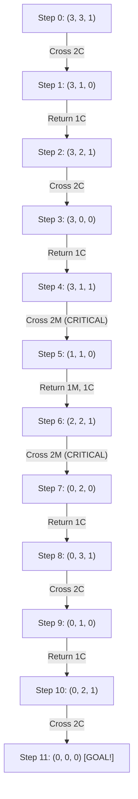

# Missionaries & Cannibals: Concept Mastery & Exam Questions

> **Course -** Fundamentals of Artificial Intelligence (`21CSC569J` & `21CSC206T`)  
> **Topic Classification -** State-Space Problem Formulation & Classical AI Puzzles  
> **Exam Priority -** **Rank 4 (The Dominant 15-Mark Part C & 20-Mark Question)**

---

## 1. Executive Summary & Problem Definition

First formalized in artificial intelligence by Saul Amarel in 1968, the **Missionaries and Cannibals Problem** is a canonical benchmark for testing an agent's ability to formulate real-world constraints into mathematical state-space representations.

### The Problem Statement
*   **Initial Setup:** Three missionaries ($M=3$) and three cannibals ($C=3$) stand on the **Left Bank** of a river.
*   **The Vessel:** A small rowboat is moored at the Left Bank.
*   **Capacity Constraint:** The boat can transport **at most two people** ($1$ or $2$ passengers) at a time. The boat cannot navigate across the river autonomously; at least one person must be on board to row.
*   **The Safety Hazard (Non-Cannibalizing Constraint):**  
    At no point in time, on **either bank of the river**, may the number of cannibals strictly exceed the number of missionaries. If cannibals outnumber missionaries on either bank, the missionaries will be eaten.
*   **The Objective:** Transfer all 6 individuals and the boat safely from the Left Bank to the Right Bank in the minimum number of river crossings.

---

## 2. First-Principles Conceptual Deep Dive & Mathematical Modeling

University evaluators grade state-space problem formulation on whether students provide formal mathematical definitions rather than vague conversational prose.

### 1. The State-Space Representation: The 3-Tuple Model
Because the total populations of missionaries and cannibals are strictly conserved across both river banks:

$$M_{\text{left}} + M_{\text{right}} = 3, \quad C_{\text{left}} + C_{\text{right}} = 3$$

the state of the entire system is uniquely and losslessly captured by tracking the population on the **Left Bank** and the location of the **Boat**:

$$s = (M, C, B)$$

where:
*   $M \in \{0, 1, 2, 3\}$: The number of missionaries on the Left Bank.
*   $C \in \{0, 1, 2, 3\}$: The number of cannibals on the Left Bank.
*   $B \in \{1, 0\}$: The location of the boat ($B = 1$ denotes Left Bank; $B = 0$ denotes Right Bank).

The complementary state of the **Right Bank** is derived algebraically:

$$M_{\text{right}} = 3 - M, \quad C_{\text{right}} = 3 - C, \quad B_{\text{right}} = 1 - B$$

---

### 2. Boundary Constraints
Valid states must obey non-negative integer limits:

$$0 \le M \le 3, \quad 0 \le C \le 3, \quad B \in \{0, 1\}$$

---

### 3. The Compound Safety Invariant Constraint

Missionaries are safe on a river bank under two mutually exclusive conditions:
1.  **Zero Missionaries:** If there are no missionaries present ($M = 0$), no one can be eaten, regardless of how many cannibals are on that bank.
2.  **Missionary Majority or Parity:** If missionaries are present ($M > 0$), their count must be greater than or equal to the count of cannibals ($M \ge C$).

This logic must hold simultaneously for **both river banks**:

$$\mathbf{\operatorname{Safe}(M, C) \iff \Big[ (M == 0 \lor M \ge C) \;\land\; ((3 - M) == 0 \lor (3 - M) \ge (3 - C)) \Big]}$$

#### Rewriting the Invariant for Examination Papers
*   On the Left Bank: $(M == 0) \lor (M \ge C)$
*   On the Right Bank: $(M == 3) \lor (M \le C)$
*   **Dangerous Configurations:** Any state where $M = 1$ and $C > 1$, or $M = 2$ and $C < 2$, is fatal.

---

### 4. Initial and Goal State Formalization

*   **Initial State ($s_0$):** All 3 missionaries, all 3 cannibals, and the boat are on the Left Bank:
    $$\mathbf{s_0 = (3, 3, 1)}$$
*   **Goal State ($s_G$):** Zero missionaries, zero cannibals, and no boat remain on the Left Bank:
    $$\mathbf{s_G = (0, 0, 0)}$$

---

## 3. Successor Function & Transition Operators

### The 5 Legal River Crossing Operators
Because the boat capacity is between 1 and 2 passengers ($1 \le \Delta M + \Delta C \le 2$), there are exactly **5 legal action operators**:

$$\mathcal{O} = \big\{ (1, 0), \; (2, 0), \; (0, 1), \; (0, 2), \; (1, 1) \big\}$$

where $(\Delta M, \Delta C)$ denotes the number of missionaries and cannibals inside the boat during the crossing:

| Operator | Action Label | Description |
| :---: | :--- | :--- |
| **$O_1 = (1, 0)$** | $\text{Cross}_{1M}$ | Transport 1 Missionary across the river |
| **$O_2 = (2, 0)$** | $\text{Cross}_{2M}$ | Transport 2 Missionaries across the river |
| **$O_3 = (0, 1)$** | $\text{Cross}_{1C}$ | Transport 1 Cannibal across the river |
| **$O_4 = (0, 2)$** | $\text{Cross}_{2C}$ | Transport 2 Cannibals across the river |
| **$O_5 = (1, 1)$** | $\text{Cross}_{1M, 1C}$ | Transport 1 Missionary and 1 Cannibal across the river |

---

### The Transition Function $\operatorname{Result}(s, a)$
Given current state $s = (M, C, B)$ and operator $a = (\Delta M, \Delta C)$:

1.  **If Boat is on the Left Bank ($B = 1$ &mdash; Left $\to$ Right Crossing):**
    $$M' = M - \Delta M, \quad C' = C - \Delta C, \quad B' = 0$$
2.  **If Boat is on the Right Bank ($B = 0$ &mdash; Right $\to$ Left Return):**
    $$M' = M + \Delta M, \quad C' = C + \Delta C, \quad B' = 1$$

#### Preconditions for Transition Validity
An action $a$ is executable in state $s$ if and only if:
1.  **Population Availability:** The departing bank must contain at least $\Delta M$ missionaries and $\Delta C$ cannibals.
2.  **Boundary Adherence:** $0 \le M' \le 3$ and $0 \le C' \le 3$.
3.  **Safety Invariant Satisfaction:** $\operatorname{Safe}(M', C') = \text{True}$.

---

## 4. State Space Derivation: The 16 Legal Reachable States

University exam questions frequently ask: *"Determine the total number of reachable states within this problem space."*

### 1. Total Universe of Conceivable States
The total number of unconstrained permutations is:

$$N_{\text{total}} = 4 \text{ (possible } M \text{)} \times 4 \text{ (possible } C \text{)} \times 2 \text{ (possible } B \text{)} = \mathbf{32 \text{ states}}$$

### 2. Application of the Safety Filter
Filtering the 32 conceivable states through $\operatorname{Safe}(M, C)$ eliminates exactly 16 illegal configurations (e.g., $(1, 2, 1)$, $(2, 1, 1)$, $(1, 3, 0)$, $(2, 3, 0)$).

This leaves **exactly 16 legal states**:

| State # | Left Bank $(M, C, B)$ | Right Bank $(M_R, C_R, B_R)$ | Safety Invariant Verification | Reachability Status |
| :---: | :---: | :---: | :--- | :---: |
| **$s_1$** | $(3, 3, 1)$ | $(0, 0, 0)$ | Left: $3 \ge 3$; Right: $0=0$ | **Initial State** |
| **$s_2$** | $(3, 2, 1)$ | $(0, 1, 0)$ | Left: $3 > 2$; Right: $0=0$ | Reachable |
| **$s_3$** | $(3, 1, 1)$ | $(0, 2, 0)$ | Left: $3 > 1$; Right: $0=0$ | Reachable |
| **$s_4$** | $(3, 0, 1)$ | $(0, 3, 0)$ | Left: $3 > 0$; Right: $0=0$ | Reachable |
| **$s_5$** | $(2, 2, 1)$ | $(1, 1, 0)$ | Left: $2 = 2$; Right: $1 = 1$ | Reachable |
| **$s_6$** | $(1, 1, 1)$ | $(2, 2, 0)$ | Left: $1 = 1$; Right: $2 = 2$ | Reachable |
| **$s_7$** | $(0, 3, 1)$ | $(3, 0, 0)$ | Left: $0 = 0$; Right: $3 > 0$ | Reachable |
| **$s_8$** | $(0, 2, 1)$ | $(3, 1, 0)$ | Left: $0 = 0$; Right: $3 > 1$ | Reachable |
| **$s_9$** | $(0, 1, 1)$ | $(3, 2, 0)$ | Left: $0 = 0$; Right: $3 > 2$ | Reachable |
| **$s_{10}$** | $(0, 0, 1)$ | $(3, 3, 0)$ | Left: $0 = 0$; Right: $3 \ge 3$ | Reachable |
| **$s_{11}$** | $(3, 2, 0)$ | $(0, 1, 1)$ | Left: $3 > 2$; Right: $0=0$ | Reachable |
| **$s_{12}$** | $(3, 1, 0)$ | $(0, 2, 1)$ | Left: $3 > 1$; Right: $0=0$ | Reachable |
| **$s_{13}$** | $(3, 0, 0)$ | $(0, 3, 1)$ | Left: $3 > 0$; Right: $0=0$ | Reachable |
| **$s_{14}$** | $(2, 2, 0)$ | $(1, 1, 1)$ | Left: $2 = 2$; Right: $1 = 1$ | Reachable |
| **$s_{15}$** | $(0, 2, 0)$ | $(3, 1, 1)$ | Left: $0 = 0$; Right: $3 > 1$ | Reachable |
| **$s_{16}$** | $(0, 0, 0)$ | $(3, 3, 1)$ | Left: $0 = 0$; Right: $3 \ge 3$ | **Goal State** |

### 3. Reachability Analysis via Breadth-First Search (BFS)
Executing BFS over the state space starting from $s_0 = (3, 3, 1)$ confirms that the state space is fully connected:

$$\mathbf{\text{Total Reachable States} = 16}$$

Every single one of the 16 legal states can be reached from the initial state without violating safety constraints.

---

## 5. The Complete 11-Step Optimal Solution Trajectory

The optimal shortest path discovered by BFS requires **exactly 11 river crossings**:

### Complete 11-Step Solution Trace Table

| Step # | Crossing Action | Passengers in Boat | Left Bank $(M, C, B)$ | Right Bank $(M_R, C_R, B_R)$ | Safety Justification |
| :---: | :---: | :---: | :---: | :---: | :--- |
| **0** | &mdash; | Initial Configuration | **$(3, 3, 1)$** | $(0, 0, 0)$ | Initial state |
| **1** | $\text{Left} \to \text{Right}$ | $2$ Cannibals | **$(3, 1, 0)$** | $(0, 2, 1)$ | Safe: Left has $3M > 1C$; Right has $0M$ |
| **2** | $\text{Right} \to \text{Left}$ | $1$ Cannibal returns | **$(3, 2, 1)$** | $(0, 1, 0)$ | Safe: Left has $3M > 2C$; Right has $0M$ |
| **3** | $\text{Left} \to \text{Right}$ | $2$ Cannibals | **$(3, 0, 0)$** | $(0, 3, 1)$ | Safe: Left has $3M > 0C$; Right has $0M$ |
| **4** | $\text{Right} \to \text{Left}$ | $1$ Cannibal returns | **$(3, 1, 1)$** | $(0, 2, 0)$ | Safe: Left has $3M > 1C$; Right has $0M$ |
| **5** | $\text{Left} \to \text{Right}$ | **$2$ Missionaries** *(Crucial)* | **$(1, 1, 0)$** | $(2, 2, 1)$ | Safe: Left has $1M = 1C$; Right has $2M = 2C$ |
| **6** | $\text{Right} \to \text{Left}$ | **$1M + 1C$ returns** | **$(2, 2, 1)$** | $(1, 1, 0)$ | Safe: Left has $2M = 2C$; Right has $1M = 1C$ |
| **7** | $\text{Left} \to \text{Right}$ | **$2$ Missionaries** *(Crucial)* | **$(0, 2, 0)$** | $(3, 1, 1)$ | Safe: Left has $0M$; Right has $3M > 1C$ |
| **8** | $\text{Right} \to \text{Left}$ | $1$ Cannibal returns | **$(0, 3, 1)$** | $(3, 0, 0)$ | Safe: Left has $0M$; Right has $3M > 0C$ |
| **9** | $\text{Left} \to \text{Right}$ | $2$ Cannibals | **$(0, 1, 0)$** | $(3, 2, 1)$ | Safe: Left has $0M$; Right has $3M > 2C$ |
| **10** | $\text{Right} \to \text{Left}$ | $1$ Cannibal returns | **$(0, 2, 1)$** | $(3, 1, 0)$ | Safe: Left has $0M$; Right has $3M > 1C$ |
| **11** | $\text{Left} \to \text{Right}$ | $2$ Cannibals | **$(0, 0, 0)$** | $(3, 3, 1)$ | **GOAL STATE REACHED!** |

---

### The Critical Problem Bottleneck (Steps 5 to 7)
Most human problem-solvers fail at Step 5 and Step 6. To safely get all missionaries across without leaving any stranded with a cannibal majority:
*   At Step 5, **two missionaries cross**, leaving exactly $(1, 1)$ on the Left Bank and creating $(2, 2)$ on the Right Bank.
*   At Step 6, to avoid stranding missionaries, **one missionary AND one cannibal must return together**. This counter-intuitive "backtracking" move is required to preserve parity on both sides!
*   At Step 7, the remaining **two missionaries cross**, bringing all 3 missionaries safely to the Right Bank.

---

## 6. Examiner's Grading Rubric & Common Traps

:::warning

**Top 4 Exam Pitfalls Where Students Lose Marks**

1.  **Omitting the Boat Variable:**  
    *WRONG:* Representing the state as a 2-tuple $(M, C)$.  
    *CORRECT:* State **must be a 3-tuple $(M, C, B)$**. Without tracking the boat, $(3, 2)$ with the boat on the Left Bank is fundamentally different from $(3, 2)$ with the boat on the Right Bank.
2.  **Unilateral Safety Check:**  
    *WRONG:* Checking only whether $M \ge C$ on the Left Bank.  
    *CORRECT:* You **must explicitly verify the Right Bank**: $(3 - M == 0) \lor (3 - M \ge 3 - C)$. If $M=2$ on the Left Bank, the Right Bank has $1M$ and $2C$ &mdash; the single missionary on the Right Bank is eaten!
3.  **Allowing the Ghost Boat:**  
    *WRONG:* Permitting an empty boat to cross $(\Delta M = 0, \Delta C = 0)$.  
    *CORRECT:* State explicitly that **$1 \le \Delta M + \Delta C \le 2$**.
4.  **Miscounting Reachable States:**  
    *WRONG:* Stating there are 32 reachable states.  
    *CORRECT:* Out of 32 total combinations, **only 16 states are legal and reachable**.

:::

---

## 7. Exhaustive University Exam Question Archive

Below is the complete catalog of all 5 major examination questions on the Missionaries and Cannibals problem across both `21CSC206T` and `21CSC569J`, with direct links to full model solutions:

### `21CSC206T` (B.Tech Papers &mdash; Part C 15M Questions)

#### 1. December 2025 &mdash; Question 26 (15 Marks)
> Three missionaries and three cannibals are on one side of a river with a boat holding 1 or 2 people. Find a way to get everyone to the other side without ever leaving a group of missionaries outnumbered by cannibals. Provide formal state formulation and complete step-by-step solution sequence.  
> 🔗 **[View Model Solution &rarr;](../Previous-Year-Sem-Papers/21CSC206T/december-2025.mdx#question-26-15-marks)**

#### 2. July 2025 &mdash; Question 26 (15 Marks)
> Explain the Tic-Tac-Toe problem and the Missionaries and Cannibals problem using state-space representation, safety constraints, and solution path.  
> 🔗 **[View Model Solution &rarr;](../Previous-Year-Sem-Papers/21CSC206T/july-2025.mdx#question-26-15-marks)**

#### 3. July 2024 &mdash; Question 26 (15 Marks)
> Formulate the Missionaries and Cannibals problem precisely: state space, successor function with valid crossing operators, and complete BFS solution path.  
> 🔗 **[View Model Solution &rarr;](../Previous-Year-Sem-Papers/21CSC206T/july-2024.mdx#question-26-15-marks)**

#### 4. May 2024 &mdash; Question 26 (15 Marks)
> There are three missionaries (M) and three cannibals (C) on one side of a river. They need to cross using a boat that can carry at most two people. Solve the problem completely by representing states and valid operators.  
> 🔗 **[View Model Solution &rarr;](../Previous-Year-Sem-Papers/21CSC206T/may-2024.mdx#question-26-15-marks)**

---

### `21CSC569J` (M.Tech Papers &mdash; 20M Questions)

#### 5. May 2026 &mdash; Question 3 (20 Marks)
> The Missionaries and Cannibals problem: 3 missionaries and 3 cannibals on one side of a river with a boat holding 1 or 2 people.  
> (i) Define state-space representation. (5 Marks)  
> (ii) Specify initial and goal states. (3 Marks)  
> (iii) Define successor function and valid moves. (7 Marks)  
> (iv) Determine total reachable states (16 states). (5 Marks)  
> 🔗 **[View Model Solution &rarr;](../Previous-Year-Sem-Papers/21CSC569J/may-2026.mdx#question-3-20-marks)**
