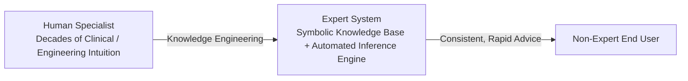
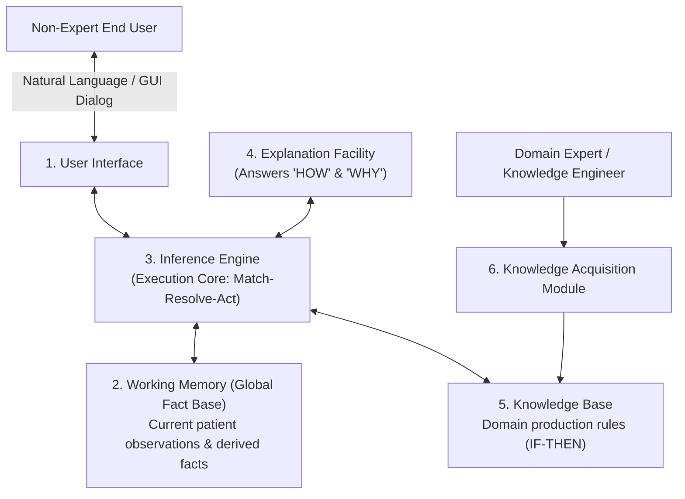
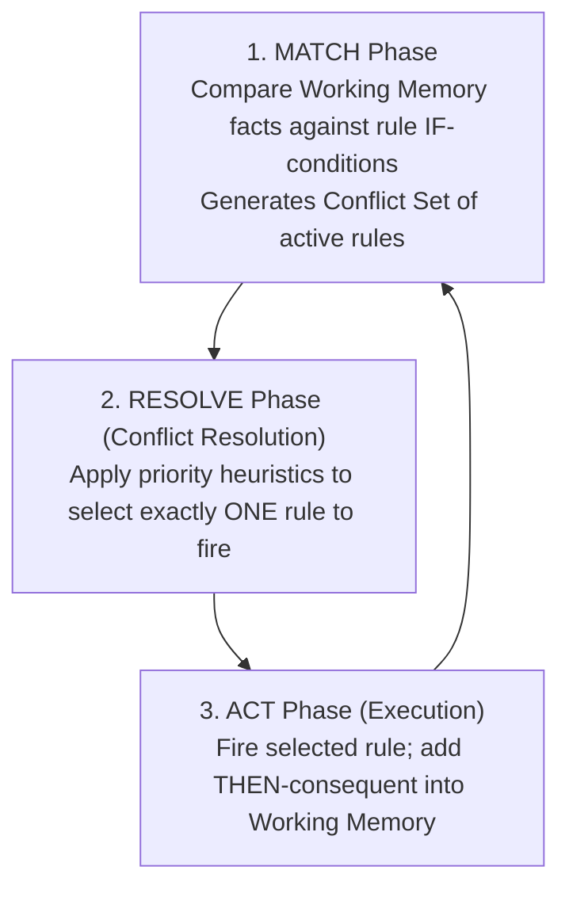
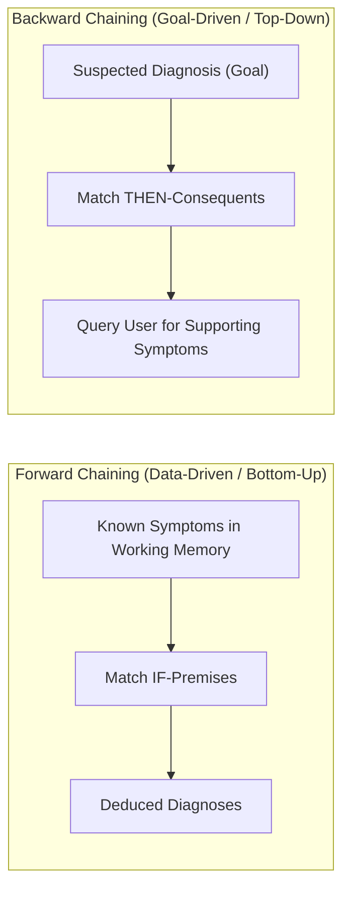

# Expert Systems & MYCIN: Concept Mastery & Exam Questions

> **Course -** Fundamentals of Artificial Intelligence (`21CSC569J` & `21CSC206T`)  
> **Topic Classification -** Knowledge-Based Systems & Symbolic Reasoning  
> **Exam Priority -** **Rank 5 (Appears in 73% of All Semester Examination Papers)**

---

## 1. Executive Summary & Why Expert Systems Matter

In early artificial intelligence, researchers attempted to build "General Problem Solvers" (GPS) using domain-independent search heuristics. By the early 1970s, it became apparent that general search alone could not solve complex real-world tasks without deep, specialized knowledge.

This realization led to the **Knowledge-Based Paradigm** pioneered by Edward Feigenbaum at Stanford University:

> *"In the knowledge lies the power."*

### Definition of an Expert System
An **Expert System (ES)** is a specialized artificial intelligence computer program that emulates the decision-making and problem-solving capabilities of a human domain specialist. It combines a large repository of domain-specific facts and heuristic production rules with an automated inference engine to deliver expert-level diagnoses, recommendations, or configurations.



---

## 2. The 6-Component Block Architecture

University examinations routinely ask students to draw the standard block diagram of an expert system and define the operational responsibility of each component.



### Detailed Component Functionality

#### 1. Knowledge Base (KB) &mdash; Long-Term Memory
The repository storing formal domain expertise. In classical systems, this is encoded as **IF-THEN production rules**:
$$\text{IF } \langle \text{condition}_1 \land \text{condition}_2 \rangle \implies \text{THEN } \langle \text{conclusion / action} \rangle$$
Unlike standard procedural code (where logic and data are tightly compiled together), the Knowledge Base is completely decoupled from the execution engine, allowing rules to be modified without rewriting software.

#### 2. Working Memory (Fact Base / Global Database) &mdash; Short-Term Memory
The dynamic scratchpad cache that stores the current state of the consultation. It contains:
*   Initial user-supplied evidence and findings (e.g., patient symptoms, lab test values).
*   Intermediate assertions dynamically deduced by fired rules during the session.

#### 3. Inference Engine &mdash; The Reasoning Brain
The execution module that coordinates the reasoning process. It compares assertions in Working Memory against rule conditions in the Knowledge Base to deduce new facts until a final conclusion is reached.

#### 4. Explanation Facility (Justifier) &mdash; Transparency Module
A critical requirement for high-stakes domains (medicine, aviation, law). It explains the system's reasoning process by answering two fundamental user queries:
*   **"WHY" Queries:** Explains why the system is asking a specific question (shows which rule premise is currently being evaluated).
*   **"HOW" Queries:** Explains how the system arrived at a particular conclusion (reconstructs the chain of fired production rules leading to the assertion).

#### 5. Knowledge Acquisition Module &mdash; The Authoring Gateway
The interface enabling domain experts and knowledge engineers to author, validate, syntax-check, and expand production rules in the Knowledge Base without software developers rewriting code.

#### 6. User Interface
Enables non-expert end users to interact with the system via structured forms, natural language dialogs, or automated API sensor telemetry.

---

## 3. The Inference Engine Execution Cycle: Match-Resolve-Act

The execution of a production system proceeds in an iterative 3-phase loop:



### Conflict Resolution Heuristics
When multiple rules match working memory simultaneously (forming a **Conflict Set**), the inference engine selects one rule using priority strategies:
1.  **Refractoriness:** Never fire the exact same rule on the exact same data twice (prevents infinite trivial loops).
2.  **Recency:** Prefer rules that match facts most recently asserted into Working Memory.
3.  **Specificity (Longest Match):** Prefer rules with more antecedent conditions (more specific rules override generic default rules).
4.  **Explicit Priority Weights:** Fire rules assigned higher priority coefficients by the knowledge engineer.

---

## 4. Inference Paradigms: Forward Chaining vs. Backward Chaining

University examination papers frequently contrast **Forward Chaining** and **Backward Chaining**:



### Master Comparison Table

| Evaluation Dimension | Forward Chaining (Data-Driven) | Backward Chaining (Goal-Driven) |
| :--- | :--- | :--- |
| **Operational Direction** | **Bottom-Up:** From atomic facts toward unknown goals. | **Top-Down:** From a target hypothesis backward to supporting facts. |
| **Starting Point** | Working Memory assertions (symptoms, sensor telemetry). | A specific goal hypothesis (e.g., *"Does patient have Meningitis?"*). |
| **Inference Trigger** | Matches the **antecedents (IF parts)** of production rules. | Matches the **consequents (THEN parts)** of production rules. |
| **Search Space** | Broad; generates many intermediate facts not needed for goal. | Focused; explores only branches relevant to proving the goal. |
| **User Interaction** | System takes all inputs upfront, then processes silently. | System actively queries the user for specific missing evidence. |
| **Best-Fit Domains** | Synthesis, configuration (DEC XCON), monitoring, fraud detection. | Diagnostic systems (MYCIN), fault isolation, legal compliance. |

---

### Step-by-Step Clinical Trace: Both Directions

Consider a diagnostic rule base:
*   **Rule 1 ($R_1$):** $\text{IF } \text{Fever} \land \text{Cough} \implies \text{Infection}$
*   **Rule 2 ($R_2$):** $\text{IF } \text{Infection} \land \text{LossOfSmell} \implies \text{COVID19}$
*   **Rule 3 ($R_3$):** $\text{IF } \text{COVID19} \implies \text{PrescribeAntiviral}$

#### Forward Chaining Trace
*   *Initial Working Memory:* $\{\text{Fever}, \text{Cough}, \text{LossOfSmell}\}$.
*   **Cycle 1:** $R_1$ antecedents match $\to$ Fire $R_1 \implies$ Assert $\text{Infection}$ into Working Memory.
*   **Cycle 2:** $R_2$ antecedents match ($\text{Infection} \land \text{LossOfSmell}$) $\to$ Fire $R_2 \implies$ Assert $\text{COVID19}$.
*   **Cycle 3:** $R_3$ antecedent matches $\to$ Fire $R_3 \implies \mathbf{\text{PrescribeAntiviral is PROVED}}$.

#### Backward Chaining Trace
*   *Initial Goal:* Prove $\text{PrescribeAntiviral}$.
*   **Subgoal 1:** $R_3$ matches consequent $\implies$ Set new subgoal: **Prove $\text{COVID19}$**.
*   **Subgoal 2:** $R_2$ matches consequent $\implies$ Set subgoals: **Prove $\text{Infection}$** and **Prove $\text{LossOfSmell}$**.
*   **Fact Check:** $\text{LossOfSmell}$ is confirmed in initial facts.
*   **Subgoal 3:** $R_1$ matches consequent for $\text{Infection} \implies$ Set subgoals: **Prove $\text{Fever}$** and **Prove $\text{Cough}$**.
*   **Fact Check:** Both $\text{Fever}$ and $\text{Cough}$ are confirmed in initial facts.
*   **Conclusion:** All subgoals unify successfully with ground facts $\implies \mathbf{\text{PrescribeAntiviral is TRUE}}$.

---

## 5. Case Study: MYCIN & Certainty Factor Calculus

Developed at Stanford University in the 1970s by Edward Shortliffe, **MYCIN** is the landmark expert system designed to identify blood-borne bacterial pathogens (specifically bacteremia and meningitis) and prescribe antibiotic therapy.

### Why Standard Bayesian Probability Failed
Classical Bayes' Rule requires full joint probability distributions $P(E_1, E_2, \dots \mid H)$ and conditional independence assumptions that clinical medicine could not supply. To handle subjective human medical judgment, Shortliffe invented **Certainty Factor (CF) Theory**.

### The Certainty Factor Metric
$$\mathbf{CF(H, E) = MB(H, E) - MD(H, E)}$$

where:
*   $MB(H, E) \in [0, 1]$: **Measure of Increased Belief** in hypothesis $H$ based on observed evidence $E$.
*   $MD(H, E) \in [0, 1]$: **Measure of Increased Disbelief** in hypothesis $H$ based on observed evidence $E$.
*   $CF(H, E) \in [-1.0, +1.0]$: The combined Certainty Factor.

```text
-1.0 ----------------------- 0.0 ----------------------- +1.0
Definitely               Complete                  Definitely
  FALSE                  Ignorance                    TRUE
```

---

### Certainty Factor Combination Rules

#### 1. Conjunctive Antecedents ($\text{AND} \implies \min$)
$$\text{IF } E_1 \text{ AND } E_2 \implies CF(E_1 \land E_2) = \min(CF(E_1), CF(E_2))$$

#### 2. Disjunctive Antecedents ($\text{OR} \implies \max$)
$$\text{IF } E_1 \text{ OR } E_2 \implies CF(E_1 \lor E_2) = \max(CF(E_1), CF(E_2))$$

#### 3. Rule Propagation
If a rule has antecedent certainty $CF(E)$ and the rule itself carries confidence $CF_{\text{rule}}$:
$$CF(H) = CF(E) \times CF_{\text{rule}}$$

#### 4. Combining Multiple Independent Rules Supporting the Same Hypothesis
When two independent rules yield positive certainty factors $CF_1 > 0$ and $CF_2 > 0$ for the same hypothesis $H$:

$$\mathbf{CF_{\text{combined}}(H) = CF_1 + CF_2 \times (1 - CF_1)}$$

*   *Asymptotic Saturation:* Evidence compounds with diminishing returns, asymptotically approaching $+1.0$ without ever exceeding it.

---

### Worked Numerical Example of CF Combination

*   Rule 1 indicates patient has Strep with certainty $CF_1 = 0.70$.
*   Rule 2 independently indicates patient has Strep with certainty $CF_2 = 0.50$.
*   Combined Certainty Factor:
    $$CF_{\text{combined}} = 0.70 + 0.50 \times (1 - 0.70) = 0.70 + 0.50 \times 0.30 = 0.70 + 0.15 = \mathbf{0.85}$$

Two moderately strong pieces of evidence compound to yield **85% confidence**.

---

## 6. Examiner's Grading Rubric & Common Traps

:::warning

**Top 4 Exam Pitfalls Where Students Lose Marks**

1.  **Omitting the Explanation Facility:**  
    *WRONG:* Drawing an expert system block diagram with only a Knowledge Base and Inference Engine.  
    *CORRECT:* You **must include all 6 components**: Knowledge Base, Working Memory, Inference Engine, **Explanation Facility**, **Knowledge Acquisition Module**, and User Interface.
2.  **Inverting Chaining Direction:**  
    *WRONG:* Stating that Backward Chaining starts with patient symptoms.  
    *CORRECT:* Backward Chaining **starts with a suspected goal hypothesis**; Forward Chaining starts with raw observations/facts.
3.  **Linear Addition of Certainty Factors:**  
    *WRONG:* Computing $CF_1 + CF_2 = 0.70 + 0.50 = 1.20$ (invalid!).  
    *CORRECT:* CF values cannot exceed $1.0$. Apply the compounding formula: **$CF_1 + CF_2(1 - CF_1) = 0.85$**.
4.  **Confusing Expert Systems with Machine Learning:**  
    Classical expert systems do not train on datasets via gradient descent; they use **deductive symbolic reasoning** over curated human rules.

:::

---

## 7. Exhaustive University Exam Question Archive

Below is the complete catalog of all 15 major examination questions on Expert Systems & MYCIN across both `21CSC206T` and `21CSC569J`, with direct links to full model solutions:

### `21CSC206T` (B.Tech Papers &mdash; 8M, 10M, & 15M Questions)

#### 1. May 2026 &mdash; Question 25.b (8 Marks)
> Describe the Architecture of an Expert System with a neat diagram. Discuss the role of each component in detail.  
> 🔗 **[View Model Solution &rarr;](../Previous-Year-Sem-Papers/21CSC206T/may-2026.mdx#question-25b-8-marks)**

#### 2. December 2025 &mdash; Question 24.b (8 Marks)
> Explain the structural components of an expert system and describe the function of the explanation module.  
> 🔗 **[View Model Solution &rarr;](../Previous-Year-Sem-Papers/21CSC206T/december-2025.mdx#question-24b-8-marks)**

#### 3. July 2025 &mdash; Question 25.a (8 Marks)
> Analyze the need for knowledge engineering, knowledge base, and inference engine in an expert system with block diagrams.  
> 🔗 **[View Model Solution &rarr;](../Previous-Year-Sem-Papers/21CSC206T/july-2025.mdx#question-25a-8-marks)**

#### 4. July 2025 &mdash; Question 27 (15 Marks)
> Design an expert system for travel recommendation and discuss its roles. Evaluate in detail about MYCIN Expert systems and its clinical diagnosis functions.  
> 🔗 **[View Model Solution &rarr;](../Previous-Year-Sem-Papers/21CSC206T/july-2025.mdx#question-27-15-marks)**

#### 5. May 2025 &mdash; Question 24.b (8 Marks)
> Compare Forward Chaining and Backward Chaining inference mechanisms in expert systems with suitable rule bases.  
> 🔗 **[View Model Solution &rarr;](../Previous-Year-Sem-Papers/21CSC206T/may-2025.mdx#question-24b-8-marks)**

#### 6. May 2025 &mdash; Question 26 (15 Marks)
> Explain the various components of Expert system with a neat block diagram and discuss the benefits and limitations of Expert systems.  
> 🔗 **[View Model Solution &rarr;](../Previous-Year-Sem-Papers/21CSC206T/may-2025.mdx#question-26-15-marks)**

#### 7. November 2024 &mdash; Question 24.a (8 Marks)
> Explain Expert System Architecture with neat sketches and describe how the inference engine executes production rules.  
> 🔗 **[View Model Solution &rarr;](../Previous-Year-Sem-Papers/21CSC206T/november-2024.mdx#question-24a-8-marks)**

#### 8. July 2024 &mdash; Question 24.b (8 Marks)
> Explain in detail about rule based expert system and frame based expert system with knowledge representation schemas.  
> 🔗 **[View Model Solution &rarr;](../Previous-Year-Sem-Papers/21CSC206T/july-2024.mdx#question-24b-8-marks)**

#### 9. July 2024 &mdash; Question 25.b (8 Marks)
> Case study analysis of MYCIN: Rule structures, certainty factor calculus ($CF = MB - MD$), and blood infection diagnosis.  
> 🔗 **[View Model Solution &rarr;](../Previous-Year-Sem-Papers/21CSC206T/july-2024.mdx#question-25b-8-marks)**

#### 10. May 2024 &mdash; Question 25.b (8 Marks)
> Explain the architecture of an Expert System with a neat diagram and discuss its main components.  
> 🔗 **[View Model Solution &rarr;](../Previous-Year-Sem-Papers/21CSC206T/may-2024.mdx#question-25b-8-marks)**

#### 11. December 2023 &mdash; Question 26 (10 Marks)
> Describe the architecture of expert systems. List the main components and describe how they work together to emulate human expertise in a specific domain.  
> 🔗 **[View Model Solution &rarr;](../Previous-Year-Sem-Papers/21CSC206T/december-2023.mdx#question-26-10-marks)**

#### 12. July 2023 &mdash; Question 25.a (8 Marks)
> How inference rules are used to represent knowledge? Explain in detail about expert system architecture with working memory and explanation facilities.  
> 🔗 **[View Model Solution &rarr;](../Previous-Year-Sem-Papers/21CSC206T/july-2023.mdx#question-25a-8-marks)**

#### 13. May 2023 &mdash; Question 25.a (8 Marks)
> Explain in detail about expert system architecture, the role of knowledge base, inference engine, and explanation module.  
> 🔗 **[View Model Solution &rarr;](../Previous-Year-Sem-Papers/21CSC206T/may-2023.mdx#question-25a-8-marks)**

---

### `21CSC569J` (M.Tech Papers &mdash; 20M Questions)

#### 14. November 2025 FN &mdash; Question 6 (20 Marks)
> Explain the concepts of Forward and Backward Reasoning in Artificial Intelligence with suitable examples, highlighting their working principles, differences, and applications in expert systems.  
> 🔗 **[View Model Solution &rarr;](../Previous-Year-Sem-Papers/21CSC569J/november-2025-fn.mdx#question-6-20-marks)**

#### 15. November 2025 AN &mdash; Question 6 (20 Marks)
> Comprehensive study of Expert System architecture and inference engines comparing forward chaining and backward chaining.  
> 🔗 **[View Model Solution &rarr;](../Previous-Year-Sem-Papers/21CSC569J/november-2025-an.mdx#question-6-20-marks)**
