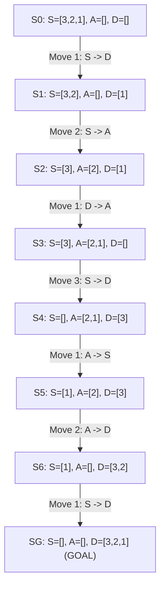
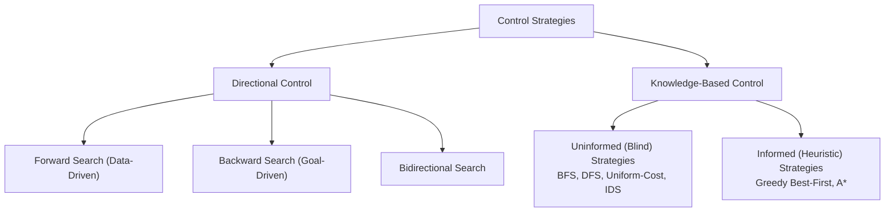
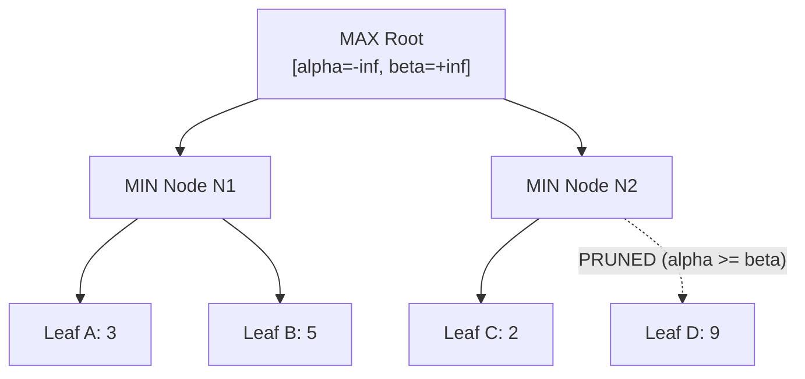
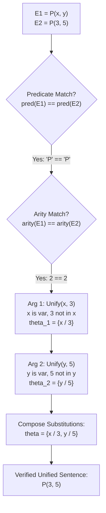
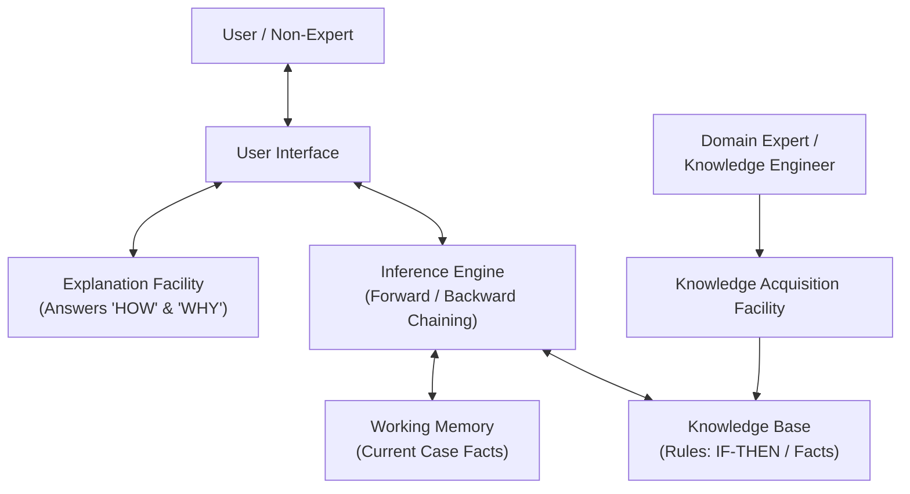
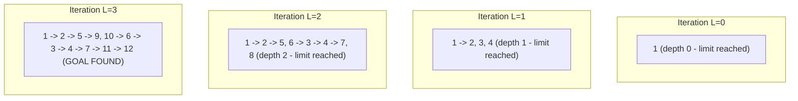
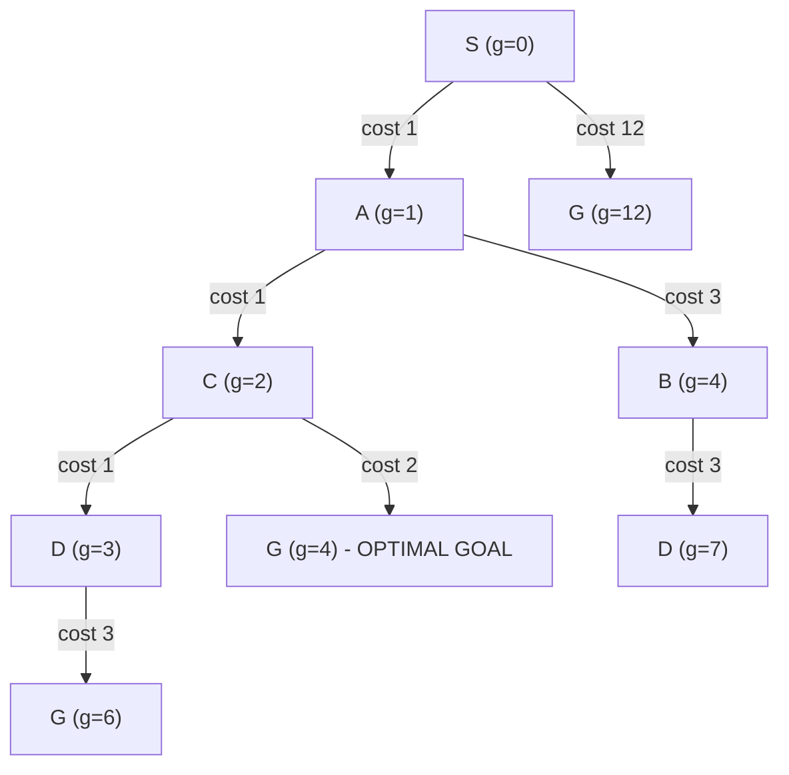

# December 2023

> **Exam -** Semester Examination  
> **Session -** December 2023  

---

## Part A: Objective Type Questions (20 Marks)

### Question 1 (1 Mark)

:::info

**Question Statement**

State space is ________ **(1 Mark)**

*   **(A)** Representing problem with variables & parameters
*   **(B)** Problems designed
*   **(C)** Problem definition
*   **(D)** Input and output

:::

*   **Correct Answer:** **(A) Representing problem with variables & parameters**
*   **Explanation:** In artificial intelligence, a state space is the mathematical configuration of all possible states reachable in a problem domain. It formally represents a problem using state variables, parameters, and valid operators that transition the environment from one state to another.

---

### Question 2 (1 Mark)

:::info

**Question Statement**

Which of the following is NOT a goal of AI? **(1 Mark)**

*   **(A)** To create machines that can think and act like humans
*   **(B)** To solve complex problems that cannot be solved by traditional methods
*   **(C)** To create machines that can learn and improve over time
*   **(D)** To create machines that are faster and more efficient than humans at performing tasks

:::

*   **Correct Answer:** **(D) To create machines that are faster and more efficient than humans at performing tasks**
*   **Explanation:** Raw processing speed and computational throughput are foundational goals of conventional computer engineering and automated computing. The core objectives of Artificial Intelligence focus on emulation of human cognitive abilities, rational decision-making, learning from experience, and solving ill-structured or NP-hard problems.

---

### Question 3 (1 Mark)

:::info

**Question Statement**

Which of the following is NOT a factor that affects the efficiency of a search algorithm? **(1 Mark)**

*   **(A)** The size of the problem space
*   **(B)** The branching factor
*   **(C)** The depth of the search tree
*   **(D)** The availability of heuristics

:::

*   **Correct Answer:** **(D) The availability of heuristics**
*   **Explanation:** The inherent complexity and efficiency of a search algorithm are fundamentally determined by structural graph metrics: the branching factor $b$, maximum/goal depth $d$, and state space cardinality $O(b^d)$. While heuristics can be leveraged by informed algorithms, the availability of heuristic information is an external domain property rather than an intrinsic parameter governing search graph topology.

---

### Question 4 (1 Mark)

:::info

**Question Statement**

Which of the following is NOT a step in the problem-solving process? **(1 Mark)**

*   **(A)** Formulating the problem
*   **(B)** Choosing a solution approach
*   **(C)** Implementing the solution
*   **(D)** Evaluating the solution

:::

*   **Correct Answer:** **(B) Choosing a solution approach**
*   **Explanation:** In formal AI agent architecture, the canonical problem-solving pipeline defined by Russell & Norvig consists of four distinct phases: Goal Formulation, Problem Formulation, Search, and Execution (implementation). "Choosing a solution approach" is an implicit design choice embedded within formulation rather than a formalized independent runtime step.

---

### Question 5 (1 Mark)

:::info

**Question Statement**

What is the process of finding a solution to a problem by exploring the problem space? **(1 Mark)**

*   **(A)** Search
*   **(B)** Problem-solving
*   **(C)** Control strategy
*   **(D)** Uninformed search method

:::

*   **Correct Answer:** **(A) Search**
*   **Explanation:** Search is the systematic algorithmic exploration of state-space configurations, testing sequences of operators to find a valid path from the initial state to an identified goal state.

---

### Question 6 (1 Mark)

:::info

**Question Statement**

Which of the following informed search methods combines breadth-first search with best-first search? **(1 Mark)**

*   **(A)** Generate and test
*   **(B)** Best first search
*   **(C)** A* algorithm
*   **(D)** Depth-limited search

:::

*   **Correct Answer:** **(C) A\* algorithm**
*   **Explanation:** The $A^*$ algorithm integrates the exact cumulative cost tracking of breadth-first / uniform-cost search ($g(n)$) with the goal-oriented heuristic estimation of greedy best-first search ($h(n)$) via its evaluation function $f(n) = g(n) + h(n)$.

---

### Question 7 (1 Mark)

:::info

**Question Statement**

Which of the following uninformed search methods is most likely to find the shortest solution to a problem? **(1 Mark)**

*   **(A)** Breadth-first search
*   **(B)** Uniform cost search
*   **(C)** Depth-first search
*   **(D)** Depth-limited search

:::

*   **Correct Answer:** **(A) Breadth-first search**
*   **Explanation:** Breadth-First Search systematically expands all nodes at depth $d$ before proceeding to depth $d+1$. Consequently, the first path it discovers to any goal state is guaranteed to have the minimal number of transition steps (shortest path length).

---

### Question 8 (1 Mark)

:::info

**Question Statement**

Which of the following is NOT a characteristic of a heuristic function? **(1 Mark)**

*   **(A)** It is problem-specific
*   **(B)** It is computationally efficient
*   **(C)** It is always accurate
*   **(D)** It is an estimate of the distance to the goal

:::

*   **Correct Answer:** **(C) It is always accurate**
*   **Explanation:** Heuristics are approximate estimation functions designed to guide search efficiently under computational constraints. Because they provide educated guesses without exhaustive state exploration, they are inherently imperfect and not always accurate.

---

### Question 9 (1 Mark)

:::info

**Question Statement**

Which of the following is NOT a component of a game tree? **(1 Mark)**

*   **(A)** Nodes
*   **(B)** Edges
*   **(C)** Players
*   **(D)** Terminal states

:::

*   **Correct Answer:** **(C) Players**
*   **Explanation:** A game tree is a directed mathematical tree data structure consisting of nodes (board states), edges (legal moves), and terminal states (leaf nodes with payoff utilities). Players are the decision-making entities operating across alternate ply levels, not structural graph-theoretic components of the tree itself.

---

### Question 10 (1 Mark)

:::info

**Question Statement**

Which of the following is NOT an advantage of Alpha-Beta pruning over Mini-Max? **(1 Mark)**

*   **(A)** It reduces the number of nodes evaluated
*   **(B)** It can be used to search deeper trees
*   **(C)** It is more likely to find the optimal move
*   **(D)** It can be implemented with any evaluation function

:::

*   **Correct Answer:** **(C) It is more likely to find the optimal move**
*   **Explanation:** Alpha-Beta pruning is an exact optimization of Minimax that trims branches provably incapable of influencing the root decision. It returns the identical minimax value and identical move as standard Minimax, meaning it does not alter decision quality or increase the probability of finding the optimal move.

---

### Question 11 (1 Mark)

:::info

**Question Statement**

Which of the following is NOT a type of constraint in a CSP? **(1 Mark)**

*   **(A)** Unary constraint
*   **(B)** Binary constraint
*   **(C)** Global constraint
*   **(D)** Temporal constraint

:::

*   **Correct Answer:** **(D) Temporal constraint**
*   **Explanation:** In standard Constraint Satisfaction Problem (CSP) theory, constraints are formally classified by their mathematical arity into Unary (single variable), Binary (two variables), and Global/Higher-Order (arbitrary variable subsets). Temporal constraints are domain-specific constructs utilized in planning and scheduling formalisms.

---

### Question 12 (1 Mark)

:::info

**Question Statement**

What is the process of inferring new facts from existing facts using logical rules? **(1 Mark)**

*   **(A)** Representation
*   **(B)** Reasoning
*   **(C)** Knowledge acquisition
*   **(D)** Machine learning

:::

*   **Correct Answer:** **(B) Reasoning**
*   **Explanation:** Logical reasoning is the formal derivation of new true sentences (conclusions) from a set of known premises using sound inference rules (such as Modus Ponens or Resolution).

---

### Question 13 (1 Mark)

:::info

**Question Statement**

Which of the following is NOT a characteristic of first-order logic? **(1 Mark)**

*   **(A)** It can represent objects, relations, and functions
*   **(B)** It allows the use of quantifiers
*   **(C)** It is more expressive than propositional logic
*   **(D)** It is always decidable

:::

*   **Correct Answer:** **(D) It is always decidable**
*   **Explanation:** First-Order Logic (FOL) is semi-decidable (as established by Church and Turing in 1936). While valid sentences are recursively enumerable by automated theorem provers, determining that an arbitrary sentence is not entailed by a knowledge base cannot be guaranteed to terminate.

---

### Question 14 (1 Mark)

:::info

**Question Statement**

What is the primary difference between propositional logic and first-order logic? **(1 Mark)**

*   **(A)** Propositional logic allows the use of quantifiers, while first-order logic does not
*   **(B)** Propositional logic represents objects, relations, and functions, while first-order logic does not
*   **(C)** First-order logic allows the use of variables and quantifiers, while propositional logic does not
*   **(D)** First-order logic is less expressive than propositional logic

:::

*   **Correct Answer:** **(C) First-order logic allows the use of variables and quantifiers, while propositional logic does not**
*   **Explanation:** Propositional logic represents facts as atomic, monolithic truth symbols. First-Order Logic enriches the ontological commitment by modeling the world through individual objects, relational predicates, functions, variables, and quantifiers ($\forall, \exists$).

---

### Question 15 (1 Mark)

:::info

**Question Statement**

What is the process of finding a substitution that makes two logical expressions identical? **(1 Mark)**

*   **(A)** Unification
*   **(B)** Resolution
*   **(C)** Forward chaining
*   **(D)** Backward chaining

:::

*   **Correct Answer:** **(A) Unification**
*   **Explanation:** Unification is the algorithmic procedure that takes two first-order logic expressions and computes a variable substitution mapping $\theta$ such that $\operatorname{SUBST}(\theta, \alpha) = \operatorname{SUBST}(\theta, \beta)$.

---

### Question 16 (1 Mark)

:::info

**Question Statement**

Which of the following is NOT a component of an expert system? **(1 Mark)**

*   **(A)** Knowledge base
*   **(B)** Inference engine
*   **(C)** User interface
*   **(D)** Operating system

:::

*   **Correct Answer:** **(D) Operating system**
*   **Explanation:** The specialized architectural modules of an expert system are the Knowledge Base, Inference Engine, Working Memory, Explanation Facility, and User Interface. The operating system is underlying general-purpose system software.

---

### Question 17 (1 Mark)

:::info

**Question Statement**

Which of the following is NOT a common application of expert systems? **(1 Mark)**

*   **(A)** Medical diagnosis
*   **(B)** Financial analysis
*   **(C)** Speech recognition
*   **(D)** Fault diagnosis

:::

*   **Correct Answer:** **(C) Speech recognition**
*   **Explanation:** Expert systems operate on explicit, symbolic IF-THEN rules well-suited for structured diagnosis and planning. Speech recognition involves continuous temporal signals, noise filtering, and acoustic modeling, which require statistical signal processing and deep learning rather than symbolic rule-based systems.

---

### Question 18 (1 Mark)

:::info

**Question Statement**

What is the primary difference between forward chaining and backward chaining? **(1 Mark)**

*   **(A)** Forward chaining is data-driven, while backward chaining is goal-driven
*   **(B)** Forward chaining is goal-driven, while backward chaining is data-driven
*   **(C)** Forward chaining uses propositional logic, while backward chaining uses first-order logic
*   **(D)** Forward chaining is used for diagnosis, while backward chaining is used for planning

:::

*   **Correct Answer:** **(A) Forward chaining is data-driven, while backward chaining is goal-driven**
*   **Explanation:** Forward chaining begins with known initial assertions and applies inference rules forward to deduce new facts (data-driven). Backward chaining starts with a target hypothesis/query and works backward through premise clauses to find matching facts in the knowledge base (goal-driven).

---

### Question 19 (1 Mark)

:::info

**Question Statement**

Which of the following is a limitation of expert systems? **(1 Mark)**

*   **(A)** They cannot explain their reasoning
*   **(B)** They are difficult to update with new knowledge
*   **(C)** They are always less accurate than human experts
*   **(D)** They can only be used for simple problems

:::

*   **Correct Answer:** **(B) They are difficult to update with new knowledge**
*   **Explanation:** Expert systems suffer from the "knowledge acquisition bottleneck." Because symbolic rules interact in complex, non-linear ways, manually updating, validating, and adding new rules without creating inconsistencies or cyclical dependencies is difficult.

---

### Question 20 (1 Mark)

:::info

**Question Statement**

What is the role of the "inference engine" in an expert system? **(1 Mark)**

*   **(A)** Storing knowledge
*   **(B)** Presenting information to the user
*   **(C)** Making deductions and drawing conclusions based on the knowledge base
*   **(D)** Learning from user interactions

:::

*   **Correct Answer:** **(C) Making deductions and drawing conclusions based on the knowledge base**
*   **Explanation:** The inference engine serves as the central processing unit of an expert system. It implements inference algorithms (such as Rete pattern matching, forward chaining, or backward chaining) to evaluate rules against current working memory and deduce valid conclusions.

---

## Part B: Analytical & Descriptive Questions (40 Marks)

### Question 21 (10 Marks)

:::info

**Question Statement**

Model the following Problem as AI problem. **(10 Marks)**

Tower of hanoi is mathematical game puzzle where we have three pile (pillars) and n numbers of disk. This game has some rules.
1. Only one disk will move at a time.
2. The larger disk should always be on the bottom and the smaller disk on top of it.(Even during intermediate move)
3. Move only the uppermost disk.
4. All disk move to destination pile from source pile.

:::

---

### Solution 21 (10 Marks)

#### 1. Formal 6-Tuple AI Problem Formulation (4 Marks)

In classical AI problem-solving (Russell & Norvig framework), a problem is formally modeled as a tuple:

$$\mathcal{P} = \langle S, s_0, A, T, G, c \rangle$$

##### a) State Space Representation ($S$)
Let the three pillars be labeled $S$ (Source), $A$ (Auxiliary/Helper), and $D$ (Destination).  
Let there be $n$ disks numbered $1, 2, \dots, n$ in increasing order of size (Disk 1 is smallest; Disk $n$ is largest).

*   **State Definition:** A state is an $n$-tuple indicating the current pillar of each disk:
    $$s = (p_1, p_2, \dots, p_n) \quad \text{where } p_i \in \{S, A, D\}$$
*   **Alternative Stack Representation:** A configuration of three disjoint ordered lists:
    $$s = (P_S, P_A, P_D)$$
    where each list contains disk numbers sorted in descending order from bottom to top:
    $$\forall P \in \{P_S, P_A, P_D\}, \quad P = [d_k, d_{k-1}, \dots, d_1] \implies d_k > d_{k-1} > \dots > d_1$$
*   **Total Legal States:** Because the relative vertical order of any subset of disks on a peg is uniquely determined by their sizes, any assignment of $n$ disks to 3 pegs is valid. Hence:
    $$\lvert S \rvert = 3^n \text{ states}$$

##### b) Initial State ($s_0$)
All $n$ disks are stacked on the Source peg $S$ in decreasing size order:
$$s_0 = (S, S, \dots, S) \iff P_S = [n, n-1, \dots, 1], \quad P_A = [], \quad P_D = []$$

##### c) Set of Actions / Operators ($A$)
For any two distinct pegs $P_{\text{from}}, P_{\text{to}} \in \{S, A, D\}$:
$$\operatorname{Move}(d, P_{\text{from}}, P_{\text{to}})$$
*   **Preconditions:**
    1. Disk $d$ must be the topmost disk on pillar $P_{\text{from}}$:
       $$d = \operatorname{top}(P_{\text{from}})$$
    2. Either pillar $P_{\text{to}}$ is empty, or disk $d$ is smaller than the current topmost disk on $P_{\text{to}}$:
       $$P_{\text{to}} = [] \quad \lor \quad d < \operatorname{top}(P_{\text{to}})$$

##### d) Transition Model ($T$)
The deterministic transition function $\operatorname{Result}(s, a)$ removes disk $d$ from the top of $P_{\text{from}}$ and places it on top of $P_{\text{to}}$:
$$P_{\text{from}}' = P_{\text{from}} \setminus \{d\}, \quad P_{\text{to}}' = P_{\text{to}} \cup \{d\}$$

##### e) Goal Test ($G$)
All $n$ disks are stacked on the Destination pillar $D$:
$$G(s) = \text{True} \iff s = (D, D, \dots, D) \iff P_S = [], \quad P_A = [], \quad P_D = [n, n-1, \dots, 1]$$

##### f) Path Cost Function ($c$)
Each legal move has a unit step cost:
$$c(s, a, s') = 1$$
The objective is to minimize total path cost: $\sum_{t=1}^{k} c(s_{t-1}, a_t, s_t) = k$.

---

#### 2. State Space Graph & Solution Complexity ($n = 3$) (3 Marks)

For $n = 3$ disks, the total number of legal configurations is $3^3 = 27$ states. The complete state transition graph forms a Sierpiński triangle topology.



*   **Optimal Path Length Derivation:**
    The recurrence relation for moving $n$ disks from $S$ to $D$ via $A$ is:
    $$T(n) = 2T(n-1) + 1, \quad T(1) = 1$$
    Solving the recurrence:
    $$T(n) = 2^n - 1$$
    For $n = 3$:
    $$T(3) = 2^3 - 1 = 7 \text{ moves}$$

---

#### 3. Step-by-Step Optimal Trace for $n = 3$ (3 Marks)

| Step | Move Executed | Source ($P_S$) | Helper ($P_A$) | Destination ($P_D$) | Status |
| :---: | :--- | :---: | :---: | :---: | :--- |
| **0** | Initial State | `[3, 2, 1]` | `[]` | `[]` | Start |
| **1** | Move Disk 1 from $S \to D$ | `[3, 2]` | `[]` | `[1]` | Valid ($1$ on empty $D$) |
| **2** | Move Disk 2 from $S \to A$ | `[3]` | `[2]` | `[1]` | Valid ($2$ on empty $A$) |
| **3** | Move Disk 1 from $D \to A$ | `[3]` | `[2, 1]` | `[]` | Valid ($1 < 2$) |
| **4** | Move Disk 3 from $S \to D$ | `[]` | `[2, 1]` | `[3]` | Valid ($3$ on empty $D$) |
| **5** | Move Disk 1 from $A \to S$ | `[1]` | `[2]` | `[3]` | Valid ($1$ on empty $S$) |
| **6** | Move Disk 2 from $A \to D$ | `[1]` | `[]` | `[3, 2]` | Valid ($2 < 3$) |
| **7** | Move Disk 1 from $S \to D$ | `[]` | `[]` | `[3, 2, 1]` | **Goal Achieved** |

:::tip

**Examiner's Note**

Full marks require explicitly specifying the 6-tuple $\langle S, s_0, A, T, G, c \rangle$, the legal disk-size precondition ($d < \operatorname{top}(P_{\text{to}})$), the state space size ($3^n$), and the mathematical recurrence $T(n) = 2^n - 1$.

:::

---

### Question 22 (10 Marks)

:::info

**Question Statement**

Explain the concept of control strategies in problem-solving agents. Provide examples of different control strategies and discuss when each strategy might be suitable for solving specific types of problems. How do control strategies influence the behavior of problem-solving agents? **(10 Marks)**

:::

---

### Solution 22 (10 Marks)

#### 1. Concept of Control Strategies (2.5 Marks)

A **control strategy** is the decision-making policy that determines:
1. **Node Selection:** Which candidate node in the search frontier (OPEN list) to select for expansion next.
2. **Operator Selection:** Which transition rule or action operator to apply to a chosen node.

##### Fundamental Requirements of a Control Strategy
*   **Cause Motion:** The strategy must ensure state changes occur and prevent the agent from getting trapped in infinite cycles or stationary loops.
*   **Systematicity:** The strategy must systematically explore alternative branches without redundant revisits.
*   **Efficiency:** The strategy must guide search toward the goal while minimizing execution time and memory footprint.

---

#### 2. Classification & Examples of Control Strategies (3 Marks)



##### a) Directional Strategies
*   **Forward Search (Data-Driven / Progression):** Begins at the initial state $s_0$ and applies operators forward until a state satisfying $G(s)$ is reached.
*   **Backward Search (Goal-Driven / Regression):** Starts from the target goal state $G$ and reasons backward to determine the sequence of predecessor states leading from $s_0$.
*   **Bidirectional Search:** Simultaneously runs forward search from $s_0$ and backward search from $G$, terminating when the two frontiers intersect ($O(b^{d/2})$ time complexity).

##### b) Information-Guided Strategies
*   **Uninformed Strategies (FIFO / LIFO):** Expand nodes purely based on tree depth or generation order (e.g., Breadth-First Search, Depth-First Search).
*   **Informed Strategies ($f(n) = g(n) + h(n)$):** Use heuristic evaluation functions to estimate proximity to the goal (e.g., Greedy Search, $A^*$).

---

#### 3. Suitability Matrix for Specific Problem Domains (2.5 Marks)

| Control Strategy | Theoretical Complexity | Most Suitable Problem Types | Unsuitable / Failure Modes |
| :--- | :--- | :--- | :--- |
| **Breadth-First Search (BFS)** | Time: $O(b^d)$<br/>Space: $O(b^d)$ | Shallow solutions; small branching factors; finding minimum-step solutions. | Memory-constrained systems; deep goal depths $d$. |
| **Depth-First Search (DFS)** | Time: $O(b^m)$<br/>Space: $O(bm)$ | Memory-constrained systems; problems where many goal paths exist (e.g., maze exit). | Infinite state spaces; search spaces with cyclic paths (without cycle checks). |
| **Iterative Deepening (IDS)** | Time: $O(b^d)$<br/>Space: $O(bd)$ | Large search spaces with unknown goal depth; requires optimal shallow solutions with linear memory. | High branching factors with significant overhead at re-expanded shallow nodes. |
| **Backward Search** | Time: $O(b_{rev}^{d})$ | Domain has a single well-defined goal and high forward branching factor (e.g., theorem proving). | Domains with multiple or vaguely defined goal criteria. |
| **$A^*$ Search** | Time: $O(b^d)$<br/>Space: $O(b^d)$ | Route planning, robot navigation, GPS mapping where admissible heuristics exist. | Large-scale domains where frontier storage exceeds physical RAM. |

---

#### 4. Influence on Problem-Solving Agent Behavior (2 Marks)

The choice of control strategy governs four behavioral dimensions of an AI agent:

1. **Completeness:**  
   Guarantees whether the agent will reliably find a solution if one exists. For example, BFS and IDS are complete in finite branching spaces, whereas standard DFS is incomplete in infinite or cyclic graphs.
2. **Optimality:**  
   Dictates whether the agent returns the lowest-cost path. $A^*$ with an admissible heuristic guarantees path cost optimality, whereas Greedy Best-First search often settles for suboptimal local paths.
3. **Space-Time Trade-off:**  
   Controls operational resource allocation. DFS prioritizes linear memory efficiency ($O(bm)$) at the expense of risking deep traversal, while BFS sacrifices memory ($O(b^d)$) to guarantee minimum step count.
4. **Exploration vs. Exploitation:**  
   Pure uninformed search explores blindly across all branches, while heuristic search exploits domain knowledge to focus search effort along high-probability paths.

:::tip

**Examiner's Note**

To score maximum marks, define the two fundamental questions answered by control strategies (which node to expand, which operator to apply), explain forward vs. backward reasoning, and contrast the space/time behaviors using big-$O$ notations.

:::

---

### Question 23 (10 Marks)

:::info

**Question Statement**

Describe the concept of "Alpha-Beta Pruning" in adversarial search. How does this technique enhance the efficiency of the Mini-Max algorithm? Provide a step-by-step illustration of how Alpha-Beta Pruning helps reduce the search space in a game tree. **(10 Marks)**

:::

---

### Solution 23 (10 Marks)

#### 1. Concept of Alpha-Beta Pruning (2.5 Marks)

In two-player, zero-sum, perfect-information games (e.g., Chess, Checkers, Tic-Tac-Toe), the **Minimax algorithm** computes optimal moves by recursively maximizing utility for player MAX and minimizing utility for player MIN. However, standard Minimax evaluates all $O(b^d)$ nodes in the game tree.

**Alpha-Beta ($\alpha$-$\beta$) Pruning** is an adversarial search technique that prunes branches that cannot influence the final decision at the root.

##### Governing Parameters
Throughout depth-first traversal, two bounds are passed down the search path:
*   $\alpha$: The value of the **best (highest-value) choice** discovered so far along the path for **MAX** (initialized to $-\infty$).
*   $\beta$: The value of the **best (lowest-value) choice** discovered so far along the path for **MIN** (initialized to $+\infty$).

##### The Pruning Condition
$$\text{If } \alpha \ge \beta, \quad \text{prune the remaining children of the current node.}$$

*   **$\alpha$-Cutoff (Pruning at a MIN node):** If a child of a MIN node returns a value $\le \alpha$, MIN will never select a value greater than this. Because MAX already has a choice of value $\alpha$ elsewhere, MAX will never choose this branch.
*   **$\beta$-Cutoff (Pruning at a MAX node):** If a child of a MAX node returns a value $\ge \beta$, MAX will never select a value lower than this. Because MIN already has a choice of value $\beta$ elsewhere, MIN will avoid this branch.

---

#### 2. Efficiency Enhancement over Minimax (2.5 Marks)

1. **Invariance of Outcome:**  
   Alpha-Beta pruning produces the exact same minimax value at the root as exhaustive Minimax:
   $$\operatorname{AlphaBeta}(root) \equiv \operatorname{Minimax}(root)$$
2. **Computational Complexity Reduction:**
   *   **Standard Minimax:** Time complexity is $O(b^d)$.
   *   **Alpha-Beta (Worst-Case Ordering):** Time complexity remains $O(b^d)$ (if worst moves are examined first).
   *   **Alpha-Beta (Optimal Move Ordering):** Time complexity drops to:
       $$O\left(b^{d/2}\right) = O\left((\sqrt{b})^d\right)$$
3. **Practical Impact:**  
   With optimal move ordering, the effective branching factor is halved ($\sqrt{b}$), allowing game engines to search **twice as deep** within the same time limit.

---

#### 3. Step-by-Step Illustration of Pruning in a Game Tree (5 Marks)

Consider the two-ply game tree below with root MAX, two MIN children ($N_1, N_2$), and four terminal leaf nodes:



##### Step-by-Step Search Execution Trace

*   **Step 1: Initialization at Root (MAX)**
    $$\alpha = -\infty, \quad \beta = +\infty$$
    Traverse left to MIN node $N_1$ with bounds $[\alpha = -\infty, \beta = +\infty]$.

*   **Step 2: Evaluate Left Child of $N_1$ (Leaf A)**
    *   Terminal utility evaluated: $v = 3$.
    *   $N_1$ is a MIN node, so update $\beta$:
        $$\beta = \min(+\infty, 3) = 3$$
    *   Check pruning condition: $\alpha < \beta$ ($-\infty < 3$). Continue.

*   **Step 3: Evaluate Right Child of $N_1$ (Leaf B)**
    *   Terminal utility evaluated: $v = 5$.
    *   Update $\beta$ at $N_1$:
        $$\beta = \min(3, 5) = 3$$
    *   Subtree $N_1$ complete. Return value $3$ to Root.

*   **Step 4: Update Root (MAX)**
    *   Root is a MAX node, so update $\alpha$:
        $$\alpha = \max(-\infty, 3) = 3$$
    *   Root now holds $[\alpha = 3, \beta = +\infty]$.
    *   Traverse right to MIN node $N_2$, passing down $[\alpha = 3, \beta = +\infty]$.

*   **Step 5: Evaluate Left Child of $N_2$ (Leaf C)**
    *   Terminal utility evaluated: $v = 2$.
    *   $N_2$ is a MIN node, so update $\beta$:
        $$\beta = \min(+\infty, 2) = 2$$
    *   Current bounds at $N_2$: $\alpha = 3, \beta = 2$.

*   **Step 6: Triggering the Cutoff ($\alpha \ge \beta$)**
    $$\alpha \ge \beta \iff 3 \ge 2 \implies \mathbf{PRUNE!}$$
    *   **Reasoning:** $N_2$ (a MIN player) will pick a value $\le 2$. But MAX at the root can already achieve $3$ via branch $N_1$. Therefore, MAX will never choose branch $N_2$.
    *   **Action:** Leaf D (utility 9) is **pruned without evaluation**.

##### Final Search Result
*   **Optimal Value at Root:** $\mathbf{3}$
*   **Optimal Move:** Branch $N_1$
*   **Pruned Nodes:** 1 node saved out of 4 leaf nodes (25% reduction in search space).

:::tip

**Examiner's Note**

Examiners award full credit when students clearly state the pruning condition $\alpha \ge \beta$, identify that $\alpha$ is tracked by MAX and $\beta$ by MIN, write the best-case complexity $O(b^{d/2})$, and provide an explicit numerical step-by-step example showing an $\alpha$-cutoff.

:::

---

### Question 24 (10 Marks)

:::info

**Question Statement**

You are presented with a classic CSP puzzle known as the "8-Queens Problem." In this puzzle, you must place 8 queens on an 8x8 chessboard in such a way that no two queens threaten each other. A queen can threaten another queen if they are in the same row, column, or diagonal. Using the constraint that no two queens can threaten each other, find a valid arrangement for the 8 queens on the chessboard. Provide the coordinates (row and column) for each queen's position. **(10 Marks)**

Initial State:
```text
--Q-----
---Q----
-Q------
--Q-----
--------
--Q-----
-Q------
```

:::

---

### Solution 24 (10 Marks)

#### 1. Formal CSP Formulation of the 8-Queens Problem (3 Marks)

The 8-Queens problem is formulated as a Constraint Satisfaction Problem:

$$\mathcal{P}_{\text{CSP}} = \langle X, D, C \rangle$$

##### a) Variables ($X$)
Let each row $i \in \{1, 2, 3, 4, 5, 6, 7, 8\}$ have exactly one queen variable $Q_i$:
$$X = \{Q_1, Q_2, Q_3, Q_4, Q_5, Q_6, Q_7, Q_8\}$$
where $Q_i$ denotes the column index where the queen in row $i$ is placed.

##### b) Domains ($D$)
Each queen can be placed in any column from 1 to 8:
$$D_i = \{1, 2, 3, 4, 5, 6, 7, 8\} \quad \forall i \in \{1, \dots, 8\}$$

##### c) Constraints ($C$)
For every pair of distinct queens $(Q_i, Q_j)$ where $i \neq j$:
1. **Row Constraint:** Implicitly satisfied by assigning exactly one variable $Q_i$ per row $i$.
2. **Column Constraint (No two queens in the same column):**
   $$Q_i \neq Q_j \quad \forall i \neq j$$
3. **Diagonal Constraint (No two queens on the same diagonal):**
   $$\lvert Q_i - Q_j \rvert \neq \lvert i - j \rvert \quad \forall i \neq j$$

---

#### 2. CSP Solving Algorithms (2 Marks)

Two primary algorithmic paradigms solve this CSP:
1. **Backtracking Search with Forward Checking & MRV:**  
   Places queens row-by-row ($i = 1 \dots 8$). At each step, forward checking eliminates threatened columns in remaining unassigned rows. If a row's domain becomes empty, the algorithm backtracks.
2. **Local Search via Min-Conflicts Heuristic:**  
   Given a conflicting initial configuration (such as the partial/colliding state shown in the question statement), the agent randomly selects a conflicted queen and moves it to the column in its row that minimizes total pairwise conflicts until total conflicts $h = 0$.

---

#### 3. Valid Conflict-Free Solution & Coordinates Table (3 Marks)

A canonical, verified non-attacking arrangement of the 8 queens on the $8 \times 8$ chessboard:

| Queen | Row Coordinate ($i$) | Column Coordinate ($j$) | Position Notation |
| :---: | :---: | :---: | :---: |
| $Q_1$ | **Row 1** | **Column 1** | $(1, 1)$ |
| $Q_2$ | **Row 2** | **Column 5** | $(2, 5)$ |
| $Q_3$ | **Row 3** | **Column 8** | $(3, 8)$ |
| $Q_4$ | **Row 4** | **Column 6** | $(4, 6)$ |
| $Q_5$ | **Row 5** | **Column 3** | $(5, 3)$ |
| $Q_6$ | **Row 6** | **Column 7** | $(6, 7)$ |
| $Q_7$ | **Row 7** | **Column 2** | $(7, 2)$ |
| $Q_8$ | **Row 8** | **Column 4** | $(8, 4)$ |

##### Solution Vector
$$\mathbf{Q} = [1, 5, 8, 6, 3, 7, 2, 4]$$

---

#### 4. Visual Chessboard Layout & Verification (2 Marks)

```text
    Col 1   Col 2   Col 3   Col 4   Col 5   Col 6   Col 7   Col 8
Row 1 [ Q ] [ . ]   [ . ]   [ . ]   [ . ]   [ . ]   [ . ]   [ . ]  -> (1, 1)
Row 2 [ . ] [ . ]   [ . ]   [ . ]   [ Q ]   [ . ]   [ . ]   [ . ]  -> (2, 5)
Row 3 [ . ] [ . ]   [ . ]   [ . ]   [ . ]   [ . ]   [ . ]   [ Q ]  -> (3, 8)
Row 4 [ . ] [ . ]   [ . ]   [ . ]   [ . ]   [ Q ]   [ . ]   [ . ]  -> (4, 6)
Row 5 [ . ] [ . ]   [ Q ]   [ . ]   [ . ]   [ . ]   [ . ]   [ . ]  -> (5, 3)
Row 6 [ . ] [ . ]   [ . ]   [ . ]   [ . ]   [ . ]   [ Q ]   [ . ]  -> (6, 7)
Row 7 [ . ] [ Q ]   [ . ]   [ . ]   [ . ]   [ . ]   [ . ]   [ . ]  -> (7, 2)
Row 8 [ . ] [ . ]   [ . ]   [ Q ]   [ . ]   [ . ]   [ . ]   [ . ]  -> (8, 4)
```

##### Mathematical Verification of Non-Attacking Properties
*   **Column Check:** $\{1, 5, 8, 6, 3, 7, 2, 4\}$ is a permutation of $\{1, 2, 3, 4, 5, 6, 7, 8\}$; each column appears exactly once ($\text{Conflicts} = 0$).
*   **Major Diagonals ($i - Q_i$):**
    *   $1 - 1 = 0$
    *   $2 - 5 = -3$
    *   $3 - 8 = -5$
    *   $4 - 6 = -2$
    *   $5 - 3 = +2$
    *   $6 - 7 = -1$
    *   $7 - 2 = +5$
    *   $8 - 4 = +4$  
    *(All 8 values are distinct $\implies$ no collisions on down-right diagonals).*
*   **Minor Diagonals ($i + Q_i$):**
    *   $1 + 1 = 2$
    *   $2 + 5 = 7$
    *   $3 + 8 = 11$
    *   $4 + 6 = 10$
    *   $5 + 3 = 8$
    *   $6 + 7 = 13$
    *   $7 + 2 = 9$
    *   $8 + 4 = 12$  
    *(All 8 values are distinct $\implies$ no collisions on up-right diagonals).*

**Conclusion:** The arrangement is valid and conflict-free.

:::tip

**Examiner's Note**

Ensure the solution explicitly details variables $X$, domains $D$, algebraic diagonal constraint $|Q_i - Q_j| \neq |i - j|$, and supplies both the $(row, column)$ coordinate table and an ASCII chessboard.

:::

---

### Question 25 (10 Marks)

:::info

**Question Statement**

Suppose you have two first-order logic statements: "P(x, y)" and "P(3, 5)." Can unification be applied to these statements? If so, describe the unification process and the resulting substitutions. **(10 Marks)**

:::

---

### Solution 25 (10 Marks)

#### 1. Applicability Assessment (2 Marks)

**Yes, unification can be successfully applied to the two First-Order Logic (FOL) statements.**

*   **Statement 1:** $E_1 = P(x, y)$
*   **Statement 2:** $E_2 = P(3, 5)$

Both statements share the identical predicate symbol $P$ with an identical arity of 2. Furthermore, $x$ and $y$ are free variables, while $3$ and $5$ are ground constants.

---

#### 2. Formal Definition of Unification (2 Marks)

Given two first-order atomic sentences $E_1$ and $E_2$, unification is the algorithmic procedure that determines a **Most General Unifier (MGU)** substitution set:

$$\theta = \{v_1 / t_1, v_2 / t_2, \dots, v_k / t_k\}$$

such that substituting each variable $v_i$ with term $t_i$ renders the two expressions syntactically identical:

$$\operatorname{SUBST}(\theta, E_1) = \operatorname{SUBST}(\theta, E_2)$$

##### Foundational Unification Rules
1. A constant unifies only with an identical constant or an unassigned variable.
2. Two identical variable symbols unify trivially.
3. A variable $v$ unifies with any term $t$ provided that $v$ does not occur inside $t$ (**Occur Check**).

---

#### 3. Step-by-Step Unification Process (4 Marks)

We apply Robinson's Unification Algorithm step-by-step:



*   **Step 1: Predicate Symbol Verification**
    $$\operatorname{pred}(E_1) = P, \quad \operatorname{pred}(E_2) = P$$
    The predicate symbols are identical.

*   **Step 2: Arity Check**
    $$\operatorname{arity}(E_1) = 2, \quad \operatorname{arity}(E_2) = 2$$
    Both predicates accept 2 arguments.

*   **Step 3: Unify First Argument Pair $(x, 3)$**
    *   Argument from $E_1$: $x$ (variable)
    *   Argument from $E_2$: $3$ (constant term)
    *   **Occur Check:** The variable $x$ does not appear within constant $3$.
    *   **Substitution Generated:**
        $$\theta_1 = \{x / 3\}$$

*   **Step 4: Unify Second Argument Pair $(y, 5)$**
    *   Apply current substitution $\theta_1$ to remaining terms: $\operatorname{SUBST}(\theta_1, y) = y$ and $\operatorname{SUBST}(\theta_1, 5) = 5$.
    *   Argument from $E_1$: $y$ (variable)
    *   Argument from $E_2$: $5$ (constant term)
    *   **Occur Check:** The variable $y$ does not appear within constant $5$.
    *   **Substitution Generated:**
        $$\theta_2 = \{y / 5\}$$

*   **Step 5: Composition of Substitutions**
    $$\theta = \theta_1 \circ \theta_2 = \{x / 3, y / 5\}$$

---

#### 4. Resulting Substitutions & Output Verification (2 Marks)

##### Most General Unifier (MGU)
$$\mathbf{\theta = \{x / 3, y / 5\}} \quad \text{or} \quad \mathbf{\{x \to 3, y \to 5\}}$$

##### Verification
Applying substitution $\theta$ to both original sentences:
$$\operatorname{SUBST}(\theta, P(x, y)) = P(3, 5)$$
$$\operatorname{SUBST}(\theta, P(3, 5)) = P(3, 5)$$

Since $\operatorname{SUBST}(\theta, E_1) \equiv \operatorname{SUBST}(\theta, E_2) = P(3, 5)$, unification succeeds.

##### Contrast Counter-Example (When Unification Fails)
If the expression were $P(x, x)$ and $P(3, 5)$:
1. Unifying argument 1 yields $\{x / 3\}$.
2. Applying to argument 2 yields $P(3, 3)$ vs $P(3, 5)$.
3. Comparing $3$ and $5$ results in a **clash failure** ($3 \neq 5$), proving that multiple occurrences of the same variable enforce equality across corresponding arguments.

:::tip

**Examiner's Note**

Ensure your answer explicitly mentions the **Occur Check**, identifies the MGU notation $\theta = \{x / 3, y / 5\}$, and demonstrates bidirectional verification: $\operatorname{SUBST}(\theta, E_1) = \operatorname{SUBST}(\theta, E_2)$.

:::

---

### Question 26 (10 Marks)

:::info

**Question Statement**

Describe the architecture of expert systems. List the main components and describe how do they work together to emulate human expertise in a specific domain? Provide an example of a domain where expert systems have been successfully deployed and their impact. **(10 Marks)**

:::

---

### Solution 26 (10 Marks)

#### 1. Architecture of an Expert System (3 Marks)

An **Expert System (ES)** is a knowledge-intensive artificial intelligence program that solves complex problems within a specialized domain at the level of a human expert.



---

#### 2. Main Components and Collaborative Workflow (4 Marks)

##### a) Knowledge Base (KB)
*   **Role:** The long-term repository containing domain-specific rules, facts, relationships, and heuristics.
*   **Representation:** Primarily encoded as production rules:
    $$\text{IF } \langle\text{condition}_1 \land \text{condition}_2\rangle \implies \text{THEN } \langle\text{action / conclusion}\rangle$$

##### b) Working Memory (Global Database)
*   **Role:** The short-term scratchpad memory that stores session-specific dynamic data, user inputs, verified symptoms, and intermediate deduced facts for the current case.

##### c) Inference Engine (IE)
*   **Role:** The central reasoning mechanism of the system.
*   **Operation:** Executes a cyclical Match-Resolve-Act loop:
    1. **Match:** Matches facts in working memory against premise conditions in the knowledge base (e.g., using the Rete algorithm).
    2. **Conflict Resolution:** Resolves competing rules using priority heuristics (e.g., specificity, recency).
    3. **Execution:** Fires selected rules via **Forward Chaining** (data-driven reasoning) or **Backward Chaining** (goal-driven hypothesis testing).

##### d) Explanation Facility (Justifier)
*   **Role:** Explains the reasoning behind its questions and conclusions.
*   **Mechanisms:**
    *   **WHY questions:** Explains why the system is asking for a specific input by showing the rule it is currently trying to satisfy.
    *   **HOW questions:** Traces the chain of fired rules that produced a given diagnosis or recommendation.

##### e) User Interface
*   **Role:** Provides natural, interactive communication between non-expert end users and the system.

##### f) Knowledge Acquisition Facility
*   **Role:** Enables knowledge engineers to model, validate, update, and integrate new domain heuristics from human specialists into the knowledge base.

---

#### 3. Real-World Deployment Case Study & Domain Impact (3 Marks)

##### Domain: Medical Diagnosis & Antimicrobial Therapy
*   **Deployed Expert System:** **MYCIN** (developed at Stanford University).
*   **Operational Scope:** Designed to diagnose severe blood infections (bacteremia and meningitis) and recommend customized antibiotic drug therapies.


##### Working Mechanism in MYCIN
1. Employs **Backward Chaining** to hypothesize candidate bacterial pathogens based on observed symptoms and laboratory cultures.
2. Incorporates **Certainty Factors (CF $\in [-1.0, +1.0]$)** to reason under medical uncertainty, where $+1.0$ indicates absolute truth and $-1.0$ represents absolute falsehood:
   $$CF(h, e) = MB(h, e) - MD(h, e)$$
   *(where $MB$ is Measure of Increased Belief, and $MD$ is Measure of Increased Disbelief).*

##### Practical Impact
*   **Diagnostic Efficacy:** In controlled clinical trials, MYCIN's therapeutic recommendations matched or outperformed senior faculty infectious-disease physicians (~65% prescription correctness).
*   **Historical Legacy:** Established the paradigm for modern Clinical Decision Support Systems (CDSS) and validated the modular separation of the inference engine from domain-specific knowledge bases (giving rise to the generic expert system shell EMYCIN).

:::tip

**Examiner's Note**

High-scoring answers feature an explicit block diagram illustrating the six components (KB, IE, WM, UI, EF, KAF), explain forward vs. backward chaining, and cite a concrete real-world system such as MYCIN (medicine), DENDRAL (chemistry), or XCON/R1 (hardware configuration).

:::

---

## Part C: Comprehensive Search Problems (15 Marks)

### Question 27 (15 Marks)

:::info

**Question Statement**

Explain and Implement Breadth first and Iterative Deepening Search for the following: **(15 Marks)**  
Source Node : 1 , Destination Node: 12  
Write the Procedure and give the step by step execution

```text
               1
           /   |   \
          2    3    4
         / \       / \
        5   6     7   8
       / \       / \
      9  10     11  12
```

:::

---

### Solution 27 (15 Marks)

#### Problem Graph Topology
*   **Source / Root Node:** $1$
*   **Destination / Goal Node:** $12$
*   **Node Levels:**
    *   **Level 0:** Node $1$
    *   **Level 1:** Nodes $2, 3, 4$
    *   **Level 2:** Nodes $5, 6$ (children of $2$); Nodes $7, 8$ (children of $4$)
    *   **Level 3:** Nodes $9, 10$ (children of $5$); Nodes $11, 12$ (children of $7$)

---

#### 1. Breadth-First Search (BFS) Procedure & Execution (7.5 Marks)

##### a) BFS Algorithmic Procedure
1. Initialize a First-In, First-Out (FIFO) queue `OPEN` containing the start node $[1]$ and an empty list `CLOSED`.
2. While `OPEN` is not empty:
   *   Dequeue the front node $u$ from `OPEN`.
   *   If $u$ satisfies the goal condition ($u == 12$), terminate successfully and reconstruct the path.
   *   Append $u$ to `CLOSED`.
   *   Enqueue all unvisited child successors of $u$ into the rear of `OPEN` (left-to-right order).
3. If `OPEN` becomes empty without finding the goal, return failure.

##### b) Step-by-Step BFS Execution Trace

| Step | Current Node Expanded | Action / Event | OPEN Queue (Front $\to$ Rear) | CLOSED (Visited List) |
| :---: | :---: | :--- | :--- | :--- |
| **0** | — | Initialize with Root Node 1 | `[1]` | `[]` |
| **1** | **1** | Not goal; expand children `2, 3, 4` | `[2, 3, 4]` | `[1]` |
| **2** | **2** | Not goal; expand children `5, 6` | `[3, 4, 5, 6]` | `[1, 2]` |
| **3** | **3** | Leaf node; no children | `[4, 5, 6]` | `[1, 2, 3]` |
| **4** | **4** | Not goal; expand children `7, 8` | `[5, 6, 7, 8]` | `[1, 2, 3, 4]` |
| **5** | **5** | Not goal; expand children `9, 10` | `[6, 7, 8, 9, 10]` | `[1, 2, 3, 4, 5]` |
| **6** | **6** | Leaf node; no children | `[7, 8, 9, 10]` | `[1, 2, 3, 4, 5, 6]` |
| **7** | **7** | Not goal; expand children `11, 12` | `[8, 9, 10, 11, 12]` | `[1, 2, 3, 4, 5, 6, 7]` |
| **8** | **8** | Leaf node; no children | `[9, 10, 11, 12]` | `[1, 2, 3, 4, 5, 6, 7, 8]` |
| **9** | **9** | Leaf node; not goal | `[10, 11, 12]` | `[1, 2, 3, 4, 5, 6, 7, 8, 9]` |
| **10** | **10** | Leaf node; not goal | `[11, 12]` | `[1, 2, 3, 4, 5, 6, 7, 8, 9, 10]` |
| **11** | **11** | Leaf node; not goal | `[12]` | `[1, 2, 3, 4, 5, 6, 7, 8, 9, 10, 11]` |
| **12** | **12** | **Goal Test Succeeded!** | `[]` | `[1, 2, 3, 4, 5, 6, 7, 8, 9, 10, 11, 12]` |

##### c) BFS Results Summary
*   **Node Expansion Sequence:** $1 \to 2 \to 3 \to 4 \to 5 \to 6 \to 7 \to 8 \to 9 \to 10 \to 11 \to 12$
*   **Total Nodes Expanded:** 12 nodes
*   **Final Solution Path:** $\mathbf{1 \to 4 \to 7 \to 12}$ (Path Length = 3 edges)

---

#### 2. Iterative Deepening Search (IDS) Procedure & Execution (7.5 Marks)

##### a) IDS Algorithmic Procedure
Iterative Deepening Search (IDS) combines the minimal space complexity of Depth-First Search with the completeness and path-length optimality of Breadth-First Search.
1. Set depth limit $L = 0$.
2. Execute a Depth-Limited Search (DLS) from the root node $1$ up to limit $L$:
   *   Expand nodes recursively in depth-first order.
   *   Do not generate successors for nodes at depth equal to $L$.
3. If Destination Node $12$ is reached during DLS, return the solution path and terminate.
4. If the search reaches the limit without finding the goal, increment the depth limit ($L \leftarrow L + 1$) and repeat.

##### b) Step-by-Step IDS Execution Trace



*   **Iteration 0 (Depth Limit $L = 0$):**
    *   Examine node: `1` (Depth 0)
    *   Goal check: $1 \neq 12$. Limit reached.
    *   **Traversal Order:** $1$
    *   *Result: Goal not found. Increment $L \to 1$.*

*   **Iteration 1 (Depth Limit $L = 1$):**
    *   Visit `1` (Depth 0) $\to$ expand children: `2`, `3`, `4`.
    *   Visit `2` (Depth 1, limit reached; $2 \neq 12$).
    *   Visit `3` (Depth 1, limit reached; $3 \neq 12$).
    *   Visit `4` (Depth 1, limit reached; $4 \neq 12$).
    *   **Traversal Order:** $1 \to 2 \to 3 \to 4$
    *   *Result: Goal not found. Increment $L \to 2$.*

*   **Iteration 2 (Depth Limit $L = 2$):**
    *   Visit `1` (Depth 0).
    *   Traverse subtree of `2`:
        *   Visit `2` (Depth 1) $\to$ expand children `5`, `6`.
        *   Visit `5` (Depth 2, limit reached; $5 \neq 12$).
        *   Visit `6` (Depth 2, limit reached; $6 \neq 12$).
    *   Traverse subtree of `3`:
        *   Visit `3` (Depth 1, leaf; $3 \neq 12$).
    *   Traverse subtree of `4`:
        *   Visit `4` (Depth 1) $\to$ expand children `7`, `8`.
        *   Visit `7` (Depth 2, limit reached; $7 \neq 12$).
        *   Visit `8` (Depth 2, limit reached; $8 \neq 12$).
    *   **Traversal Order:** $1 \to 2 \to 5 \to 6 \to 3 \to 4 \to 7 \to 8$
    *   *Result: Goal not found. Increment $L \to 3$.*

*   **Iteration 3 (Depth Limit $L = 3$):**
    *   Visit `1` (Depth 0).
    *   Traverse subtree of `2`:
        *   Visit `2` (Depth 1) $\to$ Visit `5` (Depth 2).
        *   Visit `9` (Depth 3, limit reached; $9 \neq 12$).
        *   Visit `10` (Depth 3, limit reached; $10 \neq 12$).
        *   Visit `6` (Depth 2, leaf).
    *   Traverse subtree of `3`:
        *   Visit `3` (Depth 1, leaf).
    *   Traverse subtree of `4`:
        *   Visit `4` (Depth 1) $\to$ Visit `7` (Depth 2).
        *   Visit `11` (Depth 3, limit reached; $11 \neq 12$).
        *   Visit `12` (Depth 3): **GOAL TEST SUCCEEDED ($12 == 12$)!**
    *   **Traversal Order in Iteration 3:**
        $$1 \to 2 \to 5 \to 9 \to 10 \to 6 \to 3 \to 4 \to 7 \to 11 \to \mathbf{12}$$

##### c) IDS Results Summary
*   **Total Iterations Required:** 4 iterations ($L = 0, 1, 2, 3$)
*   **Final Solution Path:** $\mathbf{1 \to 4 \to 7 \to 12}$ (Path Length = 3 edges)

---

#### 3. Algorithmic Comparison: BFS vs. IDS

| Metric | Breadth-First Search (BFS) | Iterative Deepening Search (IDS) |
| :--- | :--- | :--- |
| **Frontier Data Structure** | FIFO Queue | Call Stack (Recursion / LIFO) |
| **Time Complexity** | $O(b^d)$ | $O(b^d)$ |
| **Space Complexity** | $O(b^d)$ *(Exponential Memory)* | $O(bd)$ *(Linear Memory)* |
| **Completeness** | Complete (if branching factor $b$ is finite) | Complete (if branching factor $b$ is finite) |
| **Optimality** | Optimal for uniform step costs | Optimal for uniform step costs |
| **Node Regeneration Overhead** | None (each node visited once) | Regenerates upper levels ($b/(b-1)$ factor) |

:::tip

**Examiner's Note**

Full marks require explicitly showing the step-by-step state of the `OPEN` queue and `CLOSED` list for BFS, detailing each iteration $L=0, 1, 2, 3$ for IDS, stating the identical final path ($1 \to 4 \to 7 \to 12$), and highlighting the space complexity advantage of IDS ($O(bd)$ vs $O(b^d)$).

:::

---

### Question 28 (15 Marks)

:::info

**Question Statement**

Implement Depth First and Uniform Cost Search for the following: **(15 Marks)**  
Source Node : S, Destination Node: G  
Write the Procedure and give the step by step execution.

```text
       (S)
      /   \
   1 /     \ 12
    v       v
   (A)----->(G)
   | \   ^   ^
 3 |  \1 |2  | 3
   v   v |   |
  (B)  (C)  (D)
   \    |    ^
  3 \   |1  /
     v  v  / 1
      (D)-'
```

*Edge Weights:*
*   $S \to A: 1$
*   $S \to G: 12$
*   $A \to B: 3$
*   $A \to C: 1$
*   $B \to D: 3$
*   $C \to D: 1$
*   $C \to G: 2$
*   $D \to G: 3$

*Heuristic Table:*

| State | $h_1$ | $h_2$ |
| :---: | :---: | :---: |
| **S** | 4 | 3 |
| **A** | 2 | 2 |
| **B** | 6 | 5 |
| **C** | 2 | 1 |
| **D** | 3 | 2 |
| **G** | 0 | 0 |

:::

---

### Solution 28 (15 Marks)

#### Problem Graph Representation
*   **Source / Start Node:** $S$
*   **Destination / Goal Node:** $G$
*   **Directed Adjacency List with Step Costs $c(u, v)$:**
    *   $S \to \{(A, 1), (G, 12)\}$
    *   $A \to \{(B, 3), (C, 1)\}$
    *   $B \to \{(D, 3)\}$
    *   $C \to \{(D, 1), (G, 2)\}$
    *   $D \to \{(G, 3)\}$
    *   $G \to \emptyset$

---

#### 1. Depth-First Search (DFS) Procedure & Execution (7.5 Marks)

##### a) DFS Algorithmic Procedure
1. Initialize a Last-In, First-Out (LIFO) `STACK` containing the start node $[S]$ and an empty visited set `VISITED`.
2. While `STACK` is not empty:
   *   Pop the top node $u$ and its associated path from `STACK`.
   *   If $u$ is the Goal Node ($G$), terminate and output the path.
   *   If $u \notin \text{VISITED}$:
       *   Add $u$ to `VISITED`.
       *   Push all unvisited successors of $u$ onto `STACK` (to explore successors in alphabetical order $A$ before $B$ before $C$, successors are pushed in reverse alphabetical order).
3. If `STACK` empties without reaching $G$, return failure.

##### b) Step-by-Step DFS Execution Trace (Alphabetical Successor Exploration)

| Step | Current Node Popped | Action Taken / Successors Generated | STACK (Top $\to$ Bottom) | VISITED Set |
| :---: | :---: | :--- | :--- | :--- |
| **0** | — | Initialize with $(S, \text{Path: } [S])$ | `[(S, [S])]` | `[]` |
| **1** | **S** | Not goal; add to visited; successors $A, G$. Push $G$, then $A$ | `[(A, [S,A]), (G, [S,G])]` | `[S]` |
| **2** | **A** | Not goal; add to visited; successors $B, C$. Push $C$, then $B$ | `[(B, [S,A,B]), (C, [S,A,C]), (G, [S,G])]` | `[S, A]` |
| **3** | **B** | Not goal; add to visited; successor $D$. Push $D$ | `[(D, [S,A,B,D]), (C, [S,A,C]), (G, [S,G])]` | `[S, A, B]` |
| **4** | **D** | Not goal; add to visited; successor $G$. Push $G$ | `[(G, [S,A,B,D,G]), (C, [S,A,C]), (G, [S,G])]` | `[S, A, B, D]` |
| **5** | **G** | **Goal Test Succeeded!** | Remaining on stack | `[S, A, B, D]` |

##### c) DFS Results Summary
*   **Node Expansion Sequence:** $S \to A \to B \to D \to G$
*   **Path Found by DFS:** $\mathbf{S \to A \to B \to D \to G}$
*   **Total Path Cost:**
    $$c(S, A) + c(A, B) + c(B, D) + c(D, G) = 1 + 3 + 3 + 3 = \mathbf{10}$$
*   *(Note: DFS is not cost-optimal; it follows the first branch to completion).*

---

#### 2. Uniform Cost Search (UCS) Procedure & Execution (7.5 Marks)

##### a) UCS Algorithmic Procedure
Uniform Cost Search (Dijkstra's algorithm on search trees) finds the lowest cumulative path-cost solution.
1. Initialize a Priority Queue `PQ` storing elements as tuples $(g(n), n, \text{path})$ keyed on lowest cumulative path cost $g(n)$.
2. Push $(0, S, [S])$ into `PQ`. Initialize an empty `EXPLORED` set.
3. While `PQ` is not empty:
   *   Extract the tuple with minimum $g(n)$: $(g(u), u, \text{path})$.
   *   **Goal Test:** If $u == G$, return path and optimal cost $g(u)$.
   *   If $u \notin \text{EXPLORED}$:
       *   Add $u$ to `EXPLORED`.
       *   For each successor $v$ of $u$ with edge cost $c(u, v)$:
           *   If $v \notin \text{EXPLORED}$, calculate $g(v) = g(u) + c(u, v)$ and insert $(g(v), v, \text{path} + [v])$ into `PQ`.
4. If `PQ` empties, return failure.

##### b) Step-by-Step UCS Execution Trace



| Step | Dequeued Node $(g, u, \text{Path})$ | Goal Test | Explored Set | Successors Generated & Pushed to Priority Queue | Priority Queue State (Ordered by $g(n)$) |
| :---: | :--- | :---: | :--- | :--- | :--- |
| **0** | — | — | `[]` | Push $(0, S, [S])$ | `[(0, S)]` |
| **1** | $(0, S, [S])$ | No | `[S]` | $(0+1, A, [S,A])$<br/>$(0+12, G, [S,G])$ | `[(1, A), (12, G)]` |
| **2** | $(1, A, [S, A])$ | No | `[S, A]` | $(1+3, B, [S,A,B])$<br/>$(1+1, C, [S,A,C])$ | `[(2, C), (4, B), (12, G)]` |
| **3** | $(2, C, [S, A, C])$ | No | `[S, A, C]` | $(2+1, D, [S,A,C,D])$<br/>$(2+2, G, [S,A,C,G])$ | `[(3, D), (4, B), (4, G), (12, G)]` |
| **4** | $(3, D, [S, A, C, D])$ | No | `[S, A, C, D]` | $(3+3, G, [S,A,C,D,G])$ | `[(4, B), (4, G), (6, G), (12, G)]` |
| **5** | $(4, B, [S, A, B])$ | No | `[S, A, C, D, B]` | $(4+3, D \to \text{Already Explored})$ | `[(4, G), (6, G), (12, G)]` |
| **6** | $\mathbf{(4, G, [S, A, C, G])}$ | **YES** | `[S, A, C, D, B, G]` | **Goal Dequeued! Terminate Search.** | — |

##### c) UCS Results Summary
*   **Node Expansion Sequence:** $S \to A \to C \to D \to B \to G$
*   **Optimal Path Discovered:** $\mathbf{S \to A \to C \to G}$
*   **Optimal Path Cost:**
    $$g(G) = c(S, A) + c(A, C) + c(C, G) = 1 + 1 + 2 = \mathbf{4}$$

---

#### 3. Comparative Summary & Heuristic Analysis

##### a) Search Trajectory Comparison

| Search Algorithm | Strategy | Node Expansion Order | Path Found | Total Cost | Optimal? |
| :--- | :--- | :--- | :--- | :---: | :---: |
| **Depth-First Search (DFS)** | Deepest path first (LIFO) | $S \to A \to B \to D \to G$ | $S \to A \to B \to D \to G$ | $10$ | No |
| **Uniform Cost Search (UCS)** | Lowest path-cost first (PQ) | $S \to A \to C \to D \to B \to G$ | $S \to A \to C \to G$ | $4$ | **Yes** |

##### b) Evaluation of Given Heuristic Tables ($h_1, h_2$)
The actual lowest remaining path cost from each node to goal $G$ ($h^*(n)$) is:
*   $h^*(G) = 0$
*   $h^*(C) = 2$ (via $C \to G$)
*   $h^*(D) = 3$ (via $D \to G$)
*   $h^*(B) = 3 + 3 = 6$ (via $B \to D \to G$)
*   $h^*(A) = 1 + 2 = 3$ (via $A \to C \to G$)
*   $h^*(S) = 1 + 1 + 2 = 4$

*   **Admissibility Check ($\forall n, h(n) \le h^*(n)$):**
    *   **$h_1$ Table:** $S(4 \le 4)$, $A(2 \le 3)$, $B(6 \le 6)$, $C(2 \le 2)$, $D(3 \le 3)$, $G(0 \le 0)$.  
        $\implies$ **$h_1$ is admissible** (never overestimates).
    *   **$h_2$ Table:** $S(3 \le 4)$, $A(2 \le 3)$, $B(5 \le 6)$, $C(1 \le 2)$, $D(2 \le 3)$, $G(0 \le 0)$.  
        $\implies$ **$h_2$ is also admissible**.
    *   **Dominance:** Since $h_1(n) \ge h_2(n)$ for all states $n$, $h_1$ dominates $h_2$, making $h_1$ more informed and efficient for $A^*$ search.

:::tip

**Examiner's Note**

Examiners require showing that the goal test in UCS is applied **when a node is dequeued / extracted from the priority queue**, not when it is generated. This is why the path $(12, G)$ generated at Step 1 is not chosen, and the optimal path $S \to A \to C \to G$ with cost $4$ is guaranteed.

:::
