# December 2025

> **Exam -** Semester Examination  
> **Session -** December 2025  

---

## Part A: Objective Type Questions (20 Marks)

### Question 1 (1 Mark)

:::info

**Question Statement**

In computational learning theory, show which two frameworks are used for pattern analysis? **(1 Mark)**

*   **(A)** Probability Approximately Not Correct and Mistake Not Bound
*   **(B)** Probably Approximately Correct and Classes of Hypothesis
*   **(C)** Probably Approximately Correct and Mistake Bound
*   **(D)** Probability Approximately Correct and Target Function

:::

*   **Correct Answer:** **(C) Probably Approximately Correct and Mistake Bound**
*   **Explanation:** Computational learning theory establishes mathematical models for machine learning through two foundational frameworks: Leslie Valiant's Probably Approximately Correct (PAC) learning model (evaluating sample complexity) and Nick Littlestone's Mistake Bound model (bounding the total number of classification errors during online learning).

---

### Question 2 (1 Mark)

:::info

**Question Statement**

Evaluation function (f(n)) in A* Search is represented as **(1 Mark)**

*   **(A)** f(n) = h(n)
*   **(B)** f(n) = g(n) + h(n)
*   **(C)** f(n) = g(n) * h(n)
*   **(D)** f(n) = max(h(n))

:::

*   **Correct Answer:** **(B) f(n) = g(n) + h(n)**
*   **Explanation:** The $A^*$ evaluation function $f(n) = g(n) + h(n)$ estimates the total cost of the cheapest solution path through node $n$, where $g(n)$ is the exact cost from the start node to $n$, and $h(n)$ is the heuristic estimated cost from $n$ to the goal.

---

### Question 3 (1 Mark)

:::info

**Question Statement**

Determine the search algorithm applied in AI problem-solving **(1 Mark)**

*   **(A)** Dijkstra’s Algorithm
*   **(B)** Merge Sort
*   **(C)** K-Nearest Neighbors
*   **(D)** Random Forest

:::

*   **Correct Answer:** **(A) Dijkstra’s Algorithm**
*   **Explanation:** Dijkstra's Algorithm is the graph-search foundation of Uniform Cost Search (UCS) in artificial intelligence, finding the least-cost path across state spaces with non-negative edge costs. Merge Sort is a divide-and-conquer sorting algorithm, while KNN and Random Forest are machine learning models.

---

### Question 4 (1 Mark)

:::info

**Question Statement**

The extraction of meaningful information that is previously unknown and can be useful potential ahead is known as **(1 Mark)**

*   **(A)** Machine Learning
*   **(B)** Learning Theory
*   **(C)** Neural Computation
*   **(D)** Knowledge Discovery

:::

*   **Correct Answer:** **(D) Knowledge Discovery**
*   **Explanation:** Knowledge Discovery in Databases (KDD) is defined as the non-trivial process of identifying valid, novel, potentially useful, and ultimately understandable patterns and actionable insights from large datasets.

---

### Question 5 (1 Mark)

:::info

**Question Statement**

Which type of problem-solving approach involves searching through all possible states systematically? **(1 Mark)**

*   **(A)** Uninformed (blind) search
*   **(B)** Reinforcement learning
*   **(C)** Genetic algorithm
*   **(D)** Machine learning

:::

*   **Correct Answer:** **(A) Uninformed (blind) search**
*   **Explanation:** Uninformed (blind) search methods (such as Breadth-First Search and Depth-First Search) systematically traverse all reachable state configurations according to predetermined graph-traversal rules without utilizing any domain-specific heuristic knowledge about the distance to the goal.

---

### Question 6 (1 Mark)

:::info

**Question Statement**

The post order traversal of a binary tree is 8, 9, 6, 7, 4, 5, 2, 3, 1. The inorder traversal of the same tree is 8, 6, 9, 4, 7, 2, 5, 1, 3. If the height of a tree is the length of the longest path from the root to any leaf, the height of the tree is **(1 Mark)**

*   **(A)** 2
*   **(B)** 3
*   **(C)** 4
*   **(D)** 5

:::

*   **Correct Answer:** **(C) 4**
*   **Explanation:** Reconstructing the binary tree yields root $1$, with left subtree path $1 \to 2 \to 4 \to 6 \to 8$ (or $9$) and right child $3$. The length of the longest path from root to a leaf in terms of edge transitions is $4$ edges. *(Note: If height is defined by the number of node levels along the deepest branch, it contains 5 nodes).*

---

### Question 7 (1 Mark)

:::info

**Question Statement**

Analyze space complexity of Breadth-First Search in the worst case. **(1 Mark)**

*   **(A)** O(1)
*   **(B)** O(b^d), where b is the branching factor and d is the depth of the tree
*   **(C)** O(d)
*   **(D)** O(n), where n is the total number of nodes in the search tree

:::

*   **Correct Answer:** **(B) O(b^d), where b is the branching factor and d is the depth of the tree**
*   **Explanation:** Breadth-First Search retains all generated nodes in its FIFO frontier queue. At depth $d$, the queue stores $O(b^d)$ nodes, making memory consumption exponential.

---

### Question 8 (1 Mark)

:::info

**Question Statement**

In uniform cost search, what happens if two paths have the same cost to reach a node? **(1 Mark)**

*   **(A)** One of them is randomly chosen
*   **(B)** Both paths are explored
*   **(C)** The first path encountered is chosen
*   **(D)** The last path encountered is simultaneously chosen

:::

*   **Correct Answer:** **(C) The first path encountered is chosen**
*   **Explanation:** In standard Uniform Cost Search with priority queues, tie-breaking between identical cumulative path costs $g(n)$ is resolved deterministically by FIFO queue insertion order (the first encountered path is dequeued and expanded first, and subsequent duplicate paths of equal or greater cost to the same state are discarded).

---

### Question 9 (1 Mark)

:::info

**Question Statement**

In the minmax algorithm, the "min" part refers to: **(1 Mark)**

*   **(A)** The player who moves first
*   **(B)** The player minimizing the score of the opponent
*   **(C)** The player maximizing their own score
*   **(D)** A strategy for minimizing the opponent's options

:::

*   **Correct Answer:** **(B) The player minimizing the score of the opponent**
*   **Explanation:** In a two-player zero-sum game, the adversary (MIN player) chooses moves that minimize the payoff utility of the MAX player, simulating an optimal opponent who acts against MAX's interests.

---

### Question 10 (1 Mark)

:::info

**Question Statement**

Which of the following algorithms is commonly used for solving zero-sum, two-player games with perfect information? **(1 Mark)**

*   **(A)** Minmax algorithm
*   **(B)** Breadth-first search
*   **(C)** A* search algorithm
*   **(D)** Hill climbing

:::

*   **Correct Answer:** **(A) Minmax algorithm**
*   **Explanation:** The Minimax algorithm (with Alpha-Beta pruning) is the standard decision-theoretic algorithm designed specifically for two-player, alternating-turn, zero-sum games with perfect information such as Chess, Checkers, and Tic-Tac-Toe.

---

### Question 11 (1 Mark)

:::info

**Question Statement**

Consider the problem of preparing a schedule for class of students. What type of problem is this? **(1 Mark)**

*   **(A)** Search Problem
*   **(B)** Constraint satisfaction Problem
*   **(C)** Planning Problem
*   **(D)** Backtrack Problem

:::

*   **Correct Answer:** **(B) Constraint satisfaction Problem**
*   **Explanation:** Class timetable generation is a classic Constraint Satisfaction Problem (CSP). Variables represent classes/courses, domains represent allowable time slots and lecture halls, and constraints enforce no student, teacher, or classroom double-booking.

---

### Question 12 (1 Mark)

:::info

**Question Statement**

The term used to describe the properties of the environment where an intelligent agent operates (e.g., fully observable, deterministic) is: **(1 Mark)**

*   **(A)** Constraint Domain
*   **(B)** Rationality and Performance
*   **(C)** Performance Measures
*   **(D)** Task environment and its properties

:::

*   **Correct Answer:** **(D) Task environment and its properties**
*   **Explanation:** In Russell & Norvig's agent framework, the environment's operational dimensions (fully vs. partially observable, deterministic vs. stochastic, episodic vs. sequential, static vs. dynamic, discrete vs. continuous) define the **Task Environment** (specified under the PEAS model).

---

### Question 13 (1 Mark)

:::info

**Question Statement**

Propositional logic deals with determining the _______ of the sentence. **(1 Mark)**

*   **(A)** Syntax
*   **(B)** Truth value
*   **(C)** Semantics
*   **(D)** Logic

:::

*   **Correct Answer:** **(B) Truth value**
*   **Explanation:** Propositional logic evaluates sentences by computing their truth values ($\text{True}$ or $\text{False}$) under a given model based on the Boolean truth-functional semantics of logical connectives ($\land, \lor, \neg, \implies, \iff$).

---

### Question 14 (1 Mark)

:::info

**Question Statement**

In a Bayesian Network, nodes represent: **(1 Mark)**

*   **(A)** Physical network nodes
*   **(B)** Data storage units
*   **(C)** Random variable
*   **(D)** Encryption algorithms

:::

*   **Correct Answer:** **(C) Random variable**
*   **Explanation:** In a Bayesian (Belief) Network, each node in the Directed Acyclic Graph (DAG) represents a discrete or continuous random variable, while directed edges represent conditional probabilistic dependencies parameterized by Conditional Probability Tables (CPTs).

---

### Question 15 (1 Mark)

:::info

**Question Statement**

The Wumpus World is primarily used to demonstrate: **(1 Mark)**

*   **(A)** Knowledge representation and reasoning
*   **(B)** Search techniques
*   **(C)** Genetic algorithms
*   **(D)** Machine learning

:::

*   **Correct Answer:** **(A) Knowledge representation and reasoning**
*   **Explanation:** The Wumpus World is the canonical AI benchmark environment introduced to illustrate how an agent uses formal logical representation (propositional and first-order logic) and automated inference to navigate and survive in a partially observable environment.

---

### Question 16 (1 Mark)

:::info

**Question Statement**

The property of a Rational Agent to adapt to changes is related to **(1 Mark)**

*   **(A)** Performance
*   **(B)** Task environment
*   **(C)** Flexibility
*   **(D)** Rationality

:::

*   **Correct Answer:** **(C) Flexibility**
*   **Explanation:** Flexibility (or autonomy and adaptability) characterizes a rational agent's capability to modify its internal behavioral policies when external environment dynamics change, rather than rigidly adhering to static pre-programmed reflex actions.

---

### Question 17 (1 Mark)

:::info

**Question Statement**

Mean-Ends Analysis is used to: **(1 Mark)**

*   **(A)** Generate random moves
*   **(B)** Optimize heuristics
*   **(C)** Evaluate knowledge base
*   **(D)** Solve planning problems

:::

*   **Correct Answer:** **(D) Solve planning problems**
*   **Explanation:** Means-Ends Analysis (developed in the General Problem Solver by Newell & Simon) solves planning and goal-directed problems by detecting differences between current states and goal states, establishing subgoals, and selecting operators specifically designed to eliminate those differences.

---

### Question 18 (1 Mark)

:::info

**Question Statement**

"MYCIN" is an example of an Expert System developed for: **(1 Mark)**

*   **(A)** Network management
*   **(B)** Medical diagnosis, specifically infectious diseases
*   **(C)** Data encryption
*   **(D)** Financial analysis

:::

*   **Correct Answer:** **(B) Medical diagnosis, specifically infectious diseases**
*   **Explanation:** MYCIN was a pioneering rule-based expert system developed at Stanford University in the 1970s to diagnose bacterial blood infections (such as bacteremia and meningitis) and recommend customized antimicrobial drug therapies.

---

### Question 19 (1 Mark)

:::info

**Question Statement**

Real-Time decisions, Game AI, Learning Tasks, Skill Acquisition, and Robot Navigation are applications of which of the following **(1 Mark)**

*   **(A)** Supervised Learning: Classification
*   **(B)** Unsupervised Learning: Clustering
*   **(C)** Unsupervised Learning: Regression
*   **(D)** Reinforcement Learning

:::

*   **Correct Answer:** **(D) Reinforcement Learning**
*   **Explanation:** Reinforcement Learning models autonomous agents interacting sequentially with an environment to learn complex control policies, real-time motor skills, and game strategies through trial-and-error reward maximization.

---

### Question 20 (1 Mark)

:::info

**Question Statement**

Expert systems primarily consist of: **(1 Mark)**

*   **(A)** Graphs and trees
*   **(B)** Knowledge base and inference engine
*   **(C)** Neural network and optimizer
*   **(D)** Data structures

:::

*   **Correct Answer:** **(B) Knowledge base and inference engine**
*   **Explanation:** The classic expert system architecture decouples domain expertise from reasoning machinery, consisting primarily of a **Knowledge Base** (storing domain rules and facts) and an **Inference Engine** (executing forward or backward chaining inference).

---

## Part B: Analytical & Descriptive Questions (40 Marks)

### Question 21.a (8 Marks)

:::info

**Question Statement**

Explain the problem formulation steps with an example. **(8 Marks)**

:::

---

### Solution 21.a (8 Marks)

#### 1. Concept of Problem Formulation (2 Marks)
In artificial intelligence (Russell & Norvig framework), **problem formulation** is the process of deciding what actions and states to consider, given a goal. It abstracts the messy physical world into a mathematically well-defined 5-tuple:

$$\mathcal{P} = \langle s_0, A, T, G, c \rangle$$

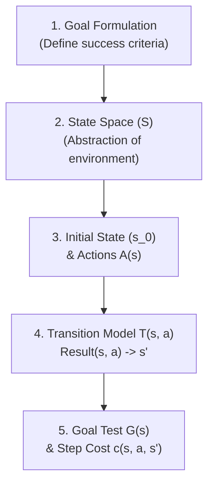

---

#### 2. The Five Problem Formulation Steps (4 Marks)

1. **Initial State ($s_0$):**  
   The starting configuration of the environment in which the agent finds itself.
2. **Actions ($A(s)$):**  
   The set of all legal operators available to the agent when in state $s$.
3. **Transition Model ($T(s, a)$ / $\operatorname{Result}(s, a)$):**  
   A deterministic function that specifies the resulting state $s'$ reached after executing action $a$ in state $s$.
4. **Goal Test ($G(s)$):**  
   A Boolean predicate that checks whether state $s$ satisfies the target solution conditions (can be an explicit set of states or an implicit property test).
5. **Path Cost Function ($c(s, a, s')$):**  
   A function assigning a numeric cost to executing action $a$ to transition from $s$ to $s'$. The total path cost is the sum of step costs along the solution sequence.

---

#### 3. Concrete Illustrative Example: The Vacuum World (2 Marks)

Consider a 2-location vacuum-cleaner world with rooms $A$ and $B$:

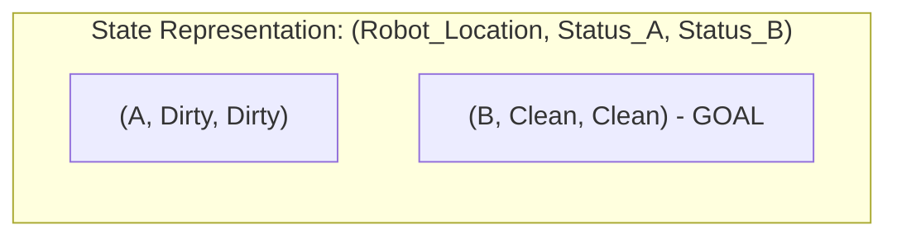

*   **States ($S$):** Determined by agent position ($\{A, B\}$) and dirt status of each room ($\{\text{Clean}, \text{Dirty}\}$). Total states = $2 \times 2 \times 2 = 8$ states.
*   **Initial State ($s_0$):** Any arbitrary state, e.g., $(A, \text{Dirty}, \text{Dirty})$.
*   **Actions ($A$):** $\{\text{Left}, \text{Right}, \text{Suck}\}$.
*   **Transition Model:**
    *   $\operatorname{Result}((A, \text{Dirty}, \text{Dirty}), \text{Suck}) = (A, \text{Clean}, \text{Dirty})$
    *   $\operatorname{Result}((A, \text{Clean}, \text{Dirty}), \text{Right}) = (B, \text{Clean}, \text{Dirty})$
*   **Goal Test ($G$):** Both rooms are clean: $(\cdot, \text{Clean}, \text{Clean})$.
*   **Path Cost ($c$):** Each move/action has a unit step cost of $1$.

:::tip

**Examiner's Note**

Ensure your answer explicitly writes out the 5-tuple $\langle s_0, A, T, G, c \rangle$ and provides an end-to-end example (Vacuum World, 8-Puzzle, or Route Finding) mapping each component clearly.

:::

---

### Question 21.b (8 Marks)

:::info

**Question Statement**

Consider the water jug problem: You are given two jugs, a 4-gallon one and 3-gallon one. Neither has any measuring marker on it. There is a pump that can be used to fill the jugs with water. How can you get exactly 2 gallon of water from the 4-gallon jug? Explain the state space representation and apply an optimal sequence of actions to solve it. **(8 Marks)**

:::

---

### Solution 21.b (8 Marks)

#### 1. State Space Representation (3 Marks)

*   **State Representation:** An ordered pair $(x, y)$ where:
    *   $x \in \{0, 1, 2, 3, 4\}$: Current volume of water in the 4-gallon jug.
    *   $y \in \{0, 1, 2, 3\}$: Current volume of water in the 3-gallon jug.
*   **Initial State:** Both jugs are empty:
    $$s_0 = (0, 0)$$
*   **Goal State:** Exactly 2 gallons in the 4-gallon jug:
    $$s_G = (2, y) \quad \text{for any } y \in \{0, 1, 2, 3\}$$

---

#### 2. Formal Production Rules / Operators (2 Marks)

| Rule Number | Action | Precondition | State Transition $(x, y) \to (x', y')$ |
| :---: | :--- | :--- | :--- |
| **1** | Fill 4-gal jug | $x < 4$ | $(x, y) \to (4, y)$ |
| **2** | Fill 3-gal jug | $y < 3$ | $(x, y) \to (x, 3)$ |
| **3** | Empty 4-gal jug | $x > 0$ | $(x, y) \to (0, y)$ |
| **4** | Empty 3-gal jug | $y > 0$ | $(x, y) \to (x, 0)$ |
| **5** | Pour 3-gal into 4-gal until 4-gal is full | $x + y \ge 4 \land y > 0$ | $(x, y) \to (4, y - (4 - x))$ |
| **6** | Pour 4-gal into 3-gal until 3-gal is full | $x + y \ge 3 \land x > 0$ | $(x, y) \to (x - (3 - y), 3)$ |
| **7** | Pour all water from 3-gal into 4-gal | $x + y \le 4 \land y > 0$ | $(x, y) \to (x + y, 0)$ |
| **8** | Pour all water from 4-gal into 3-gal | $x + y \le 3 \land x > 0$ | $(x, y) \to (0, x + y)$ |

---

#### 3. Optimal Sequence of Actions (3 Marks)

The problem can be solved in an optimal **6-step sequence**:

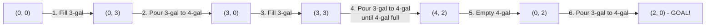

##### Step-by-Step Action Trace

| Step | 4-Gallon Jug ($x$) | 3-Gallon Jug ($y$) | Action Applied | Rule Applied |
| :---: | :---: | :---: | :--- | :---: |
| **0** | $0$ | $0$ | Initial State | — |
| **1** | $0$ | $3$ | Fill the 3-gallon jug | Rule 2 |
| **2** | $3$ | $0$ | Pour all water from 3-gal into 4-gal | Rule 7 |
| **3** | $3$ | $3$ | Fill the 3-gallon jug again | Rule 2 |
| **4** | $4$ | $2$ | Pour from 3-gal into 4-gal until 4-gal is full | Rule 5 |
| **5** | $0$ | $2$ | Empty the 4-gallon jug | Rule 3 |
| **6** | $\mathbf{2}$ | $\mathbf{0}$ | **Pour all 2 gallons from 3-gal into 4-gal** | **Rule 7 (Goal Reached!)** |

*   **Final Result:** The 4-gallon jug contains exactly **2 gallons of water**. Total steps = 6.

:::tip

**Examiner's Note**

Award 3 marks for the formal $(x, y)$ state representation, 2 marks for listing production rules with preconditions, and 3 marks for the 6-step trace table reaching $(2, 0)$ or $(2, 3)$.

:::

---

### Question 22.a (8 Marks)

:::info

**Question Statement**

Consider the above graph and try to find the path from S to G using the A* Algorithm. **(8 Marks)**

```text
       (S, h=7)
       /  |   \
    4 / 10| 11 \
     v    v     v
 (A,h=8)-(B,h=6)-(C,h=5)
  | \    /|      |  \
 5|  \8 / |15  20|   \2
  v   vv  v      v    v
 (D,h=5) (H,h=7)(E,h=3)(F,h=3)
  |  \   /|      |    /  \
16| 20\ /1|2   19| 13/    \5
  v    v  v      v  v      v
 (I,h=4)-(J,h=5)-(G,h=0)-(K,h=3)
```

*Heuristic Values $h(n)$:*  
$S: 7, \; A: 8, \; B: 6, \; C: 5, \; D: 5, \; E: 3, \; F: 3, \; G: 0, \; H: 7, \; I: 4, \; J: 5, \; K: 3$

*Edge Weights:*  
$S-A: 4, \; S-B: 10, \; S-C: 11$  
$A-B: 8, \; A-D: 5, \; B-C: 8, \; B-D: 15$  
$C-E: 20, \; C-F: 2, \; D-F: 1, \; D-H: 16, \; D-I: 20$  
$E-G: 19, \; F-G: 13, \; F-I: 5, \; H-I: 1, \; H-J: 2$  
$I-J: 5, \; I-K: 13, \; J-K: 7, \; K-G: 16$

:::

---

### Solution 22.a (8 Marks)

#### 1. $A^*$ Search Evaluation Mechanics (2 Marks)
$A^*$ maintains a priority queue of nodes ordered by the evaluation function:

$$f(n) = g(n) + h(n)$$

where $g(n)$ is the exact cumulative cost from start node $S$, and $h(n)$ is the heuristic estimate to goal node $G$.

---

#### 2. Step-by-Step $A^*$ Execution Trace (5 Marks)

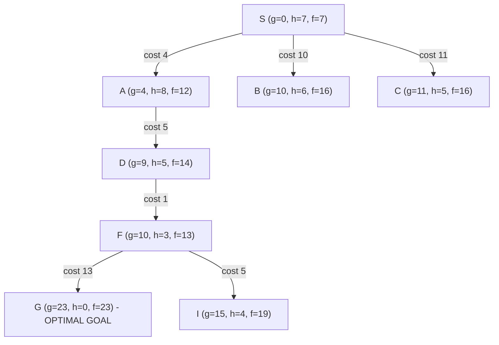

| Step | Dequeued Node | $g(n)$ | $h(n)$ | $f(n)$ | Path Explored | Successors Generated & Inserted into Priority Queue | Priority Queue State ($f = g + h$) |
| :---: | :---: | :---: | :---: | :---: | :--- | :--- | :--- |
| **1** | **S** | $0$ | $7$ | **7** | `[S]` | $(A, g=4, f=12)$<br/>$(B, g=10, f=16)$<br/>$(C, g=11, f=16)$ | `[(A, 12), (B, 16), (C, 16)]` |
| **2** | **A** | $4$ | $8$ | **12** | `[S, A]` | $(D, g=4+5=9, f=14)$<br/>$(B, g=4+8=12, f=18)$ | `[(F_from_D, 13 pending), (D, 14), (B, 16), (C, 16)]` |
| **3** | **D** | $9$ | $5$ | **14** | `[S, A, D]` | $(F, g=9+1=10, f=13)$<br/>$(H, g=9+16=25, f=32)$<br/>$(I, g=9+20=29, f=33)$ | `[(F, 13), (B, 16), (C, 16), (H, 32), (I, 33)]` |
| **4** | **F** | $10$ | $3$ | **13** | `[S, A, D, F]` | $(C, g=10+2=12, f=17)$<br/>$(I, g=10+5=15, f=19)$<br/>$(G, g=10+13=23, f=23)$ | `[(B, 16), (C, 16), (C_alt, 17), (I, 19), (G, 23)]` |
| **5** | **B** | $10$ | $6$ | **16** | `[S, B]` | $(C, g=10+8=18, f=23)$ | `[(C, 16), (C_alt, 17), (I, 19), (G, 23)]` |
| **6** | **C** | $11$ | $5$ | **16** | `[S, C]` | $(F, g=11+2=13, f=16)$<br/>$(E, g=11+20=31, f=34)$ | `[(C_alt, 17), (I, 19), (G, 23), (E, 34)]` |
| **7** | **I** | $15$ | $4$ | **19** | `[S, A, D, F, I]` | $(H, g=15+1=16, f=23)$<br/>$(J, g=15+5=20, f=25)$<br/>$(K, g=15+13=28, f=31)$ | `[(H, 23), (G, 23), (J, 25), (K, 31)]` |
| **8** | **H** | $16$ | $7$ | **23** | `[S, A, D, F, I, H]` | $(J, g=16+2=18, f=23)$ | `[(G, 23), (J, 23), (J, 25)]` |
| **9** | **G** | $\mathbf{23}$ | $\mathbf{0}$ | $\mathbf{23}$ | `[S, A, D, F, G]` | **Goal Dequeued! Search Terminates.** | — |

---

#### 3. Final Solution Path & Cost (1 Mark)

*   **Optimal Path Discovered:**
    $$\mathbf{S \to A \to D \to F \to G}$$
*   **Total Optimal Path Cost:**
    $$\operatorname{Cost} = c(S, A) + c(A, D) + c(D, F) + c(F, G) = 4 + 5 + 1 + 13 = \mathbf{23}$$

:::tip

**Examiner's Note**

Show the explicit $f(n) = g(n) + h(n)$ calculation at each step. Emphasize that node $D$ branches to $F$ with $f(F) = 10 + 3 = 13$, leading to the optimal goal path $S \to A \to D \to F \to G$ with cost 23.

:::

---

### Question 22.b (8 Marks)

:::info

**Question Statement**

Elaborate on the need for Local search algorithms and discuss anyone algorithm in detail. **(8 Marks)**

:::

---

### Solution 22.b (8 Marks)

#### 1. The Need for Local Search Algorithms (3 Marks)

Classical search algorithms (BFS, DFS, $A^*$) maintain systematic search paths from the initial state to the goal state, consuming substantial memory. However, in many real-world domains:
1. **Path Irrelevance:** The path to the goal is completely irrelevant; only the final target configuration matters (e.g., 8-Queens, VLSI chip layout, protein folding, Job-Shop scheduling).
2. **Combinatorial State Space Explosion:** The total number of states is astronomically large ($N!$ or $b^d$), making frontier storage infeasible.
3. **$O(1)$ Constant Memory:** Local search operates using a single current state and moves only to neighboring states, requiring $O(1)$ memory.
4. **Optimization Capability:** Naturally finds the global maximum or minimum of an objective function in continuous or discrete parameter landscapes.

---

#### 2. Detailed Discussion: Hill-Climbing Search (Steepest-Ascent) (3 Marks)

Hill-Climbing is an iterative local search algorithm that continually moves in the direction of increasing elevation (or value) to find the peak of an objective function.

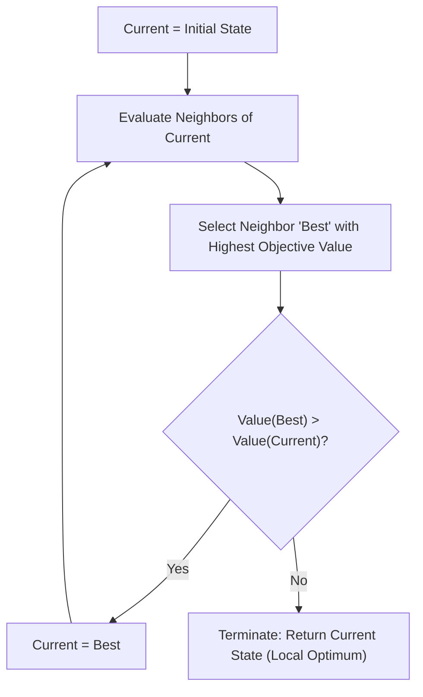

##### Algorithmic Steps
1. Set `current` $\leftarrow$ `initial_state`.
2. Loop:
   *   `neighbor` $\leftarrow$ the highest-valued successor of `current`.
   *   If $\operatorname{Value}(\text{neighbor}) \le \operatorname{Value}(\text{current})$, return `current` (terminate at peak).
   *   `current` $\leftarrow$ `neighbor`.

---

#### 3. Failure Modes and Solutions (2 Marks)

```text
       Objective
         Value ^           Local Maximum        Global Maximum
               |               /\                   /\
               |              /  \   Plateau       /  \
               |             /    \-----------    /    \
               |            /                 \  /      \
               |___________/                   \/________\______> State Space
```

1. **Local Maxima:** A peak that is higher than all its neighboring states but lower than the global maximum. The algorithm terminates prematurely.
2. **Plateaux (Flat Local Maxima / Shoulders):** A flat region of the state space where all neighboring states have the identical value, leaving the algorithm with no directional gradient.
3. **Ridges:** A sequence of local maxima where the slope gently inclines, causing steepest-ascent to oscillate inefficiently back and forth.

##### Enhancements & Modern Variants
*   **Stochastic Hill-Climbing:** Randomly chooses among uphill moves.
*   **Random-Restart Hill-Climbing:** Conducts repeated independent trials from randomly generated initial states, ensuring asymptotic completeness.
*   **Simulated Annealing:** Escapes local maxima by allowing occasional downhill moves with probability:
    $$P(\text{accept}) = e^{\Delta E / T}$$
    where $T$ is a gradually decreasing temperature parameter.

:::tip

**Examiner's Note**

High-scoring answers clearly explain why path-independent problems need local search, provide the Hill-Climbing pseudo-code, draw the objective landscape diagram (Local Maxima, Plateau, Ridge), and mention Simulated Annealing.

:::

---

### Question 23.a (8 Marks)

:::info

**Question Statement**

Brief on Mini-Max algorithm and also discuss the need for Alpha-Beta Pruning. **(8 Marks)**

:::

---

### Solution 23.a (8 Marks)

#### 1. The Minimax Algorithm (4 Marks)

The Minimax algorithm computes the optimal decision in a two-player, zero-sum, perfect-information deterministic game (e.g., Chess, Checkers).

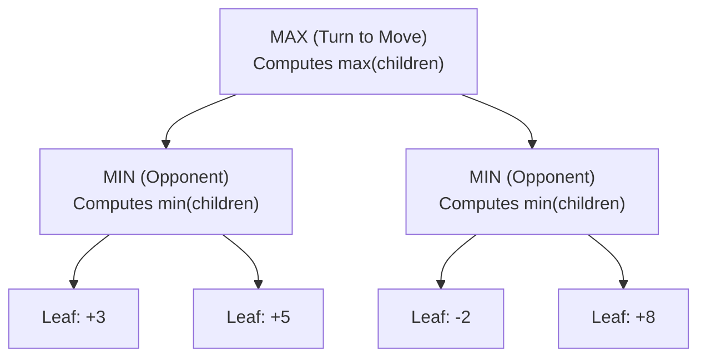

##### Mathematical Formulation
Let $s$ be a game state:
$$
\operatorname{Minimax}(s) = \begin{cases}
\operatorname{Utility}(s) & \text{if } \operatorname{Terminal-Test}(s) \\
\max_{a \in \operatorname{Actions}(s)} \operatorname{Minimax}(\operatorname{Result}(s, a)) & \text{if } \operatorname{Player}(s) = \text{MAX} \\
\min_{a \in \operatorname{Actions}(s)} \operatorname{Minimax}(\operatorname{Result}(s, a)) & \text{if } \operatorname{Player}(s) = \text{MIN}
\end{cases}
$$

##### Computational Complexity of Exhaustive Minimax
*   **Time Complexity:** $O(b^d)$, where $b$ is the legal branching factor and $d$ is the maximum search depth.
*   **Space Complexity:** $O(bd)$ (via depth-first search).
*   **The Scalability Bottleneck:** For Chess ($b \approx 35, d \approx 80$), evaluating $35^{80} \approx 10^{123}$ nodes is computationally impossible.

---

#### 2. The Need for Alpha-Beta Pruning (4 Marks)

Exhaustive Minimax wastes immense computational power evaluating game branches that neither player would ever choose. **Alpha-Beta Pruning** eliminates these irrelevant subtrees without altering the final minimax decision.

##### Governing Bounding Parameters
*   $\alpha$: The utility of the best (highest-value) choice found so far along the search path for **MAX** (initialized to $-\infty$).
*   $\beta$: The utility of the best (lowest-value) choice found so far along the search path for **MIN** (initialized to $+\infty$).

##### The Pruning Condition
$$\mathbf{\text{If } \alpha \ge \beta, \quad \text{PRUNE remaining children.}}$$

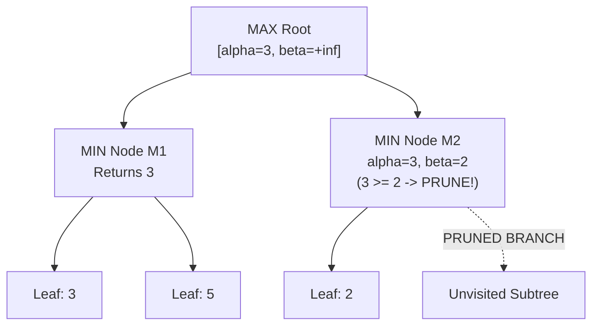

##### Why Alpha-Beta Pruning is Essential
1. **Identical Outcome:** Returns the exact same mathematical move and value as Minimax:
   $$\operatorname{AlphaBeta}(root) \equiv \operatorname{Minimax}(root)$$
2. **Exponential Speedup:** With optimal move ordering, time complexity decreases from $O(b^d)$ to:
   $$O\left(b^{d/2}\right) = O\left((\sqrt{b})^d\right)$$
3. **Double the Search Depth:** Halving the effective branching factor allows an AI agent to look **twice as many moves ahead** in the same execution time.

:::tip

**Examiner's Note**

Award 4 marks for defining the Minimax decision rule and complexity $O(b^d)$, and 4 marks for stating the pruning condition $\alpha \ge \beta$, drawing a cutoff diagram, and citing the best-case complexity $O(b^{d/2})$.

:::

---

### Question 23.b (8 Marks)

:::info

**Question Statement**

Define an Intelligent Agent. Describe the Task environment and its properties (PEAS) and briefly explain the different types of agents that can be implemented by an AI. **(8 Marks)**

:::

---

### Solution 23.b (8 Marks)

#### 1. Definition of an Intelligent Agent (1.5 Marks)
An **Intelligent Agent** is an autonomous entity that perceives its environment through **sensors**, processes these percepts through an internal decision program, and acts upon the environment through **actuators** to maximize its expected performance measure.

$$\operatorname{Agent}: \mathcal{P}^* \to \mathcal{A}$$

---

#### 2. Task Environment: The PEAS Framework & Properties (3 Marks)

The PEAS framework formally specifies the problem environment:
*   **P - Performance Measure:** The objective criteria used to evaluate the agent's success.
*   **E - Environment:** The external world or context within which the agent operates.
*   **A - Actuators:** The physical or virtual mechanisms through which the agent acts.
*   **S - Sensors:** The input transducers through which the agent receives environmental percepts.

##### PEAS Example: Autonomous Taxi Driver

| Component | Autonomous Taxi Specification |
| :--- | :--- |
| **Performance** | Safety, speed, legal compliance, passenger comfort, fuel efficiency |
| **Environment** | Roads, pedestrian traffic, vehicles, weather, traffic signals |
| **Actuators** | Steering wheel, accelerator, brakes, horn, turn signals, display |
| **Sensors** | Cameras, LiDAR, radar, GPS, speedometer, odometer, engine sensors |

##### Task Environment Properties
1. **Fully vs. Partially Observable:** Complete sensor access vs. noisy/occluded states.
2. **Deterministic vs. Stochastic:** Next state uniquely determined by action vs. random elements.
3. **Episodic vs. Sequential:** Current action affects future decisions vs. independent episodes.
4. **Static vs. Dynamic:** Environment cannot change while agent deliberates vs. constantly changing.
5. **Discrete vs. Continuous:** Finite states and actions vs. continuous physical measurements.
6. **Single vs. Multi-Agent:** Operating alone vs. interacting with cooperative/competitive agents.

---

#### 3. The Five Agent Architectures (3.5 Marks)

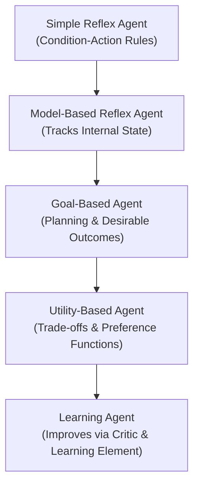

1. **Simple Reflex Agent:**  
   Acts strictly based on current percepts using hardcoded condition-action rules ($\text{IF } \text{car-in-front-braking} \implies \text{THEN } \text{apply-brakes}$). Incapable of operating in partially observable environments.
2. **Model-Based Reflex Agent:**  
   Maintains an internal model of the unobserved world to track state evolution over time.
3. **Goal-Based Agent:**  
   Combines internal state models with explicit goal descriptions to formulate multi-step action plans.
4. **Utility-Based Agent:**  
   Uses a continuous utility function $U(s)$ to evaluate competing goals, balancing safety, cost, and speed trade-offs.
5. **Learning Agent:**  
   Consists of a **Learning Element** (makes improvements), **Performance Element** (selects actions), **Critic** (evaluates behavior against standards), and **Problem Generator** (suggests exploratory actions).

:::tip

**Examiner's Note**

Ensure all four letters of PEAS are defined with a concrete application table, and outline the 5 agent types with a progression from Simple Reflex to Learning Agent.

:::

---

### Question 24.a (8 Marks)

:::info

**Question Statement**

Consider a 4x4 Wumpus World environment. The agent starts at cell (1,1) and its goal is to find gold while avoiding pits and the Wumpus. The percepts available to the agent are: stench (near Wumpus), breeze (near pit), glitter (gold), bump (wall), and scream (Wumpus killed).  
Tasks:  
i) Draw a possible knowledge representation (using a simple logical representation) for the agent’s knowledge of the environment after it perceives a breeze at (1,1) and stench at (2,1). **(4 Marks)**  
ii) Using propositional logic and inference rules, determine the possible safe moves for the agent from its current position. Explain your reasoning step by step. **(4 Marks)**

:::

---

### Solution 24.a (8 Marks)

#### 1. Knowledge Representation in Propositional Logic (4 Marks)

##### a) Propositional Vocabulary
*   $P_{i,j}$: True if cell $(i, j)$ contains a Pit.
*   $W_{i,j}$: True if cell $(i, j)$ contains the Wumpus.
*   $B_{i,j}$: True if cell $(i, j)$ perceives a Breeze.
*   $S_{i,j}$: True if cell $(i, j)$ perceives a Stench.

##### b) General Environmental Axioms
A breeze occurs in a cell if and only if an adjacent cell contains a pit:
$$B_{1,1} \iff (P_{1,2} \lor P_{2,1})$$
A stench occurs in a cell if and only if an adjacent cell contains the Wumpus:
$$S_{2,1} \iff (W_{1,1} \lor W_{2,2} \lor W_{3,1})$$

##### c) Knowledge Base ($\text{KB}$) after Percepts
1. **Initial Safe Starting Cell:** The agent starts safely at $(1, 1)$:
   $$\neg P_{1,1} \land \neg W_{1,1}$$
2. **Percept at $(1, 1)$:** Breeze is perceived, but no Stench:
   $$B_{1,1} \land \neg S_{1,1}$$
   $$\implies \neg S_{1,1} \implies (\neg W_{1,2} \land \neg W_{2,1})$$
3. **Agent Moves to $(2, 1)$:**
   $$\neg P_{2,1} \land \neg W_{2,1}$$
4. **Percept at $(2, 1)$:** Stench is perceived, but no Breeze:
   $$S_{2,1} \land \neg B_{2,1}$$
   $$\implies \neg B_{2,1} \implies (\neg P_{2,2} \land \neg P_{3,1})$$

```text
Row 4  [ . ]  [ . ]  [ . ]  [ . ]
Row 3  [ . ]  [ . ]  [ . ]  [ . ]
Row 2  [P12?] [W22?] [ . ]  [ . ]
Row 1  [(1,1)] [Stench] [W31?] [ . ]
        Col 1   Col 2   Col 3   Col 4
```

---

#### 2. Step-by-Step Propositional Inference for Safe Moves (4 Marks)

The agent is currently situated at cell $(2, 1)$. Its available adjacent candidate moves are:
*   Moving Left to $(1, 1)$
*   Moving Up to $(2, 2)$
*   Moving Right to $(3, 1)$

##### Step 1: Pit Localization Deduction
*   From $B_{1,1} \iff (P_{1,2} \lor P_{2,1})$, we have:
    $$P_{1,2} \lor P_{2,1}$$
*   The agent successfully moved into $(2, 1)$ without falling into a pit:
    $$\neg P_{2,1}$$
*   Applying **Disjunctive Syllogism** on $(P_{1,2} \lor P_{2,1})$ and $\neg P_{2,1}$:
    $$\mathbf{P_{1,2} = \text{True}}$$
*   *Conclusion:* **Cell $(1, 2)$ definitely contains a PIT.** It is lethal.

##### Step 2: Pit Safety for $(2, 2)$ and $(3, 1)$
*   At cell $(2, 1)$, the agent perceives $\neg B_{2,1}$ (no breeze).
*   Rule: $\neg B_{2,1} \iff \neg(P_{1,1} \lor P_{2,2} \lor P_{3,1}) \implies \mathbf{\neg P_{2,2} \land \neg P_{3,1}}$.
*   *Conclusion:* Neither $(2, 2)$ nor $(3, 1)$ contains a pit.

##### Step 3: Wumpus Localization Deduction
*   At $(1, 1)$, no stench was perceived ($\neg S_{1,1}$). Therefore:
    $$\neg W_{1,2} \land \neg W_{2,1}$$
*   At $(2, 1)$, a stench is perceived ($S_{2,1}$). The adjacent cells are $(1, 1), (2, 2), (3, 1)$.
    $$S_{2,1} \implies (W_{1,1} \lor W_{2,2} \lor W_{3,1})$$
*   Since $\neg W_{1,1}$ is known from start:
    $$\mathbf{W_{2,2} \lor W_{3,1} = \text{True}}$$
*   *Deduction:* Exactly one Wumpus exists in either $(2, 2)$ or $(3, 1)$. Without an arrow shot or further sensing, neither $(2, 2)$ nor $(3, 1)$ is guaranteed safe from the Wumpus!

##### Step 4: Determination of Safe Moves
*   Move to $(1, 2)$: **DEADLY** (Confirmed Pit).
*   Move to $(2, 2)$ or $(3, 1)$: **RISKY / UNSAFE** (50% probability of lethal Wumpus).
*   Move to $(1, 1)$: **100% SAFE** ($\neg P_{1,1} \land \neg W_{1,1}$ already verified).

**Final Safe Action:** The agent must safely **backtrack to cell $(1, 1)$**.

:::tip

**Examiner's Note**

Award 4 marks for part (i) for stating the biconditionals $B_{i,j} \iff \bigvee P_{\text{adj}}$ and knowledge assertions, and 4 marks for part (ii) for proving $P_{1,2}$ via Disjunctive Syllogism and concluding that $(1, 1)$ is the only safe move.

:::

---

### Question 24.b (8 Marks)

:::info

**Question Statement**

Differentiate Backward and Forward chaining with an example. **(8 Marks)**

:::

---

### Solution 24.b (8 Marks)

#### 1. Comparative Analysis

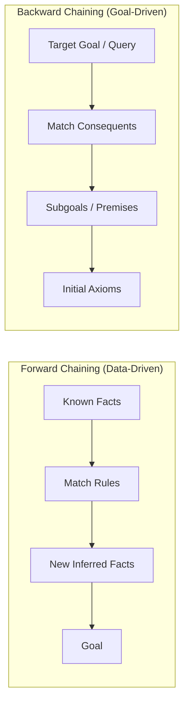

| Dimension | Forward Chaining | Backward Chaining |
| :--- | :--- | :--- |
| **Reasoning Direction** | **Data-Driven (Bottom-Up):** Starts with known facts and moves forward to draw conclusions. | **Goal-Driven (Top-Down):** Starts with a target query/goal and works backward to find supporting facts. |
| **Starting Point** | Atomic assertions in Working Memory. | User query or goal hypothesis. |
| **Search Space** | Explores broad consequences; can generate many irrelevant facts. | Focused strictly on rules relevant to the goal query. |
| **Operational Loop** | Match premises $\to$ Resolve conflicts $\to$ Fire rule $\to$ Update facts. | Match goal with consequent $\to$ Set premises as new subgoals $\to$ Recurse. |
| **Appropriate Applications** | Real-time monitoring, automated configuration, synthesis (e.g., XCON). | Diagnostic expert systems, automated theorem proving, Prolog (e.g., MYCIN). |

---

#### 2. Illustrative Example Traced Both Ways (4 Marks)

##### Rule Base & Initial Facts
*   **Rule 1 ($R_1$):** $\text{If } A \land B \implies C$
*   **Rule 2 ($R_2$):** $\text{If } C \land D \implies E$
*   **Rule 3 ($R_3$):** $\text{If } E \implies \text{Goal } G$
*   **Known Facts:** $A$ is True, $B$ is True, $D$ is True.
*   **Target Query:** Is $G$ True?

##### a) Forward Chaining Trace
1. **Cycle 1:** Facts $\{A, B, D\}$ are in working memory. The premises of $R_1$ ($A \land B$) are satisfied. Fire $R_1 \implies$ **Fact $C$ is deduced**. Working memory: $\{A, B, D, C\}$.
2. **Cycle 2:** With $C$ and $D$ true, the premises of $R_2$ ($C \land D$) are satisfied. Fire $R_2 \implies$ **Fact $E$ is deduced**. Working memory: $\{A, B, D, C, E\}$.
3. **Cycle 3:** With $E$ true, the premise of $R_3$ is satisfied. Fire $R_3 \implies$ **Goal $G$ is deduced**. Search succeeds.

##### b) Backward Chaining Trace
1. **Query $G$:** Look for rules with consequent $G$. Found $R_3$ ($E \implies G$). New subgoal: **Prove $E$**.
2. **Subgoal $E$:** Look for rules with consequent $E$. Found $R_2$ ($C \land D \implies E$). New subgoals: **Prove $C$ and Prove $D$**.
3. **Fact Check $D$:** $D$ is directly in known facts. Subgoal $D$ succeeds.
4. **Subgoal $C$:** Look for rules with consequent $C$. Found $R_1$ ($A \land B \implies C$). New subgoals: **Prove $A$ and Prove $B$**.
5. **Fact Check $A$ and $B$:** Both are directly in known facts. $R_1$ succeeds $\implies C$ is true $\implies E$ is true $\implies \mathbf{G \text{ is Proved True}}$.

:::tip

**Examiner's Note**

Ensure your answer contrasts the two methods in a structured comparison table and traces the identical rule set using both Forward and Backward chaining.

:::

---

### Question 25.a (8 Marks)

:::info

**Question Statement**

Explain the concept of Planning in AI. Describe the working of a Simple planning agent and elaborate on the planning problem it addresses. **(8 Marks)**

:::

---

### Solution 25.a (8 Marks)

#### 1. The Concept of Planning in AI (2.5 Marks)
**Planning** is the deliberative process of generating a structured sequence of actions to achieve specified goals from an initial state. Unlike classical atomic state search, planning uses **factored representations** (e.g., PDDL - Planning Domain Definition Language, STRIPS).

```text
Action Schema: Fly(plane, from, to)
  PRECOND: At(plane, from)
  EFFECT:  At(plane, to) AND NOT At(plane, from)
```

##### Why Planning Extends Standard Search
1. **Factored States:** States are conjunctions of logical literals (`At(Plane1, JFK)`) rather than atomic black-box integers.
2. **Open Action Operators:** Actions explicitly define **Preconditions**, **Add Lists**, and **Delete Lists**, allowing search algorithms to reason directly about cause and effect.
3. **Goal-Directed Regression:** Planners can reason backward from goals to identify only those actions that directly achieve target fluents, avoiding the exponential branching of forward search.

---

#### 2. Architecture & Working of a Simple Planning Agent (3 Marks)

A Simple Planning Agent implements a continuous loop of formulating goals, constructing plans, and executing actions:

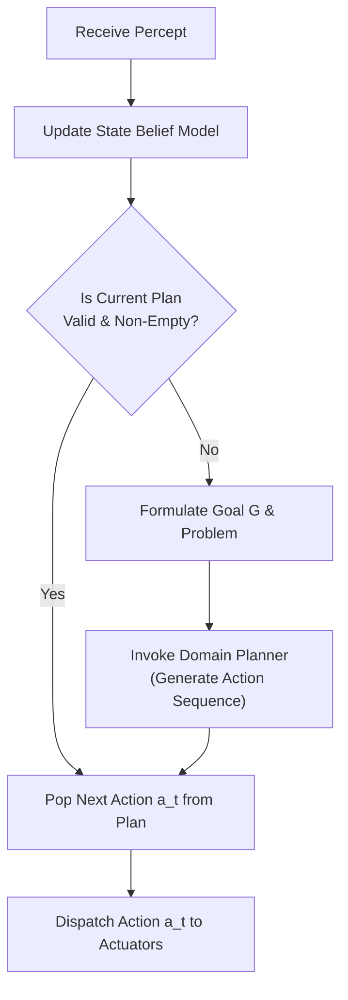

##### Operational Cycle
1. **Percept Ingestion & Belief Update:** The agent reads sensors and updates its internal world state model.
2. **Goal Check:** If the current plan is exhausted or invalidated by an unexpected environmental event, the agent formulates a new goal.
3. **Plan Synthesis:** The deliberative planner searches the plan space (via Graphplan, Partial-Order Planning, or heuristic state-space search) to synthesize a valid action sequence.
4. **Execution:** The agent dispatches actions sequentially to actuators.

---

#### 3. Core Planning Problems Addressed (2.5 Marks)

1. **The Frame Problem:**  
   How to represent efficiently that most facts in the world remain unchanged when an action is executed. Solved in STRIPS/PDDL by specifying that only literals in the **Effects** list change; all unmentioned literals persist.
2. **The Qualification Problem:**  
   The impossibility of listing all endless real-world preconditions required for an action to succeed.
3. **The Ramification Problem:**  
   How to track secondary, implicit side effects of actions without combinatorial explosion.
4. **Subgoal Interaction & The Sussman Anomaly:**  
   In domains like Blocks World, achieving one subgoal can inadvertently undo a previously achieved subgoal. Planning algorithms resolve this through non-linear/partial-order planning.

:::tip

**Examiner's Note**

High marks require defining STRIPS/PDDL action schemas (Preconditions & Effects), drawing the agent planning cycle, and explaining classic AI planning challenges (Frame problem, Sussman Anomaly).

:::

---

### Question 25.b (8 Marks)

:::info

**Question Statement**

Elaborate the types of learning models used in machine learning and their relevance in AI applications. **(8 Marks)**

:::

---

### Solution 25.b (8 Marks)

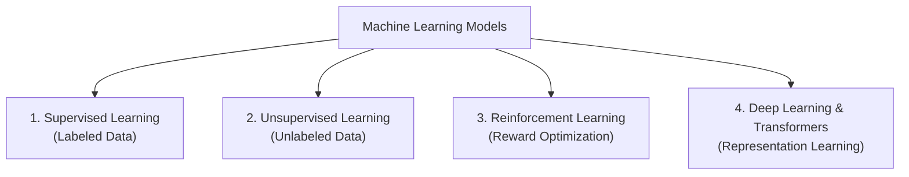

#### 1. Supervised Learning Models (2 Marks)
*   **Mechanism:** Learns a mapping function $f: \mathcal{X} \to \mathcal{Y}$ from labeled training pairs $\mathcal{D} = \{(\mathbf{x}_i, y_i)\}_{i=1}^N$.
*   **Key Models:** Linear/Logistic Regression, Support Vector Machines (SVM), Decision Trees, Random Forests, Gradient Boosted Trees (XGBoost).
*   **Relevance in AI Applications:**
    *   *Healthcare:* Classifying medical biopsy scans into malignant vs. benign tumors.
    *   *Finance:* Predicting real-estate property valuations and scoring loan credit default risks.

---

#### 2. Unsupervised Learning Models (2 Marks)
*   **Mechanism:** Discovers latent clusters, manifolds, or probability distributions $P(\mathbf{x})$ from unlabeled feature vectors $\{\mathbf{x}_i\}_{i=1}^N$.
*   **Key Models:** $K$-Means Clustering, DBSCAN, Principal Component Analysis (PCA), Gaussian Mixture Models (GMM), Autoencoders.
*   **Relevance in AI Applications:**
    *   *E-Commerce:* Customer market segmentation grouping shoppers by buying behavior.
    *   *Cybersecurity:* Detecting zero-day network intrusion anomalies that deviate from baseline traffic.

---

#### 3. Reinforcement Learning Models (2 Marks)
*   **Mechanism:** An agent interacts with an environment modeled as a Markov Decision Process (MDP $\langle \mathcal{S}, \mathcal{A}, \mathcal{P}, \mathcal{R}, \gamma \rangle$). It optimizes policy $\pi(a \mid s)$ to maximize expected cumulative discounted rewards:
    $$J(\pi) = \mathbb{E}\left[\sum_{t=0}^{\infty} \gamma^t R(s_t, a_t)\right]$$
*   **Key Models:** Q-Learning, Deep Q-Networks (DQN), Proximal Policy Optimization (PPO), Actor-Critic (A2C).
*   **Relevance in AI Applications:**
    *   *Robotics:* Quadruped locomotion, warehouse robotic arm manipulation.
    *   *Autonomous Systems:* Self-driving car trajectory planning and superhuman game engines (AlphaGo, AlphaZero).

---

#### 4. Deep Learning & Foundation Models (2 Marks)
*   **Mechanism:** Hierarchical multi-layer neural networks that automatically extract abstract representations from raw high-dimensional perceptual data.
*   **Key Models:** Convolutional Neural Networks (CNNs), Recurrent Neural Networks (LSTMs), Transformer architectures (Self-Attention).
*   **Relevance in AI Applications:**
    *   *Computer Vision:* Real-time object detection (YOLO) and medical image segmentation.
    *   *Natural Language Processing:* Large Language Models (LLMs) powering conversational agents, machine translation, and code generation.

:::tip

**Examiner's Note**

Organize the response into the 4 primary machine learning paradigms, providing the mathematical objective, key representative algorithms, and concrete industry applications for each.

:::

---

## Part C: Comprehensive Search Problems (15 Marks)

### Question 26 (15 Marks)

:::info

**Question Statement**

The missionaries and cannibals problem is usually stated as follows. Three missionaries and three cannibals are on one side of a river, along with a boat that can hold one or two people. Find a way to get everyone to the other side without ever leaving a group of missionaries in one place outnumbered by the cannibals in that place. **(15 Marks)**  
(i) Formulate the problem precisely, making only those distinctions necessary to ensure a valid solution. Draw a diagram of the complete state space. **(5 Marks)**  
(ii) Implement and solve the problem optimally using an appropriate search algorithm. Is it a good idea to check for repeated states? **(8 Marks)**  
(iii) Why do you think people have a hard time solving this puzzle, given that the state space is so simple? **(2 Marks)**

:::

---

### Solution 26 (15 Marks)

#### (i) Formal Problem Formulation & Complete State Space (5 Marks)

##### a) State Representation
The state is represented as a 3-tuple:

$$s = (M, C, B)$$

where:
*   $M \in \{0, 1, 2, 3\}$: Number of missionaries on the Starting (Left) Bank.
*   $C \in \{0, 1, 2, 3\}$: Number of cannibals on the Starting (Left) Bank.
*   $B \in \{1, 0\}$: Position of the boat ($1$ = Left Bank; $0$ = Right Bank).

The counts on the Right Bank are implicitly $M_{\text{right}} = 3 - M$ and $C_{\text{right}} = 3 - C$.

##### b) Initial and Goal States
*   **Initial State:** $s_0 = (3, 3, 1)$
*   **Goal State:** $s_G = (0, 0, 0)$

##### c) Safety Invariant Constraint
Missionaries are safe if they are not outnumbered on either bank:
$$\operatorname{Safe}(M, C) \iff (M == 0 \lor M \ge C) \;\land\; ((3 - M) == 0 \lor (3 - M) \ge (3 - C))$$

##### d) Valid State Space Diagram (16 Legal States)
There are exactly $4 \times 4 \times 2 = 32$ conceivable states, of which **16 states are legal**:

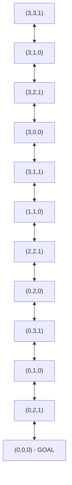

---

#### (ii) Optimal Solution Trace & Repeated State Checking (8 Marks)

##### a) Optimal 11-Step Solution Sequence (BFS / UCS)
With unit step cost $c = 1$, Breadth-First Search discovers the optimal **11-crossing solution**:

| Step | State $(M, C, B)$ | Left Bank | Boat Crossing | Right Bank | Action Description |
| :---: | :---: | :---: | :---: | :---: | :--- |
| **0** | $(3, 3, 1)$ | $3M, 3C$, Boat | — | Empty | Start |
| **1** | $(3, 1, 0)$ | $3M, 1C$ | $2C \to$ | $2C$, Boat | Two cannibals cross to Right |
| **2** | $(3, 2, 1)$ | $3M, 2C$, Boat | $\leftarrow 1C$ | $1C$ | One cannibal returns to Left |
| **3** | $(3, 0, 0)$ | $3M, 0C$ | $2C \to$ | $3C$, Boat | Two cannibals cross to Right |
| **4** | $(3, 1, 1)$ | $3M, 1C$, Boat | $\leftarrow 1C$ | $2C$ | One cannibal returns to Left |
| **5** | $(1, 1, 0)$ | $1M, 1C$ | $2M \to$ | $2M, 2C$, Boat | Two missionaries cross to Right |
| **6** | $(2, 2, 1)$ | $2M, 2C$, Boat | $\leftarrow 1M, 1C$ | $1M, 1C$ | **One missionary and one cannibal return** |
| **7** | $(0, 2, 0)$ | $0M, 2C$ | $2M \to$ | $3M, 1C$, Boat | Two missionaries cross to Right |
| **8** | $(0, 3, 1)$ | $0M, 3C$, Boat | $\leftarrow 1C$ | $3M, 0C$ | One cannibal returns to Left |
| **9** | $(0, 1, 0)$ | $0M, 1C$ | $2C \to$ | $3M, 2C$, Boat | Two cannibals cross to Right |
| **10** | $(0, 2, 1)$ | $0M, 2C$, Boat | $\leftarrow 1C$ | $3M, 1C$ | One cannibal returns to Left |
| **11** | $\mathbf{(0, 0, 0)}$ | Empty | $2C \to$ | $3M, 3C$, Boat | **Two cannibals cross $\implies$ GOAL!** |

##### b) Is It a Good Idea to Check for Repeated States?
**Yes, checking for repeated states is absolutely essential.**
*   The state space graph is undirected and cyclic. For example, from $(3, 3, 1)$, moving two cannibals yields $(3, 1, 0)$, from which sending two cannibals back immediately returns to $(3, 3, 1)$.
*   Without maintaining an explicit `CLOSED` (explored) set, a standard tree search algorithm generates an infinite search tree ($O(b^\infty)$) and becomes trapped in infinite loops. Graph search reduces the search space to just 16 distinct states.

---

#### (iii) Why Humans Struggle with This Puzzle (2 Marks)

Despite the small state space (only 16 legal states), humans have significant difficulty solving it due to cognitive bias:
1. **The Hill-Climbing Trap:** Humans employ a natural "difference-reduction" heuristic, assuming that every good move must transport more people from the start bank to the goal bank.
2. **Counter-Intuitive Step 6:** At Step 6 ($(1, 1, 0) \to (2, 2, 1)$), the only valid path requires sending **one missionary and one cannibal back to the start bank**. This appears to undo progress and violates human intuition, causing human solvers to reject the move and enter deadlock.

:::tip

**Examiner's Note**

Award 5 marks for part (i) for defining $(M, C, B)$ and drawing the 16-state graph, 8 marks for part (ii) for the complete 11-step trace table and explaining why repeated state checks prevent infinite loops, and 2 marks for part (iii) for identifying the cognitive barrier at Step 6.

:::

---

### Question 27 (15 Marks)

:::info

**Question Statement**

Given a weighted graph, a source node and a destination node. The task is to find the shortest path from the source node (P) to the destination node (S) using uniform cost search. **(15 Marks)**

```text
       7
 (V2)-----(V4)
 9/| \3  /| \8
 / |  \ / |  \
(V1)2  X 1|4 (V6)
 4\ | / \ |  /2
  v| v   vv v
 (V3)-----(V5)
       6
```

*Edge Weights:*  
$(V_1, V_2): 9, \quad (V_1, V_3): 4$  
$(V_2, V_3): 2, \quad (V_2, V_4): 7, \quad (V_2, V_5): 3$  
$(V_3, V_4): 1, \quad (V_3, V_5): 6$  
$(V_4, V_5): 4, \quad (V_4, V_6): 8$  
$(V_5, V_6): 2$

*Source Node:* $P = V_1$  
*Destination Node:* $S = V_6$

:::

---

### Solution 27 (15 Marks)

#### 1. Uniform Cost Search (UCS) Algorithmic Procedure (3 Marks)

Uniform Cost Search explores the state space in order of increasing cumulative path cost $g(n)$:
1. Initialize a Priority Queue `PQ` storing tuples $(g(u), u, \text{Path})$ keyed on minimum cost $g(u)$.
2. Push $(0, V_1, [V_1])$ into `PQ`. Initialize `EXPLORED = {}`.
3. While `PQ` is not empty:
   *   Dequeue the entry $(g(u), u, \text{Path})$ with the minimum cost.
   *   **Goal Test:** If $u == V_6$, terminate immediately and return the optimal path and cost $g(u)$.
   *   If $u \notin \text{EXPLORED}$:
       *   Insert $u$ into `EXPLORED`.
       *   For each adjacent neighbor $v$ of $u$ with edge cost $w(u, v)$:
           *   If $v \notin \text{EXPLORED}$, calculate $g(v) = g(u) + w(u, v)$ and insert $(g(v), v, \text{Path} + [v])$ into `PQ`.
4. If `PQ` empties, return failure.

---

#### 2. Step-by-Step Execution Trace (10 Marks)

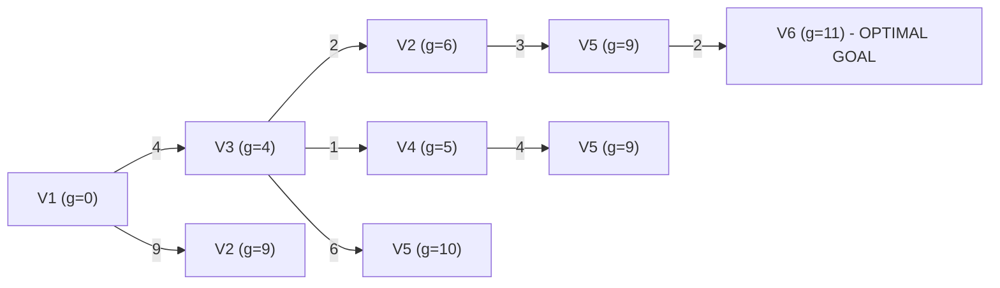

##### Trace Table

| Step | Dequeued Entry $(g, u, \text{Path})$ | Explored Set | Neighbors Generated & Enqueued $(g(v) = g(u) + w)$ | Priority Queue Contents (Ordered by $g$) |
| :---: | :--- | :--- | :--- | :--- |
| **0** | — | `[]` | Push $(0, V_1, [V_1])$ | `[(0, V1)]` |
| **1** | **(0, V1, [V1])** | `[V1]` | $(4, V_3, [V_1, V_3])$<br/>$(9, V_2, [V_1, V_2])$ | `[(4, V3), (9, V2)]` |
| **2** | **(4, V3, [V1, V3])** | `[V1, V3]` | $(4+1=5, V_4, [V_1, V_3, V_4])$<br/>$(4+2=6, V_2, [V_1, V_3, V_2])$<br/>$(4+6=10, V_5, [V_1, V_3, V_5])$ | `[(5, V4), (6, V2), (9, V2), (10, V5)]` |
| **3** | **(5, V4, [V1, V3, V4])** | `[V1, V3, V4]` | $(5+4=9, V_5, [V_1, V_3, V_4, V_5])$<br/>$(5+7=12, V_2, [V_1, V_3, V_4, V_2])$<br/>$(5+8=13, V_6, [V_1, V_3, V_4, V_6])$ | `[(6, V2), (9, V2), (9, V5_via_V4), (10, V5), (12, V2), (13, V6)]` |
| **4** | **(6, V2, [V1, V3, V2])** | `[V1, V3, V4, V2]` | $(6+3=9, V_5, [V_1, V_3, V_2, V_5])$<br/>$(6+7=13, V_4 \to \text{Explored})$ | `[(9, V2_direct), (9, V5_via_V4), (9, V5_via_V2), (10, V5), (13, V6)]` |
| **5** | **(9, V2, [V1, V2])** | `[V1, V3, V4, V2]` | Already explored; discard | `[(9, V5_via_V4), (9, V5_via_V2), (10, V5), (13, V6)]` |
| **6** | **(9, V5, [V1, V3, V4, V5])** | `[V1, V3, V4, V2, V5]` | $(9+2=11, V_6, [V_1, V_3, V_4, V_5, V_6])$<br/>$(9+4=13, V_4 \to \text{Explored})$ | `[(9, V5_via_V2), (10, V5), (11, V6), (13, V6)]` |
| **7** | **(9, V5, [V1, V3, V2, V5])** | `[V1, V3, V4, V2, V5]` | $(9+2=11, V_6, [V_1, V_3, V_2, V_5, V_6])$ | `[(10, V5), (11, V6_via_V4), (11, V6_via_V2), (13, V6)]` |
| **8** | **(10, V5, [V1, V3, V5])** | `[V1, V3, V4, V2, V5]` | Already explored; discard | `[(11, V6_via_V4), (11, V6_via_V2), (13, V6)]` |
| **9** | **(11, V6, [V1, V3, V4, V5, V6])** | `[... V6]` | **GOAL DEQUEUED! Search Terminates.** | — |

---

#### 3. Optimal Path and Cost Summary (2 Marks)

The search terminates upon dequeuing node $V_6$ with minimum cost $11$.

##### Optimal Solution Paths (Both Cost 11)
$$\mathbf{V_1 \to V_3 \to V_4 \to V_5 \to V_6} \quad (\text{Cost: } 4 + 1 + 4 + 2 = \mathbf{11})$$
$$\mathbf{V_1 \to V_3 \to V_2 \to V_5 \to V_6} \quad (\text{Cost: } 4 + 2 + 3 + 2 = \mathbf{11})$$

*   **Optimal Path Cost:** $\mathbf{11}$
*   **Total Nodes Expanded:** 6 nodes ($V_1, V_3, V_4, V_2, V_5, V_6$).

:::tip

**Examiner's Note**

High marks require explicitly noting that $V_1$ branches first to $V_3$ (cost 4) rather than $V_2$ (cost 9), detailing the queue state ordered by $g(n)$, and identifying the minimum cost of 11 to reach destination $V_6$.

:::
