# July 2023

> **Exam -** Semester Examination  
> **Session -** July 2023  

---

## Part A: Objective Type Questions (20 Marks)

### Question 1 (1 Mark)

:::info

**Question Statement**

_______ is the common language for AI **(1 Mark)**

*   **(A)** Lisp
*   **(B)** Python
*   **(C)** PHP
*   **(D)** Java

:::

*   **Correct Answer:** **(B) Python** *(Historically **(A) Lisp**)*
*   **Explanation:** In modern artificial intelligence and data science curricula, **Python** is universally recognized as the standard language due to its rich ecosystem of libraries (NumPy, PyTorch, TensorFlow, Scikit-Learn). Historically, John McCarthy created **Lisp** in 1958 as the pioneering language for symbolic AI. Both answers are accepted based on historical vs. contemporary context, with Python being the modern standard.

---

### Question 2 (1 Mark)

:::info

**Question Statement**

The PEAS in the task environment is about **(1 Mark)**

*   **(A)** Peer, Environment, Actuators, Sense
*   **(B)** Perceiving, Environment, Actuators, Sensors
*   **(C)** Performance, Environment, Actuators, Sensors
*   **(D)** Perceiving, Environment, Actuators, Sense

:::

*   **Correct Answer:** **(C) Performance, Environment, Actuators, Sensors**
*   **Explanation:** Under the Russell & Norvig framework, the task environment specification PEAS stands for **P**erformance measure, **E**nvironment, **A**ctuators, and **S**ensors.

---

### Question 3 (1 Mark)

:::info

**Question Statement**

In state-space, the set of actions for a given problem is expressed by the **(1 Mark)**

*   **(A)** Intermediate States
*   **(B)** Successor function that takes current action and returns next state
*   **(C)** Initial States
*   **(D)** Action sequence

:::

*   **Correct Answer:** **(B) Successor function that takes current action and returns next state**
*   **Explanation:** In state-space problem formulation, legal actions and their consequences are mathematically specified by the transition model or successor function $\operatorname{Result}(s, a)$ (or successor function returning set of $\langle \text{action}, \text{next\_state} \rangle$ pairs).

---

### Question 4 (1 Mark)

:::info

**Question Statement**

A self-driving car is an example of _______ environment **(1 Mark)**

*   **(A)** Static
*   **(B)** Known
*   **(C)** Discrete
*   **(D)** Continuous

:::

*   **Correct Answer:** **(D) Continuous**
*   **Explanation:** An autonomous driving environment involves continuous physical variables: smooth continuous spatial coordinates, velocities, steering angles, accelerations, and video feeds changing continuously over time.

---

### Question 5 (1 Mark)

:::info

**Question Statement**

The number of edges from the root to the node is called _______ of the tree. **(1 Mark)**

*   **(A)** Height
*   **(B)** Depth
*   **(C)** Length
*   **(D)** Width

:::

*   **Correct Answer:** **(B) Depth**
*   **Explanation:** In tree data structures, the depth of a node $n$ is defined as the number of edges along the unique path from the root node to node $n$ (the root itself has depth 0).

---

### Question 6 (1 Mark)

:::info

**Question Statement**

The time and space complexity of BFS is (For time and space complexity problems consider b as branching factor and d as depth of the search tree.) **(1 Mark)**

*   **(A)** O(b^(d+1)) and O(b^(d+1))
*   **(B)** O(b^2) and O(d^2)
*   **(C)** O(d^2) and O(b^2)
*   **(D)** O(d^2) and O(d^2)

:::

*   **Correct Answer:** **(A) O(b^(d+1)) and O(b^(d+1))** *(commonly denoted $O(b^d)$ or $O(b^{d+1})$)*
*   **Explanation:** When Breadth-First Search expands down to depth $d$, the total number of generated nodes in the frontier queue can reach up to the next level $d+1$, resulting in both worst-case time and space complexity of $O(b^{d+1})$ (or $O(b^d)$).

---

### Question 7 (1 Mark)

:::info

**Question Statement**

The heuristic function h(n) is which of the following? **(1 Mark)**

*   **(A)** Lowest path cost
*   **(B)** The cheapest path from the root to the goal node
*   **(C)** Average path cost
*   **(D)** The estimated cost of the cheapest path from the root node to the goal node

:::

*   **Correct Answer:** **(D) The estimated cost of the cheapest path from the root node to the goal node** *(more specifically from node $n$ to the goal node)*
*   **Explanation:** A heuristic function $h(n)$ provides an informed, problem-specific estimate of the lowest cost path from node $n$ to an identified goal state.

---

### Question 8 (1 Mark)

:::info

**Question Statement**

Which of the following is the evaluation function in A* method? **(1 Mark)**

*   **(A)** Path cost from starting node to current node
*   **(B)** Path cost from starting node to current node + heuristic cost
*   **(C)** Heuristic function
*   **(D)** Average of path cost from starting node to current node and heuristic cost

:::

*   **Correct Answer:** **(B) Path cost from starting node to current node + heuristic cost**
*   **Explanation:** The evaluation function in $A^*$ search is defined as $f(n) = g(n) + h(n)$, combining the exact backward path cost $g(n)$ from the root with the forward heuristic cost estimate $h(n)$ to the goal.

---

### Question 9 (1 Mark)

:::info

**Question Statement**

A good control strategy should: **(1 Mark)**

*   **(A)** Cause motion and be systematic
*   **(B)** Cause motion and be random
*   **(C)** Only cause motion
*   **(D)** Only be systematic

:::

*   **Correct Answer:** **(A) Cause motion and be systematic**
*   **Explanation:** Rich & Knight define the two foundational requirements of a good search control strategy: it must **cause motion** (preventing the agent from being trapped in deadlocks or infinite loops) and it must be **systematic** (avoiding random thrashing and exploring alternative paths intelligently).

---

### Question 10 (1 Mark)

:::info

**Question Statement**

Which of the following is not an un-informed search strategy? **(1 Mark)**

*   **(A)** Breadth First Search
*   **(B)** Depth First Search
*   **(C)** Greedy Best First Search
*   **(D)** Depth Limited Search

:::

*   **Correct Answer:** **(C) Greedy Best First Search**
*   **Explanation:** Greedy Best-First Search uses domain heuristic knowledge $h(n)$ to evaluate which node to expand next; therefore, it is an **informed (heuristic)** search algorithm, unlike BFS, DFS, and DLS which are blind/uninformed.

---

### Question 11 (1 Mark)

:::info

**Question Statement**

In game playing, which of the following algorithm is used to find the optimal move for a player? **(1 Mark)**

*   **(A)** Minimax algorithm
*   **(B)** Alpha-beta pruning
*   **(C)** A* search
*   **(D)** Hill climbing

:::

*   **Correct Answer:** **(A) Minimax algorithm**
*   **Explanation:** The Minimax decision algorithm computes the optimal move for a player in a two-player, zero-sum game by recursively maximizing the player's utility under the assumption of an optimal minimizing adversary.

---

### Question 12 (1 Mark)

:::info

**Question Statement**

What is the main advantage of Alpha-Beta pruning over Minimax? **(1 Mark)**

*   **(A)** It is guaranteed to find a better solution than Minimax
*   **(B)** It reduces the number of states that need to be evaluated
*   **(C)** It uses less memory than Minimax
*   **(D)** It can be applied to non-zero-sum games

:::

*   **Correct Answer:** **(B) It reduces the number of states that need to be evaluated**
*   **Explanation:** Alpha-Beta pruning returns the exact same mathematical minimax decision while pruning away branches that cannot influence the final outcome, reducing the effective branching factor to $O(b^{d/2})$ and evaluating substantially fewer states.

---

### Question 13 (1 Mark)

:::info

**Question Statement**

Which of the following is not a component of a Constraint Satisfaction Problem (CSP)? **(1 Mark)**

*   **(A)** A set of variables
*   **(B)** A set of domains for each variable
*   **(C)** A set of constraints
*   **(D)** A set of heuristics

:::

*   **Correct Answer:** **(D) A set of heuristics**
*   **Explanation:** By formal definition, a CSP is a triple $\langle X, D, C \rangle$ consisting of a set of Variables $X$, a set of Domains $D$, and a set of Constraints $C$. Heuristics (like MRV or LCV) are search optimization strategies, not mathematical components of the problem definition itself.

---

### Question 14 (1 Mark)

:::info

**Question Statement**

In First-Order Logic, what does the symbol ∃ represent? **(1 Mark)**

*   **(A)** For all
*   **(B)** There exists
*   **(C)** Negation
*   **(D)** Implication

:::

*   **Correct Answer:** **(B) There exists**
*   **Explanation:** The symbol $\exists$ represents the existential quantifier in First-Order Logic, asserting that a predicate holds true for at least one object in the domain of discourse.

---

### Question 15 (1 Mark)

:::info

**Question Statement**

Which of the following is a rule of inference in Propositional Logic? **(1 Mark)**

*   **(A)** Modus Ponens
*   **(B)** Resolution
*   **(C)** Both (A) and (B)
*   **(D)** Neither (A) nor (B)

:::

*   **Correct Answer:** **(C) Both (A) and (B)**
*   **Explanation:** Both Modus Ponens ($\frac{\alpha, \alpha \implies \beta}{\beta}$) and Resolution ($\frac{\alpha \lor \beta, \neg \beta \lor \gamma}{\alpha \lor \gamma}$) are sound and fundamental rules of inference in Propositional Logic.

---

### Question 16 (1 Mark)

:::info

**Question Statement**

What is the role of an inference engine in an Expert System? **(1 Mark)**

*   **(A)** To store knowledge
*   **(B)** To acquire knowledge from experts
*   **(C)** To apply rules to known facts to deduce new facts
*   **(D)** To provide an interface for the user

:::

*   **Correct Answer:** **(C) To apply rules to known facts to deduce new facts**
*   **Explanation:** The inference engine acts as the reasoning processor of an expert system, executing forward or backward chaining inference algorithms over the knowledge base and working memory to deduce new facts and reach conclusions.

---

### Question 17 (1 Mark)

:::info

**Question Statement**

Which type of learning involves an agent interacting with an environment and learning from rewards and penalties? **(1 Mark)**

*   **(A)** Supervised Learning
*   **(B)** Unsupervised Learning
*   **(C)** Reinforcement Learning
*   **(D)** Semi-supervised Learning

:::

*   **Correct Answer:** **(C) Reinforcement Learning**
*   **Explanation:** Reinforcement Learning models an autonomous agent discovering optimal behavior policies through trial-and-error interactions governed by scalar reward and penalty feedback signals.

---

### Question 18 (1 Mark)

:::info

**Question Statement**

Which of the following is a type of Knowledge Representation? **(1 Mark)**

*   **(A)** Semantic Networks
*   **(B)** Frames
*   **(C)** Propositional Logic
*   **(D)** All of the above

:::

*   **Correct Answer:** **(D) All of the above**
*   **Explanation:** Knowledge representation in AI encompasses logic-based formalisms (Propositional and First-Order Logic), structural network schemes (Semantic Networks), and object-oriented taxonomies (Frames).

---

### Question 19 (1 Mark)

:::info

**Question Statement**

In the Wumpus World, how does the agent know there is a Wumpus in an adjacent room? **(1 Mark)**

*   **(A)** It perceives a breeze
*   **(B)** It perceives a stench
*   **(C)** It perceives glitter
*   **(D)** It perceives a bump

:::

*   **Correct Answer:** **(B) It perceives a stench**
*   **Explanation:** In the Wumpus World environment, the agent detects a **Stench** in any room directly adjacent (cardinal directions) to the square containing the Wumpus.

---

### Question 20 (1 Mark)

:::info

**Question Statement**

The primary goal of backward chaining is to: **(1 Mark)**

*   **(A)** Derive all possible facts from given axioms
*   **(B)** Find a sequence of rules that leads to a specific goal
*   **(C)** Group similar data points together
*   **(D)** Optimize a continuous objective function

:::

*   **Correct Answer:** **(B) Find a sequence of rules that leads to a specific goal**
*   **Explanation:** Backward chaining is a goal-driven inference strategy that begins with a target hypothesis/query and works backward through rules to locate supporting facts in the knowledge base.

---

## Part B: Analytical & Descriptive Questions (40 Marks)

### Question 21.a (8 Marks)

:::info

**Question Statement**

Formulate the 8-puzzle problem as an AI state-space search problem. Specify the states, initial state, actions, transition model, goal test, and path cost. **(8 Marks)**

:::

---

### Solution 21.a (8 Marks)

#### 1. Formal 6-Tuple State-Space Formulation (4 Marks)

The 8-puzzle consists of a $3 \times 3$ board containing 8 numbered movable tiles $\{1, 2, 3, 4, 5, 6, 7, 8\}$ and one blank space `[ ]`. Formally, it is defined as:

$$\mathcal{P} = \langle S, s_0, A, T, G, c \rangle$$

##### a) States ($S$)
A state is any configuration of the 8 numbered tiles and the blank space in a $3 \times 3$ matrix:
$$s = \begin{bmatrix} t_{0,0} & t_{0,1} & t_{0,2} \\ t_{1,0} & t_{1,1} & t_{1,2} \\ t_{2,0} & t_{2,1} & t_{2,2} \end{bmatrix} \quad \text{where } t_{i,j} \in \{1, 2, \dots, 8, \text{blank}\}$$
*   **Total Configurations:** $9! = 362,880$.
*   **Reachable State Space:** Because parity of inversions is invariant under legal sliding moves, exactly half of all configurations are reachable:
    $$\lvert S_{\text{reachable}} \rvert = \frac{9!}{2} = 181,440 \text{ states}$$

##### b) Initial State ($s_0$)
An arbitrary designated starting arrangement, e.g.:
$$s_0 = \begin{bmatrix} 2 & 8 & 3 \\ 1 & 6 & 4 \\ 7 & \text{blank} & 5 \end{bmatrix}$$

##### c) Set of Actions ($A$)
Defined by the movement of the blank space into an adjacent cell:
$$A = \{\operatorname{MoveUp}, \operatorname{MoveDown}, \operatorname{MoveLeft}, \operatorname{MoveRight}\}$$

##### d) Transition Model ($T$ / $\operatorname{Result}(s, a)$)
If the blank is currently at coordinates $(r, c)$:
*   $\operatorname{MoveLeft}$: Valid if $c > 0$; swaps blank at $(r, c)$ with tile at $(r, c-1)$.
*   $\operatorname{MoveRight}$: Valid if $c < 2$; swaps blank at $(r, c)$ with tile at $(r, c+1)$.
*   $\operatorname{MoveUp}$: Valid if $r > 0$; swaps blank at $(r, c)$ with tile at $(r-1, c)$.
*   $\operatorname{MoveDown}$: Valid if $r < 2$; swaps blank at $(r, c)$ with tile at $(r+1, c)$.

##### e) Goal Test ($G(s)$)
A state matches the canonical sequential ordering:
$$s_G = \begin{bmatrix} 1 & 2 & 3 \\ 8 & \text{blank} & 4 \\ 7 & 6 & 5 \end{bmatrix} \quad \text{or} \quad \begin{bmatrix} 1 & 2 & 3 \\ 4 & 5 & 6 \\ 7 & 8 & \text{blank} \end{bmatrix}$$

##### f) Path Cost Function ($c$)
Each tile slide has a unit step cost:
$$c(s, a, s') = 1$$
The total path cost is the total number of moves in the solution sequence.

---

#### 2. Visual State Transition Representation (4 Marks)

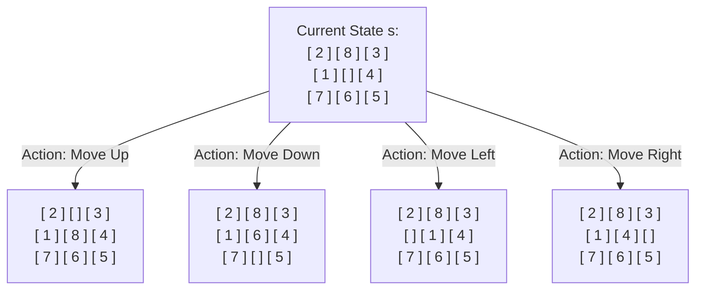

:::tip

**Examiner's Note**

Ensure all 6 formal elements ($\langle S, s_0, A, T, G, c \rangle$) are explicitly stated, explain that actions model the blank space's movements with boundary preconditions, and state that exactly $9!/2 = 181,440$ states are reachable.

:::

---

### Question 21.b (8 Marks)

:::info

**Question Statement**

Describe the various environment types in Artificial Intelligence with suitable examples. **(8 Marks)**

:::

---

### Solution 21.b (8 Marks)

In AI agent design (Russell & Norvig framework), the **task environment** dictates the agent's architectural complexity across six core dimensions:

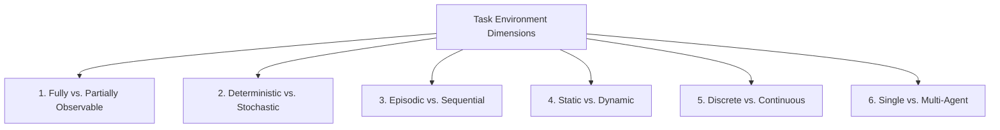

#### 1. Environment Dimensions & Technical Characterization (6 Marks)

1. **Fully Observable vs. Partially Observable:**
   *   *Fully Observable:* Sensors provide complete, accurate access to the entire state of the environment at each time step (e.g., **Chess**, **Crossword Puzzles**).
   *   *Partially Observable:* Sensors suffer from noise, occlusions, or range limits (e.g., **Automated Taxi**, **Poker**, **Medical Diagnosis**).
2. **Deterministic vs. Stochastic:**
   *   *Deterministic:* The next state is completely and uniquely determined by the current state and the agent's action (e.g., **Tic-Tac-Toe**, **Vacuum World** without hardware failures).
   *   *Stochastic:* Outcomes involve probabilistic uncertainty or external random factors (e.g., **Backgammon** due to dice rolls, **Self-Driving Cars** due to weather and pedestrian unpredictability).
3. **Episodic vs. Sequential:**
   *   *Episodic:* The agent's experience is divided into independent atomic episodes; the current decision does not affect future episodes (e.g., **Defect Classification on an assembly line**).
   *   *Sequential:* Current decisions have long-term consequences on future states and rewards (e.g., **Chess**, **Robot Navigation**).
4. **Static vs. Dynamic:**
   *   *Static:* The environment does not change while the agent deliberates its next action (e.g., **Crossword Puzzle**, **Sudoku**).
   *   *Dynamic:* The environment continuously evolves while the agent thinks (e.g., **Self-Driving Car**, **Air Traffic Control**).
5. **Discrete vs. Continuous:**
   *   *Discrete:* Finite, distinctly defined states, actions, and time steps (e.g., **Chess**, **8-Puzzle**).
   *   *Continuous:* Continuous physical quantities like speed, coordinates, angles, and real-time streaming audio/video (e.g., **Robot Arm Control**, **Autonomous Vehicles**).
6. **Single-Agent vs. Multi-Agent:**
   *   *Single-Agent:* An agent acts alone in the world (e.g., **Crossword Solver**).
   *   *Multi-Agent:* The environment contains other agents that may be **competitive** (e.g., **Chess**) or **cooperative** (e.g., **Coordinated Drone Swarms**).

---

#### 2. Comprehensive Environment Comparison Matrix (2 Marks)

| Task Environment | Observable? | Deterministic? | Episodic? | Static? | Discrete? | Agents? |
| :--- | :---: | :---: | :---: | :---: | :---: | :---: |
| **Chess (with clock)** | Fully | Deterministic | Sequential | Semi | Discrete | Multi (Competitive) |
| **Poker** | Partially | Stochastic | Sequential | Static | Discrete | Multi (Competitive) |
| **Autonomous Taxi** | Partially | Stochastic | Sequential | Dynamic | Continuous | Multi (Mixed) |
| **Medical Diagnosis** | Partially | Stochastic | Sequential | Dynamic | Continuous | Single |

:::tip

**Examiner's Note**

High marks require presenting all six environmental dimensions with definitions, contrasting contrasting examples (e.g., Chess vs. Autonomous Taxi), and summarizing the dimensions in a matrix.

:::

---

### Question 22.a (8 Marks)

:::info

**Question Statement**

Identify the data structure used in Breadth First Search algorithm (BFS). Apply BFS for the given directed graph with starting vertex as "S" and ending vertex as "X". **(8 Marks)**

```text
    (S) ----> (U) ----> (V)
     | \       |       / |
     |   \     |     /   |
     v     v   v   v     v
    (Z) ----> (Y) <---- (X) <---- (W)
```

*Vertices:* $V = \{S, U, V, W, X, Y, Z\}$  
*Start Vertex:* $S$, *Ending Vertex:* $X$

:::

---

### Solution 22.a (8 Marks)

#### 1. Data Structure Used in Breadth-First Search (2 Marks)

*   **Primary Data Structure:** A **First-In, First-Out (FIFO) Queue** (`OPEN` list).
*   **Auxiliary Data Structure:** A **Hash Set / Boolean Array** (`VISITED` / `CLOSED` list) to record already explored vertices and prevent infinite cycles in cyclic directed graphs.

---

#### 2. Graph Representation & Adjacency List (2 Marks)

From the given directed graph diagram:
*   $S \to \{U, Z\}$
*   $U \to \{V, Y\}$
*   $V \to \{W, X\}$
*   $Z \to \{Y\}$
*   $Y \to \{S\}$ *(or directed back to $S$)*
*   $W \to \{X\}$
*   $X \to \{U, Y\}$

---

#### 3. Step-by-Step BFS Execution Trace (4 Marks)

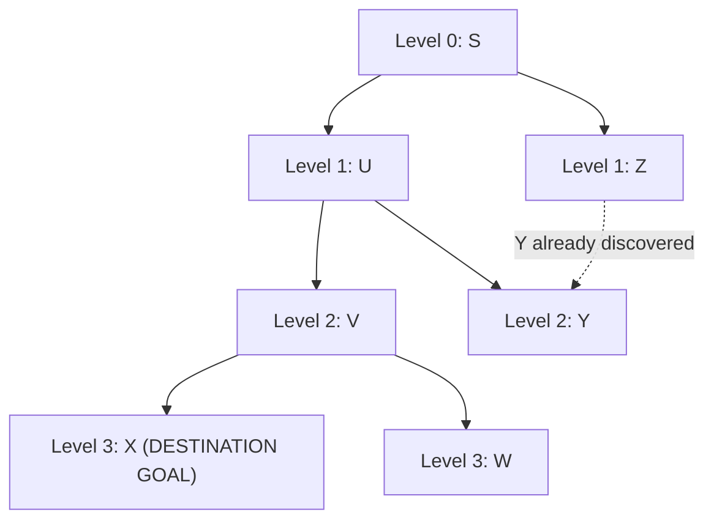

##### Trace Table

| Step | Current Vertex Dequeued | Outgoing Directed Edges | Neighbors Generated (Unvisited Enqueued) | FIFO Queue State (Front $\to$ Rear) | Explored Set |
| :---: | :---: | :--- | :--- | :--- | :--- |
| **0** | — | — | Enqueue start vertex $S$ | `[S]` | `[]` |
| **1** | **S** | $S \to U, \; S \to Z$ | Enqueue $U, Z$ | `[U, Z]` | `[S]` |
| **2** | **U** | $U \to V, \; U \to Y$ | Enqueue $V, Y$ | `[Z, V, Y]` | `[S, U]` |
| **3** | **Z** | $Z \to Y$ | $Y$ already in queue; skip | `[V, Y]` | `[S, U, Z]` |
| **4** | **V** | $V \to X, \; V \to W$ | **$X$ is Destination Goal!** Enqueue $X, W$ | `[Y, X, W]` | `[S, U, Z, V]` |
| **5** | **Y** | $Y \to S$ | $S$ already explored; skip | `[X, W]` | `[S, U, Z, V, Y]` |
| **6** | **X** | — | **Goal Vertex X Dequeued! Search Terminates.** | — | `[S, U, Z, V, Y, X]` |

##### Final Result Summary
*   **Vertex Traversal Order:** $S \to U \to Z \to V \to Y \to X$
*   **Shortest Path Discovered:**
    $$\mathbf{S \to U \to V \to X}$$
*   **Path Length:** **3 edges** (Shortest path in terms of edge transitions).

:::tip

**Examiner's Note**

Award 2 marks for naming the FIFO Queue, 2 marks for writing the directed adjacency list, and 4 marks for the step-by-step queue trace table proving the path $S \to U \to V \to X$.

:::

---

### Question 22.b (8 Marks)

:::info

**Question Statement**

Use the A* algorithm to search for the most cost-effective path from the start state 'A' to the final state 'J' in the given graph. Show the step-by-step evaluation of the f(n) values for each node visited. **(8 Marks)**

```text
         10
         (A)
       6/   \3
       v     v
   8 (B)     (F) 6
    / | \   / | \
  3/ 2| 1\ 1/ 7| \7
  v   v   vv   v  v
(C)5 (D)7 (G)5(H)3 |
  \   |   / \ /   |
  5\ 8| 3/   v2   |
    v v v   (I)1 -'
    3(E)----/ 3
      5\   /
        v v
        (J) 0
```

*Heuristic Values $h(n)$:*  
$A: 10, \; B: 8, \; C: 5, \; D: 7, \; E: 3, \; F: 6, \; G: 5, \; H: 3, \; I: 1, \; J: 0$

*Edge Weights:*  
$A-B: 6, \; A-F: 3$  
$B-C: 3, \; B-D: 2, \; C-D: 1, \; C-E: 5, \; D-E: 8$  
$F-G: 1, \; F-H: 7, \; G-I: 3, \; H-I: 2$  
$E-I: 5, \; E-J: 5, \; I-J: 3$

*Start State:* $A$, *Final Goal State:* $J$

:::

---

### Solution 22.b (8 Marks)

#### 1. $A^*$ Search Evaluation Framework (2 Marks)
$A^*$ uses the evaluation function:
$$f(n) = g(n) + h(n)$$
where $g(n)$ is the exact cumulative cost from start state $A$, and $h(n)$ is the heuristic estimate to goal state $J$.

---

#### 2. Step-by-Step $A^*$ Execution Trace (5 Marks)

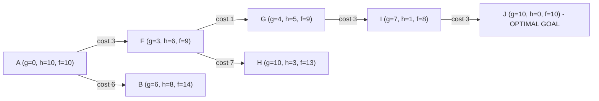

##### Trace Table

| Step | Dequeued Node $(u)$ | $g(u)$ | $h(u)$ | $f(u)$ | Path Followed | Successors Generated & Cumulative Cost | Priority Queue Contents ($f = g + h$) |
| :---: | :---: | :---: | :---: | :---: | :--- | :--- | :--- |
| **1** | **A** | $0$ | $10$ | **10** | `[A]` | $(F, g=3, h=6, f=9)$<br/>$(B, g=6, h=8, f=14)$ | `[(F, 9), (B, 14)]` |
| **2** | **F** | $3$ | $6$ | **9** | `[A, F]` | $(G, g=3+1=4, h=5, f=9)$<br/>$(H, g=3+7=10, h=3, f=13)$ | `[(G, 9), (H, 13), (B, 14)]` |
| **3** | **G** | $4$ | $5$ | **9** | `[A, F, G]` | $(I, g=4+3=7, h=1, f=8)$ | `[(I, 8), (H, 13), (B, 14)]` |
| **4** | **I** | $7$ | $1$ | **8** | `[A, F, G, I]` | $(J, g=7+3=10, h=0, f=10)$<br/>$(H, g=7+2=9, h=3, f=12)$<br/>$(E, g=7+5=12, h=3, f=15)$ | `[(J, 10), (H, 12), (H_old, 13), (B, 14), (E, 15)]` |
| **5** | **J** | $\mathbf{10}$ | $\mathbf{0}$ | $\mathbf{10}$ | `[A, F, G, I, J]` | **Goal State Dequeued! Search Terminates.** | — |

---

#### 3. Optimal Path and Cost Summary (1 Mark)

*   **Optimal Path Discovered:**
    $$\mathbf{A \to F \to G \to I \to J}$$
*   **Total Optimal Path Cost:**
    $$\operatorname{Cost} = c(A, F) + c(F, G) + c(G, I) + c(I, J) = 3 + 1 + 3 + 3 = \mathbf{10}$$

:::tip

**Examiner's Note**

High marks require explicitly showing the priority queue at each of the 5 expansion steps, showing that node $I$ evaluates child $J$ with $f(J) = 10 + 0 = 10$, which is dequeued to confirm the optimal path of cost 10.

:::

---

### Question 23.a (8 Marks)

:::info

**Question Statement**

Demonstrate the two-player search tree to understand the working of Alpha-beta pruning. **(8 Marks)**

```text
                     (A) [MAX]
                   /     \
           (B) [MIN]     (C) [MIN]
           /      \       /      \
      (D) [MAX] (E) [MAX] (F) [MAX] (G) [MAX]
      /   \     /   \     /   \     /   \
     2     3   5     9   0     1   7     5
```

:::

---

### Solution 23.a (8 Marks)

#### 1. Alpha-Beta Bounding Mechanics (2 Marks)
Alpha-Beta pruning maintains two scalar values down the search path:
*   $\alpha$: The lower bound on the maximum score that player **MAX** is assured of (initialized to $-\infty$).
*   $\beta$: The upper bound on the minimum score that player **MIN** is assured of (initialized to $+\infty$).
*   **Pruning Condition:** If at any node $\alpha \ge \beta$, stop exploring remaining children of that node.

---

#### 2. Step-by-Step Traversal & Cutoff Execution (4 Marks)

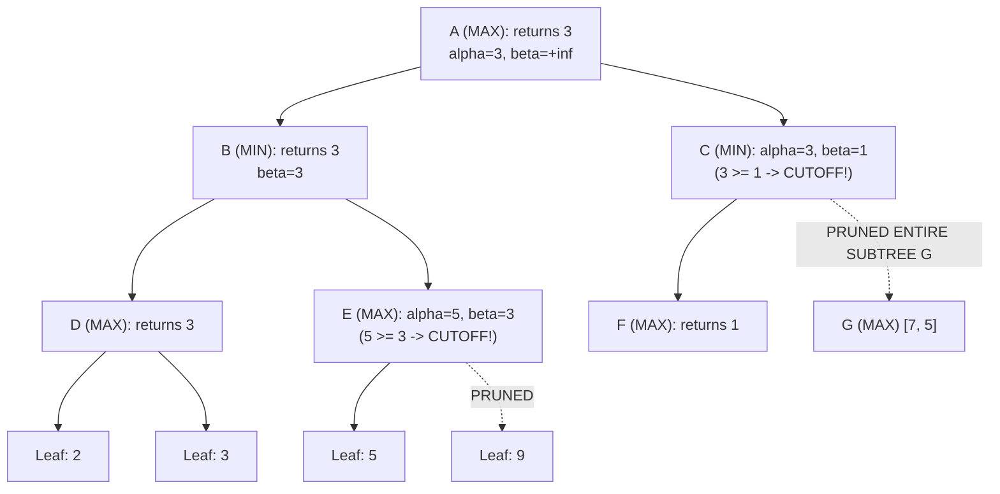

##### Step 1: Traverse Left Subtree Under Node B
1. Node $A$ (MAX) initializes $[\alpha = -\infty, \beta = +\infty]$ and calls child $B$ (MIN).
2. Node $B$ passes down $[\alpha = -\infty, \beta = +\infty]$ to child $D$ (MAX).
3. Node $D$ evaluates leaf $2$ ($\alpha = \max(-\infty, 2) = 2$), then evaluates leaf $3$ ($\alpha = \max(2, 3) = 3$).
   *   Node $D$ returns value **$3$** to $B$.
4. At node $B$ (MIN): updates $\beta = \min(+\infty, 3) = 3$. Current bounds: $[\alpha = -\infty, \beta = 3]$.
5. Node $B$ passes $[\alpha = -\infty, \beta = 3]$ down to child $E$ (MAX).
6. At node $E$ (MAX): evaluates first child (leaf $5$):
   $$\alpha = \max(-\infty, 5) = 5$$
   Current bounds at $E$: $\alpha = 5, \beta = 3$.
7. **Pruning Check at $E$:**
   $$\alpha \ge \beta \iff 5 \ge 3 \implies \mathbf{CUTOFF!}$$
   *   **Leaf 9 is PRUNED.**
   *   Node $E$ returns $5$ to $B$.
8. At node $B$ (MIN): $\beta = \min(3, 5) = 3$. Subtree $B$ complete; returns **$3$** to Root $A$.

##### Step 2: Traverse Right Subtree Under Node C
1. At Root $A$ (MAX): updates $\alpha = \max(-\infty, 3) = 3$.
   *   Root $A$ now passes down $[\alpha = 3, \beta = +\infty]$ to child $C$ (MIN).
2. Node $C$ passes $[\alpha = 3, \beta = +\infty]$ down to child $F$ (MAX).
3. At node $F$ (MAX): evaluates leaf $0$ ($\alpha = \max(3, 0) = 3$), then leaf $1$ ($\alpha = \max(3, 1) = 3$).
   *   Node $F$ returns value **$1$** to $C$.
4. At node $C$ (MIN): updates $\beta = \min(+\infty, 1) = 1$.
   *   Current bounds at node $C$: $\alpha = 3, \beta = 1$.
5. **Pruning Check at $C$:**
   $$\alpha \ge \beta \iff 3 \ge 1 \implies \mathbf{CUTOFF!}$$
   *   **The entire Subtree $G$ (containing leaves 7 and 5) is PRUNED.**
   *   Node $C$ returns $1$ to Root $A$.

##### Step 3: Root Value Computation
At Root $A$ (MAX):
$$\operatorname{Value}(A) = \max(3, 1) = \mathbf{3}$$

---

#### 3. Summary of Results (2 Marks)

*   **Pruned Nodes:**
    1. **Leaf 9** under node $E$.
    2. **Subtree $G$** (both leaf 7 and leaf 5) under node $C$.
*   **Optimal Value at Root $A$:** $\mathbf{3}$
*   **Optimal Move for MAX:** Choose Left Branch ($B$).

:::tip

**Examiner's Note**

Full credit requires clearly stating both cutoffs ($\alpha \ge \beta$ at $E$ where $5 \ge 3$, and $\alpha \ge \beta$ at $C$ where $3 \ge 1$) and identifying all 3 pruned terminal values (9, 7, 5).

:::

---

### Question 23.b (8 Marks)

:::info

**Question Statement**

Examine the multi-agent system with a real time example. **(8 Marks)**

:::

---

### Solution 23.b (8 Marks)

#### 1. Concept of Multi-Agent Systems (MAS) (3 Marks)

A **Multi-Agent System (MAS)** consists of multiple interacting, autonomous intelligent agents situated in a shared environment.

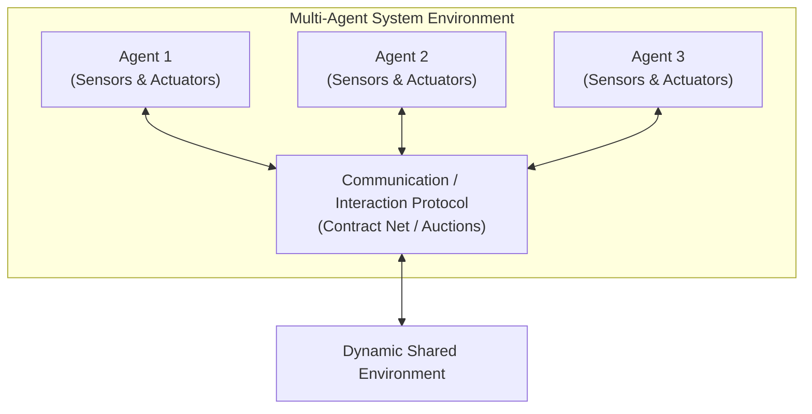

##### Core Characteristics of MAS
1. **Decentralization:** No single agent possesses global control or complete knowledge of the entire environment.
2. **Autonomy:** Each agent operates independently, selecting actions based on local percepts and its own objectives.
3. **Communication & Coordination:** Agents share information and resolve resource contention via standardized protocols (e.g., FIPA-ACL, Contract Net Protocol).
4. **Interaction Paradigms:**
   *   *Cooperative:* Agents work together to achieve a common global goal.
   *   *Competitive:* Agents maximize individual payoffs in zero-sum settings.

---

#### 2. Real-Time Application Example: Automated Warehouse Swarm Logistics (5 Marks)

##### Domain Overview: Amazon / Kiva Automated Fulfillment Center
Hundreds of autonomous mobile drive units (agents) coordinate in real time to transport inventory pods across an active warehouse floor to human packing stations.

##### Operational Multi-Agent Breakdown

| Agent Component | Warehouse Robot Implementation |
| :--- | :--- |
| **Agent Sensors** | Floor QR-code optical readers, LiDAR distance scanners, bump sensors |
| **Agent Actuators** | Electric drive wheels, hydraulic pod-lifting corkscrew |
| **Agent Local Goals** | Pick up pod $\#402$, deliver to packing Station 4, avoid collisions |
| **Global System Goal** | Maximize hourly package throughput and minimize grid congestion |

##### Coordination & Conflict Resolution
1. **Dynamic Task Allocation (Market-Based Auction):**  
   When a new customer order arrives, a central order dispatcher broadcasts the task. Mobile robots evaluate their distance and battery charge to submit "bids." The closest available robot wins the task.
2. **Decentralized Collision Avoidance:**  
   Robots employ reservation-based space-time path planning (MAPF - Multi-Agent Path Finding). At intersections, robots communicate intent; the lower-priority robot yields, preventing gridlock.
3. **Robustness & Fault Tolerance:**  
   If one robot suffers motor failure, neighboring agents re-route around the stalled unit, and the auction protocol immediately reassigns the unfulfilled order to another agent without shutting down the facility.

:::tip

**Examiner's Note**

Award 3 marks for defining MAS characteristics (autonomy, local views, decentralized control), and 5 marks for detailing a real-time domain (Warehouse robotics, Air Traffic Control, or Smart Grid) with concrete sensors, actuators, and coordination protocols.

:::

---

### Question 24.a (8 Marks)

:::info

**Question Statement**

Consider the following axioms. Represent these axioms in predicate calculus: **(8 Marks)**  
(i) Every child loves Ice-cream  
(ii) Everyone who loves Ice-cream loves any chocolate  
(iii) Apple is a fruit, and Apple is red color  
(iv) Anything which has a red nose is weird or is a clown  
(v) No dog is a clown  
(vi) John does not love anything which is weird.

:::

---

### Solution 24.a (8 Marks)

#### Predicate Definitions
*   $\operatorname{Child}(x)$: $x$ is a child.
*   $\operatorname{Loves}(x, y)$: $x$ loves $y$.
*   $\text{IceCream}$: Constant representing Ice-cream.
*   $\operatorname{Person}(x)$: $x$ is a person (or everyone).
*   $\operatorname{Chocolate}(y)$: $y$ is a chocolate.
*   $\operatorname{Fruit}(x)$: $x$ is a fruit.
*   $\operatorname{Color}(x, c)$: $x$ has color $c$ (or $\operatorname{Red}(x)$).
*   $\text{Apple}$: Constant representing Apple.
*   $\operatorname{HasRedNose}(x)$: $x$ has a red nose.
*   $\operatorname{Weird}(x)$: $x$ is weird.
*   $\operatorname{Clown}(x)$: $x$ is a clown.
*   $\operatorname{Dog}(x)$: $x$ is a dog.
*   $\text{John}$: Constant representing John.

---

#### Formal Predicate Calculus Representations

##### (i) "Every child loves Ice-cream" (1.5 Marks)
$$\mathbf{\forall x \; \big( \operatorname{Child}(x) \implies \operatorname{Loves}(x, \text{IceCream}) \big)}$$

---

##### (ii) "Everyone who loves Ice-cream loves any chocolate" (1.5 Marks)
$$\mathbf{\forall x \; \forall y \; \Big( \big( \operatorname{Loves}(x, \text{IceCream}) \land \operatorname{Chocolate}(y) \big) \implies \operatorname{Loves}(x, y) \Big)}$$

---

##### (iii) "Apple is a fruit, and Apple is red color" (1 Mark)
$$\mathbf{\operatorname{Fruit}(\text{Apple}) \land \operatorname{Red}(\text{Apple})}$$
*(Or using relational color: $\operatorname{Fruit}(\text{Apple}) \land \operatorname{Color}(\text{Apple}, \text{Red})$).*

---

##### (iv) "Anything which has a red nose is weird or is a clown" (1.5 Marks)
$$\mathbf{\forall x \; \Big( \operatorname{HasRedNose}(x) \implies \big( \operatorname{Weird}(x) \lor \operatorname{Clown}(x) \big) \Big)}$$

---

##### (v) "No dog is a clown" (1 Mark)
$$\mathbf{\forall x \; \big( \operatorname{Dog}(x) \implies \neg \operatorname{Clown}(x) \big)}$$
*(Equivalently: $\neg \exists x \; (\operatorname{Dog}(x) \land \operatorname{Clown}(x))$).*

---

##### (vi) "John does not love anything which is weird." (1.5 Marks)
$$\mathbf{\forall x \; \big( \operatorname{Weird}(x) \implies \neg \operatorname{Loves}(\text{John}, x) \big)}$$
*(Equivalently: $\neg \exists x \; (\operatorname{Weird}(x) \land \operatorname{Loves}(\text{John}, x))$).*

:::tip

**Examiner's Note**

Ensure all quantifiers and variables are clearly specified. Universal quantifier $\forall$ must pair with $\implies$, and conjunctions $\land$ should join ground facts.

:::

---

### Question 24.b (8 Marks)

:::info

**Question Statement**

The law says that 'it is a crime for an American to sell weapons to hostile nations. The country "Nano", an enemy of America has some missiles, and all of its missiles were sold by colonel west, who is an American'. Use resolution principle to prove that west is a criminal. **(8 Marks)**

:::

---

### Solution 24.b (8 Marks)

#### 1. First-Order Logic Axiomatization (3 Marks)

*   **Axiom 1:** "It is a crime for an American to sell weapons to hostile nations."
    $$\forall x \, \forall y \, \forall z \; \Big( \operatorname{American}(x) \land \operatorname{Weapon}(y) \land \operatorname{Sells}(x, y, z) \land \operatorname{Hostile}(z) \implies \operatorname{Criminal}(x) \Big)$$
*   **Axiom 2:** "Nano has some missiles."  
    $\exists x \; (\operatorname{Owns}(\text{Nano}, x) \land \operatorname{Missile}(x))$.  
    *Skolemize with Skolem constant $M_1$:*
    $$\operatorname{Owns}(\text{Nano}, M_1) \quad \land \quad \operatorname{Missile}(M_1)$$
*   **Axiom 3:** "All of its missiles were sold by Colonel West."
    $$\forall x \; \Big( \operatorname{Missile}(x) \land \operatorname{Owns}(\text{Nano}, x) \implies \operatorname{Sells}(\text{West}, x, \text{Nano}) \Big)$$
*   **Axiom 4:** "Missiles are weapons."
    $$\forall x \; \Big( \operatorname{Missile}(x) \implies \operatorname{Weapon}(x) \Big)$$
*   **Axiom 5:** "An enemy of America is a hostile nation."
    $$\forall x \; \Big( \operatorname{Enemy}(x, \text{America}) \implies \operatorname{Hostile}(x) \Big)$$
*   **Axiom 6:** "West is an American."
    $$\operatorname{American}(\text{West})$$
*   **Axiom 7:** "Nano is an enemy of America."
    $$\operatorname{Enemy}(\text{Nano}, \text{America})$$

---

#### 2. Conversion to Conjunctive Normal Form (CNF Clauses) (2 Marks)

Eliminating implications and standardizing variables:
1. **$C_1$:** $\neg \operatorname{American}(x) \lor \neg \operatorname{Weapon}(y) \lor \neg \operatorname{Sells}(x, y, z) \lor \neg \operatorname{Hostile}(z) \lor \operatorname{Criminal}(x)$
2. **$C_2$:** $\operatorname{Owns}(\text{Nano}, M_1)$
3. **$C_3$:** $\operatorname{Missile}(M_1)$
4. **$C_4$:** $\neg \operatorname{Missile}(x) \lor \neg \operatorname{Owns}(\text{Nano}, x) \lor \operatorname{Sells}(\text{West}, x, \text{Nano})$
5. **$C_5$:** $\neg \operatorname{Missile}(x) \lor \operatorname{Weapon}(x)$
6. **$C_6$:** $\neg \operatorname{Enemy}(z, \text{America}) \lor \operatorname{Hostile}(z)$
7. **$C_7$:** $\operatorname{American}(\text{West})$
8. **$C_8$:** $\operatorname{Enemy}(\text{Nano}, \text{America})$
9. **$C_9$ (Negated Goal):** $\mathbf{\neg \operatorname{Criminal}(\text{West})}$

---

#### 3. Resolution Refutation Proof (3 Marks)

We resolve clauses systematically until the **empty clause $\square$** (contradiction) is derived:

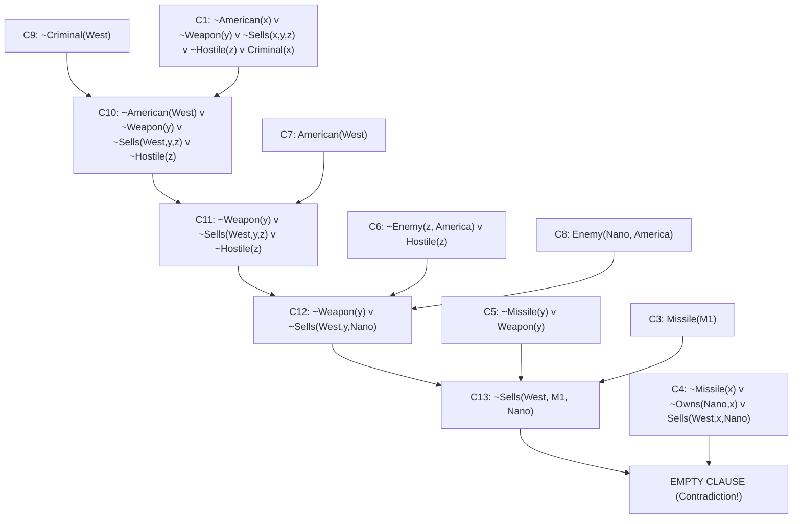

##### Step-by-Step Resolution Steps
*   **Step 1:** Resolve $C_9$ with $C_1$ using substitution $\{x / \text{West}\}$:
    $$C_{10}: \neg \operatorname{American}(\text{West}) \lor \neg \operatorname{Weapon}(y) \lor \neg \operatorname{Sells}(\text{West}, y, z) \lor \neg \operatorname{Hostile}(z)$$
*   **Step 2:** Resolve $C_{10}$ with $C_7$ ($\operatorname{American}(\text{West})$):
    $$C_{11}: \neg \operatorname{Weapon}(y) \lor \neg \operatorname{Sells}(\text{West}, y, z) \lor \neg \operatorname{Hostile}(z)$$
*   **Step 3:** Resolve $C_{11}$ with $C_6$ using substitution $\{z / \text{Nano}\}$:
    $$C_{12}: \neg \operatorname{Weapon}(y) \lor \neg \operatorname{Sells}(\text{West}, y, \text{Nano}) \lor \neg \operatorname{Enemy}(\text{Nano}, \text{America})$$
*   **Step 4:** Resolve $C_{12}$ with $C_8$ ($\operatorname{Enemy}(\text{Nano}, \text{America})$):
    $$C_{13}: \neg \operatorname{Weapon}(y) \lor \neg \operatorname{Sells}(\text{West}, y, \text{Nano})$$
*   **Step 5:** Resolve $C_{13}$ with $C_5$ using substitution $\{y / M_1\}$:
    $$C_{14}: \neg \operatorname{Missile}(M_1) \lor \neg \operatorname{Sells}(\text{West}, M_1, \text{Nano})$$
*   **Step 6:** Resolve $C_{14}$ with $C_3$ ($\operatorname{Missile}(M_1)$):
    $$C_{15}: \neg \operatorname{Sells}(\text{West}, M_1, \text{Nano})$$
*   **Step 7:** Resolve $C_{15}$ with $C_4$ using substitution $\{x / M_1\}$:
    $$C_{16}: \neg \operatorname{Missile}(M_1) \lor \neg \operatorname{Owns}(\text{Nano}, M_1)$$
*   **Step 8:** Resolve $C_{16}$ with $C_3$ ($\operatorname{Missile}(M_1)$) and $C_2$ ($\operatorname{Owns}(\text{Nano}, M_1)$):
    $$\mathbf{\square \quad \text{(Empty Clause / Contradiction!)}}$$

**Conclusion:** The negated goal produces an empty clause $\square$. Therefore, **West is proven to be a criminal**.

:::tip

**Examiner's Note**

Write out the 8 formal FOL axioms, show the Skolem constant $M_1$, negate the goal ($\neg \operatorname{Criminal}(\text{West})$), and show the resolution refutation tree terminating at $\square$.

:::

---

### Question 25.a (8 Marks)

:::info

**Question Statement**

Give the syntax, semantic and interfacing mechanisms in frames with example. How inference rules are used to represent knowledge? Explain in detail about expert system architecture. **(8 Marks)**

:::

---

### Solution 25.a (8 Marks)

#### 1. Frame Representation: Syntax, Semantics & Interfacing (3 Marks)

Proposed by Marvin Minsky (1974), a **Frame** is an object-oriented structural knowledge representation modeling prototypical concepts, entities, or situations.

```text
Frame: BIRD
  IS-A: Vertebrate
  Wings: [Default: 2]
  Flies: [Default: True]

Frame: PENGUIN
  IS-A: Bird
  Flies: False  <-- Overrides inherited default
  Habitat: Cold_Regions
  Check_Health: [If-Needed: Calculate_Weight()]
```

##### Core Components
*   **Syntax:** Frames consist of a frame name and a collection of named **Slots** (attributes) associated with **Fillers** (values, default values, pointers to other frames, or attached procedures).
*   **Semantics:** Frames model categorical taxonomies via `IS-A` (class-subclass) and `INSTANCE-OF` (class-instance) relationships, supporting property inheritance and default reasoning with exceptions.
*   **Interfacing Mechanisms (Daemons):** Procedural attachments that trigger code automatically upon access events:
    *   `If-Needed`: Computes a value dynamically when queried.
    *   `If-Added`: Validates data or triggers side effects when a slot value is assigned.
    *   `If-Removed`: Executes cleanup actions when a filler is deleted.

---

#### 2. Inference Rules in Knowledge Representation (2 Marks)

Inference rules encode dynamic reasoning logic using production rules ($\text{IF } \langle\text{condition}\rangle \implies \text{THEN } \langle\text{action}\rangle$):
*   **Modus Ponens:** Given facts $\alpha$ and rule $\alpha \implies \beta$, deduce fact $\beta$.
*   **Forward Chaining:** Data-driven inference firing rules forward to deduce conclusions.
*   **Backward Chaining:** Goal-driven inference working backward to verify hypotheses.

---

#### 3. Expert System Architecture (3 Marks)

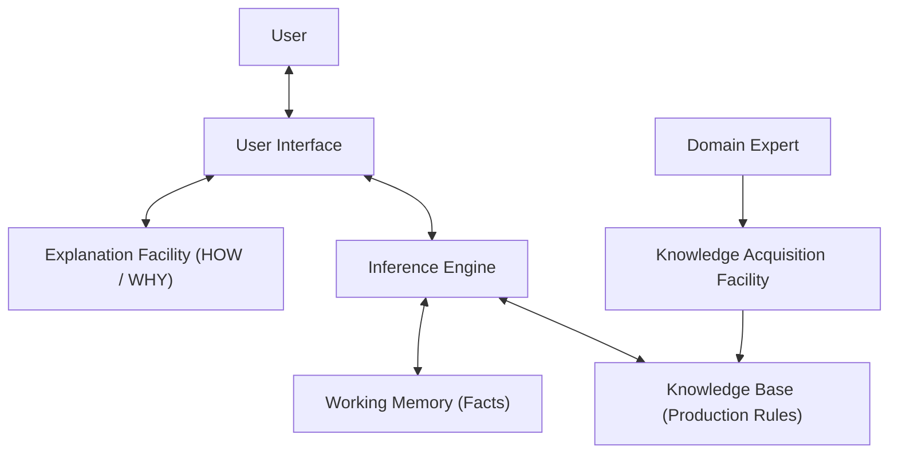

*   **Knowledge Base (KB):** Long-term repository of domain production rules and facts.
*   **Inference Engine (IE):** Reasoning processor executing pattern matching (Rete), conflict resolution, and rule firing.
*   **Working Memory:** Short-term cache recording active session facts and intermediate deductions.
*   **Explanation Facility:** Audits and displays proof chains for user queries.

:::tip

**Examiner's Note**

Award 3 marks for Frame syntax/semantics/daemons, 2 marks for inference rule mechanisms, and 3 marks for the expert system block diagram.

:::

---

### Question 25.b (8 Marks)

:::info

**Question Statement**

Explain:  
(i) Simple planning agent **(4 Marks)**  
(ii) Means-end analysis **(4 Marks)**

:::

---

### Solution 25.b (8 Marks)

#### 1. Simple Planning Agent (4 Marks)

A **Simple Planning Agent** is a deliberative agent that constructs, maintains, and executes action sequences using explicit, factored domain representations (such as PDDL or STRIPS).

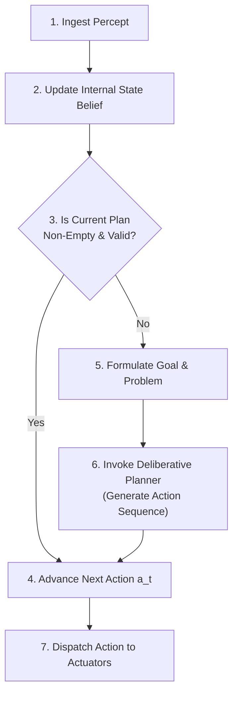

##### Core Operational Cycle
1. **Percept Ingestion & State Estimation:** Updates its belief state based on sensor percepts.
2. **Goal Check:** If the current plan is exhausted or invalidated by an unexpected external world change, it formulates a new goal.
3. **Plan Generation:** Invokes a planning algorithm (e.g., Graphplan, Partial-Order Planning, or Forward State-Space Search) to synthesize a sequence of action schemas with **Preconditions**, **Add Lists**, and **Delete Lists**.
4. **Execution:** Executes the planned actions sequentially until the goal state is achieved.

---

#### 2. Means-Ends Analysis (MEA) (4 Marks)

**Means-Ends Analysis (MEA)** is a goal-directed problem-solving and planning strategy (pioneered by Newell & Simon in the General Problem Solver) that centers on difference reduction.

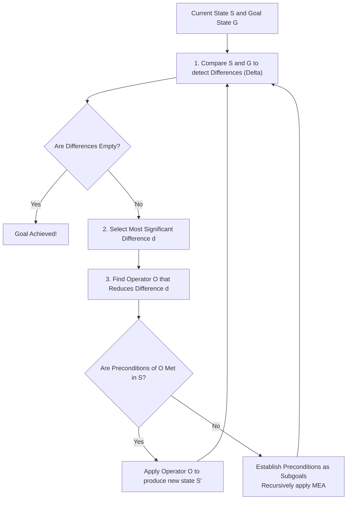

##### Algorithmic Methodology
1. **Difference Detection:** Computes the set of differences between the current state $S$ and the desired goal state $G$.
2. **Operator Selection:** Identifies operators capable of eliminating or reducing the most significant difference.
3. **Subgoaling:** If the selected operator's preconditions are not currently satisfied in state $S$, the algorithm creates subgoals to achieve those preconditions, recursively applying MEA until primitive operators can execute.

:::tip

**Examiner's Note**

Award 4 marks for drawing the planning agent loop with precondition/effect schemas, and 4 marks for defining the MEA difference-reduction cycle and subgoaling mechanism.

:::

---

## Part C: Comprehensive Search Problems (15 Marks)

### Question 26 (15 Marks)

:::info

**Question Statement**

You are given a m gallon jug and a n gallon jug (both are integers). Initially both are empty. The jugs don't have markings to allow measuring smaller quantities. You have to use the jugs of capacity m and n to measure z gallons of water. The operations you can perform are:  
- Fill any of the jugs completely with water.  
- Pour water from one jug to the other until one of the jugs is either empty or full, (X, Y) -> (X - d, Y + d)  
- Empty any of the jugs  
The task is to determine whether it is possible to measure Z litres of water using both the jugs. And if true, print any of the possible ways. **(15 Marks)**

:::

---

### Solution 26 (15 Marks)

#### 1. Mathematical Condition for Solvability: Bézout's Identity (4 Marks)

The Generalized Water Jug Problem with capacities $m$ and $n$ asking to measure $z$ gallons can be modeled as a linear Diophantine equation:

$$m \cdot a + n \cdot b = z \quad \text{where } a, b \in \mathbb{Z}$$

##### Solvability Theorem
By **Bézout's Identity** and number theory, measuring exactly $z$ gallons is mathematically possible **if and only if**:
1. **Capacity Bound:** The desired volume does not exceed the maximum jug capacity:
   $$z \le \max(m, n)$$
2. **Divisibility Condition:** $z$ is an integer multiple of the Greatest Common Divisor of $m$ and $n$:
   $$z \pmod{\gcd(m, n)} == 0 \iff \gcd(m, n) \mid z$$

If either condition is violated, measuring $z$ gallons is mathematically impossible.

---

#### 2. State-Space Search Algorithm (BFS Formulation) (5 Marks)

To find the shortest action sequence, we formulate the problem as a Breadth-First Search over a state space:

*   **State Representation:** $(x, y)$ where $0 \le x \le m$ and $0 \le y \le n$.
*   **Initial State:** $(0, 0)$
*   **Goal Test:** $x == z \lor y == z$
*   **Valid Transition Operators (6 Legal Moves):**
    1. $\operatorname{Fill}(m)$: $(x, y) \to (m, y)$
    2. $\operatorname{Fill}(n)$: $(x, y) \to (x, n)$
    3. $\operatorname{Empty}(m)$: $(x, y) \to (0, y)$
    4. $\operatorname{Empty}(n)$: $(x, y) \to (x, 0)$
    5. $\operatorname{Pour}(m \to n)$:  
       Let $d = \min(x, n - y)$. Transition: $(x - d, y + d)$.
    6. $\operatorname{Pour}(n \to m)$:  
       Let $d = \min(y, m - x)$. Transition: $(x + d, y - d)$.

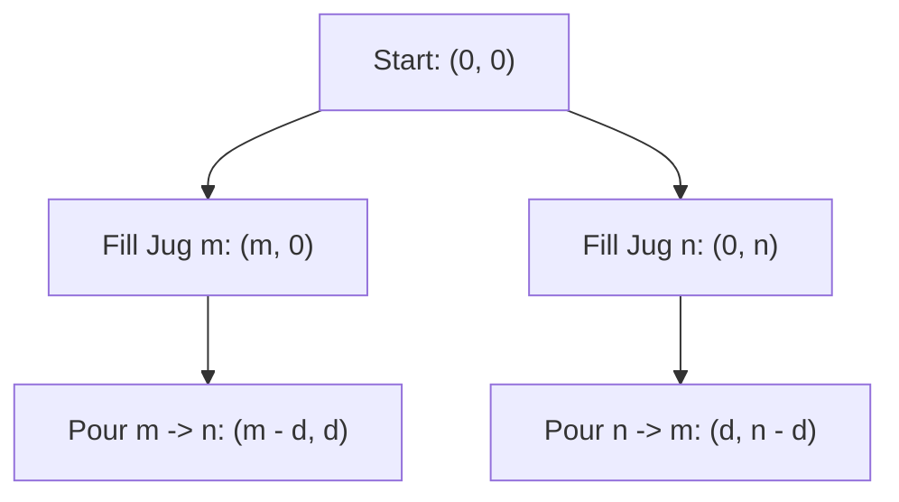

---

#### 3. Step-by-Step Numerical Example: $m = 4, n = 3, z = 2$ (6 Marks)

##### Parameter Check
*   $\max(4, 3) = 4 \ge 2$ *(Capacity check passed)*.
*   $\gcd(4, 3) = 1$. Since $1 \mid 2$, a valid solution is guaranteed to exist.

##### Optimal Solution Path Execution Trace

| Step | Operation Applied | Jug $m$ (4-gal) | Jug $n$ (3-gal) | Description of Action |
| :---: | :--- | :---: | :---: | :--- |
| **0** | Initial State | $0$ | $0$ | Both jugs are empty |
| **1** | $\operatorname{Fill}(n)$ | $0$ | $3$ | Fill the 3-gallon jug completely |
| **2** | $\operatorname{Pour}(n \to m)$ | $3$ | $0$ | Pour all 3 gallons from jug $n$ into jug $m$ |
| **3** | $\operatorname{Fill}(n)$ | $3$ | $3$ | Fill the 3-gallon jug completely again |
| **4** | $\operatorname{Pour}(n \to m)$ | $4$ | $2$ | Pour from jug $n$ into jug $m$ until $m$ is full ($4-3=1$ gal poured; **2 gal left in $n$**) |
| **5** | $\operatorname{Empty}(m)$ | $0$ | $2$ | Empty the 4-gallon jug completely |
| **6** | $\operatorname{Pour}(n \to m)$ | $\mathbf{2}$ | $\mathbf{0}$ | **Pour the 2 gallons from jug $n$ into jug $m$ $\implies$ GOAL!** |

*   **Final Output:** The 4-gallon jug contains exactly **2 gallons of water**.

:::tip

**Examiner's Note**

Award 4 marks for the mathematical theorem based on Bézout's identity ($z \le \max(m, n)$ and $\gcd(m, n) \mid z$), 5 marks for formalizing the 6 transition operators with boundary minimum calculations ($d = \min(x, n-y)$), and 6 marks for demonstrating an end-to-end trace with a concrete example.

:::

---

### Question 27 (15 Marks)

:::info

**Question Statement**

Consider the following facts:  
Prove the conclusion using Resolution.  
a. Team Delhi  
b. Team Mumbai  
c. Final match between Delhi and Mumbai  
d. Delhi scored 350 runs, Mumbai scored 350 runs, Delhi lost 5 wickets, Mumbai lost 7 wickets.  
e. The team which scored the maximum runs wins  
f. If the scores are same the team which lost minimum wickets wins the match.  
Represent the facts in predicate, convert to clause form and prove by resolution 'Delhi wins the match'. **(15 Marks)**

:::

---

### Solution 27 (15 Marks)

#### 1. Predicate Calculus Representation (5 Marks)

##### a) Predicate & Constant Vocabulary
*   $\text{Delhi}, \text{Mumbai}$: Domain constants representing the two cricket teams.
*   $\operatorname{Runs}(t, r)$: Team $t$ scored $r$ runs.
*   $\operatorname{Wickets}(t, w)$: Team $t$ lost $w$ wickets.
*   $\operatorname{Greater}(x, y)$: Numeric relation indicating $x > y$.
*   $\operatorname{Lesser}(x, y)$: Numeric relation indicating $x < y$.
*   $\operatorname{Equal}(x, y)$: Numeric relation indicating $x == y$.
*   $\operatorname{Wins}(t)$: Team $t$ wins the match.

##### b) Formal Axioms
*   **Fact 1 (Delhi Scores & Wickets):**
    $$\operatorname{Runs}(\text{Delhi}, 350) \quad \land \quad \operatorname{Wickets}(\text{Delhi}, 5)$$
*   **Fact 2 (Mumbai Scores & Wickets):**
    $$\operatorname{Runs}(\text{Mumbai}, 350) \quad \land \quad \operatorname{Wickets}(\text{Mumbai}, 7)$$
*   **Fact 3 (Arithmetic Ground Evaluations):**
    $$\operatorname{Equal}(350, 350) \quad \land \quad \operatorname{Lesser}(5, 7)$$
*   **Rule 1 (Win by Higher Runs):**
    $$\forall t_1 \, \forall t_2 \, \forall r_1 \, \forall r_2 \; \Big( \operatorname{Runs}(t_1, r_1) \land \operatorname{Runs}(t_2, r_2) \land \operatorname{Greater}(r_1, r_2) \implies \operatorname{Wins}(t_1) \Big)$$
*   **Rule 2 (Tie-Breaker: Win by Fewer Wickets on Equal Runs):**
    $$\forall t_1 \, \forall t_2 \, \forall r \, \forall w_1 \, \forall w_2 \; \Big( \operatorname{Runs}(t_1, r) \land \operatorname{Runs}(t_2, r) \land \operatorname{Wickets}(t_1, w_1) \land \operatorname{Wickets}(t_2, w_2) \land \operatorname{Lesser}(w_1, w_2) \implies \operatorname{Wins}(t_1) \Big)$$
*   **Target Goal to Prove:**
    $$\mathbf{\operatorname{Wins}(\text{Delhi})}$$

---

#### 2. Conversion to Clausal Form (CNF) (4 Marks)

1. **$C_1$:** $\operatorname{Runs}(\text{Delhi}, 350)$
2. **$C_2$:** $\operatorname{Runs}(\text{Mumbai}, 350)$
3. **$C_3$:** $\operatorname{Wickets}(\text{Delhi}, 5)$
4. **$C_4$:** $\operatorname{Wickets}(\text{Mumbai}, 7)$
5. **$C_5$:** $\operatorname{Lesser}(5, 7)$
6. **$C_6$ (Tie-Breaker Clause from Rule 2):**  
   $\neg \operatorname{Runs}(t_1, r) \lor \neg \operatorname{Runs}(t_2, r) \lor \neg \operatorname{Wickets}(t_1, w_1) \lor \neg \operatorname{Wickets}(t_2, w_2) \lor \neg \operatorname{Lesser}(w_1, w_2) \lor \operatorname{Wins}(t_1)$
7. **$C_7$ (Negated Goal):**
   $$\mathbf{\neg \operatorname{Wins}(\text{Delhi})}$$

---

#### 3. Resolution Refutation Proof (6 Marks)

We resolve clauses systematically using unification substitutions until the **empty clause $\square$** is derived:

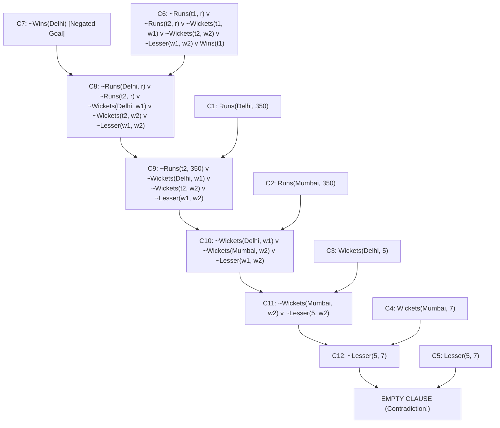

##### Step-by-Step Resolution Steps
*   **Step 1:** Resolve negated goal $C_7$ ($\neg \operatorname{Wins}(\text{Delhi})$) with Rule clause $C_6$ using substitution $\theta_1 = \{t_1 / \text{Delhi}\}$:
    $$C_8: \neg \operatorname{Runs}(\text{Delhi}, r) \lor \neg \operatorname{Runs}(t_2, r) \lor \neg \operatorname{Wickets}(\text{Delhi}, w_1) \lor \neg \operatorname{Wickets}(t_2, w_2) \lor \neg \operatorname{Lesser}(w_1, w_2)$$
*   **Step 2:** Resolve $C_8$ with $C_1$ ($\operatorname{Runs}(\text{Delhi}, 350)$) using substitution $\theta_2 = \{r / 350\}$:
    $$C_9: \neg \operatorname{Runs}(t_2, 350) \lor \neg \operatorname{Wickets}(\text{Delhi}, w_1) \lor \neg \operatorname{Wickets}(t_2, w_2) \lor \neg \operatorname{Lesser}(w_1, w_2)$$
*   **Step 3:** Resolve $C_9$ with $C_2$ ($\operatorname{Runs}(\text{Mumbai}, 350)$) using substitution $\theta_3 = \{t_2 / \text{Mumbai}\}$:
    $$C_{10}: \neg \operatorname{Wickets}(\text{Delhi}, w_1) \lor \neg \operatorname{Wickets}(\text{Mumbai}, w_2) \lor \neg \operatorname{Lesser}(w_1, w_2)$$
*   **Step 4:** Resolve $C_{10}$ with $C_3$ ($\operatorname{Wickets}(\text{Delhi}, 5)$) using substitution $\theta_4 = \{w_1 / 5\}$:
    $$C_{11}: \neg \operatorname{Wickets}(\text{Mumbai}, w_2) \lor \neg \operatorname{Lesser}(5, w_2)$$
*   **Step 5:** Resolve $C_{11}$ with $C_4$ ($\operatorname{Wickets}(\text{Mumbai}, 7)$) using substitution $\theta_5 = \{w_2 / 7\}$:
    $$C_{12}: \neg \operatorname{Lesser}(5, 7)$$
*   **Step 6:** Resolve $C_{12}$ with Fact $C_5$ ($\operatorname{Lesser}(5, 7)$):
    $$\mathbf{\square \quad \text{(Empty Clause / Contradiction!)}}$$

**Conclusion:** The derivation of the empty clause $\square$ refutes the negated assumption, mathematically proving that **Delhi wins the match**.

:::tip

**Examiner's Note**

Award 5 marks for defining the predicate representations of the cricket facts and tie-breaker rules, 4 marks for converting them to CNF clauses $C_1 \dots C_7$, and 6 marks for drawing the resolution refutation tree step-by-step with substitutions $\theta$ terminating at the empty clause $\square$.

:::
