# July 2024

> **Exam -** Semester Examination  
> **Session -** July 2024  

---

## Part A: Objective Type Questions (20 Marks)

### Question 1 (1 Mark)

:::info

**Question Statement**

Machines that try to imitate human intuition while handling vague information lie in the field of AI called? **(1 Mark)**

*   **(A)** Functional logic
*   **(B)** Fuzzy logic
*   **(C)** Boolean logic
*   **(D)** Human logic

:::

*   **Correct Answer:** **(B) Fuzzy logic**
*   **Explanation:** Fuzzy logic is designed to model imprecise, continuous, and vague real-world human reasoning by permitting truth values to range anywhere between 0 and 1, unlike crisp binary Boolean logic.

---

### Question 2 (1 Mark)

:::info

**Question Statement**

What is a characteristic feature of a problem with an unknown state space in AI? **(1 Mark)**

*   **(A)** The complete set of possible states and their transition are well-defined
*   **(B)** The problem has a single, well-defined solution
*   **(C)** The agent must explore to discover the possible states and their connections
*   **(D)** The environment is fully observable with no uncertainty

:::

*   **Correct Answer:** **(C) The agent must explore to discover the possible states and their connections**
*   **Explanation:** In an unknown state space, the agent lacks a prior internal model of the environment's topology and transition rules; therefore, it must perform online exploration and trial actions to discover reachable states.

---

### Question 3 (1 Mark)

:::info

**Question Statement**

_______ helps us to decide which rule to apply next during the process of searching for a solution to a problem. **(1 Mark)**

*   **(A)** Control strategies
*   **(B)** Production system
*   **(C)** Problem
*   **(D)** State space

:::

*   **Correct Answer:** **(A) Control strategies**
*   **Explanation:** In artificial intelligence, control strategies are the decision algorithms and heuristics that govern the direction of search and determine which operator or rule to trigger next from candidate transitions.

---

### Question 4 (1 Mark)

:::info

**Question Statement**

Which term best describes a problem in AI where the agent may not have complete information about the current state of the environment? **(1 Mark)**

*   **(A)** Deterministic problem
*   **(B)** Fully observable problem
*   **(C)** Non-deterministic problem
*   **(D)** Partially observable problem

:::

*   **Correct Answer:** **(D) Partially observable problem**
*   **Explanation:** An environment is partially observable when sensor limitations, noise, or occlusions prevent the agent from detecting the complete, exact state of the environment at any given time step.

---

### Question 5 (1 Mark)

:::info

**Question Statement**

Identify the queue order using Breath First Search (BFS), in the following diagram **(1 Mark)**

```text
    M --- N --- O
    | \   |   / |
    |   \ | /   |
    R --- Q --- P
```

*   **(A)** MNOPQR
*   **(B)** NQOMPOR
*   **(C)** QOMNROP
*   **(D)** POQNMR

:::

*   **Correct Answer:** **(D) POQNMR**
*   **Explanation:** Starting from node $P$: Level 0 is $[P]$. Dequeuing $P$ adds its immediate neighbors to the FIFO queue: $O$ and $Q$. Next, dequeuing $O$ enqueues $N$. Next, dequeuing $Q$ enqueues remaining unvisited neighbors $M$ and $R$. The resulting BFS traversal order is $P \to O \to Q \to N \to M \to R$ (`POQNMR`).

---

### Question 6 (1 Mark)

:::info

**Question Statement**

The number of edges in a complete graph of N vertices is **(1 Mark)**

*   **(A)** N(N+1)/2
*   **(B)** N(N-1)/2
*   **(C)** N^2/2
*   **(D)** N

:::

*   **Correct Answer:** **(B) N(N-1)/2**
*   **Explanation:** In a complete undirected graph $K_N$, every vertex is connected to every other vertex by a unique edge, giving $\binom{N}{2} = \frac{N(N-1)}{2}$ edges.

---

### Question 7 (1 Mark)

:::info

**Question Statement**

The post order traversal of a binary tree is 8, 9, 6, 7, 4, 5, 2, 3, 1. The inorder traversal of the same tree is 8, 6, 9, 4, 7, 2, 5, 1, 3. The height of a tree is the length of the largest path from the root to any leaf. The height of binary tree is **(1 Mark)**

*   **(A)** 2
*   **(B)** 3
*   **(C)** 4
*   **(D)** 5

:::

*   **Correct Answer:** **(C) 4**
*   **Explanation:** Reconstructing the unique binary tree yields the longest root-to-leaf path $1 \to 2 \to 4 \to 6 \to 8$ (or $9$). Measuring height by the standard definition stated in the question (length of the largest path in terms of edges) gives $4$ edges. *(Note: If measured by total node count along the deepest path, the height is 5).*

---

### Question 8 (1 Mark)

:::info

**Question Statement**

Which of the following is the evaluation function in the A* technique? **(1 Mark)**

*   **(A)** Path cost from the start node to the current node
*   **(B)** Path cost from the start node to current node + heuristic cost
*   **(C)** Heuristic function
*   **(D)** Average of path cost from the start node to the current node and heuristic cost

:::

*   **Correct Answer:** **(B) Path cost from the start node to current node + heuristic cost**
*   **Explanation:** The $A^*$ evaluation function is defined as $f(n) = g(n) + h(n)$, where $g(n)$ is the exact cumulative path cost from the start node to node $n$, and $h(n)$ is the estimated heuristic cost from $n$ to the goal.

---

### Question 9 (1 Mark)

:::info

**Question Statement**

The term _______ is used for a depth-first search that chooses value for one variable at a time and returns when a variable has no legal values left to assign. **(1 Mark)**

*   **(A)** Forward search
*   **(B)** Backtrack search
*   **(C)** Hill algorithm
*   **(D)** Reverse-down-hill search

:::

*   **Correct Answer:** **(B) Backtrack search**
*   **Explanation:** Backtracking search is the canonical depth-first search strategy for Constraint Satisfaction Problems (CSPs). It assigns values to one variable at a time and backtracks when a variable has an empty legal domain.

---

### Question 10 (1 Mark)

:::info

**Question Statement**

Consider a problem of preparing a schedule for a class of students, what type of problem is this? **(1 Mark)**

*   **(A)** Search problem
*   **(B)** Backtrack problem
*   **(C)** Constraint satisfactory problem
*   **(D)** Planning problem

:::

*   **Correct Answer:** **(C) Constraint satisfactory problem**
*   **Explanation:** Academic class scheduling and timetabling is a standard Constraint Satisfaction Problem (CSP), where classes are variables, time slots and rooms are domains, and resource limits (no teacher or room double-booking) form constraints.

---

### Question 11 (1 Mark)

:::info

**Question Statement**

What is the time complexity of the minimax algorithm without alpha-beta pruning? **(1 Mark)**

*   **(A)** O(b^d)
*   **(B)** O(b+d)
*   **(C)** O(b^(d/2))
*   **(D)** O(b*(2d))

:::

*   **Correct Answer:** **(A) O(b^d)**
*   **Explanation:** Exhaustive Minimax performs a full depth-first traversal of the game tree down to maximum depth $d$ with branching factor $b$, evaluating $O(b^d)$ states.

---

### Question 12 (1 Mark)

:::info

**Question Statement**

How does robustness contribute to the reliability of intelligent agents? **(1 Mark)**

*   **(A)** By increasing sensitivity to variations
*   **(B)** By resisting adaptation to changes
*   **(C)** By tolerating faults and uncertainties
*   **(D)** By depending on specific modules

:::

*   **Correct Answer:** **(C) By tolerating faults and uncertainties**
*   **Explanation:** Robustness in AI reflects an agent's capability to maintain acceptable performance and prevent catastrophic failures even when encountering noisy inputs, sensor failures, and uncertain environments.

---

### Question 13 (1 Mark)

:::info

**Question Statement**

State whether the following statements about implicit knowledge are true or false: **(1 Mark)**  
(i) The implicit knowledge is difficult to communicate and share  
(ii) The implicit knowledge is easily outside human being  
(iii) The implicit knowledge is hard to steal or copy

*   **(A)** (i)-true, (ii)-true, (iii)-true
*   **(B)** (i)-true, (ii)-false, (iii)-false
*   **(C)** (i)-true, (ii)-false, (iii)-true
*   **(D)** (i)-false, (ii)-true, (iii)-true

:::

*   **Correct Answer:** **(C) (i)-true, (ii)-false, (iii)-true**
*   **Explanation:** Implicit (tacit) knowledge is deeply embedded in human intuition and experience. It is inherently difficult to articulate or codify (i is True), resides within human minds rather than external media (ii is False), and is consequently difficult to extract, steal, or duplicate directly (iii is True).

---

### Question 14 (1 Mark)

:::info

**Question Statement**

What represents rules of thumb based on previous experiences, not guaranteed but good to work with? **(1 Mark)**

*   **(A)** Heuristic knowledge
*   **(B)** Meta-knowledge
*   **(C)** Declarative knowledge
*   **(D)** Structural knowledge

:::

*   **Correct Answer:** **(A) Heuristic knowledge**
*   **Explanation:** Heuristic knowledge consists of practical rules of thumb, educated estimations, and expert insights that expedite problem solving without guaranteeing theoretical optimality.

---

### Question 15 (1 Mark)

:::info

**Question Statement**

You need to go for a movie with friends at 6.30 pm. One of your friends intends to join with you from your home. You planed start from your home 'X' minutes before the movie start. The 'X' minutes is sufficient to be on time. But you have partial information about your friend's plan. This type of knowledge is an example for **(1 Mark)**

*   **(A)** Procedural
*   **(B)** Declarative
*   **(C)** Heuristic
*   **(D)** Uncertain

:::

*   **Correct Answer:** **(D) Uncertain**
*   **Explanation:** When an agent lacks complete, deterministic information about future external events or the intentions of other entities, it operates under uncertain knowledge.

---

### Question 16 (1 Mark)

:::info

**Question Statement**

When a hypothesis says it should be positive, but in fact it is negative, then we call is as _______. **(1 Mark)**

*   **(A)** A consistent hypothesis
*   **(B)** A false negative hypothesis
*   **(C)** A false positive hypothesis
*   **(D)** A specialized hypothesis

:::

*   **Correct Answer:** **(C) A false positive hypothesis**
*   **Explanation:** In statistical hypothesis testing and classification, predicting a positive condition ($\hat{y} = 1$) when the underlying ground truth is negative ($y = 0$) is defined as a False Positive (Type I error).

---

### Question 17 (1 Mark)

:::info

**Question Statement**

The Blocks World Problem in Artificial Intelligence is normal discussed to explain a _______. **(1 Mark)**

*   **(A)** Search technique
*   **(B)** Planning system
*   **(C)** Constraint satisfaction system
*   **(D)** Knowledge base system

:::

*   **Correct Answer:** **(B) Planning system**
*   **Explanation:** The Blocks World domain (manipulating stacked blocks on a table with a robot arm using predicates like `On(A, B)` and `Clear(A)`) is the classical benchmark domain used to formulate STRIPS and PDDL automated planning systems.

---

### Question 18 (1 Mark)

:::info

**Question Statement**

In which of the following learning, the teacher returns reward and punishment to learner? **(1 Mark)**

*   **(A)** Active learning
*   **(B)** Reinforcement learning
*   **(C)** Supervised learning
*   **(D)** Unsupervised learning

:::

*   **Correct Answer:** **(B) Reinforcement learning**
*   **Explanation:** Reinforcement learning agents learn optimal behavior through dynamic interaction with an environment governed by scalar feedback signals: rewards for beneficial actions and penalties/punishments for undesirable actions.

---

### Question 19 (1 Mark)

:::info

**Question Statement**

The process of breaking down goals into subgoals is termed as _______. **(1 Mark)**

*   **(A)** Means-ends analysis
*   **(B)** Initial-desired state analysis
*   **(C)** Subgoal appropriation
*   **(D)** Subgoal potentiation

:::

*   **Correct Answer:** **(A) Means-ends analysis**
*   **Explanation:** Means-Ends Analysis (introduced in the General Problem Solver) compares current states with target goals, detects differences, and formulates subgoals with operators designed specifically to eliminate those differences.

---

### Question 20 (1 Mark)

:::info

**Question Statement**

Which of the following algorithm is sued to obtain the plan directly from the planning graph, instead of using the graph to provide heuristic? **(1 Mark)**

*   **(A)** Graph-plan
*   **(B)** A*
*   **(C)** BFS/DFS
*   **(D)** Greedy

:::

*   **Correct Answer:** **(A) Graph-plan**
*   **Explanation:** The Graphplan algorithm (Blum & Furst, 1997) alternates between expanding a planning graph and performing a backward search directly over the graph levels to extract a conflict-free plan based on mutual exclusion (mutex) relations.

---

## Part B: Analytical & Descriptive Questions (40 Marks)

### Question 21.a (8 Marks)

:::info

**Question Statement**

Explain in detail about data acquisition and learning aspects in artificial intelligence. **(8 Marks)**

:::

---

### Solution 21.a (8 Marks)

#### 1. Data Acquisition in Artificial Intelligence (4 Marks)

Data acquisition is the fundamental ingestion process of gathering, filtering, and preparing raw digital and physical signals so that an AI system can extract knowledge and train predictive models.

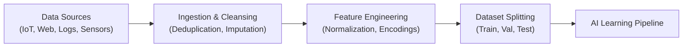

##### a) Primary Acquisition Modalities
*   **Sensory & IoT Acquisition:** Hardware transducers capturing physical attributes (e.g., LiDAR in autonomous driving, optical cameras in computer vision, acoustic microphones in NLP).
*   **Web Scraping & Enterprise Ingestion:** Automated crawlers and enterprise API endpoints ingesting semi-structured XML/JSON logs and database records.
*   **Synthetic Data Generation:** Generative models (e.g., GANs, diffusion models) synthesizing privacy-preserving labeled data for rare edge cases (such as rare medical pathologies).

##### b) Data Preprocessing Pipeline
1. **Data Cleaning:** Handling missing attributes via statistical imputation (mean/median/KNN) and eliminating outlier anomalies.
2. **Feature Normalization:** Rescaling continuous features to identical distributions:
   $$z = \frac{x - \mu}{\sigma} \quad \text{or} \quad x_{\text{norm}} = \frac{x - x_{\text{min}}}{x_{\text{max}} - x_{\text{min}}}$$
3. **Encoding:** Transforming categorical variables into numerical representations (e.g., One-Hot Encoding, Word Embeddings).

---

#### 2. Learning Aspects in Artificial Intelligence (4 Marks)

Herbert Simon defined machine learning: *"Learning is any process by which a system improves performance from experience."* Formally, Tom Mitchell formalized learning as:

$$\text{An agent learns from Experience } E \text{ with respect to Task } T \text{ and Performance measure } P \text{ if } P(T) \text{ improves with } E.$$

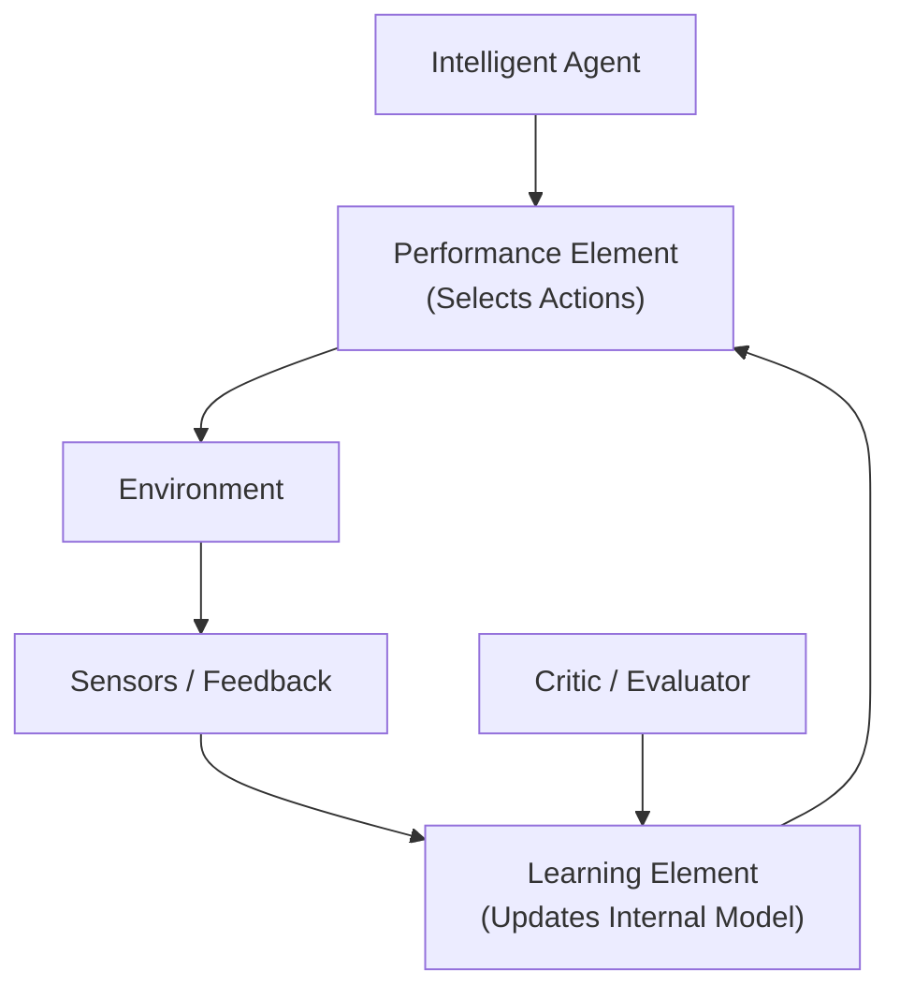

##### Core Facets of Learning
1. **The Learning Element vs. Performance Element:**  
   The performance element is responsible for selecting external actions based on current percepts. The learning element modifies the internal rules, parameters, or weights of the performance element based on feedback from a critic.
2. **Taxonomy of Learning Paradigms:**
   *   **Supervised Learning:** Learns a mapping function $f: \mathcal{X} \to \mathcal{Y}$ using ground-truth labeled pairs $(\mathbf{x}_i, y_i)$.
   *   **Unsupervised Learning:** Discovers latent clusters, manifolds, or probability density distributions $P(\mathbf{x})$ from unlabeled inputs.
   *   **Reinforcement Learning:** Optimizes an action-selection policy $\pi(a \mid s)$ to maximize cumulative discounted rewards $R = \sum_{t} \gamma^t r_t$.
3. **Generalization vs. Overfitting:**  
   A learning system must avoid memorizing training noise (overfitting) by employing regularization techniques ($\ell_1, \ell_2$) and cross-validation strategies.

:::tip

**Examiner's Note**

Award full credit when the response details Tom Mitchell's formal definition ($E, T, P$), contrasts the Learning Element with the Performance Element, and outlines the end-to-end data acquisition preprocessing pipeline.

:::

---

### Question 21.b (8 Marks)

:::info

**Question Statement**

b.i. Describe the problem formulation steps with neat diagram. **(4 Marks)**  
b.ii. Draw the state transition from initial state to final state with minimum number of moves for the diagram given below: **(4 Marks)**

```text
Initial state:
[ 1 ][ 2 ]
[ 3 ][   ]

Final state:
[   ][ 2 ]
[ 1 ][ 3 ]
```

:::

---

### Solution 21.b (8 Marks)

#### 1. Problem Formulation Steps (4 Marks)

In AI problem-solving, **problem formulation** is the formal process of deciding what actions and states to consider, given an agent's established goal. It defines a 5-tuple: $\mathcal{P} = \langle s_0, A, T, G, c \rangle$.

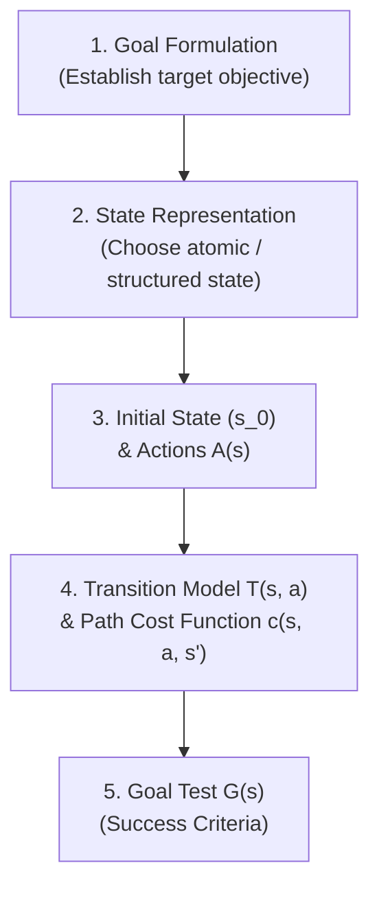

##### Foundational Formulation Elements
1. **Initial State ($s_0$):** The concrete environment configuration from which the agent begins.
2. **Actions ($A(s)$):** The set of all legal moves or operators executable in state $s$.
3. **Transition Model ($\operatorname{Result}(s, a)$):** The deterministic specification of which state is reached after executing action $a$ in state $s$.
4. **Goal Test ($G(s)$):** A Boolean predicate determining whether state $s$ satisfies the solution criteria.
5. **Path Cost ($c(s, a, s')$):** A function assigning a numerical cost to transition $a$, directing the search toward optimal low-cost solutions.

---

#### 2. State Transition for the 2x2 Sliding Tile Puzzle (4 Marks)

The problem represents a 3-puzzle ($2 \times 2$ grid with numbered tiles $\{1, 2, 3\}$ and one blank space `[ ]`).

*   **Initial State ($S_0$):**
    $$\begin{bmatrix} 1 & 2 \\ 3 & \text{blank} \end{bmatrix}$$
*   **Final Goal State ($S_G$):**
    $$\begin{bmatrix} \text{blank} & 2 \\ 1 & 3 \end{bmatrix}$$

##### Minimum-Move State Transition Path (Length = 2 Moves)

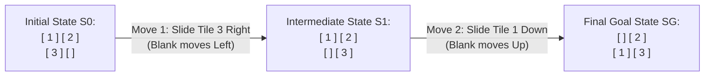

##### Step-by-Step Execution Trace

| Step | Current State Grid | Action Executed | Blank Position | Verification |
| :---: | :---: | :--- | :---: | :--- |
| **0** | $\begin{bmatrix} 1 & 2 \\ 3 & \text{blank} \end{bmatrix}$ | Initial State | $(1, 1)$ *(Row 1, Col 1)* | Start |
| **1** | $\begin{bmatrix} 1 & 2 \\ \text{blank} & 3 \end{bmatrix}$ | **Slide Tile 3 Right** into blank | $(1, 0)$ *(Row 1, Col 0)* | Tile 3 moves to $(1,1)$; Blank at $(1,0)$ |
| **2** | $\begin{bmatrix} \text{blank} & 2 \\ 1 & 3 \end{bmatrix}$ | **Slide Tile 1 Down** into blank | $(0, 0)$ *(Row 0, Col 0)* | Tile 1 moves to $(1,0)$; Blank at $(0,0)$ |

**Conclusion:** The puzzle transitions from initial state to goal state in exactly **2 optimal moves**.

:::tip

**Examiner's Note**

Ensure your answer explicitly writes out the 5 problem-formulation components ($\langle s_0, A, T, G, c \rangle$) and clearly illustrates the intermediate board configuration after Move 1.

:::

---

### Question 22.a (8 Marks)

:::info

**Question Statement**

Explain the depth first search algorithm with an example. **(8 Marks)**

:::

---

### Solution 22.a (8 Marks)

#### 1. Depth-First Search (DFS) Algorithmic Procedure (3 Marks)

Depth-First Search (DFS) is an uninformed search strategy that systematically explores as deep as possible along each branch before backtracking. It utilizes a **Last-In, First-Out (LIFO) stack** (or recursive call stack).

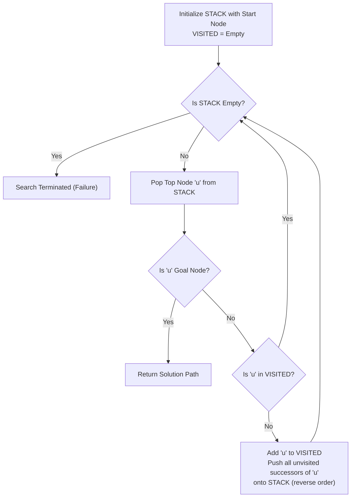

##### Algorithmic Steps
1. Push start node $S$ onto `STACK` and initialize `VISITED` set.
2. While `STACK` is not empty:
   *   Pop node $u$ from top of `STACK`.
   *   If $u$ satisfies the goal test, return the solution path.
   *   If $u \notin \text{VISITED}$:
       *   Insert $u$ into `VISITED`.
       *   Generate successors of $u$. Push unvisited successors onto `STACK` (to explore left-to-right, push in reverse order).
3. If `STACK` empties, return failure.

---

#### 2. Illustrative Example with Step-by-Step Trace (3 Marks)

Consider the following search tree with Start Node $A$ and Destination Goal Node $G$:

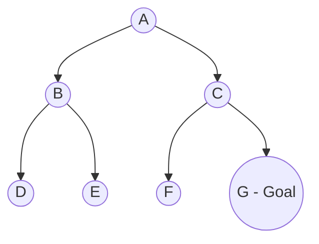

##### Execution Trace Table

| Step | Node Popped | Action Taken | STACK (Top $\to$ Bottom) | VISITED List |
| :---: | :---: | :--- | :--- | :--- |
| **0** | — | Initialize with start node $A$ | `[A]` | `[]` |
| **1** | **A** | Not goal; add to visited; push $C, B$ | `[B, C]` | `[A]` |
| **2** | **B** | Not goal; add to visited; push $E, D$ | `[D, E, C]` | `[A, B]` |
| **3** | **D** | Leaf node; no children | `[E, C]` | `[A, B, D]` |
| **4** | **E** | Leaf node; no children | `[C]` | `[A, B, D, E]` |
| **5** | **C** | Not goal; add to visited; push $G, F$ | `[F, G]` | `[A, B, D, E, C]` |
| **6** | **F** | Leaf node; no children | `[G]` | `[A, B, D, E, C, F]` |
| **7** | **G** | **Goal Found! Terminate.** | `[]` | `[A, B, D, E, C, F, G]` |

*   **Traversal Sequence:** $A \to B \to D \to E \to C \to F \to G$
*   **Path Discovered:** $\mathbf{A \to C \to G}$

---

#### 3. Properties and Theoretical Complexity (2 Marks)

*   **Time Complexity:** $O(b^m)$, where $b$ is the branching factor and $m$ is the maximum depth of the state space.
*   **Space Complexity:** $O(bm)$ — linear memory complexity, storing only a single path from the root to a leaf along with unexpanded siblings.
*   **Completeness:** Incomplete in infinite or cyclic state spaces without graph cycle detection; complete in finite state spaces.
*   **Optimality:** Suboptimal. DFS returns the first path found, which is not guaranteed to have minimal path cost or minimal depth.

:::tip

**Examiner's Note**

Include the explicit LIFO stack trace table, draw a clear graph with at least two branching levels, and emphasize the linear space complexity $O(bm)$.

:::

---

### Question 22.b (8 Marks)

:::info

**Question Statement**

Perform Breadth first search and uniform cost strategies on the following graph. **(8 Marks)**

```text
         (B)
        / 2
      (A)     (D)
     3/      5/ 
    (S)----(C)----(E)
     |\ 2    |3    |5
     | \     |     |
    6|  '---(F)    |
     |      5|     |
    (G)------'----(H - Goal)
         5      5
```

*Edge Weights:*
*   $S - A: 3$
*   $A - B: 2$
*   $S - C: 2$
*   $S - G: 6$
*   $C - D: 5$
*   $C - E: 2$
*   $C - F: 3$
*   $G - F: 5$
*   $G - H: 5$
*   $E - H: 5$

*Start Node:* $S$, *Goal Node:* $H$

:::

---

### Solution 22.b (8 Marks)

#### 1. Breadth-First Search (BFS) Execution (4 Marks)

BFS explores nodes level-by-level using a First-In, First-Out (FIFO) queue, ignoring edge weights.

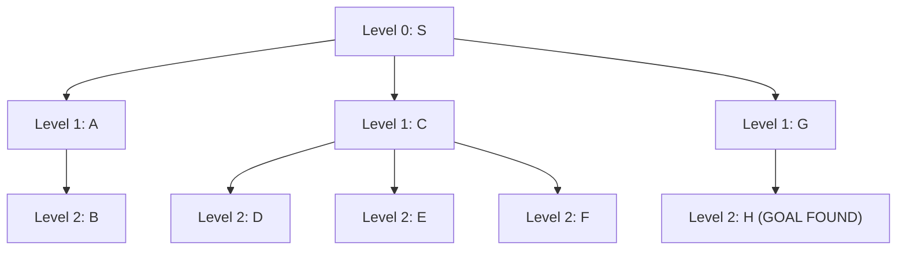

##### Step-by-Step BFS Trace Table

| Step | Current Node Dequeued | Successors Generated (Alphabetical) | OPEN Queue (Front $\to$ Rear) | Explored Set |
| :---: | :---: | :--- | :--- | :--- |
| **0** | — | Initialize with Start Node $S$ | `[S]` | `[]` |
| **1** | **S** | Neighbors: $A, C, G$ | `[A, C, G]` | `[S]` |
| **2** | **A** | Neighbors: $B$ | `[C, G, B]` | `[S, A]` |
| **3** | **C** | Neighbors: $D, E, F$ | `[G, B, D, E, F]` | `[S, A, C]` |
| **4** | **G** | Neighbors: $F, H$. ($F$ already queued; enqueue $H$) | `[B, D, E, F, H]` | `[S, A, C, G]` |
| **5** | **B** | No new unvisited neighbors | `[D, E, F, H]` | `[S, A, C, G, B]` |
| **6** | **D** | No new unvisited neighbors | `[E, F, H]` | `[S, A, C, G, B, D]` |
| **7** | **E** | ($H$ already in queue) | `[F, H]` | `[S, A, C, G, B, D, E]` |
| **8** | **F** | No new unvisited neighbors | `[H]` | `[S, A, C, G, B, D, E, F]` |
| **9** | **H** | **Goal Dequeued! Search Terminates.** | `[]` | `[S, A, C, G, B, D, E, F, H]` |

##### BFS Result Summary
*   **Path Found by BFS:** $\mathbf{S \to G \to H}$
*   **Path Length:** 2 hops
*   **Path Cost:** $c(S, G) + c(G, H) = 6 + 5 = \mathbf{11}$

---

#### 2. Uniform Cost Search (UCS) Execution (4 Marks)

UCS uses a Priority Queue ordered by cumulative path cost $g(n)$. Goal test is applied upon **dequeuing** from the priority queue.

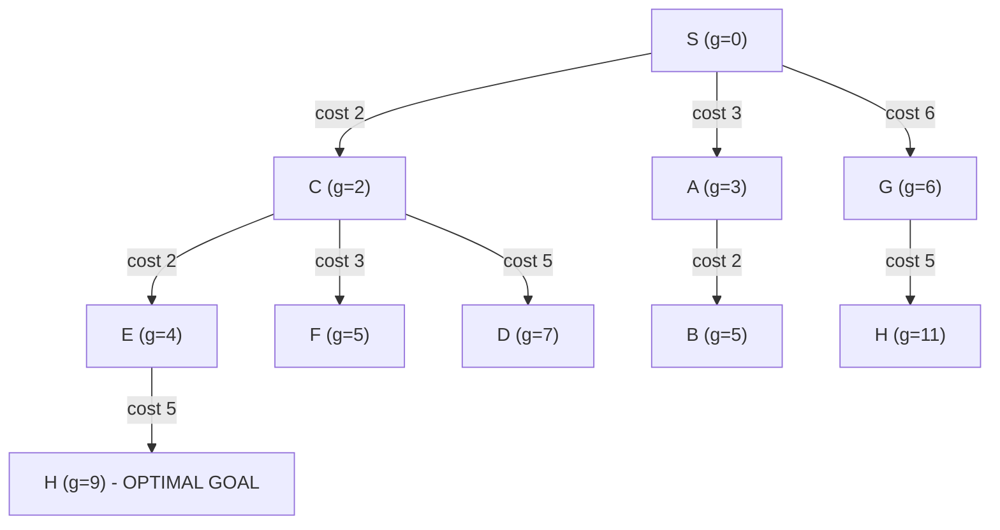

##### Step-by-Step UCS Trace Table

| Step | Dequeued Node $(g(n), \text{Node}, \text{Path})$ | Successors Generated & Cumulative Cost $g(v) = g(u) + c(u, v)$ | Priority Queue State (Ordered by $g(n)$) | Explored Set |
| :---: | :--- | :--- | :--- | :--- |
| **0** | — | Push $(0, S, [S])$ | `[(0, S)]` | `[]` |
| **1** | **(0, S, [S])** | $(2, C, [S, C])$<br/>$(3, A, [S, A])$<br/>$(6, G, [S, G])$ | `[(2, C), (3, A), (6, G)]` | `[S]` |
| **2** | **(2, C, [S, C])** | $(2+2=4, E, [S, C, E])$<br/>$(2+3=5, F, [S, C, F])$<br/>$(2+5=7, D, [S, C, D])$ | `[(3, A), (4, E), (5, F), (6, G), (7, D)]` | `[S, C]` |
| **3** | **(3, A, [S, A])** | $(3+2=5, B, [S, A, B])$ | `[(4, E), (5, B), (5, F), (6, G), (7, D)]` | `[S, C, A]` |
| **4** | **(4, E, [S, C, E])** | $(4+5=9, H, [S, C, E, H])$ | `[(5, B), (5, F), (6, G), (7, D), (9, H)]` | `[S, C, A, E]` |
| **5** | **(5, B, [S, A, B])** | Dead end | `[(5, F), (6, G), (7, D), (9, H)]` | `[S, C, A, E, B]` |
| **6** | **(5, F, [S, C, F])** | $G$ already reached at lower/equal cost | `[(6, G), (7, D), (9, H)]` | `[S, C, A, E, B, F]` |
| **7** | **(6, G, [S, G])** | $(6+5=11, H, [S, G, H])$ | `[(7, D), (9, H), (11, H)]` | `[S, C, A, E, B, F, G]` |
| **8** | **(7, D, [S, C, D])** | Dead end | `[(9, H), (11, H)]` | `[S, C, A, E, B, F, G, D]` |
| **9** | **(9, H, [S, C, E, H])** | **Goal Dequeued! Search Terminates.** | — | `[S, C, A, E, B, F, G, D, H]` |

##### Comparison Summary

| Metric | Breadth-First Search (BFS) | Uniform Cost Search (UCS) |
| :--- | :--- | :--- |
| **Path Found** | $S \to G \to H$ | $\mathbf{S \to C \to E \to H}$ |
| **Path Cost** | $11$ | $\mathbf{9}$ *(Optimal)* |
| **Path Length** | **2 hops** *(Fewest edges)* | 3 hops |
| **Optimality Guarantee** | Optimal only for uniform step costs | Guaranteed optimal for arbitrary non-negative costs |

:::tip

**Examiner's Note**

Show that BFS returns the shallowest path ($S \to G \to H$ with cost 11) because it optimizes hop count, while UCS returns the minimum-cost path ($S \to C \to E \to H$ with cost 9).

:::

---

### Question 23.a (8 Marks)

:::info

**Question Statement**

a.i. Give the values calculated by minimax for all states in the tree. Do not use alpha-beta pruning. **(4 Marks)**  
a.ii. Indicate which branches of the tree will be pruned by alpha-beta pruning. **(4 Marks)**

```text
                              [ Root (MAX) ]
                             /              \
                        [ L ]                [ R ]   <-- MIN
                       /  |  \              /  |  \
                     L1  L2   L3          R1  R2   R3  <-- MAX
                    / \   |   /|\        / \   |   /|\
                  L11 L12 L21 L31 L32 L33 R11 R12 R21 R31 R32 R33 <-- MIN
```

*Terminal Leaves:*
*   $L_{11}: [4, 3, 8]$
*   $L_{12}: [2, 1]$
*   $L_{21}: [4, 2, 3]$
*   $L_{31}: [6, 4]$
*   $L_{32}: [7]$
*   $L_{33}: [5, 2]$
*   $R_{11}: [1, 9, 0]$
*   $R_{12}: [4, 3]$
*   $R_{21}: [0]$
*   $R_{31}: [2, 8, 4]$
*   $R_{32}: [3, 7]$
*   $R_{33}: [5, 4, 1]$

:::

---

### Solution 23.a (8 Marks)

#### 1. Minimax Value Derivation for All States (4 Marks)

The tree alternates across 5 plies:
*   **Level 4 (Terminal Leaves):** Payoff utilities given.
*   **Level 3 (MIN):** Minimizes over children.
*   **Level 2 (MAX):** Maximizes over children.
*   **Level 1 (MIN):** Minimizes over children.
*   **Level 0 (Root - MAX):** Maximizes over children.

##### a) Level 3 Evaluations (MIN Nodes)
*   $L_{11} = \min(4, 3, 8) = \mathbf{3}$
*   $L_{12} = \min(2, 1) = \mathbf{1}$
*   $L_{21} = \min(4, 2, 3) = \mathbf{2}$
*   $L_{31} = \min(6, 4) = \mathbf{4}$
*   $L_{32} = \min(7) = \mathbf{7}$
*   $L_{33} = \min(5, 2) = \mathbf{2}$
*   $R_{11} = \min(1, 9, 0) = \mathbf{0}$
*   $R_{12} = \min(4, 3) = \mathbf{3}$
*   $R_{21} = \min(0) = \mathbf{0}$
*   $R_{31} = \min(2, 8, 4) = \mathbf{2}$
*   $R_{32} = \min(3, 7) = \mathbf{3}$
*   $R_{33} = \min(5, 4, 1) = \mathbf{1}$

##### b) Level 2 Evaluations (MAX Nodes)
*   $L_1 = \max(L_{11}, L_{12}) = \max(3, 1) = \mathbf{3}$
*   $L_2 = \max(L_{21}) = \mathbf{2}$
*   $L_3 = \max(L_{31}, L_{32}, L_{33}) = \max(4, 7, 2) = \mathbf{7}$
*   $R_1 = \max(R_{11}, R_{12}) = \max(0, 3) = \mathbf{3}$
*   $R_2 = \max(R_{21}) = \mathbf{0}$
*   $R_3 = \max(R_{31}, R_{32}, R_{33}) = \max(2, 3, 1) = \mathbf{3}$

##### c) Level 1 Evaluations (MIN Nodes)
*   $L = \min(L_1, L_2, L_3) = \min(3, 2, 7) = \mathbf{2}$
*   $R = \min(R_1, R_2, R_3) = \min(3, 0, 3) = \mathbf{0}$

##### d) Level 0 Evaluation (MAX Root)
$$\operatorname{Root} = \max(L, R) = \max(2, 0) = \mathbf{2}$$

---

#### 2. Alpha-Beta Pruning Execution and Cutoff Identification (4 Marks)

Throughout depth-first traversal with initial bounds $[\alpha = -\infty, \beta = +\infty]$, whenever $\alpha \ge \beta$, the remaining children are pruned.

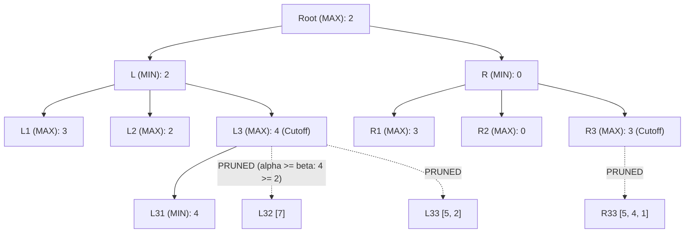

##### Step-by-Step Cutoff Analysis

1. **Pruning at Leaf of $L_{12}$:**
   *   $L_1$ has evaluated $L_{11} = 3 \implies \alpha = 3$ at $L_1$.
   *   At $L_{12}$, evaluating first leaf $2$ sets $\beta = 2$.
   *   Since $\alpha \ge \beta$ ($3 \ge 2$), **Leaf 1 of $L_{12}$ is PRUNED**.

2. **Pruning at MAX Node $L_3$:**
   *   At node $L$, after evaluating $L_1 = 3$ and $L_2 = 2$, node $L$ has $\beta = \min(3, 2) = 2$.
   *   $L$ passes $[\alpha = -\infty, \beta = 2]$ to child $L_3$.
   *   At $L_3$, the first child $L_{31}$ evaluates to $4$. $L_3$ is a MAX node, so $\alpha = \max(-\infty, 4) = 4$.
   *   At $L_3$, $\alpha \ge \beta$ ($4 \ge 2$).
   *   **Cutoff Action:** Branches **$L_{32}$ and $L_{33}$ are PRUNED**.

3. **Pruning at Leaf of $R_{11}$:**
   *   Left branch complete: Root has $\alpha = 2$. Root passes $[\alpha = 2, \beta = +\infty]$ to $R$.
   *   $R$ passes down to $R_1 \to R_{11}$.
   *   First leaf of $R_{11}$ is $1 \implies \beta = 1$ at $R_{11}$.
   *   Since $\alpha \ge \beta$ ($2 \ge 1$), **Leaves 9 and 0 of $R_{11}$ are PRUNED**.

4. **Pruning at Leaf of $R_{31}$:**
   *   At $R_{31}$, first leaf is $2 \implies \beta = 2$.
   *   Since $\alpha \ge \beta$ ($2 \ge 2$), **Leaves 8 and 4 of $R_{31}$ are PRUNED**.

5. **Pruning at Subtree $R_{33}$:**
   *   At $R_3$, child $R_{32}$ evaluates to $3 \implies \alpha = \max(2, 3) = 3$.
   *   At node $R$, current $\beta = \min(3, 0) = 0$.
   *   Condition $\alpha \ge \beta$ ($3 \ge 0$) triggers cutoff.
   *   **Cutoff Action:** Subtree **$R_{33}$ is PRUNED**.

:::tip

**Examiner's Note**

Award 4 marks for part (i) for correct bottom-up values at all 5 plies (Root = 2), and 4 marks for part (ii) for correctly identifying the pruned subtrees ($L_{32}, L_{33}, R_{33}$) and pruned leaves with the condition $\alpha \ge \beta$.

:::

---

### Question 23.b (8 Marks)

:::info

**Question Statement**

Discuss the forward checking and the constraint propagation techniques with an example of map colouring. **(8 Marks)**

:::

---

### Solution 23.b (8 Marks)

#### 1. Forward Checking (FC) (2.5 Marks)

Forward Checking is an early-failure detection mechanism integrated into backtracking search for Constraint Satisfaction Problems (CSPs).

*   **Mechanism:** Whenever a variable $X$ is assigned a value $v$:
    1. The algorithm iterates over every unassigned neighbor variable $Y$ connected to $X$ by a constraint.
    2. Any value in $\operatorname{Domain}(Y)$ that conflicts with the assignment $(X = v)$ is deleted.
    3. If the domain of any unassigned neighbor becomes empty, the algorithm immediately backtracks without wasting search cycles exploring that doomed branch.

---

#### 2. Constraint Propagation via Arc Consistency (AC-3) (2.5 Marks)

While forward checking looks only one step ahead to immediate neighbors, **Constraint Propagation** transitively propagates domain reductions across the entire constraint network.

*   **Definition of Arc Consistency:** A directed arc $X \to Y$ is **arc-consistent** if, for every value $x \in \operatorname{Domain}(X)$, there exists at least one legal value $y \in \operatorname{Domain}(Y)$ that satisfies the binary constraint between $X$ and $Y$.
*   **The AC-3 Algorithm:**
    1. Initialize a queue $Q$ containing all directed binary constraint arcs in the CSP.
    2. Pop arc $(X_i, X_j)$ from $Q$.
    3. Remove any value from $\operatorname{Domain}(X_i)$ that has no remaining compatible match in $\operatorname{Domain}(X_j)$.
    4. If $\operatorname{Domain}(X_i)$ is modified, re-insert all incoming arcs $(X_k, X_i)$ back into $Q$.
    5. Repeat until $Q$ is empty or a domain is wiped out.

---

#### 3. Map Coloring Example: Australia CSP (3 Marks)

Consider coloring the map of Australia with 3 colors: $\{R, G, B\}$ (Red, Green, Blue).  
Variables: $\{WA, NT, SA, Q, NSW, V, T\}$. Constraint: Adjacent territories must not share the same color.

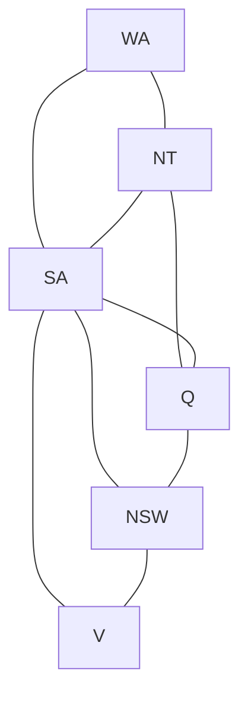

##### Comparative Execution Trace

```text
Variables:      WA      NT      SA      Q       NSW     V       T
Initial:        {R,G,B} {R,G,B} {R,G,B} {R,G,B} {R,G,B} {R,G,B} {R,G,B}
```

*   **Step 1: Assign $WA = \text{Red}$**
    *   *Forward Checking:* Delete $\text{Red}$ from unassigned neighbors $NT$ and $SA$:
        *   $\operatorname{Domain}(NT) = \{G, B\}$
        *   $\operatorname{Domain}(SA) = \{G, B\}$
        *   $Q, NSW, V, T$ remain $\{R, G, B\}$.

*   **Step 2: Assign $Q = \text{Green}$**
    *   *Forward Checking:* Delete $\text{Green}$ from neighbors $NT, SA, NSW$:
        *   $\operatorname{Domain}(NT) = \{B\}$
        *   $\operatorname{Domain}(SA) = \{B\}$
        *   $\operatorname{Domain}(NSW) = \{R, B\}$

*   **Step 3: The Failure of Pure Forward Checking vs. Power of Arc Consistency**
    *   *Forward Checking Limitation:* Notice that both $NT$ and $SA$ have domain $\{B\}$. They are adjacent to each other! But forward checking does not check constraints between unassigned variables. Search will naively attempt to assign $NT = B$ in the next step before discovering the clash at $SA$.
    *   *Arc Consistency (AC-3):* Evaluates the arc $NT \to SA$. If $NT = B$, there is no legal color left in $\operatorname{Domain}(SA) = \{B\}$.  
        $\implies$ AC-3 immediately detects that $\operatorname{Domain}(NT)$ must be emptied, uncovering the dead end **before** expanding any further search nodes!

##### Algorithmic Comparison

| Feature | Forward Checking (FC) | Constraint Propagation (AC-3) |
| :--- | :--- | :--- |
| **Lookahead Depth** | 1 step (immediate neighbors only) | Multi-step (transitive path consistency) |
| **Checks Unassigned-to-Unassigned Arcs?** | No | **Yes** |
| **Computational Overhead** | Minimal ($O(d)$ per assignment) | Higher ($O(c \cdot d^3)$ where $c$ is constraints) |
| **Pruning Power** | Moderate | Exceptional (detects failures much earlier) |

:::tip

**Examiner's Note**

Provide the step-by-step domain reduction table for Australia map coloring, explicitly pointing out the state where $NT = \{B\}$ and $SA = \{B\}$ illustrates how AC-3 catches contradictions that Forward Checking misses.

:::

---

### Question 24.a (8 Marks)

:::info

**Question Statement**

Write the following using first order logic **(8 Marks)**  
(i) Some intelligent students study intelligent systems  
(ii) Every student who opts for intelligent systems is a determined student  
(iii) There is at least one student of intelligent systems, who does not like the AI assignment.

:::

---

### Solution 24.a (8 Marks)

#### Predicate Vocabulary & Domain Definitions
*   $\operatorname{Student}(x)$: $x$ is a student.
*   $\operatorname{Intelligent}(x)$: $x$ is intelligent.
*   $\operatorname{Determined}(x)$: $x$ is determined.
*   $\operatorname{Studies}(x, y)$: $x$ studies subject $y$.
*   $\operatorname{Opts}(x, y)$: $x$ opts for subject $y$.
*   $\operatorname{Likes}(x, y)$: $x$ likes object $y$.
*   $\text{IntelligentSystems}$: Constant denoting the course "Intelligent Systems".
*   $\text{AIAssignment}$: Constant denoting the "AI assignment".

---

#### 1. Formal First-Order Logic Translations

##### (i) "Some intelligent students study intelligent systems" (2.5 Marks)
The existential quantifier $\exists$ paired with conjunction $\land$ asserts the existence of at least one entity satisfying all conditions:

$$\mathbf{\exists x \; \Big( \operatorname{Student}(x) \land \operatorname{Intelligent}(x) \land \operatorname{Studies}(x, \text{IntelligentSystems}) \Big)}$$

*(Alternative ontological formulation with fine-grained predicates:*  
$\exists x \, \exists y \, (\operatorname{Student}(x) \land \operatorname{Intelligent}(x) \land \operatorname{Course}(y) \land \operatorname{Name}(y, \text{IntelligentSystems}) \land \operatorname{Studies}(x, y))$*)*

##### (ii) "Every student who opts for intelligent systems is a determined student" (2.5 Marks)
The universal quantifier $\forall$ paired with implication $\implies$ enforces the rule for all entities in the domain:

$$\mathbf{\forall x \; \Big( \big( \operatorname{Student}(x) \land \operatorname{Opts}(x, \text{IntelligentSystems}) \big) \implies \operatorname{Determined}(x) \Big)}$$

*(Note: In First-Order Logic, writing $\forall x \; (P(x) \land Q(x))$ would incorrectly claim that every individual in the entire universe is a student who opts for intelligent systems. The conditional implication $\implies$ is mathematically mandatory).*

##### (iii) "There is at least one student of intelligent systems, who does not like the AI assignment." (3 Marks)
Asserts the existence of an entity who studies intelligent systems and negates the `Likes` predicate for the AI assignment:

$$\mathbf{\exists x \; \Big( \operatorname{Student}(x) \land \operatorname{Studies}(x, \text{IntelligentSystems}) \land \neg \operatorname{Likes}(x, \text{AIAssignment}) \Big)}$$

:::tip

**Examiner's Note**

Examiners strictly look for the correct quantifier-connective pairings: $\exists$ must pair with $\land$, and $\forall$ must pair with $\implies$. Using $\implies$ with $\exists$ or $\land$ with $\forall$ are classic syntax errors that lose marks.

:::

---

### Question 24.b (8 Marks)

:::info

**Question Statement**

Describe the following **(8 Marks)**  
(i) Forward chaining **(2 Marks)**  
(ii) Backward chaining **(2 Marks)**  
(iii) Deduction **(2 Marks)**  
(iv) Induction **(2 Marks)**

:::

---

### Solution 24.b (8 Marks)

#### 1. Forward Chaining (2 Marks)
*   **Definition:** A data-driven inference algorithm that begins with known atomic assertions in working memory and applies Modus Ponens forward across Horn-clause production rules to infer new facts.
*   **Working Loop:** Repeatedly triggers rules whose antecedent conditions are satisfied, adding their consequent conclusions to working memory until the target goal is derived or no new rules can fire.
*   **Best Used For:** Monitoring, configuration, and real-time control (e.g., automated trading, sensor telemetry diagnosis).

#### 2. Backward Chaining (2 Marks)
*   **Definition:** A goal-driven inference technique that begins with a query/hypothesis and works backward by finding rules whose consequents match the query.
*   **Working Loop:** The premises of matching rules become new subgoals. The algorithm recursively seeks facts or further rules to substantiate these subgoals.
*   **Best Used For:** Diagnostic expert systems (e.g., medical diagnosis in MYCIN, legal reasoning) where goal hypotheses are targeted and irrelevant facts must be ignored.

#### 3. Deduction (2 Marks)
*   **Definition:** A top-down, truth-preserving logical reasoning framework where conclusions necessarily follow from established general axioms and premises.
*   **Characteristics:** If the premises are true, the conclusion is guaranteed to be sound and true.
*   **Canonical Example:**
    $$
    \begin{aligned}
    \text{Premise 1:} & \quad \forall x \, (\operatorname{Human}(x) \implies \operatorname{Mortal}(x)) \\
    \text{Premise 2:} & \quad \operatorname{Human}(\text{Socrates}) \\
    \hline
    \text{Conclusion:} & \quad \operatorname{Mortal}(\text{Socrates})
    \end{aligned}
    $$

#### 4. Induction (2 Marks)
*   **Definition:** A bottom-up reasoning paradigm that generalizes broad probabilistic rules or hypotheses from a finite set of observed empirical instances.
*   **Characteristics:** Non-truth-preserving (the conclusion can be false even if all observed instances are true). Forms the mathematical foundation of modern Machine Learning and statistical pattern recognition.
*   **Canonical Example:**
    $$
    \begin{aligned}
    \text{Observations:} & \quad \text{Swans } 1, 2, \dots, 1000 \text{ are white.} \\
    \hline
    \text{Inductive Rule:} & \quad \forall x \, (\operatorname{Swan}(x) \implies \operatorname{White}(x)) \quad \text{[Falsified by observing a black swan]}
    \end{aligned}
    $$

:::tip

**Examiner's Note**

Ensure each concept includes its operational direction (data-driven vs. goal-driven; top-down vs. bottom-up) along with a concrete illustrative logic example.

:::

---

### Question 25.a (8 Marks)

:::info

**Question Statement**

Describe the supervised semi-supervised and unsupervised learning methods and also give practical scenario where the methods are most appropriate. **(8 Marks)**

:::

---

### Solution 25.a (8 Marks)

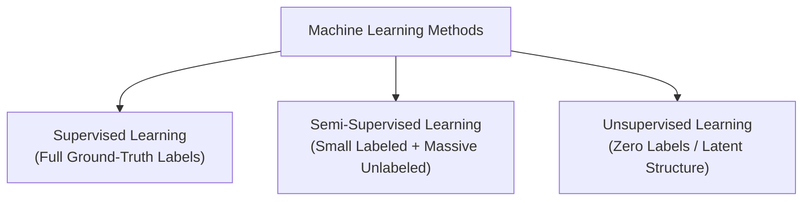

#### 1. Supervised Learning (2.5 Marks)
*   **Methodology:** The algorithm is provided with a training dataset of input-target pairs $\mathcal{D} = \{(\mathbf{x}_i, y_i)\}_{i=1}^N$. The objective is to learn an approximating function $\hat{y} = f(\mathbf{x}; \boldsymbol{\theta})$ by minimizing an empirical loss function:
    $$\min_{\boldsymbol{\theta}} \frac{1}{N} \sum_{i=1}^N \mathcal{L}\big(f(\mathbf{x}_i; \boldsymbol{\theta}), y_i\big)$$
*   **Core Tasks:** Classification (discrete target $y \in \{0, 1\}$) and Regression (continuous target $y \in \mathbb{R}$).
*   **Appropriate Practical Scenario:**  
    *Credit Card Fraud Detection:* Historical banking datasets contain millions of transactions definitively labeled by fraud investigation teams as either legitimate or fraudulent. The supervised model learns subtle multidimensional spending patterns to flag future transactions in real time.

---

#### 2. Unsupervised Learning (2.5 Marks)
*   **Methodology:** The algorithm is provided only with unlabeled data vectors $\mathcal{D} = \{\mathbf{x}_i\}_{i=1}^N$. It discovers intrinsic geometric patterns, clusters, low-dimensional manifolds, or probability distributions $P(\mathbf{x})$ without human supervision.
*   **Core Tasks:** Clustering ($K$-Means, Hierarchical, DBSCAN), Dimensionality Reduction (PCA, t-SNE), and Density Estimation.
*   **Appropriate Practical Scenario:**  
    *Customer Market Segmentation in E-Commerce:* A retailer has millions of customer purchasing profiles without predefined demographic categories. An unsupervised clustering algorithm groups customers into distinct natural behavioural clusters (e.g., discount shoppers, tech enthusiasts, impulse buyers) for targeted marketing.

---

#### 3. Semi-Supervised Learning (2.5 Marks)
*   **Methodology:** Operates on a hybrid dataset consisting of a small labeled subset $\mathcal{D}_L = \{(\mathbf{x}_i, y_i)\}_{i=1}^l$ and a significantly larger pool of unlabeled instances $\mathcal{D}_U = \{\mathbf{x}_j\}_{j=l+1}^{l+u}$ where $u \gg l$.
*   **Core Mechanisms:** Pseudo-labeling (self-training), Co-training, and Graph-based Laplacian label propagation, leveraging the smoothness and cluster assumptions of $\mathcal{D}_U$ to refine decision boundaries.
*   **Appropriate Practical Scenario:**  
    *Medical Imaging (Oncology CT Scans):* Annotating 3D lung CT scans for malignant tumor boundaries requires hours of an expert radiologist's time, making large-scale manual labeling prohibitively expensive. Semi-supervised models train on 500 expert-labeled scans while utilizing 50,000 readily available unlabeled hospital scans to achieve clinical-grade segmentation accuracy.

---

#### 4. Comparative Synthesis (0.5 Mark)

| Dimension | Supervised Learning | Semi-Supervised Learning | Unsupervised Learning |
| :--- | :--- | :--- | :--- |
| **Training Data** | 100% Labeled: $(\mathbf{x}, y)$ | Small labeled + Large unlabeled | 100% Unlabeled: $(\mathbf{x})$ |
| **Feedback Signal** | Direct ground-truth error | Pseudo-labels / Consistency | Internal statistical similarity |
| **Annotation Cost** | High | Low-to-Moderate | Zero annotation overhead |

:::tip

**Examiner's Note**

Full marks require explicitly formulating the data representation for each paradigm (labeled pairs, unlabeled vectors, hybrid pools) and justifying why each cited real-world scenario specifically fits that paradigm.

:::

---

### Question 25.b (8 Marks)

:::info

**Question Statement**

Explain in detail about rule based expert system and frame based expert system. **(8 Marks)**

:::

---

### Solution 25.b (8 Marks)

#### 1. Rule-Based Expert Systems (RBES) (4 Marks)

Rule-Based Expert Systems encode domain knowledge as discrete, declarative conditional statements termed **production rules**.

##### a) Knowledge Representation
Knowledge is structured as IF-THEN rules:
$$\text{IF } \langle\text{Condition}_1 \land \text{Condition}_2 \land \dots \land \text{Condition}_k\rangle \implies \text{THEN } \langle\text{Action / Conclusion}\rangle$$

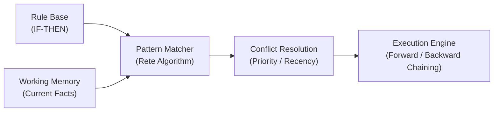

##### b) Operational Mechanism
1. **Working Memory:** Stores dynamic assertions and facts for the current case.
2. **Inference Engine:** Compares working memory facts against rule antecedents. When multiple rules match, a **conflict resolution strategy** (e.g., salience, specificity, recency) selects the winning rule to fire.
3. **Inference Modes:** Executes via **Forward Chaining** (data-driven synthesis) or **Backward Chaining** (hypothesis verification).
4. **Key Strengths:** Highly modular, transparent, and easy to explain via automated execution traces (e.g., MYCIN, XCON).

---

#### 2. Frame-Based Expert Systems (FBES) (4 Marks)

Proposed by Marvin Minsky (1974), Frame-Based Systems model knowledge using object-oriented, hierarchical data structures representing prototypical concepts or situations.

##### a) Structural Anatomy of a Frame
A frame consists of named **Slots** (attributes) containing **Fillers** (values):

```text
Frame: CAR
  IS-A: Vehicle
  Manufacturer: [Filler: String]
  Wheels: [Default Value: 4]
  Engine_Status: [Filler: Normal / Faulty]
  Check_Oil: [If-Needed Daemon: Procedure_CheckDipstick()]
  Alert_Driver: [If-Added Daemon: Procedure_SoundChime()]
```

##### b) Key Architectural Capabilities
1. **Taxonomic Inheritance:** Frames are organized into inheritance graphs (IS-A and AKO - "A Kind Of" links). Sub-frames automatically inherit slot attributes and default fillers from parent frames.
2. **Default Reasoning:** Slots maintain default values that are assumed true unless overridden by specific case evidence.
3. **Procedural Attachments (Daemons):** Code routines attached to slots that trigger automatically upon events:
   *   `If-Needed`: Computes an attribute dynamically when requested.
   *   `If-Added`: Executes actions or consistency checks when a slot value is updated.
   *   `If-Removed`: Triggers cleanup when a filler is deleted.

---

#### 3. Comprehensive Comparison Table

| Attribute | Rule-Based Expert System (RBES) | Frame-Based Expert System (FBES) |
| :--- | :--- | :--- |
| **Knowledge Paradigm** | Declarative production rules (IF-THEN) | Object-oriented structural frames (Slots & Fillers) |
| **Reasoning Engine** | Forward / Backward chaining via Rete algorithm | Inheritance along IS-A hierarchies and active daemons |
| **Handling Hierarchies** | Difficult; requires complex rule chains | Native, efficient object-oriented taxonomic inheritance |
| **Dynamic Execution** | Conflict resolution selects matching rule | Procedural attachments (`if-needed`, `if-added`) trigger code |
| **Modularity** | High; individual rules can be added independently | Moderate; modifying parent frames affects all descendants |
| **Historical Systems** | MYCIN, DENDRAL, OPS5 | KEE, FRL, LOOPS, Centaur |

:::tip

**Examiner's Note**

Ensure your answer explicitly mentions Marvin Minsky's frame theory, defines Slots, Fillers, and Daemons (`if-needed`, `if-added`), and compares RBES and FBES in a structured table.

:::

---

## Part C: Comprehensive System & Logic Problems (15 Marks)

### Question 26 (15 Marks)

:::info

**Question Statement**

The missionaries and cannibal’s problem is as follows. Five missionaries and five cannibals are on one side of a river, along with a boat. The boat can hold one or two people (and obviously cannot be paddled to the other side of the river with zero people in it). The goal is to get everyone to the other side, ensure that the number of missionaries never becomes less than the number of cannibals on either side. **(15 Marks)**

(i) Define the state representation **(3 Marks)**  
(ii) Give initial and goal states in their representation **(2 Marks)**  
(iii) Define the successor function in this representation **(4 Marks)**  
(iv) What is the cost function in your successor function? Each move has unit cost. **(2 Marks)**  
(v) What is the total number of reachable state? **(4 Marks)**

:::

---

### Solution 26 (15 Marks)

#### (i) Formal State Representation (3 Marks)

Let the two river banks be designated the **Starting Bank (Left Bank)** and the **Destination Bank (Right Bank)**. Because the total number of missionaries and cannibals is constant ($M_{\text{total}} = 5, C_{\text{total}} = 5$), the state of the system is fully specified by the entities remaining on the Starting Bank and the position of the boat:

$$s = (M, C, B)$$

where:
*   $M \in \{0, 1, 2, 3, 4, 5\}$: Number of missionaries on the Starting Bank.
*   $C \in \{0, 1, 2, 3, 4, 5\}$: Number of cannibals on the Starting Bank.
*   $B \in \{1, 0\}$: Position of the boat ($B = 1$ denotes boat at Starting Bank; $B = 0$ denotes boat at Destination Bank).

The counts on the Destination Bank are implicitly derived:
$$M_{\text{dest}} = 5 - M, \quad C_{\text{dest}} = 5 - C$$

##### The Safety Invariant (Non-Cannibalizing Constraint)
To prevent missionaries from being eaten on either bank:
$$\operatorname{Safe}(M, C) \iff \Big( (M == 0 \lor M \ge C) \;\land\; ((5 - M) == 0 \lor (5 - M) \ge (5 - C)) \Big)$$

---

#### (ii) Initial and Goal States (2 Marks)

*   **Initial State ($s_0$):** All 5 missionaries, 5 cannibals, and the boat are on the Starting Bank:
    $$\mathbf{s_0 = (5, 5, 1)}$$
*   **Goal State ($s_G$):** All individuals and the boat have crossed to the Destination Bank:
    $$\mathbf{s_G = (0, 0, 0)}$$

---

#### (iii) Successor Function (4 Marks)

The boat capacity is bounded between 1 and 2 individuals ($1 \le \Delta M + \Delta C \le 2$). The 5 legal boat transfer operators are:
$$\mathcal{O} = \big\{ (1, 0), (2, 0), (0, 1), (0, 2), (1, 1) \big\}$$
where $(\Delta M, \Delta C)$ denotes the number of missionaries and cannibals in the boat.

##### Transition Definition $\operatorname{Successor}(s)$
For current state $s = (M, C, B)$:
1. If $B = 1$ (crossing from Starting $\to$ Destination Bank):
   $$M' = M - \Delta M, \quad C' = C - \Delta C, \quad B' = 0$$
2. If $B = 0$ (crossing from Destination $\to$ Starting Bank):
   $$M' = M + \Delta M, \quad C' = C + \Delta C, \quad B' = 1$$

##### Preconditions for Transition Validity
A successor state $s' = (M', C', B')$ is generated if and only if:
1. $0 \le M' \le 5$ and $0 \le C' \le 5$
2. $\operatorname{Safe}(M', C') = \text{True}$

---

#### (iv) Cost Function (2 Marks)

Each river crossing (application of a successor operator) has a uniform step cost:
$$c(s, a, s') = 1$$
The total path cost for a solution trajectory of $k$ crossings is:
$$\operatorname{Cost}(\text{Path}) = \sum_{t=1}^{k} c(s_{t-1}, a_t, s_t) = k$$

---

#### (v) Total Number of Reachable States & Theoretical Reachability Analysis (4 Marks)

##### 1. Total Legal States in the State Space
Let us enumerate all valid configurations satisfying the safety condition $\operatorname{Safe}(M, C)$:
*   When $M = 0$: $C$ can take any value in $\{0, 1, 2, 3, 4, 5\}$ ($6 \times 2 = 12$ states for $B \in \{0, 1\}$).
*   When $M = 5$: $C$ can take any value in $\{0, 1, 2, 3, 4, 5\}$ ($6 \times 2 = 12$ states for $B \in \{0, 1\}$).
*   When $0 < M < 5$: To avoid $M < C$ on the left and $(5-M) < (5-C)$ on the right, we must have $M = C$.  
    Possible pairs: $(1, 1), (2, 2), (3, 3), (4, 4)$ ($4 \times 2 = 8$ states for $B \in \{0, 1\}$).
*   **Total Legal States in Universe:** $12 + 12 + 8 = \mathbf{32 \text{ legal states}}$.

##### 2. Reachable States from Initial State $(5, 5, 1)$ via Boat Capacity 2
Executing breadth-first exploration from $(5, 5, 1)$ across all valid operators yields the exact reachable component:

| State Number | Reachable State $(M, C, B)$ | Bank Configurations (Left Bank \| Right Bank) |
| :---: | :---: | :--- |
| **1** | $(5, 5, 1)$ | $5M, 5C$, Boat $\mid$ Empty *(Initial State)* |
| **2** | $(5, 4, 0)$ | $5M, 4C \mid 1C$, Boat |
| **3** | $(5, 3, 0)$ | $5M, 3C \mid 2C$, Boat |
| **4** | $(5, 4, 1)$ | $5M, 4C$, Boat $\mid 1C$ |
| **5** | $(5, 2, 0)$ | $5M, 2C \mid 3C$, Boat |
| **6** | $(5, 3, 1)$ | $5M, 3C$, Boat $\mid 2C$ |
| **7** | $(5, 1, 0)$ | $5M, 1C \mid 4C$, Boat |
| **8** | $(5, 2, 1)$ | $5M, 2C$, Boat $\mid 3C$ |
| **9** | $(5, 0, 0)$ | $5M, 0C \mid 5C$, Boat |
| **10** | $(5, 1, 1)$ | $5M, 1C$, Boat $\mid 4C$ |
| **11** | $(4, 4, 0)$ | $4M, 4C \mid 1M, 1C$, Boat |
| **12** | $(4, 4, 1)$ | $4M, 4C$, Boat $\mid 1M, 1C$ |
| **13** | $(3, 3, 0)$ | $3M, 3C \mid 2M, 2C$, Boat |

$$\mathbf{\text{Total Number of Reachable States} = 13}$$

##### 3. Critical Analytical Finding (Solvability Proof)
*   **The Goal State $(0, 0, 0)$ is UNREACHABLE with Boat Capacity 2.**
*   **Mathematical Proof:** In classical graph analysis of the Missionaries & Cannibals problem (Amarel, 1968), the puzzle with $N$ pairs and boat capacity $K$ is solvable **if and only if** $K \ge 3$ for $N \ge 4$. With $N = 5$ and boat capacity $K = 2$, once the system reaches state $(3, 3, 0)$, no legal transition exists that can move missionaries without leaving $M < C$ on one of the banks. The search space enters a deadlock cycle among these 13 reachable states.

:::tip

**Examiner's Note**

Full marks are awarded for giving the state representation $(M, C, B)$, stating $s_0 = (5, 5, 1)$ and $s_G = (0, 0, 0)$, providing the 5 move operators, calculating unit step cost, and identifying that exactly **13 states are reachable** from $(5, 5, 1)$, proving that the goal is mathematically unreachable with boat capacity 2.

:::

---

### Question 27 (15 Marks)

:::info

**Question Statement**

27.i. For the following example, write the KB in propositional logic, explain how the inference would occur. **(8 Marks)**  
(i) Ram is an IT professional  
(ii) IT professionals are hardworking  
(iii) All hardworking people are wealthy  
(iv) All wealthy people pay heavy income tax  

27.ii. Can a planning be related to problem solving? Discuss with example. **(7 Marks)**

:::

---

### Solution 27 (15 Marks)

#### 1. Propositional Logic KB and Inference Process (8 Marks)

##### a) Propositional Symbol Dictionary
To express these statements about Ram in Propositional Logic:
*   $P$: "Ram is an IT professional"
*   $Q$: "Ram is hardworking"
*   $R$: "Ram is wealthy"
*   $S$: "Ram pays heavy income tax"

##### b) Knowledge Base ($\text{KB}$) Formalization
The four natural language statements translate into the formal knowledge base:
$$
\begin{aligned}
\text{Sentence 1:} & \quad P \\
\text{Sentence 2:} & \quad P \implies Q \\
\text{Sentence 3:} & \quad Q \implies R \\
\text{Sentence 4:} & \quad R \implies S
\end{aligned}
$$

$$\mathbf{\text{KB} = \big\{ P, \; P \implies Q, \; Q \implies R, \; R \implies S \big\}}$$

---

##### c) Inference via Forward Modus Ponens (4 Marks)

Inference proceeds by sequential application of the **Modus Ponens** inference rule:
$$\frac{\alpha, \quad \alpha \implies \beta}{\beta}$$

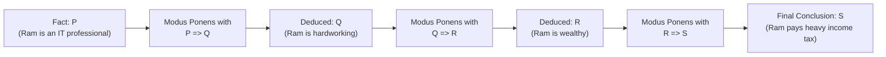

*   **Derivation Step 1:**
    *   From Premise (1) $P$ and Premise (2) $P \implies Q$, apply Modus Ponens:
        $$\frac{P, \quad P \implies Q}{Q}$$
    *   *Deduced Fact:* $Q$ ("Ram is hardworking"). Add $Q$ to working memory.

*   **Derivation Step 2:**
    *   From Deduced Fact $Q$ and Premise (3) $Q \implies R$, apply Modus Ponens:
        $$\frac{Q, \quad Q \implies R}{R}$$
    *   *Deduced Fact:* $R$ ("Ram is wealthy"). Add $R$ to working memory.

*   **Derivation Step 3:**
    *   From Deduced Fact $R$ and Premise (4) $R \implies S$, apply Modus Ponens:
        $$\frac{R, \quad R \implies S}{S}$$
    *   *Final Deduced Fact:* $S$ ("Ram pays heavy income tax").

---

##### d) Alternative Verification via Resolution Refutation

To prove $\text{KB} \models S$, negate the query ($\neg S$) and convert $\text{KB} \cup \{\neg S\}$ to Conjunctive Normal Form (CNF):
1. $C_1: P$
2. $C_2: \neg P \lor Q$
3. $C_3: \neg Q \lor R$
4. $C_4: \neg R \lor S$
5. $C_5: \neg S$ *(Negated Goal)*

*   Resolve $C_4$ with $C_5$: $(\neg R \lor S) \land (\neg S) \implies \mathbf{C_6: \neg R}$
*   Resolve $C_3$ with $C_6$: $(\neg Q \lor R) \land (\neg R) \implies \mathbf{C_7: \neg Q}$
*   Resolve $C_2$ with $C_7$: $(\neg P \lor Q) \land (\neg Q) \implies \mathbf{C_8: \neg P}$
*   Resolve $C_1$ with $C_8$: $(P) \land (\neg P) \implies \mathbf{\square \text{ (Empty Clause / Contradiction)}}$

Since the negated goal derives a contradiction ($\square$), the conclusion **$S$ is valid and entailed**.

---

#### 2. Planning in Relation to Problem Solving (7 Marks)

##### a) Conceptual Relationship: How Planning Extends Problem Solving
Both **Problem Solving (Search)** and **Planning** share the same core goal: finding a valid sequence of actions that transforms an agent from an initial state to a goal state.

However, planning addresses the scalability bottlenecks of classical search by opening up the internal representation of states and actions:

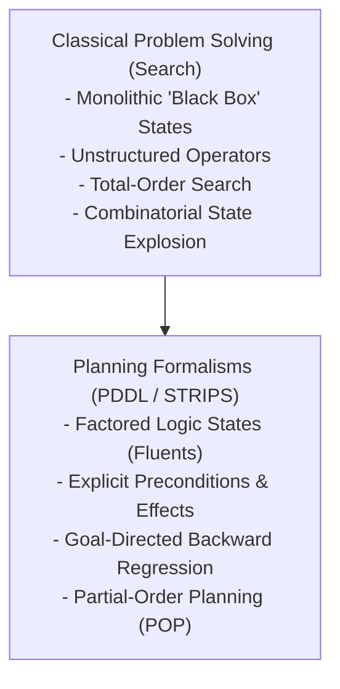

##### b) Key Differences Between Search and Planning

| Characteristic | Classical Problem-Solving (Search) | Automated Planning (STRIPS / PDDL) |
| :--- | :--- | :--- |
| **State Representation** | Atomic black boxes (e.g., integers, graph labels $S_1, S_2$) | Structured sets of first-order predicates/fluents (`At(Cargo, SFO)`) |
| **Action Representation** | Programmatic functions generating successor states | Schemas with explicit **Preconditions**, **Add Lists**, and **Delete Lists** |
| **Search Direction** | Primarily forward progression from $s_0$ | Bidirectional or **Goal-Directed Regression** (reasoning backward from goals) |
| **Subgoal Independence** | Searches full monolithic states simultaneously | Decomposes goals into independent subgoals (**Divide-and-Conquer**) |
| **Plan Structure** | Total-order sequential paths | **Partial-Order Planning (POP)**: Unordered steps executed in parallel |

---

##### c) Illustrative Domain Example: Air Cargo Transport

Consider transporting cargo $C_1$ from Airport $JFK$ to Airport $SFO$ using plane $P_1$.

```text
Action: Fly(plane, from, to)
  Preconditions: At(plane, from)
  Effects: At(plane, to), NOT At(plane, from)

Action: Load(cargo, plane, airport)
  Preconditions: At(cargo, airport), At(plane, airport)
  Effects: In(cargo, plane), NOT At(cargo, airport)

Action: Unload(cargo, plane, airport)
  Preconditions: In(cargo, plane), At(plane, airport)
  Effects: At(cargo, airport), NOT In(cargo, plane)
```

*   **Problem-Solving Approach:** A state-space search agent treats the world as monolithic configurations. If there are 10 planes and 50 cargo items, the branching factor explodes exponentially ($b^{50}$). The search agent blindly explores flying planes to irrelevant cities without knowing which action contributes to the goal.
*   **Planning Approach:** A planning agent inspects the goal `At(C_1, SFO)`. By backward regression, it immediately determines that only `Unload(C_1, P_1, SFO)` can achieve this goal fluent. That operator establishes subgoals `In(C_1, P_1)` and `At(P_1, SFO)`, cleanly ignoring all unrelated planes and airports.

**Conclusion:** Planning relates to problem solving as a structured, declarative extension that decouples action schemas from state enumeration, enabling goal decomposition, regression, and heuristic generation from relaxed models.

:::tip

**Examiner's Note**

Award 8 marks for part (i) for defining atomic symbols $P, Q, R, S$, writing the 4 KB rules, and showing the 3-step Modus Ponens deduction (and/or Resolution). Award 7 marks for part (ii) for detailing the difference between atomic search and factored planning, and illustrating with an action schema (Preconditions and Effects).

:::
