# July 2025

> **Exam -** Semester Examination  
> **Course -** Artificial Intelligence (`21CSC206T`)  
> **Session -** July 2025  

---

## Part A: Objective Type Questions (20 Marks)

### Question 1 (1 Mark)

:::info

**Question Statement**

Which AI technique is best for handling uncertainty? **(1 Mark)**

*   **(A)** Decision Trees
*   **(B)** Fuzzy Logic
*   **(C)** Neural Networks
*   **(D)** Depth-First Search

:::

*   **Correct Answer:** **(B) Fuzzy Logic**
*   **Explanation:** Fuzzy logic is designed specifically to model subjective, imprecise, and vague human reasoning by allowing continuous degrees of truth between 0 and 1, unlike crisp binary logic.

---

### Question 2 (1 Mark)

:::info

**Question Statement**

What is the purpose of a heuristic function in AI? **(1 Mark)**

*   **(A)** To guarantee an optimal solution
*   **(B)** To provide an estimate for the best path to the goal
*   **(C)** To explore all possible solutions
*   **(D)** To randomly select the next step

:::

*   **Correct Answer:** **(B) To provide an estimate for the best path to the goal**
*   **Explanation:** A heuristic function $h(n)$ estimates the remaining cost from node $n$ to an identified goal state, focusing search efforts along promising branches to prune the search space.

---

### Question 3 (1 Mark)

:::info

**Question Statement**

Which AI model learns by interacting with its environment? **(1 Mark)**

*   **(A)** Supervised Learning
*   **(B)** Unsupervised Learning
*   **(C)** Reinforcement Learning
*   **(D)** Deep Learning

:::

*   **Correct Answer:** **(C) Reinforcement Learning**
*   **Explanation:** Reinforcement learning models an autonomous agent interacting with a dynamic environment through trial-and-error, optimizing behavior via scalar reward and penalty feedback signals.

---

### Question 4 (1 Mark)

:::info

**Question Statement**

Which algorithm is commonly used to solve Tic-Tac-Toe? **(1 Mark)**

*   **(A)** A* Algorithm
*   **(B)** Minimax Algorithm
*   **(C)** Decision Trees
*   **(D)** Bayesian Networks

:::

*   **Correct Answer:** **(B) Minimax Algorithm**
*   **Explanation:** The Minimax decision algorithm computes the optimal move in two-player, turn-taking, zero-sum games with perfect information like Tic-Tac-Toe by maximizing the player's score while assuming an optimal minimizing opponent.

---

### Question 5 (1 Mark)

:::info

**Question Statement**

Which data structure is best suited for implementing recursion? **(1 Mark)**

*   **(A)** Queue
*   **(B)** Graph
*   **(C)** Stack
*   **(D)** Linked List

:::

*   **Correct Answer:** **(C) Stack**
*   **Explanation:** Recursive function calls follow a Last-In, First-Out (LIFO) execution discipline where return addresses, local variables, and activation frames are stored and retrieved from a call stack.

---

### Question 6 (1 Mark)

:::info

**Question Statement**

Which of the following is NOT an uninformed search algorithm? **(1 Mark)**

*   **(A)** Breadth-First Search (BFS)
*   **(B)** Depth-First Search (DFS)
*   **(C)** A* Algorithm
*   **(D)** Uniform Cost Search (UCS)

:::

*   **Correct Answer:** **(C) A\* Algorithm**
*   **Explanation:** $A^*$ search utilizes domain-specific heuristic knowledge $h(n)$ to guide exploration; therefore, it is an **informed (heuristic)** search algorithm, whereas BFS, DFS, and UCS are blind/uninformed.

---

### Question 7 (1 Mark)

:::info

**Question Statement**

What is the primary drawback of Depth-First Search (DFS)? **(1 Mark)**

*   **(A)** It is incomplete for infinite graphs
*   **(B)** It always finds the optimal solution
*   **(C)** It requires too much memory
*   **(D)** It expands all nodes at the same level

:::

*   **Correct Answer:** **(A) It is incomplete for infinite graphs**
*   **Explanation:** In state spaces with infinite depth or unvisited cycles, Depth-First Search can dive indefinitely down a non-terminating branch, failing to discover a valid shallow goal on an alternate branch (incompleteness).

---

### Question 8 (1 Mark)

:::info

**Question Statement**

Which heuristic search algorithm expands the node with the best evaluation function? **(1 Mark)**

*   **(A)** Best-First Search
*   **(B)** Depth-First Search
*   **(C)** Breadth-First Search
*   **(D)** Uniform Cost Search

:::

*   **Correct Answer:** **(A) Best-First Search**
*   **Explanation:** Best-First Search algorithms maintain an `OPEN` priority queue and always select the node with the lowest/best evaluation function $f(n)$ for expansion next.

---

### Question 9 (1 Mark)

:::info

**Question Statement**

Which of the following algorithms is commonly used for solving zero-sum, two-player games with perfect information? **(1 Mark)**

*   **(A)** Minimax algorithm
*   **(B)** Breadth-first search
*   **(C)** A* search algorithm
*   **(D)** Hill climbing

:::

*   **Correct Answer:** **(A) Minimax algorithm**
*   **Explanation:** Minimax is the foundational game-theoretic search algorithm designed specifically for two-player zero-sum games with perfect information like Chess and Checkers.

---

### Question 10 (1 Mark)

:::info

**Question Statement**

In the context of adversarial search, what does the term "pruning" mean? **(1 Mark)**

*   **(A)** Adding new branches to the search tree to explore more possible outcomes
*   **(B)** Removing unimportant branches of the game tree that do not affect the final decision
*   **(C)** Expanding the search tree to find better outcomes
*   **(D)** Searching deeper into the game tree to maximize the agent's score

:::

*   **Correct Answer:** **(B) Removing unimportant branches of the game tree that do not affect the final decision**
*   **Explanation:** In game-tree search (e.g., Alpha-Beta pruning), pruning is the elimination of subtrees provably incapable of influencing the root player's optimal move.

---

### Question 11 (1 Mark)

:::info

**Question Statement**

Which of the following is a common search algorithm used to solve CSPs? **(1 Mark)**

*   **(A)** Depth-first search
*   **(B)** Breadth-first search
*   **(C)** Backtracking
*   **(D)** Genetic algorithms

:::

*   **Correct Answer:** **(C) Backtracking**
*   **Explanation:** Backtracking search (depth-first search with single-variable assignments and chronological undoing upon constraint violation) is the standard foundational algorithm for solving Constraint Satisfaction Problems.

---

### Question 12 (1 Mark)

:::info

**Question Statement**

A major challenge in Rule-Based Systems is: **(1 Mark)**

*   **(A)** Ensuring high-speed data transmission
*   **(B)** Managing large volumes of rules and potential conflicts
*   **(C)** Encrypting the rule base
*   **(D)** Storing large sets of rules

:::

*   **Correct Answer:** **(B) Managing large volumes of rules and potential conflicts**
*   **Explanation:** As rule bases scale into thousands of production rules, managing rule interactions, resolving conflicting recommendations, and preventing circular dependencies becomes difficult.

---

### Question 13 (1 Mark)

:::info

**Question Statement**

In a Bayesian Network, nodes represent: **(1 Mark)**

*   **(A)** Physical network nodes
*   **(B)** Random variables
*   **(C)** Data storage units
*   **(D)** Encryption algorithms

:::

*   **Correct Answer:** **(B) Random variables**
*   **Explanation:** In a Bayesian (Belief) Network, each node in the Directed Acyclic Graph (DAG) represents a discrete or continuous random variable, while directed arcs encode conditional dependencies.

---

### Question 14 (1 Mark)

:::info

**Question Statement**

The "if" part of a rule in a Rule-Based System is known as the: **(1 Mark)**

*   **(A)** Conclusion
*   **(B)** Predicate
*   **(C)** Antecedent
*   **(D)** Variable

:::

*   **Correct Answer:** **(C) Antecedent**
*   **Explanation:** In formal logic and production rules ($\text{IF } P \implies \text{THEN } Q$), the conditional "IF" clause $P$ is termed the **antecedent** (or premise), and the "THEN" clause $Q$ is the **consequent** (or conclusion).

---

### Question 15 (1 Mark)

:::info

**Question Statement**

Propositional logic deals with determining the _______ of the sentence. **(1 Mark)**

*   **(A)** Syntax
*   **(B)** Truth
*   **(C)** Semantics
*   **(D)** Logic

:::

*   **Correct Answer:** **(B) Truth**
*   **Explanation:** Propositional logic is truth-functional; its core semantic objective is determining whether compound sentences evaluate to $\text{True}$ or $\text{False}$ under a given model assignment.

---

### Question 16 (1 Mark)

:::info

**Question Statement**

'Belief Propagation' in Bayesian Networks is a method for: **(1 Mark)**

*   **(A)** Spreading religious beliefs
*   **(B)** Propagating probabilities throughout the network
*   **(C)** Enhancing network belief systems
*   **(D)** Propagating encrypted beliefs

:::

*   **Correct Answer:** **(B) Propagating probabilities throughout the network**
*   **Explanation:** Pearl's Belief Propagation algorithm is a message-passing algorithm that computes marginal posterior probability distributions conditioned on observed evidence across Bayesian networks and Markov random fields.

---

### Question 17 (1 Mark)

:::info

**Question Statement**

What is perceptron? **(1 Mark)**

*   **(A)** A single layer feed-forward neural network with pre-processing
*   **(B)** A neural network that contains feedback
*   **(C)** A double layer auto-associative neural network
*   **(D)** An auto-associative neural network

:::

*   **Correct Answer:** **(A) A single layer feed-forward neural network with pre-processing**
*   **Explanation:** Introduced by Frank Rosenblatt in 1958, the Perceptron is the simplest fundamental artificial neural network architecture: a single-layer feed-forward linear binary classifier computing $y = f(\mathbf{w}^T \mathbf{x} + b)$.

---

### Question 18 (1 Mark)

:::info

**Question Statement**

What is an Expert System in the context of Artificial Intelligence? **(1 Mark)**

*   **(A)** A system that enhances internet speeds
*   **(B)** A system that manages large databases
*   **(C)** A system designed to emulate human expert decision-making
*   **(D)** A system used for computer hardware improvement

:::

*   **Correct Answer:** **(C) A system designed to emulate human expert decision-making**
*   **Explanation:** An Expert System is a knowledge-based AI program that couples domain-specific heuristics and rules with an automated inference engine to emulate human specialist problem-solving.

---

### Question 19 (1 Mark)

:::info

**Question Statement**

"MYCIN" is an example of an Expert System developed for: **(1 Mark)**

*   **(A)** Network management
*   **(B)** Medical diagnosis, specifically infectious diseases
*   **(C)** Data encryption
*   **(D)** Financial analysis

:::

*   **Correct Answer:** **(B) Medical diagnosis, specifically infectious diseases**
*   **Explanation:** MYCIN was developed at Stanford University in the 1970s to diagnose severe bacterial blood infections (meningitis and bacteremia) and prescribe antibiotic dosages using backward chaining with certainty factors.

---

### Question 20 (1 Mark)

:::info

**Question Statement**

The knowledge base in an Expert System contains: **(1 Mark)**

*   **(A)** Data about network configurations
*   **(B)** Information and rules about the domain of expertise
*   **(C)** Encrypted data for security purposes
*   **(D)** Algorithms for improving processing speed

:::

*   **Correct Answer:** **(B) Information and rules about the domain of expertise**
*   **Explanation:** The knowledge base is the declarative memory of an expert system, storing domain facts, definitions, heuristics, and production rules (IF-THEN statements) provided by human specialists.

---

## Part B: Analytical & Descriptive Questions (40 Marks)

### Question 21.a (8 Marks)

:::info

**Question Statement**

Describe the problem-solving process in AI with real-world examples. **(8 Marks)**

:::

---

### Solution 21.a (8 Marks)

#### 1. The Four-Phase Problem-Solving Cycle (4 Marks)

In artificial intelligence (Russell & Norvig model), an agent solves problems through an established four-stage deliberative cycle:

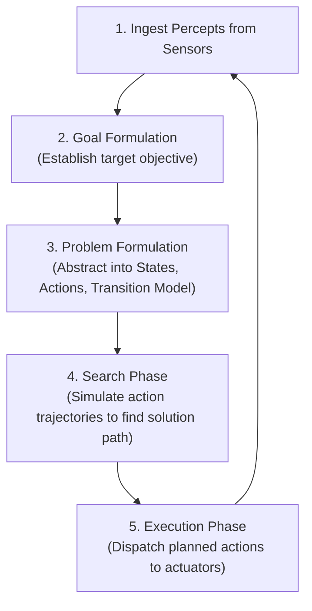

1. **Goal Formulation:**  
   The agent identifies the desirable objective. Goals focus deliberation by restricting the actions and states the agent evaluates.
2. **Problem Formulation:**  
   The mathematical formalization of the problem as a 5-tuple:
   $$\mathcal{P} = \langle s_0, A, T, G, c \rangle$$
   *   *Initial State ($s_0$):* The current environment state.
   *   *Actions ($A(s)$):* The legal operators available.
   *   *Transition Model ($T(s, a)$ / $\operatorname{Result}(s, a)$):* The resulting state after action execution.
   *   *Goal Test ($G(s)$):* Predicate determining whether state $s$ achieves the goal.
   *   *Path Cost ($c(s, a, s')$):* Numeric cost for each action transition.
3. **Search Phase:**  
   The offline examination of alternative state transitions. The search algorithm explores candidate paths and outputs an action sequence without taking physical actions in the world.
4. **Execution Phase:**  
   The agent executes the discovered plan step-by-step through its physical or virtual actuators.

---

#### 2. Real-World Applications (4 Marks)

##### a) GPS Navigation (Google Maps Routing)
*   *Initial State:* Current GPS vehicle coordinates (e.g., Downtown Seattle).
*   *Actions:* Driving along connected road segments.
*   *Transition Model:* New intersection reached with updated travel time.
*   *Goal Test:* Arriving within 10 meters of the airport terminal.
*   *Search Algorithm:* $A^*$ search with geographical straight-line distance heuristic ($h(n)$) to find the fastest travel time.

##### b) Robotic Vacuum Cleaner (Roomba)
*   *Initial State:* Docking station, dirty apartment floor.
*   *Actions:* Move forward, turn $90^\circ$, activate suction.
*   *Goal Test:* All floor tiles mapped as clean with battery charge preserved.
*   *Execution:* Interleaves online sensor updates (bump sensors, ceiling optical tracking) with dynamic replanning around moved furniture.

:::tip

**Examiner's Note**

Detail all 4 phases (Goal Formulation, Problem Formulation, Search, Execution), write the formal 5-tuple $\langle s_0, A, T, G, c \rangle$, and provide two concrete real-world domains.

:::

---

### Question 21.b (8 Marks)

:::info

**Question Statement**

Discuss data acquisition and preprocessing techniques in AI. **(8 Marks)**

:::

---

### Solution 21.b (8 Marks)

#### 1. Data Acquisition Techniques in AI (4 Marks)

Data acquisition is the process of collecting, ingesting, and cataloging digital and physical signals for AI training.

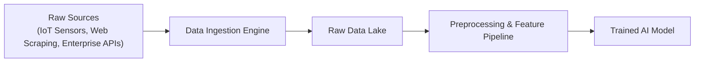

##### Acquisition Modalities
*   **Sensor & Telemetry Ingestion:** Capturing continuous physical streams (LiDAR point clouds for autonomous vehicles, medical ECG waveforms).
*   **Web Scraping & Open APIs:** Automated scrapers extracting semi-structured text and media from web pages and financial feeds.
*   **Synthetic Data Generation:** Generative models (e.g., GANs, diffusion models) generating realistic edge-case samples (e.g., simulating rare industrial defects).

---

#### 2. Data Preprocessing Techniques (4 Marks)

Raw data is typically noisy, incomplete, and inconsistently scaled. Preprocessing transforms it into a clean, normalized format:

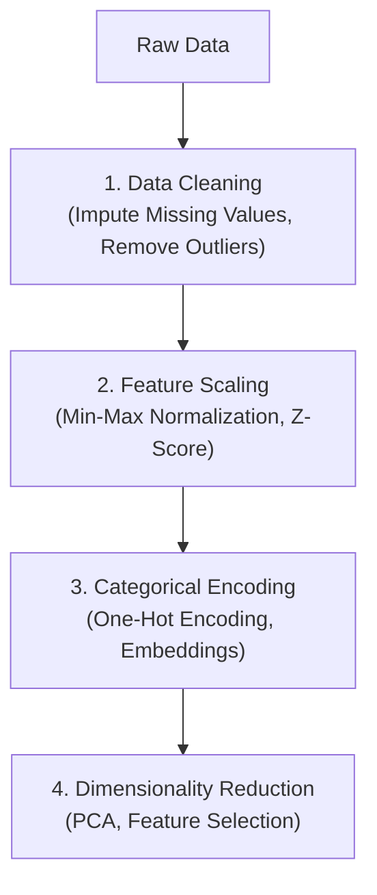

1. **Handling Missing Values:**  
   *   *Deletion:* Removing rows with missing values (viable if missingness is $< 2\%$).
   *   *Imputation:* Replacing missing entries with statistical aggregates (mean, median, mode) or predictive algorithms (KNN imputation).
2. **Feature Scaling:**  
   *   *Min-Max Normalization:* Scales features to $[0, 1]$:
       $$x_{\text{norm}} = \frac{x - x_{\text{min}}}{x_{\text{max}} - x_{\text{min}}}$$
   *   *Standardization (Z-Score):* Centers features to zero mean and unit variance:
       $$z = \frac{x - \mu}{\sigma}$$
3. **Categorical Feature Encoding:**  
   Converting non-numeric strings into vectors via **One-Hot Encoding** (for nominal categories) or **Ordinal Encoding** (for ranked categories).
4. **Outlier Detection:**  
   Using the Interquartile Range ($IQR = Q_3 - Q_1$) or Z-scores ($|z| > 3$) to filter erroneous measurement spikes.

:::tip

**Examiner's Note**

Award 4 marks for detailing data acquisition modalities (sensors, APIs, synthetic data) and 4 marks for the preprocessing pipeline with normalization formulas.

:::

---

### Question 22.a (8 Marks)

:::info

**Question Statement**

Explain the role of search algorithms in Artificial Intelligence. Compare Breadth-First Search (BFS) and Depth-First Search (DFS) with examples. **(8 Marks)**

:::

---

### Solution 22.a (8 Marks)

#### 1. The Role of Search Algorithms in AI (2.5 Marks)

Search algorithms are the primary computational mechanism used by intelligent agents to solve problems when the sequence of required actions is not known in advance.
*   **Navigating Combinatorial State Spaces:** Search systematic explores alternative branching choices to find a valid sequence of operators that transforms the initial state into a goal state.
*   **Core Responsibilities:** Guaranteeing solution existence (**completeness**), minimizing execution time and memory (**efficiency**), and identifying the lowest-cost trajectory (**optimality**).

---

#### 2. Comparison: Breadth-First Search (BFS) vs. Depth-First Search (DFS) (4 Marks)

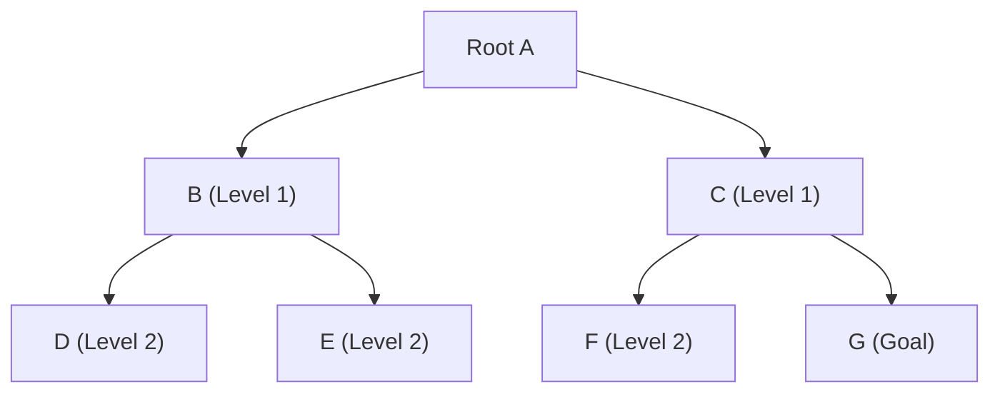

*   **Breadth-First Search (BFS):** Explores the state space level-by-level using a **FIFO Queue**. It evaluates all nodes at depth $d$ before generating nodes at depth $d+1$.  
    *Traversal Order:* $A \to B \to C \to D \to E \to F \to G$
*   **Depth-First Search (DFS):** Explores as deeply as possible along each branch before backtracking, utilizing a **LIFO Stack**.  
    *Traversal Order:* $A \to B \to D \to E \to C \to F \to G$

##### Comparison Matrix

| Feature | Breadth-First Search (BFS) | Depth-First Search (DFS) |
| :--- | :--- | :--- |
| **Frontier Structure** | FIFO Queue | LIFO Stack (or recursion) |
| **Time Complexity** | $O(b^d)$ | $O(b^m)$ *(where $m$ is max depth)* |
| **Space Complexity** | $O(b^d)$ — **Exponential Memory** | $O(bm)$ — **Linear Memory** |
| **Completeness** | **Complete** (if branching factor $b$ is finite) | **Incomplete** in infinite or cyclic graphs |
| **Optimality** | **Optimal** for uniform step costs | **Suboptimal** (returns first path found) |

---

#### 3. Summary of Trade-offs (1.5 Marks)

*   **When to Use BFS:** When the goal is close to the root (shallow depth), finding the shortest path is mandatory, and sufficient RAM is available.
*   **When to Use DFS:** When memory is severely constrained ($O(bm)$ fits in RAM), the state space is finite and acyclic, and many valid solutions exist.

:::tip

**Examiner's Note**

Award 2.5 marks for the role of search in AI, 4 marks for the comparison table with complexities, and 1.5 marks for the illustrative tree traversal example.

:::

---

### Question 22.b (8 Marks)

:::info

**Question Statement**

What is heuristic search? Explain the Generate-and-Test method with an example. **(8 Marks)**

:::

---

### Solution 22.b (8 Marks)

#### 1. Concept of Heuristic Search (3 Marks)

**Heuristic Search (Informed Search)** uses problem-specific knowledge beyond the basic problem definition to find solutions more efficiently than blind search.
*   **The Heuristic Function ($h(n)$):** Estimates the cheapest path cost from candidate node $n$ to an identified goal state:
    $$h(n) \approx h^*(n)$$
*   **Pruning & Guidance:** Guides search algorithms (e.g., $A^*$, Greedy Best-First) toward the goal, pruning unpromising branches and mitigating the combinatorial explosion of states.

---

#### 2. The Generate-and-Test Method (3 Marks)

**Generate-and-Test** is a fundamental AI search paradigm combining systematic candidate generation with goal-test verification:

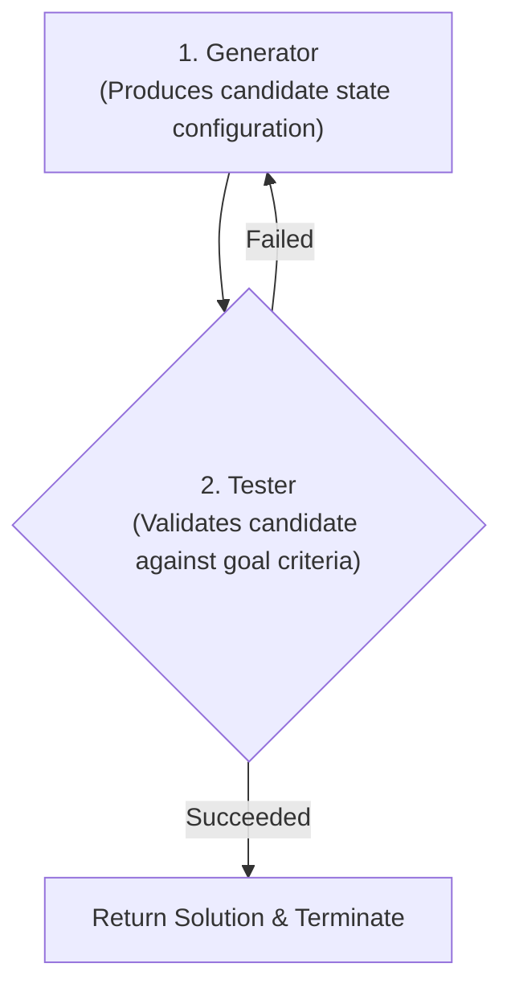

##### Algorithmic Methodology
1. **Generator:** Systematically or heuristically generates potential candidate solution configurations in the state space.
2. **Tester:** Evaluates each candidate against the goal conditions.
3. If the tester succeeds, return the solution; otherwise, repeat with the next candidate.

---

#### 3. Concrete Example: Combination Lock / 4-Queens (2 Marks)

Consider cracking a 3-digit combination lock with digits $\{0 \dots 9\}$:
*   *Generator:* Iteratively generates 3-digit tuples $(0, 0, 0) \to (0, 0, 1) \to \dots \to (9, 9, 9)$.
*   *Tester:* Attempts to rotate the dial and open the lock. If the shackle pops open, goal test succeeds.

##### Enhancing Generate-and-Test with Heuristics
Pure random generate-and-test is brute force ($O(10^3) = 1000$ trials). In complex domains like the 8-Queens puzzle, an **informed generator with backtracking** prunes conflicting queen placements immediately, generating only non-conflicting partial rows rather than testing all $8^8 \approx 16.7 \text{ million}$ complete boards.

:::tip

**Examiner's Note**

Define heuristic search ($h(n)$), draw the Generate-and-Test feedback loop, and provide an example showing how heuristic pruning prevents brute-force combinatorial explosion.

:::

---

### Question 23.a (8 Marks)

:::info

**Question Statement**

Evaluate the performance of adversarial search problems with examples in the competitive environment. **(8 Marks)**

:::

---

### Solution 23.a (8 Marks)

#### 1. The Adversarial Search Framework (2.5 Marks)

In a competitive multi-agent environment (two-player zero-sum deterministic games), an agent's success depends on outmaneuvering an active opponent who seeks to minimize the agent's utility.

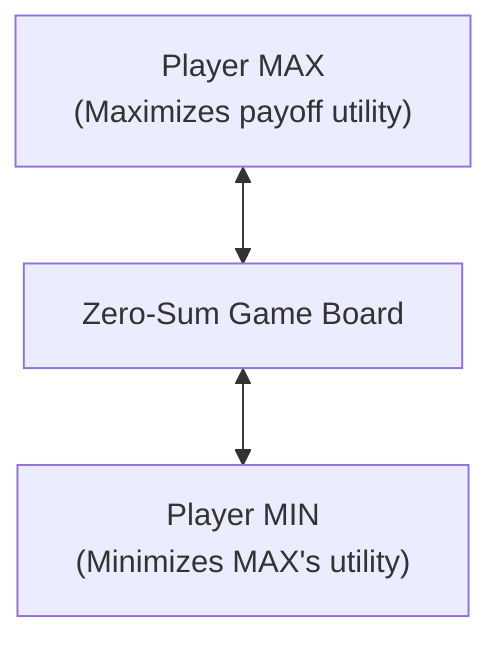

##### Formal Game Formulation
*   $S_0$: Initial board configuration.
*   $\operatorname{Player}(s)$: Identifies whose turn it is to move.
*   $\operatorname{Actions}(s)$: Legal moves available in state $s$.
*   $\operatorname{Terminal}(s)$: True if the game has ended (win, loss, draw).
*   $\operatorname{Utility}(s, p)$: Final payoff score awarded to player $p$ (e.g., $+1$ for win, $-1$ for loss, $0$ for draw).

---

#### 2. Evaluating Minimax and Alpha-Beta Performance (3 Marks)

##### a) Exhaustive Minimax Performance
*   *Time Complexity:* $O(b^d)$, where $b$ is the legal branching factor and $d$ is depth.
*   *Limitation:* For Chess ($b \approx 35, d \approx 80$), evaluating $35^{80} \approx 10^{123}$ nodes is computationally impossible within standard tournament move time limits (e.g., 3 minutes per move).

##### b) Alpha-Beta Pruning Performance Enhancement
By maintaining bounds $[\alpha, \beta]$ during depth-first traversal and cutting off branches where $\alpha \ge \beta$:
*   *Best-Case Time Complexity:* Drops to:
    $$O\left(b^{d/2}\right) = O\left((\sqrt{b})^d\right)$$
*   *Evaluation:* The effective branching factor is halved ($\sqrt{35} \approx 5.9$), allowing game engines to look **twice as deep** within identical clock limits.

---

#### 3. Real-World Competitive Benchmarks (2.5 Marks)

1. **Deep Blue vs. Garry Kasparov (Chess, 1997):**  
   Employed hardware-accelerated Minimax with Alpha-Beta pruning, transposition tables, and quiescence search, evaluating 200 million positions per second to achieve grandmaster victory.
2. **Chinook (Checkers, 1994):**  
   Alpha-Beta search coupled with a precomputed 10-piece endgame tablebase, eventually mathematically solving Checkers as a theoretical draw in 2007.
3. **AlphaGo / AlphaZero (Go & Chess, DeepMind):**  
   Because Go's branching factor ($b \approx 250$) overwhelms Alpha-Beta pruning, AlphaGo replaced heuristic evaluation with deep convolutional neural networks combined with **Monte Carlo Tree Search (MCTS)**.

:::tip

**Examiner's Note**

Award 2.5 marks for the adversarial zero-sum formal model, 3 marks for evaluating Minimax vs. Alpha-Beta complexity ($O(b^d)$ vs $O(b^{d/2})$), and 2.5 marks for citing real-world competitive benchmarks (Deep Blue, Chinook, AlphaZero).

:::

---

### Question 23.b (8 Marks)

:::info

**Question Statement**

Explain Constant Satisfaction Problem (CSP) with search problem of room coloring in AI. **(8 Marks)**

:::

---

### Solution 23.b (8 Marks)

#### 1. Concept of Constraint Satisfaction Problems (CSP) (2.5 Marks)

A **Constraint Satisfaction Problem (CSP)** models problems using factored representations where states are defined by assigning values to variables subject to explicit constraints:

$$\mathcal{P}_{\text{CSP}} = \langle X, D, C \rangle$$

*   **Variables ($X$):** A finite set of variables $\{X_1, X_2, \dots, X_n\}$.
*   **Domains ($D$):** A set of allowable values $\{D_1, D_2, \dots, D_n\}$ for each variable.
*   **Constraints ($C$):** Conditions specifying allowable combinations of variable values.
*   **Goal:** A complete, consistent assignment where every variable is assigned a value without violating any constraint.

---

#### 2. The Room-Coloring Problem Formulation (3 Marks)

Consider coloring four adjacent rooms in a floor plan: $\{R_1, R_2, R_3, R_4\}$ using three colors: $\{\text{Red}, \text{Green}, \text{Blue}\}$. Adjacent rooms sharing an interior doorway or wall cannot have the same color.

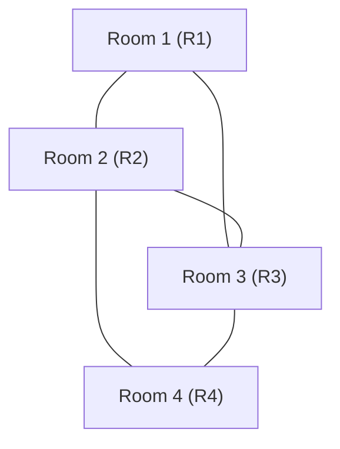

##### a) Variables
$$X = \{R_1, R_2, R_3, R_4\}$$

##### b) Domains
$$D_i = \{\text{Red}, \text{Green}, \text{Blue}\} \quad \forall i \in \{1, 2, 3, 4\}$$

##### c) Binary Constraints
$$
\begin{aligned}
R_1 \neq R_2, \quad R_1 \neq R_3, \quad R_2 \neq R_3, \quad R_2 \neq R_4, \quad R_3 \neq R_4
\end{aligned}
$$

---

#### 3. Solving via Backtracking Search with Forward Checking (2.5 Marks)

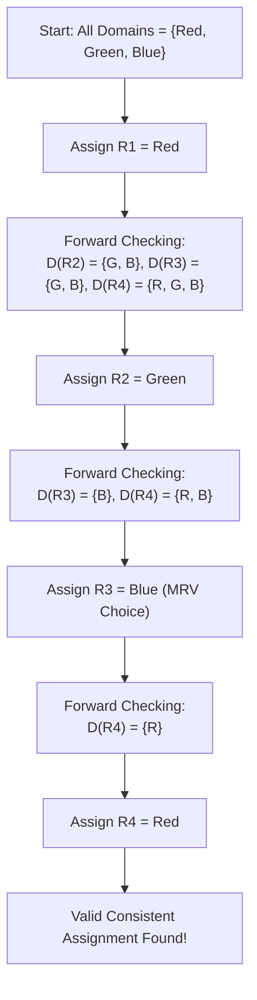

##### Solution Vector
$$\mathbf{R_1 = \text{Red}, \quad R_2 = \text{Green}, \quad R_3 = \text{Blue}, \quad R_4 = \text{Red}}$$

*   **Verification:**
    *   $R_1(\text{Red}) \neq R_2(\text{Green})$: Valid.
    *   $R_1(\text{Red}) \neq R_3(\text{Blue})$: Valid.
    *   $R_2(\text{Green}) \neq R_3(\text{Blue})$: Valid.
    *   $R_2(\text{Green}) \neq R_4(\text{Red})$: Valid.
    *   $R_3(\text{Blue}) \neq R_4(\text{Red})$: Valid.
    *   All constraints satisfied.

:::tip

**Examiner's Note**

Award 2.5 marks for the formal CSP definition $\langle X, D, C \rangle$, 3 marks for formalizing the Room Coloring variables, domains, and inequality constraints, and 2.5 marks for showing the backtracking trace with forward checking.

:::

---

### Question 24.a (8 Marks)

:::info

**Question Statement**

List the five logical connectivity used to construct the complex sentences and give the formal grammar of propositional logic. **(8 Marks)**

:::

---

### Solution 24.a (8 Marks)

#### 1. The Five Logical Connectives (4 Marks)

In Propositional Logic, complex sentences are constructed from atomic propositions using five standard truth-functional connectives:

| Connective Name | Symbolic Notation | Standard Meaning | Truth Functional Definition |
| :--- | :---: | :--- | :--- |
| **Negation** | $\neg$ or $\sim$ | "NOT" | $\neg P$ is $\text{True}$ if and only if $P$ is $\text{False}$. |
| **Conjunction** | $\land$ | "AND" | $P \land Q$ is $\text{True}$ if and only if both $P$ and $Q$ are $\text{True}$. |
| **Disjunction** | $\lor$ | "OR" | $P \lor Q$ is $\text{True}$ if either $P$ is $\text{True}$ or $Q$ is $\text{True}$ (inclusive). |
| **Implication** | $\implies$ or $\to$ | "IF ... THEN" | $P \implies Q$ is $\text{False}$ only when $P$ is $\text{True}$ and $Q$ is $\text{False}$; else $\text{True}$. |
| **Biconditional** | $\iff$ or $\leftrightarrow$ | "IF AND ONLY IF" | $P \iff Q$ is $\text{True}$ if both $P$ and $Q$ share identical truth values. |

##### Master Truth Table

| $P$ | $Q$ | $\neg P$ | $P \land Q$ | $P \lor Q$ | $P \implies Q$ | $P \iff Q$ |
| :---: | :---: | :---: | :---: | :---: | :---: | :---: |
| **T** | **T** | F | **T** | **T** | **T** | **T** |
| **T** | **F** | F | F | **T** | F | F |
| **F** | **T** | T | F | **T** | **T** | F |
| **F** | **F** | T | F | F | **T** | **T** |

---

#### 2. Formal BNF Grammar of Propositional Logic (4 Marks)

The formal syntax of Propositional Logic in Backus-Naur Form (BNF) is defined as:

```text
Sentence         ::= AtomicSentence | ComplexSentence

AtomicSentence   ::= True | False | PropositionSymbol

PropositionSymbol::= P | Q | R | S | P1 | P2 | ...

ComplexSentence  ::= ( Sentence )
                   | ¬ Sentence
                   | Sentence ∧ Sentence
                   | Sentence ∨ Sentence
                   | Sentence ⇒ Sentence
                   | Sentence ⇔ Sentence
```

##### Operator Precedence (Highest to Lowest)
1. $\neg$ (Negation)
2. $\land$ (Conjunction)
3. $\lor$ (Disjunction)
4. $\implies$ (Implication)
5. $\iff$ (Biconditional)

:::tip

**Examiner's Note**

Award 4 marks for defining all 5 connectives with their truth conditions and 4 marks for the complete Backus-Naur Form (BNF) formal grammar.

:::

---

### Question 24.b (8 Marks)

:::info

**Question Statement**

Summarize the various rules used in knowledge representation, With suitable examples. **(8 Marks)**

:::

---

### Solution 24.b (8 Marks)

In Knowledge Representation and automated reasoning, inference rules derive new true assertions from existing knowledge base premises:

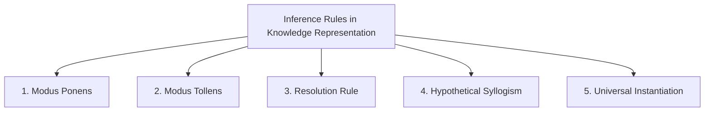

#### 1. Fundamental Propositional Inference Rules (4 Marks)

1. **Modus Ponens (Affirming the Antecedent):**
   $$\frac{\alpha, \quad \alpha \implies \beta}{\beta}$$
   *Example:* If it is raining, the street is wet ($\text{Rain} \implies \text{Wet}$). It is raining ($\text{Rain}$). Therefore, the street is wet ($\text{Wet}$).

2. **Modus Tollens (Denying the Consequent):**
   $$\frac{\neg \beta, \quad \alpha \implies \beta}{\neg \alpha}$$
   *Example:* $\text{Rain} \implies \text{Wet}$. The street is not wet ($\neg \text{Wet}$). Therefore, it is not raining ($\neg \text{Rain}$).

3. **Hypothetical Syllogism (Transitivity of Implication):**
   $$\frac{\alpha \implies \beta, \quad \beta \implies \gamma}{\alpha \implies \gamma}$$
   *Example:* If a student studies, they pass ($\text{Study} \implies \text{Pass}$). If they pass, they graduate ($\text{Pass} \implies \text{Graduate}$). Therefore, studying leads to graduation ($\text{Study} \implies \text{Graduate}$).

4. **Resolution Rule (Foundation of Theorem Provers):**
   $$\frac{\alpha \lor \beta, \quad \neg \beta \lor \gamma}{\alpha \lor \gamma}$$
   *Example:* $(P \lor Q) \land (\neg Q \lor R) \vdash (P \lor R)$.

---

#### 2. First-Order Quantifier Inference Rules (4 Marks)

1. **Universal Instantiation (UI):**  
   Substitute any ground term $c$ for universally quantified variable $v$:
   $$\frac{\forall v \; P(v)}{\operatorname{SUBST}(\{v / c\}, P(v))}$$
   *Example:* $\forall x \; (\operatorname{Human}(x) \implies \operatorname{Mortal}(x))$. Substituting $x / \text{Socrates}$ yields $\operatorname{Human}(\text{Socrates}) \implies \operatorname{Mortal}(\text{Socrates})$.

2. **Existential Instantiation (Skolemization):**  
   Replace existentially quantified variable $v$ with a new unique Skolem constant $k$:
   $$\frac{\exists v \; P(v)}{\operatorname{SUBST}(\{v / k\}, P(v))}$$
   *Example:* $\exists x \; \operatorname{Crown}(x) \vdash \operatorname{Crown}(C_1)$ where $C_1$ is a fresh symbol.

:::tip

**Examiner's Note**

Detail at least four distinct inference rules (Modus Ponens, Modus Tollens, Resolution, Universal Instantiation) showing both the formal mathematical fractional notation and a concrete domain example.

:::

---

### Question 25.a (8 Marks)

:::info

**Question Statement**

Differentiate between adaptive and ensemble learning. Analyze the need of knowledge engineering, knowledge base and inference engine in expert system **(8 Marks)**

:::

---

### Solution 25.a (8 Marks)

#### 1. Differentiating Adaptive vs. Ensemble Learning (4 Marks)

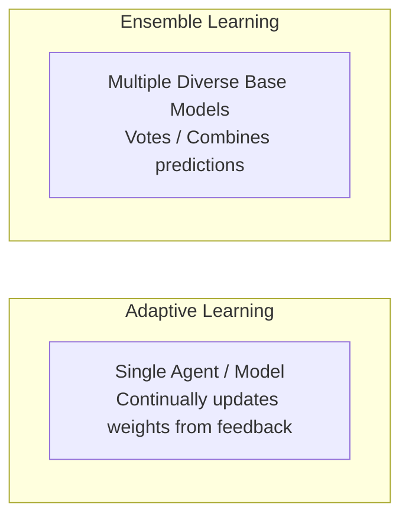

| Dimension | Adaptive Learning | Ensemble Learning |
| :--- | :--- | :--- |
| **Core Concept** | A single model dynamically modifies its internal parameters in response to real-time non-stationary feedback. | Combines predictions from multiple distinct base models to improve overall generalization. |
| **Primary Mechanism** | Online gradient descent, Reinforcement Learning, policy updating. | Bagging (Bootstrap Aggregation), Boosting (sequential error weighting), Stacking. |
| **Target Challenge** | Concept drift, non-stationary dynamic environments. | High variance (overfitting) and high bias. |
| **Key Models** | Q-Learning, Adaptive Filter (LMS), Online SGD. | Random Forest, AdaBoost, XGBoost, Stacking Classifiers. |

---

#### 2. The Need for Knowledge Engineering, KB, and Inference Engine (4 Marks)

Expert systems decouple domain knowledge from reasoning algorithms:

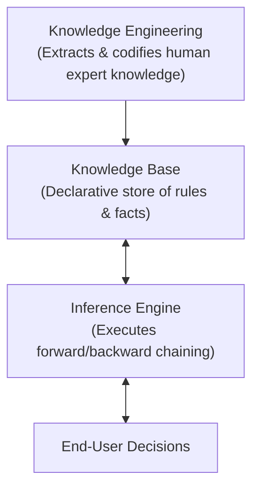

1. **Need for Knowledge Engineering:**  
   Domain experts rarely think in formal propositional logic. Knowledge engineers interview human specialists to formalize unstructured heuristics and domain rules into executable production rules, resolving ambiguities.
2. **Need for a Knowledge Base (KB):**  
   Provides a centralized, modular declarative store of domain rules. Decoupling knowledge from software code allows domain experts to add or edit medical rules without altering the underlying reasoning code.
3. **Need for an Inference Engine:**  
   Serves as the reusable reasoning core. It handles pattern matching, conflict resolution, and rule execution independently of domain content. This gave rise to generic **Expert System Shells** (such as EMYCIN), where swapping the knowledge base adapts the software to an entirely new domain.

:::tip

**Examiner's Note**

Award 4 marks for contrasting Adaptive and Ensemble learning in a table, and 4 marks for explaining the functional necessity of Knowledge Engineering, the Knowledge Base, and the Inference Engine.

:::

---

### Question 25.b (8 Marks)

:::info

**Question Statement**

Explain in detail about STRIPS and write the components of STRIPS for the given scenario: “Consider a flight journey in a luxurious flight from India to US” **(8 Marks)**

:::

---

### Solution 25.b (8 Marks)

#### 1. Concept of STRIPS in Automated Planning (3 Marks)

**STRIPS** (Stanford Research Institute Problem Solver) is a formal language for representing automated planning problems using factored logic. An action schema consists of:
1. **Action Name & Arguments:** The parameterized operator signature.
2. **Precondition List:** Conjunction of positive function-free literals that must hold true in the active state for the action to be legally applied.
3. **Effect List (Add and Delete Lists):**
   *   **Add List:** Literals that become $\text{True}$ upon action completion.
   *   **Delete List:** Literals that become $\text{False}$ upon action completion.

---

#### 2. STRIPS Formalization: Luxury Flight from India to US (5 Marks)

##### a) Initial and Goal States
*   **Initial State ($S_0$):**
    $$\operatorname{At}(\text{Passenger}, \text{India}) \land \operatorname{At}(\text{Luggage}, \text{India}) \land \operatorname{At}(\text{Flight}, \text{India}) \land \operatorname{FirstClassTicket}(\text{Passenger}) \land \operatorname{RunwayClear}(\text{India})$$
*   **Goal State ($S_G$):**
    $$\operatorname{At}(\text{Passenger}, \text{US}) \land \operatorname{At}(\text{Luggage}, \text{US})$$

##### b) Action Schemas

```text
Action: CheckInLuggage(p, luggage, airport)
  PRECOND: At(p, airport) AND At(luggage, airport) AND FirstClassTicket(p)
  ADD:     LuggageChecked(luggage, airport)
  DELETE:  At(luggage, airport)

Action: BoardLuxuryFlight(p, flight, airport)
  PRECOND: At(p, airport) AND At(flight, airport) AND FirstClassTicket(p)
  ADD:     InFlight(p, flight)
  DELETE:  At(p, airport)

Action: Fly(flight, from, to)
  PRECOND: At(flight, from) AND RunwayClear(from) AND RunwayClear(to)
  ADD:     At(flight, to) AND RunwayClear(from)
  DELETE:  At(flight, from)

Action: Disembark(p, flight, airport)
  PRECOND: InFlight(p, flight) AND At(flight, airport)
  ADD:     At(p, airport)
  DELETE:  InFlight(p, flight)

Action: ClaimLuggage(p, luggage, airport)
  PRECOND: At(p, airport) AND LuggageChecked(luggage, airport)
  ADD:     At(luggage, airport)
  DELETE:  LuggageChecked(luggage, airport)
```


:::tip

**Examiner's Note**

Award 3 marks for defining the STRIPS architecture (Preconditions, Add Lists, Delete Lists) and 5 marks for formalizing the flight journey operators (`CheckInLuggage`, `Board`, `Fly`, `Disembark`, `ClaimLuggage`).

:::

---

## Part C: Comprehensive Search Problems (15 Marks)

### Question 26 (15 Marks)

:::info

**Question Statement**

Explain the Tic-Tac-Toe problem and the Missionaries and Cannibals problem using state-space representation. **(15 Marks)**

:::

---

### Solution 26 (15 Marks)

#### 1. Tic-Tac-Toe State-Space Formulation (7.5 Marks)

$3 \times 3$ Tic-Tac-Toe is a two-player, zero-sum, perfect-information deterministic board game.

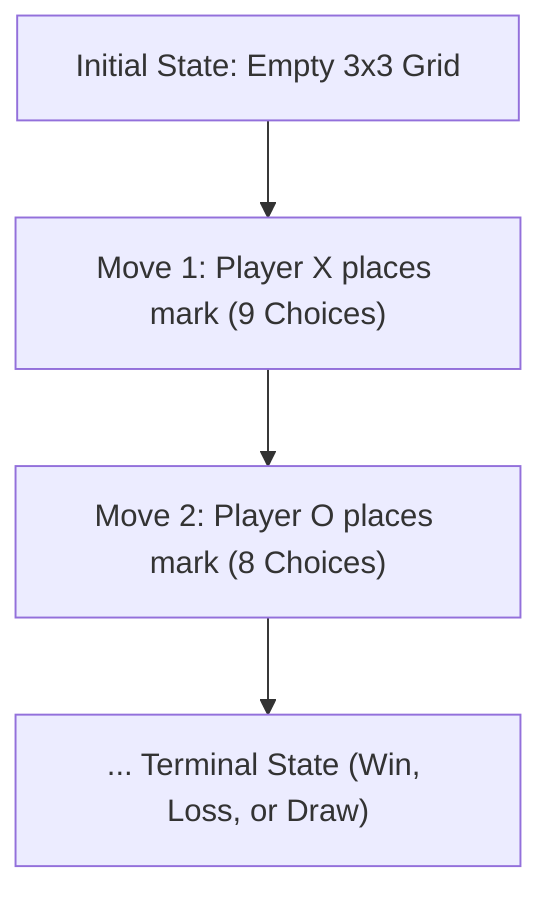

##### a) Formal State-Space Elements
1. **State Representation ($S$):**  
   A $3 \times 3$ matrix $s \in \{X, O, \text{blank}\}^9$.
2. **Initial State ($s_0$):**  
   An empty $3 \times 3$ grid:
   $$s_0 = \begin{bmatrix} \text{blank} & \text{blank} & \text{blank} \\ \text{blank} & \text{blank} & \text{blank} \\ \text{blank} & \text{blank} & \text{blank} \end{bmatrix}$$
3. **Set of Actions ($A(s)$):**  
   Placing the current player's mark ($X$ or $O$) in any empty coordinate $(r, c)$ where $s[r, c] == \text{blank}$.
4. **Transition Model ($T(s, a)$):**  
   Updates cell $(r, c)$ with the active player's mark and alternates the active player turn.
5. **Terminal / Goal Test ($G(s)$):**  
   A state is terminal if:
   *   Three matching marks line up along any row, column, or diagonal.
   *   All 9 cells are occupied with no winner (Draw).
6. **Utility Function:**  
   $$\operatorname{Utility}(s) = \begin{cases} +1 & \text{if } X \text{ wins} \\ -1 & \text{if } O \text{ wins} \\ 0 & \text{if Draw} \end{cases}$$

##### b) Search Space Complexity
*   **Theoretical Upper Bound:** $3^9 = 19,683$ board configurations.
*   **Total Game Tree Leaves:** $9! = 362,880$.
*   **Symmetry Reduction:** Accounting for rotations and reflections reduces the reachable state space to **765 unique non-isomorphic states**.

---

#### 2. Missionaries and Cannibals State-Space Formulation (7.5 Marks)

Three missionaries ($M$) and three cannibals ($C$) must cross a river using a two-person boat without ever leaving missionaries outnumbered by cannibals on either bank.

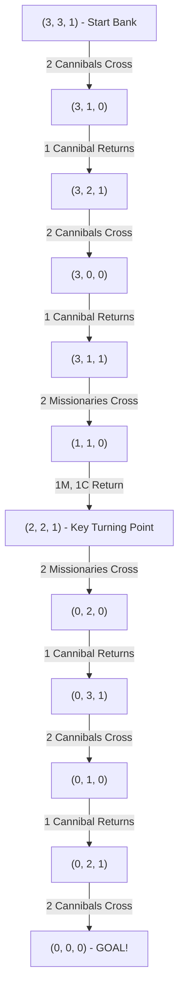

##### a) Formal State-Space Elements
1. **State Tuple:**  
   $$s = (M, C, B)$$
   where $M \in \{0, 1, 2, 3\}$, $C \in \{0, 1, 2, 3\}$, and $B \in \{1, 0\}$ ($1$ = Left Bank; $0$ = Right Bank).
2. **Initial and Goal States:**  
   $$s_0 = (3, 3, 1), \quad s_G = (0, 0, 0)$$
3. **Safety Invariant Constraint:**  
   $$\operatorname{Safe}(M, C) \iff (M == 0 \lor M \ge C) \;\land\; ((3-M) == 0 \lor (3-M) \ge (3-C))$$
4. **Action Set:**  
   $$\mathcal{O} = \{ (1, 0), (2, 0), (0, 1), (0, 2), (1, 1) \}$$
5. **Path Cost:** Uniform cost $c = 1$ per crossing.

##### b) Optimal Solution Trajectory (11 Crossings)
The optimal path requires exactly **11 river crossings**, crucially featuring the counter-intuitive return move at Trip 6 ($(1, 1, 0) \to (2, 2, 1)$) where one missionary and one cannibal return together to avoid violating the safety constraint on either bank.

:::tip

**Examiner's Note**

Award 7.5 marks for Tic-Tac-Toe (state matrix, Minimax utility, game tree complexity $9!$ vs. 765 isomorphic states), and 7.5 marks for Missionaries & Cannibals (3-tuple state, safety constraint, 11-step optimal solution).

:::

---

### Question 27 (15 Marks)

:::info

**Question Statement**

Design an expert system for travel recommendation and discuss its roles. Evaluate in detail about MYCIN Expert systems and its functions. **(15 Marks)**

:::

---

### Solution 27 (15 Marks)

#### 1. Design of a Travel Recommendation Expert System (7.5 Marks)

A Travel Recommendation Expert System assists tourists in choosing vacation destinations, itineraries, and accommodations tailored to individual preferences, budgets, and constraints.

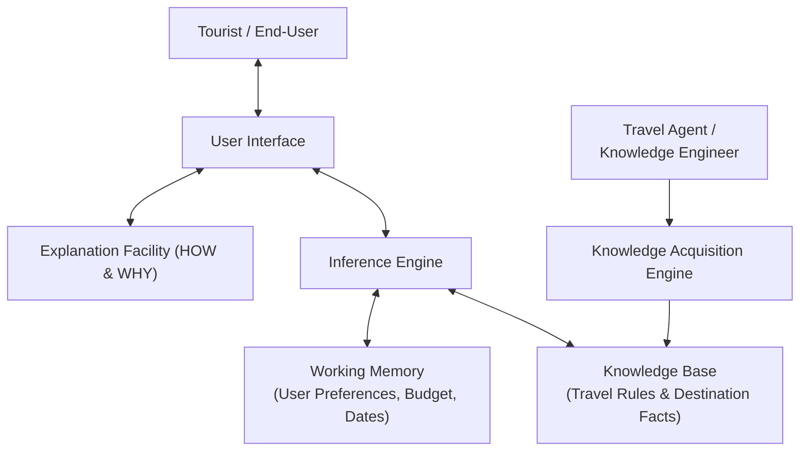

##### a) Knowledge Base Representation (Sample Production Rules)
*   **Rule 1 (Budget & Climate):**
    $$\text{IF } (\text{Budget} == \text{Luxury}) \land (\text{Climate} == \text{Tropical}) \land (\text{TravelType} == \text{Relaxation}) \implies \text{Recommend}(\text{Maldives})$$
*   **Rule 2 (Adventure & Budget):**
    $$\text{IF } (\text{Budget} == \text{Economy}) \land (\text{Interest} == \text{Trekking}) \land (\text{Continent} == \text{Asia}) \implies \text{Recommend}(\text{Nepal})$$
*   **Rule 3 (Family Cultural Travel):**
    $$\text{IF } (\text{Party} == \text{FamilyWithKids}) \land (\text{Interest} == \text{ThemeParks}) \implies \text{Recommend}(\text{Orlando, Florida})$$

##### b) System Modules & Roles
1. **User Interface:** Collects tourist constraints (vacation duration, budget range, preferred activities, visa restrictions).
2. **Working Memory:** Holds the active tourist profile during the session.
3. **Inference Engine:** Employs **Forward Chaining** to filter candidate destinations based on hard budget/season constraints, followed by **Backward Chaining** to test whether a candidate city satisfies travel preferences.
4. **Explanation Facility:** Provides transparent reasoning (e.g., *"Recommending Switzerland because your preference is Alpine skiing and your budget accommodates European travel in December"*).

---

#### 2. Comprehensive Evaluation of the MYCIN Expert System (7.5 Marks)

Developed at Stanford University in the 1970s by Edward Shortliffe, **MYCIN** was a pioneering rule-based clinical decision support system designed to diagnose infectious blood diseases (specifically bacteremia and meningitis) and prescribe appropriate antimicrobial drug therapies.


##### a) Core Working Mechanisms and Functions
1. **Goal-Directed Backward Chaining:**  
   MYCIN operates backward from the clinical goal $\operatorname{PrescribeAntimicrobialTherapy}(p)$ by evaluating whether specific bacterial organisms (e.g., *Pseudomonas*, *Streptococcus*) are present in patient blood cultures.
2. **Handling Medical Uncertainty via Certainty Factors (CF):**  
   Medical evidence is rarely binary. MYCIN introduced **Certainty Factors** ($CF \in [-1.0, +1.0]$):
   $$CF(h, e) = MB(h, e) - MD(h, e)$$
   where $MB$ is the Measure of Increased Belief and $MD$ is the Measure of Increased Disbelief.
   *   $CF = +1.0$: Absolute proof of hypothesis $h$.
   *   $CF = -1.0$: Absolute refutation of hypothesis $h$.
   *   $CF = 0.0$: Complete lack of evidence.
3. **Explanation Facilities (`HOW` and `WHY`):**  
   MYCIN pioneered automated clinical explanation:
   *   *WHY:* Explains why the system asks for a specific lab reading by displaying the medical rule currently being verified.
   *   *HOW:* Traces the chain of fired rules that produced a therapeutic drug recommendation.

##### b) Evaluation and Historical Impact
*   **Clinical Performance:** In blinded evaluations conducted by independent medical panels, MYCIN's therapeutic recommendations matched or outperformed senior faculty infectious-disease specialists (~65% prescription correctness), outperforming human resident doctors.
*   **Historical Legacy (EMYCIN):** Proved the viability of symbolic AI in medicine and demonstrated that the inference engine could be decoupled from medical rules, creating **EMYCIN** ("Empty MYCIN")—the world's first commercial expert system shell.

:::tip

**Examiner's Note**

Award 7.5 marks for the travel recommendation expert system design (block diagram, production rules, component roles), and 7.5 marks for evaluating MYCIN (domain, backward chaining, Certainty Factors $CF = MB - MD$, `HOW`/`WHY` explanation facilities, and EMYCIN legacy).

:::
