# May 2023

> **Exam -** Semester Examination  
> **Session -** May 2023  

---

## Part A: Objective Type Questions (20 Marks)

### Question 1 (1 Mark)

:::info

**Question Statement**

If a problem does not yield a particular answer, then it is called as **(1 Mark)**

*   **(A)** Cross-domain problem
*   **(B)** Independent problem
*   **(C)** Well-structured problem
*   **(D)** Ill-structured problem

:::

*   **Correct Answer:** **(D) Ill-structured problem**
*   **Explanation:** In problem-solving theory, an ill-structured problem is one that lacks a clear, definitive formulation, lacks a deterministic algorithmic path to a unique answer, and has ambiguous or subjective evaluation criteria.

---

### Question 2 (1 Mark)

:::info

**Question Statement**

The field that investigates the mechanics of human intelligence is **(1 Mark)**

*   **(A)** History
*   **(B)** Cognitive science
*   **(C)** Psychology
*   **(D)** Sociology

:::

*   **Correct Answer:** **(B) Cognitive science**
*   **Explanation:** Cognitive science is the interdisciplinary study of mind, intelligence, and cognitive processes, synthesizing computational AI models with cognitive psychology, linguistics, and neuroscience.

---

### Question 3 (1 Mark)

:::info

**Question Statement**

A state space form (or map) in which, the nodes are _______ and the arcs between nodes are _______. **(1 Mark)**

*   **(A)** States, actions
*   **(B)** Actions, states
*   **(C)** Path, method
*   **(D)** Method, path

:::

*   **Correct Answer:** **(A) States, actions**
*   **Explanation:** In state space graph representations, nodes correspond to discrete state configurations, while directed arcs represent the transitions or actions that transform one state into another.

---

### Question 4 (1 Mark)

:::info

**Question Statement**

What kind of environment is crossword puzzle? **(1 Mark)**

*   **(A)** Static
*   **(B)** Dynamic
*   **(C)** Semi-dynamic
*   **(D)** Stochastic

:::

*   **Correct Answer:** **(A) Static**
*   **Explanation:** A crossword puzzle environment does not change while the agent takes time to deliberate over a move; therefore, it is static.

---

### Question 5 (1 Mark)

:::info

**Question Statement**

If any search algorithm is able to generate a solution, then the search is called _______. **(1 Mark)**

*   **(A)** Efficient
*   **(B)** Informed
*   **(C)** Uninformed
*   **(D)** Complete

:::

*   **Correct Answer:** **(D) Complete**
*   **Explanation:** A search algorithm is defined as complete if it is mathematically guaranteed to find a solution whenever at least one valid solution exists in the search space.

---

### Question 6 (1 Mark)

:::info

**Question Statement**

In a search technique a node/state is marked to be visited when **(1 Mark)**

*   **(A)** It is pruned
*   **(B)** Its successors are traversed
*   **(C)** It is explained
*   **(D)** The successors are traversed and explained

:::

*   **Correct Answer:** **(B) Its successors are traversed**
*   **Explanation:** In graph-search algorithms, a node is marked visited (and moved to the `CLOSED` set) once it has been expanded and its legal child successors have been generated.

---

### Question 7 (1 Mark)

:::info

**Question Statement**

Your friend is in a building that has 15 floors. And you want to locate him. Which search technique would you use? **(1 Mark)**

*   **(A)** Depth limited search
*   **(B)** Iterative deepening search
*   **(C)** Depth-first search
*   **(D)** Breadth first search

:::

*   **Correct Answer:** **(A) Depth limited search**
*   **Explanation:** When the maximum depth of the search space is known in advance (the building has exactly 15 floors), Depth-Limited Search (DLS) with limit $L = 15$ prevents infinite recursion while maintaining linear space efficiency $O(bL)$.

---

### Question 8 (1 Mark)

:::info

**Question Statement**

Which of the following search technique uses a priority queue? **(1 Mark)**

*   **(A)** Breadth first search
*   **(B)** Depth first search
*   **(C)** Iterative deepening search
*   **(D)** Best first search

:::

*   **Correct Answer:** **(D) Best first search**
*   **Explanation:** Best-First Search algorithms (such as Greedy Best-First Search, Uniform Cost Search, and $A^*$) manage their frontier using a priority queue ordered by an evaluation function $f(n)$.

---

### Question 9 (1 Mark)

:::info

**Question Statement**

Which of the following algorithm has maximum branching factor? **(1 Mark)**

*   **(A)** Breadth First Search
*   **(B)** Depth First Search
*   **(C)** Best First Search
*   **(D)** Iterative Deepening Search

:::

*   **Correct Answer:** **(A) Breadth First Search**
*   **Explanation:** Breadth-First Search systematically retains all generated successor branches at every level simultaneously in its frontier queue, resulting in an effective branching factor footprint that consumes $O(b^d)$ nodes in memory.

---

### Question 10 (1 Mark)

:::info

**Question Statement**

Which of the following is optimal and complete? **(1 Mark)**

*   **(A)** A*
*   **(B)** Depth-first search
*   **(C)** Depth-limited search
*   **(D)** Greedy search

:::

*   **Correct Answer:** **(A) A\***
*   **Explanation:** The $A^*$ algorithm is mathematically proven to be both complete and optimal when the heuristic function $h(n)$ is admissible (for tree search) and consistent (for graph search).

---

### Question 11 (1 Mark)

:::info

**Question Statement**

An adversarial search method uses: **(1 Mark)**

*   **(A)** Alpha-beta search
*   **(B)** Heuristic search
*   **(C)** Best first search
*   **(D)** Uniform cost search

:::

*   **Correct Answer:** **(A) Alpha-beta search**
*   **Explanation:** Alpha-Beta pruning is an adversarial search algorithm designed specifically for two-player competitive games where players have opposing utility objectives.

---

### Question 12 (1 Mark)

:::info

**Question Statement**

Game playing can be modeled as _______. **(1 Mark)**

*   **(A)** General search problem
*   **(B)** Constraint satisfaction problem
*   **(C)** Adversarial search problem
*   **(D)** Neural network model

:::

*   **Correct Answer:** **(C) Adversarial search problem**
*   **Explanation:** Classical board games (such as Chess, Checkers, and Go) are modeled as adversarial search problems because an opponent's choices actively attempt to minimize the agent's performance.

---

### Question 13 (1 Mark)

:::info

**Question Statement**

The primary advantage of Alpha-Beta pruning is: **(1 Mark)**

*   **(A)** It guarantees finding the optimal path
*   **(B)** It reduces the number of evaluated nodes
*   **(C)** It works on cyclic graphs
*   **(D)** It requires no evaluation function

:::

*   **Correct Answer:** **(B) It reduces the number of evaluated nodes**
*   **Explanation:** Alpha-Beta pruning eliminates subtrees that cannot influence the final decision at the root, reducing the effective branching factor to $O(b^{d/2})$ and evaluating far fewer nodes.

---

### Question 14 (1 Mark)

:::info

**Question Statement**

A Constraint Satisfaction Problem consists of: **(1 Mark)**

*   **(A)** Variables, domains, and constraints
*   **(B)** Nodes, edges, and heuristics
*   **(C)** Rules, facts, and inference engines
*   **(D)** Data, features, and labels

:::

*   **Correct Answer:** **(A) Variables, domains, and constraints**
*   **Explanation:** A CSP is formally defined as a triple $\mathcal{P} = \langle X, D, C \rangle$ consisting of a set of Variables $X$, a set of Domains $D$, and a set of Constraints $C$.

---

### Question 15 (1 Mark)

:::info

**Question Statement**

Which of the following is an example of an atomic sentence in First-Order Logic? **(1 Mark)**

*   **(A)** King(John)
*   **(B)** King(John) ∧ Greedy(John)
*   **(C)** ∀x King(x) ⇒ Greedy(x)
*   **(D)** ¬King(John)

:::

*   **Correct Answer:** **(A) King(John)**
*   **Explanation:** An atomic sentence in First-Order Logic consists of a predicate symbol applied to a tuple of terms without logical connectives or quantifiers.

---

### Question 16 (1 Mark)

:::info

**Question Statement**

What is the process of eliminating existential quantifiers called? **(1 Mark)**

*   **(A)** Unification
*   **(B)** Skolemization
*   **(C)** Resolution
*   **(D)** Normalization

:::

*   **Correct Answer:** **(B) Skolemization**
*   **Explanation:** Skolemization is the conversion process in First-Order Logic that eliminates existential quantifiers ($\exists$) by replacing existentially quantified variables with Skolem constants or Skolem functions.

---

### Question 17 (1 Mark)

:::info

**Question Statement**

Which of the following is a drawback of rule-based expert systems? **(1 Mark)**

*   **(A)** Transparency
*   **(B)** Modularity
*   **(C)** Knowledge acquisition bottleneck
*   **(D)** Explanation facility

:::

*   **Correct Answer:** **(C) Knowledge acquisition bottleneck**
*   **Explanation:** The knowledge acquisition bottleneck refers to the significant difficulty, manual effort, and potential for inconsistency involved in extracting domain knowledge from human experts and formalizing it into symbolic IF-THEN rules.

---

### Question 18 (1 Mark)

:::info

**Question Statement**

Which component of an Expert System interacts with the user to accept queries and output explanations? **(1 Mark)**

*   **(A)** Working Memory
*   **(B)** Knowledge Base
*   **(C)** User Interface
*   **(D)** Inference Engine

:::

*   **Correct Answer:** **(C) User Interface**
*   **Explanation:** The User Interface serves as the communication gateway, collecting case facts from the user and displaying recommendations along with audit explanations.

---

### Question 19 (1 Mark)

:::info

**Question Statement**

In machine learning, grouping customers based on their purchase history without pre-assigned labels is: **(1 Mark)**

*   **(A)** Supervised learning
*   **(B)** Unsupervised learning
*   **(C)** Reinforcement learning
*   **(D)** Semi-supervised learning

:::

*   **Correct Answer:** **(B) Unsupervised learning**
*   **Explanation:** Discovering latent natural clusters or patterns within unlabeled data vectors without external target labels is the definition of unsupervised clustering.

---

### Question 20 (1 Mark)

:::info

**Question Statement**

In the Wumpus World, what happens if an agent enters a square containing a Pit? **(1 Mark)**

*   **(A)** It finds gold
*   **(B)** It kills the Wumpus
*   **(C)** It falls into the pit and dies
*   **(D)** It gets a positive reward

:::

*   **Correct Answer:** **(C) It falls into the pit and dies**
*   **Explanation:** Pits are terminal hazard squares in the Wumpus World; entering a pit results in the agent's death and a severe utility penalty of $-1000$.

---

## Part B: Analytical & Descriptive Questions (40 Marks)

### Question 21.a (8 Marks)

:::info

**Question Statement**

Formulate the 8-puzzle problem as an AI state-space search problem. Specify the states, initial state, actions, transition model, goal test, and path cost. **(8 Marks)**

:::

---

### Solution 21.a (8 Marks)

#### 1. Formal 6-Tuple State-Space Formulation (4 Marks)

The 8-puzzle consists of a $3 \times 3$ grid containing 8 numbered tiles $\{1, 2, \dots, 8\}$ and one blank space `[ ]`. It is formally modeled as:

$$\mathcal{P} = \langle S, s_0, A, T, G, c \rangle$$

##### a) State Representation ($S$)
A state is any arrangement of the 8 numbered tiles and the blank space in a $3 \times 3$ matrix:
$$s = \begin{bmatrix} t_{0,0} & t_{0,1} & t_{0,2} \\ t_{1,0} & t_{1,1} & t_{1,2} \\ t_{2,0} & t_{2,1} & t_{2,2} \end{bmatrix} \quad \text{where } t_{i,j} \in \{1, 2, \dots, 8, \text{blank}\}$$
*   **Total State Configurations:** $9! = 362,880$.
*   **Reachable State Space:** Half of the permutation universe is reachable due to parity invariants:
    $$\lvert S_{\text{reachable}} \rvert = \frac{9!}{2} = 181,440 \text{ states}$$

##### b) Initial State ($s_0$)
An arbitrary designated starting configuration, e.g.:
$$s_0 = \begin{bmatrix} 2 & 8 & 3 \\ 1 & 6 & 4 \\ 7 & \text{blank} & 5 \end{bmatrix}$$

##### c) Set of Actions ($A$)
Actions describe the movement of the blank space into an adjacent cell:
$$A = \{\operatorname{MoveUp}, \operatorname{MoveDown}, \operatorname{MoveLeft}, \operatorname{MoveRight}\}$$

##### d) Transition Model ($T$ / $\operatorname{Result}(s, a)$)
If the blank space is currently at row $r$ and column $c$:
*   $\operatorname{MoveLeft}$: Valid if $c > 0$; swaps blank at $(r, c)$ with tile at $(r, c-1)$.
*   $\operatorname{MoveRight}$: Valid if $c < 2$; swaps blank at $(r, c)$ with tile at $(r, c+1)$.
*   $\operatorname{MoveUp}$: Valid if $r > 0$; swaps blank at $(r, c)$ with tile at $(r-1, c)$.
*   $\operatorname{MoveDown}$: Valid if $r < 2$; swaps blank at $(r, c)$ with tile at $(r+1, c)$.

##### e) Goal Test ($G(s)$)
A Boolean predicate checking if the current tile configuration matches the goal arrangement:
$$s_G = \begin{bmatrix} 1 & 2 & 3 \\ 8 & \text{blank} & 4 \\ 7 & 6 & 5 \end{bmatrix} \quad \text{or} \quad \begin{bmatrix} 1 & 2 & 3 \\ 4 & 5 & 6 \\ 7 & 8 & \text{blank} \end{bmatrix}$$

##### f) Path Cost Function ($c$)
Each legal slide of a tile has a uniform cost of $1$:
$$c(s, a, s') = 1$$
The total path cost is the total number of moves in the solution sequence.

---

#### 2. State Transition Diagram (4 Marks)

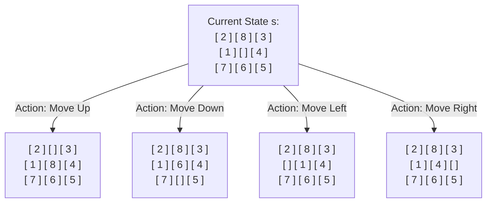

:::tip

**Examiner's Note**

Award full marks for explicitly stating the 6-tuple $\langle S, s_0, A, T, G, c \rangle$, defining blank-tile movements with boundary constraints, and stating that exactly $9!/2 = 181,440$ states are reachable.

:::

---

### Question 21.b (8 Marks)

:::info

**Question Statement**

Describe the various environment types in Artificial Intelligence with suitable examples. **(8 Marks)**

:::

---

### Solution 21.b (8 Marks)

In artificial intelligence agent design (Russell & Norvig framework), the **task environment** dictates the agent's complexity across six core dimensions:

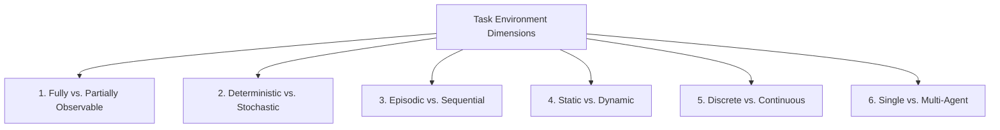

#### 1. Environmental Dimensions (6 Marks)

1. **Fully Observable vs. Partially Observable:**
   *   *Fully Observable:* Sensors provide complete, accurate access to the entire state of the environment at each time step (e.g., **Chess**, **Crossword Puzzles**).
   *   *Partially Observable:* Sensors suffer from noise, occlusions, or range limits (e.g., **Automated Taxi**, **Poker**, **Medical Diagnosis**).
2. **Deterministic vs. Stochastic:**
   *   *Deterministic:* The next state is completely determined by the current state and the agent's action (e.g., **Tic-Tac-Toe**, **Vacuum World**).
   *   *Stochastic:* Outcomes involve probabilistic uncertainty or external random factors (e.g., **Backgammon** due to dice rolls, **Self-Driving Cars**).
3. **Episodic vs. Sequential:**
   *   *Episodic:* The agent's experience is divided into independent atomic episodes; current decisions do not affect future episodes (e.g., **Part Defect Image Classification**).
   *   *Sequential:* Current decisions have long-term consequences on future states and rewards (e.g., **Chess**, **Robot Navigation**).
4. **Static vs. Dynamic:**
   *   *Static:* The environment does not change while the agent deliberates its next action (e.g., **Crossword Puzzle**, **Sudoku**).
   *   *Dynamic:* The environment continuously evolves while the agent thinks (e.g., **Self-Driving Car**, **Air Traffic Control**).
5. **Discrete vs. Continuous:**
   *   *Discrete:* Finite, distinctly defined states, actions, and time steps (e.g., **Chess**, **8-Puzzle**).
   *   *Continuous:* Continuous physical quantities like speed, coordinates, and real-time streaming sensor telemetry (e.g., **Robot Arm Control**, **Autonomous Vehicles**).
6. **Single-Agent vs. Multi-Agent:**
   *   *Single-Agent:* An agent acts alone in the world (e.g., **Crossword Solver**).
   *   *Multi-Agent:* The environment contains other agents that may be **competitive** (e.g., **Chess**) or **cooperative** (e.g., **Warehouse Swarm Logistics**).

---

#### 2. Cross-Domain Comparison Matrix (2 Marks)

| Task Environment | Observable? | Deterministic? | Episodic? | Static? | Discrete? | Agents? |
| :--- | :---: | :---: | :---: | :---: | :---: | :---: |
| **Chess (with clock)** | Fully | Deterministic | Sequential | Semi | Discrete | Multi (Competitive) |
| **Poker** | Partially | Stochastic | Sequential | Static | Discrete | Multi (Competitive) |
| **Autonomous Taxi** | Partially | Stochastic | Sequential | Dynamic | Continuous | Multi (Mixed) |
| **Medical Diagnosis** | Partially | Stochastic | Sequential | Dynamic | Continuous | Single |

:::tip

**Examiner's Note**

Detail all six environmental dimensions with definitions, provide contrasting examples, and summarize the dimensions in a structured comparison table.

:::

---

### Question 22.a (8 Marks)

:::info

**Question Statement**

Explain the Depth First Search algorithm with an example and discuss its time and space complexity. **(8 Marks)**

:::

---

### Solution 22.a (8 Marks)

#### 1. Depth-First Search (DFS) Algorithmic Procedure (3 Marks)

Depth-First Search (DFS) is an uninformed search strategy that systematically explores as deep as possible along each branch before backtracking. It utilizes a **Last-In, First-Out (LIFO) stack** (or recursive call stack).

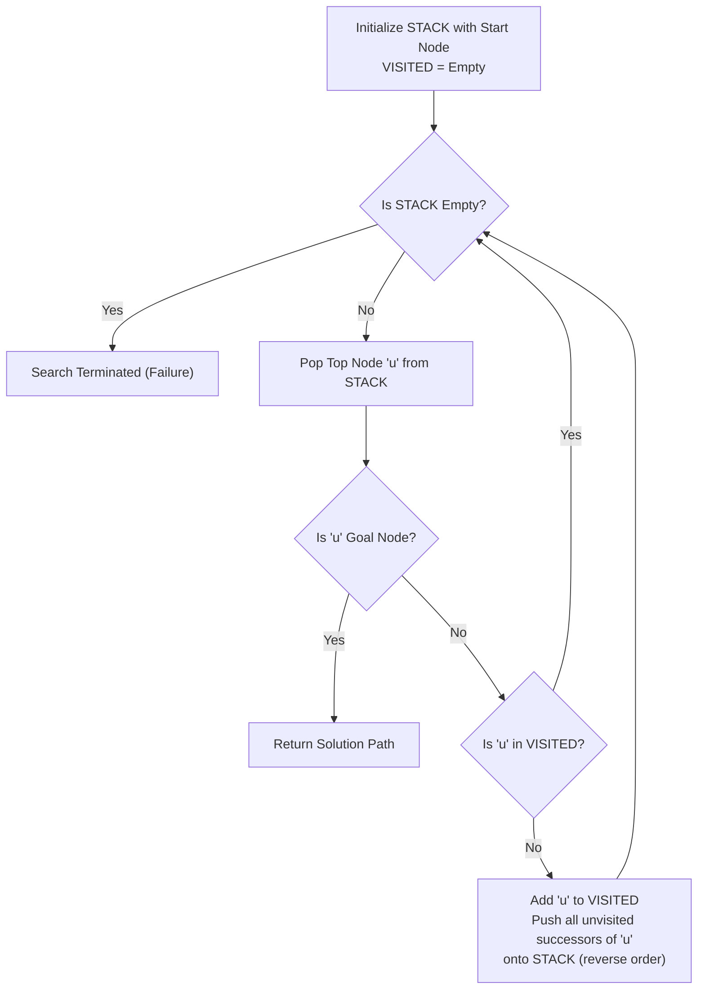

##### Algorithmic Steps
1. Push start node $S$ onto `STACK` and initialize `VISITED` set.
2. While `STACK` is not empty:
   *   Pop node $u$ from top of `STACK`.
   *   If $u$ satisfies the goal test, return the solution path.
   *   If $u \notin \text{VISITED}$:
       *   Insert $u$ into `VISITED`.
       *   Generate successors of $u$. Push unvisited successors onto `STACK` (to explore left-to-right, push in reverse order).
3. If `STACK` empties, return failure.

---

#### 2. Illustrative Example with Step-by-Step Trace (3 Marks)

Consider the following search tree with Start Node $A$ and Destination Goal Node $G$:

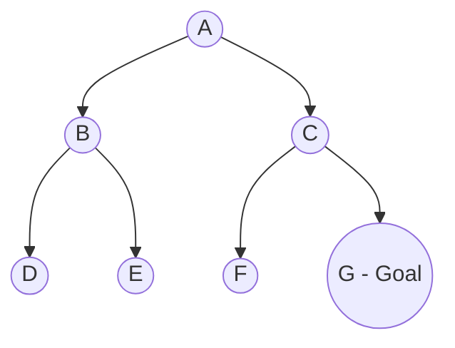

##### Execution Trace Table

| Step | Node Popped | Action Taken | STACK (Top $\to$ Bottom) | VISITED List |
| :---: | :---: | :--- | :--- | :--- |
| **0** | — | Initialize with start node $A$ | `[A]` | `[]` |
| **1** | **A** | Not goal; add to visited; push $C, B$ | `[B, C]` | `[A]` |
| **2** | **B** | Not goal; add to visited; push $E, D$ | `[D, E, C]` | `[A, B]` |
| **3** | **D** | Leaf node; no children | `[E, C]` | `[A, B, D]` |
| **4** | **E** | Leaf node; no children | `[C]` | `[A, B, D, E]` |
| **5** | **C** | Not goal; add to visited; push $G, F$ | `[F, G]` | `[A, B, D, E, C]` |
| **6** | **F** | Leaf node; no children | `[G]` | `[A, B, D, E, C, F]` |
| **7** | **G** | **Goal Found! Terminate.** | `[]` | `[A, B, D, E, C, F, G]` |

*   **Traversal Sequence:** $A \to B \to D \to E \to C \to F \to G$
*   **Path Discovered:** $\mathbf{A \to C \to G}$

---

#### 3. Properties and Theoretical Complexity (2 Marks)

*   **Time Complexity:** $O(b^m)$, where $b$ is the branching factor and $m$ is the maximum depth of the state space.
*   **Space Complexity:** $O(bm)$ — linear memory complexity, storing only a single path from the root to a leaf along with unexpanded siblings.
*   **Completeness:** Incomplete in infinite or cyclic state spaces without graph cycle detection; complete in finite state spaces.
*   **Optimality:** Suboptimal. DFS returns the first path found, which is not guaranteed to have minimal path cost or minimal depth.

:::tip

**Examiner's Note**

Include the explicit LIFO stack trace table, draw a clear graph with at least two branching levels, and emphasize the linear space complexity $O(bm)$.

:::

---

### Question 22.b (8 Marks)

:::info

**Question Statement**

A dog wants to eat the bone which is far away from him. It has to avoid hurdle, stick and other things to reach the bone. Using A* search find the optimal path to reach the bone. **(8 Marks)**

```text
+-----------------------+-----------------------+-----------------------+
| Pole                  | Rope                  | Bone (Goal)           |
| G = 3.5, H = 6        | G = 3.8, H = 5        | G = 3, H = 0          |
+-----------------------+-----------------------+-----------------------+
| Stand                 | Pebbles               | Horn                  |
| G = 6, H = 5          | G = 4, H = 8          | G = 3, H = 5.5        |
+-----------------------+-----------------------+-----------------------+
| Stick                 | Lane                  | Hurdles               |
| G = 2, H = 6          | G = 1, H = 6          | G = 1, H = 6.5        |
+-----------------------+-----------------------+-----------------------+
| DOG (Start)           | Blocked (X)           | Garden                |
| G = 0, H = 9          |                       | G = 5, H = 9          |
+-----------------------+-----------------------+-----------------------+
```

:::

---

### Solution 22.b (8 Marks)

#### 1. Problem Representation (2 Marks)
The grid represents a $4 \times 3$ navigation maze:
*   **Start State:** `DOG` at $(4, 1)$ with $G = 0, H = 9 \implies f = 9$.
*   **Goal State:** `Bone` at $(1, 3)$ with $H = 0$.
*   **Obstacles:** Cell $(4, 2)$ is `Blocked (X)`.
*   **Evaluation Function:** $f(n) = G(n) + H(n)$.

---

#### 2. Step-by-Step $A^*$ Search Execution (5 Marks)

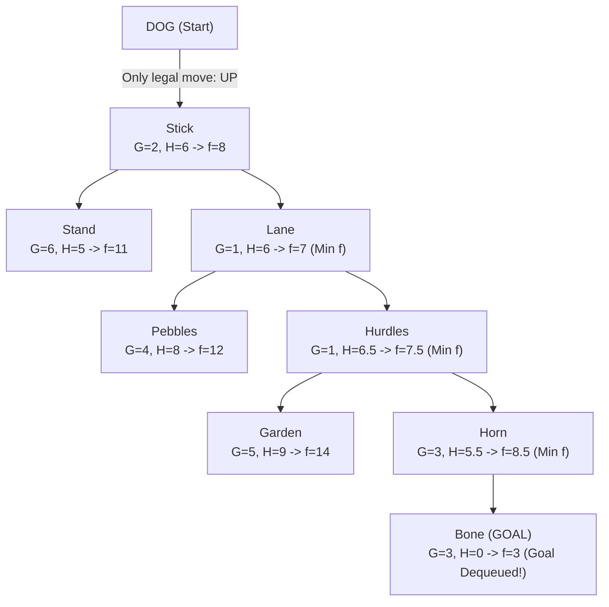

##### Trace Table

| Step | State Evaluated | $G$ Value | $H$ Value | $f = G + H$ | Action / Priority Queue State |
| :---: | :--- | :---: | :---: | :---: | :--- |
| **0** | **DOG (Start)** | $0$ | $9$ | **9** | Cell $(4, 2)$ is blocked; only neighbor is `Stick` $(3, 1)$ |
| **1** | **Stick** | $2$ | $6$ | **8** | Neighbors: `Stand` ($f=6+5=11$), `Lane` ($f=1+6=7$) |
| **2** | **Lane** | $1$ | $6$ | **7** | Selected (lowest $f$). Neighbors: `Pebbles` ($f=12$), `Hurdles` ($f=7.5$) |
| **3** | **Hurdles** | $1$ | $6.5$ | **7.5** | Selected (lowest $f$). Neighbors: `Horn` ($f=3+5.5=8.5$), `Garden` ($f=14$) |
| **4** | **Horn** | $3$ | $5.5$ | **8.5** | Selected (lowest $f$). Neighbors: `Bone` ($f=3+0=3$), `Pebbles` ($f=12$) |
| **5** | **Bone (Goal)** | $\mathbf{3}$ | $\mathbf{0}$ | $\mathbf{3}$ | **Goal Dequeued! Search Terminates.** |

---

#### 3. Optimal Solution Path (1 Mark)

$$\mathbf{\text{DOG} \to \text{Stick} \to \text{Lane} \to \text{Hurdles} \to \text{Horn} \to \text{Bone}}$$

:::tip

**Examiner's Note**

Show the explicit $f(n) = G + H$ evaluation for each candidate neighbor, noting that the blocked cell $(4, 2)$ forces the dog to move upward to `Stick` first, then following the minimum-$f$ path to the `Bone`.

:::

---

### Question 23.a (8 Marks)

:::info

**Question Statement**

Demonstrate the two-player search tree to understand the working of Alpha-beta pruning. **(8 Marks)**

```text
                     (A) [MAX]
                   /     \
           (B) [MIN]     (C) [MIN]
           /      \       /      \
      (D) [MAX] (E) [MAX] (F) [MAX] (G) [MAX]
      /   \     /   \     /   \     /   \
     2     3   5     9   0     1   7     5
```

:::

---

### Solution 23.a (8 Marks)

#### 1. Alpha-Beta Bounding Mechanics (2 Marks)
Alpha-Beta pruning maintains two scalar values down the search path:
*   $\alpha$: The lower bound on the maximum score that player **MAX** is assured of (initialized to $-\infty$).
*   $\beta$: The upper bound on the minimum score that player **MIN** is assured of (initialized to $+\infty$).
*   **Pruning Condition:** If at any node $\alpha \ge \beta$, stop exploring remaining children of that node.

---

#### 2. Step-by-Step Traversal & Cutoff Execution (4 Marks)

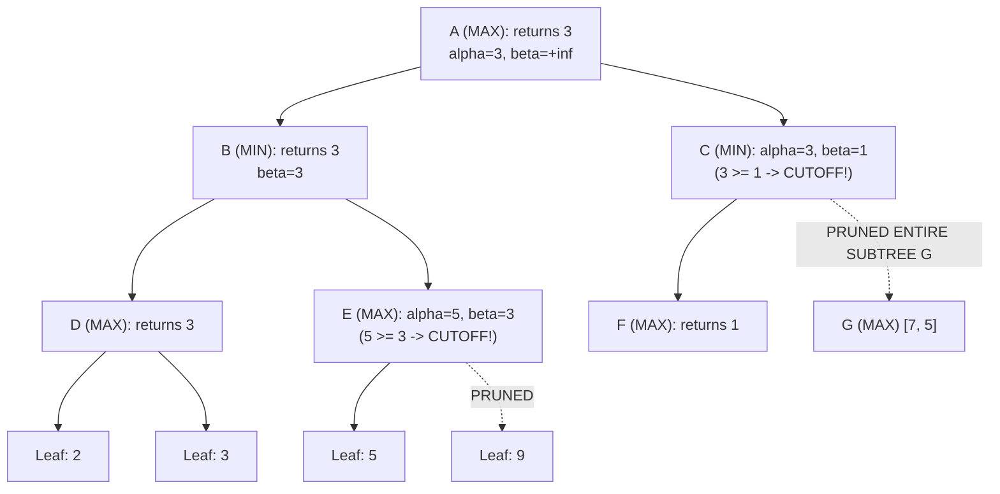

##### Step 1: Traverse Left Subtree Under Node B
1. Node $A$ (MAX) initializes $[\alpha = -\infty, \beta = +\infty]$ and calls child $B$ (MIN).
2. Node $B$ passes down $[\alpha = -\infty, \beta = +\infty]$ to child $D$ (MAX).
3. Node $D$ evaluates leaf $2$ ($\alpha = \max(-\infty, 2) = 2$), then evaluates leaf $3$ ($\alpha = \max(2, 3) = 3$).
   *   Node $D$ returns value **$3$** to $B$.
4. At node $B$ (MIN): updates $\beta = \min(+\infty, 3) = 3$. Current bounds: $[\alpha = -\infty, \beta = 3]$.
5. Node $B$ passes $[\alpha = -\infty, \beta = 3]$ down to child $E$ (MAX).
6. At node $E$ (MAX): evaluates first child (leaf $5$):
   $$\alpha = \max(-\infty, 5) = 5$$
   Current bounds at $E$: $\alpha = 5, \beta = 3$.
7. **Pruning Check at $E$:**
   $$\alpha \ge \beta \iff 5 \ge 3 \implies \mathbf{CUTOFF!}$$
   *   **Leaf 9 is PRUNED.**
   *   Node $E$ returns $5$ to $B$.
8. At node $B$ (MIN): $\beta = \min(3, 5) = 3$. Subtree $B$ complete; returns **$3$** to Root $A$.

##### Step 2: Traverse Right Subtree Under Node C
1. At Root $A$ (MAX): updates $\alpha = \max(-\infty, 3) = 3$.
   *   Root $A$ now passes down $[\alpha = 3, \beta = +\infty]$ to child $C$ (MIN).
2. Node $C$ passes $[\alpha = 3, \beta = +\infty]$ down to child $F$ (MAX).
3. At node $F$ (MAX): evaluates leaf $0$ ($\alpha = \max(3, 0) = 3$), then leaf $1$ ($\alpha = \max(3, 1) = 3$).
   *   Node $F$ returns value **$1$** to $C$.
4. At node $C$ (MIN): updates $\beta = \min(+\infty, 1) = 1$.
   *   Current bounds at node $C$: $\alpha = 3, \beta = 1$.
5. **Pruning Check at $C$:**
   $$\alpha \ge \beta \iff 3 \ge 1 \implies \mathbf{CUTOFF!}$$
   *   **The entire Subtree $G$ (containing leaves 7 and 5) is PRUNED.**
   *   Node $C$ returns $1$ to Root $A$.

##### Step 3: Root Value Computation
At Root $A$ (MAX):
$$\operatorname{Value}(A) = \max(3, 1) = \mathbf{3}$$

---

#### 3. Summary of Results (2 Marks)

*   **Pruned Nodes:**
    1. **Leaf 9** under node $E$.
    2. **Subtree $G$** (both leaf 7 and leaf 5) under node $C$.
*   **Optimal Value at Root $A$:** $\mathbf{3}$
*   **Optimal Move for MAX:** Choose Left Branch ($B$).

:::tip

**Examiner's Note**

Full credit requires clearly stating both cutoffs ($\alpha \ge \beta$ at $E$ where $5 \ge 3$, and $\alpha \ge \beta$ at $C$ where $3 \ge 1$) and identifying all 3 pruned terminal values (9, 7, 5).

:::

---

### Question 23.b (8 Marks)

:::info

**Question Statement**

Consider the following game tree:  
(i) Give a value of A such that B is pruned  
(ii) Give a value of A such that B is not pruned  
(iii) Assume B = 5; A = 5 give value of C and D, such that subtree containing E and F is pruned. **(8 Marks)**

```text
                       [ Root (Max) ]
                      /              \
               [ Min_L ]            [ Min_R ]
               /       \            /       \
            Max_1     Max_2      Max_3     Max_4
            /   \     /   \      /   \     /   \
           5     0   A     B    C     D   E     F
```

:::

---

### Solution 23.b (8 Marks)

#### 1. Analysis of Left Subtree (`Min_L`) (3 Marks)

*   **Evaluation of `Max_1`:**
    $$\operatorname{Value}(\text{Max\_1}) = \max(5, 0) = 5$$
*   **Bounds at `Min_L`:**  
    `Min_L` receives $5$ from `Max_1`, so its upper bound becomes:
    $$\beta = \min(+\infty, 5) = 5$$
    `Min_L` passes down $[\alpha = -\infty, \beta = 5]$ to `Max_2`.
*   **Evaluation of `Max_2`:**  
    `Max_2` evaluates its left child first, which has value $A$.  
    Since `Max_2` is a MAX node, it updates:
    $$\alpha = \max(-\infty, A) = A$$
    Current bounds at `Max_2`: $[\alpha = A, \beta = 5]$.

---

#### 2. Solutions to Parts (i) and (ii) (3 Marks)

##### (i) Value of $A$ such that $B$ is pruned
Pruning occurs at `Max_2` when $\alpha \ge \beta$:
$$\alpha \ge \beta \iff A \ge 5$$
*   **Answer:** Any value **$A \ge 5$** (e.g., $\mathbf{A = 5}$ or $\mathbf{A = 6}$).

##### (ii) Value of $A$ such that $B$ is not pruned
For $B$ to be evaluated, the pruning condition must not hold:
$$\alpha < \beta \iff A < 5$$
*   **Answer:** Any value **$A < 5$** (e.g., $\mathbf{A = 4}$ or $\mathbf{A = 0}$).

---

#### 3. Solution to Part (iii) (2 Marks)

##### (iii) Values of $C$ and $D$ such that the Subtree containing $E$ and $F$ is Pruned
*   **Left Subtree Outcome:** Given $A = 5$ and $B = 5$:
    $$\operatorname{Value}(\text{Max\_2}) = 5 \implies \operatorname{Value}(\text{Min\_L}) = \min(5, 5) = 5$$
*   **Root Bound:** The Root (Max) updates:
    $$\alpha = \max(-\infty, 5) = 5$$
    The Root passes down $[\alpha = 5, \beta = +\infty]$ to `Min_R`.
*   **Pruning the Subtree (`Max_4` containing $E$ and $F$):**  
    For `Min_R` to trigger a cutoff before exploring `Max_4`, `Min_R` must receive a value from `Max_3` that satisfies:
    $$\alpha \ge \beta \iff 5 \ge \operatorname{Value}(\text{Max\_3})$$
*   Since `Max_3` is a MAX node:
    $$\operatorname{Value}(\text{Max\_3}) = \max(C, D) \le 5$$
*   **Answer:** Any values such that **$C \le 5$ and $D \le 5$** (e.g., $\mathbf{C = 4, D = 3}$ or $\mathbf{C = 5, D = 2}$).  
    *Result:* `Max_3` returns $\le 5$, setting $\beta \le 5$ at `Min_R`. Since $\alpha = 5 \ge \beta$, the remaining branch `Max_4` (containing $E$ and $F$) is **PRUNED**.

:::tip

**Examiner's Note**

Award 3 marks for (i) $A \ge 5$, 3 marks for (ii) $A < 5$, and 2 marks for (iii) $C \le 5$ and $D \le 5$ with the mathematical justification showing $\alpha \ge \beta$ at the right MIN node.

:::

---

### Question 24.a (8 Marks)

:::info

**Question Statement**

Consider the following axioms. Represent these axioms in predicate calculus: **(8 Marks)**  
(i) Every child loves Ice-cream  
(ii) Everyone who loves Ice-cream loves any chocolate  
(iii) Apple is a fruit, and Apple is red color  
(iv) Anything which has a red nose is weird or is a clown  
(v) No dog is a clown  
(vi) John does not love anything which is weird.

:::

---

### Solution 24.a (8 Marks)

#### Predicate Definitions
*   $\operatorname{Child}(x)$: $x$ is a child.
*   $\operatorname{Loves}(x, y)$: $x$ loves $y$.
*   $\text{IceCream}$: Constant representing Ice-cream.
*   $\operatorname{Person}(x)$: $x$ is a person (or everyone).
*   $\operatorname{Chocolate}(y)$: $y$ is a chocolate.
*   $\operatorname{Fruit}(x)$: $x$ is a fruit.
*   $\operatorname{Color}(x, c)$: $x$ has color $c$ (or $\operatorname{Red}(x)$).
*   $\text{Apple}$: Constant representing Apple.
*   $\operatorname{HasRedNose}(x)$: $x$ has a red nose.
*   $\operatorname{Weird}(x)$: $x$ is weird.
*   $\operatorname{Clown}(x)$: $x$ is a clown.
*   $\operatorname{Dog}(x)$: $x$ is a dog.
*   $\text{John}$: Constant representing John.

---

#### Formal Predicate Calculus Representations

##### (i) "Every child loves Ice-cream" (1.5 Marks)
$$\mathbf{\forall x \; \big( \operatorname{Child}(x) \implies \operatorname{Loves}(x, \text{IceCream}) \big)}$$

---

##### (ii) "Everyone who loves Ice-cream loves any chocolate" (1.5 Marks)
$$\mathbf{\forall x \; \forall y \; \Big( \big( \operatorname{Loves}(x, \text{IceCream}) \land \operatorname{Chocolate}(y) \big) \implies \operatorname{Loves}(x, y) \Big)}$$

---

##### (iii) "Apple is a fruit, and Apple is red color" (1 Mark)
$$\mathbf{\operatorname{Fruit}(\text{Apple}) \land \operatorname{Red}(\text{Apple})}$$
*(Or using relational color: $\operatorname{Fruit}(\text{Apple}) \land \operatorname{Color}(\text{Apple}, \text{Red})$).*

---

##### (iv) "Anything which has a red nose is weird or is a clown" (1.5 Marks)
$$\mathbf{\forall x \; \Big( \operatorname{HasRedNose}(x) \implies \big( \operatorname{Weird}(x) \lor \operatorname{Clown}(x) \big) \Big)}$$

---

##### (v) "No dog is a clown" (1 Mark)
$$\mathbf{\forall x \; \big( \operatorname{Dog}(x) \implies \neg \operatorname{Clown}(x) \big)}$$
*(Equivalently: $\neg \exists x \; (\operatorname{Dog}(x) \land \operatorname{Clown}(x))$).*

---

##### (vi) "John does not love anything which is weird." (1.5 Marks)
$$\mathbf{\forall x \; \big( \operatorname{Weird}(x) \implies \neg \operatorname{Loves}(\text{John}, x) \big)}$$
*(Equivalently: $\neg \exists x \; (\operatorname{Weird}(x) \land \operatorname{Loves}(\text{John}, x))$).*

:::tip

**Examiner's Note**

Ensure all quantifiers and variables are clearly specified. Universal quantifier $\forall$ must pair with $\implies$, and conjunctions $\land$ should join ground facts.

:::

---

### Question 24.b (8 Marks)

:::info

**Question Statement**

The law says that 'it is a crime for an American to sell weapons to hostile nations. The country "Nano", an enemy of America has some missiles, and all of its missiles were sold by colonel west, who is an American'. Use resolution principle to prove that west is a criminal. **(8 Marks)**

:::

---

### Solution 24.b (8 Marks)

#### 1. First-Order Logic Axiomatization (3 Marks)

*   **Axiom 1:** "It is a crime for an American to sell weapons to hostile nations."
    $$\forall x \, \forall y \, \forall z \; \Big( \operatorname{American}(x) \land \operatorname{Weapon}(y) \land \operatorname{Sells}(x, y, z) \land \operatorname{Hostile}(z) \implies \operatorname{Criminal}(x) \Big)$$
*   **Axiom 2:** "Nano has some missiles."  
    $\exists x \; (\operatorname{Owns}(\text{Nano}, x) \land \operatorname{Missile}(x))$.  
    *Skolemize with Skolem constant $M_1$:*
    $$\operatorname{Owns}(\text{Nano}, M_1) \quad \land \quad \operatorname{Missile}(M_1)$$
*   **Axiom 3:** "All of its missiles were sold by Colonel West."
    $$\forall x \; \Big( \operatorname{Missile}(x) \land \operatorname{Owns}(\text{Nano}, x) \implies \operatorname{Sells}(\text{West}, x, \text{Nano}) \Big)$$
*   **Axiom 4:** "Missiles are weapons."
    $$\forall x \; \Big( \operatorname{Missile}(x) \implies \operatorname{Weapon}(x) \Big)$$
*   **Axiom 5:** "An enemy of America is a hostile nation."
    $$\forall x \; \Big( \operatorname{Enemy}(x, \text{America}) \implies \operatorname{Hostile}(x) \Big)$$
*   **Axiom 6:** "West is an American."
    $$\operatorname{American}(\text{West})$$
*   **Axiom 7:** "Nano is an enemy of America."
    $$\operatorname{Enemy}(\text{Nano}, \text{America})$$

---

#### 2. Conversion to Conjunctive Normal Form (CNF Clauses) (2 Marks)

Eliminating implications and standardizing variables:
1. **$C_1$:** $\neg \operatorname{American}(x) \lor \neg \operatorname{Weapon}(y) \lor \neg \operatorname{Sells}(x, y, z) \lor \neg \operatorname{Hostile}(z) \lor \operatorname{Criminal}(x)$
2. **$C_2$:** $\operatorname{Owns}(\text{Nano}, M_1)$
3. **$C_3$:** $\operatorname{Missile}(M_1)$
4. **$C_4$:** $\neg \operatorname{Missile}(x) \lor \neg \operatorname{Owns}(\text{Nano}, x) \lor \operatorname{Sells}(\text{West}, x, \text{Nano})$
5. **$C_5$:** $\neg \operatorname{Missile}(x) \lor \operatorname{Weapon}(x)$
6. **$C_6$:** $\neg \operatorname{Enemy}(z, \text{America}) \lor \operatorname{Hostile}(z)$
7. **$C_7$:** $\operatorname{American}(\text{West})$
8. **$C_8$:** $\operatorname{Enemy}(\text{Nano}, \text{America})$
9. **$C_9$ (Negated Goal):** $\mathbf{\neg \operatorname{Criminal}(\text{West})}$

---

#### 3. Resolution Refutation Proof (3 Marks)

We resolve clauses systematically until the **empty clause $\square$** (contradiction) is derived:

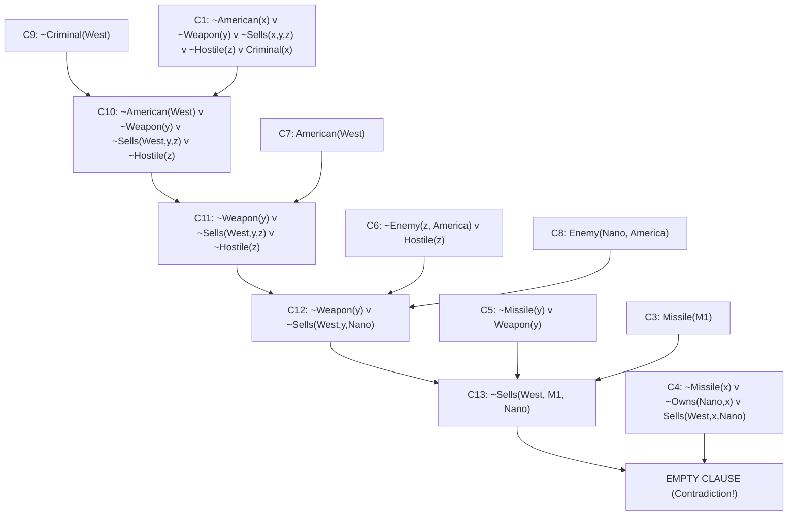

##### Step-by-Step Resolution Steps
*   **Step 1:** Resolve $C_9$ with $C_1$ using substitution $\{x / \text{West}\}$:
    $$C_{10}: \neg \operatorname{American}(\text{West}) \lor \neg \operatorname{Weapon}(y) \lor \neg \operatorname{Sells}(\text{West}, y, z) \lor \neg \operatorname{Hostile}(z)$$
*   **Step 2:** Resolve $C_{10}$ with $C_7$ ($\operatorname{American}(\text{West})$):
    $$C_{11}: \neg \operatorname{Weapon}(y) \lor \neg \operatorname{Sells}(\text{West}, y, z) \lor \neg \operatorname{Hostile}(z)$$
*   **Step 3:** Resolve $C_{11}$ with $C_6$ using substitution $\{z / \text{Nano}\}$:
    $$C_{12}: \neg \operatorname{Weapon}(y) \lor \neg \operatorname{Sells}(\text{West}, y, \text{Nano}) \lor \neg \operatorname{Enemy}(\text{Nano}, \text{America})$$
*   **Step 4:** Resolve $C_{12}$ with $C_8$ ($\operatorname{Enemy}(\text{Nano}, \text{America})$):
    $$C_{13}: \neg \operatorname{Weapon}(y) \lor \neg \operatorname{Sells}(\text{West}, y, \text{Nano})$$
*   **Step 5:** Resolve $C_{13}$ with $C_5$ using substitution $\{y / M_1\}$:
    $$C_{14}: \neg \operatorname{Missile}(M_1) \lor \neg \operatorname{Sells}(\text{West}, M_1, \text{Nano})$$
*   **Step 6:** Resolve $C_{14}$ with $C_3$ ($\operatorname{Missile}(M_1)$):
    $$C_{15}: \neg \operatorname{Sells}(\text{West}, M_1, \text{Nano})$$
*   **Step 7:** Resolve $C_{15}$ with $C_4$ using substitution $\{x / M_1\}$:
    $$C_{16}: \neg \operatorname{Missile}(M_1) \lor \neg \operatorname{Owns}(\text{Nano}, M_1)$$
*   **Step 8:** Resolve $C_{16}$ with $C_3$ ($\operatorname{Missile}(M_1)$) and $C_2$ ($\operatorname{Owns}(\text{Nano}, M_1)$):
    $$\mathbf{\square \quad \text{(Empty Clause / Contradiction!)}}$$

**Conclusion:** The negated goal produces an empty clause $\square$. Therefore, **West is proven to be a criminal**.

:::tip

**Examiner's Note**

Write out the 8 formal FOL axioms, show the Skolem constant $M_1$, negate the goal ($\neg \operatorname{Criminal}(\text{West})$), and show the resolution refutation tree terminating at $\square$.

:::

---

### Question 25.a (8 Marks)

:::info

**Question Statement**

Give the syntax, semantic and interfacing mechanisms in frames with example. How inference rules are used to represent knowledge? Explain in detail about expert system architecture. **(8 Marks)**

:::

---

### Solution 25.a (8 Marks)

#### 1. Frame Representation: Syntax, Semantics & Interfacing (3 Marks)

Proposed by Marvin Minsky (1974), a **Frame** is an object-oriented structural knowledge representation modeling prototypical concepts, entities, or situations.

```text
Frame: BIRD
  IS-A: Vertebrate
  Wings: [Default: 2]
  Flies: [Default: True]

Frame: PENGUIN
  IS-A: Bird
  Flies: False  <-- Overrides inherited default
  Habitat: Cold_Regions
  Check_Health: [If-Needed: Calculate_Weight()]
```

##### Core Components
*   **Syntax:** Frames consist of a frame name and a collection of named **Slots** (attributes) associated with **Fillers** (values, default values, pointers to other frames, or attached procedures).
*   **Semantics:** Frames model categorical taxonomies via `IS-A` (class-subclass) and `INSTANCE-OF` (class-instance) relationships, supporting property inheritance and default reasoning with exceptions.
*   **Interfacing Mechanisms (Daemons):** Procedural attachments that trigger code automatically upon access events:
    *   `If-Needed`: Computes a value dynamically when queried.
    *   `If-Added`: Validates data or triggers side effects when a slot value is assigned.
    *   `If-Removed`: Executes cleanup actions when a filler is deleted.

---

#### 2. Inference Rules in Knowledge Representation (2 Marks)

Inference rules encode dynamic reasoning logic using production rules ($\text{IF } \langle\text{condition}\rangle \implies \text{THEN } \langle\text{action}\rangle$):
*   **Modus Ponens:** Given facts $\alpha$ and rule $\alpha \implies \beta$, deduce fact $\beta$.
*   **Forward Chaining:** Data-driven inference firing rules forward to deduce conclusions.
*   **Backward Chaining:** Goal-driven inference working backward to verify hypotheses.

---

#### 3. Expert System Architecture (3 Marks)

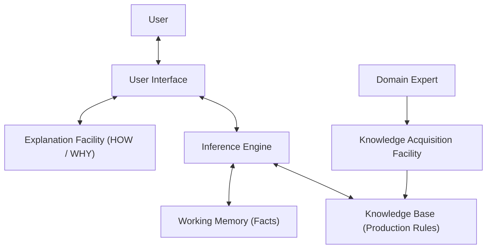

*   **Knowledge Base (KB):** Long-term repository of domain production rules and facts.
*   **Inference Engine (IE):** Reasoning processor executing pattern matching (Rete), conflict resolution, and rule firing.
*   **Working Memory:** Short-term cache recording active session facts and intermediate deductions.
*   **Explanation Facility:** Audits and displays proof chains for user queries.

:::tip

**Examiner's Note**

Award 3 marks for Frame syntax/semantics/daemons, 2 marks for inference rule mechanisms, and 3 marks for the expert system block diagram.

:::

---

### Question 25.b (8 Marks)

:::info

**Question Statement**

Explain:  
(i) Simple planning agent **(4 Marks)**  
(ii) Means-end analysis **(4 Marks)**

:::

---

### Solution 25.b (8 Marks)

#### 1. Simple Planning Agent (4 Marks)

A **Simple Planning Agent** is a deliberative agent that constructs, maintains, and executes action sequences using explicit, factored domain representations (such as PDDL or STRIPS).

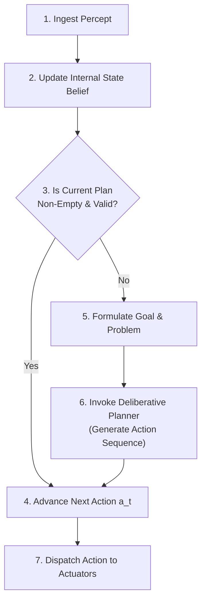

##### Core Operational Cycle
1. **Percept Ingestion & State Estimation:** Updates its belief state based on sensor percepts.
2. **Goal Check:** If the current plan is exhausted or invalidated by an unexpected external world change, it formulates a new goal.
3. **Plan Generation:** Invokes a planning algorithm (e.g., Graphplan, Partial-Order Planning, or Forward State-Space Search) to synthesize a sequence of action schemas with **Preconditions**, **Add Lists**, and **Delete Lists**.
4. **Execution:** Executes the planned actions sequentially until the goal state is achieved.

---

#### 2. Means-Ends Analysis (MEA) (4 Marks)

**Means-Ends Analysis (MEA)** is a goal-directed problem-solving and planning strategy (pioneered by Newell & Simon in the General Problem Solver) that centers on difference reduction.

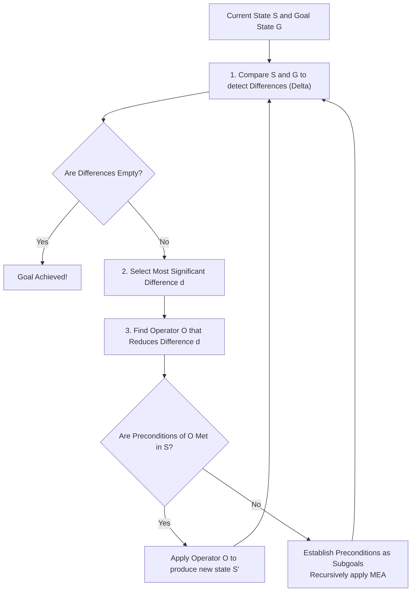

##### Algorithmic Methodology
1. **Difference Detection:** Computes the set of differences between the current state $S$ and the desired goal state $G$.
2. **Operator Selection:** Identifies operators capable of eliminating or reducing the most significant difference.
3. **Subgoaling:** If the selected operator's preconditions are not currently satisfied in state $S$, the algorithm creates subgoals to achieve those preconditions, recursively applying MEA until primitive operators can execute.

:::tip

**Examiner's Note**

Award 4 marks for drawing the planning agent loop with precondition/effect schemas, and 4 marks for defining the MEA difference-reduction cycle and subgoaling mechanism.

:::

---

## Part C: Comprehensive Search Problems (15 Marks)

### Question 26 (15 Marks)

:::info

**Question Statement**

26.i. Comparatively analyze A* and best first search algorithm. **(5 Marks)**  
26.ii. Apply UCS in the following graph and find the path from S to G. **(10 Marks)**

```text
       (S)
      /   \
   1 /     \ 12
    v       v
   (A)----->(G)
   | \   ^   ^
 3 |  \1 |2  | 3
   v   v |   |
  (B)  (C)  (D)
   \    |    ^
  3 \   |1  /
     v  v  / 1
      (D)-'
```

*Edge Weights:*  
$S \to A: 1, \quad S \to G: 12$  
$A \to B: 3, \quad A \to C: 1$  
$B \to D: 3, \quad C \to D: 1, \quad C \to G: 2, \quad D \to G: 3$

:::

---

### Solution 26 (15 Marks)

#### 1. Comparative Analysis: $A^*$ vs. Greedy Best-First Search (5 Marks)

Both algorithms utilize a priority queue to expand nodes, but differ fundamentally in their evaluation functions:

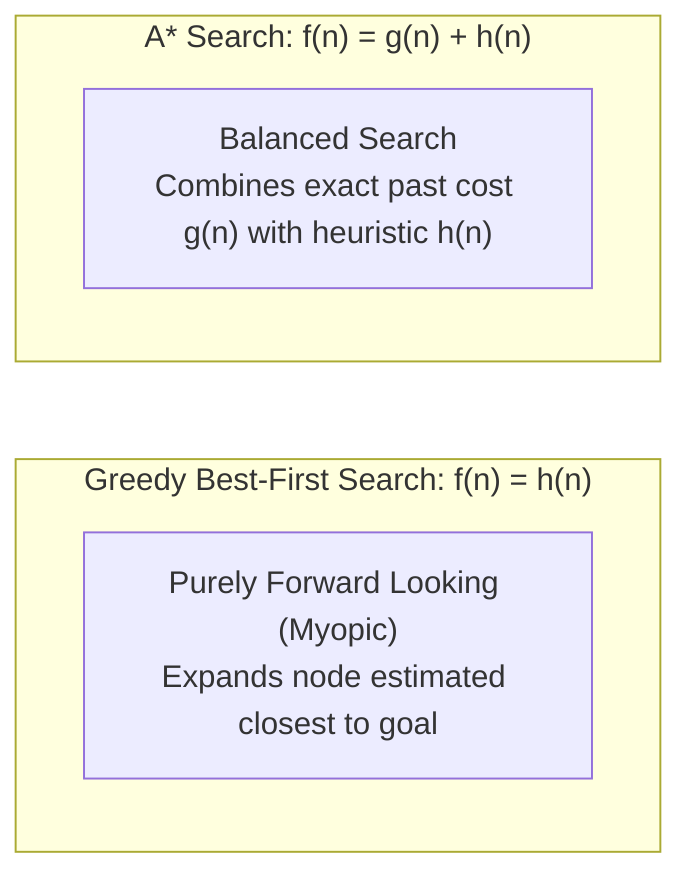

| Dimension | Greedy Best-First Search | $A^*$ Search |
| :--- | :--- | :--- |
| **Evaluation Function** | $f(n) = h(n)$ | $f(n) = g(n) + h(n)$ |
| **Cost Consideration** | Considers only estimated cost to goal | Considers both actual path cost from start $g(n)$ and estimated cost $h(n)$ |
| **Optimality** | **Suboptimal:** Can be lured down expensive paths by misleading heuristics | **Optimal:** Guaranteed to return lowest-cost path if $h(n)$ is admissible |
| **Completeness** | Incomplete in infinite state spaces or graphs with loops | Complete in finite branching spaces with positive step costs |
| **Worst-Case Complexity** | Time: $O(b^m)$, Space: $O(b^m)$ | Time: $O(b^d)$, Space: $O(b^d)$ |

---

#### 2. Uniform Cost Search (UCS) Execution (10 Marks)

##### a) Algorithmic Mechanism
Uniform Cost Search explores the state space in increasing order of cumulative path cost $g(n)$ using a priority queue. The goal test is applied **upon dequeuing**.

##### b) Step-by-Step Priority Queue Trace

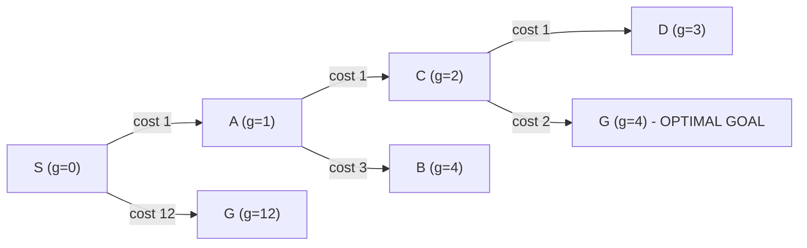

| Step | Dequeued Tuple $(g(u), u, \text{Path})$ | Explored Set | Successors Generated & Cumulative Cost $g(v) = g(u) + c(u, v)$ | Priority Queue Contents (Ordered by $g(n)$) |
| :---: | :--- | :--- | :--- | :--- |
| **0** | — | `[]` | Push $(0, S, [S])$ | `[(0, S)]` |
| **1** | **(0, S, [S])** | `[S]` | $(1, A, [S, A])$<br/>$(12, G, [S, G])$ | `[(1, A), (12, G)]` |
| **2** | **(1, A, [S, A])** | `[S, A]` | $(1+1=2, C, [S, A, C])$<br/>$(1+3=4, B, [S, A, B])$ | `[(2, C), (4, B), (12, G)]` |
| **3** | **(2, C, [S, A, C])** | `[S, A, C]` | $(2+1=3, D, [S, A, C, D])$<br/>$(2+2=4, G, [S, A, C, G])$ | `[(3, D), (4, B), (4, G), (12, G)]` |
| **4** | **(3, D, [S, A, C, D])** | `[S, A, C, D]` | $(3+3=6, G, [S, A, C, D, G])$ | `[(4, B), (4, G), (6, G), (12, G)]` |
| **5** | **(4, B, [S, A, B])** | `[S, A, C, D, B]` | $(4+3=7, D \to \text{Already Explored})$ | `[(4, G), (6, G), (12, G)]` |
| **6** | $\mathbf{(4, G, [S, A, C, G])}$ | `[... G]` | **Goal Dequeued! Search Terminates.** | — |

##### c) Result Summary
*   **Optimal Path Discovered:** $\mathbf{S \to A \to C \to G}$
*   **Optimal Path Cost:**
    $$g(G) = c(S, A) + c(A, C) + c(C, G) = 1 + 1 + 2 = \mathbf{4}$$

:::tip

**Examiner's Note**

Award 5 marks for the $A^*$ vs. Best-First comparison table, and 10 marks for the UCS trace showing that the goal node $G$ generated with cost 12 at Step 1 is not chosen, and the search optimal path $S \to A \to C \to G$ with cost 4 is returned.

:::

---

### Question 27 (15 Marks)

:::info

**Question Statement**

27.i. Comparatively analyze BFS and DFS uninformed algorithm. **(5 Marks)**  
27.ii. Consider the given graph.  
'A' is the root node  
'F' is the goal node  
Explain the searching process using IDS. Explain IDS with all its features. **(10 Marks)**

```text
                 (A)
             /    |    \
          (B)    (C)    (D)
         /   \    |    / | \
       (E)   (F) (G) (H) (I) (J)
       / \        |   | \     |
     (K) (L)     (M) (N) (P) (Q)
```

:::

---

### Solution 27 (15 Marks)

#### 1. Comparative Analysis: BFS vs. DFS (5 Marks)

| Dimension | Breadth-First Search (BFS) | Depth-First Search (DFS) |
| :--- | :--- | :--- |
| **Frontier Data Structure** | First-In, First-Out (FIFO) Queue | Last-In, First-Out (LIFO) Stack |
| **Expansion Strategy** | Level-by-level (shallowest unexpanded node first) | Deepest branch first until leaf, then backtracks |
| **Time Complexity** | $O(b^d)$ | $O(b^m)$ *(where $m$ is maximum depth)* |
| **Space Complexity** | $O(b^d)$ *(Exponential Memory)* | $O(bm)$ *(Linear Memory)* |
| **Completeness** | Complete (if branching factor $b$ is finite) | Incomplete in infinite or cyclic state spaces |
| **Optimality** | Optimal for uniform step costs | Suboptimal; returns first path discovered |

---

#### 2. Iterative Deepening Search (IDS) Execution (10 Marks)

##### a) Algorithmic Concept & Key Features
Iterative Deepening Search (IDS) combines the advantages of BFS and DFS:
*   **Optimal Space Complexity:** Runs recursive Depth-Limited Search (DLS), consuming only $O(bd)$ linear memory.
*   **Completeness & Path Optimality:** Systematically increases the depth bound $L = 0, 1, 2, \dots$, guaranteeing that the first time a goal node is discovered, it is at the shallowest possible depth.
*   **Minimal Overhead:** The overhead of re-expanding upper levels is small:
    $$\frac{b}{b - 1}$$
    For branching factor $b = 3$, upper-level regeneration overhead is only $\approx 33\%$.

---

##### b) Step-by-Step Search Trace for Goal Node 'F'

From the given tree:
*   **Root Node:** $A$ (Depth 0)
*   **Goal Node:** $F$ (Located at Depth 2 as child of $B$)

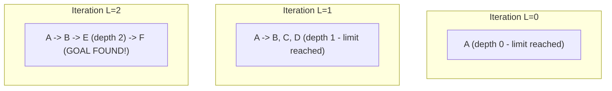

*   **Iteration 0 (Depth Limit $L = 0$):**
    *   Visit `A` (Depth 0).
    *   Depth limit reached. Goal test $A == F$ is False.
    *   **Traversal:** $A$
    *   *Result: Goal not found. Increment $L \to 1$.*

*   **Iteration 1 (Depth Limit $L = 1$):**
    *   Visit `A` (Depth 0) $\to$ generate children: `B`, `C`, `D`.
    *   Visit `B` (Depth 1, limit reached; $B \neq F$).
    *   Visit `C` (Depth 1, limit reached; $C \neq F$).
    *   Visit `D` (Depth 1, limit reached; $D \neq F$).
    *   **Traversal:** $A \to B \to C \to D$
    *   *Result: Goal not found. Increment $L \to 2$.*

*   **Iteration 2 (Depth Limit $L = 2$):**
    *   Visit `A` (Depth 0).
    *   Traverse subtree of `B`:
        *   Visit `B` (Depth 1) $\to$ generate children: `E`, `F`.
        *   Visit `E` (Depth 2, limit reached; $E \neq F$).
        *   Visit `F` (Depth 2): **GOAL TEST SUCCEEDED ($F == F$)!**
    *   **Traversal Sequence in Iteration 2:**
        $$A \to B \to E \to \mathbf{F}$$

##### c) Final Solution Path & Complexity
*   **Optimal Path Discovered:**
    $$\mathbf{A \to B \to F}$$
*   **Path Length:** **2 edges** (Depth 2).
*   **Termination:** Search terminates at Iteration 2 without needing to explore nodes $C, D$ or levels $\ge 3$.

:::tip

**Examiner's Note**

Award 5 marks for part (i) for the BFS vs. DFS comparison table, and 10 marks for part (ii) for explaining the features of IDS (linear memory $O(bd)$, completeness), and writing out the explicit traversal for each iteration $L=0, 1, 2$ terminating at goal node $F$.

:::
