# May 2024

> **Exam -** Semester Examination  
> **Session -** May 2024  

---

## Part A: Objective Type Questions (20 Marks)

### Question 1 (1 Mark)

:::info

**Question Statement**

Which of the following is not an application of artificial intelligence? **(1 Mark)**

*   **(A)** Database management system
*   **(B)** Computer vision
*   **(C)** Natural language processing
*   **(D)** Digital assistants

:::

*   **Correct Answer:** **(A) Database management system**
*   **Explanation:** Traditional Relational Database Management Systems (RDBMS) execute deterministic relational algebra and SQL queries based on hardcoded transaction logic. In contrast, computer vision, NLP, and digital assistants represent core cognitive AI domains.

---

### Question 2 (1 Mark)

:::info

**Question Statement**

In the context of AI problem formulation, what does the term "State Space" refer to? **(1 Mark)**

*   **(A)** The physical space where AI algorithms operate
*   **(B)** The set of all possible states the problem can be in
*   **(C)** The memory space allocated for AI programs
*   **(D)** The space complexity of the AI solution

:::

*   **Correct Answer:** **(B) The set of all possible states the problem can be in**
*   **Explanation:** In AI problem formulation, the state space is the mathematical universe of all reachable configurations generated by applying legal actions from the initial state.

---

### Question 3 (1 Mark)

:::info

**Question Statement**

In a game of tic-tac-toe, the player who goes first (X) makes optimal moves, and the player who goes second (O) also makes optimal moves. Assuming both players play perfectly, what is the outcome of a standard 3 x 3 tic-tac-toe game? **(1 Mark)**

*   **(A)** X wins
*   **(B)** O wins
*   **(C)** It's a draw
*   **(D)** Depends on the specific moves made

:::

*   **Correct Answer:** **(C) It's a draw**
*   **Explanation:** Standard $3 \times 3$ Tic-Tac-Toe is a finite, zero-sum, perfect-information game with a theoretical game-theoretic value of zero; under optimal Minimax play by both agents, the game deterministically terminates in a draw.

---

### Question 4 (1 Mark)

:::info

**Question Statement**

A self-driving car needs to navigate through a city while avoiding obstacles and following traffic rules. Which AI approach is most suitable for training the car to make decisions in real-time based on its environment. **(1 Mark)**

*   **(A)** Supervised learning
*   **(B)** Unsupervised learning
*   **(C)** Reinforcement learning
*   **(D)** Ensemble learning

:::

*   **Correct Answer:** **(C) Reinforcement learning**
*   **Explanation:** Reinforcement learning models an agent learning dynamic, real-time control policies through sequential interaction with an environment, maximizing rewards for speed and destination reaching while penalizing collisions and traffic infractions.

---

### Question 5 (1 Mark)

:::info

**Question Statement**

The post order traversal of a binary tree is 8, 9, 6, 7, 4, 5, 2, 3, 1. The inorder traversal of the same tree is 8, 6, 9, 4, 7, 2, 5, 1, 3. The height of a tree is the length of the longest path from the root to any leaf, the height of the tree is **(1 Mark)**

*   **(A)** 2
*   **(B)** 5
*   **(C)** 3
*   **(D)** 4

:::

*   **Correct Answer:** **(D) 4**
*   **Explanation:** Reconstructing the binary tree yields the longest path from root $1 \to 2 \to 4 \to 6 \to 8$ (or $9$). Measuring height by the standard definition stated in the question (length of the longest path in terms of edge transitions) gives $4$ edges. *(Note: If height is defined by total node count along the deepest branch, it contains 5 nodes).*

---

### Question 6 (1 Mark)

:::info

**Question Statement**

In uniform cost search, what happens if two paths have the same cost to reach a node? **(1 Mark)**

*   **(A)** One of them is randomly chosen
*   **(B)** Both paths are explored
*   **(C)** The first path encountered is chosen
*   **(D)** The last path encountered is simultaneously chosen

:::

*   **Correct Answer:** **(C) The first path encountered is chosen**
*   **Explanation:** In standard Uniform Cost Search priority queue implementations, ties between identical cumulative path costs $g(n)$ are broken deterministically by FIFO insertion order; the first path dequeued expands the node, and subsequent redundant paths of equal cost to the same node are discarded.

---

### Question 7 (1 Mark)

:::info

**Question Statement**

The goal of any search algorithm is to find a path from the initial state to the: **(1 Mark)**

*   **(A)** Intermediate state
*   **(B)** Current state
*   **(C)** Goal state
*   **(D)** Terminal state

:::

*   **Correct Answer:** **(C) Goal state**
*   **Explanation:** By definition, a search algorithm navigates through the problem's state space to discover a valid sequence of operators that transitions the system from the initial state to a designated goal state.

---

### Question 8 (1 Mark)

:::info

**Question Statement**

Generate and test search is based on which of the following search technique? **(1 Mark)**

*   **(A)** Breadth first search
*   **(B)** Depth first search with backtracking
*   **(C)** Best first search
*   **(D)** Greedy search

:::

*   **Correct Answer:** **(B) Depth first search with backtracking**
*   **Explanation:** Generate-and-Test systematically generates candidate solutions one by one and tests whether each satisfies the goal conditions. In structured state spaces, this corresponds to Depth-First Search with backtracking upon encountering non-solution paths.

---

### Question 9 (1 Mark)

:::info

**Question Statement**

In Alpha-Beta pruning, what does the beta value represent? **(1 Mark)**

*   **(A)** The highest score found so far for the minimizing player
*   **(B)** The highest score found so far for the maximizing player
*   **(C)** The lowest score found so far for the maximizing player
*   **(D)** The lowest score found so far for the minimizing player

:::

*   **Correct Answer:** **(D) The lowest score found so far for the minimizing player**
*   **Explanation:** $\beta$ represents the upper bound on the utility value that player MIN can force at the current node or along the current path, representing the lowest (best) payoff found so far for the minimizing player.

---

### Question 10 (1 Mark)

:::info

**Question Statement**

Consider the problem of preparing a schedule for class of students. What type of problem is this? **(1 Mark)**

*   **(A)** Search problem
*   **(B)** Constraint satisfaction problem
*   **(C)** Planning problem
*   **(D)** Backtrack problem

:::

*   **Correct Answer:** **(B) Constraint satisfaction problem**
*   **Explanation:** Academic class scheduling is a canonical Constraint Satisfaction Problem (CSP) where courses are variables, available time slots and classrooms are domains, and resource limits (no professor or classroom double-booking) form constraints.

---

### Question 11 (1 Mark)

:::info

**Question Statement**

In the context of multi-agent systems, dynamic discovery and registration of agents facilitate: **(1 Mark)**

*   **(A)** Static task allocation
*   **(B)** Centralized control mechanisms
*   **(C)** Dynamic interactions and collaborations
*   **(D)** Pre-programmed behavior models

:::

*   **Correct Answer:** **(C) Dynamic interactions and collaborations**
*   **Explanation:** Dynamic discovery (via matchmaker or directory facilitator services) allows autonomous agents to locate, negotiate, and collaborate with newly available agents at runtime without requiring static pre-configuration.

---

### Question 12 (1 Mark)

:::info

**Question Statement**

Which technology can an intelligent agent use to handle an environment with low observability? **(1 Mark)**

*   **(A)** Sensor fusion
*   **(B)** Decision tree
*   **(C)** Backpropagation
*   **(D)** Support vector machine

:::

*   **Correct Answer:** **(A) Sensor fusion**
*   **Explanation:** Sensor fusion integrates data from multiple disparate sensors (e.g., LiDAR, radar, cameras, ultrasonic) to overcome occlusions and noise, reducing uncertainty and reconstructing a more complete belief state in partially observable environments.

---

### Question 13 (1 Mark)

:::info

**Question Statement**

Which of the following properties are essential for a good knowledge representation system?  
(i) Representation adequacy  
(ii) Inferential adequacy  
(iii) Inferential efficiency **(1 Mark)**

*   **(A)** (i) and (ii) only
*   **(B)** (ii) and (iii) only
*   **(C)** (i) and (iii) only
*   **(D)** All (i), (ii) and (iii)

:::

*   **Correct Answer:** **(D) All (i), (ii) and (iii)**
*   **Explanation:** Rich & Knight define the core criteria of effective knowledge representation: Representational Adequacy (ability to represent all necessary knowledge), Inferential Adequacy (ability to manipulate structures to derive new knowledge), and Inferential Efficiency (ability to guide inference quickly toward solutions).

---

### Question 14 (1 Mark)

:::info

**Question Statement**

The logical sentence P ∧ Q ⇒ R is equivalent to which of the following? **(1 Mark)**

*   **(A)** P ⇒ (Q ∧ R)
*   **(B)** (P ⇒ Q) ∧ (Q ⇒ R)
*   **(C)** P ⇒ (Q ⇒ R)
*   **(D)** (P ∧ Q) ∨ R

:::

*   **Correct Answer:** **(C) P ⇒ (Q ⇒ R)**
*   **Explanation:** By the Law of Exportation in Boolean logic: $(P \land Q) \implies R \equiv \neg(P \land Q) \lor R \equiv \neg P \lor \neg Q \lor R \equiv \neg P \lor (Q \implies R) \equiv P \implies (Q \implies R)$.

---

### Question 15 (1 Mark)

:::info

**Question Statement**

In AI, what does the term "belief revision" refer to? **(1 Mark)**

*   **(A)** Modifying existing knowledge based on new evidence
*   **(B)** Verifying truth values of propositional sentences
*   **(C)** Transforming logical expressions into CNF
*   **(D)** Generating heuristic estimates for informed search

:::

*   **Correct Answer:** **(A) Modifying existing knowledge based on new evidence**
*   **Explanation:** Belief revision is the cognitive and logical process of updating an agent's internal belief state to maintain consistency when new environmental percepts or evidence contradict prior assumptions.

---

### Question 16 (1 Mark)

:::info

**Question Statement**

Which of the following is not an example of a system using semantic nets? **(1 Mark)**

*   **(A)** WordNet
*   **(B)** ConceptNet
*   **(C)** Control net
*   **(D)** Gellish

:::

*   **Correct Answer:** **(C) Control net**
*   **Explanation:** WordNet, ConceptNet, and Gellish are semantic network knowledge bases representing lexical and conceptual relationships. ControlNet is an adapter neural network architecture for text-to-image diffusion models, not a knowledge representation semantic net.

---

### Question 17 (1 Mark)

:::info

**Question Statement**

Unsupervised learning focuses on: **(1 Mark)**

*   **(A)** Predicting discrete labels from labeled datasets
*   **(B)** Learning patterns without label training data
*   **(C)** Optimizing reward signals through environmental feedback
*   **(D)** Deriving theorems through logical inference

:::

*   **Correct Answer:** **(B) Learning patterns without label training data**
*   **Explanation:** Unsupervised learning algorithms extract latent structures, probability densities, or natural clusterings from unlabeled data vectors without human-provided target annotations.

---

### Question 18 (1 Mark)

:::info

**Question Statement**

The architecture of an expert system is concerned with: **(1 Mark)**

*   **(A)** Optimizing hardware throughput
*   **(B)** Designing relational database schemas
*   **(C)** Replicating human expertise in a specific domain
*   **(D)** Minimizing algorithmic time complexity of sorting

:::

*   **Correct Answer:** **(C) Replicating human expertise in a specific domain**
*   **Explanation:** An Expert System architecture decouples a domain-specific Knowledge Base from a general Inference Engine to emulate the problem-solving and diagnostic capabilities of human specialists.

---

### Question 19 (1 Mark)

:::info

**Question Statement**

A simple planning agent is characterized by: **(1 Mark)**

*   **(A)** Rigid condition-action rules without internal models
*   **(B)** The ability to predict future events and formulate action sequences
*   **(C)** Purely reactive sensor-motor couplings
*   **(D)** Genetic mutation of candidate heuristics

:::

*   **Correct Answer:** **(B) The ability to predict future events and formulate action sequences**
*   **Explanation:** Planning agents are deliberative systems that use explicit state models and action schemas (Preconditions & Effects) to predict the outcome of actions and synthesize multi-step plans to achieve goals.

---

### Question 20 (1 Mark)

:::info

**Question Statement**

A planning agent exhibits goal-directed behavior by: **(1 Mark)**

*   **(A)** Selecting purely random exploratory operators
*   **(B)** Reacting exclusively to instantaneous percepts
*   **(C)** Achieving specific objectives over time through structured action sequences
*   **(D)** Discarding working memory after each action

:::

*   **Correct Answer:** **(C) Achieving specific objectives over time through structured action sequences**
*   **Explanation:** Goal-directed behavior involves selecting actions based on explicit representations of desirable future states, organizing sub-actions over extended horizons to satisfy target goals.

---

## Part B: Analytical & Descriptive Questions (40 Marks)

### Question 21.a (8 Marks)

:::info

**Question Statement**

Explain the concept of state space representation. Formulate the Vacuum World problem as a state space search problem. **(8 Marks)**

:::

---

### Solution 21.a (8 Marks)

#### 1. Concept of State Space Representation (3 Marks)

A **state space** is a mathematical model representing all possible configurations of a problem domain along with the permissible transitions between them. It is formally expressed as a directed graph $\mathcal{G} = (V, E)$, where:
*   **Vertices ($V$):** Discrete state configurations representing the environment.
*   **Edges ($E$):** Legal actions or operators transitioning the system from one state to another.

A state-space search problem is defined by the 5-tuple:

$$\mathcal{P} = \langle S, s_0, A, T, G, c \rangle$$

1. **State Space ($S$):** The set of all valid state configurations.
2. **Initial State ($s_0 \in S$):** The starting configuration.
3. **Actions ($A(s)$):** The set of legal moves executable in state $s$.
4. **Transition Model ($T(s, a) \to s'$):** The resulting state after executing action $a$.
5. **Goal Test ($G(s)$):** A Boolean predicate identifying solution states.
6. **Path Cost ($c(s, a, s')$):** Step cost associated with each transition.

---

#### 2. State-Space Formulation of the Vacuum World (5 Marks)

Consider a classic 2-location vacuum-cleaner world with rooms $A$ and $B$:

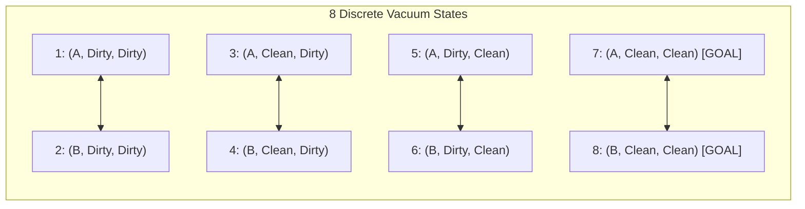

##### a) State Representation
A state is represented as a 3-tuple:
$$s = (\text{Location}, \text{Status}_A, \text{Status}_B)$$
where:
*   $\text{Location} \in \{A, B\}$: Current location of the vacuum agent.
*   $\text{Status}_A, \text{Status}_B \in \{\text{Clean}, \text{Dirty}\}$: Dirt condition of each room.
*   **Total States:** $2 \times 2 \times 2 = \mathbf{8 \text{ discrete states}}$.

##### b) Initial State ($s_0$)
Any arbitrary state, typically:
$$s_0 = (A, \text{Dirty}, \text{Dirty})$$

##### c) Set of Actions ($A$)
$$A = \{\operatorname{Left}, \operatorname{Right}, \operatorname{Suck}\}$$

##### d) Transition Model ($T$)
*   $\operatorname{Suck}$: If room is $\text{Dirty}$, it becomes $\text{Clean}$; otherwise no change.
*   $\operatorname{Left}$: Sets location to $A$ (if already at $A$, no change).
*   $\operatorname{Right}$: Sets location to $B$ (if already at $B$, no change).

##### e) Goal Test ($G$)
Both rooms must be clean:
$$G(s) = \text{True} \iff s \in \big\{ (A, \text{Clean}, \text{Clean}), \; (B, \text{Clean}, \text{Clean}) \big\}$$

##### f) Path Cost Function ($c$)
Each action has a uniform step cost:
$$c(s, a, s') = 1$$

:::tip

**Examiner's Note**

Award 3 marks for the formal 5-tuple state space definition $\langle S, s_0, A, T, G, c \rangle$ and 5 marks for formalizing the 8 discrete states of the Vacuum World with transitions and goal criteria.

:::

---

### Question 21.b (8 Marks)

:::info

**Question Statement**

Apply the problem characteristics and identify the problem type for the given scenario along with appropriate explanation. **(8 Marks)**  
(i) Solving the equation $\int (x^2 + 3x + \sin 2x \cos 2x) \, dx$ **(2 Marks)**  
(ii) Backtracking **(2 Marks)**  
(iii) Tracking the mobility of an animal in the forest **(2 Marks)**  
(iv) Ambiguity in a sentence EG: Chicken is ready to eat **(2 Marks)**

:::

---

### Solution 21.b (8 Marks)

Rich & Knight classify AI problems along foundational problem characteristics: decomposability, recoverability of steps, predictability of the universe, and knowledge consistency.

#### (i) Solving $\int (x^2 + 3x + \sin 2x \cos 2x) \, dx$ (2 Marks)
*   **Problem Characteristics:** **Decomposable**, **Ignorable (Steps can be ignored/undone)**, **Deterministic and Predictable**.
*   **Explanation:** Symbolic integration is **decomposable** because the integral can be broken down into independent sub-integrals:
    $$\int x^2 \, dx + \int 3x \, dx + \frac{1}{2} \int \sin 4x \, dx$$
    Each sub-problem is solved independently using standard integration rules and combined: $\frac{x^3}{3} + \frac{3x^2}{2} - \frac{\cos 4x}{8} + C$. It is **ignorable** because exploring an incorrect symbolic identity does not damage the original equation; one simply restarts or applies an alternative substitution.

---

#### (ii) Backtracking (2 Marks)
*   **Problem Characteristics:** **Recoverable**, **Systematic State-Space Search**.
*   **Explanation:** Backtracking applies to **recoverable problems** (such as the 8-Queens problem, puzzle solving, or theorem proving) where making an exploratory move may lead to a dead end. Because prior state configurations are preserved on a call stack, the agent can undo moves and restore previous states to explore alternative branches systematically.

---

#### (iii) Tracking the Mobility of an Animal in the Forest (2 Marks)
*   **Problem Characteristics:** **Partially Observable**, **Stochastic**, **Continuous**, **Dynamic**, and **Irrecoverable**.
*   **Explanation:** The physical forest environment is non-stationary and partially occluded (dense foliage, sensor blind spots). Animal motion is continuous and governed by unpredictable probabilistic choices. The problem is **irrecoverable** because real-world time moves forward irreversibly; missed animal detections cannot be physically undone and require state estimation via Hidden Markov Models (HMMs) or Particle Filters.

---

#### (iv) Ambiguity in the Sentence "Chicken is ready to eat" (2 Marks)
*   **Problem Characteristics:** **Context-Dependent**, **Natural Language Ambiguity (Syntactic & Semantic)**.
*   **Explanation:** This represents a classic NLP ambiguity problem with two valid semantic interpretations:
    1. *The cooked chicken meat is ready for humans to consume.*
    2. *The living bird (chicken) is hungry and ready to consume feed.*
    Resolving this requires common-sense world knowledge, situational context, and semantic role labeling to determine whether "chicken" serves as the **Agent** or the **Theme/Patient** of the predicate "eat".

:::tip

**Examiner's Note**

Ensure each sub-part explicitly names the specific problem characteristics (e.g., decomposable, recoverable, partially observable, ambiguous) along with a clear technical justification.

:::

---

### Question 22.a (8 Marks)

:::info

**Question Statement**

Consider the given graph and find the route to traverse from node A to destination D using breadth first search technique. Elucidate each step in detail with necessary sketch. **(8 Marks)**

```text
         (A)
        /   \
      (B)   (E)
      /     / \
    (C)   (F) (G)
    /
  ((D))
```

*Start Node:* $A$, *Destination Goal Node:* $D$

:::

---

### Solution 22.a (8 Marks)

#### 1. Breadth-First Search (BFS) Algorithmic Procedure (2 Marks)

Breadth-First Search systematically traverses a graph level-by-level using a **First-In, First-Out (FIFO) queue**:
1. Initialize queue `OPEN` containing start node $[A]$ and empty set `CLOSED`.
2. While `OPEN` is not empty:
   *   Dequeue front node $u$.
   *   If $u$ is the Goal Node ($D$), terminate and reconstruct the path.
   *   Add $u$ to `CLOSED`.
   *   Enqueue all unvisited child successors of $u$ into the rear of `OPEN` (left-to-right order).

---

#### 2. Step-by-Step Execution Trace (4 Marks)

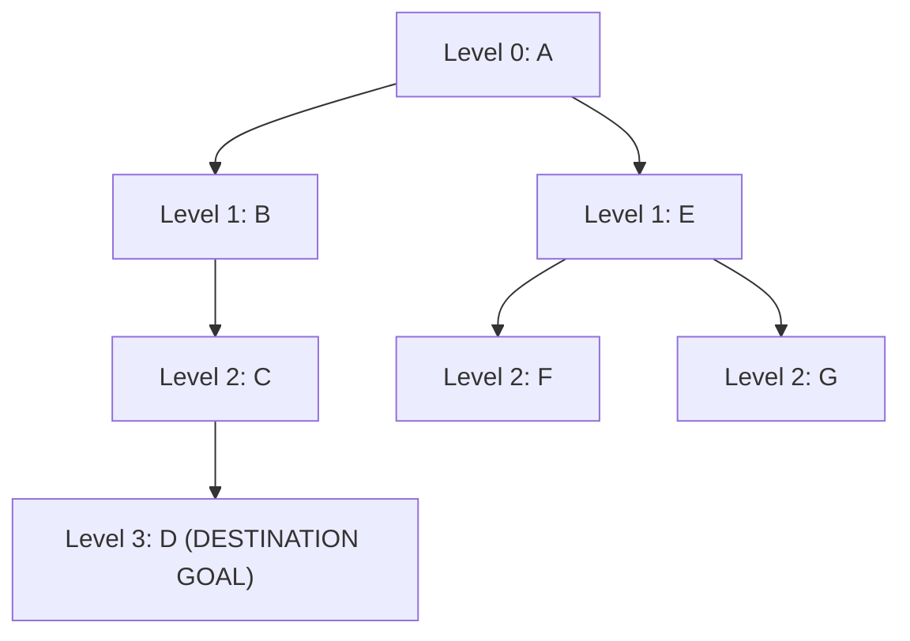

##### Trace Table

| Step | Node Dequeued | Action / Successors Generated | FIFO Queue State (Front $\to$ Rear) | Visited / Explored Set |
| :---: | :---: | :--- | :--- | :--- |
| **0** | — | Initialize with Root Node $A$ | `[A]` | `[]` |
| **1** | **A** | Not goal; enqueue children $B, E$ | `[B, E]` | `[A]` |
| **2** | **B** | Not goal; enqueue child $C$ | `[E, C]` | `[A, B]` |
| **3** | **E** | Not goal; enqueue children $F, G$ | `[C, F, G]` | `[A, B, E]` |
| **4** | **C** | Not goal; enqueue child $D$ | `[F, G, D]` | `[A, B, E, C]` |
| **5** | **F** | Leaf node; no children | `[G, D]` | `[A, B, E, C, F]` |
| **6** | **G** | Leaf node; no children | `[D]` | `[A, B, E, C, F, G]` |
| **7** | **D** | **Destination Goal Dequeued! Search Terminates.** | — | `[A, B, E, C, F, G, D]` |

---

#### 3. Traversal Sequence & Final Path (2 Marks)

*   **Node Traversal Sequence:**
    $$A \to B \to E \to C \to F \to G \to D$$
*   **Total Nodes Expanded:** 7 nodes.
*   **Final Solution Route:**
    $$\mathbf{A \to B \to C \to D}$$
*   **Path Length:** **3 edges** (Depth 3).

:::tip

**Examiner's Note**

Full marks require explicitly showing the level-by-level queue progression, drawing the search tree levels (Level 0 to Level 3), and stating the path $A \to B \to C \to D$.

:::

---

### Question 22.b (8 Marks)

:::info

**Question Statement**

You are developing a warehouse management system that uses robots to move items around the warehouse. The warehouse is represented as a grid, where each cell represents a location that the robot can occupy. Some cells are obstacles that the robot cannot pass through. How would you implement path finding for the robots using the A* algorithm? **(8 Marks)**

:::

---

### Solution 22.b (8 Marks)

#### 1. Warehouse Grid Problem Formulation (2 Marks)

*   **Grid Model:** A $2\text{D}$ coordinate grid $\mathcal{W} = \{ (x, y) \mid 0 \le x < W, 0 \le y < H \}$.
*   **State Representation:** Current robot coordinates $(x, y)$.
*   **Obstacles:** Static obstacles (storage shelves, walls, pillars) mapped into a set $\mathcal{O} \subset \mathcal{W}$. A cell is walkable if $(x, y) \notin \mathcal{O}$.
*   **Action Set:** 4-connected grid movements:
    $$A = \{ \operatorname{North}(0, 1), \; \operatorname{South}(0, -1), \; \operatorname{East}(1, 0), \; \operatorname{West}(-1, 0) \}$$
*   **Step Cost ($g$):** Uniform step cost $c = 1$ for each grid transition.

---

#### 2. Evaluation Function and Heuristic Design (3 Marks)

$A^*$ selects nodes minimizing the total estimated path cost:

$$f(n) = g(n) + h(n)$$

where:
*   $g(n)$: Exact cumulative distance traveled from the robot's pickup start location to cell $n$.
*   $h(n)$: Heuristic estimate from cell $n$ to target delivery station $(x_g, y_g)$.

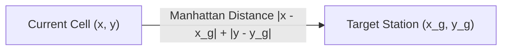

##### Admissible & Consistent Heuristic: Manhattan Distance
For a 4-connected grid without diagonal moves, the **Manhattan Distance** ($L_1$ norm) is perfectly admissible and monotonic:
$$h(n) = \lvert x - x_g \rvert + \lvert y - y_g \rvert$$
*   *Admissibility Proof:* Because the robot cannot move faster than one grid step per transition, the straight-line Manhattan distance without obstacles is always $\le$ the actual path cost in the presence of obstacles ($h(n) \le h^*(n)$), guaranteeing path optimality.

---

#### 3. Algorithmic Implementation Steps (3 Marks)

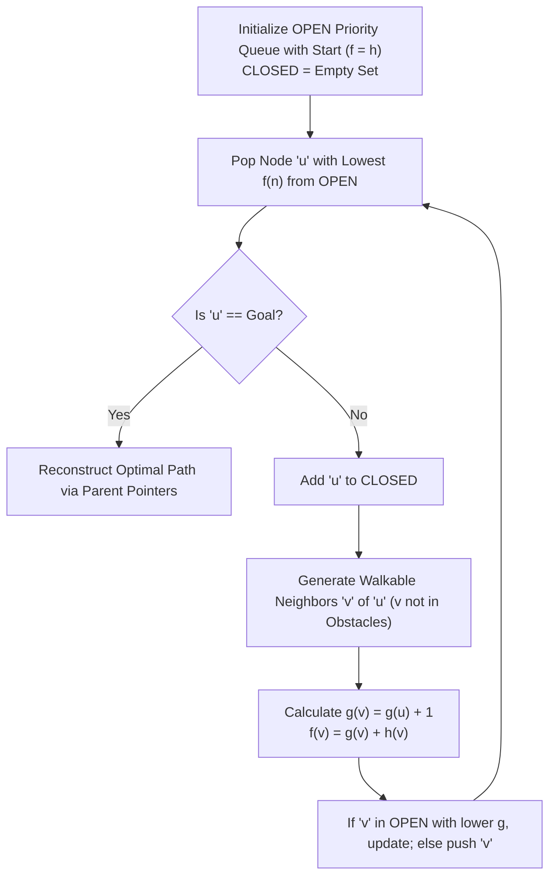

##### Algorithmic Pipeline
1. **Priority Queue (`OPEN`):** Stores candidate cells ordered by $f(n)$. Ties are broken by choosing the node with lower $h(n)$ (moving closer to the goal).
2. **Explored Set (`CLOSED`):** Stores already evaluated coordinates to avoid revisiting cycles.
3. **Collision Avoidance (Multi-Robot Extension):**  
   For multiple robots, extend the state to **Space-Time coordinates** $(x, y, t)$ (Time-Space $A^*$), ensuring no two robots occupy the same coordinate $(x, y)$ at the same time step $t$, and avoiding edge-swapping collisions.

:::tip

**Examiner's Note**

Ensure your answer includes the formal grid definition, justifies Manhattan distance as an admissible heuristic for 4-connected movement, outlines the priority queue loop, and mentions space-time coordinates for multi-robot safety.

:::

---

### Question 23.a (8 Marks)

:::info

**Question Statement**

Describe the role of alpha-beta pruning in adversarial search. How does it improve the efficiency of the minimax algorithm? **(8 Marks)**

:::

---

### Solution 23.a (8 Marks)

#### 1. Adversarial Search & The Minimax Bottleneck (2.5 Marks)

In two-player, zero-sum, perfect-information games (e.g., Chess, Checkers), the **Minimax algorithm** determines the optimal move by maximizing utility for player MAX and minimizing utility for player MIN:

$$
\operatorname{Minimax}(s) = \begin{cases}
\operatorname{Utility}(s) & \text{if } \operatorname{Terminal}(s) \\
\max_{a \in A(s)} \operatorname{Minimax}(\operatorname{Result}(s, a)) & \text{if } \operatorname{Player}(s) = \text{MAX} \\
\min_{a \in A(s)} \operatorname{Minimax}(\operatorname{Result}(s, a)) & \text{if } \operatorname{Player}(s) = \text{MIN}
\end{cases}
$$

*   **Complexity Bottleneck:** Exhaustive Minimax evaluates all $O(b^d)$ nodes in the game tree, where $b$ is the branching factor and $d$ is the search depth. For Chess ($b \approx 35, d \approx 80$), evaluating $35^{80} \approx 10^{123}$ nodes is computationally impossible.

---

#### 2. The Mechanics of Alpha-Beta Pruning (3 Marks)

Alpha-Beta pruning eliminates subtrees that cannot influence the final decision at the root by tracking two bounding values along the search path:
*   $\alpha$: The value of the **best choice found so far for MAX** (lower bound, initialized to $-\infty$).
*   $\beta$: The value of the **best choice found so far for MIN** (upper bound, initialized to $+\infty$).

##### The Pruning Condition
$$\mathbf{\text{If } \alpha \ge \beta, \quad \text{PRUNE remaining children.}}$$

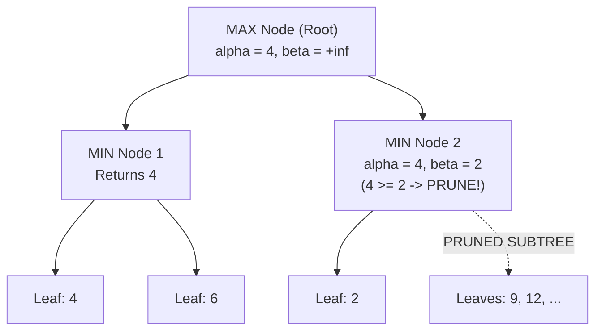

*   **$\alpha$-Cutoff:** At a MIN node, if a child yields a value $\le \alpha$, MIN will never select a value greater than this. Because MAX already has an option yielding $\alpha$ elsewhere, MAX will never select this branch. Remaining children are pruned.
*   **$\beta$-Cutoff:** At a MAX node, if a child yields a value $\ge \beta$, MAX will never pick a lower value. MIN will avoid this branch. Remaining children are pruned.

---

#### 3. Efficiency Improvements over Minimax (2.5 Marks)

1. **Exact Decision Invariance:**  
   Alpha-Beta pruning returns the exact same mathematical move and value as exhaustive Minimax:
   $$\operatorname{AlphaBeta}(\text{root}) \equiv \operatorname{Minimax}(\text{root})$$
2. **Computational Complexity Reduction:**
   *   *Worst-Case (Poor Move Ordering):* Time complexity remains $O(b^d)$.
   *   *Best-Case (Optimal Move Ordering):* Time complexity drops to:
       $$O\left(b^{d/2}\right) = O\left((\sqrt{b})^d\right)$$
3. **Practical Impact:**  
   Halving the effective branching factor allows game engines to search **twice as deep** within the exact same time limit, dramatically increasing tactical playing strength.

:::tip

**Examiner's Note**

Award full marks for stating the mathematical definition of $\alpha$ and $\beta$, the cutoff condition $\alpha \ge \beta$, and the best-case time complexity $O(b^{d/2})$.

:::

---

### Question 23.b (8 Marks)

:::info

**Question Statement**

Explain how the adaptive behavior and robustness influence the flexibility of the intelligent agent in a diversified environment. **(8 Marks)**

:::

---

### Solution 23.b (8 Marks)

In artificial intelligence agent architecture, operating successfully in a **diversified, non-stationary environment** requires three intertwined capabilities:

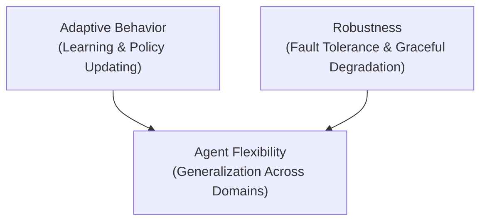

#### 1. Adaptive Behavior and Its Role (3 Marks)

*   **Definition:** Adaptive behavior is the capability of an agent to modify its internal decision policies, parameters, and belief representations over time based on environmental experience and feedback.
*   **Architectural Mechanism:** Mediated by the **Learning Element** (in a learning agent) interacting with a **Critic**:
    $$\text{Percept} \to \text{Critic Evaluates Performance} \to \text{Updates Policy } \pi(a \mid s)$$
*   **Influence on Flexibility:**
    *   Enables the agent to operate in non-stationary environments where transition dynamics change over time (e.g., road friction changing from dry asphalt to icy conditions).
    *   Replaces rigid hand-coded rules with continuous optimization, allowing an autonomous vehicle to adapt to varying regional driving cultures.

---

#### 2. Robustness and Its Role (3 Marks)

*   **Definition:** Robustness is the degree to which an intelligent agent can maintain acceptable performance despite sensor noise, partial observability, hardware faults, and unexpected external disturbances.
*   **Architectural Mechanism:**
    *   *Sensor Fusion & Redundancy:* Combining multiple sensor inputs (e.g., LiDAR + Radar + Cameras) so that failure of an optical sensor does not blind the agent.
    *   *Fault Tolerance & Fallback Modes:* Safe-state transitions (e.g., pulling over safely if localization fails).
*   **Influence on Flexibility:**
    *   Prevents catastrophic failures when encountering unseen edge cases.
    *   Ensures that unexpected environmental anomalies do not crash the system.

---

#### 3. Holistic Synthesis: Achieving Agent Flexibility (2 Marks)

| Dimension | Adaptive Behavior | Robustness | Resulting Agent Flexibility |
| :--- | :--- | :--- | :--- |
| **Focus** | Long-term learning and policy modification | Short-term fault tolerance and noise resilience | Broad domain generalization |
| **Failure Response** | Updates model to prevent repeating mistakes | Contains errors to degrade gracefully | Autonomous operation without human intervention |
| **Real-World Impact** | Robot learns to walk on sand, mud, and ice | Robot maintains balance if kicked or a motor stalls | Universal autonomous locomotion |

:::tip

**Examiner's Note**

Define Adaptive Behavior and Robustness explicitly, explain how they interact via learning elements and sensor fusion, and contrast their roles in achieving overall agent flexibility.

:::

---

### Question 24.a (8 Marks)

:::info

**Question Statement**

The agent enters a 5x5 grid Wumpus world. It senses a stench in squares (2,1) and (4,3), and a breeze in squares (1,3) and (3,4). Additionally, it observes glitter in square (5,4). What are the possible locations of the Wumpus and pits, and how should the agent proceed to safely reach the gold? **(8 Marks)**

:::

---

### Solution 24.a (8 Marks)

#### 1. Environmental Sensing Constraints on a 5x5 Grid (3 Marks)

Let grid coordinates be $(r, c)$ where $r \in \{1 \dots 5\}$ (Row) and $c \in \{1 \dots 5\}$ (Column). The agent starts safely at $(1, 1)$.

```text
Row 5  [ . ]   [ . ]   [ . ]   [GLITTER] [ . ]   <-- (5, 4) contains GOLD!
Row 4  [ . ]   [ . ]  [STENCH]  [ . ]    [ . ]   <-- (4, 3) perceives Stench
Row 3  [ . ]   [ . ]   [ . ]   [BREEZE]  [ . ]   <-- (3, 4) perceives Breeze
Row 2 [STENCH] [ . ]   [ . ]    [ . ]    [ . ]   <-- (2, 1) perceives Stench
Row 1  [START] [ . ]  [BREEZE]  [ . ]    [ . ]   <-- (1, 3) perceives Breeze
       Col 1   Col 2   Col 3    Col 4    Col 5
```

##### a) Possible Wumpus Locations
A stench is perceived in a square if and only if a Wumpus occupies an adjacent square:
*   Adjacent to $(2, 1)$: $\operatorname{Adj}(2, 1) = \{ (1, 1), (2, 2), (3, 1) \}$.  
    Since $(1, 1)$ is the safe start square ($\neg W_{1,1}$), **Wumpus 1 is at $(2, 2)$ or $(3, 1)$**.
*   Adjacent to $(4, 3)$: $\operatorname{Adj}(4, 3) = \{ (3, 3), (5, 3), (4, 2), (4, 4) \}$.  
    Since the Manhattan distance between $(2, 1)$ and $(4, 3)$ is $\lvert 2-4 \rvert + \lvert 1-3 \rvert = 4$, they share zero common adjacent cells.  
    $\implies$ The environment contains **two distinct Wumpus hazards**:
    *   $W_1 \in \{ (2, 2), (3, 1) \}$
    *   $W_2 \in \{ (3, 3), (5, 3), (4, 2), (4, 4) \}$

##### b) Possible Pit Locations
A breeze is perceived if and only if a Pit occupies an adjacent square:
*   Adjacent to $(1, 3)$: $\operatorname{Adj}(1, 3) = \{ (1, 2), (1, 4), (2, 3) \}$.  
    $\implies$ **$\text{Pit}_1 \in \{ (1, 2), (1, 4), (2, 3) \}$**.
*   Adjacent to $(3, 4)$: $\operatorname{Adj}(3, 4) = \{ (2, 4), (4, 4), (3, 3), (3, 5) \}$.  
    $\implies$ **$\text{Pit}_2 \in \{ (2, 4), (4, 4), (3, 3), (3, 5) \}$**.

---

#### 2. Gold Localization (1 Mark)
*   **Glitter at $(5, 4)$:** The glitter percept occurs in the exact square containing the gold.  
    $\implies$ **The Gold is located at square $(5, 4)$.**

---

#### 3. Step-by-Step Safe Navigation Strategy to Reach the Gold (4 Marks)

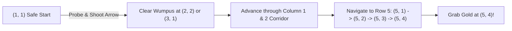

1. **Clear Immediate Path with Arrow:**  
   The agent at $(1, 1)$ faces East toward $(1, 2)$. If safe, it moves to $(1, 2)$. Alternatively, facing North toward $(2, 1)$, the agent shoots an arrow northward into $(2, 1)$ and $(3, 1)$. A scream confirms the Wumpus at $(3, 1)$ is dead, making $(3, 1)$ completely safe.
2. **Safe Perimeter Flanking Route:**  
   Avoid the central hazard cluster around $(3, 3), (3, 4), (4, 3)$ by navigating along the outer cleared perimeter:
   *   Move $(1, 1) \to (2, 1)$ (after killing Wumpus or verifying $(2, 2)$).
   *   Move northward along Column 1: $(2, 1) \to (3, 1) \to (4, 1) \to (5, 1)$ (Squares $(4, 1)$ and $(5, 1)$ perceive no breeze, confirming they are pit-free).
   *   Traverse eastward along Row 5: $(5, 1) \to (5, 2) \to (5, 3) \to \mathbf{(5, 4)}$.
3. **Goal Achievement:**  
   At $(5, 4)$, execute $\operatorname{Grab}$ action to secure the gold, and safely retrace the known path backward to $(1, 1)$ to exit.

:::tip

**Examiner's Note**

Identify that the Manhattan distance between the two stench percepts means two distinct Wumpuses exist, list the candidate pit squares, state the gold is at $(5, 4)$, and detail a safe perimeter navigation corridor.

:::

---

### Question 24.b (8 Marks)

:::info

**Question Statement**

Discuss the challenges associated with applying uncertain knowledge and reasoning methods to simple decision-making in AI. How can these challenges be mitigated? **(8 Marks)**

:::

---

### Solution 24.b (8 Marks)

#### 1. Challenges of Uncertain Knowledge and Reasoning (4 Marks)

In real-world environments, pure classical First-Order Logic fails because agents encounter **uncertainty** arising from three fundamental limitations:

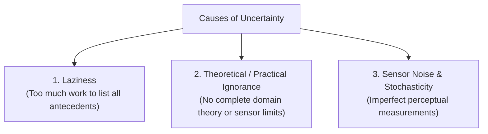

1. **The Qualification Problem:**  
   It is impossible to enumerate all preconditions required for an action to succeed (e.g., when starting a car: battery charged, fuel in tank, ignition functional, no potato in tailpipe).
2. **Computational Intractability of Full Joint Distributions:**  
   For $n$ Boolean variables, the full joint probability distribution requires storing $2^n - 1$ parameters. Computing marginal queries by exhaustive summation takes $O(2^n)$ time.
3. **The Knowledge Acquisition Bottleneck:**  
   Human domain experts struggle to provide precise, calibrated numerical probabilities (e.g., $P(\text{Cavity} \mid \text{Toothache})$).
4. **Non-Monotonicity and Contradictory Evidence:**  
   New observations can invalidate prior probabilistic beliefs, requiring complex belief revision algorithms.

---

#### 2. Mitigation Strategies in AI (4 Marks)

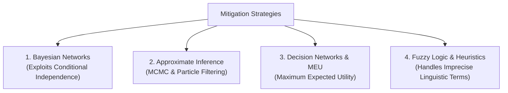

1. **Bayesian Networks & Conditional Independence:**  
   Exploits conditional independence properties (d-separation). By factoring the joint distribution into local Conditional Probability Tables (CPTs):
   $$P(X_1, \dots, X_n) = \prod_{i=1}^n P(X_i \mid \operatorname{Parents}(X_i))$$
   the parameter requirement shrinks from exponential $O(2^n)$ to linear or polynomial $O(n \cdot 2^k)$ (where $k$ is maximum parents).
2. **Approximate Sampling (MCMC & Particle Filtering):**  
   Avoids exact summation over exponential state spaces by using Monte Carlo sampling algorithms (Likelihood Weighting, Gibbs Sampling), providing scalable real-time probabilistic estimates.
3. **Maximum Expected Utility (MEU):**  
   Decision theory combines probability theory with utility theory:
   $$\operatorname{Action}^* = \arg\max_{a} \sum_{s'} P(s' \mid s, a) \, U(s')$$
   allowing agents to make rational trade-offs between risks and rewards under uncertainty.

:::tip

**Examiner's Note**

Award 4 marks for detailing the three causes of uncertainty (laziness, ignorance, qualification problem, exponential joint distributions) and 4 marks for explaining Bayesian networks, MCMC sampling, and Maximum Expected Utility as mitigations.

:::

---

### Question 25.a (8 Marks)

:::info

**Question Statement**

Describe how mean ends analysis can be applied to solve complex scenarios in the blocks world. **(8 Marks)**

:::

---

### Solution 25.a (8 Marks)

#### 1. Concept of Means-Ends Analysis (MEA) (3 Marks)

**Means-Ends Analysis (MEA)** is a goal-directed planning strategy (introduced in GPS by Newell & Simon) that centers on **difference reduction**:

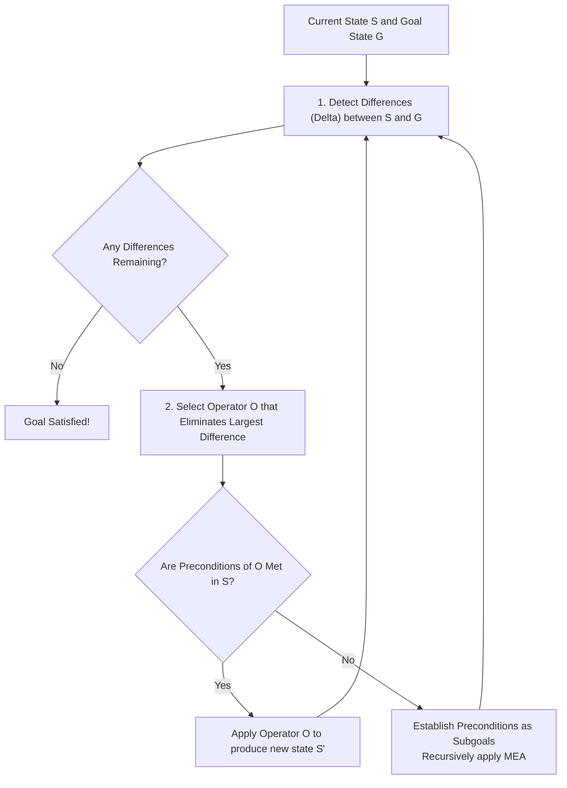

*   **Subgoaling:** When an operator capable of reducing a primary difference cannot fire because its preconditions are not met, MEA sets those preconditions as **intermediate subgoals**, planning backward recursively.

---

#### 2. Application to the Blocks World Domain (5 Marks)

##### a) Domain Predicates & Operators
*   Predicates: $\operatorname{On}(A, B)$, $\operatorname{OnTable}(A)$, $\operatorname{Clear}(A)$, $\operatorname{Holding}(A)$, $\operatorname{ArmEmpty}$.
*   Operators:
    *   $\operatorname{Stack}(A, B)$: Precond: $\operatorname{Holding}(A) \land \operatorname{Clear}(B)$. Effect: $\operatorname{On}(A, B) \land \operatorname{ArmEmpty} \land \neg \operatorname{Holding}(A) \land \neg \operatorname{Clear}(B)$.
    *   $\operatorname{Unstack}(A, B)$: Precond: $\operatorname{On}(A, B) \land \operatorname{Clear}(A) \land \operatorname{ArmEmpty}$. Effect: $\operatorname{Holding}(A) \land \operatorname{Clear}(B) \land \neg \operatorname{On}(A, B) \land \neg \operatorname{ArmEmpty}$.

---

##### b) Solving a Complex Scenario: The Sussman Anomaly

The Sussman Anomaly illustrates a classic block-stacking dilemma where naive linear planners get trapped in destructive cycles:

```text
Initial State:            Goal State:
   [ C ]                     [ A ]
   [ A ]   [ B ]             [ B ]
  ==============            [ C ]
      Table                ==============
                                Table
```

*   **Initial State:** $\operatorname{On}(C, A), \; \operatorname{OnTable}(A), \; \operatorname{OnTable}(B), \; \operatorname{Clear}(C), \; \operatorname{Clear}(B), \; \operatorname{ArmEmpty}$.
*   **Goal State:** $\operatorname{On}(A, B) \land \operatorname{On}(B, C)$.

##### MEA Step-by-Step Resolution
1. **Identify Primary Differences:**  
   Goal requires $\operatorname{On}(A, B)$ and $\operatorname{On}(B, C)$.
2. **Attempt Subgoal 1 ($\operatorname{On}(B, C)$):**
   *   Requires $\operatorname{Stack}(B, C)$.
   *   Precondition: $\operatorname{Clear}(C)$ is True, but $B$ is on table. Execute $\operatorname{Pickup}(B)$, then $\operatorname{Stack}(B, C)$.
   *   *Conflict:* Now $B$ is on $C$, but $A$ is trapped under $C$ in the initial state! Trying to achieve $\operatorname{On}(A, B)$ requires unstacking $C$, which undoes $\operatorname{On}(B, C)$!
3. **MEA Subgoal Re-ordering via Difference Reduction:**
   *   MEA detects that $\operatorname{Clear}(A)$ is a prerequisite for moving $A$.
   *   **Step 1:** Apply $\operatorname{Unstack}(C, A)$ and $\operatorname{Putdown}(C)$ on table.  
       *Result:* Both $A, B, C$ are now clear on the table!
   *   **Step 2:** Apply $\operatorname{Pickup}(B)$ and $\operatorname{Stack}(B, C)$.  
       *Result:* Subgoal $\operatorname{On}(B, C)$ achieved!
   *   **Step 3:** Apply $\operatorname{Pickup}(A)$ and $\operatorname{Stack}(A, B)$.  
       *Result:* Subgoal $\operatorname{On}(A, B)$ achieved!
   *   **Final State Reached:** $[A \text{ on } B \text{ on } C]$.

:::tip

**Examiner's Note**

Detail the MEA difference-reduction cycle, define Blocks World predicates and operators, and illustrate the resolution of the Sussman Anomaly without entering infinite loops.

:::

---

### Question 25.b (8 Marks)

:::info

**Question Statement**

Explain the architecture of an Expert System with a neat diagram and discuss its main components. **(8 Marks)**

:::

---

### Solution 25.b (8 Marks)

#### 1. Architecture of an Expert System (3 Marks)

An **Expert System** emulates human decision-making by coupling a specialized knowledge base with an automated reasoning engine.

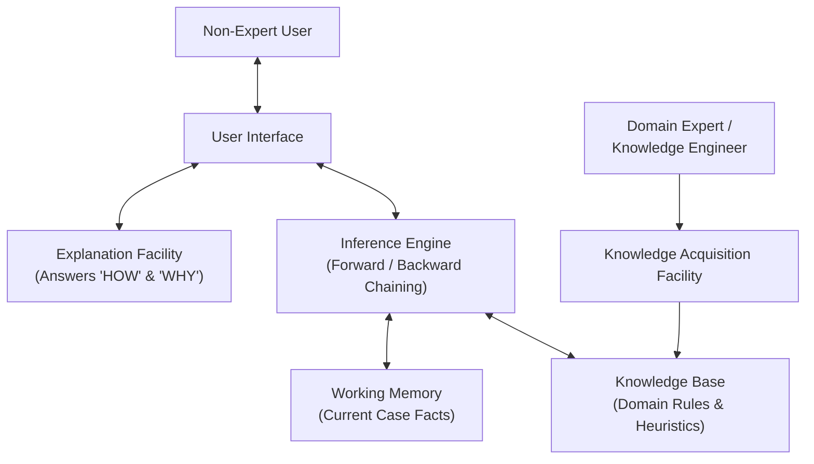

---

#### 2. Detailed Functionality of Core Components (5 Marks)

1. **Knowledge Base (KB):**  
   The centralized repository of specialized domain knowledge encoded as production rules:
   $$\text{IF } \langle\text{symptoms / premises}\rangle \implies \text{THEN } \langle\text{diagnosis / action}\rangle$$
2. **Inference Engine (IE):**  
   The computational reasoning brain that executes inference:
   *   *Pattern Matcher:* Compares working memory against rule antecedents.
   *   *Conflict Resolution:* Selects a single rule to fire when multiple rules match.
   *   *Execution:* Executes via **Forward Chaining** (data-driven) or **Backward Chaining** (goal-driven).
3. **Working Memory (Fact Database):**  
   Stores session-specific data, user answers, and intermediate deduced assertions for the active session.
4. **Explanation Facility (Justifier):**  
   Provides transparency by explaining **WHY** information is needed and **HOW** conclusions were derived.
5. **User Interface:**  
   Facilitates interactive dialogue between end users and the system.
6. **Knowledge Acquisition Facility:**  
   Enables knowledge engineers to update and expand the knowledge base without modifying the inference code.

:::tip

**Examiner's Note**

Award 3 marks for the block diagram and 5 marks for defining all six components, noting the structural separation between the Knowledge Base and the Inference Engine.

:::

---

## Part C: Comprehensive Search Problems (15 Marks)

### Question 26 (15 Marks)

:::info

**Question Statement**

There are three missionaries (M) and three cannibals (C) on one side of a river. They need to cross to the other side using a boat that can carry at most two people. If the number of missionaries ever becomes less than the number of cannibals on either side of the river, the cannibals will eat the missionaries. Determine the sequence of trips to safely transport everyone to the other side. **(15 Marks)**

:::

---

### Solution 26 (15 Marks)

#### 1. Formal State-Space Problem Formulation (4 Marks)

##### a) State Representation
The state is represented as a 3-tuple:

$$s = (M, C, B)$$

where:
*   $M \in \{0, 1, 2, 3\}$: Number of missionaries on the Starting (Left) Bank.
*   $C \in \{0, 1, 2, 3\}$: Number of cannibals on the Starting (Left) Bank.
*   $B \in \{1, 0\}$: Position of the boat ($1$ = Left Bank; $0$ = Right Bank).

The counts on the Right Bank are implicitly $M_{\text{right}} = 3 - M$ and $C_{\text{right}} = 3 - C$.

##### b) Initial and Goal States
*   **Initial State:** $s_0 = (3, 3, 1)$
*   **Goal State:** $s_G = (0, 0, 0)$

##### c) Safety Invariant Constraint
Missionaries must not be outnumbered by cannibals on either bank:
$$\operatorname{Safe}(M, C) \iff (M == 0 \lor M \ge C) \;\land\; ((3 - M) == 0 \lor (3 - M) \ge (3 - C))$$

##### d) Set of Boat Actions
The boat carries 1 or 2 people:
$$\mathcal{O} = \{ (1, 0), (2, 0), (0, 1), (0, 2), (1, 1) \}$$

---

#### 2. Optimal 11-Trip Solution Sequence (9 Marks)

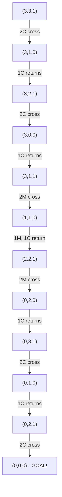

##### Step-by-Step Execution Trace

| Trip # | State $(M, C, B)$ | Left Bank | Boat Cargo | Right Bank | Safety Verification |
| :---: | :---: | :---: | :---: | :---: | :--- |
| **0** | $(3, 3, 1)$ | $3M, 3C$, Boat | — | Empty | Initial State |
| **1** | $(3, 1, 0)$ | $3M, 1C$ | $2C \to$ | $2C$, Boat | Left: $3M \ge 1C$; Right: $0M$ (Safe) |
| **2** | $(3, 2, 1)$ | $3M, 2C$, Boat | $\leftarrow 1C$ | $1C$ | Left: $3M \ge 2C$; Right: $0M$ (Safe) |
| **3** | $(3, 0, 0)$ | $3M, 0C$ | $2C \to$ | $3C$, Boat | Left: $3M \ge 0C$; Right: $0M$ (Safe) |
| **4** | $(3, 1, 1)$ | $3M, 1C$, Boat | $\leftarrow 1C$ | $2C$ | Left: $3M \ge 1C$; Right: $0M$ (Safe) |
| **5** | $(1, 1, 0)$ | $1M, 1C$ | $2M \to$ | $2M, 2C$, Boat | Left: $1M \ge 1C$; Right: $2M \ge 2C$ (Safe) |
| **6** | $(2, 2, 1)$ | $2M, 2C$, Boat | $\leftarrow 1M, 1C$ | $1M, 1C$ | Left: $2M \ge 2C$; Right: $1M \ge 1C$ (Safe) |
| **7** | $(0, 2, 0)$ | $0M, 2C$ | $2M \to$ | $3M, 1C$, Boat | Left: $0M$; Right: $3M \ge 1C$ (Safe) |
| **8** | $(0, 3, 1)$ | $0M, 3C$, Boat | $\leftarrow 1C$ | $3M, 0C$ | Left: $0M$; Right: $3M \ge 0C$ (Safe) |
| **9** | $(0, 1, 0)$ | $0M, 1C$ | $2C \to$ | $3M, 2C$, Boat | Left: $0M$; Right: $3M \ge 2C$ (Safe) |
| **10** | $(0, 2, 1)$ | $0M, 2C$, Boat | $\leftarrow 1C$ | $3M, 1C$ | Left: $0M$; Right: $3M \ge 1C$ (Safe) |
| **11** | $\mathbf{(0, 0, 0)}$ | Empty | $2C \to$ | $3M, 3C$, Boat | **All 6 Crossed! Goal Achieved.** |

---

#### 3. Critical Analytical Insights (2 Marks)

*   **Optimal Path Length:** Exactly **11 crossings** (minimal possible trips).
*   **The Crucial Turning Point (Trip 6):**  
    At Trip 6, moving from $(1, 1, 0)$ back to $(2, 2, 1)$ requires transporting **one missionary and one cannibal back to the starting bank**. Without this counter-intuitive step, the missionaries on the right bank would be eaten if only cannibals returned, or the missionaries on the left bank would be outnumbered if only missionaries returned.

:::tip

**Examiner's Note**

Award 4 marks for defining the state tuple $(M, C, B)$ and safety constraint, 9 marks for the complete 11-step trace table verifying safety at each bank, and 2 marks for highlighting the counter-intuitive return move at Trip 6.

:::

---

### Question 27 (15 Marks)

:::info

**Question Statement**

Given a weighted graph, a source node and a destination node. The task is to find the shortest path from the source node (P) to the destination node (S) using uniform cost search. **(15 Marks)**

```text
       7
 (V2)-----(V4)
 9/| \3  /| \8
 / |  \ / |  \
(V1)2  X 1|4 (V6)
 4\ | / \ |  /2
  v| v   vv v
 (V3)-----(V5)
       6
```

*Edge Weights:*  
$(V_1, V_2): 9, \quad (V_1, V_3): 4$  
$(V_2, V_3): 2, \quad (V_2, V_4): 7, \quad (V_2, V_5): 3$  
$(V_3, V_4): 1, \quad (V_3, V_5): 6$  
$(V_4, V_5): 4, \quad (V_4, V_6): 8$  
$(V_5, V_6): 2$

*Source Node:* $P = V_1$  
*Destination Node:* $S = V_6$

:::

---

### Solution 27 (15 Marks)

#### 1. Uniform Cost Search (UCS) Algorithmic Procedure (3 Marks)

Uniform Cost Search explores the state space in order of increasing cumulative path cost $g(n)$:
1. Initialize a Priority Queue `PQ` storing tuples $(g(u), u, \text{Path})$ keyed on minimum cost $g(u)$.
2. Push $(0, V_1, [V_1])$ into `PQ`. Initialize `EXPLORED = {}`.
3. While `PQ` is not empty:
   *   Dequeue the entry $(g(u), u, \text{Path})$ with the minimum cost.
   *   **Goal Test:** If $u == V_6$, terminate immediately and return the optimal path and cost $g(u)$.
   *   If $u \notin \text{EXPLORED}$:
       *   Insert $u$ into `EXPLORED`.
       *   For each adjacent neighbor $v$ of $u$ with edge cost $w(u, v)$:
           *   If $v \notin \text{EXPLORED}$, calculate $g(v) = g(u) + w(u, v)$ and insert $(g(v), v, \text{Path} + [v])$ into `PQ`.
4. If `PQ` empties, return failure.

---

#### 2. Step-by-Step Execution Trace (10 Marks)

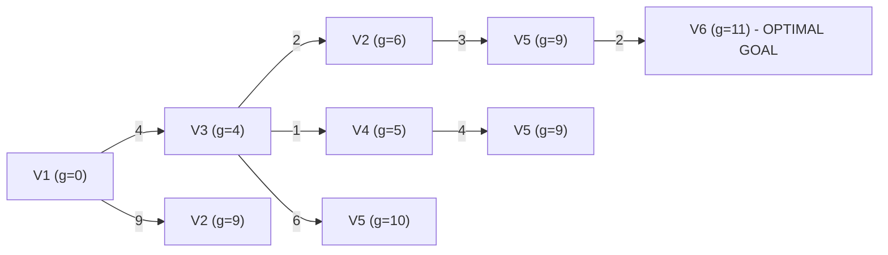

##### Trace Table

| Step | Dequeued Entry $(g, u, \text{Path})$ | Explored Set | Neighbors Generated & Enqueued $(g(v) = g(u) + w)$ | Priority Queue Contents (Ordered by $g$) |
| :---: | :--- | :--- | :--- | :--- |
| **0** | — | `[]` | Push $(0, V_1, [V_1])$ | `[(0, V1)]` |
| **1** | **(0, V1, [V1])** | `[V1]` | $(4, V_3, [V_1, V_3])$<br/>$(9, V_2, [V_1, V_2])$ | `[(4, V3), (9, V2)]` |
| **2** | **(4, V3, [V1, V3])** | `[V1, V3]` | $(4+1=5, V_4, [V_1, V_3, V_4])$<br/>$(4+2=6, V_2, [V_1, V_3, V_2])$<br/>$(4+6=10, V_5, [V_1, V_3, V_5])$ | `[(5, V4), (6, V2), (9, V2), (10, V5)]` |
| **3** | **(5, V4, [V1, V3, V4])** | `[V1, V3, V4]` | $(5+4=9, V_5, [V_1, V_3, V_4, V_5])$<br/>$(5+7=12, V_2, [V_1, V_3, V_4, V_2])$<br/>$(5+8=13, V_6, [V_1, V_3, V_4, V_6])$ | `[(6, V2), (9, V2), (9, V5_via_V4), (10, V5), (12, V2), (13, V6)]` |
| **4** | **(6, V2, [V1, V3, V2])** | `[V1, V3, V4, V2]` | $(6+3=9, V_5, [V_1, V_3, V_2, V_5])$<br/>$(6+7=13, V_4 \to \text{Explored})$ | `[(9, V2_direct), (9, V5_via_V4), (9, V5_via_V2), (10, V5), (13, V6)]` |
| **5** | **(9, V2, [V1, V2])** | `[V1, V3, V4, V2]` | Already explored; discard | `[(9, V5_via_V4), (9, V5_via_V2), (10, V5), (13, V6)]` |
| **6** | **(9, V5, [V1, V3, V4, V5])** | `[V1, V3, V4, V2, V5]` | $(9+2=11, V_6, [V_1, V_3, V_4, V_5, V_6])$<br/>$(9+4=13, V_4 \to \text{Explored})$ | `[(9, V5_via_V2), (10, V5), (11, V6), (13, V6)]` |
| **7** | **(9, V5, [V1, V3, V2, V5])** | `[V1, V3, V4, V2, V5]` | $(9+2=11, V_6, [V_1, V_3, V_2, V_5, V_6])$ | `[(10, V5), (11, V6_via_V4), (11, V6_via_V2), (13, V6)]` |
| **8** | **(10, V5, [V1, V3, V5])** | `[V1, V3, V4, V2, V5]` | Already explored; discard | `[(11, V6_via_V4), (11, V6_via_V2), (13, V6)]` |
| **9** | **(11, V6, [V1, V3, V4, V5, V6])** | `[... V6]` | **GOAL DEQUEUED! Search Terminates.** | — |

---

#### 3. Optimal Path and Cost Summary (2 Marks)

The search terminates upon dequeuing node $V_6$ with minimum cost $11$.

##### Optimal Solution Paths (Both Cost 11)
$$\mathbf{V_1 \to V_3 \to V_4 \to V_5 \to V_6} \quad (\text{Cost: } 4 + 1 + 4 + 2 = \mathbf{11})$$
$$\mathbf{V_1 \to V_3 \to V_2 \to V_5 \to V_6} \quad (\text{Cost: } 4 + 2 + 3 + 2 = \mathbf{11})$$

*   **Optimal Path Cost:** $\mathbf{11}$
*   **Total Nodes Expanded:** 6 nodes ($V_1, V_3, V_4, V_2, V_5, V_6$).

:::tip

**Examiner's Note**

High marks require explicitly noting that $V_1$ branches first to $V_3$ (cost 4) rather than $V_2$ (cost 9), detailing the queue state ordered by $g(n)$, and identifying the minimum cost of 11 to reach destination $V_6$.

:::
