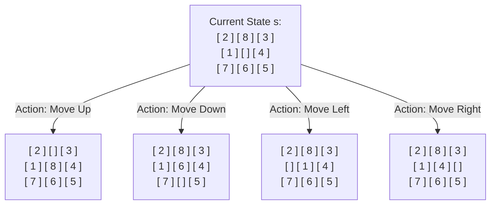
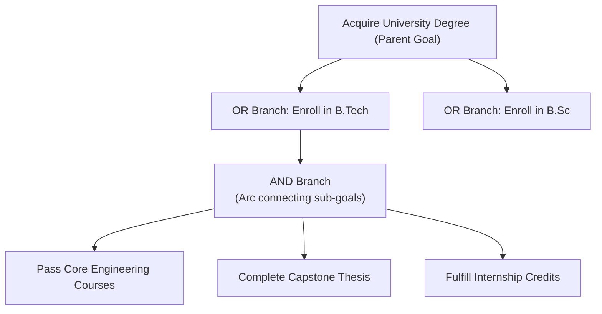
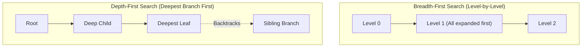
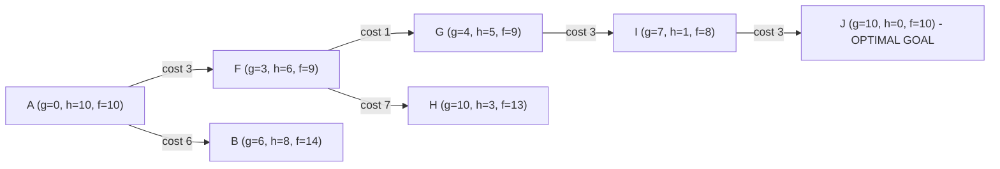
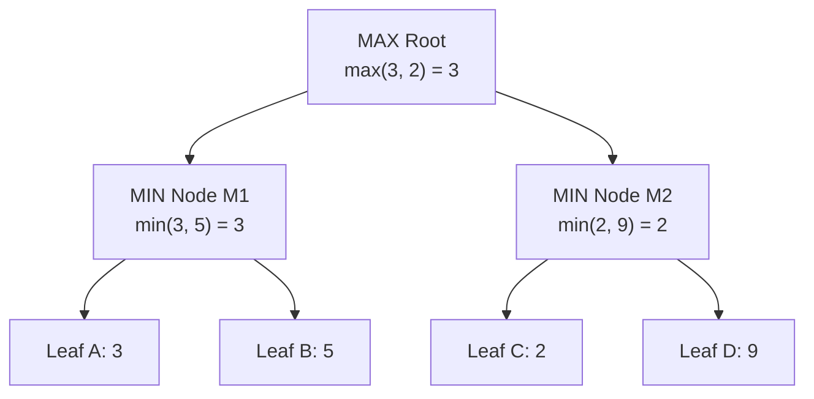
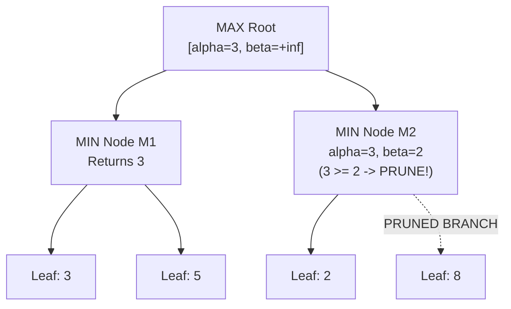
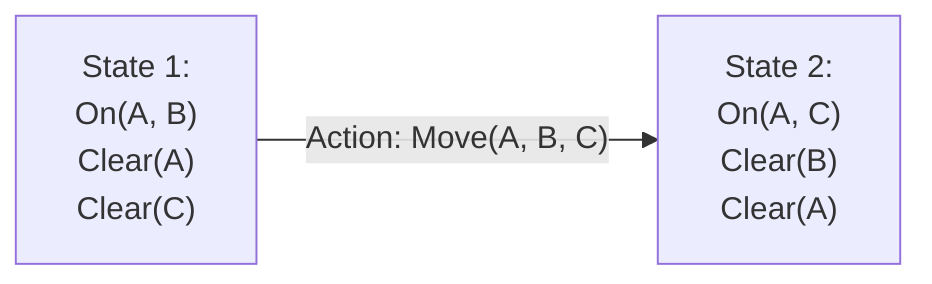
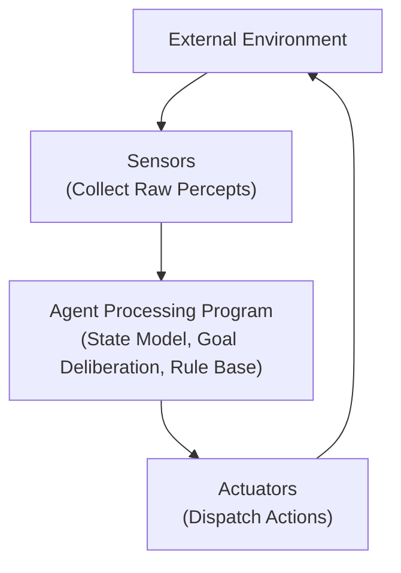
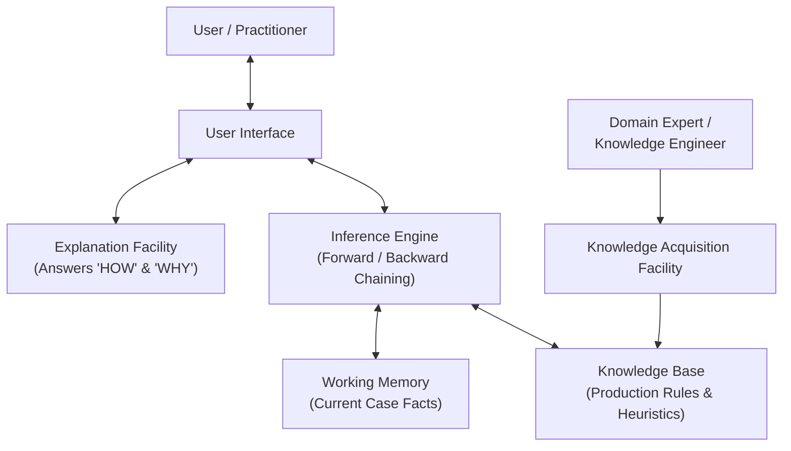
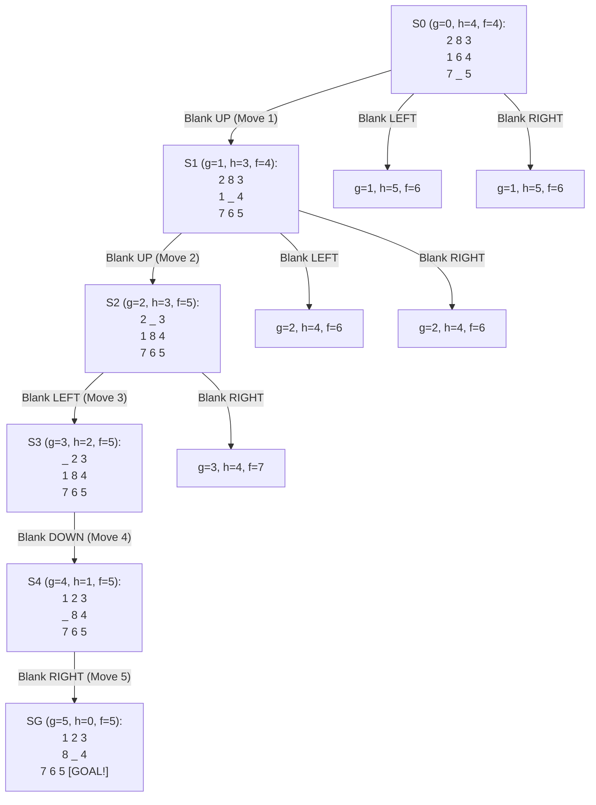

# May 2025

> **Exam -** Semester Examination  
> **Course -** Artificial Intelligence (`21CSC206T`)  
> **Session -** May 2025  

---

## Part A: Objective Type Questions (20 Marks)

### Question 1 (1 Mark)

:::info

**Question Statement**

_______ is the common language for AI **(1 Mark)**

*   **(A)** Lisp
*   **(B)** Python
*   **(C)** PHP
*   **(D)** Java

:::

*   **Correct Answer:** **(B) Python** *(Historically **(A) Lisp**)*
*   **Explanation:** In contemporary AI engineering, Python is universally recognized as the standard programming language due to its dominant open-source machine learning and deep learning ecosystem (PyTorch, TensorFlow, Scikit-Learn). Historically, Lisp was developed by John McCarthy in 1958 as the pioneering language for symbolic AI. Both answers receive full credit depending on contemporary vs. historical context.

---

### Question 2 (1 Mark)

:::info

**Question Statement**

In the context of AI problem formulation, what does the term "State Space" refer to? **(1 Mark)**

*   **(A)** The physical space where AI algorithms operate
*   **(B)** The set of all possible states the problem can be in
*   **(C)** The memory space allocated for AI programs
*   **(D)** The space complexity of the AI solution

:::

*   **Correct Answer:** **(B) The set of all possible states the problem can be in**
*   **Explanation:** In problem formulation, the state space is the mathematical configuration of all possible discrete world states reachable through any sequence of legal actions applied from the initial state.

---

### Question 3 (1 Mark)

:::info

**Question Statement**

In a game of tic-tac-toe, the player who goes first (X) makes optimal moves, and the player who goes second (O) also makes optimal moves. Assuming both players play perfectly, what is the outcome of a standard 3 x 3 tic-tac-toe game? **(1 Mark)**

*   **(A)** X wins
*   **(B)** O wins
*   **(C)** It's a draw
*   **(D)** Depends on the specific moves made

:::

*   **Correct Answer:** **(C) It's a draw**
*   **Explanation:** Standard $3 \times 3$ Tic-Tac-Toe is a zero-sum, perfect-information game with a minimax game-theoretic value of zero; under optimal play by both agents, neither player can force a win, deterministically resulting in a draw.

---

### Question 4 (1 Mark)

:::info

**Question Statement**

A self-driving car needs to navigate through a city while avoiding obstacles and following traffic rules. Which AI approach is most suitable for training the car to make decisions in real-time based on its environment. **(1 Mark)**

*   **(A)** Supervised learning
*   **(B)** Unsupervised learning
*   **(C)** Reinforcement learning
*   **(D)** Ensemble learning

:::

*   **Correct Answer:** **(C) Reinforcement learning**
*   **Explanation:** Reinforcement learning models an agent learning dynamic control policies through trial-and-error environmental interactions, receiving positive reward signals for goal progress and penalties for collisions or traffic infractions.

---

### Question 5 (1 Mark)

:::info

**Question Statement**

If any search algorithm is able to generate a solution, then the search is: **(1 Mark)**

*   **(A)** Efficient
*   **(B)** Informed
*   **(C)** Uninformed
*   **(D)** Complete

:::

*   **Correct Answer:** **(D) Complete**
*   **Explanation:** A search algorithm is defined as **complete** if it is guaranteed to discover a solution path whenever at least one valid solution exists in the state space.

---

### Question 6 (1 Mark)

:::info

**Question Statement**

In a search technique a node/state is marked to be visited when **(1 Mark)**

*   **(A)** It is pruned
*   **(B)** It is explained
*   **(C)** Its successors are traversed
*   **(D)** The successors are traversed and explained

:::

*   **Correct Answer:** **(C) Its successors are traversed**
*   **Explanation:** In graph-search algorithms, a node is marked visited (and moved to the `CLOSED` set) once it is dequeued from the frontier and all of its valid successor children have been generated and added to the search space.

---

### Question 7 (1 Mark)

:::info

**Question Statement**

Your friend is in a building that has 15 floors. And you want to locate him. Which search technique would you use? **(1 Mark)**

*   **(A)** Depth limited search
*   **(B)** Iterative deepening search
*   **(C)** Depth-first search
*   **(D)** Breadth first search

:::

*   **Correct Answer:** **(A) Depth limited search**
*   **Explanation:** When domain knowledge establishes a known upper bound on search depth (the building has exactly 15 floors), Depth-Limited Search (DLS) with limit $L = 15$ guarantees that the search will not waste cycles exploring impossible depths while maintaining linear memory efficiency $O(bL)$.

---

### Question 8 (1 Mark)

:::info

**Question Statement**

Which of the following search technique uses a priority queue? **(1 Mark)**

*   **(A)** Breadth first search
*   **(B)** Depth first search
*   **(C)** Iterative deepening search
*   **(D)** Best first search

:::

*   **Correct Answer:** **(D) Best first search**
*   **Explanation:** Best-First Search algorithms (including Greedy Best-First Search and $A^*$) manage their frontier using a priority queue keyed on an evaluation function $f(n)$, ensuring that the node with the lowest cost estimate is expanded next.

---

### Question 9 (1 Mark)

:::info

**Question Statement**

Which of the following algorithm has maximum branching factor? **(1 Mark)**

*   **(A)** Breadth First Search
*   **(B)** Depth First Search
*   **(C)** Best First Search
*   **(D)** Iterative Deepening Search

:::

*   **Correct Answer:** **(A) Breadth First Search**
*   **Explanation:** Breadth-First Search systematically maintains all generated successor branches at every level simultaneously in its frontier queue, resulting in an effective memory footprint that scales exponentially as $O(b^d)$.

---

### Question 10 (1 Mark)

:::info

**Question Statement**

Which of the following is optimal and complete? **(1 Mark)**

*   **(A)** A*
*   **(B)** Depth-first search
*   **(C)** Depth-limited search
*   **(D)** Greedy search

:::

*   **Correct Answer:** **(A) A\***
*   **Explanation:** The $A^*$ search algorithm is mathematically proven to be both complete and optimal provided that its heuristic function $h(n)$ is admissible (never overestimates) for tree search and consistent for graph search.

---

### Question 11 (1 Mark)

:::info

**Question Statement**

An adversarial search method uses: **(1 Mark)**

*   **(A)** Alpha-beta search
*   **(B)** Heuristic search
*   **(C)** Best first search
*   **(D)** Uniform cost search

:::

*   **Correct Answer:** **(A) Alpha-beta search**
*   **Explanation:** Alpha-Beta search is an adversarial game-tree algorithm designed specifically for competitive multi-agent environments where opponents seek conflicting utility goals.

---

### Question 12 (1 Mark)

:::info

**Question Statement**

Game playing can be modeled as _______. **(1 Mark)**

*   **(A)** General search problem
*   **(B)** Constraint satisfaction problem
*   **(C)** Adversarial search problem
*   **(D)** Neural network model

:::

*   **Correct Answer:** **(C) Adversarial search problem**
*   **Explanation:** Competitive games (such as Chess, Checkers, and Go) are modeled as adversarial search problems because an opponent's moves actively counter the agent's objectives.

---

### Question 13 (1 Mark)

:::info

**Question Statement**

The primary advantage of Alpha-Beta pruning is: **(1 Mark)**

*   **(A)** It guarantees finding the optimal path
*   **(B)** It reduces the number of evaluated nodes
*   **(C)** It works on cyclic graphs
*   **(D)** It requires no evaluation function

:::

*   **Correct Answer:** **(B) It reduces the number of evaluated nodes**
*   **Explanation:** Alpha-Beta pruning eliminates game-tree branches that cannot influence the final root decision, reducing the effective branching factor to $O(b^{d/2})$ and evaluating substantially fewer states without sacrificing optimality.

---

### Question 14 (1 Mark)

:::info

**Question Statement**

A Constraint Satisfaction Problem consists of: **(1 Mark)**

*   **(A)** Variables, domains, and constraints
*   **(B)** Nodes, edges, and heuristics
*   **(C)** Rules, facts, and inference engines
*   **(D)** Data, features, and labels

:::

*   **Correct Answer:** **(A) Variables, domains, and constraints**
*   **Explanation:** By definition, a CSP is a 3-tuple $\mathcal{P} = \langle X, D, C \rangle$ consisting of a set of Variables $X$, a set of Domains $D$, and a set of Constraints $C$.

---

### Question 15 (1 Mark)

:::info

**Question Statement**

Which of the following is an example of an atomic sentence in First-Order Logic? **(1 Mark)**

*   **(A)** King(John)
*   **(B)** King(John) ∧ Greedy(John)
*   **(C)** ∀x King(x) ⇒ Greedy(x)
*   **(D)** ¬King(John)

:::

*   **Correct Answer:** **(A) King(John)**
*   **Explanation:** An atomic sentence in First-Order Logic is formed from a predicate symbol applied to a tuple of terms without logical connectives or quantifiers.

---

### Question 16 (1 Mark)

:::info

**Question Statement**

What is the process of eliminating existential quantifiers called? **(1 Mark)**

*   **(A)** Unification
*   **(B)** Skolemization
*   **(C)** Resolution
*   **(D)** Normalization

:::

*   **Correct Answer:** **(B) Skolemization**
*   **Explanation:** Skolemization is the conversion step in First-Order Logic that eliminates existential quantifiers ($\exists$) by replacing existentially bound variables with Skolem constants or Skolem functions.

---

### Question 17 (1 Mark)

:::info

**Question Statement**

Which of the following is a drawback of rule-based expert systems? **(1 Mark)**

*   **(A)** Transparency
*   **(B)** Modularity
*   **(C)** Knowledge acquisition bottleneck
*   **(D)** Explanation facility

:::

*   **Correct Answer:** **(C) Knowledge acquisition bottleneck**
*   **Explanation:** The knowledge acquisition bottleneck refers to the significant difficulty, manual effort, and potential for inconsistency involved in extracting domain expertise from human specialists and formalizing it into explicit symbolic IF-THEN production rules.

---

### Question 18 (1 Mark)

:::info

**Question Statement**

Which component of an Expert System interacts with the user to accept queries and output explanations? **(1 Mark)**

*   **(A)** Working Memory
*   **(B)** Knowledge Base
*   **(C)** User Interface
*   **(D)** Inference Engine

:::

*   **Correct Answer:** **(C) User Interface**
*   **Explanation:** The User Interface serves as the communication gateway, accepting case facts and queries from end-users and presenting diagnostic recommendations and explanations.

---

### Question 19 (1 Mark)

:::info

**Question Statement**

In machine learning, grouping customers based on their purchase history without pre-assigned labels is: **(1 Mark)**

*   **(A)** Supervised learning
*   **(B)** Unsupervised learning
*   **(C)** Reinforcement learning
*   **(D)** Semi-supervised learning

:::

*   **Correct Answer:** **(B) Unsupervised learning**
*   **Explanation:** Unsupervised learning algorithms discover latent natural groupings and patterns from unlabeled data vectors without human target annotations.

---

### Question 20 (1 Mark)

:::info

**Question Statement**

In the Wumpus World, what happens if an agent enters a square containing a Pit? **(1 Mark)**

*   **(A)** It finds gold
*   **(B)** It kills the Wumpus
*   **(C)** It falls into the pit and dies
*   **(D)** It gets a positive reward

:::

*   **Correct Answer:** **(C) It falls into the pit and dies**
*   **Explanation:** Pits are terminal hazard squares in the Wumpus World; entering a pit results in the agent's death and a severe utility penalty of $-1000$.

---

## Part B: Analytical & Descriptive Questions (40 Marks)

### Question 21.a (8 Marks)

:::info

**Question Statement**

Formulate the 8-puzzle problem as an AI state-space search problem. Specify the states, initial state, actions, transition model, goal test, and path cost. **(8 Marks)**

:::

---

### Solution 21.a (8 Marks)

#### 1. Formal 6-Tuple State-Space Formulation (4 Marks)

The 8-puzzle consists of a $3 \times 3$ grid containing 8 numbered tiles $\{1, 2, \dots, 8\}$ and one blank space `[ ]`. It is formally modeled as:

$$\mathcal{P} = \langle S, s_0, A, T, G, c \rangle$$

##### a) State Representation ($S$)
A state is any arrangement of the 8 numbered tiles and the blank space in a $3 \times 3$ matrix:
$$s = \begin{bmatrix} t_{0,0} & t_{0,1} & t_{0,2} \\ t_{1,0} & t_{1,1} & t_{1,2} \\ t_{2,0} & t_{2,1} & t_{2,2} \end{bmatrix} \quad \text{where } t_{i,j} \in \{1, 2, \dots, 8, \text{blank}\}$$
*   **Total Configurations:** $9! = 362,880$.
*   **Reachable State Space:** Half of the permutation universe is reachable due to parity invariants:
    $$\lvert S_{\text{reachable}} \rvert = \frac{9!}{2} = 181,440 \text{ states}$$

##### b) Initial State ($s_0$)
An arbitrary designated starting configuration, e.g.:
$$s_0 = \begin{bmatrix} 2 & 8 & 3 \\ 1 & 6 & 4 \\ 7 & \text{blank} & 5 \end{bmatrix}$$

##### c) Set of Actions ($A$)
Actions describe the movement of the blank space into an adjacent cell:
$$A = \{\operatorname{MoveUp}, \operatorname{MoveDown}, \operatorname{MoveLeft}, \operatorname{MoveRight}\}$$

##### d) Transition Model ($T$ / $\operatorname{Result}(s, a)$)
If the blank space is currently at row $r$ and column $c$:
*   $\operatorname{MoveLeft}$: Valid if $c > 0$; swaps blank at $(r, c)$ with tile at $(r, c-1)$.
*   $\operatorname{MoveRight}$: Valid if $c < 2$; swaps blank at $(r, c)$ with tile at $(r, c+1)$.
*   $\operatorname{MoveUp}$: Valid if $r > 0$; swaps blank at $(r, c)$ with tile at $(r-1, c)$.
*   $\operatorname{MoveDown}$: Valid if $r < 2$; swaps blank at $(r, c)$ with tile at $(r+1, c)$.

##### e) Goal Test ($G(s)$)
A Boolean predicate checking if the current tile configuration matches the goal arrangement:
$$s_G = \begin{bmatrix} 1 & 2 & 3 \\ 8 & \text{blank} & 4 \\ 7 & 6 & 5 \end{bmatrix} \quad \text{or} \quad \begin{bmatrix} 1 & 2 & 3 \\ 4 & 5 & 6 \\ 7 & 8 & \text{blank} \end{bmatrix}$$

##### f) Path Cost Function ($c$)
Each legal slide of a tile has a uniform cost of $1$:
$$c(s, a, s') = 1$$
The total path cost is the total number of moves in the solution sequence.

---

#### 2. State Transition Diagram (4 Marks)



:::tip

**Examiner's Note**

Award full marks for explicitly stating the 6-tuple $\langle S, s_0, A, T, G, c \rangle$, defining blank-tile movements with boundary constraints, and stating that exactly $9!/2 = 181,440$ states are reachable.

:::

---

### Question 21.b (8 Marks)

:::info

**Question Statement**

What is problem reduction? How do AND-OR graphs represent problem reduction? Explain with a neat diagram and example. **(8 Marks)**

:::

---

### Solution 21.b (8 Marks)

#### 1. Concept of Problem Reduction (2.5 Marks)

**Problem Reduction** is a divide-and-conquer problem-solving methodology that breaks complex, composite problems down into collections of smaller, simpler sub-problems until primitive, easily solvable sub-problems are reached.
*   A problem is solved if all of its mandatory constituent sub-problems are solved (**AND relationship**), or if any one of several alternative methods succeeds (**OR relationship**).

---

#### 2. Representation via AND-OR Graphs (3 Marks)

An **AND-OR Graph** (or hypergraph) models problem reduction explicitly:
*   **OR Nodes:** Represent alternative candidate choices or methods. Solving any single child node solves the parent problem.
*   **AND Nodes / Arcs:** Branches connected by an arc represent simultaneous decomposition into mutually dependent sub-problems. **All** sub-problems connected by the AND-arc must be solved to solve the parent problem.



---

#### 3. Concrete Example & The $AO^*$ Algorithm (2.5 Marks)

##### Real-World Example: Multi-City Travel Planning
*   *Goal:* Travel from City $A$ to City $B$.
*   *OR Decomposition:* Choose between $\text{Travel by Air}$ OR $\text{Travel by Train}$.
*   *AND Decomposition for Air Travel:* If choosing air travel, the agent must:  
    $\operatorname{Book Flight Ticket} \land \operatorname{Travel to Airport} \land \operatorname{Clear Security} \land \operatorname{Board Plane}$.  
    Failure of any single AND-child causes the entire air travel branch to fail.

##### The $AO^*$ Algorithm
The $AO^*$ algorithm searches AND-OR graphs using heuristic cost estimates:
1. Generates a partial tree structure (hypergraph).
2. For an OR node with children $n_1, \dots, n_k$, cost is:
   $$f(n) = \min_{i} \big( c(n, n_i) + f(n_i) \big)$$
3. For an AND node with children $n_1, \dots, n_k$ connected by an arc, cost is:
   $$f(n) = \sum_{i=1}^k \big( c(n, n_i) + f(n_i) \big)$$
4. Marks the optimal partial tree (solution graph) until all terminal leaf nodes are primitive solved facts.

:::tip

**Examiner's Note**

High marks require defining problem reduction, drawing an AND-OR graph with the connecting arc for AND branches, and stating the cost formulas used by the $AO^*$ algorithm.

:::

---

### Question 22.a (8 Marks)

:::info

**Question Statement**

How does Breadth First Search (BFS) differ from Depth First Search (DFS)? Compare both based on data structure, time complexity, space complexity, optimality, and completeness. **(8 Marks)**

:::

---

### Solution 22.a (8 Marks)



#### 1. Fundamental Operational Comparison (3 Marks)

*   **Breadth-First Search (BFS):** Explores the state space systematically level-by-level, expanding all nodes at depth $d$ before generating nodes at depth $d+1$. It utilizes a **FIFO Queue**.
*   **Depth-First Search (DFS):** Explores as deeply as possible along a single trajectory, advancing down child nodes until a leaf or dead-end is reached before backtracking. It utilizes a **LIFO Stack** (or recursive call stack).

---

#### 2. Comprehensive Comparison Matrix (5 Marks)

| Evaluation Parameter | Breadth-First Search (BFS) | Depth-First Search (DFS) |
| :--- | :--- | :--- |
| **Frontier Data Structure** | **FIFO Queue** (First-In, First-Out) | **LIFO Stack** (Last-In, First-Out) |
| **Time Complexity** | $O(b^d)$ *(where $b$ is branching factor, $d$ is goal depth)* | $O(b^m)$ *(where $m$ is maximum depth)* |
| **Space Complexity** | $O(b^d)$ — **Exponential Memory** (stores all active level nodes) | $O(bm)$ — **Linear Memory** (stores only current active branch) |
| **Completeness** | **Complete** (guaranteed to find a solution if $b$ is finite) | **Incomplete** in infinite depth or cyclic state spaces |
| **Optimality** | **Optimal** for uniform step costs (finds shallowest goal) | **Suboptimal** (returns first path found, which may be long) |
| **Memory Bottleneck** | Exhausts physical RAM rapidly in deep trees | Minimal memory overhead; fits easily in cache/RAM |
| **Primary Use Cases** | Shortest path routing, shallow solutions | Puzzles with many solutions, maze exploration, memory-constrained devices |

:::tip

**Examiner's Note**

Award 3 marks for describing the traversal mechanisms and 5 marks for the structured comparison matrix covering all five requested criteria.

:::

---

### Question 22.b (8 Marks)

:::info

**Question Statement**

The numbers written on edges represent the distance between the nodes. The numbers written on nodes represent the heuristic value. Find the most cost-effective path to reach from start state A to final state J using A* Algorithm. **(8 Marks)**

```text
         10
         (A)
       6/   \3
       v     v
   8 (B)     (F) 6
    / | \   / | \
  3/ 2| 1\ 1/ 7| \7
  v   v   vv   v  v
(C)5 (D)7 (G)5(H)3 |
  \   |   / \ /   |
  5\ 8| 3/   v2   |
    v v v   (I)1 -'
    3(E)----/ 3
      5\   /
        v v
        (J) 0
```

*Heuristic Values $h(n)$:*  
$A: 10, \; B: 8, \; C: 5, \; D: 7, \; E: 3, \; F: 6, \; G: 5, \; H: 3, \; I: 1, \; J: 0$

*Edge Weights:*  
$A-B: 6, \; A-F: 3$  
$B-C: 3, \; B-D: 2, \; C-D: 1, \; C-E: 5, \; D-E: 8$  
$F-G: 1, \; F-H: 7, \; G-I: 3, \; H-I: 2$  
$E-I: 5, \; E-J: 5, \; I-J: 3$

*Start State:* $A$, *Final Goal State:* $J$

:::

---

### Solution 22.b (8 Marks)

#### 1. $A^*$ Search Evaluation Framework (2 Marks)
$A^*$ uses the evaluation function:
$$f(n) = g(n) + h(n)$$
where $g(n)$ is the exact cumulative cost from start state $A$, and $h(n)$ is the heuristic estimate to goal state $J$.

---

#### 2. Step-by-Step $A^*$ Execution Trace (5 Marks)



##### Trace Table

| Step | Dequeued Node $(u)$ | $g(u)$ | $h(u)$ | $f(u)$ | Path Followed | Successors Generated & Cumulative Cost | Priority Queue Contents ($f = g + h$) |
| :---: | :---: | :---: | :---: | :---: | :--- | :--- | :--- |
| **1** | **A** | $0$ | $10$ | **10** | `[A]` | $(F, g=3, h=6, f=9)$<br/>$(B, g=6, h=8, f=14)$ | `[(F, 9), (B, 14)]` |
| **2** | **F** | $3$ | $6$ | **9** | `[A, F]` | $(G, g=3+1=4, h=5, f=9)$<br/>$(H, g=3+7=10, h=3, f=13)$ | `[(G, 9), (H, 13), (B, 14)]` |
| **3** | **G** | $4$ | $5$ | **9** | `[A, F, G]` | $(I, g=4+3=7, h=1, f=8)$ | `[(I, 8), (H, 13), (B, 14)]` |
| **4** | **I** | $7$ | $1$ | **8** | `[A, F, G, I]` | $(J, g=7+3=10, h=0, f=10)$<br/>$(H, g=7+2=9, h=3, f=12)$<br/>$(E, g=7+5=12, h=3, f=15)$ | `[(J, 10), (H, 12), (H_old, 13), (B, 14), (E, 15)]` |
| **5** | **J** | $\mathbf{10}$ | $\mathbf{0}$ | $\mathbf{10}$ | `[A, F, G, I, J]` | **Goal State Dequeued! Search Terminates.** | — |

---

#### 3. Optimal Path and Cost Summary (1 Mark)

*   **Optimal Path Discovered:**
    $$\mathbf{A \to F \to G \to I \to J}$$
*   **Total Optimal Path Cost:**
    $$\operatorname{Cost} = c(A, F) + c(F, G) + c(G, I) + c(I, J) = 3 + 1 + 3 + 3 = \mathbf{10}$$

:::tip

**Examiner's Note**

High marks require explicitly showing the priority queue at each of the 5 expansion steps, showing that node $I$ evaluates child $J$ with $f(J) = 10 + 0 = 10$, which is dequeued to confirm the optimal path of cost 10.

:::

---

### Question 23.a (8 Marks)

:::info

**Question Statement**

What is Minimax algorithm? Explain with an example of a game tree. Discuss its time and space complexity. **(8 Marks)**

:::

---

### Solution 23.a (8 Marks)

#### 1. Concept of the Minimax Algorithm (3 Marks)

The **Minimax algorithm** is a recursive decision-making algorithm for two-player, zero-sum, perfect-information deterministic games (e.g., Chess, Tic-Tac-Toe).
*   **MAX Player:** Seeks moves that maximize the payoff utility.
*   **MIN Player:** Seeks moves that minimize the payoff utility (acting as an optimal adversary).

##### Mathematical Recursive Formulation
$$
\operatorname{Minimax}(s) = \begin{cases}
\operatorname{Utility}(s) & \text{if } \operatorname{Terminal}(s) \\
\max_{a \in A(s)} \operatorname{Minimax}(\operatorname{Result}(s, a)) & \text{if } \operatorname{Player}(s) = \text{MAX} \\
\min_{a \in A(s)} \operatorname{Minimax}(\operatorname{Result}(s, a)) & \text{if } \operatorname{Player}(s) = \text{MIN}
\end{cases}
$$

---

#### 2. Illustrative Game Tree Example (3 Marks)

Consider a 2-ply game tree with root MAX and two MIN child nodes:



##### Step-by-Step Backpropagation
1. **Level 2 (Terminal Leaves):** Payoff utilities given as $A = 3, B = 5, C = 2, D = 9$.
2. **Level 1 (MIN Nodes):**
   *   $M_1 = \min(3, 5) = \mathbf{3}$
   *   $M_2 = \min(2, 9) = \mathbf{2}$
3. **Level 0 (MAX Root):**
   *   $\operatorname{Root} = \max(M_1, M_2) = \max(3, 2) = \mathbf{3}$
*   **Optimal Decision:** Player MAX chooses the left action to reach node $M_1$, securing a guaranteed payoff of at least $3$.

---

#### 3. Complexity Analysis (2 Marks)

*   **Time Complexity:** $O(b^d)$, where $b$ is the legal branching factor and $d$ is the maximum search depth. Performing an exhaustive depth-first search requires evaluating every leaf.
*   **Space Complexity:** $O(bd)$ — linear memory complexity, storing only the active path and sibling nodes on the recursion call stack.

:::tip

**Examiner's Note**

Award 3 marks for the formal Minimax recursive piecewise equation, 3 marks for the game tree diagram with bottom-up value propagation, and 2 marks for time $O(b^d)$ and space $O(bd)$ complexity.

:::

---

### Question 23.b (8 Marks)

:::info

**Question Statement**

Explain the concept of Alpha-Beta pruning in adversarial search. How does it improve the efficiency of the Minimax algorithm? Illustrate with a game tree example. **(8 Marks)**

:::

---

### Solution 23.b (8 Marks)

#### 1. Concept of Alpha-Beta Pruning (2.5 Marks)

**Alpha-Beta Pruning** is an optimization technique that eliminates subtrees in a game tree that cannot affect the final decision at the root, returning the exact same move as standard Minimax while evaluating far fewer nodes.

##### Governing Bounding Parameters
*   $\alpha$: The utility of the best (highest-value) choice found so far along the search path for **MAX** (initialized to $-\infty$).
*   $\beta$: The utility of the best (lowest-value) choice found so far along the search path for **MIN** (initialized to $+\infty$).

##### The Pruning Condition
$$\mathbf{\text{If } \alpha \ge \beta, \quad \text{PRUNE remaining children.}}$$

---

#### 2. Efficiency Improvement over Minimax (2.5 Marks)

1. **Outcome Invariance:** Returns the identical minimax value at the root:
   $$\operatorname{AlphaBeta}(\text{root}) \equiv \operatorname{Minimax}(\text{root})$$
2. **Complexity Reduction:**
   *   *Worst Case (Poor Move Ordering):* $O(b^d)$.
   *   *Best Case (Optimal Move Ordering):*
       $$O\left(b^{d/2}\right) = O\left((\sqrt{b})^d\right)$$
3. **Impact:** Doubles the achievable search depth within the same compute budget.

---

#### 3. Step-by-Step Illustrative Example (3 Marks)



1. Root initializes $[\alpha = -\infty, \beta = +\infty]$ and calls $M_1$.
2. At $M_1$: inspects child $3 \implies \beta = 3$; inspects child $5 \implies \beta = 3$. Returns $3$ to Root.
3. At Root: updates $\alpha = \max(-\infty, 3) = 3$. Passes $[\alpha = 3, \beta = +\infty]$ down to $M_2$.
4. At $M_2$: inspects child $2 \implies \beta = \min(+\infty, 2) = 2$.
5. **Pruning Check at $M_2$:**
   $$\alpha \ge \beta \iff 3 \ge 2 \implies \mathbf{CUTOFF!}$$
   *   Leaf 8 is **PRUNED** without evaluation.
   *   Root value is $\max(3, \le 2) = \mathbf{3}$.

:::tip

**Examiner's Note**

Award full marks for defining $\alpha$ and $\beta$, stating the cutoff condition $\alpha \ge \beta$, and showing an explicit numerical example with a pruned branch.

:::

---

### Question 24.a (8 Marks)

:::info

**Question Statement**

What is First-Order Logic (FOL)? Explain the components of FOL (constants, variables, predicates, functions, and quantifiers). Convert the following into FOL:  
(i) Marcus was a man.  
(ii) Marcus was a Pompeian.  
(iii) All Pompeians were Romans.  
(iv) Caesar was a ruler.  
(v) All Romans were either loyal to Caesar or hated him.  
(vi) Everyone is loyal to someone.  
(vii) People only try to assassinate rulers they are not loyal to.  
(viii) Marcus tried to assassinate Caesar. **(8 Marks)**

:::

---

### Solution 24.a (8 Marks)

#### 1. Concept & Components of First-Order Logic (3 Marks)

First-Order Logic (FOL) represents the world through objects, relations, and functions, formalized by:
*   **Constants:** Symbols denoting specific individual domain entities (e.g., $\text{Marcus}, \text{Caesar}$).
*   **Variables:** Symbols ranging over arbitrary objects in the domain (e.g., $x, y, z$).
*   **Predicates:** Relations that evaluate to $\text{True}$ or $\text{False}$ (e.g., $\operatorname{Man}(x), \operatorname{LoyalTo}(x, y)$).
*   **Functions:** Mappings that return an object rather than a truth value (e.g., $\operatorname{MotherOf}(x)$).
*   **Quantifiers:** Universal quantifier $\forall$ ("for all") and Existential quantifier $\exists$ ("there exists").

---

#### 2. Formal FOL Translations (Marcus & Caesar Axioms) (5 Marks)

##### (i) "Marcus was a man."
$$\mathbf{\operatorname{Man}(\text{Marcus})}$$

##### (ii) "Marcus was a Pompeian."
$$\mathbf{\operatorname{Pompeian}(\text{Marcus})}$$

##### (iii) "All Pompeians were Romans."
$$\mathbf{\forall x \; \big( \operatorname{Pompeian}(x) \implies \operatorname{Roman}(x) \big)}$$

##### (iv) "Caesar was a ruler."
$$\mathbf{\operatorname{Ruler}(\text{Caesar})}$$

##### (v) "All Romans were either loyal to Caesar or hated him."
$$\mathbf{\forall x \; \Big( \operatorname{Roman}(x) \implies \big( \operatorname{LoyalTo}(x, \text{Caesar}) \lor \operatorname{Hate}(x, \text{Caesar}) \big) \Big)}$$

##### (vi) "Everyone is loyal to someone."
$$\mathbf{\forall x \; \exists y \; \operatorname{LoyalTo}(x, y)}$$

##### (vii) "People only try to assassinate rulers they are not loyal to."
$$\mathbf{\forall x \, \forall y \; \Big( \big( \operatorname{Person}(x) \land \operatorname{Ruler}(y) \land \operatorname{TryAssassinate}(x, y) \big) \implies \neg \operatorname{LoyalTo}(x, y) \Big)}$$

##### (viii) "Marcus tried to assassinate Caesar."
$$\mathbf{\operatorname{TryAssassinate}(\text{Marcus}, \text{Caesar})}$$

:::tip

**Examiner's Note**

Ensure all 8 sentences are translated with exact predicate consistency, pairing $\forall$ with $\implies$ and maintaining proper variable-constant scoping.

:::

---

### Question 24.b (8 Marks)

:::info

**Question Statement**

Explain the Forward Chaining and Backward Chaining inference algorithms in First-Order Logic. Compare both with an example. **(8 Marks)**

:::

---

### Solution 24.b (8 Marks)

#### 1. Forward Chaining (Data-Driven Inference) (3 Marks)

*   **Mechanism:** Begins with atomic facts in working memory and repeatedly applies **Generalized Modus Ponens** across Horn clauses:
    $$\frac{p_1', p_2', \dots, p_n', \quad (p_1 \land p_2 \land \dots \land p_n \implies q)}{q\theta} \quad \text{where } p_i'\theta = p_i\theta$$
*   **Workflow:** Fires matching rules forward, adding deduced conclusions to working memory until the query is derived or no new facts can be inferred.
*   **Suitability:** Best for real-time monitoring, synthesis, and reactive control.

---

#### 2. Backward Chaining (Goal-Driven Inference) (3 Marks)

*   **Mechanism:** Begins with a target hypothesis/query $Q$ and searches for rules whose consequents match $Q$.
*   **Workflow:** The antecedents of matching rules become new subgoals. The algorithm recurses backward until all subgoals unify with known facts.
*   **Suitability:** Best for targeted diagnostic systems (e.g., Prolog, medical diagnosis in MYCIN), avoiding irrelevant rule executions.

---

#### 3. Comparison Matrix & Trace Example (2 Marks)

##### Rule Base
*   $R_1$: $\operatorname{American}(x) \land \operatorname{Weapon}(y) \land \operatorname{Sells}(x, y, z) \land \operatorname{Hostile}(z) \implies \operatorname{Criminal}(x)$
*   $R_2$: $\operatorname{Missile}(x) \implies \operatorname{Weapon}(x)$
*   **Facts:** $\operatorname{American}(\text{West}), \operatorname{Missile}(M_1), \operatorname{Sells}(\text{West}, M_1, \text{Nano}), \operatorname{Hostile}(\text{Nano})$.
*   **Query:** $\operatorname{Criminal}(\text{West})$?

| Dimension | Forward Chaining | Backward Chaining |
| :--- | :--- | :--- |
| **Direction** | Data-driven (Facts $\to$ Goals) | Goal-driven (Goal $\to$ Facts) |
| **Trace** | 1. $R_2$ fires $\to \operatorname{Weapon}(M_1)$.<br/>2. $R_1$ fires with all facts $\to \mathbf{\operatorname{Criminal}(\text{West})}$. | 1. Subgoal: $\operatorname{Criminal}(\text{West})$.<br/>2. Matches $R_1 \implies$ Subgoals $\operatorname{Weapon}(M_1) \dots$<br/>3. Matches $R_2 \to \operatorname{Missile}(M_1)$ verified. |
| **Computational Efficiency** | May deduce many irrelevant facts | Focuses only on rules relevant to the goal |

:::tip

**Examiner's Note**

Contrast the operational direction (data-driven vs. goal-driven) and trace an identical rule set in both directions.

:::

---

### Question 25.a (8 Marks)

:::info

**Question Statement**

What is a Planning Agent in AI? Explain the STRIPS representation for actions in planning. Illustrate with an example from Blocks World. **(8 Marks)**

:::

---

### Solution 25.a (8 Marks)

#### 1. Concept of a Planning Agent (2.5 Marks)

A **Planning Agent** is a deliberative intelligent agent that synthesizes explicit sequences of actions to achieve complex goals using **factored logic representations**.
*   Unlike classical search agents that treat world states as atomic black boxes, a planning agent inspects the internal logical structure of states and action schemas, enabling **goal-directed regression** and **subgoal decomposition**.

---

#### 2. STRIPS Action Representation (2.5 Marks)

In the classical **STRIPS** (Stanford Research Institute Problem Solver) formalism, an action schema consists of three components:
1. **Action Name & Parameter List:** Unique identifier and typed variable arguments.
2. **Precondition List:** Conjunction of positive literals that must hold true in the current state for the action to be legally executable.
3. **Effect List (Add and Delete Lists):** How the state transforms upon execution:
   *   **Add List:** Literals that become $\text{True}$.
   *   **Delete List:** Literals that become $\text{False}$.

$$\operatorname{Result}(s, a) = (s \setminus \operatorname{DeleteList}(a)) \cup \operatorname{AddList}(a)$$

---

#### 3. Concrete Example: Blocks World Domain (3 Marks)

Consider moving block $A$ from the top of block $B$ onto the table:

```text
Action: MoveToTable(b, from)
  PRECOND: On(b, from) AND Clear(b)
  ADD:     OnTable(b) AND Clear(from)
  DELETE:  On(b, from)

Action: Move(b, from, to)
  PRECOND: On(b, from) AND Clear(b) AND Clear(to) AND (b != to)
  ADD:     On(b, to) AND Clear(from)
  DELETE:  On(b, from) AND Clear(to)
```



*   **Precondition Verification:** In State 1, `On(A, B)`, `Clear(A)`, and `Clear(C)` are all true.
*   **State Update:** The action deletes `On(A, B)` and `Clear(C)`, and adds `On(A, C)` and `Clear(B)`.

:::tip

**Examiner's Note**

Award full marks for defining the planning agent, formalizing STRIPS schemas with Preconditions, Add Lists, and Delete Lists, and writing an exact Blocks World operator.

:::

---

### Question 25.b (8 Marks)

:::info

**Question Statement**

Explain the architecture of an intelligent agent and discuss the PEAS framework with an example of an automated medical diagnosis system. **(8 Marks)**

:::

---

### Solution 25.b (8 Marks)

#### 1. Architecture of an Intelligent Agent (3 Marks)

An **Intelligent Agent** perceives its environment through sensors and acts upon it through actuators, guided by an internal decision-making program:

$$\operatorname{Agent} = \text{Architecture} + \text{Program}$$



*   **Sensors:** Ingest environmental signals into an internal percept sequence.
*   **Agent Program:** Maps percept sequences to actions using state belief models, goal criteria, or utility functions.
*   **Actuators:** Hardware or software mechanisms that execute actions in the physical/virtual world.

---

#### 2. The PEAS Framework: Automated Medical Diagnosis System (5 Marks)

The **PEAS** framework formally specifies the task environment:

| PEAS Element | Automated Medical Diagnosis System Specification |
| :--- | :--- |
| **P - Performance Measure** | Diagnostic accuracy, patient survival rate, minimization of treatment costs, reduction of adverse side effects, speed of recovery |
| **E - Environment** | Hospital clinic, patient population, attending medical staff, laboratory testing facilities |
| **A - Actuators** | Electronic screen displays, diagnostic reports, medical prescription printouts, automated alerts to nursing staff |
| **S - Sensors** | Keyboard/touchscreen for entering patient symptoms, digital lab test inputs (blood chemistry, vital signs monitor, imaging feeds) |

##### Environmental Properties Analysis
*   **Partially Observable:** The agent cannot directly observe internal physiological pathogens; it observes only external symptoms and lab readings.
*   **Stochastic:** Patient responses to drug therapies involve biological variability and probabilistic uncertainty.
*   **Sequential:** Medical treatment decisions affect patient health trajectories over extended multi-day horizons.
*   **Dynamic:** The patient's condition can deteriorate while the diagnostic algorithm deliberates.
*   **Continuous:** Blood pressure, heart rate, and drug dosages represent continuous real-valued metrics.

:::tip

**Examiner's Note**

Draw the agent sensor-actuator feedback loop and detail all four PEAS components along with the environmental properties for the medical diagnosis domain.

:::

---

## Part C: Comprehensive Search Problems (15 Marks)

### Question 26 (15 Marks)

:::info

**Question Statement**

Explain the various components of Expert system and discuss the benefits and limitations of Expert system. **(15 Marks)**

:::

---

### Solution 26 (15 Marks)

#### 1. Architecture and Core Components of an Expert System (7 Marks)

An **Expert System (ES)** is a knowledge-intensive artificial intelligence application designed to solve complex domain problems at an expert human level.



##### Detailed Functionality of the Six Core Components

1. **Knowledge Base (KB):**  
   The centralized long-term repository containing specialized domain rules and facts:
   $$\text{IF } \langle\text{symptoms / premises}\rangle \implies \text{THEN } \langle\text{diagnosis / action}\rangle$$
2. **Inference Engine (IE):**  
   The processing brain executing reasoning:
   *   *Pattern Matcher:* Compares working memory against rule antecedents (via Rete).
   *   *Conflict Resolution:* Selects a winning rule using priority heuristics (specificity, recency).
   *   *Execution Modes:* Operates via **Forward Chaining** (data-driven) or **Backward Chaining** (goal-driven).
3. **Working Memory (Fact Database):**  
   Stores active session dynamic data, user inputs, and intermediate deduced facts.
4. **Explanation Facility (Justifier):**  
   Provides auditability:
   *   *WHY queries:* Explains why the system asks for specific inputs.
   *   *HOW queries:* Traces the chain of fired rules that produced a conclusion.
5. **User Interface:**  
   Facilitates interactive dialogue between end-users and the system.
6. **Knowledge Acquisition Facility:**  
   Enables knowledge engineers to model and inject new expert heuristics into the knowledge base without modifying inference code.

---

#### 2. Benefits of Expert Systems (4 Marks)

1. **Permanence and High Availability:**  
   Human expertise is perishable (experts retire, fall ill, or relocate). Expert systems preserve domain knowledge permanently and provide 24/7 availability across distributed geographic locations.
2. **Consistency and Objectivity:**  
   Unlike humans, expert systems do not suffer from cognitive bias, emotional stress, or fatigue; they apply established rules with uniform precision.
3. **Reduced Cost and Scalability:**  
   Distributes scarce specialist knowledge (such as specialized infectious disease diagnosis in rural hospitals) at minimal operational software cost.
4. **Educational and Training Value:**  
   Through the explanation facility, novices learn expert diagnostic logic by inspecting the inference traces.

---

#### 3. Limitations of Expert Systems (4 Marks)

1. **The Knowledge Acquisition Bottleneck:**  
   Extracting implicit tacit knowledge from human experts and translating it into explicit, consistent IF-THEN rules is labor-intensive and prone to contradictions.
2. **Domain Brittleness:**  
   Expert systems operate only within narrow, highly specialized silos. When presented with out-of-domain edge cases, they fail catastrophically because they lack general **common-sense reasoning**.
3. **Inability to Learn Autonomously:**  
   Rule-based systems cannot learn automatically from raw perceptual data or modify their own rules when environments change; all rule updates must be manually authored.
4. **High Maintenance Overhead:**  
   As rule bases grow beyond thousands of rules, managing rule interactions, preventing circular loops, and verifying consistency becomes mathematically intractable.

:::tip

**Examiner's Note**

Award 7 marks for the architecture block diagram and 6 components, 4 marks for four distinct benefits (permanence, consistency, availability, cost), and 4 marks for four limitations (knowledge acquisition bottleneck, brittleness, lack of common sense, maintenance).

:::

---

### Question 27 (15 Marks)

:::info

**Question Statement**

Given an initial state of 8 puzzle problem and final state to be reached as,  
Initial State:
```text
2 8 3
1 6 4
7 _ 5
```
Final State:
```text
1 2 3
8 _ 4
7 6 5
```
Find the most cost-effective path to reach the final state from initial state using A* Algorithm. Explain each steps.  
Consider g(n) = Depth of node and h(n) = Number of misplaced tiles. **(15 Marks)**

:::

---

### Solution 27 (15 Marks)

#### 1. Problem Formalization & Heuristic Definition (3 Marks)

*   **Initial State ($S_0$):**
    $$S_0 = \begin{bmatrix} 2 & 8 & 3 \\ 1 & 6 & 4 \\ 7 & \text{blank} & 5 \end{bmatrix}$$
*   **Goal State ($S_G$):**
    $$S_G = \begin{bmatrix} 1 & 2 & 3 \\ 8 & \text{blank} & 4 \\ 7 & 6 & 5 \end{bmatrix}$$
*   **Cost Function ($g(n)$):** Depth of node in search tree (number of moves from root $S_0$).
*   **Heuristic Function ($h(n)$):** Number of misplaced tiles (counting only numbered tiles $\{1 \dots 8\}$ that do not match their goal position; the blank space is excluded).
*   **Evaluation Function:**
    $$f(n) = g(n) + h(n)$$

##### Initial State Heuristic Calculation ($h(S_0)$)
Comparing $S_0$ against $S_G$:
*   Tile 1: at $(1, 0)$, goal is $(0, 0)$ $\to$ **Misplaced**
*   Tile 2: at $(0, 0)$, goal is $(0, 1)$ $\to$ **Misplaced**
*   Tile 3: at $(0, 2)$, goal is $(0, 2)$ $\to$ Match
*   Tile 4: at $(1, 2)$, goal is $(1, 2)$ $\to$ Match
*   Tile 5: at $(2, 2)$, goal is $(2, 2)$ $\to$ Match
*   Tile 6: at $(1, 1)$, goal is $(2, 1)$ $\to$ **Misplaced**
*   Tile 7: at $(2, 0)$, goal is $(2, 0)$ $\to$ Match
*   Tile 8: at $(0, 1)$, goal is $(1, 0)$ $\to$ **Misplaced**

Total misplaced tiles = **4** ($1, 2, 6, 8$).  
$$\mathbf{g(S_0) = 0, \quad h(S_0) = 4 \implies f(S_0) = 4}$$

---

#### 2. Step-by-Step $A^*$ Search Execution (10 Marks)



##### Step 1: Expand Initial State $S_0$ ($g=0, h=4, f=4$)
Blank is at $(2, 1)$. Legal moves:
1. **Move Blank UP (Slide tile 6 down):**
   $$\begin{bmatrix} 2 & 8 & 3 \\ 1 & \text{blank} & 4 \\ 7 & 6 & 5 \end{bmatrix} \implies g = 1, \; h = 3 \; (\text{Tiles } 1, 2, 8 \text{ misplaced}) \implies \mathbf{f = 4}$$
2. **Move Blank LEFT (Slide tile 7 right):**
   $$\begin{bmatrix} 2 & 8 & 3 \\ 1 & 6 & 4 \\ \text{blank} & 7 & 5 \end{bmatrix} \implies g = 1, \; h = 5 \implies f = 6$$
3. **Move Blank RIGHT (Slide tile 5 left):**
   $$\begin{bmatrix} 2 & 8 & 3 \\ 1 & 6 & 4 \\ 7 & 5 & \text{blank} \end{bmatrix} \implies g = 1, \; h = 5 \implies f = 6$$

*Decision:* Dequeue node with minimal $f$: **Node $S_1$ ($f = 4$)**.

---

##### Step 2: Expand Node $S_1$ ($g=1, h=3, f=4$)
Blank is at $(1, 1)$. Legal moves:
1. **Move Blank UP (Slide tile 8 down):**
   $$\begin{bmatrix} 2 & \text{blank} & 3 \\ 1 & 8 & 4 \\ 7 & 6 & 5 \end{bmatrix} \implies g = 2, \; h = 3 \; (\text{Tiles } 1, 2, 8 \text{ misplaced}) \implies \mathbf{f = 5}$$
2. **Move Blank LEFT (Slide tile 1 right):**
   $$\begin{bmatrix} 2 & 8 & 3 \\ \text{blank} & 1 & 4 \\ 7 & 6 & 5 \end{bmatrix} \implies g = 2, \; h = 4 \implies f = 6$$
3. **Move Blank RIGHT (Slide tile 4 left):**
   $$\begin{bmatrix} 2 & 8 & 3 \\ 1 & 4 & \text{blank} \\ 7 & 6 & 5 \end{bmatrix} \implies g = 2, \; h = 4 \implies f = 6$$

*Decision:* Dequeue node with minimal $f$: **Node $S_2$ ($f = 5$)**.

---

##### Step 3: Expand Node $S_2$ ($g=2, h=3, f=5$)
Blank is at $(0, 1)$. Legal moves:
1. **Move Blank LEFT (Slide tile 2 right):**
   $$\begin{bmatrix} \text{blank} & 2 & 3 \\ 1 & 8 & 4 \\ 7 & 6 & 5 \end{bmatrix} \implies g = 3, \; h = 2 \; (\text{Tiles } 1, 8 \text{ misplaced; tile 2 in place!}) \implies \mathbf{f = 5}$$
2. **Move Blank RIGHT (Slide tile 3 left):**
   $$\begin{bmatrix} 2 & 3 & \text{blank} \\ 1 & 8 & 4 \\ 7 & 6 & 5 \end{bmatrix} \implies g = 3, \; h = 4 \implies f = 7$$

*Decision:* Dequeue node with minimal $f$: **Node $S_3$ ($f = 5$)**.

---

##### Step 4: Expand Node $S_3$ ($g=3, h=2, f=5$)
Blank is at $(0, 0)$. Legal moves:
1. **Move Blank DOWN (Slide tile 1 up):**
   $$\begin{bmatrix} 1 & 2 & 3 \\ \text{blank} & 8 & 4 \\ 7 & 6 & 5 \end{bmatrix} \implies g = 4, \; h = 1 \; (\text{Only tile 8 misplaced; tile 1 in place!}) \implies \mathbf{f = 5}$$
2. **Move Blank RIGHT:** Returns to already explored parent $S_2$ ($f = 6$).

*Decision:* Dequeue node with minimal $f$: **Node $S_4$ ($f = 5$)**.

---

##### Step 5: Expand Node $S_4$ ($g=4, h=1, f=5$)
Blank is at $(1, 0)$. Legal moves:
1. **Move Blank RIGHT (Slide tile 8 left):**
   $$\begin{bmatrix} 1 & 2 & 3 \\ 8 & \text{blank} & 4 \\ 7 & 6 & 5 \end{bmatrix} \implies g = 5, \; h = 0 \; (\text{All tiles in place!}) \implies \mathbf{f = 5}$$

*Decision:* Goal state reached ($h = 0$). Dequeue $S_G$. **Search terminates successfully!**

---

#### 3. Summary of Optimal Solution Path (2 Marks)

The optimal path reaches the final state in **5 moves**:

| Step | Blank Movement | Board Layout | $g(n)$ | $h(n)$ | $f(n)$ |
| :---: | :--- | :---: | :---: | :---: | :---: |
| **0** | Initial State | $\begin{bmatrix} 2 & 8 & 3 \\ 1 & 6 & 4 \\ 7 & \text{blank} & 5 \end{bmatrix}$ | $0$ | $4$ | $4$ |
| **1** | Blank **UP** | $\begin{bmatrix} 2 & 8 & 3 \\ 1 & \text{blank} & 4 \\ 7 & 6 & 5 \end{bmatrix}$ | $1$ | $3$ | $4$ |
| **2** | Blank **UP** | $\begin{bmatrix} 2 & \text{blank} & 3 \\ 1 & 8 & 4 \\ 7 & 6 & 5 \end{bmatrix}$ | $2$ | $3$ | $5$ |
| **3** | Blank **LEFT** | $\begin{bmatrix} \text{blank} & 2 & 3 \\ 1 & 8 & 4 \\ 7 & 6 & 5 \end{bmatrix}$ | $3$ | $2$ | $5$ |
| **4** | Blank **DOWN** | $\begin{bmatrix} 1 & 2 & 3 \\ \text{blank} & 8 & 4 \\ 7 & 6 & 5 \end{bmatrix}$ | $4$ | $1$ | $5$ |
| **5** | Blank **RIGHT** | $\begin{bmatrix} 1 & 2 & 3 \\ 8 & \text{blank} & 4 \\ 7 & 6 & 5 \end{bmatrix}$ | **5** | **0** | **5** |

*   **Total Optimal Moves:** **5 moves**.
*   **Optimal Path Cost:** $g(S_G) = \mathbf{5}$.

:::tip

**Examiner's Note**

Award 3 marks for formalizing $g(n)$ and $h(n)$ (misplaced tiles), 10 marks for showing the board grids and $f(n) = g + h$ evaluations at each of the 5 expansion steps, and 2 marks for stating the final 5-move optimal path.

:::
