# May 2026

> **Exam -** Semester Examination  
> **Session -** May 2026  

---

## Part A: Objective Type Questions (20 Marks)

### Question 1 (1 Mark)

:::info

**Question Statement**

A Problem is first connected to its proposed solution during the _______ stage. **(1 Mark)**

*   **(A)** Conceptualization
*   **(B)** Identification
*   **(C)** Formalization
*   **(D)** Implementation

:::

*   **Correct Answer:** **(A) Conceptualization**
*   **Explanation:** In knowledge engineering and classical AI problem solving, the conceptualization stage bridges the identified domain problem with candidate solution concepts, establishing the key relationships, entities, and search abstractions before mathematical formalization and implementation.

---

### Question 2 (1 Mark)

:::info

**Question Statement**

Which of the following search technique uses a priority queue? **(1 Mark)**

*   **(A)** Breadth First Search
*   **(B)** Depth First Search
*   **(C)** Iterative Deepening Search
*   **(D)** Best First Search

:::

*   **Correct Answer:** **(D) Best First Search**
*   **Explanation:** Best-First Search algorithms (including Greedy Best-First Search, Uniform Cost Search, and $A^*$) manage their frontier using a priority queue keyed on an evaluation function $f(n)$, ensuring that the node with the lowest evaluation value is expanded next.

---

### Question 3 (1 Mark)

:::info

**Question Statement**

The field that investigates the mechanics of human intelligence is **(1 Mark)**

*   **(A)** History
*   **(B)** Cognitive science
*   **(C)** Psychology
*   **(D)** Sociology

:::

*   **Correct Answer:** **(B) Cognitive science**
*   **Explanation:** Cognitive science is the interdisciplinary study of mind and intelligence, synthesizing computer models from AI with experimental techniques from psychology, linguistics, and neuroscience to investigate human thought processes.

---

### Question 4 (1 Mark)

:::info

**Question Statement**

A state space form (or map) in which, the nodes are _______ and the arcs between nodes are _______. **(1 Mark)**

*   **(A)** States, actions
*   **(B)** Actions, states
*   **(C)** Path, method
*   **(D)** Method, path

:::

*   **Correct Answer:** **(A) States, actions**
*   **Explanation:** In graph-theoretic state space representations, nodes represent discrete state configurations of the problem, while directed edges (arcs) represent operators/actions that transition the system from one state to another.

---

### Question 5 (1 Mark)

:::info

**Question Statement**

What kind of environment is crossword puzzle? **(1 Mark)**

*   **(A)** Static
*   **(B)** Dynamic
*   **(C)** Semi-dynamic
*   **(D)** Stochastic

:::

*   **Correct Answer:** **(A) Static**
*   **Explanation:** A crossword puzzle environment does not change or evolve over time while the problem-solving agent deliberates over candidate words; hence, it is static (as well as fully observable, deterministic, and discrete).

---

### Question 6 (1 Mark)

:::info

**Question Statement**

If any search algorithm is able to generate a solution, then the search is called: **(1 Mark)**

*   **(A)** Efficient
*   **(B)** Informed
*   **(C)** Uninformed
*   **(D)** Complete

:::

*   **Correct Answer:** **(D) Complete**
*   **Explanation:** In search theory, an algorithm is defined as **complete** if it is mathematically guaranteed to return a solution whenever at least one valid solution exists in the search space.

---

### Question 7 (1 Mark)

:::info

**Question Statement**

In a search technique a node/state is marked to be visited when **(1 Mark)**

*   **(A)** It is pruned
*   **(B)** Its successors are traversed
*   **(C)** It is explained
*   **(D)** The successors are traversed and explained

:::

*   **Correct Answer:** **(B) Its successors are traversed**
*   **Explanation:** In graph search algorithms, a node moves from the frontier (OPEN list) to the visited/explored set (CLOSED list) when it is expanded and its valid child successors have been generated and traversed.

---

### Question 8 (1 Mark)

:::info

**Question Statement**

What does the heuristic function h(n) represent in A* search? **(1 Mark)**

*   **(A)** Actual cost from start to node n
*   **(B)** Actual cost from node n to goal
*   **(C)** Estimated cost from node n to goal
*   **(D)** Estimated cost from start to node n

:::

*   **Correct Answer:** **(C) Estimated cost from node n to goal**
*   **Explanation:** In $A^*$ search, $h(n)$ is the heuristic function that estimates the cheapest path cost from the current node $n$ to an identified goal state, while $g(n)$ measures the exact cumulative cost from the start node to $n$.

---

### Question 9 (1 Mark)

:::info

**Question Statement**

Which of the following is a real-world example where Depth-Limited Search (DLS) is effective? **(1 Mark)**

*   **(A)** Searching for files in a small directory structure with known maximum depth
*   **(B)** Finding the shortest path on a map
*   **(C)** Exploring infinite web pages
*   **(D)** Playing chess with infinite moves

:::

*   **Correct Answer:** **(A) Searching for files in a small directory structure with known maximum depth**
*   **Explanation:** Depth-Limited Search (DLS) avoids infinite recursion in deep graphs by enforcing a cutoff depth limit $L$. It is most effective when domain knowledge establishes a known upper bound on the maximum solution depth (e.g., small hierarchical directory trees).

---

### Question 10 (1 Mark)

:::info

**Question Statement**

Which of the following problems can be modeled as a CSP? **(1 Mark)**

*   **(A)** Travelling Salesperson Problem
*   **(B)** Sudoku
*   **(C)** Minimum Spanning Tree
*   **(D)** Shortest path in a weighted graph

:::

*   **Correct Answer:** **(B) Sudoku**
*   **Explanation:** Sudoku is a classic Constraint Satisfaction Problem (CSP) where the 81 grid cells are variables, numbers $\{1, \dots, 9\}$ form domains, and row, column, and $3 \times 3$ block uniqueness constraints define the relations.

---

### Question 11 (1 Mark)

:::info

**Question Statement**

Which technique is used to improve the efficiency of Minimax algorithm by eliminating subtrees? **(1 Mark)**

*   **(A)** Forward pruning
*   **(B)** Alpha-Beta pruning
*   **(C)** Backward pruning
*   **(D)** Heuristic evaluation

:::

*   **Correct Answer:** **(B) Alpha-Beta pruning**
*   **Explanation:** Alpha-Beta pruning maintains search bounds $[\alpha, \beta]$ during Minimax depth-first traversal, pruning branches that cannot influence the final decision at the root without sacrificing optimality.

---

### Question 12 (1 Mark)

:::info

**Question Statement**

Which of the following is an advantage of First-Order Logic (FOL) over Propositional Logic? **(1 Mark)**

*   **(A)** FOL cannot express complex relationships
*   **(B)** FOL allows the use of quantifiers to express properties of objects
*   **(C)** FOL is simpler to implement
*   **(D)** FOL avoids ambiguity completely without formal semantics

:::

*   **Correct Answer:** **(B) FOL allows the use of quantifiers to express properties of objects**
*   **Explanation:** First-Order Logic introduces universal ($\forall$) and existential ($\exists$) quantifiers, variables, relations, and functions, allowing concise expression of generalized rules across infinite or parameterized domains where propositional logic requires exhaustive enumerations.

---

### Question 13 (1 Mark)

:::info

**Question Statement**

In First-Order Logic, what does the symbol ∀ represent? **(1 Mark)**

*   **(A)** There exists
*   **(B)** For all / Universal quantifier
*   **(C)** Negation
*   **(D)** Conjunction

:::

*   **Correct Answer:** **(B) For all / Universal quantifier**
*   **Explanation:** The symbol $\forall$ denotes the universal quantifier ("for all" or "for every"), asserting that a statement holds true for every object in the domain of discourse.

---

### Question 14 (1 Mark)

:::info

**Question Statement**

In an expert system, which component is responsible for reasoning and drawing conclusions? **(1 Mark)**

*   **(A)** User Interface
*   **(B)** Knowledge Base
*   **(C)** Inference Engine
*   **(D)** Explanation Facility

:::

*   **Correct Answer:** **(C) Inference Engine**
*   **Explanation:** The inference engine serves as the processing brain of an expert system, matching facts from working memory against rules in the knowledge base and executing forward or backward chaining inference.

---

### Question 15 (1 Mark)

:::info

**Question Statement**

Which of the following is an example of a goal-based agent? **(1 Mark)**

*   **(A)** Thermostat
*   **(B)** Self-driving car planning a route to a destination
*   **(C)** Simple reflex vacuum cleaner
*   **(D)** Automatic light sensor

:::

*   **Correct Answer:** **(B) Self-driving car planning a route to a destination**
*   **Explanation:** A self-driving car searching for and selecting a trajectory to reach an explicit target destination operates as a goal-based agent, evaluating sequences of actions that lead to the specified goal state.

---

### Question 16 (1 Mark)

:::info

**Question Statement**

In a Constraint Satisfaction Problem (CSP), what is the term used for the set of allowed values for each variable? **(1 Mark)**

*   **(A)** Constraint
*   **(B)** Domain
*   **(C)** Scope
*   **(D)** Relation

:::

*   **Correct Answer:** **(B) Domain**
*   **Explanation:** In CSP formalisms, the **Domain** $D_i$ specifies the finite or infinite set of permissible values that can be assigned to variable $X_i$.

---

### Question 17 (1 Mark)

:::info

**Question Statement**

Which learning paradigm learns an optimal policy through interaction with an environment using rewards and punishments? **(1 Mark)**

*   **(A)** Supervised Learning
*   **(B)** Unsupervised Learning
*   **(C)** Reinforcement Learning
*   **(D)** Semi-Supervised Learning

:::

*   **Correct Answer:** **(C) Reinforcement Learning**
*   **Explanation:** Reinforcement Learning models an agent learning to map situations to actions through scalar numerical reward signals without explicit input-output pairs or sub-optimal corrective supervision.

---

### Question 18 (1 Mark)

:::info

**Question Statement**

What is the primary difference between propositional logic and first-order logic? **(1 Mark)**

*   **(A)** Propositional logic supports quantifiers; FOL does not
*   **(B)** FOL represents objects, relations, and quantifiers; propositional logic deals with atomic propositions
*   **(C)** Propositional logic is undecidable; FOL is decidable
*   **(D)** FOL is less expressive than propositional logic

:::

*   **Correct Answer:** **(B) FOL represents objects, relations, and quantifiers; propositional logic deals with atomic propositions**
*   **Explanation:** Propositional logic treats sentences as monolithic Boolean truth atoms, whereas First-Order Logic provides a rich ontological commitment to domain objects, relational predicates, functions, and quantifiers.

---

### Question 19 (1 Mark)

:::info

**Question Statement**

A heuristic function h(n) is said to be admissible if: **(1 Mark)**

*   **(A)** It never overestimates the actual cost to reach the goal
*   **(B)** It always overestimates the cost
*   **(C)** It equals zero for all nodes
*   **(D)** It is always greater than the true path cost

:::

*   **Correct Answer:** **(A) It never overestimates the actual cost to reach the goal**
*   **Explanation:** Admissibility requires $0 \le h(n) \le h^*(n)$ for all nodes $n$, where $h^*(n)$ is the true optimal cost from node $n$ to the nearest goal state, ensuring that $A^*$ tree search returns an optimal solution.

---

### Question 20 (1 Mark)

:::info

**Question Statement**

In the Wumpus World, what percept indicates that a pit is in an adjacent room? **(1 Mark)**

*   **(A)** Stench
*   **(B)** Breeze
*   **(C)** Glitter
*   **(D)** Scream

:::

*   **Correct Answer:** **(B) Breeze**
*   **Explanation:** In the classic Wumpus World environment, the agent perceives a **Breeze** in any square directly adjacent (north, south, east, west) to a pit.

---

## Part B: Analytical & Descriptive Questions (40 Marks)

### Question 21.a (8 Marks)

:::info

**Question Statement**

Explain the problem formulation steps with an example. **(8 Marks)**

:::

---

### Solution 21.a (8 Marks)

#### 1. Formal Definition & Framework (2 Marks)
In AI problem-solving, **problem formulation** is the mathematical abstraction that converts an informal goal into a state-space search model. Formally, a problem is formulated as a 5-tuple:

$$\mathcal{P} = \langle s_0, A, T, G, c \rangle$$

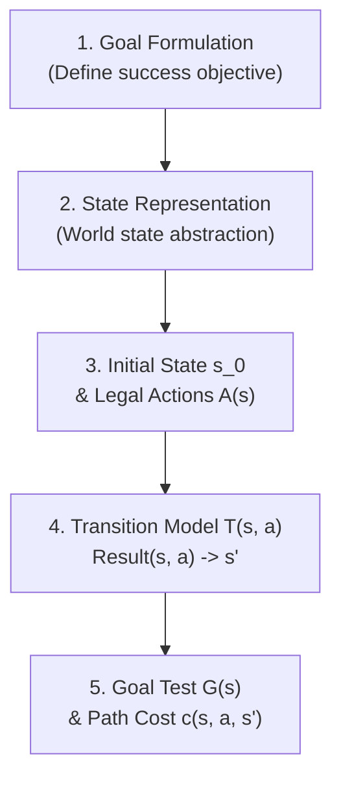

---

#### 2. The Five Formulation Components (3 Marks)

1. **Initial State ($s_0$):**  
   The state configuration in which the agent begins execution.
2. **Set of Actions ($A(s)$):**  
   The set of all permissible actions/operators executable by the agent from current state $s$.
3. **Transition Model ($T(s, a)$ / $\operatorname{Result}(s, a)$):**  
   A deterministic function specifying which state $s'$ results from applying action $a$ in state $s$.
4. **Goal Test ($G(s)$):**  
   A Boolean predicate that checks whether state $s$ satisfies the required goal conditions (either explicitly enumerated or defined by a property check).
5. **Path Cost Function ($c(s, a, s')$):**  
   A function that assigns a numerical step cost to executing action $a$ between states $s$ and $s'$.

---

#### 3. Concrete Example: The 8-Puzzle Problem (3 Marks)

The 8-puzzle consists of a $3 \times 3$ grid with 8 numbered tiles and one blank space `[ ]`.

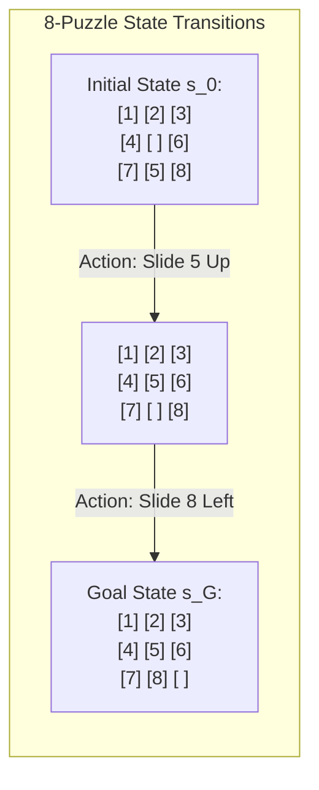

*   **State Space ($S$):** All $3 \times 3$ permutations of tiles $\{1, \dots, 8\}$ and the blank space. Total reachable states = $\frac{9!}{2} = 181,440$.
*   **Initial State ($s_0$):** An arbitrary configuration, e.g., $\begin{bmatrix} 1 & 2 & 3 \\ 4 & \text{blank} & 6 \\ 7 & 5 & 8 \end{bmatrix}$.
*   **Actions ($A$):** Movements of the blank space: $\{\text{Left}, \text{Right}, \text{Up}, \text{Down}\}$.
*   **Transition Model:** Swaps the blank tile with the adjacent tile in the chosen direction.
*   **Goal Test ($G$):** State matches the standard numerical order: $\begin{bmatrix} 1 & 2 & 3 \\ 4 & 5 & 6 \\ 7 & 8 & \text{blank} \end{bmatrix}$.
*   **Path Cost ($c$):** Each tile slide has unit cost $c = 1$. The total path cost is the number of moves.

:::tip

**Examiner's Note**

High marks require explicitly writing the 5-tuple $\langle s_0, A, T, G, c \rangle$ and mapping each component to a concrete domain like the 8-puzzle or vacuum world.

:::

---

### Question 21.b (8 Marks)

:::info

**Question Statement**

Consider the water jug problem: You are given two jugs, a 4-gallon one and 3-gallon one. Neither has any measuring marker on it. There is a pump that can be used to fill the jugs with water. How can you get exactly 2 gallon of water from the 4-gallon jug? Explain the state space representation and apply an optimal sequence of actions to solve it. **(8 Marks)**

:::

---

### Solution 21.b (8 Marks)

#### 1. State Space Representation (3 Marks)

*   **State Variable:** An ordered coordinate pair:
    $$(x, y)$$
    where:
    *   $x \in \{0, 1, 2, 3, 4\}$: Gallons of water currently in the 4-gallon jug.
    *   $y \in \{0, 1, 2, 3\}$: Gallons of water currently in the 3-gallon jug.
*   **Initial State:** Both jugs are empty:
    $$s_0 = (0, 0)$$
*   **Goal State:** Exactly 2 gallons in the 4-gallon jug:
    $$s_G = (2, y) \quad \text{for any } y \in \{0, 1, 2, 3\}$$

---

#### 2. Production Rules / Transition Operators (2 Marks)

| Rule # | Action Description | Precondition | State Transition $(x, y) \to (x', y')$ |
| :---: | :--- | :--- | :--- |
| **$R_1$** | Fill 4-gal jug | $x < 4$ | $(x, y) \to (4, y)$ |
| **$R_2$** | Fill 3-gal jug | $y < 3$ | $(x, y) \to (x, 3)$ |
| **$R_3$** | Empty 4-gal jug | $x > 0$ | $(x, y) \to (0, y)$ |
| **$R_4$** | Empty 3-gal jug | $y > 0$ | $(x, y) \to (x, 0)$ |
| **$R_5$** | Pour 3-gal into 4-gal until 4-gal is full | $x + y \ge 4 \land y > 0$ | $(x, y) \to (4, y - (4 - x))$ |
| **$R_6$** | Pour 4-gal into 3-gal until 3-gal is full | $x + y \ge 3 \land x > 0$ | $(x, y) \to (x - (3 - y), 3)$ |
| **$R_7$** | Pour all water from 3-gal into 4-gal | $x + y \le 4 \land y > 0$ | $(x, y) \to (x + y, 0)$ |
| **$R_8$** | Pour all water from 4-gal into 3-gal | $x + y \le 3 \land x > 0$ | $(x, y) \to (0, x + y)$ |

---

#### 3. Optimal Sequence of Actions (3 Marks)

The optimal path reaches goal state $(2, 0)$ in **6 transitions**:

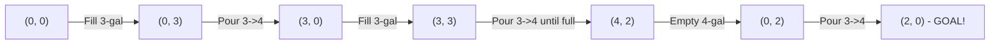

##### Step-by-Step State Trace

| Step | 4-Gallon Jug ($x$) | 3-Gallon Jug ($y$) | Action Applied | Rule Applied |
| :---: | :---: | :---: | :--- | :---: |
| **0** | $0$ | $0$ | Initial State | — |
| **1** | $0$ | $3$ | Fill the 3-gallon jug completely | $R_2$ |
| **2** | $3$ | $0$ | Pour all water from 3-gal into 4-gal | $R_7$ |
| **3** | $3$ | $3$ | Fill the 3-gallon jug completely again | $R_2$ |
| **4** | $4$ | $2$ | Pour from 3-gal into 4-gal until 4-gal is full ($4-3=1$ gal needed; $2$ left in 3-gal) | $R_5$ |
| **5** | $0$ | $2$ | Empty the 4-gallon jug | $R_3$ |
| **6** | $\mathbf{2}$ | $\mathbf{0}$ | **Pour remaining 2 gallons from 3-gal into 4-gal** | $\mathbf{R_7}$ **(Goal Achieved!)** |

:::tip

**Examiner's Note**

Ensure your answer explicitly shows the mathematical condition for pouring ($x + y \ge 4$) in Rule 5 and details the 6-step trace table reaching $(2, 0)$.

:::

---

### Question 22.a (8 Marks)

:::info

**Question Statement**

Consider a state space where the start state is number 1 and each state 'n' has two successors: 2n and 2n+1.  
(i) Draw the search tree up to depth 3 (root at depth 0). **(2 Marks)**  
(ii) Which states will be visited by DFS (assume left branch is explored first) if the goal is state 11? **(2 Marks)**  
(iii) Which states will be visited by BFS for the same goal? **(2 Marks)**  
(iv) Is DFS optimal in this scenario? Explain. **(2 Marks)**

:::

---

### Solution 22.a (8 Marks)

#### (i) Search Tree up to Depth 3 (2 Marks)

The root is node $1$ at depth 0. Each node $n$ generates left child $2n$ and right child $2n + 1$:

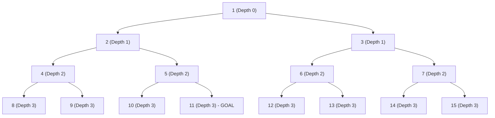

*   **Depth 0:** $[1]$
*   **Depth 1:** $[2, 3]$
*   **Depth 2:** $[4, 5, 6, 7]$
*   **Depth 3:** $[8, 9, 10, 11, 12, 13, 14, 15]$

---

#### (ii) States Visited by DFS for Goal 11 (2 Marks)

DFS explores the leftmost path to maximum depth before backtracking:
1. Visit $1$ (Root)
2. Traverse Left to $2$
3. Traverse Left to $4$
4. Traverse Left to $8$ (Depth 3 leaf; not goal)
5. Backtrack to $4$; Traverse Right to $9$ (Depth 3 leaf; not goal)
6. Backtrack to $2$; Traverse Right to $5$
7. Traverse Left to $10$ (Depth 3 leaf; not goal)
8. Backtrack to $5$; Traverse Right to $\mathbf{11}$ (**Goal Succeeded!**)

$$\mathbf{\text{DFS Visited Sequence:} \quad 1 \to 2 \to 4 \to 8 \to 9 \to 5 \to 10 \to 11}$$
*(Total 8 nodes visited).*

---

#### (iii) States Visited by BFS for Goal 11 (2 Marks)

BFS explores the tree level-by-level using a FIFO queue:
*   **Level 0:** $1$
*   **Level 1:** $2, 3$
*   **Level 2:** $4, 5, 6, 7$
*   **Level 3:** $8, 9, 10, \mathbf{11}$ (**Goal Succeeded!**)

$$\mathbf{\text{BFS Visited Sequence:} \quad 1 \to 2 \to 3 \to 4 \to 5 \to 6 \to 7 \to 8 \to 9 \to 10 \to 11}$$
*(Total 11 nodes visited).*

---

#### (iv) Optimality of DFS in this Scenario (2 Marks)

*   **For this specific instance:** DFS returns the path $1 \to 2 \to 5 \to 11$, which has a path length of 3 edges. Since the goal state $11$ lies at depth 3, the path found matches the optimal depth.
*   **General Optimality Analysis:** DFS is **NOT optimal in general**.
    *   If another goal state existed at a shallower level in the right subtree (e.g., node $3$ at depth 1 or node $7$ at depth 2), standard DFS would have missed it initially, exploring deeply into the left subtree down to leaf nodes at depth 3 before backtracking, returning a deeper, suboptimal path.
    *   In an infinite, unbounded tree ($n \to 2n$), DFS without a depth bound would dive indefinitely down the leftmost branch ($1 \to 2 \to 4 \to 8 \to 16 \dots$) and never terminate, making it neither complete nor optimal.

:::tip

**Examiner's Note**

Award 2 marks each: (i) complete binary tree up to depth 3, (ii) DFS traversal $1 \to 2 \to 4 \to 8 \to 9 \to 5 \to 10 \to 11$, (iii) BFS traversal $1 \to 2 \to 3 \to \dots \to 11$, and (iv) explaining that DFS is not optimal in general because it can overlook shallow solutions in unvisited subtrees.

:::

---

### Question 22.b (8 Marks)

:::info

**Question Statement**

Use the A* algorithm to search for the shortest path from the start state 'A' to the final state 'J' in the given graph. Show the step-by-step evaluation of the f(n) values for each node visited. **(8 Marks)**

```text
         10
         (A)
       6/   \3
       v     v
   8 (B)     (F) 6
    / | \   / | \
  3/ 2| 1\ 1/ 7| \7
  v   v   vv   v  v
(C)5 (D)7 (G)5(H)3 |
  \   |   / \ /   |
  5\ 8| 3/   v2   |
    v v v   (I)1 -'
    3(E)----/ 3
      5\   /
        v v
        (J) 0
```

*Heuristic Values $h(n)$:*  
$A: 10, \; B: 8, \; C: 5, \; D: 7, \; E: 3, \; F: 6, \; G: 5, \; H: 3, \; I: 1, \; J: 0$

*Edge Weights:*  
$A-B: 6, \; A-F: 3$  
$B-C: 3, \; B-D: 2, \; C-D: 1, \; C-E: 5, \; D-E: 8$  
$F-G: 1, \; F-H: 7, \; G-I: 3, \; H-I: 2$  
$E-I: 5, \; E-J: 5, \; I-J: 3$

*Start State:* $A$, *Final Goal State:* $J$

:::

---

### Solution 22.b (8 Marks)

#### 1. $A^*$ Search Evaluation Framework (2 Marks)
$A^*$ uses the evaluation function:
$$f(n) = g(n) + h(n)$$
where $g(n)$ is the exact cumulative cost from start state $A$, and $h(n)$ is the heuristic estimate to goal state $J$.

---

#### 2. Step-by-Step $A^*$ Execution Trace (5 Marks)

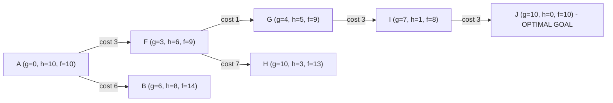

##### Trace Table

| Step | Dequeued Node $(u)$ | $g(u)$ | $h(u)$ | $f(u)$ | Path Followed | Successors Generated & Cumulative Cost | Priority Queue Contents ($f = g + h$) |
| :---: | :---: | :---: | :---: | :---: | :--- | :--- | :--- |
| **1** | **A** | $0$ | $10$ | **10** | `[A]` | $(F, g=3, h=6, f=9)$<br/>$(B, g=6, h=8, f=14)$ | `[(F, 9), (B, 14)]` |
| **2** | **F** | $3$ | $6$ | **9** | `[A, F]` | $(G, g=3+1=4, h=5, f=9)$<br/>$(H, g=3+7=10, h=3, f=13)$ | `[(G, 9), (H, 13), (B, 14)]` |
| **3** | **G** | $4$ | $5$ | **9** | `[A, F, G]` | $(I, g=4+3=7, h=1, f=8)$ | `[(I, 8), (H, 13), (B, 14)]` |
| **4** | **I** | $7$ | $1$ | **8** | `[A, F, G, I]` | $(J, g=7+3=10, h=0, f=10)$<br/>$(H, g=7+2=9, h=3, f=12)$<br/>$(E, g=7+5=12, h=3, f=15)$ | `[(J, 10), (H, 12), (H_old, 13), (B, 14), (E, 15)]` |
| **5** | **J** | $\mathbf{10}$ | $\mathbf{0}$ | $\mathbf{10}$ | `[A, F, G, I, J]` | **Goal State Dequeued! Search Terminates.** | — |

---

#### 3. Optimal Path and Cost Summary (1 Mark)

*   **Optimal Path Discovered:**
    $$\mathbf{A \to F \to G \to I \to J}$$
*   **Total Optimal Path Cost:**
    $$\operatorname{Cost} = c(A, F) + c(F, G) + c(G, I) + c(I, J) = 3 + 1 + 3 + 3 = \mathbf{10}$$

:::tip

**Examiner's Note**

High marks require explicitly showing the priority queue at each of the 5 expansion steps, showing that node $I$ evaluates child $J$ with $f(J) = 10 + 0 = 10$, which is dequeued to confirm the optimal path of cost 10.

:::

---

### Question 23.a (8 Marks)

:::info

**Question Statement**

Consider a Constraint Satisfaction Problem (CSP) for coloring the map shown below using three colors: Red, Green, and Blue. Adjacent regions must not have the same color. Regions: WA, NT, SA, Q, NSW, V, T.  
(i) Represent the problem as a CSP (Variables, Domains, Constraints). **(3 Marks)**  
(ii) Show how Forward Checking helps in avoiding backtracking when assigning colors to the regions. **(3 Marks)**  
(iii) Explain how the MRV (Minimum Remaining Values) heuristic can be applied here to choose the next variable. **(2 Marks)**

:::

---

### Solution 23.a (8 Marks)

#### (i) Formal CSP Representation (3 Marks)

The map-coloring problem is formally modeled as a triple $\mathcal{P}_{\text{CSP}} = \langle X, D, C \rangle$:

##### a) Variables ($X$)
The seven Australian territories:
$$X = \{WA, NT, SA, Q, NSW, V, T\}$$

##### b) Domains ($D$)
Each variable can take any of the three colors:
$$D_i = \{\text{Red}, \text{Green}, \text{Blue}\} \quad \forall X_i \in X$$

##### c) Constraints ($C$)
Adjacent regions sharing a border must have different colors:
$$
\begin{aligned}
WA \neq NT, \quad WA \neq SA, \quad NT \neq SA, \quad NT \neq Q, \\
SA \neq Q, \quad SA \neq NSW, \quad SA \neq V, \quad Q \neq NSW, \quad NSW \neq V
\end{aligned}
$$
*(Tasmania $T$ has no adjacency constraints).*

---

#### (ii) Forward Checking to Avoid Backtracking (3 Marks)

Forward Checking filters out inconsistent values from the domains of unassigned neighboring variables immediately after each assignment:

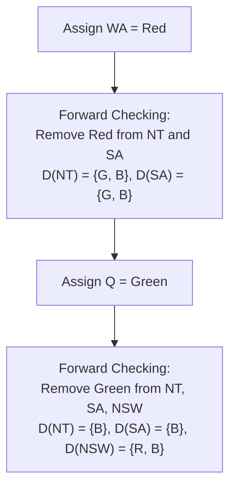

##### Domain Reduction Trace Table

| Step | Variable Assigned | Value | $D(WA)$ | $D(NT)$ | $D(SA)$ | $D(Q)$ | $D(NSW)$ | $D(V)$ | $D(T)$ |
| :---: | :---: | :---: | :---: | :---: | :---: | :---: | :---: | :---: | :---: |
| **0** | Initial Domains | — | $\{R,G,B\}$ | $\{R,G,B\}$ | $\{R,G,B\}$ | $\{R,G,B\}$ | $\{R,G,B\}$ | $\{R,G,B\}$ | $\{R,G,B\}$ |
| **1** | $WA$ | **Red** | $\{R\}$ | $\{G, B\}$ | $\{G, B\}$ | $\{R,G,B\}$ | $\{R,G,B\}$ | $\{R,G,B\}$ | $\{R,G,B\}$ |
| **2** | $Q$ | **Green** | $\{R\}$ | $\{B\}$ | $\{B\}$ | $\{G\}$ | $\{R, B\}$ | $\{R,G,B\}$ | $\{R,G,B\}$ |
| **3** | $V$ | **Blue** | $\{R\}$ | $\{B\}$ | $\{B\}$ | $\{G\}$ | $\{R\}$ | $\{B\}$ | $\{R,G,B\}$ |

*   **How Backtracking is Avoided:**  
    If an assignment causes any unassigned variable's domain to become empty ($\emptyset$), forward checking immediately flags a conflict, pruning the branch at depth 2 or 3 rather than exploring an exponential tree of doomed assignments.

---

#### (iii) Minimum Remaining Values (MRV) Heuristic (2 Marks)

The **MRV Heuristic** (also known as the "Most Constrained Variable" or "Fail-First" heuristic) dictates:
$$\text{Choose the unassigned variable with the fewest legal values remaining in its domain.}$$

*   **Application in Australia Map Coloring:**
    *   After assigning $WA = \text{Red}$ and $Q = \text{Green}$, the domain sizes are:
        $$\lvert D(NT) \rvert = 1 \; (\{B\}), \quad \lvert D(SA) \rvert = 1 \; (\{B\}), \quad \lvert D(NSW) \rvert = 2, \quad \lvert D(V) \rvert = 3, \quad \lvert D(T) \rvert = 3$$
    *   MRV prioritizes selecting either $NT$ or $SA$ next (tie-broken by the **Degree Heuristic**, selecting $SA$ because it has the highest number of constraints on remaining unassigned variables).
    *   **Benefit:** Prunes invalid search paths early, minimizing the depth of the search tree before encountering dead ends.

:::tip

**Examiner's Note**

Ensure all 7 variables and 9 adjacency constraints are listed, illustrate forward checking domain reductions in a trace table, and explain why MRV acts as a "fail-first" optimization.

:::

---

### Question 23.b (8 Marks)

:::info

**Question Statement**

Apply the Alpha-Beta Pruning algorithm to the game tree below, where the tree is evaluated from left to right. Show which branches are pruned and the final value at the root. **(8 Marks)**

```text
             MAX
            /   \
         MIN     MIN
        /   \   /   \
       3     5 2     8
```

:::

---

### Solution 23.b (8 Marks)

#### 1. Game Tree Structure & Initial Bounds (2 Marks)
*   **Root (Level 0):** MAX player, initial bounds $[\alpha = -\infty, \beta = +\infty]$.
*   **Level 1:** Two MIN nodes, Left Child ($M_1$) and Right Child ($M_2$).
*   **Level 2:** Four terminal leaves evaluated from left to right:
    *   Under $M_1$: Left leaf $= 3$, Right leaf $= 5$.
    *   Under $M_2$: Left leaf $= 2$, Right leaf $= 8$.

---

#### 2. Step-by-Step Alpha-Beta Pruning Trace (4 Marks)

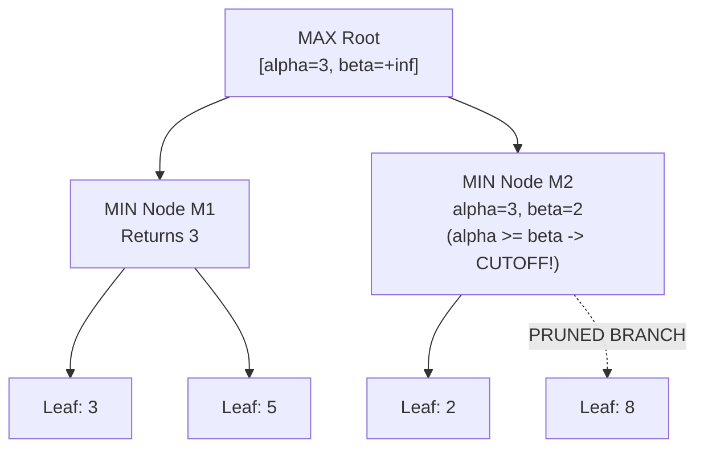

##### Step 1: Evaluate Left MIN Subtree ($M_1$)
1. Root passes bounds $[\alpha = -\infty, \beta = +\infty]$ to node $M_1$.
2. Node $M_1$ inspects its left child (leaf value $3$):
   $$\beta = \min(+\infty, 3) = 3$$
3. Node $M_1$ inspects its right child (leaf value $5$):
   $$\beta = \min(3, 5) = 3$$
4. Node $M_1$ completes evaluation and returns value $3$ to Root.

##### Step 2: Update Root (MAX Node)
*   Root updates its lower bound $\alpha$:
    $$\alpha = \max(-\infty, 3) = 3$$
*   Current bounds at Root: $[\alpha = 3, \beta = +\infty]$.

##### Step 3: Evaluate Right MIN Subtree ($M_2$)
1. Root passes down bounds $[\alpha = 3, \beta = +\infty]$ to node $M_2$.
2. Node $M_2$ inspects its left child (leaf value $2$):
   $$\beta = \min(+\infty, 2) = 2$$
3. Current bounds at $M_2$: $[\alpha = 3, \beta = 2]$.

##### Step 4: Pruning Condition Triggered ($\alpha \ge \beta$)
$$\alpha \ge \beta \iff 3 \ge 2 \implies \mathbf{CUTOFF!}$$
*   **Reasoning:** $M_2$ is a MIN node, so its final value can never exceed $2$. But the MAX player at the root is already guaranteed a payoff of at least $3$ by choosing branch $M_1$. Therefore, MAX will never choose branch $M_2$, making the remaining children of $M_2$ irrelevant to the final decision.
*   **Pruned Branch:** The branch leading to the **leaf with value 8 is PRUNED**.

---

#### 3. Final Search Outcome (2 Marks)

*   **Pruned Branches:** Right child of node $M_2$ (Leaf with value 8).
*   **Optimal Move at Root:** Choose the Left Branch (node $M_1$).
*   **Final Minimax Value at Root:**
    $$\operatorname{Value}(\text{Root}) = \mathbf{3}$$

:::tip

**Examiner's Note**

Full marks require explicitly showing the condition $\alpha \ge \beta$ ($3 \ge 2$) at node $M_2$, identifying leaf 8 as pruned, and stating the final root value of 3.

:::

---

### Question 24.a (8 Marks)

:::info

**Question Statement**

Convert the following sentences into First-Order Logic (FOL): **(8 Marks)**  
(i) Every student loves artificial intelligence. **(2 Marks)**  
(ii) Some students are not intelligent. **(2 Marks)**  
(iii) If a person is an engineer, then they know mathematics. **(2 Marks)**  
(iv) There is a doctor who treated every patient. **(2 Marks)**

:::

---

### Solution 24.a (8 Marks)

#### Predicate Definitions
*   $\operatorname{Student}(x)$: $x$ is a student.
*   $\operatorname{Loves}(x, y)$: $x$ loves $y$.
*   $\text{AI}$: Constant representing Artificial Intelligence.
*   $\operatorname{Intelligent}(x)$: $x$ is intelligent.
*   $\operatorname{Person}(x)$: $x$ is a person.
*   $\operatorname{Engineer}(x)$: $x$ is an engineer.
*   $\operatorname{Knows}(x, y)$: $x$ knows subject $y$.
*   $\text{Mathematics}$: Constant representing Mathematics.
*   $\operatorname{Doctor}(x)$: $x$ is a doctor.
*   $\operatorname{Patient}(y)$: $y$ is a patient.
*   $\operatorname{Treated}(x, y)$: $x$ treated $y$.

---

#### Formal FOL Translations

##### (i) "Every student loves artificial intelligence." (2 Marks)
The universal quantifier $\forall$ pairs with implication $\implies$:

$$\mathbf{\forall x \; \big( \operatorname{Student}(x) \implies \operatorname{Loves}(x, \text{AI}) \big)}$$

---

##### (ii) "Some students are not intelligent." (2 Marks)
The existential quantifier $\exists$ pairs with conjunction $\land$:

$$\mathbf{\exists x \; \big( \operatorname{Student}(x) \land \neg \operatorname{Intelligent}(x) \big)}$$

---

##### (iii) "If a person is an engineer, then they know mathematics." (2 Marks)
Universal quantification over persons who are engineers:

$$\mathbf{\forall x \; \Big( \big( \operatorname{Person}(x) \land \operatorname{Engineer}(x) \big) \implies \operatorname{Knows}(x, \text{Mathematics}) \Big)}$$

*(Or compactly, assuming the domain is people: $\forall x \; (\operatorname{Engineer}(x) \implies \operatorname{Knows}(x, \text{Mathematics}))$).*

---

##### (iv) "There is a doctor who treated every patient." (2 Marks)
Nested quantifiers: an existential quantifier for the doctor scoping over a universal quantifier for all patients:

$$\mathbf{\exists x \; \Big( \operatorname{Doctor}(x) \land \forall y \; \big( \operatorname{Patient}(y) \implies \operatorname{Treated}(x, y) \big) \Big)}$$

:::tip

**Examiner's Note**

Remember the foundational rules of First-Order Logic translation: $\forall$ universally pairs with $\implies$, and $\exists$ existentially pairs with $\land$. In sentence (iv), the quantifier order $\exists x \, \forall y$ is critical; reversing it to $\forall y \, \exists x$ would incorrectly assert that every patient was treated by some doctor (possibly different doctors).

:::

---

### Question 24.b (8 Marks)

:::info

**Question Statement**

Explain Unification algorithm with an example in First Order Logic. **(8 Marks)**

:::

---

### Solution 24.b (8 Marks)

#### 1. Concept of Unification in First-Order Logic (2.5 Marks)
**Unification** is the algorithmic process of finding a variable substitution mapping $\theta$ that makes two distinct First-Order Logic atomic expressions syntactically identical:

$$\operatorname{UNIFY}(P, Q) = \theta \quad \text{such that} \quad \operatorname{SUBST}(\theta, P) = \operatorname{SUBST}(\theta, Q)$$

where $\theta = \{v_1 / t_1, v_2 / t_2, \dots, v_k / t_k\}$ replaces variable $v_i$ with term $t_i$.

##### The Most General Unifier (MGU)
The unification algorithm computes the **Most General Unifier (MGU)**, which imposes the fewest possible constraints on variables, preserving maximal generality for downstream theorem proving.

---

#### 2. Foundational Unification Rules (2.5 Marks)

1. **Identical Symbols:** $\operatorname{UNIFY}(c, c) = \emptyset$ for identical constants or variables.
2. **Variable with Term:** $\operatorname{UNIFY}(var, term)$ returns $\{var / term\}$ provided that $var$ does not occur inside $term$ (**The Occur Check**).
3. **Compound Expressions:** $\operatorname{UNIFY}(P(x_1, \dots, x_n), Q(y_1, \dots, y_n))$ succeeds if predicate symbols match ($P == Q$), arities match, and argument pairs unify recursively under composed substitutions:
   $$\theta \leftarrow \theta \circ \operatorname{UNIFY}(\operatorname{SUBST}(\theta, x_i), \operatorname{SUBST}(\theta, y_i))$$
4. **Clash Failure:** Attempting to unify distinct constants (e.g., $\operatorname{UNIFY}(\text{John}, \text{Mary})$) returns **FAIL**.

---

#### 3. Step-by-Step Unification Example (3 Marks)

Unify the following two First-Order Logic expressions:
$$E_1 = \operatorname{Knows}(\text{John}, x)$$
$$E_2 = \operatorname{Knows}(y, \operatorname{Mother}(y))$$

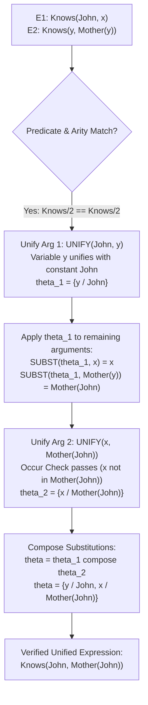

##### Composition & Verification
$$\mathbf{\theta = \{y / \text{John}, \; x / \operatorname{Mother}(\text{John})\}}$$

Applying $\theta$ to both expressions:
*   $\operatorname{SUBST}(\theta, E_1) = \operatorname{Knows}(\text{John}, \operatorname{Mother}(\text{John}))$
*   $\operatorname{SUBST}(\theta, E_2) = \operatorname{Knows}(\text{John}, \operatorname{Mother}(\text{John}))$

Both expressions are rendered syntactically identical. Unification succeeds.

:::tip

**Examiner's Note**

Ensure your answer explicitly mentions the **Occur Check**, defines the **MGU**, and details the step-by-step substitution composition on a two-argument predicate.

:::

---

### Question 25.a (8 Marks)

:::info

**Question Statement**

Discuss the differences between Supervised, Unsupervised, and Reinforcement Learning. Provide a practical application for each. **(8 Marks)**

:::

---

### Solution 25.a (8 Marks)

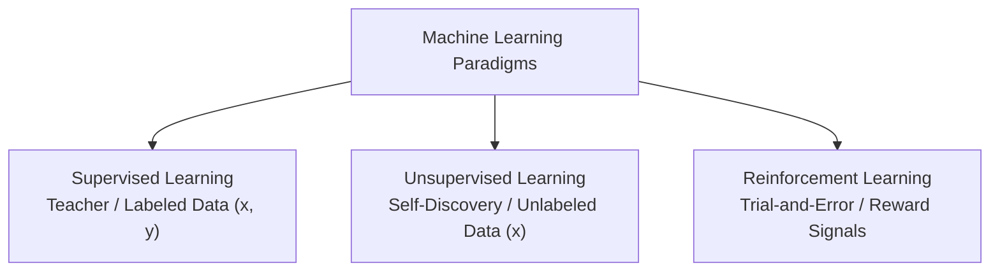

#### 1. Core Paradigm Descriptions (4 Marks)

1. **Supervised Learning:**
   *   **Mechanism:** Trains on labeled input-target pairs $\mathcal{D} = \{(\mathbf{x}_i, y_i)\}_{i=1}^N$. The objective is to learn an approximating function $f(\mathbf{x}) \approx y$ by minimizing empirical loss $\frac{1}{N} \sum_{i=1}^N \mathcal{L}(f(\mathbf{x}_i), y_i)$.
   *   **Tasks:** Classification (discrete target labels) and Regression (continuous numeric targets).
2. **Unsupervised Learning:**
   *   **Mechanism:** Operates on unlabeled feature vectors $\mathcal{D} = \{\mathbf{x}_i\}_{i=1}^N$ without external feedback. Discovers latent geometric structures, clusters, or probability distributions $P(\mathbf{x})$.
   *   **Tasks:** Clustering ($K$-Means, Hierarchical), Dimensionality Reduction (PCA), and Anomaly Detection.
3. **Reinforcement Learning:**
   *   **Mechanism:** An agent interacts with a dynamic environment modeled as a Markov Decision Process (MDP). It learns an action-selection policy $\pi(a \mid s)$ through trial-and-error to maximize cumulative discounted rewards $R = \sum_{t=0}^{\infty} \gamma^t r_t$.
   *   **Tasks:** Sequential decision making, motor control, game playing.

---

#### 2. Comparative Matrix (2 Marks)

| Dimension | Supervised Learning | Unsupervised Learning | Reinforcement Learning |
| :--- | :--- | :--- | :--- |
| **Data Nature** | Fully labeled pairs: $(\mathbf{x}, y)$ | Unlabeled features: $(\mathbf{x})$ | Sequential states and action transitions: $(s, a, r, s')$ |
| **Feedback Type** | Direct ground-truth error signal | No direct supervision; self-organizing | Delayed scalar reward/punishment feedback |
| **Primary Goal** | Predict target outcomes for unseen inputs | Discover latent patterns and representations | Learn optimal behavior policy maximizing rewards |
| **Key Algorithms** | SVM, Random Forest, Linear Regression | $K$-Means, PCA, DBSCAN, Autoencoders | Q-Learning, PPO, Deep Q-Networks (DQN) |

---

#### 3. Practical Industry Applications (2 Marks)

*   **Supervised Learning Application:**  
    *Medical Tumor Classification:* A convolutional neural network trained on thousands of mammograms annotated by oncologists as "Benign" or "Malignant" to assist doctors in early breast cancer diagnosis.
*   **Unsupervised Learning Application:**  
    *E-Commerce Customer Segmentation:* Grouping millions of online retail customers into behavioral cohorts based on browsing frequency, purchase history, and cart abandonment without predefined labels.
*   **Reinforcement Learning Application:**  
    *Autonomous Warehouse Robotics:* Training automated guided vehicles (AGVs) to navigate crowded fulfillment centers, avoid obstacles, and optimize package retrieval routes through trial-and-error simulation.

:::tip

**Examiner's Note**

Structure the answer into three clear components: formal mathematical definition, a comparison table across key dimensions, and concrete real-world applications.

:::

---

### Question 25.b (8 Marks)

:::info

**Question Statement**

Describe the Architecture of an Expert System with a neat diagram. Discuss the role of each component in detail. **(8 Marks)**

:::

---

### Solution 25.b (8 Marks)

#### 1. Architecture of an Expert System (3 Marks)

An **Expert System** emulates the decision-making ability of a human specialist by coupling a formalized knowledge base with an automated reasoning engine.

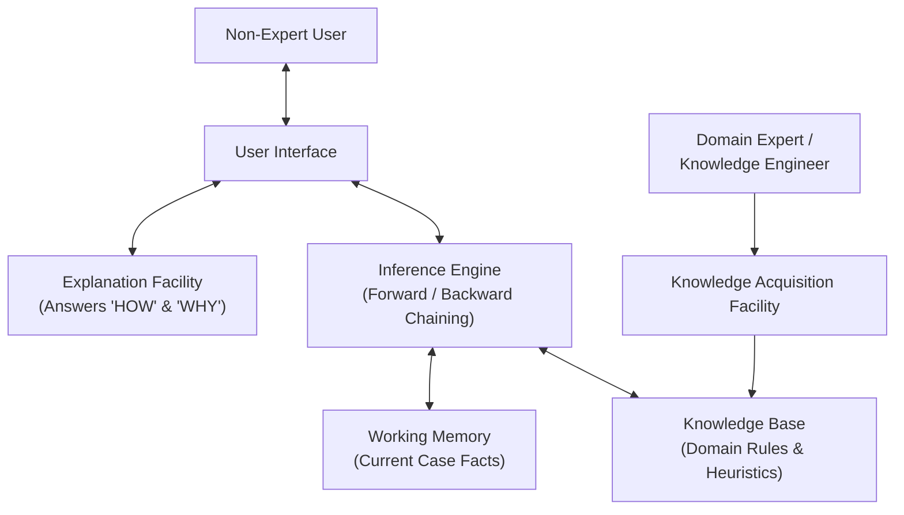

---

#### 2. Component Roles in Detail (5 Marks)

1. **Knowledge Base (KB):**  
   The central long-term memory containing domain-specific facts, heuristics, and production rules:
   $$\text{IF } \langle\text{symptoms / premises}\rangle \implies \text{THEN } \langle\text{diagnosis / action}\rangle$$
2. **Inference Engine (IE):**  
   The computational reasoning brain that executes inference:
   *   **Pattern Matching:** Identifies rules whose premises match current working memory (often optimized via the Rete algorithm).
   *   **Conflict Resolution:** Chooses which rule to fire when multiple rules match (using criteria like salience, specificity, or recency).
   *   **Execution Modes:** Executes via **Forward Chaining** (data-driven reasoning) or **Backward Chaining** (goal-driven hypothesis testing).
3. **Working Memory (Fact Database):**  
   The short-term scratchpad memory that stores session-specific user inputs, lab test readings, and intermediate deduced facts for the active case.
4. **Explanation Facility (Justifier):**  
   Provides transparency by explaining the system's reasoning:
   *   *WHY explanations:* Clarifies why a question is being asked by displaying the rule currently being evaluated.
   *   *HOW explanations:* Traces the chain of fired rules that produced a final conclusion.
5. **User Interface:**  
   Facilitates interactive communication between non-expert end users and the system.
6. **Knowledge Acquisition Facility:**  
   Enables knowledge engineers to model, validate, and inject new expertise from human specialists into the knowledge base without modifying the inference engine.

:::tip

**Examiner's Note**

Full marks require drawing the clean 6-component block diagram and explaining the role of each component, highlighting the separation between the Knowledge Base and the Inference Engine.

:::

---

## Part C: Comprehensive Search Problems (15 Marks)

### Question 26 (15 Marks)

:::info

**Question Statement**

Explain Knowledge Base in Artificial Intelligence. What are the types of Knowledge and explain its architecture in detail. **(15 Marks)**

:::

---

### Solution 26 (15 Marks)

#### 1. Concept of Knowledge Base in AI (3 Marks)

In artificial intelligence, a **Knowledge Base (KB)** is a centralized, formal repository of domain facts, relationships, heuristics, and semantic rules that enables a knowledge-based agent to reason, draw inferences, and solve complex problems.

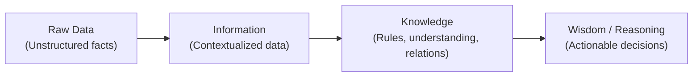

##### Knowledge-Based Agent Loop
A Knowledge-Based Agent interacts with its KB through two primary operations:
*   $\operatorname{TELL}(\text{KB}, \alpha)$: Informs the knowledge base of a newly perceived sentence $\alpha$.
*   $\operatorname{ASK}(\text{KB}, \beta)$: Queries whether sentence $\beta$ is logically entailed by the knowledge base ($\text{KB} \models \beta$).

---

#### 2. Comprehensive Types of Knowledge in AI (6 Marks)

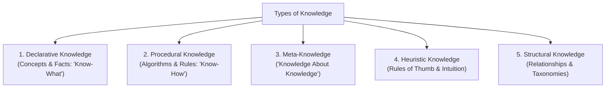

##### a) Declarative Knowledge ("Know-What")
*   **Definition:** Descriptive, factual assertions about objects, concepts, and states of the world. Stored as static propositions or logic sentences.
*   **Representation:** Expressed in Propositional or First-Order Logic.
*   **Example:** $\operatorname{CapitalOf}(\text{Paris}, \text{France})$, $\operatorname{IsA}(\text{Robin}, \text{Bird})$.

##### b) Procedural Knowledge ("Know-How")
*   **Definition:** Operational instructions, behavioral rules, and step-by-step algorithms describing how to perform actions and achieve goals.
*   **Representation:** Encoded as executable production rules, code routines, or state transition programs.
*   **Example:** "To clear a block, first remove all blocks stacked on top of it."

##### c) Meta-Knowledge ("Knowledge About Knowledge")
*   **Definition:** Knowledge regarding the reliability, source, validity, certainty, and applicability of other knowledge in the system.
*   **Example:** "Rule 14 has a Certainty Factor of $0.85$ and was extracted from clinical medical trials in 2024."

##### d) Heuristic Knowledge
*   **Definition:** Practical rules of thumb, educated estimations, and expert insights that expedite problem solving without guaranteeing theoretical optimality.
*   **Example:** "In chess, controlling the center four squares usually provides a tactical advantage."

##### e) Structural Knowledge
*   **Definition:** Relationship models describing how concepts relate to one another (part-whole relationships, taxonomies, and conceptual hierarchies).
*   **Representation:** Semantic networks and frame hierarchies with `IS-A` and `PART-OF` links.
*   **Example:** A wheel is `PART-OF` a car; a car `IS-A` vehicle.

---

#### 3. Architecture of a Knowledge-Based System (6 Marks)

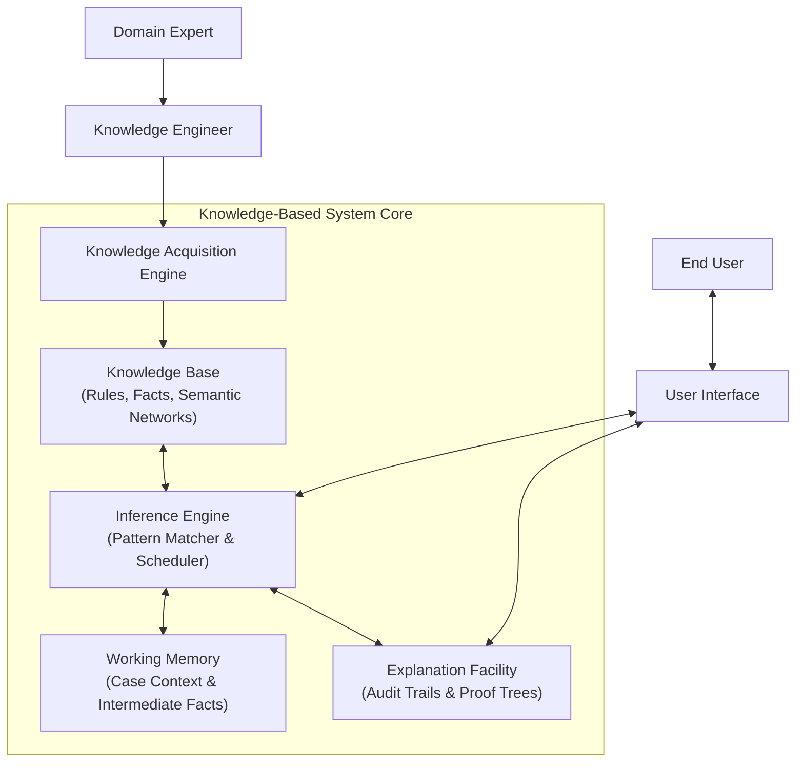

##### Architectural Modules and Workflow

1. **Knowledge Base (KB):**  
   The declarative store containing all domain rules, facts, constraints, and relational ontologies.
2. **Inference Engine (IE):**  
   The reasoning engine that operates via a three-phase cycle:
   *   *Match:* Compares current working memory facts against knowledge base rule antecedents using pattern-matching algorithms like Rete.
   *   *Resolve Conflicts:* Selects the highest-priority rule from the conflict set.
   *   *Act:* Fires the chosen rule, asserting new conclusions into working memory.
3. **Working Memory:**  
   The temporary dynamic database recording current case symptoms, user inputs, and intermediate deduced facts.
4. **Explanation Facility:**  
   Constructs human-understandable audit trails, detailing **WHY** a question is necessary and **HOW** a final conclusion was reached.
5. **Knowledge Acquisition Engine:**  
   Tools that allow knowledge engineers to translate human domain expertise into formal logic without modifying the core inference software.

:::tip

**Examiner's Note**

Award 3 marks for defining the Knowledge Base and the TELL/ASK interface, 6 marks for describing all 5 types of knowledge (Declarative, Procedural, Meta, Heuristic, Structural) with examples, and 6 marks for drawing the comprehensive architecture diagram and detailing each component's role.

:::

---

### Question 27 (15 Marks)

:::info

**Question Statement**

Solve the Cryptarithmetic Problem **(15 Marks)**

```text
    T W O
+ T H R E E
+ S E V E N
-----------
T W E L V E
```

Explain the Step by Step Process with diagram

:::

---

### Solution 27 (15 Marks)

#### 1. Formal CSP Formulation of the Puzzle (3 Marks)

Cryptarithmetic puzzles are Constraint Satisfaction Problems where letters represent distinct decimal digits:
*   **Variables:** The set of 10 distinct letters:
    $$X = \{T, W, O, H, R, E, S, V, N, L\}$$
*   **Domain:** Each letter maps to a unique decimal digit:
    $$D = \{0, 1, 2, 3, 4, 5, 6, 7, 8, 9\}$$
*   **Global All-Different Constraint:**
    $$\operatorname{AllDifferent}(T, W, O, H, R, E, S, V, N, L)$$
*   **Leading Digit Constraints:** Leading letters cannot be zero:
    $$T \neq 0, \quad S \neq 0$$

##### Column Alignment & Carries
Let $c_1, c_2, c_3, c_4, c_5$ denote the carries between columns from right (units) to left (hundred-thousands):

```text
Column:   6        5        4        3        2        1
Carry:   c_5      c_4      c_3      c_2      c_1
                  T        W        O
         T        H        R        E        E
+        S        E        V        E        N
------------------------------------------------------
T        W        E        L        V        E
```

---

#### 2. Step-by-Step Column Deductions (9 Marks)

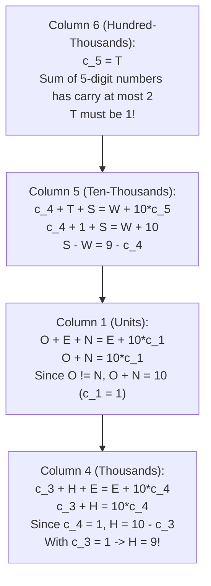

##### Step 1: Analyze Column 6 (Hundred-Thousands Column)
$$c_5 = T$$
*   Adding two 5-digit numbers and one 3-digit number can generate a carry $c_5$ into the sixth column of at most:
    $$\frac{19999 + 99999 + 99999}{100000} \approx 2.19 \implies c_5 \in \{1, 2\}$$
*   Since $T$ is the leading digit of the sum and carries must match:
    $$\mathbf{T = 1}, \quad \mathbf{c_5 = 1}$$

##### Step 2: Analyze Column 5 (Ten-Thousands Column)
$$c_4 + T + S = W + 10 \cdot c_5$$
Substitute $T = 1$ and $c_5 = 1$:
$$c_4 + 1 + S = W + 10 \implies S - W = 9 - c_4$$
*   Since all digits are distinct and $T = 1$, if $c_4 = 1$, then $S - W = 8$.
*   Since $S \le 9$ and $W \ge 0$, the only distinct digit assignment is:
    $$\mathbf{S = 8}, \quad \mathbf{W = 0}, \quad \mathbf{c_4 = 1}$$

##### Step 3: Analyze Column 1 (Units Column)
$$O + E + N = E + 10 \cdot c_1$$
Subtract $E$ from both sides:
$$O + N = 10 \cdot c_1$$
*   Since $O$ and $N$ are distinct non-zero digits ($O \neq N$), their sum must be $10$:
    $$\mathbf{c_1 = 1}, \quad \mathbf{O + N = 10}$$

##### Step 4: Analyze Column 4 (Thousands Column)
$$c_3 + H + E = E + 10 \cdot c_4$$
Subtract $E$ from both sides and substitute $c_4 = 1$:
$$c_3 + H = 10$$
*   Carry $c_3$ from the hundreds column can be at most $2$.
*   If $c_3 = 1$:
    $$H = 10 - 1 \implies \mathbf{H = 9}$$
    *(Digit 9 is available and unused).*

##### Step 5: Analyze Column 2 (Tens Column)
$$c_1 + W + E + E = V + 10 \cdot c_2$$
Substitute $c_1 = 1$ and $W = 0$:
$$1 + 2E = V + 10 \cdot c_2$$
*   If $c_2 = 0$: $V = 2E + 1$.
*   If $c_2 = 1$: $V = 2E + 1 - 10 = 2E - 9$.

##### Step 6: Analyze Column 3 (Hundreds Column)
$$c_2 + T + R + V = L + 10 \cdot c_3$$
Substitute $T = 1$ and $c_3 = 1$:
$$c_2 + 1 + R + V = L + 10$$

##### Step 7: Assigning Remaining Digits
Currently assigned digits:
$$\{T: 1, \; W: 0, \; S: 8, \; H: 9\}, \quad \text{Carries: } c_1 = 1, \; c_4 = 1, \; c_5 = 1$$
Available digits: $\{2, 3, 4, 5, 6, 7\}$.

*   Test $E = 2$:
    *   From Column 2: $V = 2(2) + 1 = 5$ ($c_2 = 0$).
    *   From Column 3 ($c_2 = 0, c_3 = 1$):
        $$0 + 1 + R + 5 = L + 10 \implies R + 6 = L + 10 \implies R - L = 4$$
    *   Available digits: $\{3, 4, 6, 7\}$.
    *   Choosing $\mathbf{R = 7}$ yields:
        $$L = 7 - 4 = \mathbf{3}$$
    *   Remaining available digits for $\{O, N\}$: $\{4, 6\}$.
    *   Since $O + N = 10$, this perfectly satisfies $4 + 6 = 10$!
    *   Both $O = 6, N = 4$ and $O = 4, N = 6$ are valid. Setting $\mathbf{O = 6}, \mathbf{N = 4}$.

---

#### 3. Verified Cryptarithmetic Solution (3 Marks)

##### Unique Digit Mapping Table

| Letter | Assigned Digit | Deduction Reason |
| :---: | :---: | :--- |
| **T** | **1** | Only possible carry $c_5$ into 6th column |
| **W** | **0** | Derived from Column 5 ($S - W = 8$) |
| **E** | **2** | Column 2 parity with available digits |
| **L** | **3** | Hundreds column deduction ($R - L = 4$) |
| **N** | **4** | Units column complement ($O + N = 10$) |
| **V** | **5** | Column 2 tens evaluation ($V = 2E + 1$) |
| **O** | **6** | Units column complement ($O + N = 10$) |
| **R** | **7** | Hundreds column deduction ($R - L = 4$) |
| **S** | **8** | Derived from Column 5 ($S - W = 8$) |
| **H** | **9** | Thousands column carry ($c_3 + H = 10$) |

##### Arithmetic Verification
$$
\begin{aligned}
\text{T W O} & = 106 \\
\text{T H R E E} & = 19722 \\
\text{S E V E N} & = 82524 \\
\hline
\text{Sum} & = 106 + 19722 + 82524 = \mathbf{102352} \\
\text{T W E L V E} & = 102352 \quad \mathbf{\checkmark \text{ (Exact Match!)}}
\end{aligned}
$$

*(Note: The symmetric assignment $O = 4, N = 6$ yielding $104 + 19722 + 82526 = 102352$ is equally valid).*

:::tip

**Examiner's Note**

High marks require presenting the column-by-column algebraic carry equations ($c_1 \dots c_5$), demonstrating the logical deductions that yield $T=1, W=0, S=8, H=9$, and concluding with the complete arithmetic addition verification.

:::
