# November 2024

> **Exam -** Semester Examination  
> **Session -** November 2024  

---

## Part A: Objective Type Questions (20 Marks)

### Question 1 (1 Mark)

:::info

**Question Statement**

Which of the Following Sentence is TRUE **(1 Mark)**

*   **(A)** Problem solving is the process of generating solutions for a given situation
*   **(B)** Problem will not be defined in a context manner.
*   **(C)** Every problem wont have a well-defined objective.
*   **(D)** Explore Information

:::

*   **Correct Answer:** **(A) Problem solving is the process of generating solutions for a given situation**
*   **Explanation:** In artificial intelligence, problem solving is defined as the systematic search and computational process of finding a valid sequence of actions or operators that transitions an agent from an initial state to a goal state.

---

### Question 2 (1 Mark)

:::info

**Question Statement**

What is the first step in data acquisition for AI models? **(1 Mark)**

*   **(A)** Data Annotation
*   **(B)** Data Collection
*   **(C)** Data Preprocessing
*   **(D)** Data Augmentation

:::

*   **Correct Answer:** **(B) Data Collection**
*   **Explanation:** Data acquisition begins fundamentally with **Data Collection** (gathering raw data from sensors, databases, IoT streams, or web sources) before subsequent downstream phases such as preprocessing, annotation, and augmentation can occur.

---

### Question 3 (1 Mark)

:::info

**Question Statement**

What is the objective of the Missionaries and Cannibals problem? **(1 Mark)**

*   **(A)** To ensure all missionaries cross before the cannibals
*   **(B)** To get all missionaries and cannibals across the river without any being eaten
*   **(C)** To prevent the cannibals from crossing the river
*   **(D)** To make sure missionaries outnumber cannibals on both sides of the river

:::

*   **Correct Answer:** **(B) To get all missionaries and cannibals across the river without any being eaten**
*   **Explanation:** The goal is to safely transport all $N$ missionaries and $N$ cannibals from the starting bank to the destination bank using a boat of limited capacity, subject to the safety invariant that missionaries are never outnumbered by cannibals on either bank.

---

### Question 4 (1 Mark)

:::info

**Question Statement**

Which AI model is typically used for tasks like image classification? **(1 Mark)**

*   **(A)** Convolutional Neural Networks (CNNs)
*   **(B)** K-nearest neighbors (KNN)
*   **(C)** Support Vector Machines (SVM)
*   **(D)** Recurrent Neural Networks (RNNs)

:::

*   **Correct Answer:** **(A) Convolutional Neural Networks (CNNs)**
*   **Explanation:** Convolutional Neural Networks (CNNs) utilize spatial convolution kernels, parameter sharing, and pooling layers to automatically extract shift-invariant 2D spatial feature hierarchies from visual pixel arrays.

---

### Question 5 (1 Mark)

:::info

**Question Statement**

Unlike depth-first search and breadth-first search, Best First Search does not guarantee **(1 Mark)**

*   **(A)** Domain exploration
*   **(B)** Agents
*   **(C)** Completeness or optimality
*   **(D)** Recurrent

:::

*   **Correct Answer:** **(C) Completeness or optimality**
*   **Explanation:** Pure Greedy Best-First Search selects nodes based solely on $h(n)$. It can be lured down dead-end paths by misleading heuristics, can get trapped in infinite loops in cyclic graphs (incomplete), and does not guarantee finding the lowest-cost solution (suboptimal).

---

### Question 6 (1 Mark)

:::info

**Question Statement**

Best First Search is an informed search algorithm that selects the node for expansion based on **(1 Mark)**

*   **(A)** Heuristic function value
*   **(B)** Hash value
*   **(C)** algorithm
*   **(D)** Process

:::

*   **Correct Answer:** **(A) Heuristic function value**
*   **Explanation:** Best-First Search evaluates candidate nodes using a priority queue keyed on an evaluation function $f(n)$ derived from domain heuristic estimates $h(n)$ indicating estimated proximity to the goal.

---

### Question 7 (1 Mark)

:::info

**Question Statement**

_______ is the maximum number of edges in a binary tree with N nodes? **(1 Mark)**

*   **(A)** 5
*   **(B)** 6
*   **(C)** 7
*   **(D)** n-1

:::

*   **Correct Answer:** **(D) n-1**
*   **Explanation:** By graph-theoretic definition, any connected tree structure containing $N$ vertices (including any binary tree) possesses exactly $N - 1$ edges.

---

### Question 8 (1 Mark)

:::info

**Question Statement**

The time complexity of Depth Limited Search is _______, similar to Depth First Search. **(1 Mark)**

*   **(A)** O(b^d)
*   **(B)** C
*   **(C)** D
*   **(D)** E*B

:::

*   **Correct Answer:** **(A) O(b^d)** *(specifically $O(b^l)$ where $l$ is the depth limit)*
*   **Explanation:** Depth-Limited Search terminates exploration at depth limit $l$. In the worst case, it traverses all generated branches down to depth $l$ with branching factor $b$, yielding a time complexity of $O(b^l)$ (or $O(b^d)$).

---

### Question 9 (1 Mark)

:::info

**Question Statement**

Which of the following best defines a task environment in artificial intelligence (AI)? **(1 Mark)**

*   **(A)** The hardware used to run AI algorithms
*   **(B)** The surrounding conditions in which an agent operates
*   **(C)** The goal set by the user
*   **(D)** The set of inputs used by the agent

:::

*   **Correct Answer:** **(B) The surrounding conditions in which an agent operates**
*   **Explanation:** In agent theory, the task environment encompasses the external problems, dynamics, constraints, sensors, actuators, and environmental conditions within which an agent operates (formalized under the PEAS model).

---

### Question 10 (1 Mark)

:::info

**Question Statement**

Which of the following is a property of an intelligent agent? **(1 Mark)**

*   **(A)** Adaptability
*   **(B)** Passivity
*   **(C)** Randomness
*   **(D)** Inactivity

:::

*   **Correct Answer:** **(A) Adaptability**
*   **Explanation:** An intelligent agent exhibits autonomy, rationality, reactivity, proactiveness, and **adaptability**—the capacity to learn from experience and adjust its behavior in dynamic, changing environments.

---

### Question 11 (1 Mark)

:::info

**Question Statement**

Which of the following tasks is suitable for a multi-agent system? **(1 Mark)**

*   **(A)** A single robot navigating a room
*   **(B)** Multiple autonomous drones coordinating to deliver packages
*   **(C)** A personal assistant answering queries
*   **(D)** A simple game of tic-tac-toe

:::

*   **Correct Answer:** **(B) Multiple autonomous drones coordinating to deliver packages**
*   **Explanation:** Coordinating multiple autonomous drones requires distributed task allocation, decentralized collision avoidance, and inter-agent communication protocols—the core focus of Multi-Agent Systems (MAS).

---

### Question 12 (1 Mark)

:::info

**Question Statement**

What aspect of intelligent agents is most affected by flexibility? **(1 Mark)**

*   **(A)** Stability
*   **(B)** Predictability
*   **(C)** Performance in dynamic environments
*   **(D)** Sensor accuracy

:::

*   **Correct Answer:** **(C) Performance in dynamic environments**
*   **Explanation:** Flexibility allows an agent to select alternative strategies when faced with unexpected environmental changes or sensor noise, directly enhancing its performance in non-stationary, dynamic environments.

---

### Question 13 (1 Mark)

:::info

**Question Statement**

Which of the following statements is False about the Propositional Logic? **(1 Mark)**

*   **(A)** Always involves quantifiers.
*   **(B)** Basis of symbolic reasoning systems
*   **(C)** Deals with truth values
*   **(D)** Uses logical connectives for statements

:::

*   **Correct Answer:** **(A) Always involves quantifiers.**
*   **Explanation:** Propositional logic treats facts as atomic propositions and evaluates them using truth-functional Boolean connectives ($\land, \lor, \neg, \implies$). It **does not** support variables or quantifiers ($\forall, \exists$); quantifiers belong strictly to First-Order Predicate Logic.

---

### Question 14 (1 Mark)

:::info

**Question Statement**

What type of reasoning is commonly used in knowledge-based agents to derive new information from existing knowledge? **(1 Mark)**

*   **(A)** Deductive reasoning
*   **(B)** Inductive reasoning
*   **(C)** Abductive reasoning
*   **(D)** Heuristic reasoning

:::

*   **Correct Answer:** **(A) Deductive reasoning**
*   **Explanation:** Knowledge-based agents employ deductive reasoning (such as Modus Ponens and Resolution) to guarantee that conclusions logically follow from known premises in the knowledge base.

---

### Question 15 (1 Mark)

:::info

**Question Statement**

Which reasoning method is used to infer new facts from a set of rules and facts in the presence of uncertainty? **(1 Mark)**

*   **(A)** Deductive reasoning
*   **(B)** Inductive reasoning
*   **(C)** Abductive reasoning
*   **(D)** Non-monotonic reasoning

:::

*   **Correct Answer:** **(D) Non-monotonic reasoning**
*   **Explanation:** In classical deductive logic, adding new facts never invalidates prior theorems (monotonicity). In uncertain domains with default assumptions, **non-monotonic reasoning** allows an agent to retract prior conclusions when new, conflicting evidence is acquired.

---

### Question 16 (1 Mark)

:::info

**Question Statement**

What is the primary purpose of the unification algorithm in AI? **(1 Mark)**

*   **(A)** To find the most efficient algorithm
*   **(B)** To match different logical expressions
*   **(C)** To optimize computational resources
*   **(D)** To enhance data storage

:::

*   **Correct Answer:** **(B) To match different logical expressions**
*   **Explanation:** Unification is the algorithmic procedure of finding a variable substitution mapping $\theta$ that makes two distinct First-Order Logic atomic expressions syntactically identical.

---

### Question 17 (1 Mark)

:::info

**Question Statement**

In Means-Ends Analysis, how is the current state defined? **(1 Mark)**

*   **(A)** The desired final outcome of the problem
*   **(B)** The initial situation or configuration before any actions are taken
*   **(C)** Any possible state that can be reached
*   **(D)** A temporary state achieved through random actions

:::

*   **Correct Answer:** **(B) The initial situation or configuration before any actions are taken** *(or the active configuration of the world at any deliberation step)*
*   **Explanation:** In Means-Ends Analysis, the current state represents the active situation or environment configuration from which differences to the goal state are measured.

---

### Question 18 (1 Mark)

:::info

**Question Statement**

In which scenario is Means-Ends Analysis particularly useful? **(1 Mark)**

*   **(A)** When the solution space is large and complex
*   **(B)** When a clear set of rules is available.
*   **(C)** When there is only one solution
*   **(D)** When data is perfectly organized

:::

*   **Correct Answer:** **(A) When the solution space is large and complex**
*   **Explanation:** Means-Ends Analysis decomposes complex problems into independent subgoals based on difference reduction, making it effective for navigating large, complex solution spaces like planning and theorem proving.

---

### Question 19 (1 Mark)

:::info

**Question Statement**

Which of the following is a common approach to solve the Blocks World Problem? **(1 Mark)**

*   **(A)** Random search
*   **(B)** Depth-first search
*   **(C)** Genetic algorithms
*   **(D)** Dynamic programming

:::

*   **Correct Answer:** **(B) Depth-first search** *(along with Goal-Regression Planning / STRIPS)*
*   **Explanation:** In standard classical search formulations of the Blocks World, depth-first search with backtracking (or recursive backward planning) is a foundational method for identifying valid action sequences.

---

### Question 20 (1 Mark)

:::info

**Question Statement**

What does forward chaining use to infer new facts? **(1 Mark)**

*   **(A)** Rules and goals
*   **(B)** Known facts and rules
*   **(C)** Only goals
*   **(D)** Process

:::

*   **Correct Answer:** **(B) Known facts and rules**
*   **Explanation:** Forward chaining is a data-driven reasoning strategy that begins with known facts in working memory and triggers matching production rules forward to derive new assertions.

---

## Part B: Analytical & Descriptive Questions (40 Marks)

### Question 21.a (8 Marks)

:::info

**Question Statement**

Analyse knowledge-based complexity for the AI application for travelling salesman problem **(8 Marks)**

:::

---

### Solution 21.a (8 Marks)

#### 1. Formal Formulation of the Travelling Salesperson Problem (TSP) (2 Marks)

Given a set of $N$ cities $\mathcal{C} = \{c_1, c_2, \dots, c_N\}$ and non-negative pairwise edge distances $d(c_i, c_j)$, the **Travelling Salesperson Problem (TSP)** seeks a closed Hamiltonian tour visiting every city exactly once and returning to the starting city with minimal total tour cost:

$$\min_{\pi} \sum_{i=1}^{N-1} d(c_{\pi(i)}, c_{\pi(i+1)}) + d(c_{\pi(N)}, c_{\pi(1)})$$

where $\pi$ is a permutation of $\{1, 2, \dots, N\}$.

---

#### 2. Combinatorial Search Space Complexity (3 Marks)

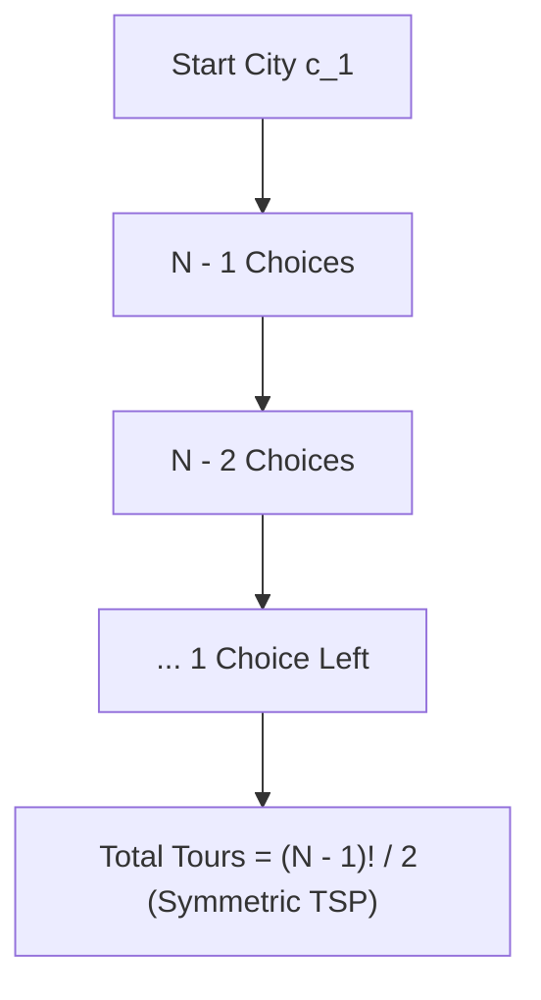

*   **Search Space Cardinality:**  
    For an undirected symmetric TSP with $N$ cities, fixing the starting city leaves $(N - 1)!$ permutations. Because direction is symmetric, the number of distinct tours is:
    $$\lvert \mathcal{S} \rvert = \frac{(N - 1)!}{2}$$
*   **Combinatorial Explosion:**  
    *   For $N = 10$: $\frac{9!}{2} = 181,440$ tours.
    *   For $N = 20$: $\approx 6 \times 10^{16}$ tours.
    *   For $N = 50$: $\approx 3 \times 10^{62}$ tours.
*   **Computational Class:** TSP is **NP-hard** in optimization form and **NP-complete** in decision form.

---

#### 3. Knowledge-Based Heuristic Optimization (3 Marks)

To bypass factorial complexity, AI systems inject domain knowledge via informed search and heuristics:

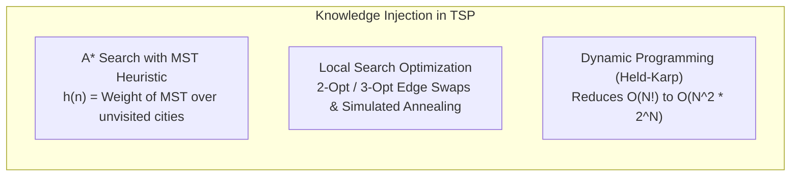

1. **$A^*$ Search with Minimum Spanning Tree (MST) Heuristic:**
   *   *Heuristic $h(n)$:* The cost of the Minimum Spanning Tree connecting all remaining unvisited cities plus the nearest edges connecting to the tour endpoints.
   *   *Admissibility:* Since an optimal tour must contain a path connecting all unvisited cities, and an MST is the minimal cost network connecting them, $h(n) \le h^*(n)$ holds, guaranteeing an optimal tour.
2. **Local Search Heuristics (2-Opt & Simulated Annealing):**  
   Replaces two crossing tour edges with non-crossing edges if tour length decreases, reducing runtime to $O(N^2)$ polynomial steps while achieving near-optimal solutions.
3. **Dynamic Programming (Held-Karp Algorithm):**  
   Uses memoization over sub-tours: $C(S, j)$ denotes the shortest path visiting set of cities $S$ ending at city $j$, reducing complexity from $O(N!)$ to $O(N^2 2^N)$.

:::tip

**Examiner's Note**

High marks require explicitly writing the factorial search space formula $(N-1)!/2$, identifying that TSP is NP-hard, and explaining the MST heuristic for $A^*$ search along with local search (2-Opt).

:::

---

### Question 21.b (8 Marks)

:::info

**Question Statement**

Describe about Problem Solving Process. **(8 Marks)**

:::

---

### Solution 21.b (8 Marks)

In artificial intelligence (Russell & Norvig model), the **Problem-Solving Process** is the computational sequence of formulating goals, formalizing states and actions, conducting search, and executing the discovered plan.

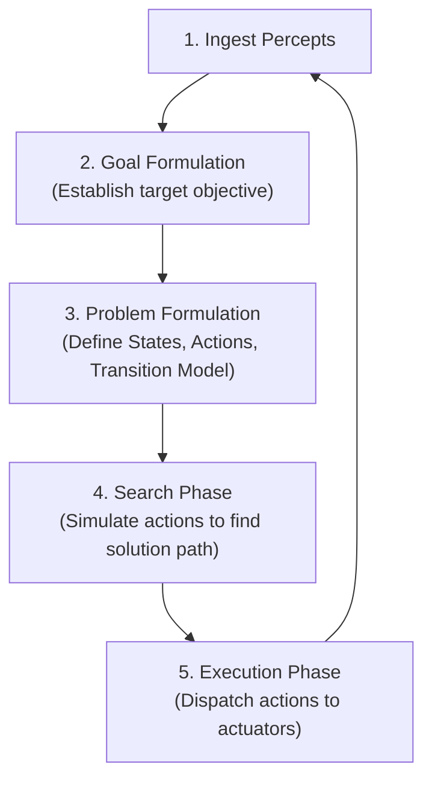

#### 1. The Four Foundational Phases (4 Marks)

1. **Goal Formulation:**  
   The agent identifies the desirable environmental state. Goals organize behavior by limiting the objectives and actions the agent considers.
2. **Problem Formulation:**  
   The process of abstracting the physical environment into a mathematically tractable state space:
   $$\mathcal{P} = \langle s_0, A, T, G, c \rangle$$
   *   *Initial State ($s_0$):* The current environment state.
   *   *Actions ($A(s)$):* The legal operators available to the agent.
   *   *Transition Model ($T(s, a)$ / $\operatorname{Result}(s, a)$):* The resulting state after executing action $a$.
   *   *Goal Test ($G(s)$):* Predicate determining whether state $s$ achieves the goal.
   *   *Path Cost ($c(s, a, s')$):* Step cost associated with each transition.
3. **Search Phase:**  
   The deliberative simulation of action sequences through the state space. It takes the formulated problem as input and returns a solution path (or failure) without executing physical moves in the real world.
4. **Execution Phase:**  
   The agent executes the actions in the discovered solution sequence sequentially via its actuators.

---

#### 2. Open-Loop vs. Closed-Loop Problem Solving (2 Marks)

*   **Open-Loop Execution (Predictable Worlds):** In fully observable, deterministic environments, the agent formulates a plan, executes the entire action sequence blindly, and is guaranteed success without re-sensing.
*   **Closed-Loop Execution (Uncertain Worlds):** In partially observable or stochastic environments, the agent must continually interleave search, execution, and perception to monitor for unexpected plan divergence and replan dynamically.

---

#### 3. Well-Defined Problems and Abstraction (2 Marks)

An effective problem-solving process requires **abstraction**: eliminating irrelevant real-world details (e.g., in route planning, ignoring tire wear and radio volume) while retaining essential spatial connections, preventing combinatorial explosion.

:::tip

**Examiner's Note**

Detail all 4 phases (Goal Formulation, Problem Formulation, Search, Execution), write the formal 5-tuple $\langle s_0, A, T, G, c \rangle$, and contrast open-loop vs. closed-loop execution.

:::

---

### Question 22.a (8 Marks)

:::info

**Question Statement**

Explain the concept of a queue in data structures. Describe its main operations and give an example of a real-world application. **(8 Marks)**

:::

---

### Solution 22.a (8 Marks)

#### 1. Concept of a Queue (2.5 Marks)

A **Queue** is a linear, sequential data structure operating strictly on the **First-In, First-Out (FIFO)** principle: the first element inserted is the first element removed.


##### Architectural Properties
*   **Front:** The boundary where elements are removed (dequeued).
*   **Rear:** The boundary where elements are inserted (enqueued).
*   **Access Order:** Elements are retrieved in the identical order they were received.

---

#### 2. Fundamental Queue Operations (3 Marks)

| Operation | Description | Precondition / Edge Case | Time Complexity |
| :--- | :--- | :--- | :---: |
| `enqueue(item)` | Inserts `item` at the rear of the queue | Checks for **Queue Overflow** if fixed capacity | $O(1)$ |
| `dequeue()` | Removes and returns the front element | Checks for **Queue Underflow** if empty | $O(1)$ |
| `peek()` / `front()` | Returns the front element without removing it | Fails if queue is empty | $O(1)$ |
| `isEmpty()` | Returns Boolean `True` if queue contains 0 items | — | $O(1)$ |
| `isFull()` | Returns Boolean `True` if static buffer is at capacity | — | $O(1)$ |

---

#### 3. Real-World Applications (2.5 Marks)

1. **Breadth-First Search (BFS) in Artificial Intelligence:**  
   BFS uses a FIFO queue (`OPEN` list) to store the search frontier. This guarantees that all nodes at depth $d$ are expanded before any node at depth $d+1$, ensuring the discovery of the shallowest solution.
2. **Operating System CPU Job Scheduling:**  
   Round-Robin schedulers maintain ready processes in a FIFO queue; each process receives a discrete CPU time quantum before being placed at the rear of the queue.
3. **Print Spooling & Network Packet Routing:**  
   Print jobs sent to a shared office printer are queued in the order received. Network router buffers queue incoming IP packets to manage traffic bursts.

:::tip

**Examiner's Note**

Full marks require stating the FIFO principle, defining all 5 operations (`enqueue`, `dequeue`, `peek`, `isEmpty`, `isFull`) with $O(1)$ complexity, and explaining its usage in BFS and OS job scheduling.

:::

---

### Question 22.b (8 Marks)

:::info

**Question Statement**

Explain Briefly about Depth First Search with suitable example **(8 Marks)**

:::

---

### Solution 22.b (8 Marks)

#### 1. Algorithmic Procedure of Depth-First Search (DFS) (3 Marks)

Depth-First Search (DFS) is an uninformed search algorithm that systematically explores as deep as possible along each branch before backtracking. It operates using a **Last-In, First-Out (LIFO) stack** (or recursive function calls).

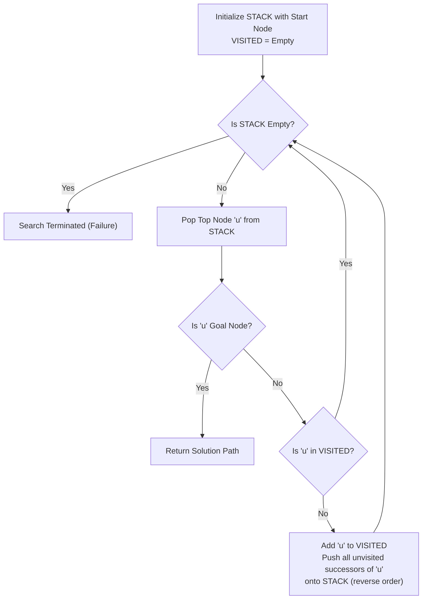

---

#### 2. Illustrative Example with Step-by-Step Trace (3 Marks)

Consider the following search tree with Start Node $A$ and Destination Goal Node $G$:

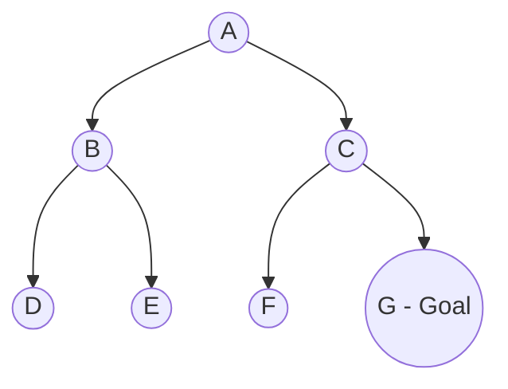

##### Trace Table

| Step | Node Popped | Action Taken | STACK (Top $\to$ Bottom) | VISITED List |
| :---: | :---: | :--- | :--- | :--- |
| **0** | — | Initialize with start node $A$ | `[A]` | `[]` |
| **1** | **A** | Not goal; add to visited; push $C, B$ | `[B, C]` | `[A]` |
| **2** | **B** | Not goal; add to visited; push $E, D$ | `[D, E, C]` | `[A, B]` |
| **3** | **D** | Leaf node; no children | `[E, C]` | `[A, B, D]` |
| **4** | **E** | Leaf node; no children | `[C]` | `[A, B, D, E]` |
| **5** | **C** | Not goal; add to visited; push $G, F$ | `[F, G]` | `[A, B, D, E, C]` |
| **6** | **F** | Leaf node; no children | `[G]` | `[A, B, D, E, C, F]` |
| **7** | **G** | **Goal Found! Terminate.** | `[]` | `[A, B, D, E, C, F, G]` |

*   **Traversal Sequence:** $A \to B \to D \to E \to C \to F \to G$
*   **Discovered Path:** $\mathbf{A \to C \to G}$

---

#### 3. Properties and Theoretical Complexity (2 Marks)

*   **Time Complexity:** $O(b^m)$, where $b$ is the branching factor and $m$ is the maximum tree depth.
*   **Space Complexity:** $O(bm)$ — linear memory complexity, storing only a single path from the root to a leaf along with remaining unexpanded siblings.
*   **Completeness:** Incomplete in infinite or cyclic state spaces; complete in finite acyclic spaces.
*   **Optimality:** Suboptimal; returns the first path encountered, regardless of step cost or depth.

:::tip

**Examiner's Note**

Detail the LIFO stack operation, provide a step-by-step trace table with a diagram, and state the linear space complexity $O(bm)$.

:::

---

### Question 23.a (8 Marks)

:::info

**Question Statement**

Explain the concept of performance measures in the context of intelligent agents. Discuss how performance measures relate to the rationality of an agent **(8 Marks)**

:::

---

### Solution 23.a (8 Marks)

#### 1. Concept of Performance Measures (3 Marks)

A **Performance Measure** is the objective mathematical criterion used by an external observer to evaluate how successfully an intelligent agent achieves its intended objectives in an environment.

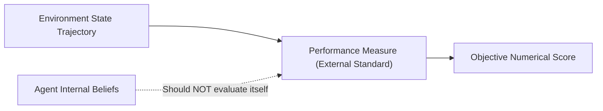

##### Critical Design Principles
1. **Objective vs. Subjective:**  
   The performance measure must evaluate the actual state of the environment, not the agent's internal subjective feelings. For example, a vacuum agent should be rewarded for the cleanliness of the floor, not for how many times it turns on its vacuum motor (which would incentivize cleaning and redirtying endlessly).
2. **Long-Term vs. Short-Term:**  
   Evaluates cumulative utility over extended operational horizons rather than momentary greedy spikes.

---

#### 2. The Relationship Between Performance Measures and Rationality (5 Marks)

##### Definition of Rationality
Russell & Norvig formally define a rational agent:
$$\text{For each possible percept sequence, a rational agent should select an action that is expected to}$$
$$\text{maximize its performance measure, given the evidence provided by the percept sequence and built-in knowledge.}$$

##### Foundational Dimensions Governing Rational Action
Rationality depends on four distinct factors:
1. The **Performance Measure** defining success criteria.
2. The agent's **Prior Knowledge** of the environment.
3. The **Actions** that the agent can perform.
4. The agent's **Percept Sequence** to date.

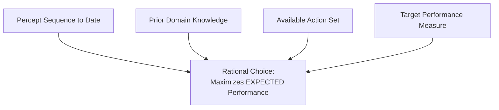

##### Rationality $\neq$ Omniscience, Success, or Perfection
*   **Rationality vs. Omniscience:** An omniscient agent knows the actual outcome of its actions in advance and is impossible in reality. A rational agent maximizes **expected** performance given limited perceptual evidence.
*   **Rationality vs. Perfection:** If a rational driver turns safely onto a green light and an unexpected falling tree crushes the car, the driver's action was completely rational, even though the ultimate outcome was unsuccessful.

:::tip

**Examiner's Note**

Award 3 marks for defining performance measures based on environmental states rather than agent inputs, and 5 marks for formalizing rationality as expected performance maximization and contrasting rationality with omniscience.

:::

---

### Question 23.b (8 Marks)

:::info

**Question Statement**

Define "Task Environment" in the context of intelligent agents. Describe the properties that characterize a task environment. **(8 Marks)**

:::

---

### Solution 23.b (8 Marks)

#### 1. Definition of Task Environment & The PEAS Framework (3 Marks)

In artificial intelligence, the **Task Environment** encompasses the complete problem context within which an intelligent agent operates. It is formally specified by the **PEAS framework**:
*   **P - Performance Measure:** Objective evaluation standard of success.
*   **E - Environment:** The external world or context containing objects and dynamics.
*   **A - Actuators:** Physical/virtual mechanisms used to execute actions.
*   **S - Sensors:** Input transducers collecting environmental percepts.

##### Illustrative Example: Automated Taxi Driver

| Component | Automated Taxi Specification |
| :--- | :--- |
| **Performance** | Safety, passenger comfort, speed, legal compliance, fuel economy |
| **Environment** | Urban streets, highways, pedestrians, vehicles, weather, traffic signs |
| **Actuators** | Steering wheel, accelerator pedal, brakes, horn, display |
| **Sensors** | Cameras, LiDAR, radar, GPS, speedometer, odometer, engine sensors |

---

#### 2. The Six Characterizing Environmental Properties (5 Marks)

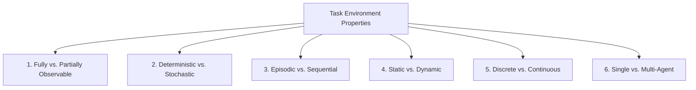

1. **Fully Observable vs. Partially Observable:**  
   Sensors provide complete access to the state of the environment (e.g., **Chess**) vs. occlusions, noise, and hidden cards (e.g., **Poker**, **Driving**).
2. **Deterministic vs. Stochastic:**  
   The next state is completely determined by the current state and action (e.g., **Vacuum World**) vs. uncertainty, weather, and physical dice rolls (e.g., **Backgammon**).
3. **Episodic vs. Sequential:**  
   Experience is divided into independent atomic episodes where current actions do not affect future episodes (e.g., **Defect Classification**) vs. sequential long-term consequences (e.g., **Chess**).
4. **Static vs. Dynamic:**  
   The environment remains unchanged while the agent deliberates (e.g., **Crossword**) vs. continuously evolving in real time (e.g., **Self-Driving Car**).
5. **Discrete vs. Continuous:**  
   Finite, distinctly numbered states and actions (e.g., **Chess**) vs. continuous real-valued coordinates, velocities, and angles (e.g., **Robot Arm**).
6. **Single-Agent vs. Multi-Agent:**  
   An agent acts alone (e.g., **Sudoku**) vs. interacting with competitive or cooperative agents (e.g., **Autonomous Drone Fleet**).

:::tip

**Examiner's Note**

Define the PEAS model with a concrete table, and detail all six environment dimensions with clear contrasting examples.

:::

---

### Question 24.a (8 Marks)

:::info

**Question Statement**

Define inference in the context of artificial intelligence. Discuss the different types of inference methods used in AI. **(8 Marks)**

:::

---

### Solution 24.a (8 Marks)

#### 1. Concept of Inference in Artificial Intelligence (2 Marks)

**Inference** is the formal algorithmic process of deriving new true sentences (conclusions) from an existing Knowledge Base ($\text{KB}$) of axioms and percepts:

$$\text{KB} \models \alpha \iff \operatorname{Infer}(\text{KB}) \vdash \alpha$$

##### Core Criteria of Sound Inference
*   **Soundness (Truth-Preserving):** Derives only sentences that are genuinely entailed by the knowledge base ($\text{If } \text{KB} \vdash \alpha \implies \text{KB} \models \alpha$).
*   **Completeness:** Capable of deriving any sentence that is logically entailed ($\text{If } \text{KB} \models \alpha \implies \text{KB} \vdash \alpha$).

---

#### 2. The Four Primary Inference Paradigms in AI (6 Marks)

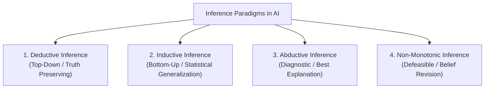

##### a) Deductive Inference (Sound & Formal)
*   **Mechanism:** Derives necessary conclusions from established premises. If premises are true, conclusions are guaranteed true.
*   **Rules:** Modus Ponens ($\frac{\alpha, \alpha \implies \beta}{\beta}$) and Resolution Refutation.
*   **Example:** $\operatorname{Human}(\text{Socrates}) \land (\forall x \; \operatorname{Human}(x) \implies \operatorname{Mortal}(x)) \vdash \operatorname{Mortal}(\text{Socrates})$.

##### b) Inductive Inference (Machine Learning)
*   **Mechanism:** Generalizes broad probabilistic rules from a finite set of specific empirical observations.
*   **Nature:** Not truth-preserving (conclusions are probable, not certain).
*   **Example:** Observing 1,000 white swans induces the general hypothesis $\forall x \; \operatorname{Swan}(x) \implies \operatorname{White}(x)$.

##### c) Abductive Inference (Diagnostic Reasoning)
*   **Mechanism:** Infers the most plausible hypothesis or cause $\alpha$ that accounts for an observed symptom $\beta$ (reasoning from effects to causes).
*   **Application:** Medical diagnosis expert systems (MYCIN).
*   **Example:** Observing wet grass abduces that it rained overnight (even though sprinklers could also cause wet grass).

##### d) Non-Monotonic Inference (Default Reasoning)
*   **Mechanism:** Allows conclusions to be retracted when new evidence contradicts prior default assumptions.
*   **Example:** Assuming Tweety can fly because Tweety is a bird; later learning Tweety is a penguin retracts the conclusion that Tweety can fly.

:::tip

**Examiner's Note**

Define inference with soundness and completeness, and detail the 4 types of reasoning (Deduction, Induction, Abduction, Non-Monotonic) with explicit logical examples.

:::

---

### Question 24.b (8 Marks)

:::info

**Question Statement**

Explain the Unification Algorithm in the context of logic programming. Discuss its importance, working mechanism, and provide examples to illustrate its application. **(8 Marks)**

:::

---

### Solution 24.b (8 Marks)

#### 1. Concept and Importance of Unification (2.5 Marks)

In First-Order Logic and Logic Programming (Prolog), **Unification** is the foundational pattern-matching algorithm that determines a variable substitution mapping $\theta$ such that two atomic logical expressions become syntactically identical:

$$\operatorname{UNIFY}(P, Q) = \theta \quad \text{such that} \quad \operatorname{SUBST}(\theta, P) \equiv \operatorname{SUBST}(\theta, Q)$$

##### Why Unification is Essential
*   Enables generalized inference rules like **Generalized Modus Ponens** and **Resolution Refutation** to operate across quantified sentences without exhaustive propositional ground enumeration.
*   Forms the execution engine of logic programming languages (Prolog clause resolution).

---

#### 2. Working Mechanism & The Occur Check (2.5 Marks)

Robinson's Unification Algorithm executes recursively:
1. **Identical Symbols:** Unifying identical constants or variables returns the empty substitution $\emptyset$.
2. **Variable to Term:** A variable $v$ unifies with term $t$ yielding $\{v / t\}$, provided that $v$ does not appear inside $t$ (**The Occur Check**).
   *   *Why Occur Check Matters:* Attempting to unify $x$ with $f(x)$ without the occur check creates an infinite circular structure $x = f(f(f(\dots)))$.
3. **Compound Expressions:** Two compound terms unify if they share the identical function/predicate symbol, identical arity, and argument pairs unify under composed substitutions:
   $$\theta \leftarrow \theta \circ \operatorname{UNIFY}(\operatorname{SUBST}(\theta, arg_1), \operatorname{SUBST}(\theta, arg_2))$$

---

#### 3. Step-by-Step Illustrative Example (3 Marks)

Unify the following two First-Order Logic literals:
$$E_1 = \operatorname{Parent}(\text{Bob}, x)$$
$$E_2 = \operatorname{Parent}(y, \operatorname{SonOf}(\text{Bob}))$$

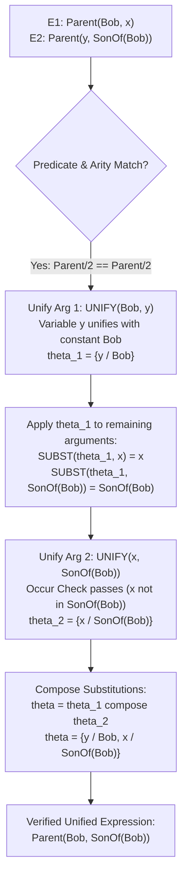

##### Composition & Verification
$$\mathbf{\theta = \{y / \text{Bob}, \; x / \operatorname{SonOf}(\text{Bob})\}}$$

Applying substitution $\theta$:
*   $\operatorname{SUBST}(\theta, E_1) = \operatorname{Parent}(\text{Bob}, \operatorname{SonOf}(\text{Bob}))$
*   $\operatorname{SUBST}(\theta, E_2) = \operatorname{Parent}(\text{Bob}, \operatorname{SonOf}(\text{Bob}))$

Both expressions evaluate to identical forms. Unification succeeds.

:::tip

**Examiner's Note**

Award full marks for defining the Most General Unifier (MGU), explaining the Occur Check, and demonstrating a step-by-step trace showing substitution composition.

:::

---

### Question 25.a (8 Marks)

:::info

**Question Statement**

Explain Means-Ends Analysis in Artificial Intelligence. Discuss its role in problem-solving and learning, and provide examples of how it can be applied in real-world scenarios. **(8 Marks)**

:::

---

### Solution 25.a (8 Marks)

#### 1. Concept of Means-Ends Analysis (MEA) (3 Marks)

**Means-Ends Analysis (MEA)** is a goal-directed problem-solving and planning strategy (introduced by Newell & Simon in the General Problem Solver) that centers on **difference reduction**:

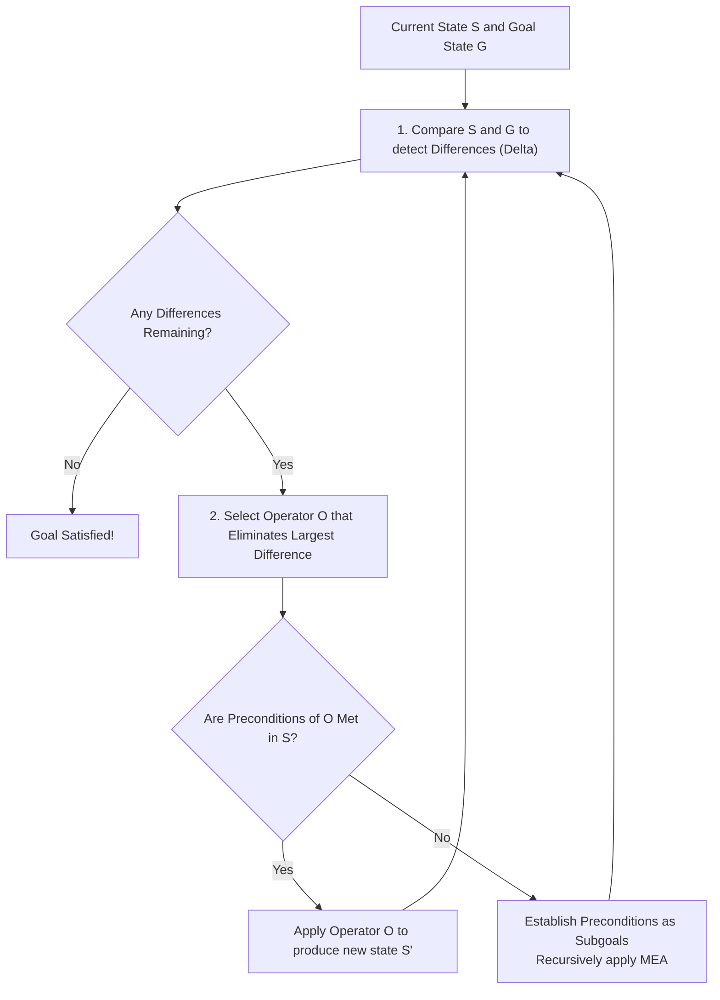

*   **Difference Detection:** Compares the current state $S$ with goal state $G$ to determine what features differ.
*   **Operator Selection:** Identifies candidate operators whose effects reduce the largest detected difference.
*   **Subgoaling:** If the operator's preconditions are not met, MEA sets those preconditions as new recursive subgoals.

---

#### 2. Role in Problem-Solving and Learning (2.5 Marks)

1. **Role in Problem-Solving:**  
   Decouples complex multi-step problems into modular, manageable sub-problems. It replaces unguided, combinatorial forward exploration with goal-directed backward regression.
2. **Role in Learning:**  
   *   *Macro-Operators:* Successful sub-plans generated by MEA can be saved as reusable macro-operators, speeding up future problem solving.
   *   *Explanation-Based Learning (EBL):* System generalizes why an operator sequence resolved a difference, caching general rules for similar domains.

---

#### 3. Real-World Applications (2.5 Marks)

1. **Automated IT Infrastructure Deployment:**  
   *   *Current State:* Empty cloud server without dependencies.
   *   *Goal State:* Running containerized web service.
   *   *MEA Planning:* Detects missing database $\to$ selects `install-postgres` operator $\to$ precondition requires `apt-update` $\to$ establishes `apt-update` as subgoal.
2. **Robotic Navigation & Manipulation:**  
   *   *Current State:* Warehouse robot at Station $A$, package at Station $B$.
   *   *Goal State:* Package delivered to Station $C$.
   *   *MEA Planning:* Primary difference is package location $\to$ operator `Transport(B, C)` requires precondition `At(Robot, B)` $\to$ creates navigation subgoal `Navigate(A, B)`.

:::tip

**Examiner's Note**

Detail the MEA difference-reduction cycle, explain how subgoaling handles unsatisfied preconditions, and provide a concrete real-world example (Cloud deployment or Robotics).

:::

---

### Question 25.b (8 Marks)

:::info

**Question Statement**

Explain the fundamental concepts of machine learning, and describe its key methods and models. **(8 Marks)**

:::

---

### Solution 25.b (8 Marks)

#### 1. Fundamental Concepts of Machine Learning (2.5 Marks)

Tom Mitchell formalized machine learning:
$$\text{An algorithm learns from Experience } E \text{ with respect to Task } T \text{ and Performance measure } P \text{ if } P(T) \text{ improves with } E.$$

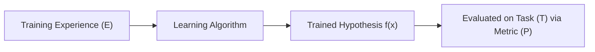

##### Foundational Concepts
*   **Hypothesis Space ($\mathcal{H}$):** The mathematical set of candidate functions parameterized by weights $\boldsymbol{\theta}$.
*   **Loss Function ($\mathcal{L}$):** Measures empirical prediction error on training data.
*   **Generalization vs. Overfitting:** The objective is to achieve low error on unseen test distributions by employing regularization ($\ell_1, \ell_2$) and cross-validation.

---

#### 2. Key Methods and Models (5.5 Marks)

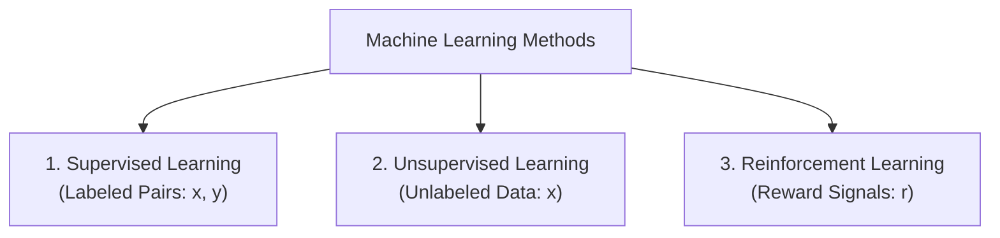

##### a) Supervised Learning
*   *Objective:* Learns a predictive mapping $f: \mathcal{X} \to \mathcal{Y}$ from labeled instances $\{(\mathbf{x}_i, y_i)\}_{i=1}^N$.
*   *Core Tasks & Models:*
    *   **Classification (Discrete $y$):** Logistic Regression, Support Vector Machines (SVM), Random Forests.
    *   **Regression (Continuous $y$):** Linear Regression, Gradient Boosted Decision Trees (XGBoost).
*   *Application:* Medical tumor malignancy diagnosis from clinical biopsy features.

##### b) Unsupervised Learning
*   *Objective:* Discovers latent patterns, geometric manifolds, or probability distributions $P(\mathbf{x})$ from unlabeled inputs $\{\mathbf{x}_i\}_{i=1}^N$.
*   *Core Tasks & Models:*
    *   **Clustering:** $K$-Means, Hierarchical Clustering, DBSCAN.
    *   **Dimensionality Reduction:** Principal Component Analysis (PCA), Autoencoders.
*   *Application:* Customer market segmentation in e-commerce based on purchasing history.

##### c) Reinforcement Learning (RL)
*   *Objective:* Optimizes an action policy $\pi(a \mid s)$ in a Markov Decision Process to maximize expected cumulative discounted rewards:
    $$J(\pi) = \mathbb{E}\left[\sum_{t=0}^{\infty} \gamma^t R(s_t, a_t)\right]$$
*   *Core Models:* Q-Learning, Deep Q-Networks (DQN), Proximal Policy Optimization (PPO).
*   *Application:* Autonomous robotic locomotion and superhuman board game engines (AlphaZero).

:::tip

**Examiner's Note**

State Mitchell's formal definition $\langle E, T, P \rangle$, and structure the answer into the three primary paradigms (Supervised, Unsupervised, RL) with their mathematical objectives and representative models.

:::

---

## Part C: Comprehensive Search Problems (15 Marks)

### Question 26 (15 Marks)

:::info

**Question Statement**

Explain the concepts of Trees and Graphs. Discuss their types and key properties in real-world applications. Provide examples to illustrate their usage in solving complex problems. **(15 Marks)**

:::

---

### Solution 26 (15 Marks)

#### 1. Core Concepts & Mathematical Definitions (4 Marks)

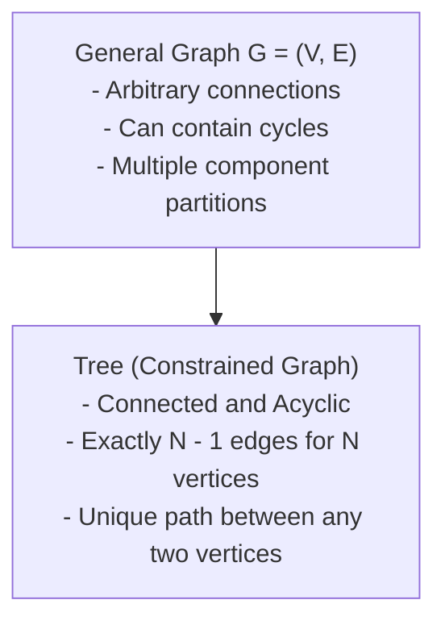

##### a) Graph
A **Graph** $\mathcal{G} = (V, E)$ consists of:
*   $V$: A finite set of **vertices** (nodes) representing entities.
*   $E$: A set of **edges** (arcs) representing relationships between vertex pairs:
    $$E \subseteq V \times V$$
*   Edges may be **directed** (ordered pairs $(u, v)$) or **undirected** (unordered sets $\{u, v\}$), and **weighted** (with associated costs $w(u, v)$).

##### b) Tree
A **Tree** is a connected, undirected acyclic graph.
*   **Fundamental Theorem of Trees:** For any graph with $N$ vertices, the following statements are mathematically equivalent:
    1. $\mathcal{G}$ is a tree.
    2. $\mathcal{G}$ is connected and has exactly $N - 1$ edges.
    3. $\mathcal{G}$ is acyclic and has exactly $N - 1$ edges.
    4. There exists a unique simple path between any pair of vertices in $\mathcal{G}$.

---

#### 2. Taxonomy of Types (5 Marks)

##### a) Graph Classifications

| Graph Type | Structural Characteristic | Representative Real-World Domain |
| :--- | :--- | :--- |
| **Directed Acyclic Graph (DAG)** | Directed edges with zero closed cycles | Task dependency scheduling, Git commit trees, Bayesian Networks |
| **Weighted Graph** | Numerical weights assigned to edges | Road traffic networks (Google Maps routing) |
| **Bipartite Graph** | Vertices partition into disjoint sets $U, V$ | Matching problems (job applicants to job openings) |
| **Complete Graph ($K_n$)** | An edge connects every distinct pair | Fully meshed communication backbones |

##### b) Tree Classifications

| Tree Type | Structural Characteristic | Representative Real-World Domain |
| :--- | :--- | :--- |
| **Binary Search Tree (BST)** | Left child $<$ Root $\le$ Right child | Fast in-memory lookup and dynamic indexing |
| **Self-Balancing Trees (AVL / Red-Black)** | Guaranteed $O(\log N)$ search height | Database indexing engines, Linux kernel memory virtual trees |
| **Game Trees (Adversarial)** | Alternating ply levels (MAX and MIN) | Minimax and Alpha-Beta game playing (Chess) |
| **Spanning Trees (MST)** | Tree spanning all graph vertices with minimal cost | Telecommunication fiber optic network layout |

---

#### 3. Mathematical Properties & Governing Equations (3 Marks)

1. **Handshaking Lemma (Euler):**  
   In any undirected graph, the sum of vertex degrees equals twice the total number of edges:
   $$\sum_{v \in V} \operatorname{deg}(v) = 2 \lvert E \rvert$$
2. **Tree Edge Count:**  
   For any tree with $\lvert V \rvert = N$ vertices:
   $$\lvert E \rvert = N - 1$$
3. **Complete Graph Edge Count:**  
   $$\lvert E \rvert = \binom{N}{2} = \frac{N(N - 1)}{2}$$

---

#### 4. Real-World Applications in Complex Problem Solving (3 Marks)

1. **GPS Route Planning via Weighted Graphs:**  
   Road networks are modeled as weighted directed graphs where intersections are vertices and road segments are edges weighted by transit times. Algorithms like Dijkstra's and $A^*$ find the minimum-time path across millions of road segments.
2. **Social Networks & PageRank (Web Graph):**  
   The World Wide Web is modeled as a massive directed graph where web pages are vertices and hyperlinks are directed edges. Google's PageRank algorithm computes the stationary distribution of random walks across this graph to rank search results.
3. **Abstract Syntax Trees (ASTs) in Compilers:**  
   Programming language parsers convert linear source code text into hierarchical Abstract Syntax Trees, enabling semantic analysis, type checking, and machine code optimization.

:::tip

**Examiner's Note**

Award 4 marks for mathematical definitions of graphs vs. trees, 5 marks for the taxonomies (DAGs, Bipartite, BST, Game Trees), 3 marks for governing theorems (Euler's lemma, $N-1$ edges), and 3 marks for concrete real-world problem-solving applications.

:::

---

### Question 27 (15 Marks)

:::info

**Question Statement**

Given the graph below, demonstrate how the A* algorithm searches for the shortest path from node A to node J In your explanation, highlight how A* combines the advantages of Breadth First Search (BFS) and Best First Search (BFS) through its use of heuristics. Also, discuss the importance of the chosen heuristic being both admissible and consistent. **(15 Marks)**

```text
         10
         (A)
       6/   \3
       v     v
   8 (B)     (F) 6
    / | \   / | \
  3/ 2| 1\ 1/ 7| \7
  v   v   vv   v  v
(C)5 (D)7 (G)5(H)3 |
  \   |   / \ /   |
  5\ 8| 3/   v2   |
    v v v   (I)1 -'
    3(E)----/ 3
      5\   /
        v v
        (J) 0
```

*Heuristic Values $h(n)$:*  
$A: 10, \; B: 8, \; C: 5, \; D: 7, \; E: 3, \; F: 6, \; G: 5, \; H: 3, \; I: 1, \; J: 0$

*Edge Weights:*  
$A-B: 6, \; A-F: 3$  
$B-C: 3, \; B-D: 2, \; C-D: 1, \; C-E: 5, \; D-E: 8$  
$F-G: 1, \; F-H: 7, \; G-I: 3, \; H-I: 2$  
$E-I: 5, \; E-J: 5, \; I-J: 3$

*Start State:* $A$, *Final Goal State:* $J$

:::

---

### Solution 27 (15 Marks)

#### 1. Theoretical Foundation of the $A^*$ Algorithm (4 Marks)

The $A^*$ algorithm evaluates candidate nodes using the evaluation function:

$$f(n) = g(n) + h(n)$$

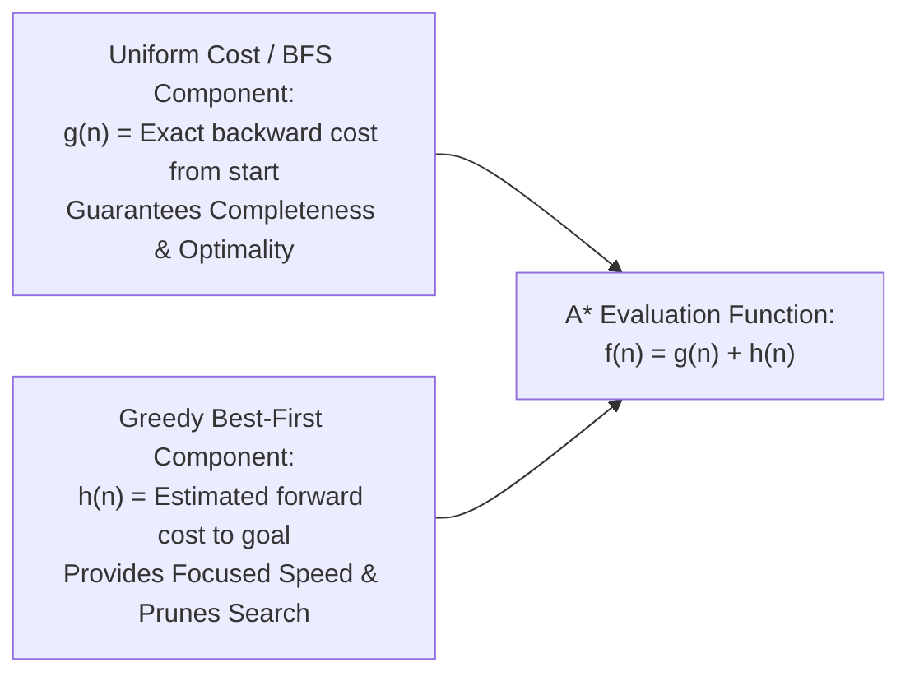

##### a) How $A^*$ Combines BFS and Best-First Search
*   **Breadth-First Search / Uniform Cost Component ($g(n)$):** Measures the accumulated cost from the start node, penalizing deep or expensive paths. It ensures that the algorithm does not wander blindly down unpromising infinite branches, providing completeness and cost-optimality.
*   **Greedy Best-First Search Component ($h(n)$):** Uses problem-specific heuristic knowledge to pull the search toward the goal, focusing expansions along high-probability trajectories and pruning unpromising branches.

---

#### 2. Importance of Admissibility and Consistency (4 Marks)

##### a) Admissibility (Optimality in Tree Search)
A heuristic $h(n)$ is **admissible** if it never overestimates the true minimal cost to reach the goal:
$$0 \le h(n) \le h^*(n) \quad \forall n$$
*   *Theorem:* If $h(n)$ is admissible, $A^*$ using Tree Search is guaranteed to return an optimal solution.

##### b) Consistency / Monotonicity (Optimality in Graph Search)
A heuristic $h(n)$ is **consistent (monotonic)** if, for every node $n$ and every successor $n'$ generated by action $a$:
$$h(n) \le c(n, a, n') + h(n')$$
*(This satisfies the triangle inequality).*
*   *Importance:* Consistency guarantees that the sequence of $f(n)$ values along any optimal path is non-decreasing ($f(n') \ge f(n)$). This ensures that **the first time a node is expanded in Graph Search, the path to that node is guaranteed to be optimal**, completely eliminating the need to reopen nodes in the `CLOSED` list.

---

#### 3. Step-by-Step $A^*$ Execution Trace from $A$ to $J$ (7 Marks)

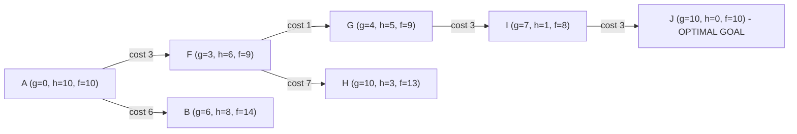

##### Trace Table

| Step | Dequeued Node $(u)$ | $g(u)$ | $h(u)$ | $f(u)$ | Path Followed | Generated Successors & Cumulative Cost $g(v) = g(u) + w$ | Priority Queue Contents ($f = g + h$) |
| :---: | :---: | :---: | :---: | :---: | :--- | :--- | :--- |
| **1** | **A** | $0$ | $10$ | **10** | `[A]` | $(F, g=3, h=6, f=9)$<br/>$(B, g=6, h=8, f=14)$ | `[(F, 9), (B, 14)]` |
| **2** | **F** | $3$ | $6$ | **9** | `[A, F]` | $(G, g=3+1=4, h=5, f=9)$<br/>$(H, g=3+7=10, h=3, f=13)$ | `[(G, 9), (H, 13), (B, 14)]` |
| **3** | **G** | $4$ | $5$ | **9** | `[A, F, G]` | $(I, g=4+3=7, h=1, f=8)$ | `[(I, 8), (H, 13), (B, 14)]` |
| **4** | **I** | $7$ | $1$ | **8** | `[A, F, G, I]` | $(J, g=7+3=10, h=0, f=10)$<br/>$(H, g=7+2=9, h=3, f=12)$<br/>$(E, g=7+5=12, h=3, f=15)$ | `[(J, 10), (H, 12), (H_old, 13), (B, 14), (E, 15)]` |
| **5** | **J** | $\mathbf{10}$ | $\mathbf{0}$ | $\mathbf{10}$ | `[A, F, G, I, J]` | **Goal State Dequeued! Search Terminates.** | — |

---

#### 4. Summary of Results

*   **Optimal Path Discovered:**
    $$\mathbf{A \to F \to G \to I \to J}$$
*   **Total Optimal Path Cost:**
    $$\operatorname{Cost} = c(A, F) + c(F, G) + c(G, I) + c(I, J) = 3 + 1 + 3 + 3 = \mathbf{10}$$

:::tip

**Examiner's Note**

Award 4 marks for explaining how $A^*$ balances $g(n)$ and $h(n)$, 4 marks for defining admissibility ($h \le h^*$) and consistency ($h(n) \le c + h(n')$), and 7 marks for the complete 5-step priority queue trace table confirming the optimal path of cost 10.

:::
