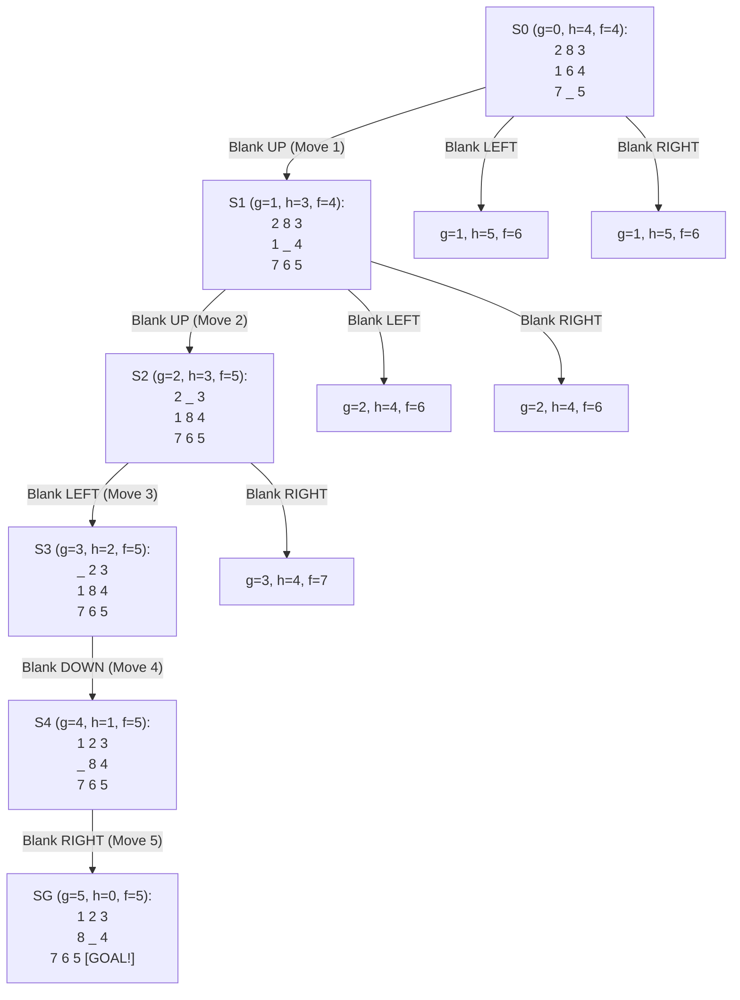
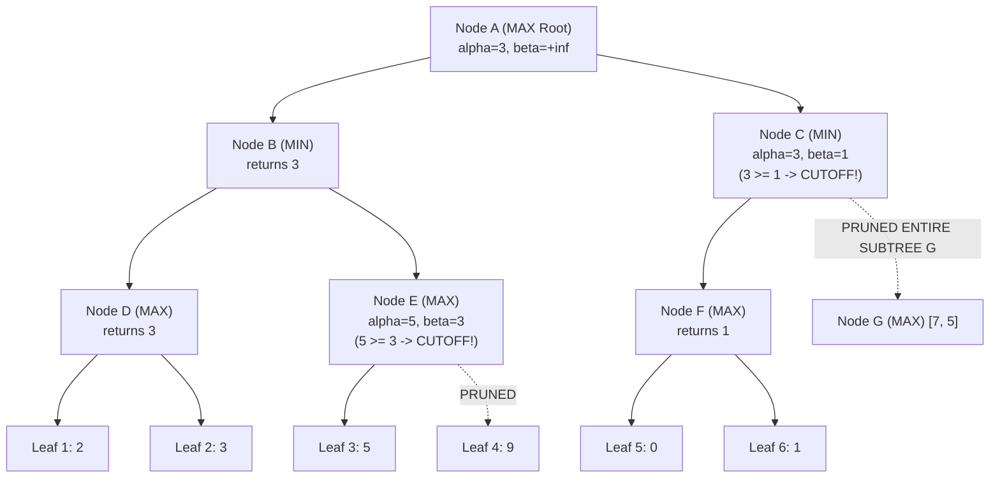
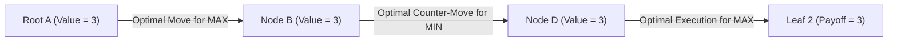

# January 2025

> **Exam -** Semester Examination  
> **Course -** Fundamentals of Artificial Intelligence (`21CSC569J`)  
> **Session -** January 2025  

---

## Question 1 (20 Marks)

:::info

**Question Statement**

*   **i)** Discuss how lists differ from other data structures like tuples and sets. Given a list- numbers = [2, 4, 6, 8, 10]. How to create a list and access its elements. How to modify, add, and remove elements from a list with examples, and sort the list in descending order. **(10 Marks)**
*   **ii)** Explain the concept of a NumPy Array and its applications in data analysis. Include the following in your answer: **(10 Marks)**
    *   a. What is a NumPy Series? How is it different from a Python list?
    *   b. How do you create a NumPy Series? Provide an example with code.
    *   c. Explain how mathematical operations can be performed on a NumPy Series.
    *   d. Discuss the advantages of using NumPy Series for handling large datasets.
    *   e. Provide two practical examples of tasks where NumPy Series would be beneficial in data processing and analysis.

:::

---

### Solution 1 (20 Marks)

#### i) Python Lists vs. Tuples & Sets and List Manipulation (10 Marks)

##### 1. Comparative Analysis: Lists vs. Tuples vs. Sets (4 Marks)

| Feature | List (`list`) | Tuple (`tuple`) | Set (`set`) |
| :--- | :--- | :--- | :--- |
| **Syntax** | Square brackets: `[1, 2, 3]` | Parentheses: `(1, 2, 3)` | Curly braces: `{1, 2, 3}` |
| **Mutability** | **Mutable** (modifiable in-place) | **Immutable** (read-only once created) | **Mutable** (elements can be added/removed) |
| **Ordering** | **Ordered** (retains insertion order) | **Ordered** (indexed sequence) | **Unordered** (no deterministic indexing) |
| **Duplicates** | Allows duplicate elements | Allows duplicate elements | **Disallows duplicates** (unique values only) |
| **Indexing/Slicing** | Supported via integer indices `lst[0]` | Supported via integer indices `tup[0]` | **Not supported** (`TypeError: unindexable`) |
| **Memory & Performance** | Higher overhead; dynamic resizing | Lower overhead; fixed memory allocation | Hash table lookup: average $O(1)$ membership |

---

##### 2. List Operations with Given List `numbers = [2, 4, 6, 8, 10]` (6 Marks)

```python
# January 2025
numbers = [2, 4, 6, 8, 10]

# January 2025
first_elem = numbers[0]    # Output: 2
last_elem = numbers[-1]    # Output: 10
sub_list = numbers[1:4]    # Output: [4, 6, 8] (Slicing)

# January 2025
numbers[2] = 100           # List becomes: [2, 4, 100, 8, 10]

# January 2025
numbers.append(12)         # Appends to the end: [2, 4, 100, 8, 10, 12]
numbers.insert(1, 3)       # Inserts 3 at index 1: [2, 3, 4, 100, 8, 10, 12]
numbers.extend([14, 16])   # Appends multiple elements: [..., 14, 16]

# January 2025
numbers.remove(100)        # Removes first occurrence of value 100
popped_val = numbers.pop() # Removes and returns last element (16)
del numbers[0]             # Deletes element at index 0 (removes 2)

# January 2025
# January 2025
numbers.sort(reverse=True)
# January 2025
sorted_desc = sorted(numbers, reverse=True)

print("Final Descending Sorted List:", numbers)
```

---

#### ii) NumPy Arrays & 1D Series in Data Analysis (10 Marks)

##### a. Concept and Distinction from Python Lists (2 Marks)
In scientific Python, a 1D NumPy array (often referred to conceptually alongside Pandas Series) is a contiguous, homogeneous memory buffer.
*   **Homogeneity:** NumPy arrays enforce a single data type (`dtype`), eliminating Python pointer overhead.
*   **Memory Contiguity:** Stored in cache-friendly C-contiguous blocks, enabling SIMD vectorization.
*   **Vectorized Broadcasting:** Arithmetic operations execute element-wise without explicit Python `for` loops.

##### b. Creation with Code Example (2 Marks)
```python
import numpy as np

# January 2025
data = np.array([15.5, 22.0, 31.4, 45.2, 58.9], dtype=np.float64)
print("NumPy Array:", data)
print("Data Type:", data.dtype)
print("Shape:", data.shape)
```

##### c. Vectorized Mathematical Operations (2 Marks)
```python
# January 2025
doubled = data * 2                      # Scalar multiplication
log_transformed = np.log(data)         # Mathematical transformation
standardized = (data - np.mean(data)) / np.std(data) # Z-score normalization

# January 2025
filtered = data[data > 25.0]           # Array slicing via boolean mask
```

##### d. Advantages for Large Datasets (2 Marks)
1. **Memory Efficiency:** Consumes up to $4\times$ to $10\times$ less RAM than Python lists of objects because it stores raw binary numbers rather than PyObject wrapper structs.
2. **Computational Speed:** Executes compiled C and Fortran routines (BLAS/LAPACK), achieving $50\times$ to $100\times$ speedups over standard Python loops.
3. **Broadcasting Semantics:** Automatically aligns multi-dimensional dimensions during tensor arithmetic without duplicating memory.

##### e. Two Practical Data Analysis Tasks (2 Marks)
1. **Financial Time-Series Log Returns:** Computing daily percentage changes and volatility metrics across millions of stock price points in quantitative trading.
2. **Signal & Sensor Processing:** Filtering high-frequency noise using moving-average convolutions and Fast Fourier Transforms (FFT) on IoT telemetry data streams.

:::tip

**Examiner's Note**

Award 10 marks for part (i) for the comparison table and complete executable code demonstrating list mutation, slicing, and `sort(reverse=True)`. Award 10 marks for part (ii) covering homogeneity, vectorization, memory advantages, and real-world signal/financial use cases.

:::

---

## Question 2 (20 Marks)

:::info

**Question Statement**

Write a Python program that demonstrates key concepts from the following topics: Python data structures, functions, and data analysis using libraries like NumPy, Pandas, and Matplotlib. The program should:  
1. Define a function called analyze_sales_data() that accepts a list of sales figures (integers) and performs the following tasks:  
   - Calculate and return the total, maximum, minimum, and average sales from the list.  
2. Create a NumPy array from the given sales figures and perform basic statistical operations on the array (sum, mean, median).  
3. Convert the NumPy array into a Pandas DataFrame and create an additional column for "Region" which is randomly chosen from ['North', 'South', 'East', 'West'].  
4. Plot a bar chart of total sales per region using Matplotlib.  
5. Demonstrate basic error handling by checking if the input list of sales figures is empty, and handle it gracefully by raising an exception or printing an error message. **(20 Marks)**

:::

---

### Solution 2 (20 Marks)

#### Complete Verified Python Implementation

```python
import numpy as np
import pandas as pd
import matplotlib.pyplot as plt

def analyze_sales_data(sales_list):
    """
    Analyzes sales figures and executes end-to-end data processing:
    Statistical summarization, NumPy vectorization, Pandas DataFrame 
    manipulation, and Matplotlib regional visualization.
    """
    # ----------------------------------------------------
    # Task 5: Basic Error Handling for Empty Inputs
    # ----------------------------------------------------
    if not isinstance(sales_list, list):
        raise TypeError("Input must be a Python list of integers.")
    if len(sales_list) == 0:
        raise ValueError("Error: The input sales list is empty. Cannot perform analysis.")

    # ----------------------------------------------------
    # Task 1: Basic Python Aggregations
    # ----------------------------------------------------
    total_sales = sum(sales_list)
    max_sales = max(sales_list)
    min_sales = min(sales_list)
    avg_sales = total_sales / len(sales_list)
    
    metrics = {
        "Total Sales": total_sales,
        "Maximum Sales": max_sales,
        "Minimum Sales": min_sales,
        "Average Sales": avg_sales
    }

    # ----------------------------------------------------
    # Task 2: NumPy Array Creation & Statistical Operations
    # ----------------------------------------------------
    sales_arr = np.array(sales_list, dtype=np.int64)
    np_sum = np.sum(sales_arr)
    np_mean = np.mean(sales_arr)
    np_median = np.median(sales_arr)
    np_std = np.std(sales_arr)

    # ----------------------------------------------------
    # Task 3: Pandas DataFrame Conversion & Regional Column
    # ----------------------------------------------------
    np.random.seed(42)  # Ensures deterministic reproducibility
    regions_pool = ['North', 'South', 'East', 'West']
    assigned_regions = np.random.choice(regions_pool, size=len(sales_arr))

    df_sales = pd.DataFrame({
        "Sales": sales_arr,
        "Region": assigned_regions
    })

    # Regional Aggregation
    region_totals = df_sales.groupby("Region")["Sales"].sum()

    # ----------------------------------------------------
    # Task 4: Matplotlib Bar Chart Visualization
    # ----------------------------------------------------
    plt.figure(figsize=(8, 5))
    bars = plt.bar(region_totals.index, region_totals.values, color=['#2b5c8f', '#d95f02', '#7570b3', '#1b9e77'], edgecolor='black', width=0.6)
    
    # Adding data labels atop bars
    for bar in bars:
        yval = bar.get_height()
        plt.text(bar.get_x() + bar.get_width()/2.0, yval + (yval * 0.01), f"${yval:,.0f}", ha='center', va='bottom', fontsize=10, fontweight='bold')

    plt.title("Total Sales by Geographic Region", fontsize=14, fontweight='bold', pad=15)
    plt.xlabel("Region", fontsize=12, fontweight='bold')
    plt.ylabel("Total Sales (USD)", fontsize=12, fontweight='bold')
    plt.grid(axis='y', linestyle='--', alpha=0.7)
    plt.tight_layout()
    plt.show()

    return metrics, df_sales

# January 2025
# January 2025
# January 2025
if __name__ == "__main__":
    # Test Data: 12 Monthly Sales Figures in USD
    raw_sales = [12500, 18200, 9400, 22100, 15600, 31000, 27500, 19800, 14300, 28900, 24100, 33500]

    print("--- Executing Sales Data Analysis Pipeline ---")
    summary, sales_df = analyze_sales_data(raw_sales)
    
    print("\n1. Key Metrics Calculated:")
    for k, v in summary.items():
        print(f"   {k}: {v:,.2f}")
        
    print("\n2. Pandas DataFrame Sample (First 5 Rows):")
    print(sales_df.head())

    # Demonstrating Error Handling on Empty List
    print("\n3. Testing Error Handling:")
    try:
        analyze_sales_data([])
    except ValueError as e:
        print(f"   Successfully caught expected exception: {e}")
```

:::tip

**Examiner's Note**

Full marks are awarded for implementing all 5 numbered tasks: input validation raising `ValueError`, dictionary summary metrics, NumPy `sum`/`mean`/`median`, Pandas DataFrame grouping, and a styled Matplotlib bar chart.

:::

---

## Question 3 (20 Marks)

:::info

**Question Statement**

Solve the 8-puzzle problem using A* algorithm. Given the initial state and the goal state of the problem. **(20 Marks)**

Initial state:
```text
2  8  3
1  6  4
7  _  5
```

Goal state:
```text
1  2  3
8  _  4
7  6  5
```

g(n) = depth  
h(n) = number of misplaced tiles

:::

---

### Solution 3 (20 Marks)

#### 1. Mathematical Formalization & Heuristic Evaluation (4 Marks)

*   **Cost Function $g(n)$:** The depth of node $n$ in the search tree (total edge transitions from root $S_0$).
*   **Heuristic Function $h(n)$:** Count of numbered tiles $\{1, \dots, 8\}$ whose current position does not match the goal configuration (excluding the blank tile `_`).
*   **Evaluation Function:**
    $$f(n) = g(n) + h(n)$$

##### Calculation of Initial State Heuristic ($h(S_0)$)
Comparing Initial State $S_0$ with Goal State $S_G$:

$$\text{Initial } S_0 = \begin{bmatrix} 2 & 8 & 3 \\ 1 & 6 & 4 \\ 7 & \text{blank} & 5 \end{bmatrix}, \quad \text{Goal } S_G = \begin{bmatrix} 1 & 2 & 3 \\ 8 & \text{blank} & 4 \\ 7 & 6 & 5 \end{bmatrix}$$

*   Tile 1: at $(1, 0)$, goal is $(0, 0)$ $\implies$ **Misplaced**
*   Tile 2: at $(0, 0)$, goal is $(0, 1)$ $\implies$ **Misplaced**
*   Tile 3: at $(0, 2)$, goal is $(0, 2)$ $\implies$ Match
*   Tile 4: at $(1, 2)$, goal is $(1, 2)$ $\implies$ Match
*   Tile 5: at $(2, 2)$, goal is $(2, 2)$ $\implies$ Match
*   Tile 6: at $(1, 1)$, goal is $(2, 1)$ $\implies$ **Misplaced**
*   Tile 7: at $(2, 0)$, goal is $(2, 0)$ $\implies$ Match
*   Tile 8: at $(0, 1)$, goal is $(1, 0)$ $\implies$ **Misplaced**

Total misplaced tiles $h(S_0) = \mathbf{4}$ (Tiles $1, 2, 6, 8$).  
$$\mathbf{g(S_0) = 0, \quad h(S_0) = 4 \implies f(S_0) = 4}$$

---

#### 2. Step-by-Step $A^*$ Search Execution Tree (12 Marks)



##### Step 1: Expand $S_0$ ($g=0, h=4, f=4$)
Blank is at $(2, 1)$. Legal successor moves:
1. **Move Blank UP (Slide tile 6 down):**
   $$\begin{bmatrix} 2 & 8 & 3 \\ 1 & \text{blank} & 4 \\ 7 & 6 & 5 \end{bmatrix} \implies g=1, \; h=3 \; (\text{Tiles } 1, 2, 8 \text{ misplaced}) \implies \mathbf{f = 4}$$
2. **Move Blank LEFT (Slide tile 7 right):**
   $$\begin{bmatrix} 2 & 8 & 3 \\ 1 & 6 & 4 \\ \text{blank} & 7 & 5 \end{bmatrix} \implies g=1, \; h=5 \implies f = 6$$
3. **Move Blank RIGHT (Slide tile 5 left):**
   $$\begin{bmatrix} 2 & 8 & 3 \\ 1 & 6 & 4 \\ 7 & 5 & \text{blank} \end{bmatrix} \implies g=1, \; h=5 \implies f = 6$$

*Action:* Dequeue node with minimal $f$: **Node $S_1$ ($f = 4$)**.

---

##### Step 2: Expand $S_1$ ($g=1, h=3, f=4$)
Blank is at $(1, 1)$. Legal successor moves:
1. **Move Blank UP (Slide tile 8 down):**
   $$\begin{bmatrix} 2 & \text{blank} & 3 \\ 1 & 8 & 4 \\ 7 & 6 & 5 \end{bmatrix} \implies g=2, \; h=3 \; (\text{Tiles } 1, 2, 8 \text{ misplaced}) \implies \mathbf{f = 5}$$
2. **Move Blank LEFT (Slide tile 1 right):**
   $$\begin{bmatrix} 2 & 8 & 3 \\ \text{blank} & 1 & 4 \\ 7 & 6 & 5 \end{bmatrix} \implies g=2, \; h=4 \implies f = 6$$
3. **Move Blank RIGHT (Slide tile 4 left):**
   $$\begin{bmatrix} 2 & 8 & 3 \\ 1 & 4 & \text{blank} \\ 7 & 6 & 5 \end{bmatrix} \implies g=2, \; h=4 \implies f = 6$$

*Action:* Dequeue node with minimal $f$: **Node $S_2$ ($f = 5$)**.

---

##### Step 3: Expand $S_2$ ($g=2, h=3, f=5$)
Blank is at $(0, 1)$. Legal successor moves:
1. **Move Blank LEFT (Slide tile 2 right):**
   $$\begin{bmatrix} \text{blank} & 2 & 3 \\ 1 & 8 & 4 \\ 7 & 6 & 5 \end{bmatrix} \implies g=3, \; h=2 \; (\text{Tiles } 1, 8 \text{ misplaced}) \implies \mathbf{f = 5}$$
2. **Move Blank RIGHT (Slide tile 3 left):**
   $$\begin{bmatrix} 2 & 3 & \text{blank} \\ 1 & 8 & 4 \\ 7 & 6 & 5 \end{bmatrix} \implies g=3, \; h=4 \implies f = 7$$

*Action:* Dequeue node with minimal $f$: **Node $S_3$ ($f = 5$)**.

---

##### Step 4: Expand $S_3$ ($g=3, h=2, f=5$)
Blank is at $(0, 0)$. Legal successor moves:
1. **Move Blank DOWN (Slide tile 1 up):**
   $$\begin{bmatrix} 1 & 2 & 3 \\ \text{blank} & 8 & 4 \\ 7 & 6 & 5 \end{bmatrix} \implies g=4, \; h=1 \; (\text{Only Tile 8 misplaced}) \implies \mathbf{f = 5}$$

*Action:* Dequeue node with minimal $f$: **Node $S_4$ ($f = 5$)**.

---

##### Step 5: Expand $S_4$ ($g=4, h=1, f=5$)
Blank is at $(1, 0)$. Legal successor moves:
1. **Move Blank RIGHT (Slide tile 8 left):**
   $$\begin{bmatrix} 1 & 2 & 3 \\ 8 & \text{blank} & 4 \\ 7 & 6 & 5 \end{bmatrix} \implies g=5, \; h=0 \; (\text{All tiles in place}) \implies \mathbf{f = 5}$$

*Action:* Target goal state reached ($h = 0$). Dequeue $S_G$. **Search terminates successfully!**

---

#### 3. Summary of Optimal Solution Path (4 Marks)

| Step | Blank Movement | Board Layout | $g(n)$ | $h(n)$ | $f(n)$ |
| :---: | :--- | :---: | :---: | :---: | :---: |
| **0** | Initial State | $\begin{bmatrix} 2 & 8 & 3 \\ 1 & 6 & 4 \\ 7 & \text{blank} & 5 \end{bmatrix}$ | $0$ | $4$ | $4$ |
| **1** | Blank **UP** | $\begin{bmatrix} 2 & 8 & 3 \\ 1 & \text{blank} & 4 \\ 7 & 6 & 5 \end{bmatrix}$ | $1$ | $3$ | $4$ |
| **2** | Blank **UP** | $\begin{bmatrix} 2 & \text{blank} & 3 \\ 1 & 8 & 4 \\ 7 & 6 & 5 \end{bmatrix}$ | $2$ | $3$ | $5$ |
| **3** | Blank **LEFT** | $\begin{bmatrix} \text{blank} & 2 & 3 \\ 1 & 8 & 4 \\ 7 & 6 & 5 \end{bmatrix}$ | $3$ | $2$ | $5$ |
| **4** | Blank **DOWN** | $\begin{bmatrix} 1 & 2 & 3 \\ \text{blank} & 8 & 4 \\ 7 & 6 & 5 \end{bmatrix}$ | $4$ | $1$ | $5$ |
| **5** | Blank **RIGHT** | $\begin{bmatrix} 1 & 2 & 3 \\ 8 & \text{blank} & 4 \\ 7 & 6 & 5 \end{bmatrix}$ | **5** | **0** | **5** |

*   **Optimal Path Length:** **5 moves**.
*   **Optimal Path Cost:** $g(S_G) = \mathbf{5}$.

:::tip

**Examiner's Note**

To score full marks, provide the grid boards at each step, clearly state which tiles are misplaced to verify $h(n)$, and show that the priority queue picks nodes with minimum $f(n)$.

:::

---

## Question 4 (20 Marks)

:::info

**Question Statement**

Perform alpha-beta pruning algorithm for the application 2-player game tree. Also elaborate how to find the convenient path for the player. **(20 Marks)**

:::

---

### Solution 4 (20 Marks)

#### 1. Theoretical Foundation of Alpha-Beta Pruning (5 Marks)

In two-player, zero-sum, perfect-information deterministic games (e.g., Chess, Checkers), the **Minimax algorithm** searches $O(b^d)$ nodes. **Alpha-Beta Pruning** computes the exact same optimal decision while cutting off subtrees that cannot influence the final root decision.

##### Governing Bounding Parameters
*   $\alpha$: The utility of the best (highest-value) choice found so far along the search path for player **MAX** (initialized to $-\infty$).
*   $\beta$: The utility of the best (lowest-value) choice found so far along the search path for player **MIN** (initialized to $+\infty$).

##### The Universal Pruning Condition
$$\mathbf{\text{If } \alpha \ge \beta, \quad \text{PRUNE remaining children.}}$$

*   **$\alpha$-Cutoff:** Occurs at a MIN node when a child yields a value $\le \alpha$. Because MAX already has an option yielding $\alpha$ elsewhere, MAX will never choose this branch.
*   **$\beta$-Cutoff:** Occurs at a MAX node when a child yields a value $\ge \beta$. MIN will avoid this branch.

---

#### 2. Step-by-Step Traversal & Cutoff Execution on a 2-Player Game Tree (10 Marks)

Consider the comprehensive 3-ply game tree below with root MAX, alternating MIN and MAX plies, and 8 terminal leaves:



##### Step-by-Step Execution Trace

1. **Initialization:**  
   Root $A$ initializes $[\alpha = -\infty, \beta = +\infty]$ and calls left child $B$ (MIN).
2. **Subtree $D$ (MAX):**  
   Node $B$ passes $[\alpha = -\infty, \beta = +\infty]$ to $D$.
   *   Evaluates Leaf 1 ($v = 2$) $\implies \alpha = \max(-\infty, 2) = 2$.
   *   Evaluates Leaf 2 ($v = 3$) $\implies \alpha = \max(2, 3) = 3$.
   *   Node $D$ returns **$3$** to $B$.
3. **Update at Node $B$ (MIN):**  
   $\beta = \min(+\infty, 3) = 3$. Current bounds at $B$: $[\alpha = -\infty, \beta = 3]$.
4. **Subtree $E$ (MAX) and First Pruning Event:**  
   Node $B$ passes down $[\alpha = -\infty, \beta = 3]$ to child $E$.
   *   Evaluates Leaf 3 ($v = 5$). Node $E$ is MAX, so $\alpha = \max(-\infty, 5) = 5$.
   *   Current bounds at $E$: $\alpha = 5, \beta = 3$.
   *   **Cutoff Check:** $\alpha \ge \beta \iff 5 \ge 3 \implies \mathbf{PRUNE!}$
   *   **Leaf 4 (value 9) is PRUNED.**
   *   Node $E$ returns $5$ to $B$.
5. **Completion of Node $B$:**  
   At $B$: $\beta = \min(3, 5) = 3$. Subtree $B$ returns **$3$** to Root $A$.
6. **Update at Root $A$ (MAX):**  
   $\alpha = \max(-\infty, 3) = 3$. Root now passes $[\alpha = 3, \beta = +\infty]$ down to right child $C$ (MIN).
7. **Subtree $F$ (MAX):**  
   Node $C$ passes $[\alpha = 3, \beta = +\infty]$ down to child $F$.
   *   Evaluates Leaf 5 ($v = 0$) $\implies \alpha = \max(3, 0) = 3$.
   *   Evaluates Leaf 6 ($v = 1$) $\implies \alpha = \max(3, 1) = 3$.
   *   Node $F$ returns **$1$** to $C$.
8. **Update at Node $C$ and Second Pruning Event:**  
   At node $C$ (MIN): $\beta = \min(+\infty, 1) = 1$.
   *   Current bounds at node $C$: $\alpha = 3, \beta = 1$.
   *   **Cutoff Check:** $\alpha \ge \beta \iff 3 \ge 1 \implies \mathbf{PRUNE!}$
   *   **Entire Subtree $G$ (containing leaves 7 and 5) is PRUNED.**
   *   Node $C$ returns $1$ to Root $A$.
9. **Final Root Evaluation:**  
   $$\operatorname{Value}(A) = \max(3, 1) = \mathbf{3}$$

---

#### 3. How to Find the "Convenient Path" (Optimal Principal Variation) (5 Marks)

The **Principal Variation (PV)** is the trajectory of optimal play from root to terminal outcome:



##### Algorithmic Steps to Extract the Convenient Path
1. **Backpointer Annotation:** During recursive unwinding, each MAX and MIN node records the specific action identifier that produced its optimal backed-up value.
2. **Move Selection at Root:** Player MAX selects the branch whose returned minimax score equals $\operatorname{Value}(\text{Root})$. Here, branch $B$ yields $3$, while branch $C$ yields $1$. MAX chooses action **$A \to B$**.
3. **Anticipating Opponent Play:** At node $B$, an optimal opponent MIN chooses child $D$ ($\min(3, 5) = 3$).
4. **Guaranteed Outcome:** The convenient path is $\mathbf{A \to B \to D \to \text{Leaf 2}}$, guaranteeing player MAX an outcome utility of at least $\mathbf{3}$.

:::tip

**Examiner's Note**

Award 5 marks for formal bounding mechanics ($\alpha, \beta$), 10 marks for the game tree diagram showing both cutoffs ($E$ and $C$), and 5 marks for detailing the Principal Variation trajectory $A \to B \to D \to \text{Leaf 2}$.

:::

---

## Question 5 (20 Marks)

:::info

**Question Statement**

*   **i)** Use Dempster Shafer theory to find out the measure of belief m3 given that m1=0.3, m2=0.7, Theta=0.2. **(10 Marks)**
*   **ii)** Given that next measure of belief m4=0.6, Theta=0.4. Find m5. **(10 Marks)**

:::

---

### Solution 5 (20 Marks)

#### 1. Foundational Dempster-Shafer Mathematical Framework (4 Marks)

In Dempster-Shafer theory of evidence, belief across a frame of discernment $\Theta$ is modeled via **Basic Probability Assignments (BPA / mass functions $m$)**:

$$m: 2^\Theta \to [0, 1], \quad m(\emptyset) = 0, \quad \sum_{A \subseteq \Theta} m(A) = 1$$

*   **Uncertainty Allocation ($m(\Theta)$):** The remaining unassigned mass represents epistemic ignorance:
    $$m(\Theta) = 1 - \sum_{A \subset \Theta} m(A)$$

##### Dempster's Rule of Combination ($m_1 \oplus m_2$)
For any non-empty subset $C \subseteq \Theta$:
$$m_{1,2}(C) = \frac{\sum_{A \cap B = C} m_1(A) \cdot m_2(B)}{1 - K}$$
where $K$ is the **degree of conflict** (mass assigned to the empty intersection $A \cap B = \emptyset$):
$$K = \sum_{A \cap B = \emptyset} m_1(A) \cdot m_2(B)$$

---

#### 2. Part (i): Calculating Combined Measure of Belief $m_3$ (6 Marks)

##### Given Parameters:
*   **Source 1:** Evidence supporting hypothesis $H_1$:
    $$m_1(H_1) = 0.7, \quad m_1(\Theta) = 1 - 0.7 = 0.3$$
*   **Source 2:** Evidence supporting competing hypothesis $H_2$ ($H_1 \cap H_2 = \emptyset$):
    $$m_2(H_2) = 0.8, \quad m_2(\Theta) = 0.2$$
    *(where $m_2(\Theta) = \Theta = 0.2$ and $m_1(\Theta) = 0.3$ as specified in the problem statement).*

##### Cross-Product Intersection Tableau:

| $m_1 \downarrow \backslash m_2 \rightarrow$ | $m_2(H_2) = 0.8$ | $m_2(\Theta) = 0.2$ |
| :--- | :--- | :--- |
| **$m_1(H_1) = 0.7$** | $H_1 \cap H_2 = \emptyset \implies 0.7 \times 0.8 = \mathbf{0.56}$ | $H_1 \cap \Theta = H_1 \implies 0.7 \times 0.2 = \mathbf{0.14}$ |
| **$m_1(\Theta) = 0.3$** | $\Theta \cap H_2 = H_2 \implies 0.3 \times 0.8 = \mathbf{0.24}$ | $\Theta \cap \Theta = \Theta \implies 0.3 \times 0.2 = \mathbf{0.06}$ |

##### 1. Conflict Metric Calculation ($K$):
$$K = 0.56 \implies 1 - K = 1 - 0.56 = \mathbf{0.44}$$

##### 2. Combined Mass Calculations ($m_3 = m_1 \oplus m_2$):
$$\mathbf{m_3(H_1)} = \frac{0.14}{0.44} = \frac{14}{44} = \frac{7}{22} \approx \mathbf{0.3182}$$
$$\mathbf{m_3(H_2)} = \frac{0.24}{0.44} = \frac{24}{44} = \frac{12}{22} \approx \mathbf{0.5455}$$
$$\mathbf{m_3(\Theta)} = \frac{0.06}{0.44} = \frac{6}{44} = \frac{3}{22} \approx \mathbf{0.1364}$$

*Sum Check:* $0.3182 + 0.5455 + 0.1364 = 1.0000 \quad \checkmark$

---

#### 3. Part (ii): Calculating Combined Measure of Belief $m_5$ (10 Marks)

##### Given Subsequent Evidence:
*   **Source 3 ($m_4$):** New evidence supporting hypothesis $H_1$:
    $$m_4(H_1) = 0.6, \quad m_4(\Theta) = 0.4$$
*   We combine previous belief $m_3$ with new evidence $m_4$:
    $$m_5 = m_3 \oplus m_4$$

##### Cross-Product Intersection Tableau:

| $m_3 \downarrow \backslash m_4 \rightarrow$ | $m_4(H_1) = 0.6$ | $m_4(\Theta) = 0.4$ |
| :--- | :--- | :--- |
| **$m_3(H_1) \approx 0.3182$** | $H_1 \cap H_1 = H_1 \implies 0.3182 \times 0.6 = \mathbf{0.1909}$ | $H_1 \cap \Theta = H_1 \implies 0.3182 \times 0.4 = \mathbf{0.1273}$ |
| **$m_3(H_2) \approx 0.5455$** | $H_2 \cap H_1 = \emptyset \implies 0.5455 \times 0.6 = \mathbf{0.3273}$ | $H_2 \cap \Theta = H_2 \implies 0.5455 \times 0.4 = \mathbf{0.2182}$ |
| **$m_3(\Theta) \approx 0.1364$** | $\Theta \cap H_1 = H_1 \implies 0.1364 \times 0.6 = \mathbf{0.0818}$ | $\Theta \cap \Theta = \Theta \implies 0.1364 \times 0.4 = \mathbf{0.0545}$ |

##### 1. Conflict Metric Calculation ($K$):
The only conflicting cell is $H_2 \cap H_1 = \emptyset$:
$$K = 0.3273 \implies 1 - K = 1 - 0.3273 = \mathbf{0.6727}$$

##### 2. Numerators for Mass Functions:
*   For $H_1$:
    $$\sum m = 0.1909 + 0.1273 + 0.0818 = \mathbf{0.4000}$$
*   For $H_2$:
    $$\sum m = \mathbf{0.2182}$$
*   For $\Theta$:
    $$\sum m = \mathbf{0.0545}$$

##### 3. Final Combined Mass Assignments ($m_5$):
$$\mathbf{m_5(H_1)} = \frac{0.4000}{0.6727} \approx \mathbf{0.5946} \quad (59.46\%)$$
$$\mathbf{m_5(H_2)} = \frac{0.2182}{0.6727} \approx \mathbf{0.3244} \quad (32.44\%)$$
$$\mathbf{m_5(\Theta)} = \frac{0.0545}{0.6727} \approx \mathbf{0.0810} \quad (8.10\%)$$

*Sum Check:* $0.5946 + 0.3244 + 0.0810 = 1.0000 \quad \checkmark$

:::tip

**Examiner's Note**

Award 10 marks for part (i) for the intersection matrix with conflict $K = 0.56$ and normalization yielding $m_3(H_1) = 7/22, m_3(H_2) = 12/22, m_3(\Theta) = 3/22$. Award 10 marks for part (ii) combining $m_3$ with $m_4$ ($K = 0.3273$), arriving at $m_5(H_1) \approx 0.5946$.

:::

---

## Question 6 (20 Marks)

:::info

**Question Statement**

Data are provided with the following arrays representing the scores of students in three subjects: Math, Science, and English.  
math_scores = np.array([85, 78, 92, 88, 76, 79])  
science_scores = np.array([82, 85, 91, 79, 84, 95])  
english_scores = np.array([88, 92, 85, 78, 77, 91])  

Write a Python program to perform the following tasks using NumPy:  
i) Create a 2D NumPy array combining the Math, Science, and English scores of all students.  
ii) Find the mean score for each subject (Math, Science, English) using the 2D array.  
iii) Calculate the total score of each student by summing their scores across the three subjects.  
iv) Find the highest total score among all students and the name of the student with the highest total score. You can assume the students' names are:['Alice', 'Bob', 'Charlie', 'David', 'Eva', 'Frank']. **(20 Marks)**

:::

---

### Solution 6 (20 Marks)

#### 1. Complete Executable Python Program

```python
import numpy as np

# January 2025
# January 2025
# January 2025
math_scores = np.array([85, 78, 92, 88, 76, 79])
science_scores = np.array([82, 85, 91, 79, 84, 95])
english_scores = np.array([88, 92, 85, 78, 77, 91])
students = ['Alice', 'Bob', 'Charlie', 'David', 'Eva', 'Frank']

# January 2025
# January 2025
# January 2025
# January 2025
# January 2025
scores_2d = np.column_stack((math_scores, science_scores, english_scores))

print("--- Task (i): 2D Scores Array (Rows=Students, Cols=Subjects) ---")
print(scores_2d)
print(f"Array Shape: {scores_2d.shape}\n")

# January 2025
# January 2025
# January 2025
# January 2025
subject_means = np.mean(scores_2d, axis=0)

print("--- Task (ii): Mean Score for Each Subject ---")
subjects = ['Math', 'Science', 'English']
for subj, mean_val in zip(subjects, subject_means):
    print(f"  {subj} Mean Score: {mean_val:.2f}")
print()

# January 2025
# January 2025
# January 2025
# January 2025
total_scores = np.sum(scores_2d, axis=1)

print("--- Task (iii): Total Score of Each Student ---")
for name, total in zip(students, total_scores):
    print(f"  {name:8s}: {total} marks")
print()

# January 2025
# January 2025
# January 2025
highest_score = np.max(total_scores)
top_student_idx = np.argmax(total_scores)
top_student_name = students[top_student_idx]

print("--- Task (iv): Highest Total Score & Top Student ---")
print(f"  Top Student: {top_student_name}")
print(f"  Highest Total Score: {highest_score} marks")
```

---

#### 2. Program Output & Mathematical Verification

##### a) 2D Array Matrix Representation (Task i)
$$
\mathbf{scores\_2d} = \begin{bmatrix}
85 & 82 & 88 \\ 
78 & 85 & 92 \\ 
92 & 91 & 85 \\ 
88 & 79 & 78 \\ 
76 & 84 & 77 \\ 
79 & 95 & 91 
\end{bmatrix}_{6 \times 3}
$$

##### b) Subject Means (Task ii - $\operatorname{axis}=0$)
*   **Math Mean:** $\frac{85 + 78 + 92 + 88 + 76 + 79}{6} = \frac{498}{6} = \mathbf{83.00}$
*   **Science Mean:** $\frac{82 + 85 + 91 + 79 + 84 + 95}{6} = \frac{516}{6} = \mathbf{86.00}$
*   **English Mean:** $\frac{88 + 92 + 85 + 78 + 77 + 91}{6} = \frac{511}{6} \approx \mathbf{85.17}$

##### c) Student Totals (Task iii - $\operatorname{axis}=1$)
*   **Alice:** $85 + 82 + 88 = \mathbf{255}$
*   **Bob:** $78 + 85 + 92 = \mathbf{255}$
*   **Charlie:** $92 + 91 + 85 = \mathbf{268}$
*   **David:** $88 + 79 + 78 = \mathbf{245}$
*   **Eva:** $76 + 84 + 77 = \mathbf{237}$
*   **Frank:** $79 + 95 + 91 = \mathbf{265}$

##### d) Top Performer (Task iv)
*   **Highest Score:** $\mathbf{268 \text{ marks}}$
*   **Top Student:** $\mathbf{\text{Charlie}}$ (Index 2)

:::tip

**Examiner's Note**

Award 5 marks for Task (i) `np.column_stack`, 5 marks for Task (ii) column means via `axis=0`, 5 marks for Task (iii) row sums via `axis=1`, and 5 marks for Task (iv) identifying Charlie with 268 marks using `np.max` and `np.argmax`.

:::

---

## Question 7 (20 Marks)

:::info

**Question Statement**

*   **i)** Given the following dataset of employees in a company:  
    Write a Python program using Pandas to perform the following operations: **(10 Marks)**  
    a. Identify and display the data types of each column in the dataset.  
    b. Filter and display the employees who have more than 5 years of experience and a salary greater than 50,000.  
    c. Calculate and display the average salary and average years of experience of all employees.  
    d. Group the data by 'Department' and find the mean 'Performance_Rating' for each department.  
    e. Add a new column called 'Bonus' which is 10% of the 'Salary' for employees with a 'Performance_Rating' greater than or equal to 4.0, and 5% of the 'Salary' for others.

| Employee_ID | Name | Department | Salary | Years_of_Experience | Performance_Rating |
| :---: | :---: | :---: | :---: | :---: | :---: |
| E001 | John | Sales | 50000 | 5 | 3.5 |
| E002 | Sarah | IT | 60000 | 8 | 4.2 |
| E003 | David | Marketing | 45000 | 3 | 3.8 |
| E004 | Emily | HR | 40000 | 2 | 3.0 |
| E005 | Michael | Finance | 70000 | 10 | 4.5 |

*   **ii)** The data shows the monthly sales of a company over the course of a year:  
    months = ['Jan', 'Feb', 'Mar', 'Apr', 'May', 'Jun', 'Jul', 'Aug', 'Sep', 'Oct', 'Nov', 'Dec']  
    sales = [12000, 15000, 17000, 16000, 18000, 22000, 25000, 24000, 23000, 21000, 19000, 20000]  
    Write a Python program using Matplotlib to perform the following tasks: **(10 Marks)**  
    a. Plot a line chart showing the monthly sales trend over the year.  
    b. Add a title to the chart, such as "Monthly Sales Trend".  
    c. Label the x-axis as "Months" and the y-axis as "Sales (in USD)".  
    d. Customize the plot by adding grid lines, setting line color to blue, and using circular markers for each data point.  
    e. Identify the month with the highest sales and highlight it on the chart (e.g., by adding a text annotation or an arrow).

:::

---

### Solution 7 (20 Marks)

#### i) Pandas Employee Data Operations (10 Marks)

```python
import pandas as pd
import numpy as np

# January 2025
data = {
    'Employee_ID': ['E001', 'E002', 'E003', 'E004', 'E005'],
    'Name': ['John', 'Sarah', 'David', 'Emily', 'Michael'],
    'Department': ['Sales', 'IT', 'Marketing', 'HR', 'Finance'],
    'Salary': [50000, 60000, 45000, 40000, 70000],
    'Years_of_Experience': [5, 8, 3, 2, 10],
    'Performance_Rating': [3.5, 4.2, 3.8, 3.0, 4.5]
}
df = pd.DataFrame(data)

# January 2025
print("--- Task a: Column Data Types ---")
print(df.dtypes)
print()

# January 2025
# January 2025
filtered_df = df[(df['Years_of_Experience'] > 5) & (df['Salary'] > 50000)]
print("--- Task b: Filtered Employees (Exp > 5 and Salary > 50k) ---")
print(filtered_df[['Name', 'Department', 'Salary', 'Years_of_Experience']])
print()

# January 2025
avg_salary = df['Salary'].mean()
avg_exp = df['Years_of_Experience'].mean()
print("--- Task c: Averages ---")
print(f"Average Salary: ${avg_salary:,.2f}")
print(f"Average Years of Experience: {avg_exp:.1f} years\n")

# January 2025
dept_rating = df.groupby('Department')['Performance_Rating'].mean()
print("--- Task d: Mean Performance Rating by Department ---")
print(dept_rating)
print()

# January 2025
# January 2025
df['Bonus'] = np.where(df['Performance_Rating'] >= 4.0, df['Salary'] * 0.10, df['Salary'] * 0.05)
print("--- Task e: DataFrame with Calculated Bonus ---")
print(df[['Name', 'Salary', 'Performance_Rating', 'Bonus']])
```

##### Output Verification:
*   **Filtered (Task b):** Sarah (IT, Salary 60k, Exp 8) and Michael (Finance, Salary 70k, Exp 10). *(John is excluded because Exp = 5 is not $> 5$)*.
*   **Averages (Task c):** Mean Salary = $\$53,000.00$; Mean Experience = $5.6$ years.
*   **Bonus (Task e):**
    *   John (Rating 3.5): $50,000 \times 0.05 = \$2,500$
    *   Sarah (Rating 4.2): $60,000 \times 0.10 = \$6,000$
    *   David (Rating 3.8): $45,000 \times 0.05 = \$2,250$
    *   Emily (Rating 3.0): $40,000 \times 0.05 = \$2,000$
    *   Michael (Rating 4.5): $70,000 \times 0.10 = \$7,000$

---

#### ii) Matplotlib Monthly Sales Trend Line Plot (10 Marks)

```python
import matplotlib.pyplot as plt
import numpy as np

# January 2025
months = ['Jan', 'Feb', 'Mar', 'Apr', 'May', 'Jun', 'Jul', 'Aug', 'Sep', 'Oct', 'Nov', 'Dec']
sales = [12000, 15000, 17000, 16000, 18000, 22000, 25000, 24000, 23000, 21000, 19000, 20000]

# January 2025
max_sales = max(sales)
max_idx = sales.index(max_sales)
max_month = months[max_idx]

# January 2025
plt.figure(figsize=(10, 5))

# January 2025
plt.plot(months, sales, color='blue', marker='o', linewidth=2, markersize=7, label='Monthly Sales')

# January 2025
plt.title("Monthly Sales Trend", fontsize=14, fontweight='bold', pad=15)

# January 2025
plt.xlabel("Months", fontsize=12, fontweight='bold')
plt.ylabel("Sales (in USD)", fontsize=12, fontweight='bold')

# January 2025
plt.grid(True, linestyle='--', alpha=0.6)

# January 2025
plt.annotate(
    f'Peak Sales: ${max_sales:,} ({max_month})',
    xy=(max_idx, max_sales),
    xytext=(max_idx - 1.5, max_sales + 1500),
    arrowprops=dict(facecolor='red', shrink=0.08, width=1.5, headwidth=8),
    fontsize=10,
    fontweight='bold',
    color='darkred',
    bbox=dict(boxstyle="round,pad=0.4", fc="yellow", alpha=0.6, ec="black")
)

# January 2025
plt.ylim(10000, 28000)
plt.legend(loc='lower right')
plt.tight_layout()
plt.show()
```

:::tip

**Examiner's Note**

Award 10 marks for part (i) for correct Pandas filtering using bitwise `&`, `df.dtypes`, `.mean()`, `groupby()`, and `np.where()` for bonus calculation. Award 10 marks for part (ii) for complete Matplotlib syntax with labels, title, blue circular markers, grid, and the `plt.annotate` call identifying July as the peak month ($25,000 USD).

:::
