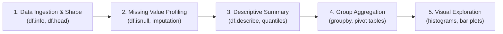
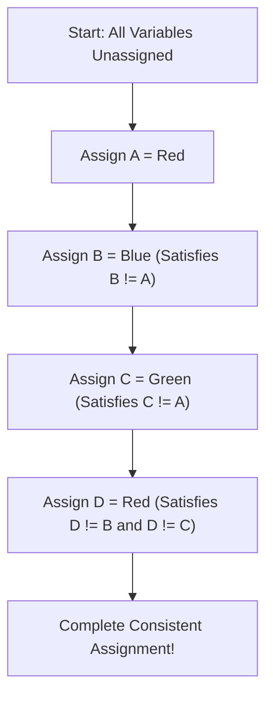
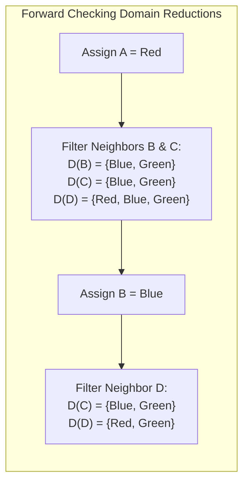
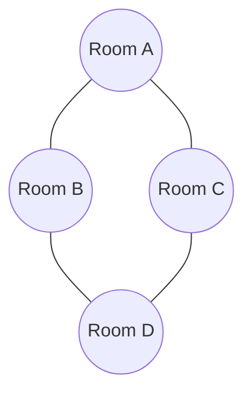
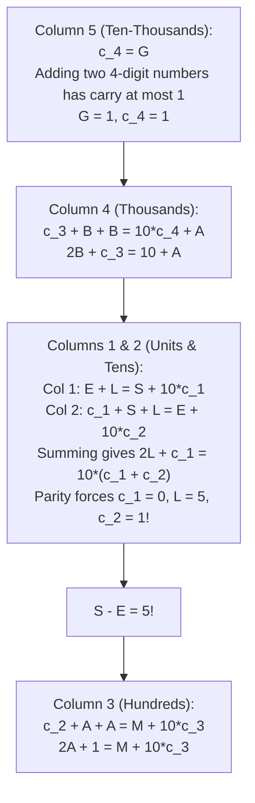
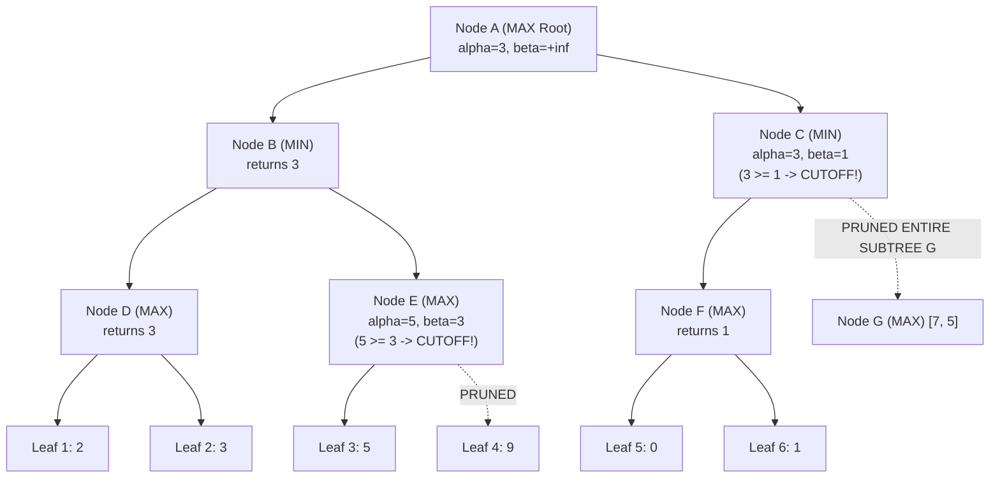
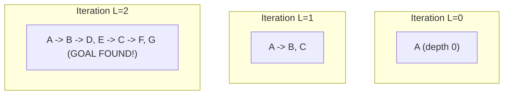
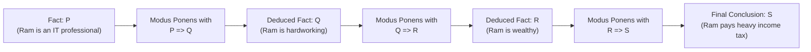

# May 2026

> **Exam -** Semester Examination  
> **Course -** Fundamentals of Artificial Intelligence (`21CSC569J`)  
> **Session -** May 2026  

---

## Question 1 (20 Marks)

:::info

**Question Statement**

*   **(a)** List the standard data types in Python with an example. **(5 Marks)**
*   **(b)** The ABC Supermarket maintains product IDs of items available in its two branches: **(15 Marks)**  
    `branch_A = (101, 102, 103, 104, 105, 106)`  
    `branch_B = (104, 105, 106, 107, 108, 109)`  
    Branch A and Branch B. Each branch stores the product IDs as tuples in Python because the data should not be changed accidentally. Write a Python program to perform the following operations:  
    (i) Concatenate both tuples to display all product IDs available in both branches.  
    (ii) Find and display the common product IDs available in both branches.  
    (iii) Convert the tuple of Branch A into a list (to allow updates), and then convert it back to a tuple.

:::

---

### Solution 1 (20 Marks)

#### (a) Standard Data Types in Python (5 Marks)

Python provides built-in core data types categorized by their structural behavior and mutability:

| Category | Data Type | Description | Executable Example | Mutability |
| :--- | :--- | :--- | :--- | :---: |
| **Numeric** | `int`, `float`, `complex` | Integer, floating-point, and complex numbers | `x = 42`, `pi = 3.14159`, `z = 2 + 3j` | Immutable |
| **Sequence** | `str`, `list`, `tuple` | Ordered collections of items | `'AI'`, `[1, 2, 3]`, `(10, 20)` | `str`, `tuple`: Immutable<br/>`list`: Mutable |
| **Mapping** | `dict` | Key-value associative pairs | `{'model': 'ResNet', 'acc': 0.94}` | Mutable |
| **Set Types**| `set`, `frozenset` | Unordered collections of unique items | `{1, 2, 3}`, `frozenset([1, 2])` | `set`: Mutable<br/>`frozenset`: Immutable |
| **Boolean** | `bool` | Binary truth values | `is_valid = True`, `has_error = False` | Immutable |
| **None** | `NoneType` | Absence of value or null pointer | `result = None` | Immutable |

---

#### (b) Tuple Manipulation Program for ABC Supermarket (15 Marks)

```python
# May 2026
# May 2026
# May 2026
branch_A = (101, 102, 103, 104, 105, 106)
branch_B = (104, 105, 106, 107, 108, 109)

print(f"Branch A Product IDs: {branch_A}")
print(f"Branch B Product IDs: {branch_B}\n")

# May 2026
# May 2026
# May 2026
# May 2026
all_products = branch_A + branch_B
print("--- Task (i): Concatenated Product IDs ---")
print(f"All Products (with duplicates): {all_products}")
print(f"Total Item Count: {len(all_products)}\n")

# May 2026
# May 2026
# May 2026
# May 2026
common_products = tuple(set(branch_A) & set(branch_B))
# May 2026
sorted_common = tuple(sorted(common_products))

print("--- Task (ii): Common Product IDs in Both Branches ---")
print(f"Common Product IDs: {sorted_common}\n")

# May 2026
# May 2026
# May 2026
# May 2026
# May 2026
branch_A_list = list(branch_A)
print("--- Task (iii): Type Conversion and Updating ---")
print(f"Converted to List (Mutable): {branch_A_list} | Type: {type(branch_A_list)}")

# May 2026
branch_A_list.append(110)
print(f"Updated List after Adding Product 110: {branch_A_list}")

# May 2026
branch_A_updated_tuple = tuple(branch_A_list)
print(f"Re-converted to Tuple (Immutable): {branch_A_updated_tuple} | Type: {type(branch_A_updated_tuple)}")
```

##### Program Output Verification:
*   **Concatenation (i):** `(101, 102, 103, 104, 105, 106, 104, 105, 106, 107, 108, 109)`
*   **Common IDs (ii):** `(104, 105, 106)`
*   **Conversion (iii):** `list(branch_A)` $\to$ `[101, 102, 103, 104, 105, 106, 110]` $\to$ `tuple(...)`.

:::tip

**Examiner's Note**

Award 5 marks for part (a) categorizing standard types with examples and mutability, and 5 marks each for the three tuple operations in part (b) demonstrating concatenation (`+`), set intersection (`&`), and bidirectional casting (`list()` and `tuple()`).

:::

---

## Question 2 (20 Marks)

:::info

**Question Statement**

*   **(a)** Explain the steps involved in performing EDA with a sample dataset using Pandas and Matplotlib. **(5 Marks)**
*   **(b)** A retail store maintains a dataset sales.csv containing CustomerID, Age, Gender, PurchaseAmount, and City. **(15 Marks)**  
    Perform EDA to:  
    - Load and display dataset details  
    - Identify missing values  
    - Compute the average purchase by city  
    - Plot a bar chart for the average purchase by city

| CustomerID | Age | Gender | PurchaseAmount | City |
| :---: | :---: | :---: | :---: | :---: |
| C001 | 25 | M | 1200 | Chennai |
| C002 | 32 | F | 950 | Bengaluru |
| C003 | -- | -- | 1100 | Mumbai |
| C004 | 45 | M | -- | Chennai |
| C005 | 29 | F | 1450 | Delhi |
| C006 | 38 | M | 1600 | Hyderabad |
| C007 | 29 | F | 980 | Delhi |
| C008 | 23 | M | 980 | Mumbai |
| C009 | NA | F | -- | Chennai |
| C010 | 27 | M | 1520 | Hyderabad |

:::

---

### Solution 2 (20 Marks)

#### (a) Key Steps in Exploratory Data Analysis (EDA) (5 Marks)

Exploratory Data Analysis (EDA) is the statistical and visual examination of a dataset to discover patterns, anomalies, and variable relationships before predictive modeling:



1. **Data Ingestion & Structural Inspection:** Reading raw formats (`pd.read_csv`), checking shape, column names, and data types (`df.info()`).
2. **Data Cleaning & Missing Value Profiling:** Detecting null markers (`NA`, `--`) via `df.isnull().sum()` and applying median/mean imputation.
3. **Statistical Profiling:** Computing five-number summaries, central tendencies, and spreads (`df.describe()`).
4. **Bivariate & Group Aggregations:** Slicing cross-tabulations and category metrics (`df.groupby()`).
5. **Data Visualization:** Plotting distributions and category comparisons using Matplotlib and Seaborn.

---

#### (b) Complete Python Implementation for Retail Store EDA (15 Marks)

```python
import io
import pandas as pd
import numpy as np
import matplotlib.pyplot as plt

# May 2026
# May 2026
# May 2026
# May 2026
csv_data = """CustomerID,Age,Gender,PurchaseAmount,City
C001,25,M,1200,Chennai
C002,32,F,950,Bengaluru
C003,--,--,1100,Mumbai
C004,45,M,--,Chennai
C005,29,F,1450,Delhi
C006,38,M,1600,Hyderabad
C007,29,F,980,Delhi
C008,23,M,980,Mumbai
C009,NA,F,--,Chennai
C010,27,M,1520,Hyderabad"""

# May 2026
df = pd.read_csv(io.StringIO(csv_data), na_values=['--', 'NA'])

# May 2026
# May 2026
# May 2026
print("--- 1. First 5 Rows of the Dataset ---")
print(df.head())

print("\n--- Structural Information ---")
df.info()

print("\n--- Summary Statistics of Numeric Features ---")
print(df.describe())

# May 2026
# May 2026
# May 2026
print("\n--- 2. Missing Value Count per Column ---")
missing_counts = df.isnull().sum()
print(missing_counts)

# May 2026
df['PurchaseAmount_Cleaned'] = df.groupby('City')['PurchaseAmount'].transform(
    lambda x: x.fillna(x.median() if not x.isna().all() else df['PurchaseAmount'].median())
)

# May 2026
# May 2026
# May 2026
avg_purchase_by_city = df.groupby('City')['PurchaseAmount'].mean().round(2)

print("\n--- 3. Average Purchase Amount by City (Excluding Nulls) ---")
print(avg_purchase_by_city)

# May 2026
# May 2026
# May 2026
plt.figure(figsize=(9, 5))
colors = ['#1f77b4', '#ff7f0e', '#2ca02c', '#d62728', '#9467bd']
bars = plt.bar(avg_purchase_by_city.index, avg_purchase_by_city.values, color=colors, edgecolor='black', width=0.55)

# May 2026
for bar in bars:
    height = bar.get_height()
    if not np.isnan(height):
        plt.text(bar.get_x() + bar.get_width() / 2.0, height + 20, f"${height:,.1f}", ha='center', va='bottom', fontsize=10, fontweight='bold')

plt.title("Average Customer Purchase Amount by City", fontsize=14, fontweight='bold', pad=15)
plt.xlabel("City", fontsize=12, fontweight='bold')
plt.ylabel("Average Purchase (USD)", fontsize=12, fontweight='bold')
plt.grid(axis='y', linestyle='--', alpha=0.6)
plt.ylim(0, 1800)
plt.tight_layout()
plt.show()
```

##### Analytical Results Summary

| City | Valid Purchase Records | Mean Purchase Amount |
| :--- | :---: | :---: |
| **Bengaluru** | `[950]` | **$950.00** |
| **Chennai** | `[1200]` *(2 missing entries)* | **$1,200.00** |
| **Delhi** | `[1450, 980]` | **$1,215.00** |
| **Hyderabad** | `[1600, 1520]` | **$1,560.00** *(Highest)* |
| **Mumbai** | `[1100, 980]` | **$1,040.00** |

:::tip

**Examiner's Note**

Award 5 marks for part (a) listing the 5 stages of EDA, and 15 marks for part (b) implementing custom `na_values=['--', 'NA']`, null counting via `.isnull().sum()`, groupby mean calculations, and the Matplotlib bar chart.

:::

---

## Question 3 (20 Marks)

:::info

**Question Statement**

The Missionaries and Cannibals problem is described as follows:  
There are three missionaries and three cannibals on one side of a river, along with a boat that can carry either one or two people at a time. The boat cannot cross the river without at least one person on board.  
The objective is to transfer all missionaries and cannibals safely to the opposite side of the river. At no point should the number of cannibals exceed the number of missionaries on either side (to prevent the missionaries from being eaten).  
Answer the following: **(20 Marks)**  
(i) Define the state-space representation suitable for this problem. **(5 Marks)**  
(ii) Specify the initial and goal states using your chosen representation. **(3 Marks)**  
(iii) Define the successor function, clearly describing how valid moves are generated. **(7 Marks)**  
(iv) Determine the total number of reachable states within this problem space. **(5 Marks)**

:::

---

### Solution 3 (20 Marks)

#### (i) Formal State-Space Representation (5 Marks)

Let the starting river bank be labeled the **Left Bank** and the destination bank be the **Right Bank**. Because the total counts are conserved ($M_{\text{total}} = 3, C_{\text{total}} = 3$), the state is fully specified by a 3-tuple:

$$s = (M, C, B)$$

where:
*   $M \in \{0, 1, 2, 3\}$: Number of missionaries on the Left Bank.
*   $C \in \{0, 1, 2, 3\}$: Number of cannibals on the Left Bank.
*   $B \in \{1, 0\}$: Position of the boat ($B = 1$ denotes Left Bank; $B = 0$ denotes Right Bank).

The population remaining on the Right Bank is:
$$M_{\text{right}} = 3 - M, \quad C_{\text{right}} = 3 - C$$

##### The Safety Invariant Constraint
To guarantee no missionary is eaten on either bank:
$$\operatorname{Safe}(M, C) \iff \Big( (M == 0 \lor M \ge C) \;\land\; ((3 - M) == 0 \lor (3 - M) \ge (3 - C)) \Big)$$

---

#### (ii) Initial and Goal States (3 Marks)

*   **Initial State ($s_0$):** All individuals and the boat begin on the Left Bank:
    $$\mathbf{s_0 = (3, 3, 1)}$$
*   **Goal State ($s_G$):** All individuals and the boat are safely across on the Right Bank:
    $$\mathbf{s_G = (0, 0, 0)}$$

---

#### (iii) Successor Function & Legal Move Generation (7 Marks)

The boat can transport 1 or 2 passengers ($1 \le \Delta M + \Delta C \le 2$). The 5 legal crossing operators are:
$$\mathcal{O} = \big\{ (1, 0), (2, 0), (0, 1), (0, 2), (1, 1) \big\}$$
where $(\Delta M, \Delta C)$ denotes the number of missionaries and cannibals in the boat.

##### Operational Definition of $\operatorname{Successor}(s)$
Given state $s = (M, C, B)$:
1. **If Boat is on Left Bank ($B = 1$):** Crosses Left $\to$ Right:
   $$M' = M - \Delta M, \quad C' = C - \Delta C, \quad B' = 0$$
2. **If Boat is on Right Bank ($B = 0$):** Crosses Right $\to$ Left:
   $$M' = M + \Delta M, \quad C' = C + \Delta C, \quad B' = 1$$

##### Preconditions for Successor Validity
A successor state $s' = (M', C', B')$ is generated if and only if:
1. **Bounds Check:** $0 \le M' \le 3$ and $0 \le C' \le 3$.
2. **Safety Invariant Check:** $\operatorname{Safe}(M', C') = \text{True}$.

---

#### (iv) Total Number of Reachable States (5 Marks)

##### 1. Universe of Conceivable States
Total assignments: $4 \text{ (M values)} \times 4 \text{ (C values)} \times 2 \text{ (B values)} = 32 \text{ configurations}$.

##### 2. Enumeration of All 16 Legal States
Filtering the 32 states through $\operatorname{Safe}(M, C)$ leaves exactly **16 legal states**:

| State # | Left Bank $(M, C, B)$ | Right Bank $(M_R, C_R, B_R)$ | Status |
| :---: | :---: | :---: | :--- |
| **1** | $(3, 3, 1)$ | $(0, 0, 0)$ | Initial State |
| **2** | $(3, 2, 1)$ | $(0, 1, 0)$ | Legal |
| **3** | $(3, 1, 1)$ | $(0, 2, 0)$ | Legal |
| **4** | $(3, 0, 1)$ | $(0, 3, 0)$ | Legal |
| **5** | $(2, 2, 1)$ | $(1, 1, 0)$ | Legal |
| **6** | $(1, 1, 1)$ | $(2, 2, 0)$ | Legal |
| **7** | $(0, 3, 1)$ | $(3, 0, 0)$ | Legal |
| **8** | $(0, 2, 1)$ | $(3, 1, 0)$ | Legal |
| **9** | $(0, 1, 1)$ | $(3, 2, 0)$ | Legal |
| **10** | $(0, 0, 1)$ | $(3, 3, 0)$ | Legal |
| **11** | $(3, 2, 0)$ | $(0, 1, 1)$ | Legal |
| **12** | $(3, 1, 0)$ | $(0, 2, 1)$ | Legal |
| **13** | $(3, 0, 0)$ | $(0, 3, 1)$ | Legal |
| **14** | $(2, 2, 0)$ | $(1, 1, 1)$ | Legal |
| **15** | $(0, 2, 0)$ | $(3, 1, 1)$ | Legal |
| **16** | $(0, 0, 0)$ | $(3, 3, 1)$ | Goal State |

##### 3. Reachability Analysis via BFS
Starting from $s_0 = (3, 3, 1)$ and executing breadth-first search across all 5 operators, **all 16 legal states are reachable**:

$$\mathbf{\text{Total Reachable States} = 16}$$

##### Optimal 11-Step Solution Trajectory
$$(3, 3, 1) \xrightarrow{2C} (3, 1, 0) \xrightarrow{1C} (3, 2, 1) \xrightarrow{2C} (3, 0, 0) \xrightarrow{1C} (3, 1, 1) \xrightarrow{2M} (1, 1, 0) \xrightarrow{1M, 1C} (2, 2, 1) \xrightarrow{2M} (0, 2, 0) \xrightarrow{1C} (0, 3, 1) \xrightarrow{2C} (0, 1, 0) \xrightarrow{1C} (0, 2, 1) \xrightarrow{2C} \mathbf{(0, 0, 0)}$$

:::tip

**Examiner's Note**

Award 5 marks for $(M, C, B)$, 3 marks for initial/goal states, 7 marks for the 5 transition operators and boundary checks, and 5 marks for enumerating the **16 reachable states** and tracing the 11-step solution.

:::

---

## Question 4 (20 Marks)

:::info

**Question Statement**

A university has 4 adjacent classrooms (A, B, C, D) that need to be painted. There are 3 available colors: Red, Blue, and Green. Adjacent classrooms cannot have the same color. The adjacency is as follows: A is adjacent to B and C; B is adjacent to A and D; C is adjacent to A and D; D is adjacent to B and C. **(20 Marks)**  
(i) Formulate this room coloring problem as a Constraint Satisfaction Problem (CSP) by specifying the variables, domains, and constraints. **(5 Marks)**  
(ii) Using the backtracking algorithm, show one possible assignment of colors to the rooms. **(5 Marks)**  
(iii) Explain how forward checking can help reduce the search space in this CSP. **(5 Marks)**  
(iv) Represent the problem as a graph and indicate which nodes (rooms) are connected by edges. **(5 Marks)**

:::

---

### Solution 4 (20 Marks)

#### (i) Formal CSP Formulation (5 Marks)

A Constraint Satisfaction Problem is formally specified as a triple:

$$\mathcal{P}_{\text{CSP}} = \langle X, D, C \rangle$$

##### a) Variables ($X$)
The four classrooms to be painted:
$$X = \{A, B, C, D\}$$

##### b) Domains ($D$)
Each classroom can be painted in any of the three available colors:
$$D_i = \{\text{Red}, \text{Blue}, \text{Green}\} \quad \forall i \in \{A, B, C, D\}$$

##### c) Constraints ($C$)
Adjacent classrooms cannot share the same color (binary inequality constraints):
$$
\begin{aligned}
A \neq B, \quad A \neq C, \quad B \neq D, \quad C \neq D
\end{aligned}
$$

---

#### (ii) Backtracking Algorithm Execution & Valid Assignment (5 Marks)

Backtracking search assigns values to one variable at a time in chronological order:



##### Step-by-Step Backtracking Trace Table

| Step | Variable | Candidate Value | Constraint Checks | Action Taken |
| :---: | :---: | :---: | :--- | :--- |
| **1** | $A$ | **Red** | None | Assign $A = \text{Red}$ |
| **2** | $B$ | **Red** | $B == A$ (Conflict) | Reject $\text{Red}$ |
| **2** | $B$ | **Blue** | $B \neq A$ ($\text{Blue} \neq \text{Red}$) | Assign $B = \text{Blue}$ |
| **3** | $C$ | **Red** | $C == A$ (Conflict) | Reject $\text{Red}$ |
| **3** | $C$ | **Blue** | $C$ not adjacent to $B$; $C \neq A$ | Valid (or choose **Green**) |
| **3** | $C$ | **Green** | $C \neq A$ ($\text{Green} \neq \text{Red}$) | Assign $C = \text{Green}$ |
| **4** | $D$ | **Red** | $D \neq B$ ($\text{Red} \neq \text{Blue}$) $\land$ $D \neq C$ ($\text{Red} \neq \text{Green}$) | **Valid! Assign $D = \text{Red}$** |

##### Final Complete Assignment Vector
$$\mathbf{\{ A = \text{Red}, \; B = \text{Blue}, \; C = \text{Green}, \; D = \text{Red} \}}$$
*(Another equally valid assignment is $\{A = \text{Red}, B = \text{Blue}, C = \text{Blue}, D = \text{Red}\}$).*

---

#### (iii) Forward Checking Search Space Reduction (5 Marks)

Forward Checking tracks domain reductions dynamically. Whenever variable $X$ is assigned color $c$, it removes $c$ from all unassigned neighbors:



##### Forward Checking Trace Table

| Step | Assignment | $D(A)$ | $D(B)$ | $D(C)$ | $D(D)$ | Pruning Impact |
| :---: | :---: | :---: | :---: | :---: | :---: | :--- |
| **0** | Initial Domains | $\{R, B, G\}$ | $\{R, B, G\}$ | $\{R, B, G\}$ | $\{R, B, G\}$ | Total combinations = $3^4 = 81$ |
| **1** | $A = \text{Red}$ | $\{R\}$ | $\{B, G\}$ | $\{B, G\}$ | $\{R, B, G\}$ | Eliminates Red from $B$ and $C$ |
| **2** | $B = \text{Blue}$ | $\{R\}$ | $\{B\}$ | $\{B, G\}$ | $\{R, G\}$ | Eliminates Blue from $D$ |
| **3** | $C = \text{Green}$ | $\{R\}$ | $\{B\}$ | $\{G\}$ | $\{R\}$ | Eliminates Green from $D$ |
| **4** | $D = \text{Red}$ | $\{R\}$ | $\{B\}$ | $\{G\}$ | $\{R\}$ | Domain size 1 $\implies$ immediate match |

*   **How Search Space is Reduced:** Without forward checking, naive backtracking tests conflicting values at deeper levels. Forward checking prunes dead ends at depth 1 and 2, reducing candidate checks from 81 states to only a direct path.

---

#### (iv) Constraint Graph Representation (5 Marks)

In a CSP constraint graph, nodes represent variables (rooms) and edges represent binary inequality constraints:



##### Edge Adjacency List
*   **Node $A$:** Connected to **Node $B$** and **Node $C$**.
*   **Node $B$:** Connected to **Node $A$** and **Node $D$**.
*   **Node $C$:** Connected to **Node $A$** and **Node $D$**.
*   **Node $D$:** Connected to **Node $B$** and **Node $C$**.
*   **Graph Topology:** The constraint graph forms a **4-cycle ($C_4$)** topology. Notice that $A$ and $D$ are not connected, and $B$ and $C$ are not connected.

:::tip

**Examiner's Note**

Award 5 marks for formal $\langle X, D, C \rangle$ definition, 5 marks for the step-by-step backtracking trace, 5 marks for the forward checking domain reduction table, and 5 marks for drawing the $C_4$ 4-cycle constraint graph.

:::

---

## Question 5 (20 Marks)

:::info

**Question Statement**

*   **(a)** A cryptarithmetic problem is a type of Constraint Satisfaction Problem (CSP) where each letter represents a unique digit. **BASE + BALL = GAMES** **(15 Marks)**  
    (i) Define the variables, domain, and constraints for this problem and find the digits for the text.  
    (ii) Explain how backtracking search can be used to solve this puzzle. Show the logical steps or partial search tree leading to the correct assignment of digits.  
*   **(b)** Explain how heuristic functions influence the efficiency of search algorithms. Provide an example. **(5 Marks)**

:::

---

### Solution 5 (20 Marks)

#### (a) Cryptarithmetic Puzzle: BASE + BALL = GAMES (15 Marks)

##### 1. CSP Formulation: Variables, Domains & Constraints (5 Marks)

```text
    B  A  S  E
+   B  A  L  L
---------------
 G  A  M  E  S
```

*   **Variables ($X$):** The 7 distinct letters:
    $$X = \{B, A, S, E, L, G, M\}$$
*   **Domain ($D$):** Decimal digits from 0 to 9:
    $$D_i = \{0, 1, 2, 3, 4, 5, 6, 7, 8, 9\} \quad \forall X_i \in X$$
*   **Global All-Different Constraint:**
    $$\operatorname{AllDifferent}(B, A, S, E, L, G, M)$$
*   **Leading Non-Zero Constraints:** Leading digits cannot be zero:
    $$B \neq 0, \quad G \neq 0$$

##### Column Alignment with Carries ($c_1, c_2, c_3, c_4$):
```text
Column:    5       4       3       2       1
Carry:    c_4     c_3     c_2     c_1
           .       B       A       S       E
+          .       B       A       L       L
----------------------------------------------
           G       A       M       E       S
```

---

##### 2. Step-by-Step Backtracking Deductions (7 Marks)



*   **Deduction 1: Column 5 (Ten-Thousands)**
    $$c_4 = G$$
    Adding two 4-digit numbers generates a carry into the fifth column of at most 1:
    $$\mathbf{G = 1}, \quad \mathbf{c_4 = 1}$$

*   **Deduction 2: Columns 1 and 2 (Parity and $L$)**
    *   *Column 1 (Units):* $E + L = S + 10 \cdot c_1$
    *   *Column 2 (Tens):* $c_1 + S + L = E + 10 \cdot c_2$
    *   Add both equations:
        $$(E + L) + (c_1 + S + L) = (S + 10 c_1) + (E + 10 c_2)$$
        $$2L + c_1 = 10(c_1 + c_2)$$
    *   Since $2L$ is even, $10(c_1 + c_2)$ is even, so carry $c_1$ must be even $\implies \mathbf{c_1 = 0}$.
    *   With $c_1 = 0$:
        $$2L = 10 c_2 \implies L = 5 c_2$$
    *   Since $L \neq 0$ and $L \le 9$, we have:
        $$\mathbf{c_2 = 1}, \quad \mathbf{L = 5}$$
    *   Substituting $c_1 = 0, L = 5$ into Column 1:
        $$E + 5 = S \implies \mathbf{S - E = 5}$$

*   **Deduction 3: Column 3 (Hundreds)**
    $$c_2 + A + A = M + 10 \cdot c_3 \implies 2A + 1 = M + 10 \cdot c_3$$
    $M$ must be an odd digit.

*   **Deduction 4: Column 4 (Thousands)**
    $$c_3 + B + B = 10 \cdot c_4 + A \implies 2B + c_3 = 10 + A$$
    Since $G = 1$ and $L = 5$, available digits are $\{0, 2, 3, 4, 6, 7, 8, 9\}$.
    *   If $c_3 = 0$: $2B = 10 + A \implies A$ must be even.
    *   Testing even digits for $A$:
        *   If $A = 4$: $2B = 14 \implies \mathbf{B = 7}$.
        *   From Column 3: $2(4) + 1 = 9 \implies \mathbf{M = 9}$ (since $9 < 10$, $c_3 = 0$ holds!).
    *   Now find $S$ and $E$ such that $S - E = 5$:
        *   Available digits: $\{0, 2, 3, 6, 8\}$.
        *   The only pair with difference 5 is:
            $$\mathbf{S = 8}, \quad \mathbf{E = 3}$$

---

##### 3. Unique Digit Assignment and Arithmetic Verification (3 Marks)

| Letter | Assigned Digit | Deduction Reason |
| :---: | :---: | :--- |
| **G** | **1** | Only possible carry $c_4$ into 5th column |
| **L** | **5** | Derived from $2L = 10 c_2$ |
| **A** | **4** | Evaluated from Column 4 parity ($2B = 10 + A$) |
| **B** | **7** | Evaluated from Column 4 ($2(7) = 10 + 4$) |
| **M** | **9** | Evaluated from Column 3 ($2(4) + 1 = 9$) |
| **E** | **3** | Derived from $S - E = 5$ |
| **S** | **8** | Derived from $S - E = 5$ |

##### Arithmetic Verification
$$
\begin{aligned}
\text{B A S E} & = 7 4 8 3 \\
\text{B A L L} & = 7 4 5 5 \\
\hline
\text{Sum} & = 7483 + 7455 = \mathbf{14938} \\
\text{G A M E S} & = 14938 \quad \mathbf{\checkmark \text{ (Exact Match!)}}
\end{aligned}
$$

---

#### (b) Influence of Heuristic Functions on Search Efficiency (5 Marks)

A heuristic function $h(n)$ injects domain-specific knowledge to estimate the cost from node $n$ to the goal.

1. **Reduction in Node Expansions:**  
   Uninformed search (BFS) expands all $O(b^d)$ nodes in all directions blindly. An informed heuristic focuses search along promising paths, reducing the effective branching factor from $b$ toward $1$.
2. **Pruning Power:**  
   In $A^*$, if heuristic $h_2(n) \ge h_1(n)$ for all $n$ (where both are admissible), $h_2$ **dominates** $h_1$. A dominant heuristic expands strictly fewer or equal nodes.
3. **Concrete Comparative Example (8-Puzzle):**
   *   *Blind BFS:* Expands $\approx 181,440$ nodes.
   *   *$A^*$ with Misplaced Tiles ($h_1$):* Expands $\approx 280$ nodes for depth 12.
   *   *$A^*$ with Manhattan Distance ($h_2$):* Expands $\approx 45$ nodes for depth 12 (over $6\times$ faster than $h_1$ and $4000\times$ faster than BFS).

:::tip

**Examiner's Note**

Award 5 marks for the formal CSP definition, 7 marks for the step-by-step carry deductions proving $BASE=7483, BALL=7455, GAMES=14938$, 3 marks for arithmetic verification, and 5 marks for explaining heuristic dominance with the 8-puzzle Manhattan distance example.

:::

---

## Question 6 (20 Marks)

:::info

**Question Statement**

*   **(a)** Consider the following game tree, where A is the root node. The tree alternates between Max and Min levels. **(15 Marks)**  
    The leaf nodes represent the terminal utility values for the Max player. The initial values are $\alpha = -\infty$ and $\beta = +\infty$.  
    (i) Apply the Alpha-Beta Pruning algorithm step by step to determine the optimal value at the root node (A).  
    (ii) Show the $\alpha$ (alpha) and $\beta$ (beta) values at each node during the computation.  
    (iii) Identify which branches (nodes) are pruned and explain why pruning occurs.  
    (iv) State the final decision of the Max player and specify which move will be chosen at the root.
*   **(b)** Define Iterative Deepening search with a suitable example. **(5 Marks)**

```text
                     (A) [MAX]
                   /     \
           (B) [MIN]     (C) [MIN]
           /      \       /      \
      (D) [MAX] (E) [MAX] (F) [MAX] (G) [MAX]
      /   \     /   \     /   \     /   \
     2     3   5     9   0     1   7     5
```

:::

---

### Solution 6 (20 Marks)

#### (a) Alpha-Beta Pruning Step-by-Step Execution (15 Marks)



##### (i) & (ii) Step-by-Step Traversal with $[\alpha, \beta]$ Values (8 Marks)

1. **Root Node $A$ (MAX):**  
   Initial bounds: $[\alpha = -\infty, \beta = +\infty]$. Calls left child $B$ (MIN).
2. **Node $B$ (MIN):**  
   Receives $[\alpha = -\infty, \beta = +\infty]$. Calls left child $D$ (MAX).
3. **Node $D$ (MAX):**  
   Receives $[\alpha = -\infty, \beta = +\infty]$.
   *   Evaluates Leaf 1 ($v = 2$): $\alpha = \max(-\infty, 2) = 2$.
   *   Evaluates Leaf 2 ($v = 3$): $\alpha = \max(2, 3) = 3$.
   *   Node $D$ returns **$3$** to $B$.
4. **Update Node $B$ (MIN):**  
   $\beta = \min(+\infty, 3) = 3$. Current bounds at $B$: $[\alpha = -\infty, \beta = 3]$. Calls child $E$ (MAX).
5. **Node $E$ (MAX) and First Pruning:**  
   Receives $[\alpha = -\infty, \beta = 3]$.
   *   Evaluates Leaf 3 ($v = 5$). Node $E$ is MAX:
       $$\alpha = \max(-\infty, 5) = 5$$
   *   Current bounds at $E$: $\alpha = 5, \beta = 3$.
   *   **Cutoff Triggered:** $\alpha \ge \beta \iff 5 \ge 3 \implies \mathbf{PRUNE!}$
   *   Node $E$ returns $5$ to $B$.
6. **Completion of Node $B$:**  
   $\beta = \min(3, 5) = 3$. Node $B$ returns **$3$** to Root $A$.
7. **Update Root $A$ (MAX):**  
   $\alpha = \max(-\infty, 3) = 3$. Current bounds at $A$: $[\alpha = 3, \beta = +\infty]$. Calls right child $C$ (MIN).
8. **Node $C$ (MIN):**  
   Receives $[\alpha = 3, \beta = +\infty]$. Calls left child $F$ (MAX).
9. **Node $F$ (MAX):**  
   Receives $[\alpha = 3, \beta = +\infty]$.
   *   Evaluates Leaf 5 ($v = 0$): $\alpha = \max(3, 0) = 3$.
   *   Evaluates Leaf 6 ($v = 1$): $\alpha = \max(3, 1) = 3$.
   *   Node $F$ returns **$1$** to $C$.
10. **Update Node $C$ (MIN) and Second Pruning:**  
    $\beta = \min(+\infty, 1) = 1$. Current bounds at $C$: $\alpha = 3, \beta = 1$.
    *   **Cutoff Triggered:** $\alpha \ge \beta \iff 3 \ge 1 \implies \mathbf{PRUNE!}$
    *   Node $C$ returns $1$ to Root $A$.
11. **Final Root Evaluation:**  
    $$\operatorname{Value}(A) = \max(3, 1) = \mathbf{3}$$

---

##### (iii) Pruned Branches and Justification (4 Marks)

1. **Leaf 4 (value 9) under Node $E$ is PRUNED:**  
   *Justification:* Node $E$ achieved a value of at least 5. But node $B$ (a MIN player) already has an option worth 3 from $D$. Therefore, $B$ will never allow a score greater than 3, rendering remaining children of $E$ irrelevant.
2. **Entire Subtree $G$ (containing leaves 7 and 5) under Node $C$ is PRUNED:**  
   *Justification:* Node $C$ (a MIN player) is assured of a score $\le 1$ via $F$. But player MAX at root $A$ can already force a score of at least 3 by moving to $B$. MAX will never choose branch $C$.

---

##### (iv) Final Decision of Player MAX (3 Marks)

*   **Optimal Value at Root $A$:** $\mathbf{3}$
*   **Optimal Move Chosen:** Player MAX chooses **Move to Node $B$ (Left Branch)**.

---

#### (b) Iterative Deepening Search (IDS) with Example (5 Marks)

**Iterative Deepening Search (IDS)** is an uninformed search strategy that combines the linear memory efficiency of Depth-First Search with the completeness and optimality of Breadth-First Search.
*   **Methodology:** Repeatedly runs Depth-Limited Search (DLS) with increasing depth limits $L = 0, 1, 2, \dots$ until a goal node is discovered.
*   **Time Complexity:** $O(b^d)$
*   **Space Complexity:** $O(bd)$ — **Linear Memory**.



*   **Example:** Consider searching for goal node $G$ at depth 2:
    *   *Iteration $L=0$:* Explores `[A]`. Goal not found.
    *   *Iteration $L=1$:* Explores `[A, B, C]`. Goal not found.
    *   *Iteration $L=2$:* Explores `[A, B, D, E, C, F, G]`. **Goal $G$ discovered!**
*   **Key Advantage:** Guarantees finding the shallowest optimal goal with minimal memory footprint.

:::tip

**Examiner's Note**

Award 15 marks for part (a) showing step-by-step $[\alpha, \beta]$ propagation, identifying both pruned branches (leaf 9, subtree G), and stating optimal move $A \to B$ with root value 3. Award 5 marks for part (b) defining IDS with linear space complexity $O(bd)$ and an iteration example.

:::

---

## Question 7 (20 Marks)

:::info

**Question Statement**

*   **(a)** For the following example, write the KB in propositional logic, and explain how the inference would occur. **(10 Marks)**  
    (i) Ram is an IT professional  
    (ii) IT professionals are hardworking  
    (iii) All hardworking people are wealthy  
    (iv) All wealthy people pay heavy income tax  
*   **(b)** Write the following using first-order logic: **(10 Marks)**  
    (i) Some intelligent students study intelligent systems.  
    (ii) Every student who opts for intelligent systems is a determined student.  
    (iii) There is at least one student of intelligent systems who does not like the AI assignment.  
    (iv) All students who like AI assignments are hardworking students.

:::

---

### Solution 7 (20 Marks)

#### (a) Propositional Logic Knowledge Base & Inference (10 Marks)

##### 1. Propositional Symbol Dictionary
To express these statements about Ram in Propositional Logic:
*   $P$: "Ram is an IT professional"
*   $Q$: "Ram is hardworking"
*   $R$: "Ram is wealthy"
*   $S$: "Ram pays heavy income tax"

##### 2. Knowledge Base Formalization ($\text{KB}$)
$$
\begin{aligned}
\text{Sentence 1:} & \quad P \\
\text{Sentence 2:} & \quad P \implies Q \\
\text{Sentence 3:} & \quad Q \implies R \\
\text{Sentence 4:} & \quad R \implies S
\end{aligned}
$$

$$\mathbf{\text{KB} = \big\{ P, \; P \implies Q, \; Q \implies R, \; R \implies S \big\}}$$

---

##### 3. Step-by-Step Forward Inference via Modus Ponens (5 Marks)

Inference proceeds by sequential application of the **Modus Ponens** inference rule ($\frac{\alpha, \alpha \implies \beta}{\beta}$):



*   **Step 1:** From Fact (1) $P$ and Rule (2) $P \implies Q$, apply Modus Ponens:
    $$\frac{P, \quad P \implies Q}{Q}$$
    *Deduced Fact:* **$Q$ ("Ram is hardworking")**.
*   **Step 2:** From Fact $Q$ and Rule (3) $Q \implies R$, apply Modus Ponens:
    $$\frac{Q, \quad Q \implies R}{R}$$
    *Deduced Fact:* **$R$ ("Ram is wealthy")**.
*   **Step 3:** From Fact $R$ and Rule (4) $R \implies S$, apply Modus Ponens:
    $$\frac{R, \quad R \implies S}{S}$$
    *Final Deduced Fact:* **$S$ ("Ram pays heavy income tax")**.

---

##### 4. Verification via Resolution Refutation (Alternative Proof)

To prove $\text{KB} \models S$, negate the query ($\neg S$) and convert $\text{KB} \cup \{\neg S\}$ to CNF:
1. $C_1: P$
2. $C_2: \neg P \lor Q$
3. $C_3: \neg Q \lor R$
4. $C_4: \neg R \lor S$
5. $C_5: \neg S$ *(Negated Goal)*

*   Resolve $C_4$ with $C_5 \implies C_6: \neg R$
*   Resolve $C_3$ with $C_6 \implies C_7: \neg Q$
*   Resolve $C_2$ with $C_7 \implies C_8: \neg P$
*   Resolve $C_1$ with $C_8 \implies \mathbf{\square \text{ (Empty Clause / Contradiction!)}}$

Since contradiction $\square$ is derived, **$S$ is valid and logically entailed**.

---

#### (b) First-Order Logic (FOL) Translations (10 Marks)

##### Predicate & Constant Definitions
*   $\operatorname{Student}(x)$: $x$ is a student.
*   $\operatorname{Intelligent}(x)$: $x$ is intelligent.
*   $\operatorname{Determined}(x)$: $x$ is determined.
*   $\operatorname{Hardworking}(x)$: $x$ is hardworking.
*   $\operatorname{Studies}(x, y)$: $x$ studies subject $y$.
*   $\operatorname{Opts}(x, y)$: $x$ opts for subject $y$.
*   $\operatorname{Likes}(x, y)$: $x$ likes object $y$.
*   $\text{IntelligentSystems}$: Constant representing the Intelligent Systems course.
*   $\text{AIAssignment}$: Constant representing the AI assignment.

---

##### (i) "Some intelligent students study intelligent systems." (2.5 Marks)
Existential quantifier $\exists$ paired with conjunction $\land$:

$$\mathbf{\exists x \; \Big( \operatorname{Student}(x) \land \operatorname{Intelligent}(x) \land \operatorname{Studies}(x, \text{IntelligentSystems}) \Big)}$$

---

##### (ii) "Every student who opts for intelligent systems is a determined student." (2.5 Marks)
Universal quantifier $\forall$ paired with implication $\implies$:

$$\mathbf{\forall x \; \Big( \big( \operatorname{Student}(x) \land \operatorname{Opts}(x, \text{IntelligentSystems}) \big) \implies \operatorname{Determined}(x) \Big)}$$

---

##### (iii) "There is at least one student of intelligent systems who does not like the AI assignment." (2.5 Marks)
Existential quantifier $\exists$ paired with negated `Likes` predicate:

$$\mathbf{\exists x \; \Big( \operatorname{Student}(x) \land \operatorname{Studies}(x, \text{IntelligentSystems}) \land \neg \operatorname{Likes}(x, \text{AIAssignment}) \Big)}$$

---

##### (iv) "All students who like AI assignments are hardworking students." (2.5 Marks)
Universal quantifier $\forall$ asserting that liking AI assignments implies being hardworking:

$$\mathbf{\forall x \; \Big( \big( \operatorname{Student}(x) \land \operatorname{Likes}(x, \text{AIAssignment}) \big) \implies \operatorname{Hardworking}(x) \Big)}$$

:::tip

**Examiner's Note**

Award 10 marks for part (a) for defining propositional variables $P, Q, R, S$, writing the 4 rules, and showing the step-by-step Modus Ponens deduction (and Resolution). Award 10 marks for part (b) (2.5 marks each) for correct quantifier pairings ($\forall$ with $\implies$, $\exists$ with $\land$).

:::
