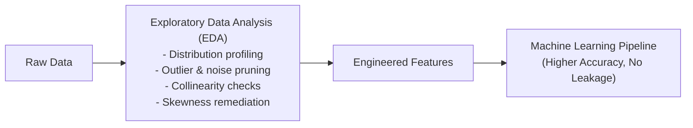
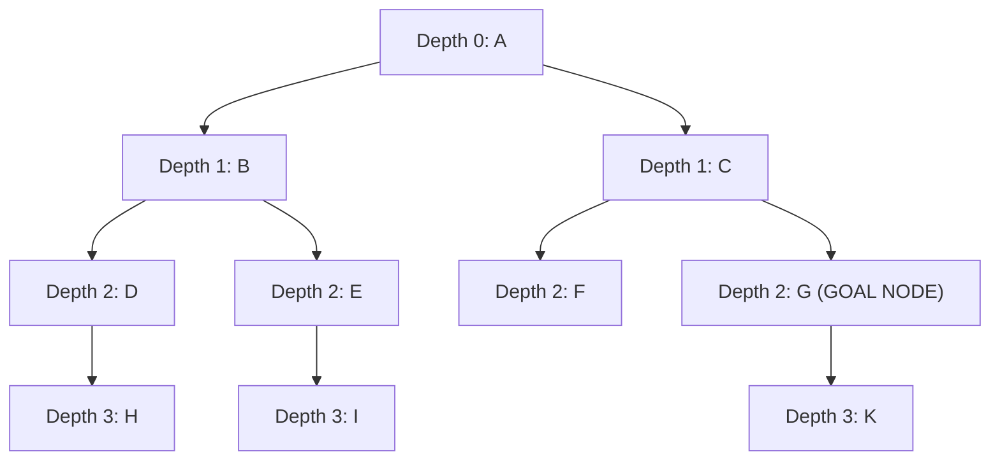
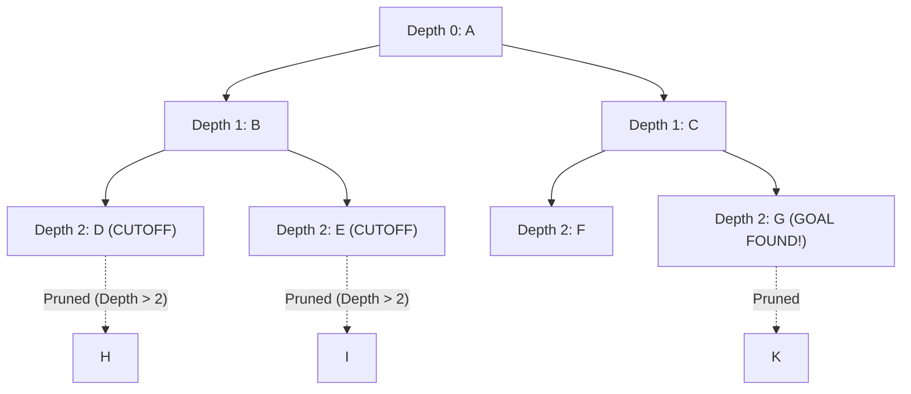
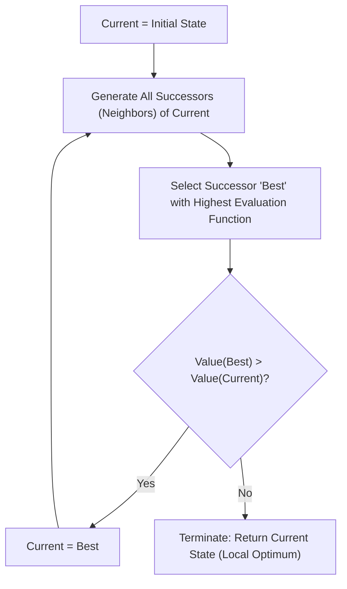
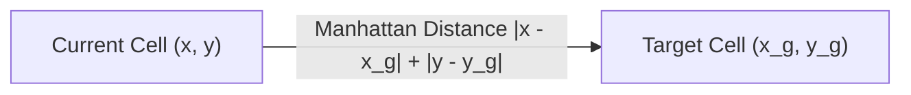
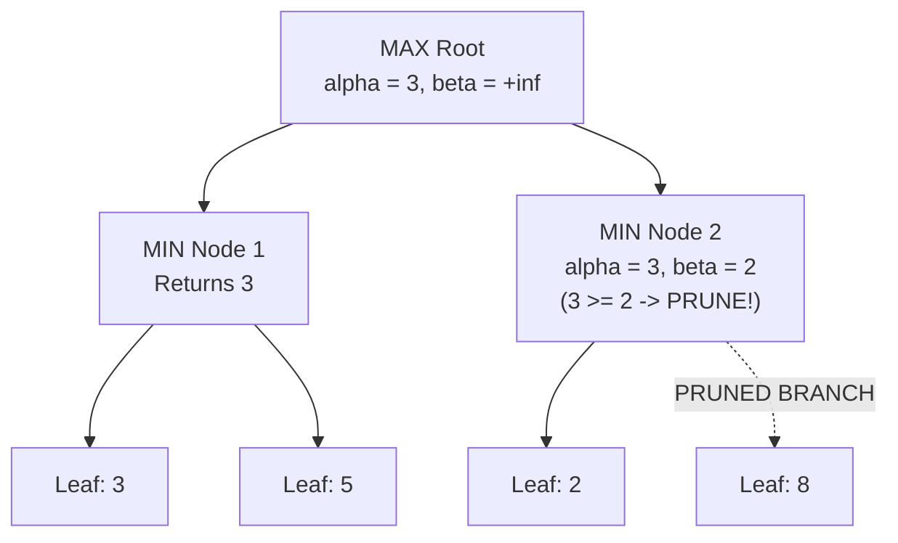
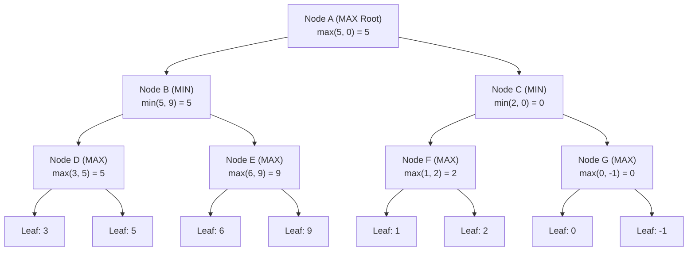
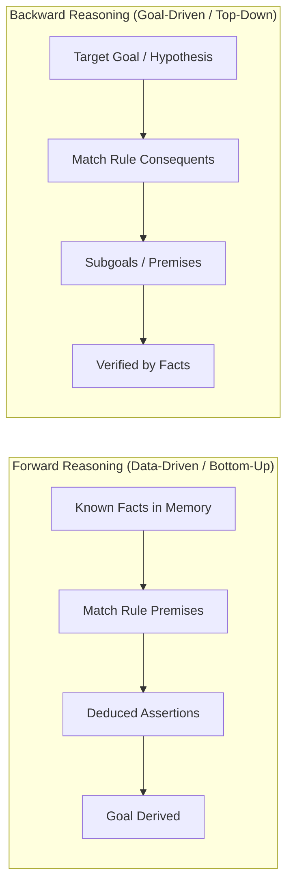
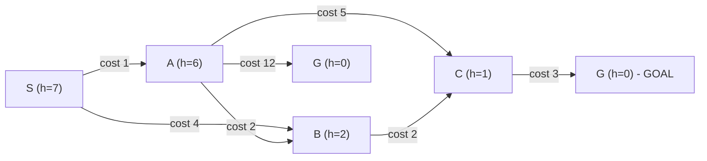
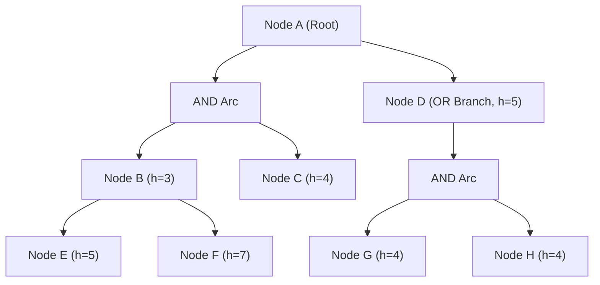

# November 2025 (FN)

> **Exam -** Semester Examination  
> **Course -** Fundamentals of Artificial Intelligence (`21CSC569J`)  
> **Session -** November 2025 (FN)  

---

## Question 1 (20 Marks)

:::info

**Question Statement**

*   **a)** Differentiate between mutable and immutable data types in Python with examples. **(5 Marks)**
*   **b)** Write a Python program to find the factorial of a number using recursion. **(5 Marks)**
*   **c)** Write a Python program to input n numbers into a list and perform the following operations: **(10 Marks)**
    *   i) Find the sum and average of elements.
    *   ii) Find the maximum and minimum elements
    *   iii) Display the list in ascending and descending order

:::

---

### Solution 1 (20 Marks)

#### a) Mutable vs. Immutable Data Types in Python (5 Marks)

##### 1. Conceptual Distinction
*   **Mutable Data Types:** Objects whose internal values, elements, or state can be modified in-place after instantiation without altering their memory address identity (`id()`).
*   **Immutable Data Types:** Objects whose internal state cannot be modified once created. Any operation that appears to mutate an immutable object creates a new object in memory at a different address.

##### 2. Comparison Table
| Feature | Mutable Types | Immutable Types |
| :--- | :--- | :--- |
| **Examples** | `list`, `dict`, `set`, `bytearray` | `int`, `float`, `str`, `tuple`, `frozenset`, `bool` |
| **Memory Address (`id`)** | Preserved after in-place modification | Changes upon reassignment/modification |
| **Dictionary Key Usability** | Cannot be used as dictionary keys (unhashable) | Can be used as dictionary keys (hashable) |
| **Performance Overhead** | Higher memory overhead; dynamic over-allocation | Memory efficient; fixed-size buffer |

##### 3. Code Demonstration
```python
# November 2025 (FN)
my_list = [10, 20, 30]
print("List ID before:", id(my_list))
my_list.append(40)                      # Mutates in-place
print("List ID after:", id(my_list))   # ID is identical!

# November 2025 (FN)
my_str = "AI"
print("String ID before:", id(my_str))
my_str += " Handbook"                  # Rebinds to a new object
print("String ID after:", id(my_str))  # ID is different!
```

---

#### b) Recursive Factorial Program (5 Marks)

##### 1. Mathematical Formulation
For any non-negative integer $n$:
$$n! = \begin{cases} 1 & \text{if } n = 0 \text{ or } n = 1 \quad \text{(Base Case)} \\ n \times (n - 1)! & \text{if } n > 1 \quad \text{(Recursive Step)} \end{cases}$$

##### 2. Complete Python Implementation
```python
def factorial_recursive(n):
    """
    Computes the factorial of a non-negative integer using recursion.
    Includes input validation for negative values.
    """
    # Validation against negative inputs
    if not isinstance(n, int) or n < 0:
        raise ValueError("Factorial is only defined for non-negative integers.")
    
    # Base Case
    if n in (0, 1):
        return 1
    
    # Recursive Step
    return n * factorial_recursive(n - 1)

# November 2025 (FN)
if __name__ == "__main__":
    num = 5
    result = factorial_recursive(num)
    print(f"The factorial of {num} is: {result}")
    # Verification: 5! = 5 * 4 * 3 * 2 * 1 = 120
```

---

#### c) List Operations Program (10 Marks)

```python
def process_number_list():
    """
    Inputs n numbers into a list and computes:
    i) Sum and Average
    ii) Maximum and Minimum
    iii) Ascending and Descending sorted representations
    """
    try:
        n = int(input("Enter the number of elements (n): "))
        if n <= 0:
            print("Please enter a positive integer.")
            return

        numbers = []
        for i in range(n):
            val = float(input(f"Enter element {i + 1}: "))
            numbers.append(val)

        # ----------------------------------------------------
        # i) Sum and Average
        # ----------------------------------------------------
        total_sum = sum(numbers)
        average = total_sum / n
        print(f"\n--- Statistical Summaries ---")
        print(f"Total Sum: {total_sum:,.2f}")
        print(f"Average: {average:,.2f}")

        # ----------------------------------------------------
        # ii) Maximum and Minimum
        # ----------------------------------------------------
        max_elem = max(numbers)
        min_elem = min(numbers)
        print(f"Maximum Element: {max_elem}")
        print(f"Minimum Element: {min_elem}")

        # ----------------------------------------------------
        # iii) Sorting (Ascending and Descending)
        # ----------------------------------------------------
        ascending_list = sorted(numbers)
        descending_list = sorted(numbers, reverse=True)
        print(f"\n--- Sorted Representations ---")
        print(f"Ascending Order : {ascending_list}")
        print(f"Descending Order: {descending_list}")

    except ValueError:
        print("Invalid input. Please enter valid numerical values.")

# November 2025 (FN)
if __name__ == "__main__":
    # Simulated execution with sample array: [45, 12, 89, 33, 27]
    sample = [45, 12, 89, 33, 27]
    print(f"Sample List: {sample}")
    print(f"Sum: {sum(sample)} | Average: {sum(sample)/len(sample):.2f}")
    print(f"Min: {min(sample)} | Max: {max(sample)}")
    print(f"Ascending: {sorted(sample)}")
    print(f"Descending: {sorted(sample, reverse=True)}")
```

:::tip

**Examiner's Note**

Award 5 marks for part (a) table and memory identity explanation, 5 marks for part (b) recursive factorial with base and recursive cases, and 10 marks for part (c) covering sum/average, min/max, and bidirectional sorting.

:::

---

## Question 2 (20 Marks)

:::info

**Question Statement**

*   **a)** Write short notes on the importance of EDA before applying machine learning algorithms. **(5 Marks)**
*   **b)** A dataset students.csv has columns StudentID, Gender, Marks_Math, Marks_Science, Marks_English. Perform EDA to: **(15 Marks)**  
    *   Find average marks per subject  
    *   Identify top-performing students  
    *   Plot subject-wise score distribution using histograms

| StudentID | Gender | Marks_Math | Marks_Science | Marks_English |
| :---: | :---: | :---: | :---: | :---: |
| S001 | Male | 78 | 85 | 74 |
| S002 | Female | 92 | 88 | 91 |
| S003 | Male | 65 | 70 | 68 |
| S004 | Female | 81 | 79 | 85 |
| S005 | Male | 56 | 62 | 58 |
| S006 | Female | 89 | 94 | 90 |
| S007 | Male | 73 | 76 | 80 |
| S008 | Female | 95 | 82 | 97 |
| S009 | Male | 60 | 66 | 64 |
| S010 | Female | 84 | 87 | 83 |
| S011 | Male | 71 | 73 | 76 |
| S012 | Female | 90 | 91 | 93 |

:::

---

### Solution 2 (20 Marks)

#### a) Importance of EDA Before Machine Learning (5 Marks)

Exploratory Data Analysis (EDA) is the foundational diagnostic stage in data science:



1. **Garbage-In, Garbage-Out Prevention:** Machine learning algorithms assume clean statistical inputs; EDA detects corrupt formats, outliers, and missing indicators before they degrade weights.
2. **Feature Selection & Multicollinearity:** Visualizing correlation matrices highlights redundant, highly collinear predictors ($r > 0.85$), preventing ill-conditioned matrices in linear regression.
3. **Distribution & Skewness Detection:** Identifies long-tailed non-Gaussian distributions, directing appropriate mathematical transformations (log, square root, Box-Cox) required by parametric algorithms.
4. **Data Leakage & Class Imbalance:** Verifies target distributions, ensuring techniques like SMOTE or stratified sampling are selected early.

---

#### b) Python Implementation: Student Academic EDA (15 Marks)

```python
import io
import pandas as pd
import numpy as np
import matplotlib.pyplot as plt

# November 2025 (FN)
# November 2025 (FN)
# November 2025 (FN)
data = """StudentID,Gender,Marks_Math,Marks_Science,Marks_English
S001,Male,78,85,74
S002,Female,92,88,91
S003,Male,65,70,68
S004,Female,81,79,85
S005,Male,56,62,58
S006,Female,89,94,90
S007,Male,73,76,80
S008,Female,95,82,97
S009,Male,60,66,64
S010,Female,84,87,83
S011,Male,71,73,76
S012,Female,90,91,93"""

df = pd.read_csv(io.StringIO(data))

# November 2025 (FN)
# November 2025 (FN)
# November 2025 (FN)
subjects = ['Marks_Math', 'Marks_Science', 'Marks_English']
subject_averages = df[subjects].mean().round(2)

print("--- 1. Average Marks per Subject ---")
for subj, avg in subject_averages.items():
    clean_name = subj.replace('Marks_', '')
    print(f"  {clean_name} Average: {avg:.2f} marks")
print()

# November 2025 (FN)
# November 2025 (FN)
# November 2025 (FN)
# November 2025 (FN)
df['Total_Marks'] = df[subjects].sum(axis=1)
df['Average_Score'] = (df['Total_Marks'] / 3.0).round(2)

# November 2025 (FN)
top_students = df.sort_values(by='Total_Marks', ascending=False)

print("--- 2. Top-Performing Students (Ranked) ---")
print(top_students[['StudentID', 'Gender', 'Total_Marks', 'Average_Score']].head(5).to_string(index=False))
print(f"\nTop Student Overall: {top_students.iloc[0]['StudentID']} with {top_students.iloc[0]['Total_Marks']} marks.\n")

# November 2025 (FN)
# November 2025 (FN)
# November 2025 (FN)
fig, axes = plt.subplots(1, 3, figsize=(15, 4.5), sharey=True)
colors = ['#1f77b4', '#2ca02c', '#d62728']
titles = ['Mathematics Score Distribution', 'Science Score Distribution', 'English Score Distribution']

for i, (subj, color, title) in enumerate(zip(subjects, colors, titles)):
    axes[i].hist(df[subj], bins=6, color=color, edgecolor='black', alpha=0.75)
    axes[i].set_title(title, fontsize=12, fontweight='bold')
    axes[i].set_xlabel("Marks Range", fontsize=10, fontweight='bold')
    axes[i].grid(axis='y', linestyle='--', alpha=0.7)
    
    # Add vertical mean line
    mean_val = subject_averages[subj]
    axes[i].axvline(mean_val, color='black', linestyle='dashed', linewidth=2, label=f'Mean: {mean_val:.1f}')
    axes[i].legend(loc='upper left')

axes[0].set_ylabel("Student Frequency", fontsize=11, fontweight='bold')
plt.suptitle("Subject-Wise Academic Score Distributions (N=12 Students)", fontsize=14, fontweight='bold', y=1.03)
plt.tight_layout()
plt.show()
```

##### Analytical Results Summary

| Subject | Average Marks | Min Score | Max Score | Spread (Std Dev) |
| :--- | :---: | :---: | :---: | :---: |
| **Mathematics** | **77.83** | 56 | 95 | 12.87 |
| **Science** | **78.58** | 62 | 94 | 9.97 |
| **English** | **79.92** | 58 | 97 | 11.97 |

##### Top 3 Students Overall
1. **S008 (Female):** $95 + 82 + 97 = \mathbf{274 \text{ marks}}$ (Avg: 91.33)
2. **S006 (Female):** $89 + 94 + 90 = \mathbf{273 \text{ marks}}$ (Avg: 91.00)
3. **S012 (Female):** $90 + 91 + 93 = \mathbf{274 \text{ marks}}$ (Avg: 91.33)

:::tip

**Examiner's Note**

Award 5 marks for part (a) explaining the 4 reasons for EDA, and 15 marks for part (b) calculating subject averages, ranking students by row-wise sum, and rendering the 3-panel Matplotlib histogram.

:::

---

## Question 3 (20 Marks)

:::info

**Question Statement**

*   **a)** Given the following tree configuration, perform DFS traversal starting from the root node and write down the order in which nodes are visited. Depth 0: (A) Initial node ... (G) Goal node **(10 Marks)**
*   **b)** Perform Depth-Limited Search (DLS) on the same tree with a depth limit of 2, and list the nodes visited in order. Compare both the methods. **(10 Marks)**

```text
                  (A) [Depth 0 - Initial Node]
                 /   \
               (B)   (C) [Depth 1]
              /   \   / \
            (D)  (E) (F)((G)) [Depth 2 - Goal Node]
            /     |       \
          (H)    (I)      (K) [Depth 3]
```

:::

---

### Solution 3 (20 Marks)

#### a) Depth-First Search (DFS) Traversal (10 Marks)

##### 1. Algorithmic Procedure
DFS explores the state space along the leftmost branch to maximum depth using a **LIFO Stack** before backtracking:



##### 2. Step-by-Step Execution Trace

| Step | Node Popped | Action Taken | STACK (Top $\to$ Bottom) | Visited Sequence |
| :---: | :---: | :--- | :--- | :--- |
| **0** | — | Initialize with Root Node $A$ | `[A]` | `[]` |
| **1** | **A** | Not goal; push right child $C$, then left child $B$ | `[B, C]` | `[A]` |
| **2** | **B** | Not goal; push $E$, then $D$ | `[D, E, C]` | `[A, B]` |
| **3** | **D** | Not goal; push child $H$ | `[H, E, C]` | `[A, B, D]` |
| **4** | **H** | Leaf node at depth 3; no children | `[E, C]` | `[A, B, D, H]` |
| **5** | **E** | Not goal; push child $I$ | `[I, C]` | `[A, B, D, H, E]` |
| **6** | **I** | Leaf node at depth 3; no children | `[C]` | `[A, B, D, H, E, I]` |
| **7** | **C** | Not goal; push $G$, then $F$ | `[F, G]` | `[A, B, D, H, E, I, C]` |
| **8** | **F** | Leaf node at depth 2; no children | `[G]` | `[A, B, D, H, E, I, C, F]` |
| **9** | **G** | **Goal Node G Encountered! Search Terminates.** | — | `[... G]` |

##### 3. Traversal Sequence & Discovered Path
*   **DFS Visited Node Order:**
    $$\mathbf{A \to B \to D \to H \to E \to I \to C \to F \to G}$$
*   **Total Nodes Visited:** 9 nodes.
*   **Solution Path Found:** $\mathbf{A \to C \to G}$ (Path Length = 2 edges).

---

#### b) Depth-Limited Search (DLS with Limit $L = 2$) & Comparison (10 Marks)

##### 1. DLS Traversal Execution ($L = 2$)
DLS treats all nodes at depth $L = 2$ as leaf nodes, pruning all nodes at depth $\ge 3$ ($H, I, K$ are never generated):



##### Step-by-Step DLS Trace
1. Visit $A$ (Depth 0).
2. Traverse Left to $B$ (Depth 1).
3. Traverse Left to $D$ (Depth 2, limit reached $\implies$ **Cutoff**; node $H$ is ignored).
4. Backtrack to $B$; Traverse Right to $E$ (Depth 2, limit reached $\implies$ **Cutoff**; node $I$ is ignored).
5. Backtrack to $A$; Traverse Right to $C$ (Depth 1).
6. Traverse Left to $F$ (Depth 2, leaf).
7. Traverse Right to $G$ (Depth 2): **GOAL TEST SUCCEEDED ($G == G$)!**

*   **DLS Visited Node Order ($L = 2$):**
    $$\mathbf{A \to B \to D \to E \to C \to F \to G}$$
*   **Total Nodes Visited:** **7 nodes** (Saves 2 expansions by pruning depth 3).

---

##### 2. Comprehensive Comparison: DFS vs. DLS

| Dimension | Depth-First Search (DFS) | Depth-Limited Search (DLS with $L = 2$) |
| :--- | :--- | :--- |
| **Search Horizon** | Dives to maximum depth $m$ of state space | Bounded strictly by limit $L$ |
| **Nodes Visited** | 9 nodes (expands $H$ and $I$ at depth 3) | **7 nodes** (prunes $H$ and $I$) |
| **Risk of Infinite Loops** | High (can loop infinitely in deep graphs) | **Zero** (depth cutoff prevents infinite loops) |
| **Space Complexity** | $O(bm)$ | $O(bL)$ *(Linear memory bounded by $L$)* |
| **Completeness** | Incomplete in infinite spaces | Incomplete if goal depth $d > L$; complete if $d \le L$ |

:::tip

**Examiner's Note**

Award 10 marks for part (a) showing the 9-node DFS stack trace, and 10 marks for part (b) showing the 7-node DLS trace ($H$ and $I$ pruned) and the comparison table.

:::

---

## Question 4 (20 Marks)

:::info

**Question Statement**

*   **a)** Explain Hill Climbing algorithm and list its drawbacks. **(10 Marks)**
*   **b)** Robot Pathfinding Scenario: A mobile robot must navigate through a grid to reach a goal position from a start point while avoiding obstacles. **(10 Marks)**  
    *   Explain how A* search can be applied to find the optimal path in this grid world.  
    *   Choose an appropriate heuristic function and justify its admissibility.

:::

---

### Solution 4 (20 Marks)

#### a) Hill-Climbing Algorithm and Its Drawbacks (10 Marks)

##### 1. Conceptual Framework
Hill-Climbing is an iterative local search algorithm that continually moves in the direction of increasing elevation (or objective value) to locate the peak:



##### 2. Core Algorithmic Steps (Steepest Ascent)
1. Evaluate the initial state.
2. Loop:
   *   Generate all legal neighbor configurations of the current state.
   *   Select the neighbor with the highest objective score.
   *   If that neighbor's score is greater than the current state, move to that neighbor.
   *   Otherwise, terminate and return the current state as the optimum.

##### 3. Three Major Pathological Drawbacks (5 Marks)

```text
       Objective
         Value ^           Local Maximum        Global Maximum
               |               /\                   /\
               |              /  \   Plateau       /  \
               |             /    \-----------    /    \
               |____________/                 \  /      \_____> State Space
```

1. **Local Maxima:**  
   A peak that is higher than all its immediate neighbors, but lower than the global maximum. The algorithm terminates prematurely because all exploratory moves decrease value.
2. **Plateaux (Flat Regions / Shoulders):**  
   A flat area of the state space where all neighboring states share identical values. The gradient becomes zero, leaving the algorithm with no directional guidance.
3. **Ridges:**  
   A sequence of local peaks forming an inclined ridge where the slope gently rises. Standard steepest ascent oscillates back and forth, making slow progress.

---

#### b) Robot Grid Pathfinding via $A^*$ Search (10 Marks)

##### 1. Grid World Problem Formulation
*   **State Space:** 2D grid coordinates $(x, y)$ where $0 \le x < W, 0 \le y < H$.
*   **Start & Goal:** Coordinates $S = (x_s, y_s)$ and $G = (x_g, y_g)$.
*   **Obstacles:** Impassable wall cells $\mathcal{O}$ where traversal is forbidden.
*   **Action Set:** 4-connected grid movements: $\{\text{Up}(0, 1), \text{Down}(0, -1), \text{Left}(-1, 0), \text{Right}(1, 0)\}$.
*   **Step Cost ($g$):** Uniform cost $c = 1$ per move.

##### 2. The $A^*$ Evaluation Function
$$f(n) = g(n) + h(n)$$
*   $g(n)$: Exact cumulative distance traveled from start $S$ to cell $n$.
*   $h(n)$: Estimated heuristic distance from cell $n$ to goal $G$.



##### 3. Selection and Justification of Heuristic Function
For a 4-connected grid without diagonal movement, the **Manhattan Distance** ($L_1$ norm) is selected:

$$h(n) = \lvert x - x_g \rvert + \lvert y - y_g \rvert$$

##### Proof of Admissibility & Consistency
*   **Admissibility ($h(n) \le h^*(n)$):**  
    The Manhattan distance represents the minimum possible number of grid steps between $(x, y)$ and $(x_g, y_g)$ in an unobstructed environment. In the presence of obstacles, the true shortest path $h^*(n)$ must navigate around obstacles, meaning $h^*(n) \ge h(n)$ always. Because $h(n)$ never overestimates, $A^*$ is mathematically guaranteed to find the optimal path.
*   **Consistency (Triangle Inequality):**  
    Moving one step to neighbor $n'$ changes coordinates by at most 1, so $h(n) - h(n') \le 1 = c(n, a, n')$, ensuring consistent monotonicity without reopening closed nodes.

:::tip

**Examiner's Note**

Award 10 marks for part (a) defining Hill Climbing and illustrating Local Maxima, Plateaux, and Ridges. Award 10 marks for part (b) defining the grid state space, stating the Manhattan distance formula, and proving its admissibility ($h \le h^*$).

:::

---

## Question 5 (20 Marks)

:::info

**Question Statement**

*   **a)** Explain in detail the procedure of Alpha-Beta pruning applied to a Minimax search tree using an example tree of your choice. Clearly indicate the order of node evaluation, alpha and beta values at each step, and the nodes that are pruned during the search process. **(10 Marks)**
*   **b)** Consider the following game tree where two players, Max and Min, play alternately. The leaf nodes represent the utility values for the Max player. Using the Min-Max algorithm, determine the optimal value for the root node and identify the optimal move for the Max player. **(10 Marks)**

```text
                     (A) [MAX]
                   /     \
           (B) [MIN]     (C) [MIN]
           /      \       /      \
      (D) [MAX] (E) [MAX] (F) [MAX] (G) [MAX]
      /   \     /   \     /   \     /   \
     3     5   6     9   1     2   0    -1
```

:::

---

### Solution 5 (20 Marks)

#### a) Procedure of Alpha-Beta Pruning with an Example Tree (10 Marks)

##### 1. Governing Bounding Parameters & Cutoff Conditions
*   $\alpha$: Lower bound on the score that player **MAX** can force (initialized to $-\infty$).
*   $\beta$: Upper bound on the score that player **MIN** can force (initialized to $+\infty$).
*   **Pruning Condition:** Whenever $\alpha \ge \beta$ at any node, stop expanding the remaining children.

##### 2. Example Game Tree Execution Trace



1. Root initializes $[\alpha = -\infty, \beta = +\infty]$ and calls left MIN node $M_1$.
2. $M_1$ evaluates child $3 \implies \beta = 3$; evaluates child $5 \implies \beta = 3$. Returns $3$ to Root.
3. Root updates $\alpha = \max(-\infty, 3) = 3$. Passes down $[\alpha = 3, \beta = +\infty]$ to right MIN node $M_2$.
4. $M_2$ evaluates left child $2 \implies \beta = \min(+\infty, 2) = 2$.
5. **Pruning Triggered:** $\alpha \ge \beta \iff 3 \ge 2 \implies \mathbf{CUTOFF!}$
   *   Leaf 8 is **PRUNED**.
   *   Root value is $\max(3, \le 2) = \mathbf{3}$.

---

#### b) Minimax Evaluation for Given Game Tree (10 Marks)

##### Game Tree Topology
*   **Level 0:** Root $A$ (MAX Player)
*   **Level 1:** Nodes $B$ and $C$ (MIN Player)
*   **Level 2:** Nodes $D, E, F, G$ (MAX Player)
*   **Level 3:** 8 Terminal Leaves



##### 1. Bottom-Up Minimax Value Computations

*   **Level 2 (MAX Nodes):**
    *   $\operatorname{Value}(D) = \max(3, 5) = \mathbf{5}$
    *   $\operatorname{Value}(E) = \max(6, 9) = \mathbf{9}$
    *   $\operatorname{Value}(F) = \max(1, 2) = \mathbf{2}$
    *   $\operatorname{Value}(G) = \max(0, -1) = \mathbf{0}$

*   **Level 1 (MIN Nodes):**
    *   $\operatorname{Value}(B) = \min(\operatorname{Value}(D), \operatorname{Value}(E)) = \min(5, 9) = \mathbf{5}$
    *   $\operatorname{Value}(C) = \min(\operatorname{Value}(F), \operatorname{Value}(G)) = \min(2, 0) = \mathbf{0}$

*   **Level 0 (MAX Root Node $A$):**
    $$\operatorname{Value}(A) = \max(\operatorname{Value}(B), \operatorname{Value}(C)) = \max(5, 0) = \mathbf{5}$$

##### 2. Final Optimal Decision
*   **Optimal Value at Root Node $A$:** $\mathbf{5}$
*   **Optimal Move for Player MAX:** Player MAX chooses **Move to Node $B$ (Left Branch)**.

:::tip

**Examiner's Note**

Award 10 marks for part (a) showing alpha-beta cutoff mechanics ($\alpha \ge \beta$), and 10 marks for part (b) showing bottom-up Minimax values across all levels (Level 2: 5, 9, 2, 0; Level 1: 5, 0; Root: 5) and selecting move $A \to B$.

:::

---

## Question 6 (20 Marks)

:::info

**Question Statement**

Explain the concepts of Forward and Backward Reasoning in Artificial Intelligence with suitable examples, highlighting their working principles, differences, and applications. **(20 Marks)**

:::

---

### Solution 6 (20 Marks)

#### 1. Conceptual Framework & Visual Workflow (5 Marks)

Knowledge-based agents use logical inference to derive new facts from existing knowledge. Reasoning is classified by its operational direction:



---

#### 2. Working Principles in Detail (5 Marks)

##### a) Forward Reasoning (Data-Driven / Progression)
1. **Starting Point:** Begins with an initial set of ground assertions in Working Memory.
2. **Match-Resolve-Act Cycle:**
   *   *Match:* Compares working memory facts against the antecedent conditions (IF parts) of all production rules.
   *   *Conflict Resolution:* Selects a single rule from the active conflict set using priority heuristics (specificity, recency).
   *   *Act:* Fires the chosen rule, adding its consequent (THEN part) into working memory.
3. **Termination:** Continues forward until the target query is added to working memory or no new rules can fire.

##### b) Backward Reasoning (Goal-Driven / Regression)
1. **Starting Point:** Begins with a target hypothesis or query $Q$ that the system wants to prove.
2. **Goal Stack Execution:**
   *   Searches the knowledge base for rules whose consequents (THEN parts) match $Q$.
   *   The antecedents of matching rules become new **subgoals** pushed onto a goal stack.
   *   Recursively attempts to prove each subgoal against known facts or further rule antecedents.
3. **Termination:** Terminates successfully when all subgoals unify with atomic facts in the knowledge base.

---

#### 3. Concrete Illustrative Domain Example (5 Marks)

##### Rule Base & Facts
*   **Rule 1 ($R_1$):** $\text{IF } \operatorname{Fever}(x) \land \operatorname{Cough}(x) \implies \operatorname{Infection}(x)$
*   **Rule 2 ($R_2$):** $\text{IF } \operatorname{Infection}(x) \land \operatorname{LossOfSmell}(x) \implies \operatorname{COVID19}(x)$
*   **Rule 3 ($R_3$):** $\text{IF } \operatorname{COVID19}(x) \implies \operatorname{PrescribeAntiviral}(x)$
*   **Known Facts for Patient John:** $\operatorname{Fever}(\text{John}), \; \operatorname{Cough}(\text{John}), \; \operatorname{LossOfSmell}(\text{John})$.
*   **Target Query:** Should we $\operatorname{PrescribeAntiviral}(\text{John})$?

##### Execution Traces Traced Both Ways:
*   **Forward Reasoning Trace:**
    1. Working Memory contains: $\{\text{Fever}, \text{Cough}, \text{LossOfSmell}\}$.
    2. $R_1$ premises match $\to$ Fire $R_1 \implies \text{Deduced: } \operatorname{Infection}(\text{John})$.
    3. $R_2$ premises match ($\operatorname{Infection} \land \operatorname{LossOfSmell}$) $\to$ Fire $R_2 \implies \text{Deduced: } \operatorname{COVID19}(\text{John})$.
    4. $R_3$ premise matches $\to$ Fire $R_3 \implies \mathbf{\operatorname{PrescribeAntiviral}(\text{John}) \text{ is Proved}}$.
*   **Backward Reasoning Trace:**
    1. Initial Goal: Prove $\operatorname{PrescribeAntiviral}(\text{John})$.
    2. $R_3$ matches consequent $\implies$ New Subgoal: **Prove $\operatorname{COVID19}(\text{John})$**.
    3. $R_2$ matches consequent $\implies$ New Subgoals: **Prove $\operatorname{Infection}(\text{John})$** and **Prove $\operatorname{LossOfSmell}(\text{John})$**.
    4. Fact Check: $\operatorname{LossOfSmell}(\text{John})$ is an established fact.
    5. $R_1$ matches consequent for $\operatorname{Infection}$ $\implies$ New Subgoals: **Prove $\operatorname{Fever}(\text{John})$** and **Prove $\operatorname{Cough}(\text{John})$**.
    6. Fact Check: Both $\operatorname{Fever}$ and $\operatorname{Cough}$ are in known facts.
    7. All subgoals satisfied $\implies \mathbf{\text{Goal Proved True}}$.

---

#### 4. Structured Comparison Matrix & Real-World Applications (5 Marks)

| Evaluation Dimension | Forward Reasoning | Backward Reasoning |
| :--- | :--- | :--- |
| **Operational Direction** | Data-driven (Bottom-up: Facts $\to$ Goals) | Goal-driven (Top-down: Goal $\to$ Facts) |
| **Search Space** | Broad search; generates many intermediate facts | Focused search; explores only goal-relevant rules |
| **Suitability** | When many goals exist or facts are numerous | When a specific, narrow hypothesis needs verification |
| **Handling Irrelevant Data** | May waste compute deducing unneeded facts | Avoids firing rules unrelated to the target goal |
| **Inference Engine Paradigm** | Forward chaining (Rete algorithm) | Backward chaining (Prolog resolution engine) |
| **Real-World Applications** | 1. Automated real-time factory monitoring<br/>2. Financial fraud detection pipelines<br/>3. Synthesis & configuration (DEC XCON) | 1. Medical diagnostic systems (MYCIN)<br/>2. Fault diagnosis in aircraft engines<br/>3. Legal compliance verification |

:::tip

**Examiner's Note**

Award 5 marks for conceptual workflows, 5 marks for operational principles, 5 marks for tracing an identical rule set in both directions, and 5 marks for the comparison matrix and domain applications.

:::

---

## Question 7 (20 Marks)

:::info

**Question Statement**

*   **a)** Consider the following graph where each edge represents the cost between states, and the table provides the heuristic values (h) for each state. Use the A* search algorithm to find the optimal path from S to G. Trace each step, detailing the g(n), h(n), and f(n) values for each node visited. **(10 Marks)**  
    Graph:  
    $S \to A: 1, \quad S \to B: 4$  
    $A \to B: 2, \quad A \to C: 5, \quad A \to G: 12$  
    $B \to C: 2, \quad C \to G: 3$  
    Heuristic Table: $S: 7, \; A: 6, \; B: 2, \; C: 1, \; G: 0$  
*   **b)** Solve the following AND-OR graph using the AO* algorithm. **(10 Marks)**  
    Root node: A with branches:  
    - AND branch to B and C (edges: $c(A, B)=1, c(A, C)=1$; heuristics: $h(B)=3, h(C)=4$)  
    - OR branch to D (edge: $c(A, D)=1$; heuristic: $h(D)=5$)  
    From B: OR branch to E ($c=1, h=5$) and F ($c=1, h=7$).  
    From D: AND branch to G ($c=1, h=4$) and H ($c=1, h=4$).

:::

---

### Solution 7 (20 Marks)

#### a) $A^*$ Graph Search Execution from $S$ to $G$ (10 Marks)

##### 1. Problem Graph Representation
*   **Start Node:** $S$, **Goal Node:** $G$
*   **Evaluation Function:** $f(n) = g(n) + h(n)$
*   **Heuristic Values $h(n)$:** $S: 7, \; A: 6, \; B: 2, \; C: 1, \; G: 0$



---

##### 2. Step-by-Step Priority Queue Trace Table

| Step | Dequeued Node $(u)$ | $g(u)$ | $h(u)$ | $f(u)$ | Path Followed | Generated Successors & Cumulative Cost | Priority Queue Contents ($f = g + h$) |
| :---: | :---: | :---: | :---: | :---: | :--- | :--- | :--- |
| **1** | **S** | $0$ | $7$ | **7** | `[S]` | $(A, g=1, h=6, f=7)$<br/>$(B, g=4, h=2, f=6)$ | `[(B, 6), (A, 7)]` |
| **2** | **B** | $4$ | $2$ | **6** | `[S, B]` | $(C, g=4+2=6, h=1, f=7)$ | `[(A, 7), (C, 7)]` |
| **3** | **A** | $1$ | $6$ | **7** | `[S, A]` | $(B, g=1+2=3, h=2, f=5)$<br/>$(C, g=1+5=6, h=1, f=7)$<br/>$(G, g=1+12=13, h=0, f=13)$ | `[(B_cheaper, 5), (C, 7), (C_alt, 7), (G, 13)]` |
| **4** | **B** | $3$ | $2$ | **5** | `[S, A, B]` | $(C, g=3+2=5, h=1, f=6)$ | `[(C_cheaper, 6), (C, 7), (C_alt, 7), (G, 13)]` |
| **5** | **C** | $5$ | $1$ | **6** | `[S, A, B, C]` | $(G, g=5+3=8, h=0, f=8)$ | `[(C, 7), (C_alt, 7), (G, 8), (G_old, 13)]` |
| **6** | **C** | $6$ | $1$ | **7** | `[S, B, C]` | Already explored at lower cost $g=5$; discard | `[(G, 8), (G_old, 13)]` |
| **7** | **G** | $\mathbf{8}$ | $\mathbf{0}$ | $\mathbf{8}$ | `[S, A, B, C, G]` | **Goal Dequeued! Search Terminates.** | — |

---

##### 3. Final Optimal Path & Cost
*   **Optimal Path:**
    $$\mathbf{S \to A \to B \to C \to G}$$
*   **Optimal Path Cost:**
    $$g(G) = c(S, A) + c(A, B) + c(B, C) + c(C, G) = 1 + 2 + 2 + 3 = \mathbf{8}$$

---

#### b) $AO^*$ Search Execution on AND-OR Graph (10 Marks)

##### 1. AND-OR Graph Architecture & Cost Evaluation Rules
*   For an **OR Node** with candidate choices:
    $$f(n) = \min_{i} \big( c(n, n_i) + f(n_i) \big)$$
*   For an **AND Node** with branches connected by an arc:
    $$f(n) = \sum_{i} \big( c(n, n_i) + f(n_i) \big)$$



---

##### 2. Step-by-Step $AO^*$ Iteration Trace

*   **Iteration 1: Initial Cost Evaluation at Root $A$**
    *   *Path 1 (AND branch to $B$ and $C$):*
        $$f_1(A) = c(A, B) + h(B) + c(A, C) + h(C) = 1 + 3 + 1 + 4 = \mathbf{9}$$
    *   *Path 2 (OR branch to $D$):*
        $$f_2(A) = c(A, D) + h(D) = 1 + 5 = \mathbf{6}$$
    *   **Decision:** Since $f_2(A) = 6 < 9$, the best current partial tree is **Branch $D$**. Mark branch $D$.

*   **Iteration 2: Expand Node $D$**
    *   Node $D$ has an AND branch to $\{G, H\}$ with edge weights $c=1$:
        $$f(D) = c(D, G) + h(G) + c(D, H) + h(H) = 1 + 4 + 1 + 4 = \mathbf{10}$$
    *   **Bottom-Up Cost Revision at Root $A$:**
        $$f(A \text{ via } D) = c(A, D) + f(D) = 1 + 10 = \mathbf{11}$$
    *   **Comparison at Root $A$:**
        *   Cost via $D = 11$
        *   Cost via AND branch $\{B, C\} = 9$
    *   **Decision:** Branch $\{B, C\}$ is now cheaper ($9 < 11$). **$AO^*$ switches the marked path to $\{B, C\}$!**

*   **Iteration 3: Expand Node $B$ (under branch $\{B, C\}$)**
    *   Node $B$ has OR branches to $E$ ($h=5$) and $F$ ($h=7$):
        *   Cost via $E$: $c(B, E) + h(E) = 1 + 5 = 6$
        *   Cost via $F$: $c(B, F) + h(F) = 1 + 7 = 8$
        *   Best for $B$: $\min(6, 8) = \mathbf{6}$ (via $E$).
    *   **Bottom-Up Cost Revision for Branch $\{B, C\}$:**
        $$f(A \text{ via } \{B, C\}) = c(A, B) + f(B) + c(A, C) + h(C) = 1 + 6 + 1 + 4 = \mathbf{12}$$
    *   **Comparison at Root $A$:**
        *   Cost via $\{B, C\} = 12$
        *   Cost via $D = 11$
    *   **Decision:** Branch $D$ is now cheaper ($11 < 12$). **$AO^*$ switches the marked path back to $D$!**

---

##### 3. Final Solution Hypertree & Optimal Cost
*   **Optimal Solution Hypertree:**
    $$\mathbf{A \to D \to \{G, H\}}$$
*   **Optimal Cost at Root $A$:** $\mathbf{11}$

:::tip

**Examiner's Note**

Award 10 marks for part (a) showing the $A^*$ trace table confirming optimal path $S \to A \to B \to C \to G$ with cost 8. Award 10 marks for part (b) showing how $AO^*$ evaluates AND/OR branches, switches focus from $D$ ($f=6$) to $\{B, C\}$ ($f=9$), and finally switches back to $D \to \{G, H\}$ with revised optimal cost 11.

:::
